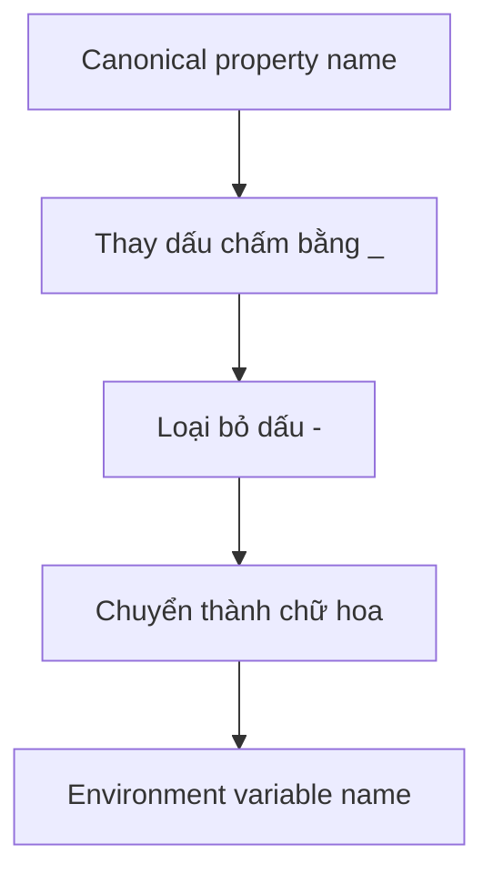

# Relaxed binding và quy tắc tên biến môi trường

Spring Boot cho phép cùng một thuộc tính cấu hình được cung cấp từ nhiều nguồn: YAML, properties, biến môi trường, Java system properties, tham số dòng lệnh và cấu hình từ xa. Trong môi trường triển khai như Docker hoặc Kubernetes, biến môi trường thường là cách đưa cấu hình vào container mà không phải sửa artifact. Tuy nhiên, tên biến môi trường không nhất thiết giống tên property trong YAML. Spring Boot sử dụng **relaxed binding** để chuyển đổi tên và giá trị theo quy tắc của từng nguồn.

Trong module **`SPRING_CLOUD_CORE`**, kỹ năng này đặc biệt hữu ích khi cấu hình Spring Cloud Config Client, Context, discovery và service communication. Ví dụ, `spring.config.import` trong tệp YAML có thể được ghi đè bằng `SPRING_CONFIG_IMPORT`; `spring.cloud.config.uri` có thể nhận giá trị từ `SPRING_CLOUD_CONFIG_URI`. Để tránh cấu hình sai khi deploy, cần hiểu cách chuyển đổi tên, binding danh sách/map, thứ tự ưu tiên và giới hạn của từng nguồn.

## 1. Relaxed binding là gì?

**Relaxed binding** là khả năng Spring Boot ánh xạ các cách biểu diễn tên thuộc tính khác nhau về cùng một thuộc tính cấu hình trong những ngữ cảnh được hỗ trợ. Ví dụ, một thuộc tính Java có tên `connectTimeout` có thể được cấu hình bằng key chuẩn `connect-timeout` trong YAML; biến môi trường tương ứng có thể là `CONNECTTIMEOUT` ở cuối chuỗi tên.

Ví dụ lớp cấu hình:

```java
import java.time.Duration;
import org.springframework.boot.context.properties.ConfigurationProperties;

@ConfigurationProperties(prefix = "catalog.client")
public class CatalogClientProperties {
    private Duration connectTimeout = Duration.ofSeconds(2);

    public Duration getConnectTimeout() {
        return connectTimeout;
    }

    public void setConnectTimeout(Duration connectTimeout) {
        this.connectTimeout = connectTimeout;
    }
}
```

Các nguồn có thể biểu diễn cùng thuộc tính theo những dạng phù hợp với nguồn đó:

```yaml
catalog:
  client:
    connect-timeout: 1500ms
```

```properties
catalog.client.connect-timeout=1500ms
```

```text
CATALOG_CLIENT_CONNECTTIMEOUT=1500ms
```

Spring Boot Binder kết hợp tên property và kiểu dữ liệu để gán giá trị vào object. Relaxed binding không có nghĩa mọi chuỗi tùy ý đều tương đương; mỗi nguồn có quy tắc chuyển đổi cụ thể, và một số ký tự không thể biểu diễn đầy đủ bằng tên biến môi trường.

### Tên canonical nên dùng

Khi đặt tên property trong tài liệu và mã nguồn, nên dùng **lowercase kebab-case** làm dạng canonical:

```text
catalog.client.base-url
catalog.client.connect-timeout
spring.cloud.config.discovery.enabled
spring.config.import
```

Dạng canonical có các lợi ích:

- Dễ đọc và phân tách từ trong tên dài.
- Phù hợp với convention của Spring Boot và metadata cấu hình.
- Có quy tắc chuyển đổi rõ ràng sang biến môi trường.
- Giảm nhầm lẫn giữa tên trường Java camelCase và key cấu hình.

Trong Java, tên field/getter thường dùng camelCase (`baseUrl`, `connectTimeout`); trong YAML/properties nên dùng kebab-case (`base-url`, `connect-timeout`).

## 2. Quy tắc chuyển property name thành environment variable

Spring Boot quy định cách chuyển tên thuộc tính thành tên biến môi trường theo ba bước chính:

1. Thay dấu chấm (`.`) bằng dấu gạch dưới (`_`).
2. Bỏ dấu gạch ngang (`-`).
3. Chuyển toàn bộ thành chữ hoa.

Ví dụ:

| Canonical property | Environment variable |
| --- | --- |
| `spring.application.name` | `SPRING_APPLICATION_NAME` |
| `server.port` | `SERVER_PORT` |
| `spring.config.import` | `SPRING_CONFIG_IMPORT` |
| `spring.cloud.config.uri` | `SPRING_CLOUD_CONFIG_URI` |
| `spring.cloud.config.discovery.enabled` | `SPRING_CLOUD_CONFIG_DISCOVERY_ENABLED` |
| `catalog.client.base-url` | `CATALOG_CLIENT_BASEURL` |
| `catalog.client.connect-timeout` | `CATALOG_CLIENT_CONNECTTIMEOUT` |
| `management.endpoints.web.exposure.include` | `MANAGEMENT_ENDPOINTS_WEB_EXPOSURE_INCLUDE` |

Lưu ý dễ nhầm: dấu chấm được đổi thành `_`, còn dấu gạch ngang bị **loại bỏ**, không đổi thành `_`. Vì vậy `base-url` chuyển thành `BASEURL`, không phải `BASE_URL`.



Ví dụ chi tiết:

```text
spring.cloud.config.discovery.enabled
          |         |         |
          v         v         v
SPRING_CLOUD_CONFIG_DISCOVERY_ENABLED
```

Khi đọc cấu hình trong container, hãy đối chiếu tên biến theo quy tắc này thay vì tự viết lại dấu phân cách theo cảm tính.

### 2.1. Vì sao không nên tự thêm underscore cho dấu gạch ngang?

Giả sử property canonical là:

```text
catalog.client.base-url
```

Tên biến theo quy tắc là:

```text
CATALOG_CLIENT_BASEURL
```

Nếu đặt `CATALOG_CLIENT_BASE_URL`, Binder có thể diễn giải nó như một tên property có thêm ranh giới từ, thay vì đúng key dự kiến. Đặc biệt khi có nhiều thuộc tính có các từ gần nhau, cách viết không theo quy tắc khiến việc debug trở nên khó khăn. Nên xác định canonical property trước, rồi áp dụng đúng phép chuyển đổi.

### 2.2. Chữ hoa/chữ thường của biến môi trường

Tên biến môi trường trong các hệ điều hành và runtime có thể có quy tắc phân biệt hoa/thường khác nhau. Trên Linux, tên biến môi trường phân biệt hoa/thường; `CATALOG_CLIENT_BASEURL` và `catalog_client_baseurl` là hai tên khác nhau. Trên Windows, việc xử lý tên biến thường không phân biệt hoa/thường theo cùng cách.

Trong tài liệu triển khai, nên dùng tên chữ hoa theo convention Spring Boot để nhất quán giữa local, CI và container. Không nên dựa vào việc một môi trường tự chuẩn hóa chữ hoa/thường.

## 3. Binding thuộc tính lồng nhau

Xét cấu hình:

```yaml
catalog:
  client:
    base-url: https://catalog.internal
    connect-timeout: 1500ms
    read-timeout: 3s
    enabled: true
```

Các biến môi trường tương ứng:

```text
CATALOG_CLIENT_BASEURL=https://catalog.internal
CATALOG_CLIENT_CONNECTTIMEOUT=1500ms
CATALOG_CLIENT_READTIMEOUT=3s
CATALOG_CLIENT_ENABLED=true
```

Object Java có thể gom các thuộc tính đó:

```java
import java.time.Duration;
import org.springframework.boot.context.properties.ConfigurationProperties;

@ConfigurationProperties(prefix = "catalog.client")
public class CatalogClientProperties {
    private String baseUrl;
    private Duration connectTimeout = Duration.ofSeconds(2);
    private Duration readTimeout = Duration.ofSeconds(3);
    private boolean enabled = true;

    public String getBaseUrl() { return baseUrl; }
    public void setBaseUrl(String baseUrl) { this.baseUrl = baseUrl; }
    public Duration getConnectTimeout() { return connectTimeout; }
    public void setConnectTimeout(Duration value) { this.connectTimeout = value; }
    public Duration getReadTimeout() { return readTimeout; }
    public void setReadTimeout(Duration value) { this.readTimeout = value; }
    public boolean isEnabled() { return enabled; }
    public void setEnabled(boolean enabled) { this.enabled = enabled; }
}
```

Lớp properties phải được đăng ký bằng `@ConfigurationPropertiesScan` hoặc `@EnableConfigurationProperties`. Việc đặt biến môi trường đúng tên không tự tạo bean properties nếu ứng dụng chưa bật cơ chế đăng ký.

## 4. Binding danh sách và chỉ số phần tử

Với thuộc tính dạng list, chỉ số phần tử cần được bao quanh bởi dấu gạch dưới khi chuyển sang biến môi trường.

Property dạng indexed:

```text
my.service[0].other
```

Được chuyển thành:

```text
MY_SERVICE_0_OTHER
```

Ví dụ cấu hình YAML:

```yaml
catalog:
  endpoints:
    - name: primary
      url: https://catalog-a.internal
    - name: replica
      url: https://catalog-b.internal
```

Các biến môi trường:

```text
CATALOG_ENDPOINTS_0_NAME=primary
CATALOG_ENDPOINTS_0_URL=https://catalog-a.internal
CATALOG_ENDPOINTS_1_NAME=replica
CATALOG_ENDPOINTS_1_URL=https://catalog-b.internal
```

Với lớp cấu hình:

```java
import java.util.ArrayList;
import java.util.List;
import org.springframework.boot.context.properties.ConfigurationProperties;

@ConfigurationProperties(prefix = "catalog")
public class CatalogProperties {
    private List<Endpoint> endpoints = new ArrayList<>();

    public List<Endpoint> getEndpoints() { return endpoints; }
    public void setEndpoints(List<Endpoint> endpoints) { this.endpoints = endpoints; }

    public static class Endpoint {
        private String name;
        private String url;

        public String getName() { return name; }
        public void setName(String name) { this.name = name; }
        public String getUrl() { return url; }
        public void setUrl(String url) { this.url = url; }
    }
}
```

Khi dùng biến môi trường cho list, chỉ số là một phần của tên property. Nếu cấu hình có nhiều phần tử, cần bảo đảm index không bị bỏ sót hoặc gán nhầm. Đối với danh sách endpoint dài hoặc thay đổi thường xuyên, YAML, Config Server hoặc một nguồn cấu hình có cấu trúc có thể dễ bảo trì hơn hàng loạt biến môi trường.

**Lưu ý:** Quy tắc chỉ số được bao quanh bởi `_` giúp phân biệt số chỉ mục với phần chữ của tên thuộc tính. Ví dụ `MY_SERVICE_0_OTHER` tương ứng `my.service[0].other`; không tự bỏ một trong hai dấu gạch dưới quanh index.

## 5. Binding Map và giới hạn biểu diễn key

Map thường dùng để cấu hình tập key/value có tên động, ví dụ headers, metadata hoặc các tùy chọn theo tenant.

YAML:

```yaml
catalog:
  client:
    headers:
      region: ap-southeast
      channel: web
```

Với các key đơn giản, biến môi trường có thể biểu diễn theo đường dẫn property:

```text
CATALOG_CLIENT_HEADERS_REGION=ap-southeast
CATALOG_CLIENT_HEADERS_CHANNEL=web
```

Trong thực tế, tên biến môi trường được hỗ trợ bởi hệ điều hành, container runtime và nền tảng triển khai có thể giới hạn các ký tự hợp lệ. Do đó, key map chứa dấu gạch ngang, dấu chấm, khoảng trắng hoặc ký tự đặc biệt cần được kiểm tra kỹ trên môi trường đích. Không nên giả định mọi key tùy ý trong YAML đều có thể chuyển thành environment variable một cách không mất thông tin.

Đối với map binding từ environment variables, Spring Boot chuyển key map sang chữ thường. Điều này quan trọng nếu ứng dụng muốn giữ nguyên key có phân biệt hoa/thường. Với key phức tạp hoặc cần giữ chính xác ký tự, cân nhắc dùng YAML/properties, `SPRING_APPLICATION_JSON` hoặc nguồn cấu hình khác có cấu trúc phù hợp.

Ví dụ map Java:

```java
import java.util.LinkedHashMap;
import java.util.Map;
import org.springframework.boot.context.properties.ConfigurationProperties;

@ConfigurationProperties(prefix = "catalog.client")
public class CatalogClientProperties {
    private Map<String, String> headers = new LinkedHashMap<>();

    public Map<String, String> getHeaders() { return headers; }
    public void setHeaders(Map<String, String> headers) { this.headers = headers; }
}
```

Nếu key map là dữ liệu nghiệp vụ có quy tắc đặt tên riêng, cần thử nghiệm trên chính loại property source và runtime triển khai thay vì chỉ suy ra từ cách viết trong YAML.

## 6. Binding giá trị có kiểu dữ liệu

Tên biến đúng chỉ giải quyết phần định danh property. Giá trị vẫn phải chuyển đổi được sang kiểu Java mà bean yêu cầu.

| Kiểu Java | Ví dụ giá trị | Lưu ý |
| --- | --- | --- |
| `boolean` | `true`, `false` | Dùng giá trị rõ ràng, tránh chuỗi không chuẩn |
| `int`, `long` | `8080`, `5000` | Phải nằm trong miền giá trị kiểu |
| `Duration` | `1500ms`, `2s` | Nên ghi đơn vị tường minh |
| `DataSize` | `10MB`, `512KB` | Dùng đơn vị có ý nghĩa và nhất quán |
| `enum` | `ROUND_ROBIN` | Phải khớp giá trị enum sau conversion |
| `List<T>` | Các phần tử có index | Dùng index bao quanh bởi `_` trong env var |
| `Map<K,V>` | Key/value động | Lưu ý lowercasing và giới hạn ký tự của env var |

Ví dụ timeout:

```text
CATALOG_CLIENT_CONNECTTIMEOUT=1500ms
CATALOG_CLIENT_READTIMEOUT=3s
```

Nếu `connectTimeout` có kiểu `Duration`, Binder chuyển chuỗi `1500ms` thành thời lượng tương ứng. Nếu dùng kiểu `long` với ý nghĩa milliseconds, hãy đặt tên rõ (`connect-timeout-ms`) và ghi giá trị số. Tránh dùng cùng một key nhưng mỗi môi trường hiểu đơn vị khác nhau.

### Validation sau binding

Có thể dùng Bean Validation để ngăn cấu hình không hợp lệ:

```java
import jakarta.validation.constraints.Max;
import jakarta.validation.constraints.Min;
import jakarta.validation.constraints.NotBlank;
import org.springframework.boot.context.properties.ConfigurationProperties;
import org.springframework.validation.annotation.Validated;

@Validated
@ConfigurationProperties(prefix = "catalog.client")
public class CatalogClientProperties {
    @NotBlank
    private String baseUrl;

    @Min(100)
    @Max(10000)
    private int connectTimeoutMs = 1500;

    public String getBaseUrl() { return baseUrl; }
    public void setBaseUrl(String baseUrl) { this.baseUrl = baseUrl; }
    public int getConnectTimeoutMs() { return connectTimeoutMs; }
    public void setConnectTimeoutMs(int value) { this.connectTimeoutMs = value; }
}
```

Đảm bảo dependency Bean Validation provider có mặt trong classpath. Các ứng dụng Spring Boot cũ có thể sử dụng namespace validation trước `jakarta`; chọn import theo phiên bản thực tế. Với cấu hình bắt buộc, validation nên làm startup thất bại sớm thay vì để request đầu tiên mới phát hiện giá trị sai.

## 7. Environment variable và các nguồn cấu hình khác

Environment variables chỉ là một trong các nguồn property. Giá trị cuối cùng được quyết định bởi thứ tự ưu tiên của Spring Boot và các nguồn được bật trong ứng dụng.

Trong cấu hình mặc định của Spring Boot, các nguồn thường gặp có thứ tự ưu tiên khái quát từ thấp đến cao như sau:

1. Giá trị mặc định được khai báo trong ứng dụng.
2. `@PropertySource`.
3. Config Data, gồm `application.properties`, YAML và các nguồn được nhập qua `spring.config.import`.
4. `RandomValuePropertySource`.
5. Biến môi trường của hệ điều hành.
6. Java system properties (`-D...`).
7. JNDI và các nguồn servlet trong ứng dụng web tương ứng.
8. `SPRING_APPLICATION_JSON`.
9. Tham số dòng lệnh.
10. Các nguồn kiểm thử như `@TestPropertySource` hoặc thuộc tính test tùy cơ chế test.

Danh sách trên là định hướng cho các nguồn tiêu chuẩn; thứ tự chi tiết có thể có bổ sung theo phiên bản Boot, môi trường web và integration. Khi có nhiều nguồn cùng định nghĩa một key, nguồn có độ ưu tiên cao hơn có thể ghi đè nguồn thấp hơn.

Ví dụ `application.yml`:

```yaml
server:
  port: 8080
```

Environment variable:

```text
SERVER_PORT=9090
```

Khi không có nguồn ưu tiên cao hơn ghi đè, `server.port` hiệu lực có thể là `9090`. Nếu chạy thêm tham số command line:

```bash
java -jar catalog-service.jar --server.port=10080
```

thì tham số dòng lệnh có độ ưu tiên cao hơn biến môi trường theo thứ tự chuẩn, nên port hiệu lực có thể là `10080`.

### 7.1. `SPRING_APPLICATION_JSON` cho cấu trúc phức tạp

Khi cần truyền cấu hình lồng nhau hoặc key khó biểu diễn bằng tên biến môi trường, Spring Boot hỗ trợ `SPRING_APPLICATION_JSON`:

```bash
export SPRING_APPLICATION_JSON='{"catalog":{"client":{"base-url":"https://catalog.internal","connect-timeout":"1500ms"}}}'
```

Trên Windows PowerShell, cách đặt biến và escape chuỗi JSON khác Bash; ví dụ minh họa trên dùng cú pháp shell kiểu POSIX. Trong môi trường triển khai, cần cấu hình JSON qua cơ chế env tương ứng và bảo đảm dấu nháy được truyền nguyên vẹn.

JSON có thể biểu diễn object/list rõ ràng hơn các biến phẳng. Tuy nhiên, nó không tự giải quyết quản lý secret, phân quyền hoặc precedence. Vì `SPRING_APPLICATION_JSON` có độ ưu tiên cao hơn environment variables thông thường trong thứ tự chuẩn, một giá trị JSON có thể ghi đè giá trị tưởng như đã đặt bằng biến riêng. Cần kiểm tra cả hai khi debug.

### 7.2. Placeholder tham chiếu thuộc tính khác

Một property có thể tham chiếu giá trị khác:

```yaml
catalog:
  client:
    host: catalog.internal
    base-url: "https://${catalog.client.host}"
```

Biến môi trường `CATALOG_CLIENT_HOST` có thể cung cấp host; placeholder được giải quyết khi property được sử dụng theo cơ chế của Spring. Có thể đặt default cho placeholder:

```yaml
catalog:
  client:
    host: "${CATALOG_CLIENT_HOST:localhost}"
```

Default chỉ nên dùng nếu `localhost` là giá trị có ý nghĩa an toàn trong môi trường đó. Với production, default vô tình trỏ về localhost có thể làm ứng dụng kết nối nhầm chính container.

## 8. `@ConfigurationProperties` và `@Value` khi dùng biến môi trường

### 8.1. ConfigurationProperties cho nhóm thuộc tính

`@ConfigurationProperties` phù hợp với nhóm thuộc tính có cấu trúc, cần conversion, nested object, list/map và validation. Nó dùng Binder của Spring Boot, do đó là lựa chọn tự nhiên khi cấu hình được cấp từ nhiều nguồn.

```java
@ConfigurationProperties(prefix = "spring.cloud.config")
public class ConfigClientSettings {
    private String uri;
    private String label;

    public String getUri() { return uri; }
    public void setUri(String uri) { this.uri = uri; }
    public String getLabel() { return label; }
    public void setLabel(String label) { this.label = label; }
}
```

Các biến tương ứng:

```text
SPRING_CLOUD_CONFIG_URI=https://config.internal
SPRING_CLOUD_CONFIG_LABEL=main
```

Lớp properties cần được đăng ký trong context bằng `@ConfigurationPropertiesScan` hoặc `@EnableConfigurationProperties`.

### 8.2. Value cho một vài thuộc tính đơn lẻ

`@Value` thường phù hợp khi một bean chỉ cần một giá trị:

```java
@Component
public class ConfigServerEndpoint {
    private final String uri;

    public ConfigServerEndpoint(
            @Value("${spring.cloud.config.uri}") String uri) {
        this.uri = uri;
    }
}
```

Khi dùng placeholder, nên viết key ở dạng canonical kebab-case. `@Value` không cung cấp toàn bộ trải nghiệm relaxed binding và bulk binding như `@ConfigurationProperties`; đừng dựa vào nó để ánh xạ các cấu trúc map/list phức tạp.

### 8.3. Cẩn trọng với tên key và map

Relaxed binding có thể chấp nhận nhiều cách viết trong các trường hợp được hỗ trợ, nhưng điều đó không làm mọi tên biến môi trường tương đương. Nếu cấu hình có key map động, dấu gạch dưới hoặc chữ hoa có ý nghĩa nghiệp vụ, hãy kiểm tra kết quả Binder trực tiếp. Với key cần giữ nguyên ký tự, cấu hình có cấu trúc trong YAML/JSON thường dễ dự đoán hơn.

## 9. Áp dụng cho Docker và Kubernetes

### 9.1. Docker: truyền biến lúc chạy

Ví dụ chạy container:

```bash
docker run --rm \
  -e SPRING_PROFILES_ACTIVE=prod \
  -e SERVER_PORT=8080 \
  -e SPRING_CLOUD_CONFIG_URI=http://config-server:8888 \
  -e SPRING_CONFIG_IMPORT=optional:configserver: \
  catalog-service:1.0.0
```

Các biến được truyền vào process trong container. Chú ý dấu cách cuối dòng và cú pháp shell; giá trị `SPRING_CONFIG_IMPORT` trong ví dụ được cố ý truyền nguyên chuỗi `optional:configserver:`. Nếu Config Server là nguồn bắt buộc, bỏ `optional:` theo chính sách startup.

Không đưa password/token trực tiếp vào command line hoặc lịch sử shell. Dùng Docker secrets hoặc cơ chế secret của nền tảng thích hợp.

### 9.2. Kubernetes: env và envFrom

Có thể khai báo biến trực tiếp trong Pod:

```yaml
apiVersion: v1
kind: Pod
metadata:
  name: catalog-service
spec:
  containers:
    - name: app
      image: catalog-service:1.0.0
      env:
        - name: SPRING_PROFILES_ACTIVE
          value: prod
        - name: SERVER_PORT
          value: "8080"
        - name: SPRING_CLOUD_CONFIG_URI
          value: http://config-server:8888
        - name: SPRING_CONFIG_IMPORT
          value: optional:configserver:
```

Hoặc nạp nhiều key từ ConfigMap:

```yaml
envFrom:
  - configMapRef:
      name: catalog-service-config
```

Secret có thể được tham chiếu bằng `secretKeyRef` hoặc `envFrom.secretRef`, tùy cấu trúc triển khai. Cần quản lý quyền đọc Secret, mã hóa at rest và luồng rotate theo chính sách Kubernetes của tổ chức.

Khi cập nhật ConfigMap/Secret được dùng làm environment variables, process đang chạy **không tự nhận giá trị mới trong environment**. Thông thường cần tạo Pod mới hoặc restart workload để process nhận biến mới. Đây là khác biệt quan trọng so với việc mount volume và ứng dụng chủ động đọc lại file; ngay cả khi file mount thay đổi, Spring Boot cũng không tự động bind lại mọi bean.

### 9.3. Một số biến cấu hình Spring Cloud thường dùng

| Mục đích | Canonical property | Environment variable |
| --- | --- | --- |
| Tên ứng dụng | `spring.application.name` | `SPRING_APPLICATION_NAME` |
| Profile active | `spring.profiles.active` | `SPRING_PROFILES_ACTIVE` |
| Config Data import | `spring.config.import` | `SPRING_CONFIG_IMPORT` |
| Config Server URI | `spring.cloud.config.uri` | `SPRING_CLOUD_CONFIG_URI` |
| Config label | `spring.cloud.config.label` | `SPRING_CLOUD_CONFIG_LABEL` |
| Discovery-first lookup | `spring.cloud.config.discovery.enabled` | `SPRING_CLOUD_CONFIG_DISCOVERY_ENABLED` |
| Config Server service ID | `spring.cloud.config.discovery.service-id` | `SPRING_CLOUD_CONFIG_DISCOVERY_SERVICEID` |
| HTTP port | `server.port` | `SERVER_PORT` |

Tên property và tính sẵn có của từng tùy chọn phụ thuộc phiên bản Spring Boot/Spring Cloud. Bảng này minh họa phép chuyển đổi tên; hãy đối chiếu tài liệu đúng release train trước khi dùng một property cụ thể.

## 10. Chẩn đoán khi biến môi trường không được bind

Khi giá trị trong ứng dụng không như mong đợi, kiểm tra theo trình tự:

1. **Canonical key:** xác định chính xác key trong `@ConfigurationProperties` hoặc metadata, ví dụ `catalog.client.base-url`.
2. **Tên biến:** thay `.` bằng `_`, bỏ `-`, viết hoa; ví dụ `CATALOG_CLIENT_BASEURL`.
3. **Biến đã được truyền vào process chưa:** kiểm tra cấu hình Docker/Kubernetes/CI và môi trường của đúng container.
4. **Nguồn có bị ghi đè không:** kiểm tra system properties, `SPRING_APPLICATION_JSON`, command line và profile-specific config.
5. **Bean đã đăng ký chưa:** xác nhận `@ConfigurationPropertiesScan` hoặc `@EnableConfigurationProperties`.
6. **Kiểu dữ liệu:** xác nhận chuỗi có thể chuyển thành `Duration`, số, enum, list hoặc kiểu đích.
7. **Validation:** xem lỗi binding/validation trong startup log.
8. **Tên map/list:** kiểm tra index, key lowercasing và ký tự đặc biệt.
9. **Runtime thực tế:** bảo đảm đang xem đúng Pod/replica và đúng image/tag.

### Các lỗi hay gặp

| Triệu chứng | Nguyên nhân thường gặp | Cách sửa |
| --- | --- | --- |
| Giá trị vẫn lấy từ YAML | Tên env sai, chưa truyền vào process hoặc property source ưu tiên cao hơn | Kiểm tra canonical key và env thực tế; kiểm tra precedence |
| `BASE_URL` không ghi đè `base-url` | Dùng underscore thay cho dấu gạch ngang bị loại bỏ | Dùng `BASEURL` theo quy tắc chuyển đổi |
| List không có phần tử mong đợi | Chỉ số không được bao quanh bởi `_` | Dùng dạng `MY_SERVICE_0_OTHER` |
| Map key bị đổi chữ hoa/thường | Environment-variable map key được lower-case khi binding | Dùng key lowercase hoặc nguồn cấu hình giữ nguyên key |
| Không tìm thấy properties bean | Lớp chưa được scan/enable | Đăng ký bằng cơ chế ConfigurationProperties phù hợp |
| Startup báo lỗi conversion | Giá trị không đúng kiểu hoặc đơn vị | Sửa giá trị và dùng đơn vị tường minh |
| Local đúng, Kubernetes sai | Pod cũ, ConfigMap chưa được tham chiếu hoặc deployment chưa rollout | Kiểm tra Pod template, env và image đang chạy |
| Config Server URI đúng nhưng không có cấu hình | Sai application/profile/label hoặc import không được nạp | Kiểm tra request, Config Server response và startup log |

Có thể dùng Actuator `env` hoặc `configprops` để kiểm tra property source và object đã bind trong môi trường được bảo vệ. Không công khai các endpoint này tùy tiện: chúng có thể làm lộ tên key, cấu trúc nội bộ hoặc dữ liệu nhạy cảm nếu cấu hình masking không phù hợp.

## 11. Thực hành: cấu hình Config Client bằng environment variables

Giả sử ứng dụng `catalog-service` lấy cấu hình từ Config Server và dùng một số thuộc tính riêng.

Trong `application.yml`:

```yaml
spring:
  application:
    name: catalog-service
  config:
    import: "optional:configserver:"
  cloud:
    config:
      uri: http://localhost:8888
      label: main

catalog:
  client:
    base-url: http://localhost:8081
    connect-timeout: 2s
```

Khi deploy, cấp biến môi trường:

```text
SPRING_PROFILES_ACTIVE=prod
SPRING_CLOUD_CONFIG_URI=https://config.internal
SPRING_CLOUD_CONFIG_LABEL=release
CATALOG_CLIENT_BASEURL=https://catalog.internal
CATALOG_CLIENT_CONNECTTIMEOUT=1500ms
```

Sau đó xác minh:

1. Process có nhận đủ biến môi trường không?
2. Profile `prod` có active không?
3. Config Client có gửi đúng application name, profile và label không?
4. Giá trị từ Config Server có bị environment variable ghi đè theo thứ tự ưu tiên không?
5. `CatalogClientProperties` có bind đúng `baseUrl` và `connectTimeout` không?
6. Khi chạy hai replica, mỗi replica có cùng image và cùng bộ biến cấu hình cần thiết không?

Trong ví dụ này, environment variables thường có độ ưu tiên cao hơn Config Data nên `CATALOG_CLIENT_BASEURL` có thể ghi đè `catalog.client.base-url` được nhận từ Config Server. Đây là hành vi hữu ích nếu được chủ động thiết kế, nhưng có thể gây bất ngờ nếu muốn Config Server là nguồn có thẩm quyền. Hãy quy định rõ nguồn nào được phép ghi đè và kiểm tra kết quả thực tế.

## 12. Bài tập và câu hỏi tự kiểm tra

### Bài tập 1 — Chuyển tên property

Chuyển các key sau thành tên biến môi trường:

1. `spring.cloud.config.uri`
2. `spring.cloud.config.discovery.service-id`
3. `catalog.client.read-timeout`
4. `management.endpoints.web.exposure.include`
5. `catalog.nodes[1].host`

**Đáp án:**

1. `SPRING_CLOUD_CONFIG_URI`
2. `SPRING_CLOUD_CONFIG_DISCOVERY_SERVICEID`
3. `CATALOG_CLIENT_READTIMEOUT`
4. `MANAGEMENT_ENDPOINTS_WEB_EXPOSURE_INCLUDE`
5. `CATALOG_NODES_1_HOST`

### Bài tập 2 — Phân tích precedence

Giả sử cùng một property `server.port` được đặt trong `application.yml` là `8080`, environment variable `SERVER_PORT=9090` và command line `--server.port=10080`. Giá trị nào có hiệu lực theo thứ tự nguồn tiêu chuẩn?

**Đáp án:** `10080`, vì command-line property có độ ưu tiên cao hơn environment variable và Config Data trong trường hợp mặc định.

### Bài tập 3 — Chẩn đoán list binding

Một lớp properties có `List<Endpoint> endpoints`, nhưng biến `CATALOG_ENDPOINTS0_URL` không bind phần tử đầu tiên. Cần đổi thành dạng nào?

**Đáp án:** `CATALOG_ENDPOINTS_0_URL`, trong đó index `0` được bao quanh bởi dấu `_`.

### Câu hỏi tự kiểm tra

1. Ba bước chuyển property name thành environment variable là gì?
2. `base-url` được chuyển thành `BASEURL` hay `BASE_URL`? Vì sao?
3. Vì sao canonical property nên dùng kebab-case?
4. Biến môi trường biểu diễn index list như thế nào?
5. Điều gì xảy ra với map key khi binding từ environment variables?
6. Vì sao không thể giả định env var luôn thắng mọi nguồn cấu hình khác?
7. `@ConfigurationProperties` có ưu điểm gì so với `@Value` khi cấu hình có nested object và list?
8. Khi thay ConfigMap dùng làm environment variables, vì sao Pod thường cần được tạo lại?

## 13. Những nguyên tắc cần nhớ

- Dùng lowercase kebab-case làm canonical property name trong YAML/properties và tài liệu cấu hình.
- Chuyển sang environment variable bằng quy tắc: dấu chấm thành `_`, bỏ dấu gạch ngang, viết hoa.
- Với list, bao quanh chỉ số phần tử bằng `_`; với map, chú ý key được chuyển thành chữ thường và giới hạn ký tự của tên biến.
- Giá trị phải chuyển đổi được sang kiểu Java; dùng `Duration`, `DataSize`, enum và validation một cách tường minh.
- Environment variables có thứ tự ưu tiên riêng; `SPRING_APPLICATION_JSON`, system properties và command line có thể ghi đè chúng theo thứ tự cấu hình tiêu chuẩn.
- `@ConfigurationProperties` phù hợp cho cấu hình có cấu trúc; `@Value` phù hợp với một vài giá trị đơn giản.
- Kiểm tra biến trong đúng process/container và xác minh bean đã bind; không chỉ kiểm tra manifest hoặc file YAML.

Nắm được relaxed binding giúp cấu hình Spring Cloud nhất quán giữa máy phát triển, CI và môi trường container. Khi tên property, biến môi trường, nguồn ưu tiên và kiểu dữ liệu được xác định rõ, các thành phần như Config Client, discovery và service communication sẽ nhận đúng cấu hình mà ứng dụng cần.
