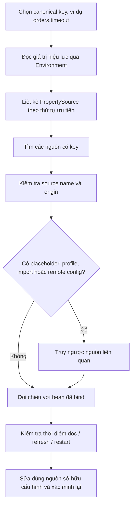
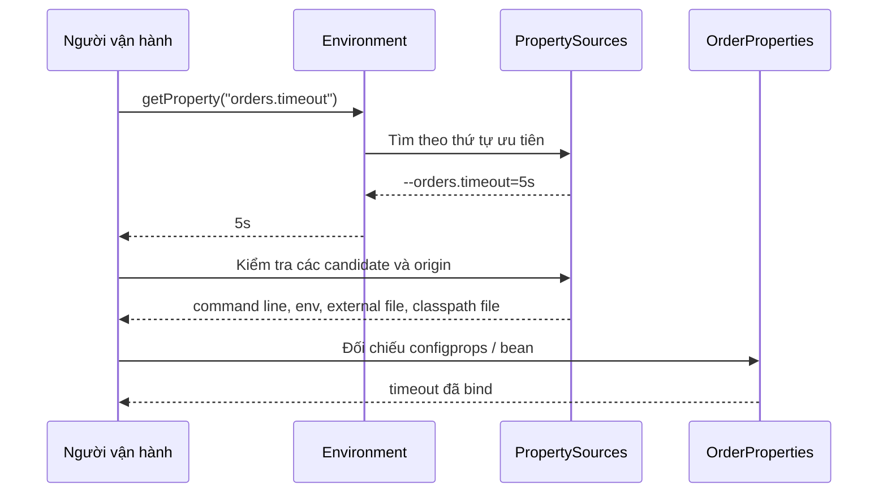

# Truy tìm nguồn tạo ra giá trị cấu hình hiệu lực

## 1. Vấn đề: biết giá trị vẫn chưa đủ

Khi một ứng dụng Spring Boot đọc được `orders.timeout=5s`, người vận hành còn cần trả lời ba câu hỏi:

1. **Giá trị hiệu lực là gì?** Ứng dụng cuối cùng đang sử dụng `5s` hay một giá trị khác?
2. **Nguồn nào cung cấp giá trị đó?** File YAML, profile, biến môi trường, Java system property, tham số dòng lệnh, test property hay Spring Cloud Config?
3. **Vì sao nguồn đó thắng?** Nó có độ ưu tiên cao hơn, được nạp sau trong nhóm Config Data, hoặc được một cơ chế binding/placeholder xử lý đặc biệt?

Nếu chỉ nhìn `application.yml`, ta có thể bỏ sót một biến môi trường do Kubernetes inject, một tham số `--` từ manifest, một system property do JVM launcher đặt hoặc một remote property source. Khi đó việc sửa file không giải quyết được nguyên nhân.

Bài học thuộc chương **Environment** của module **SPRING_CLOUD_CORE**. Module tập trung vào Spring Cloud Commons, Spring Cloud Context, cấu hình bên ngoài, tương thích Spring Boot, refresh scope, discovery và cách kiểm thử/vận hành các abstraction chung. Khả năng truy tìm nguồn cấu hình là nền tảng để vận hành các dịch vụ này có thể dự đoán và chẩn đoán được.

Sau bài học, người học có thể:

- Phân biệt giá trị hiệu lực với các giá trị ứng viên trong những property source.
- Dùng `Environment` và `PropertySource` để xác định nguồn đang cung cấp một khóa.
- Đọc origin để tìm file, dòng hoặc nguồn đã tạo ra giá trị khi metadata được hỗ trợ.
- Dùng Actuator `env` và `configprops` một cách an toàn.
- Phân biệt truy vấn property đơn giản với binding qua `Binder` / `@ConfigurationProperties`.
- Truy tìm cấu hình đến từ profile, Config Data import, test override và Spring Cloud Config.
- Xác định lúc nào thay đổi cấu hình có hiệu lực, lúc nào cần refresh hoặc restart.

## 2. Các khái niệm nền tảng

### 2.1. Environment và PropertySource

Spring Framework cung cấp abstraction `Environment` để truy cập profile và thuộc tính cấu hình. Một `ConfigurableEnvironment` có tập `PropertySource`; mỗi property source là một nguồn key/value, ví dụ map trong file, system properties hoặc environment variables.

`Environment.getProperty("orders.timeout")` trả về giá trị được phân giải theo thứ tự ưu tiên. Khi nhiều nguồn cùng có khóa, nguồn có ưu tiên cao hơn được xét trước.

Các thành phần thường gặp:

| Thành phần | Vai trò | Ví dụ |
| --- | --- | --- |
| `Environment` | API đọc property và profile đang active | `environment.getProperty("server.port")` |
| `ConfigurableEnvironment` | Biến thể cho phép truy cập/cấu hình tập property source | `getPropertySources()` |
| `PropertySource` | Một nguồn key/value | `applicationConfig: [classpath:/application.yml]` |
| `MutablePropertySources` | Tập property source có thứ tự | `addFirst`, `addLast`, `replace` |
| `PropertyResolver` | Phân giải key, placeholder và chuyển đổi kiểu | `getProperty`, `resolvePlaceholders` |
| `Binder` | Bind cấu hình có cấu trúc sang object | `@ConfigurationProperties` |

Cần phân biệt **nguồn chứa giá trị** với **đối tượng nhận giá trị**. `Environment` trả lời property được phân giải từ đâu trong tập nguồn; `@ConfigurationProperties` tạo object có cấu trúc từ nhiều property; bean nghiệp vụ sau đó có thể nhận object ấy qua dependency injection.

### 2.2. Giá trị hiệu lực, giá trị ứng viên và origin

Giả sử cùng khóa `orders.timeout` xuất hiện ở ba nơi:

```yaml
# application.yml
orders:
  timeout: 2s
```

```bash
ORDERS_TIMEOUT=4s
```

```bash
java -jar app.jar --orders.timeout=5s
```

Có ba **giá trị ứng viên**. Trong cấu hình Spring Boot thông thường, command-line property có ưu tiên cao hơn environment variable và Config Data, do đó giá trị hiệu lực là `5s`.

- **Giá trị hiệu lực (effective value):** kết quả mà resolver trả về khi ứng dụng đọc property.
- **Giá trị ứng viên (candidate value):** giá trị một property source có thể cung cấp nếu được xét ở vị trí ưu tiên của nó.
- **Origin:** metadata mô tả vị trí hoặc nguồn gốc của giá trị, ví dụ file YAML và số dòng nếu loader giữ metadata đó.
- **Property source name:** tên nguồn đang chứa giá trị, ví dụ system environment, system properties, command line hoặc một Config Data resource.

Origin không phải lúc nào cũng tồn tại. Một environment variable hoặc một custom property source có thể không cung cấp thông tin vị trí chi tiết. Khi không có origin, tên property source vẫn giúp khoanh vùng.

## 3. Quy trình truy tìm từ khóa đến nguồn

Một quy trình chẩn đoán có thể áp dụng cho hầu hết ứng dụng:

1. Ghi lại **canonical property name** và giá trị ứng dụng đang quan sát, ví dụ `orders.timeout`.
2. Xác định nơi tiêu thụ property: `@Value`, `@ConfigurationProperties`, `Binder` hay gọi `Environment` trực tiếp.
3. Đọc giá trị hiệu lực qua đúng API mà ứng dụng sử dụng.
4. Liệt kê các property source theo thứ tự và tìm tất cả nguồn chứa khóa.
5. Kiểm tra origin hoặc tên nguồn của ứng viên có độ ưu tiên cao nhất.
6. Nếu có placeholder, profile, import hoặc remote config, truy ngược từng tầng liên quan.
7. So sánh giá trị được bind vào bean với giá trị trong `Environment`.
8. Kiểm tra thời điểm đọc và scope của bean để xác định thay đổi đã được áp dụng chưa.



Không bắt đầu bằng việc sửa mọi file có chứa khóa. Trước hết cần biết giá trị hiệu lực và nguồn đang thắng; nếu không, một thay đổi ở nguồn ưu tiên thấp vẫn không tác động đến ứng dụng.

## 4. Đọc giá trị hiệu lực bằng Environment

### 4.1. Truy vấn property đơn giản

`Environment` có thể được inject vào bean:

```java
import java.time.Duration;
import org.springframework.core.env.Environment;
import org.springframework.stereotype.Component;

@Component
class TimeoutInspector {

    private final Environment environment;

    TimeoutInspector(Environment environment) {
        this.environment = environment;
    }

    Duration effectiveTimeout() {
        return environment.getProperty(
                "orders.timeout",
                Duration.class,
                Duration.ofSeconds(2)
        );
    }
}
```

`getProperty(name, targetType, defaultValue)` vừa lấy property vừa chuyển đổi sang kiểu yêu cầu thông qua conversion service phù hợp. Nếu không tìm thấy khóa, ví dụ trả về giá trị mặc định là hai giây.

Cần phân biệt giá trị mặc định truyền vào API với property source: giá trị mặc định này chỉ được dùng khi resolver không tìm thấy giá trị, nó không tạo một nguồn cấu hình có origin trong `Environment`.

### 4.2. Truy vấn placeholder

Một property có thể tham chiếu property khác:

```yaml
orders:
  timeout: ${ORDERS_TIMEOUT:3s}
```

Trong trường hợp này, giá trị cuối cùng phụ thuộc vào resolver của placeholder `ORDERS_TIMEOUT` và giá trị mặc định `3s`. Khi truy tìm, cần phân biệt:

- Khóa mà bean yêu cầu: `orders.timeout`.
- Biểu thức được khai báo: `${ORDERS_TIMEOUT:3s}`.
- Khóa được tham chiếu: `ORDERS_TIMEOUT`.
- Giá trị cuối cùng sau khi placeholder được giải quyết.

Đọc riêng `orders.timeout` có thể chỉ cho thấy biểu thức hoặc giá trị đã được resolve tùy property source và API. Khi cần tìm gốc của một giá trị placeholder, hãy truy tiếp khóa được tham chiếu.

### 4.3. Đọc profile đang active

Profile ảnh hưởng đến những Config Data document nào được nạp. Có thể đọc danh sách profile qua `Environment`:

```java
String[] activeProfiles = environment.getActiveProfiles();
String[] defaultProfiles = environment.getDefaultProfiles();
```

Nếu `getActiveProfiles()` trả về mảng rỗng, Spring sử dụng default profiles theo cấu hình hiện hành. Điều đó không có nghĩa ứng dụng đang chạy profile tên `default` đã được active rõ ràng; cần phân biệt active và default profile.

Profile là một phần của việc xác định nguồn cấu hình. Khi giá trị không như mong đợi, hãy xác minh profile trước khi kết luận file profile-specific đã được nạp.

## 5. Liệt kê PropertySource và tìm ứng viên

### 5.1. Thứ tự trong MutablePropertySources

Với `ConfigurableEnvironment`, có thể duyệt `getPropertySources()`. Iterator của `MutablePropertySources` duyệt theo thứ tự ưu tiên, từ nguồn ưu tiên cao xuống thấp.

Ví dụ sau chỉ log **tên nguồn** và **origin**, không log giá trị để tránh lộ cấu hình nhạy cảm:

```java
import org.springframework.boot.origin.Origin;
import org.springframework.boot.origin.OriginLookup;
import org.springframework.core.env.ConfigurableEnvironment;
import org.springframework.core.env.PropertySource;
import org.slf4j.Logger;
import org.slf4j.LoggerFactory;
import org.springframework.stereotype.Component;

@Component
class PropertySourceTracer {

    private static final Logger log =
            LoggerFactory.getLogger(PropertySourceTracer.class);

    private final ConfigurableEnvironment environment;

    PropertySourceTracer(ConfigurableEnvironment environment) {
        this.environment = environment;
    }

    void trace(String key) {
        boolean first = true;

        for (PropertySource<?> source : environment.getPropertySources()) {
            Object candidate = source.getProperty(key);
            if (candidate == null) {
                continue;
            }

            Origin origin = OriginLookup.getOrigin(source, key);
            String role = first ? "nguồn khớp đầu tiên trong thứ tự duyệt" : "nguồn khớp tiếp theo";

            log.info("key={}, role={}, source={}, origin={}",
                    key, role, source.getName(), origin);

            first = false;
        }
    }
}
```

Đoạn mã cần một logger phù hợp trong class thực tế. Nếu không muốn thêm logging vào ứng dụng, có thể thực hiện cùng việc kiểm tra bằng Actuator hoặc một công cụ chẩn đoán nội bộ có kiểm soát truy cập.

Các giới hạn của cách duyệt trực tiếp:

- Đây là phép dò **ứng viên raw** trên từng source, không thay thế toàn bộ quá trình phân giải của `Environment`.
- Placeholder có thể tham chiếu khóa khác; muốn tìm nguồn cuối cùng phải truy tiếp khóa được tham chiếu.
- `@ConfigurationProperties` sử dụng Binder và relaxed binding, do đó tên thuộc tính được ánh xạ có thể khác cách truy vấn raw key.
- Một `CompositePropertySource` có thể chứa các source con; muốn xem chi tiết phải xét cấu trúc bên trong.
- Một số source là adapter hoặc wrapper, nên cùng một giá trị có thể xuất hiện dưới nhiều tên nguồn.
- `null` không được xem là giá trị property thông thường để ghi đè một giá trị thấp hơn.

Trong ví dụ, biến `first` chỉ đánh dấu source đầu tiên có raw candidate cho khóa canonical đã truyền. Một adapter như `configurationProperties` hoặc một `CompositePropertySource` có thể ủy quyền xuống nguồn khác, vì vậy nhãn này không phải bằng chứng tuyệt đối về origin cuối cùng. Đây là chỉ dấu hữu ích khi điều tra; hãy đối chiếu lại với `environment.getProperty(key)`, origin và cách bean bind trước khi kết luận.

### 5.2. Không đồng nhất thứ tự source với thứ tự file được đọc

Config Data loader có thể đọc nhiều file và document rồi tạo property source theo thứ tự đã tính toán. Tên source thường chứa thông tin resource, nhưng không nên tự suy ra ưu tiên chỉ từ tên file hoặc timestamp.

Ví dụ, `application-prod.yml` không phải lúc nào cũng thắng một file khác chỉ vì tên có profile. Kết quả còn phụ thuộc location, packaged/external config, import, profile group và các nguồn runtime có ưu tiên cao hơn.

## 6. Origin: tìm file và vị trí khai báo

### 6.1. Origin metadata là gì?

Spring Boot hỗ trợ origin metadata để giải thích giá trị đến từ đâu. Với Config Data được nạp từ file, origin có thể chỉ ra resource và dòng khai báo. Ví dụ một property có thể được hiển thị với origin dạng:

```text
class path resource [application.yml] - 12:11
```

Định dạng hiển thị cụ thể phụ thuộc loader và phiên bản. Không phải property source nào cũng có origin; đối với system properties hoặc environment variables, có thể chỉ biết tên nguồn.

Origin giúp trả lời “khai báo ở đâu?”, trong khi property source name giúp trả lời “nguồn nào đang cung cấp?”. Cả hai đều có ích khi nhiều file hoặc nhiều nguồn chứa cùng khóa.

### 6.2. OriginLookup

Trong Spring Boot, `OriginLookup` là abstraction để đọc origin nếu property source hỗ trợ:

```java
Origin origin = OriginLookup.getOrigin(propertySource, "orders.timeout");
```

Nếu source không hỗ trợ origin hoặc không có metadata cho khóa, kết quả có thể là `null`. Không nên xem thiếu origin là lỗi cấu hình.

### 6.3. Đọc origin qua Actuator

Khi ứng dụng đã tích hợp Spring Boot Actuator, endpoint `env` có thể hiển thị các property source và thông tin origin. Ví dụ:

```text
GET /actuator/env/orders.timeout
```

Endpoint này hữu ích vì nó tổng hợp nhiều nguồn trong runtime context đang chạy, thay vì chỉ đọc một file riêng lẻ. Kết quả có thể bao gồm tên property source, giá trị đã được sanitize và origin nếu có.

Để expose endpoint qua HTTP, cần cấu hình exposure và bảo mật phù hợp:

```yaml
management:
  endpoints:
    web:
      exposure:
        include: health,info,env,configprops
```

Đoạn cấu hình chỉ minh họa việc expose endpoint. Nó **không phải cấu hình bảo mật hoàn chỉnh**. Trong production, cần giới hạn network access, xác thực/phân quyền, sanitization và chính sách hiển thị giá trị cho `env`/`configprops`. Không công khai endpoint chẩn đoán cấu hình cho người dùng bên ngoài.

## 7. Dùng Actuator env và configprops đúng mục đích

### 7.1. Endpoint env: property source và giá trị được phân giải

`/actuator/env` tập trung vào `Environment`:

- Liệt kê property source mà application context đang nhìn thấy.
- Cho biết giá trị của một property sau khi phân giải.
- Trong trường hợp hỗ trợ origin, có thể chỉ ra file và dòng khai báo.
- Cho phép truy vấn một property cụ thể qua endpoint con như `/actuator/env/orders.timeout`.

Giá trị có thể bị sanitize hoặc ẩn theo cấu hình endpoint. Đây là hành vi cần thiết vì property source thường chứa password, token, secret key, connection string và thông tin hạ tầng.

### 7.2. Endpoint configprops: kết quả binding

`/actuator/configprops` tập trung vào các bean được bind bằng `@ConfigurationProperties`:

- Cho biết prefix và bean cấu hình được quản lý.
- Hiển thị các trường đã bind và metadata liên quan khi có.
- Giúp phát hiện property có trong Environment nhưng không bind vào object như mong đợi.
- Hữu ích khi kiểm tra validation, kiểu dữ liệu và cấu trúc lồng nhau.

Hai endpoint trả lời hai câu hỏi khác nhau:

| Endpoint | Câu hỏi chính | Dùng khi |
| --- | --- | --- |
| `env` | Environment đang có property từ source nào và giá trị được phân giải ra sao? | Tìm nguồn ghi đè, profile, file import hoặc env variable |
| `configprops` | Bean cấu hình đã nhận những giá trị nào sau binding? | Điều tra relaxed binding, cấu trúc object, conversion hoặc validation |

Ví dụ: `env` cho thấy `orders.retry.max-attempts` tồn tại, nhưng `configprops` không có giá trị mong đợi. Khi đó hãy kiểm tra prefix, tên field, kiểu dữ liệu, annotation đăng ký bean và validation. Ngược lại, nếu cả hai đều cho thấy giá trị cũ, hãy tìm property source ưu tiên cao hơn hoặc xác minh context đã được refresh chưa.

## 8. Truy tìm trong các tình huống phức tạp

### 8.1. Profile và nhiều file Config Data

Giả sử một ứng dụng có:

```text
classpath:/application.yml
classpath:/application-prod.yml
file:./config/application.yml
file:./config/application-prod.yml
```

Khi `prod` active, nhiều document có thể cùng định nghĩa `orders.timeout`. Cách điều tra:

1. Xác nhận `Environment.getActiveProfiles()`.
2. Dùng `env` endpoint hoặc duyệt property sources để xác định resource nào được nạp.
3. Tìm các source cùng chứa `orders.timeout`.
4. Xem source nào có ưu tiên cao nhất và origin của nó.
5. Kiểm tra environment/system/command line có ghi đè Config Data không.

Không suy luận rằng file bên ngoài luôn thắng mọi nguồn: nó có thể thắng file đóng gói trong nhóm Config Data nhưng vẫn bị environment variable hoặc command-line property ghi đè.

### 8.2. Biến môi trường và relaxed binding

Spring Boot hỗ trợ relaxed binding để map tên biến môi trường sang property. Ví dụ `ORDERS_TIMEOUT` có thể được map sang `orders.timeout` khi binding theo quy tắc tên tương ứng.

Một số nguồn như `SystemEnvironmentPropertySource` cũng hỗ trợ biến thể tên khi truy vấn. Vì vậy, khi dò raw property, nên dùng canonical key (`orders.timeout`) thay vì chỉ tìm đúng chuỗi `ORDERS_TIMEOUT` trong mọi source.

Với map key hoặc list index phức tạp, quy tắc tên biến có thêm chi tiết. Nếu giá trị không bind như dự kiến, hãy kiểm tra `configprops` và tài liệu relaxed binding thay vì chỉ kiểm tra tên biến bằng mắt.

### 8.3. Spring Cloud Config remote property source

Khi dùng Spring Cloud Config Client, remote property sources được đưa vào Environment của ứng dụng. Tên source thường giúp nhận diện dữ liệu đến từ Config Server, còn origin có thể cho biết resource/label tùy cách backend cung cấp.

Ví dụ cấu hình import:

```yaml
spring:
  application:
    name: order-service
  config:
    import: optional:configserver:http://config-server:8888
```

Khi `orders.timeout` có giá trị không mong đợi:

- Kiểm tra Config Server đang trả application name, profile và label nào.
- Kiểm tra property source remote có mặt trong Environment hay không.
- Kiểm tra chính sách override remote của Spring Cloud Config.
- Kiểm tra nguồn local có được phép override remote theo cấu hình hay không.
- Kiểm tra environment variable và command line có được ưu tiên theo chính sách hiện hành không.
- Xác định ứng dụng đã lấy cấu hình lúc startup hay đang dùng cơ chế refresh.

Không nên giả định mọi phiên bản Spring Cloud Config đều xếp remote source giống nhau. Hành vi override phụ thuộc release train, bootstrap/Config Data integration và cấu hình phía server. Hãy kiểm tra source thực tế trên runtime đang chạy.

### 8.4. Test override và giá trị khác production

Trong Spring Test, cấu hình có thể bị thay bởi:

- `@SpringBootTest(properties = ...)`.
- `@TestPropertySource`.
- `@DynamicPropertySource`.
- `TestPropertyValues` hoặc `ApplicationContextInitializer`.

Ví dụ:

```java
@SpringBootTest(properties = "orders.timeout=50ms")
class OrderServiceTest {
    // Context test nhận giá trị riêng cho test này.
}
```

Nếu test pass nhưng production dùng timeout khác, hãy kiểm tra test property source trước khi kết luận binding code sai. Test cố ý cô lập cấu hình để tái lập tình huống; nó không chứng minh manifest hoặc Config Server production đang cung cấp cùng giá trị.

## 9. Binder và @ConfigurationProperties: truy nguồn sau binding

### 9.1. Tại sao Environment và Binder có thể cho kết quả khác cách nhìn?

`Environment` đọc property theo một tên cụ thể. `Binder` ánh xạ một nhóm property vào cấu trúc object và hỗ trợ relaxed binding, aggregate, nested object, collection và conversion.

Ví dụ:

```java
@ConfigurationProperties(prefix = "orders")
public record OrderProperties(
        Duration timeout,
        Retry retry
) {
    public record Retry(int maxAttempts) {}
}
```

Các property `orders.timeout` và `orders.retry.max-attempts` được bind thành object. Nếu field không được map do sai prefix, sai tên hoặc conversion lỗi, nhìn thấy một property trong `env` chưa đủ để kết luận bean đã nhận giá trị đó.

### 9.2. Bind trực tiếp để kiểm tra

Trong công cụ chẩn đoán hoặc test có thể dùng `Binder`:

```java
Binder binder = Binder.get(environment);

BindResult<OrderProperties> result =
        binder.bind("orders", Bindable.of(OrderProperties.class));

if (result.isBound()) {
    OrderProperties properties = result.get();
    // Kiểm tra các giá trị không nhạy cảm hoặc assertion trong test.
}
```

Đoạn mã minh họa binding cùng Environment mà ứng dụng đang dùng. Cần bảo đảm kiểu đích và converter tương ứng với ứng dụng thực tế. Với bean production, ưu tiên kiểm tra bean đã được Boot bind thay vì tạo một object thứ hai với cấu hình khác.

### 9.3. Kiểm tra origin sau binding

Với Spring Boot hỗ trợ configuration property origin, Actuator `configprops` có thể hiển thị origin của một số thuộc tính đã bind. Đây thường là cách dễ dùng để liên hệ field của bean với nguồn cấu hình.

Nếu tự xây dựng công cụ, cần dùng API `ConfigurationProperty` và `Origin` phù hợp phiên bản Boot; không giả định một field trong object luôn giữ lại đầy đủ metadata origin. Metadata có thể mất khi ứng dụng tự map sang object khác hoặc copy giá trị vào bean tùy biến.

## 10. Cấu hình thay đổi lúc runtime: refresh có làm thay nguồn không?

Truy tìm nguồn không kết thúc ở startup. Trong hệ thống dùng Spring Cloud Context, một số cấu hình có thể được cập nhật và một số bean có thể được tạo lại khi refresh được kích hoạt.

Phân biệt ba bước:

1. **Nguồn thay đổi:** Config Server, environment provider hoặc một property source được cập nhật.
2. **Environment được cập nhật:** context nhận property mới hoặc được làm mới theo integration.
3. **Bean sử dụng giá trị mới:** bean phải được bind/khởi tạo lại hoặc đọc property theo cách hỗ trợ thay đổi.

`@RefreshScope` có thể khiến bean mục tiêu được tạo lại sau refresh. Bean singleton thông thường giữ field đã inject từ lúc khởi tạo có thể vẫn dùng giá trị cũ. Do đó, khi thấy `env` phản ánh giá trị mới nhưng ứng dụng vẫn xử lý theo giá trị cũ, hãy kiểm tra bean đã được refresh hay chưa, scope có phù hợp không và component có cache riêng hay không.

Refresh không thay thế restart cho mọi thuộc tính. Các thiết lập quyết định web server, port, loại application context hoặc cấu trúc hạ tầng có thể cần restart/rollout. Cần kiểm tra tài liệu và hành vi của phiên bản Spring Boot/Spring Cloud đang triển khai.

## 11. Ví dụ điều tra hoàn chỉnh

Giả sử API `order-service` có timeout mong đợi là `2s` nhưng log cho thấy request chờ đến `5s`.

Các nguồn có thể khai báo:

```yaml
# classpath:/application.yml
orders:
  timeout: 2s
```

```yaml
# file:./config/application-prod.yml
orders:
  timeout: 3s
```

```bash
ORDERS_TIMEOUT=4s
```

```bash
java -jar order-service.jar --orders.timeout=5s
```

Cách điều tra:

1. Xác nhận profile `prod` active.
2. Đọc `Environment.getProperty("orders.timeout")`; nếu trả `5s`, xác nhận giá trị hiệu lực.
3. Dùng `env` endpoint hoặc tracer để liệt kê source chứa key.
4. Xác định command-line source có `5s` và đứng trước các source còn lại.
5. Kiểm tra `configprops` để xác nhận `OrderProperties.timeout` đã bind thành năm giây.
6. Nếu bean vẫn xử lý với hai giây, kiểm tra bean có giữ giá trị cũ, được tạo trước khi cấu hình cập nhật hay không.
7. Sửa tham số deploy nếu `5s` là ngoài ý muốn; không cần sửa file đóng gói đang khai báo `2s`.
8. Khởi động lại hoặc refresh theo cơ chế phù hợp, rồi xác minh lại giá trị hiệu lực và bean.



Trong thực tế, Actuator endpoint có thể không expose giá trị rõ ràng vì sanitization. Đây là hành vi bảo vệ thông tin; không nên tắt sanitization chỉ để thuận tiện debug production. Có thể kiểm tra tên source/origin hoặc thực hiện assertion trong môi trường kiểm thử có dữ liệu không nhạy cảm.

## 12. Bảo mật khi truy tìm cấu hình

Cấu hình có thể chứa thông tin nhạy cảm. Một công cụ trace hữu ích cần giới hạn dữ liệu nó tiết lộ.

- Không log giá trị của password, token, private key, secret hoặc URL có credential.
- Không expose `/actuator/env` và `/actuator/configprops` công khai.
- Dùng authentication/authorization, network policy và giới hạn endpoint exposure.
- Giữ sanitization cho các key nhạy cảm; không đổi sang hiển thị mọi giá trị chỉ để debug.
- Khi cần tái hiện lỗi, dùng giá trị giả lập trong test thay cho secret production.
- Ghi source name và origin thường đã đủ để khoanh vùng mà không cần in raw value.
- Kiểm soát quyền đọc Config Server và kho cấu hình; remote property source cũng có thể chứa secret.

Nếu phải thêm endpoint nội bộ để trace, hãy thiết kế nó theo allowlist các key không nhạy cảm, ghi nhận người truy cập và không cho phép truy vấn tùy ý các thuộc tính bí mật.

## 13. Checklist kiểm tra khi cấu hình không như mong đợi

| Câu hỏi | Dấu hiệu cần xác nhận |
| --- | --- |
| Canonical key là gì? | Tên property chính xác, prefix và cấu trúc nested |
| Giá trị hiệu lực là gì? | Kết quả `Environment.getProperty` trong runtime |
| Source nào đang thắng? | Thứ tự `PropertySource`, tên source và candidate |
| Có origin không? | Resource, file, dòng hoặc metadata từ provider |
| Profile nào active? | `getActiveProfiles()` và file profile được nạp |
| Có Config Data import không? | Import path, remote Config Server và location |
| Có nguồn runtime ghi đè không? | Environment, `-D`, `--`, JSON, JNDI/Servlet source |
| Bean đã nhận giá trị đó chưa? | `configprops`, Binder result hoặc giá trị bean trong test |
| Có placeholder không? | Truy tiếp khóa tham chiếu và default expression |
| Có refresh/restart cần thiết không? | Bean scope, thời điểm bind và loại property |
| Có test override không? | Annotation, dynamic property và initializer |
| Việc chẩn đoán có an toàn không? | Sanitization, quyền truy cập và dữ liệu được log |

## 14. Tài liệu tham khảo

- [Spring Framework — Environment Abstraction](https://docs.spring.io/spring-framework/reference/core/beans/environment.html): `Environment`, `PropertySource` và quản lý profile.
- [Spring Boot — Externalized Configuration](https://docs.spring.io/spring-boot/reference/features/external-config.html): Config Data, property source, origin, binding và thứ tự ưu tiên.
- [Spring Boot Actuator — Endpoints](https://docs.spring.io/spring-boot/reference/actuator/endpoints.html): endpoint `env` và `configprops` cùng các kiểm soát hiển thị.
- [Spring Boot — Configuration Metadata and Type-safe Properties](https://docs.spring.io/spring-boot/reference/features/external-config.html#features.external-config.typesafe-configuration-properties): Binder và `@ConfigurationProperties`.
- [Spring Cloud Config](https://docs.spring.io/spring-cloud-config/reference/): property source remote, Config Data import và override policy.
- [Spring Cloud Commons](https://docs.spring.io/spring-cloud-commons/reference/): abstraction chung được tích hợp trong ứng dụng Spring Cloud.

**Ghi nhớ:** Muốn tìm ra vì sao ứng dụng đang dùng một giá trị, hãy đi từ canonical key đến giá trị hiệu lực trong `Environment`, liệt kê property source theo thứ tự, xem origin của source thắng, rồi đối chiếu với bean đã bind. Với placeholder, remote config, profile và refresh, truy tiếp từng tầng cho đến nguồn sở hữu thực sự; luôn bảo vệ giá trị nhạy cảm trong quá trình chẩn đoán.
