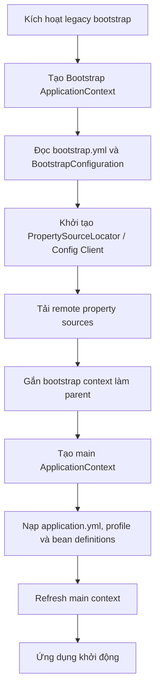
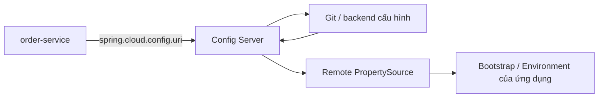

# Bootstrap context và điều kiện cần sử dụng

> **Chương:** Bootstrap  
> **Module:** `SPRING_CLOUD_CORE` — các nền tảng cốt lõi của Spring Cloud trong hệ thống phân tán, đặc biệt Spring Cloud Commons, Context, cấu hình bên ngoài, discovery, service registry, giao tiếp dịch vụ và cách kiểm thử, vận hành các abstraction chung.  
> **Trọng tâm:** Bootstrap context là một ApplicationContext khởi tạo sớm, thường đóng vai trò parent cho context chính để chuẩn bị property source và các thành phần nền tảng. Bài học giải thích cơ chế legacy, cách bật, trường hợp cần dùng và cách lựa chọn giữa bootstrap với Config Data hiện đại.

## 1. Bootstrap context giải quyết vấn đề gì?

Một ứng dụng Spring Boot có thể cần cấu hình từ xa trước khi tạo các bean nghiệp vụ. Ví dụ, `order-service` cần lấy URL database, thông tin kết nối registry, feature flag hoặc cấu hình client từ Spring Cloud Config Server. Ứng dụng phải biết cách liên hệ Config Server trước khi có thể tải phần cấu hình còn lại.

Trong kiến trúc Spring Cloud legacy, **bootstrap context** giải quyết việc chuẩn bị các nguồn cấu hình và thành phần nền tảng trước ApplicationContext chính. Nó được tạo riêng và thường làm **parent context** của context ứng dụng. Các property source và profile cần thiết từ giai đoạn bootstrap được đưa vào môi trường cấu hình mà ứng dụng chính sử dụng.

Cơ chế này hữu ích trong những hệ thống dùng `BootstrapConfiguration`, `PropertySourceLocator`, `bootstrap.yml`, hoặc cần một giai đoạn cấu hình riêng trước khi ứng dụng chính khởi tạo. Tuy nhiên, từ Spring Boot 2.4, Config Data cung cấp cách tích hợp cấu hình ngoài theo vòng đời chuẩn của Boot; Spring Cloud Config hiện xem `spring.config.import` là phương thức mặc định để kết nối Config Server. Vì thế, **không phải ứng dụng Spring Cloud nào cũng cần bootstrap context**. Tài liệu Config Client mô tả cả Config Data lẫn Config First Bootstrap.

### Kết quả học tập

Sau bài này, người học có thể:

1. giải thích bootstrap context, main ApplicationContext và quan hệ parent/child;
2. phân biệt bootstrap context với file `bootstrap.yml`, BootstrapRegistry của Spring Boot và Config Data;
3. xác định cách kích hoạt legacy bootstrap và các cấu hình cần có;
4. mô tả cách Config Client kết nối Config Server theo Config First hoặc Discovery First;
5. hiểu vai trò của `BootstrapConfiguration`, `PropertySourceLocator` và `spring.factories`;
6. phân tích precedence giữa remote property source, `bootstrap.yml` và cấu hình ứng dụng;
7. chọn lúc nên duy trì bootstrap, lúc nên dùng `spring.config.import`, và cách kiểm thử khi di chuyển.

## 2. Phân biệt ba khái niệm thường bị nhầm

### 2.1. Bootstrap context

Đây là một Spring `ApplicationContext` riêng, được tạo trong giai đoạn bootstrap. Trong mô hình legacy, context này làm parent của main application context. Nó có thể khởi tạo cấu hình bootstrap, các bean cần thiết để truy cập nguồn cấu hình và các `PropertySourceLocator` tùy chỉnh.

### 2.2. File bootstrap.yml

`bootstrap.yml` hoặc `bootstrap.properties` là file cấu hình dành cho **bootstrap context**. File này thường chứa những thông tin cần có sớm, ví dụ tên ứng dụng, địa chỉ Config Server và profile dùng để lấy cấu hình.

Chỉ tạo file có tên `bootstrap.yml` **không tự động bật legacy bootstrap** trong các cấu hình Spring Cloud hiện đại. Cần kích hoạt cơ chế bootstrap bằng cách phù hợp với release train đang dùng. Nếu bootstrap không được bật, file này có thể không được xử lý theo cách mà dự án mong đợi.

### 2.3. Spring Boot BootstrapRegistry

Spring Boot có khái niệm `BootstrapRegistry` và `BootstrapRegistryInitializer`, đặc biệt trong cơ chế chuẩn bị Config Data. Đây là registry dùng để đăng ký một số đối tượng cần thiết trong quá trình bootstrap Config Data. Nó **không phải** Spring Cloud legacy bootstrap `ApplicationContext`, không phải parent context của main application và không có nghĩa phải tạo `bootstrap.yml`.

Tên gọi gần nhau nhưng trách nhiệm khác nhau:

| Khái niệm | Vai trò |
| --- | --- |
| Spring Cloud bootstrap context | ApplicationContext khởi tạo sớm, thường là parent của main context trong chế độ legacy |
| `bootstrap.yml` | File cấu hình được đọc cho bootstrap context khi legacy bootstrap đã bật |
| Spring Boot `BootstrapRegistry` | Registry phục vụ giai đoạn khởi tạo một số thành phần, ví dụ Config Data loader |

Khi đọc tài liệu hoặc code cũ, cần xác định đang nói tới cơ chế nào để không áp dụng nhầm cách cấu hình.

## 3. Bootstrap context nằm ở đâu trong vòng đời ứng dụng?

### 3.1. Quan hệ parent và child

Trong mô hình legacy, quá trình có thể hình dung như sau:

1. Spring Cloud nhận biết bootstrap mode đã được kích hoạt.
2. Một bootstrap ApplicationContext được tạo từ các cấu hình bootstrap.
3. Các bean trong bootstrap context chuẩn bị nguồn cấu hình; ví dụ Config Client kết nối Config Server hoặc một `PropertySourceLocator` truy vấn nguồn riêng.
4. Bootstrap context được gắn làm parent cho main ApplicationContext.
5. Main context kế thừa các property source/profile phù hợp theo quy tắc context hierarchy và tiếp tục vòng đời Spring Boot thông thường.



Sơ đồ là mô hình khái niệm. Chi tiết thời điểm chạy `PropertySourceLocator` đã thay đổi giữa các release train; phần 8 nêu rõ khác biệt đó.

### 3.2. Vì sao dùng context hierarchy?

Context cha có thể cung cấp bean hoặc property source dùng chung cho context con. Điều này giúp tách trách nhiệm:

- Bootstrap context chuẩn bị thông tin cần thiết để tìm nguồn cấu hình.
- Main context khởi tạo các bean nghiệp vụ và tích hợp dịch vụ.
- Một số ứng dụng có context hierarchy phức tạp hơn có thể dùng `SpringApplicationBuilder` để tạo parent, child hoặc sibling context.

Không nên mặc định tất cả context con hoặc sibling đều chia sẻ cùng một `Environment` object. Cách chia sẻ Environment phụ thuộc cách dựng hierarchy. Spring Cloud có quy tắc để property source từ bootstrap được đưa vào context chính mà không vô tình đẩy mọi giá trị từ một nhánh context sang nhánh khác.

### 3.3. Những thành phần thường xuất hiện

| Thành phần | Trách nhiệm |
| --- | --- |
| `BootstrapConfiguration` | Khai báo cấu hình và bean được nạp vào bootstrap context |
| `PropertySourceLocator` | Tạo hoặc truy vấn một `PropertySource` để bổ sung vào Environment |
| Config Client | Kết nối Config Server và lấy cấu hình từ xa |
| `ApplicationContextInitializer` | Một initializer có thể được bootstrap context cung cấp cho main SpringApplication |
| `bootstrap.yml` | Cung cấp cấu hình khởi tạo như application name, profile, Config Server URI |
| `spring.factories` | Cơ chế đăng ký một số bootstrap configuration trong các thế hệ Spring Cloud sử dụng legacy bootstrap |

## 4. Khi nào cần sử dụng bootstrap context?

### 4.1. Các trường hợp có lý do rõ ràng

Legacy bootstrap có thể phù hợp khi:

- **Ứng dụng hiện hữu phụ thuộc vào bootstrap lifecycle:** dự án đã dùng `BootstrapConfiguration`, `PropertySourceLocator` hoặc các initializer được nạp từ bootstrap context.
- **Cần một nguồn property tùy chỉnh trong bootstrap phase:** ví dụ lấy cấu hình từ một dịch vụ nội bộ hoặc kho cấu hình riêng thông qua `PropertySourceLocator`.
- **Kiến trúc phụ thuộc vào context hierarchy:** một số bean/configuration cần được tạo ở context cha và dùng chung theo thiết kế của ứng dụng.
- **Cần giữ nguyên hành vi của hệ thống cũ trong quá trình nâng cấp:** thay đổi cơ chế nạp cấu hình cùng lúc với nâng release train có thể làm khó xác định nguyên nhân lỗi.
- **Tích hợp legacy yêu cầu bootstrap:** một thư viện hoặc thành phần nội bộ được thiết kế cho `BootstrapConfiguration` và chưa được chuyển sang Config Data.

Trong các trường hợp này, hãy xác định chính xác component nào cần bootstrap và kiểm tra tài liệu của Spring Cloud release train đang sử dụng. Bootstrap context là một quyết định kiến trúc, không chỉ là một tên file cấu hình.

### 4.2. Khi không cần bootstrap context

Với ứng dụng mới chỉ cần lấy cấu hình từ Spring Cloud Config Server và release train hỗ trợ Config Data, thông thường nên dùng:

```yaml
spring:
  application:
    name: order-service
  config:
    import: "optional:configserver:http://config-server:8888"
```

Không cần tạo `bootstrap.yml` chỉ để khai báo Config Server theo phương thức này. Config Client sử dụng `spring.config.import`, và Config Data xử lý việc lấy property source trong quá trình chuẩn bị Environment.

Các trường hợp khác cũng thường không cần bootstrap:

- chỉ cần cấu hình cục bộ từ `application.yml`;
- chỉ muốn thay đổi `logging.level.*` hoặc một giá trị nghiệp vụ;
- chỉ muốn tạo một bean cấu hình dùng chung nhưng không cần parent context;
- chỉ muốn nạp một file cấu hình ngoài mà Config Data đã hỗ trợ;
- chỉ muốn bật `@RefreshScope` — refresh scope là khả năng Spring Cloud Context, không đòi hỏi mọi ứng dụng phải bật legacy bootstrap.

### 4.3. Bảng quyết định nhanh

| Nhu cầu | Hướng nên xem xét |
| --- | --- |
| Ứng dụng mới lấy cấu hình từ Config Server | Config Data với `spring.config.import` |
| File cấu hình local hoặc file ngoài JAR | Spring Boot Config Data |
| Cần custom Config Data loader/bootstrap registry | `BootstrapRegistryInitializer` và extension tương ứng của Boot |
| Hệ thống cũ dùng `BootstrapConfiguration`/`PropertySourceLocator` | Duy trì legacy bootstrap trong khi đánh giá migration |
| Cần remote property source theo quy tắc bootstrap cũ | Legacy bootstrap, sau khi xác minh precedence và release train |
| Chỉ cần refresh một bean khi property đổi | `@RefreshScope` hoặc cơ chế rebinding phù hợp |
| Chỉ cần thay log level khi chạy | Actuator `loggers` hoặc cơ chế logging rebinding phù hợp |

**Không dùng bootstrap context chỉ vì ứng dụng có chữ “Spring Cloud”.** Chọn cơ chế nhỏ nhất đáp ứng đúng yêu cầu cấu hình và tương thích với phiên bản.

## 5. Điều kiện kích hoạt legacy bootstrap

### 5.1. Bootstrap không tự bật chỉ vì có bootstrap.yml

Trong các cấu hình Spring Cloud hiện đại, legacy bootstrap phải được kích hoạt rõ ràng bằng một trong các cách được hỗ trợ:

- thêm dependency `spring-cloud-starter-bootstrap` vào classpath; hoặc
- đặt `spring.cloud.bootstrap.enabled=true` bằng system property hoặc environment variable trước khi SpringApplication bắt đầu.

Ví dụ với JVM:

```bash
java -Dspring.cloud.bootstrap.enabled=true -jar order-service.jar
```

Ví dụ với environment variable:

```bash
export SPRING_CLOUD_BOOTSTRAP_ENABLED=true
```

Lưu ý: đặt `spring.cloud.bootstrap.enabled=true` bên trong `application.yml` thường là quá muộn để kích hoạt chính quá trình đọc bootstrap, vì file cấu hình của main application được xử lý trong vòng đời sau đó. Hãy dùng starter, system property hoặc environment variable theo tài liệu release train.

Với các thế hệ Spring Cloud cũ, hành vi mặc định và cơ chế kích hoạt có thể khác. Khi nâng cấp, phải đối chiếu phiên bản thực tế thay vì sao chép cấu hình legacy từ dự án khác.

### 5.2. Dependency mẫu cho Config Client legacy

Ví dụ Maven:

```xml
<dependencies>
    <dependency>
        <groupId>org.springframework.cloud</groupId>
        <artifactId>spring-cloud-starter-config</artifactId>
    </dependency>

    <dependency>
        <groupId>org.springframework.cloud</groupId>
        <artifactId>spring-cloud-starter-bootstrap</artifactId>
    </dependency>
</dependencies>
```

Các version nên được quản lý bởi Spring Cloud BOM phù hợp với Spring Boot. Không ghi version riêng cho từng starter nếu không có lý do rõ ràng.

Nếu ứng dụng không dùng Config Server mà có custom `BootstrapConfiguration`, cơ chế bootstrap vẫn có thể được kích hoạt bởi starter/property; dependency cụ thể tùy thuộc thành phần cần dùng.

### 5.3. Cấu hình bootstrap.yml tối thiểu

Một ví dụ config-first:

```yaml
spring:
  application:
    name: order-service
  profiles:
    active: prod
  cloud:
    config:
      uri: http://localhost:8888
      fail-fast: true
```

Các giá trị quan trọng:

- `spring.application.name`: tên ứng dụng dùng để tìm cấu hình tương ứng trên Config Server;
- `spring.profiles.active`: profile cần lấy, nếu đã biết ở giai đoạn bootstrap;
- `spring.cloud.config.uri`: địa chỉ Config Server trong chế độ config-first;
- `spring.cloud.config.fail-fast`: yêu cầu ứng dụng dừng nếu không lấy được cấu hình theo chính sách fail-fast.

Tên ứng dụng và profile nên được đặt ở nguồn sẵn có đủ sớm để Config Client yêu cầu đúng tài liệu. Nếu URI hoặc thông tin xác thực phụ thuộc môi trường, hãy cấp chúng qua environment variable/secret management phù hợp.

## 6. Config First và Discovery First

### 6.1. Config First: biết địa chỉ Config Server từ trước

Đây là cách đơn giản nhất: ứng dụng biết URL Config Server qua `spring.cloud.config.uri` hoặc một biến môi trường. Khi bootstrap chạy, Config Client kết nối trực tiếp đến địa chỉ đó.



Ví dụ:

```yaml
spring:
  application:
    name: inventory-service
  cloud:
    config:
      uri: https://config.internal.example
      fail-fast: true
```

Địa chỉ này cần có sẵn trước khi Config Client tìm nguồn từ xa. Nếu Config Server có TLS hoặc xác thực, phải cấu hình trust material/credentials theo hướng dẫn của phiên bản; không lưu password trực tiếp trong repository.

### 6.2. Discovery First: tìm Config Server qua registry

Trong một số hệ thống, địa chỉ Config Server có thể thay đổi. Thay vì cấu hình host cố định, client có thể tìm Config Server qua service registry. Đây là một lựa chọn định vị Config Server của Config Client; nếu dùng Config Data, vẫn cần khai báo `spring.config.import` theo yêu cầu của cơ chế Config Data. Ví dụ bên dưới mô tả các thuộc tính discovery, không tự bật legacy bootstrap.

Các điều kiện khái quát:

1. Config Server được đăng ký với service registry.
2. Ứng dụng client có discovery implementation phù hợp.
3. Client biết cách kết nối registry từ một nguồn cấu hình ban đầu.
4. Bật discovery lookup của Config Client, ví dụ `spring.cloud.config.discovery.enabled=true`.
5. Cấu hình service ID nếu không dùng mặc định `configserver`.

```yaml
spring:
  cloud:
    config:
      discovery:
        enabled: true
        service-id: configserver
```

Ví dụ chỉ thể hiện các property Config Client. Địa chỉ registry, credential, metadata, context path và cơ chế TLS phụ thuộc provider (Eureka, Consul hoặc implementation khác). Discovery lookup có thêm một network round trip lúc startup để tìm Config Server.

Discovery First hữu ích khi tọa độ Config Server thay đổi nhưng registry có endpoint ổn định. Nếu chính registry cũng cần remote configuration để biết địa chỉ, cần một nguồn bootstrap tối thiểu độc lập để tránh vòng phụ thuộc.

### 6.3. So sánh hai cách

| Tiêu chí | Config First | Discovery First |
| --- | --- | --- |
| Cách tìm Config Server | URI cấu hình trực tiếp | Service registry |
| Cấu hình ban đầu | URL/host và credential cần thiết | Endpoint registry và cấu hình discovery |
| Độ phức tạp | Thấp hơn | Cao hơn, phụ thuộc registry |
| Network round trip | Gọi Config Server | Thêm bước tìm service trước khi gọi |
| Khi phù hợp | Địa chỉ Config Server ổn định | Hạ tầng có registry làm điểm định vị ổn định |
| Rủi ro chính | URI cũ khi server đổi địa chỉ | Registry chưa sẵn sàng hoặc client chưa tìm được server |

## 7. PropertySource và thứ tự ưu tiên

### 7.1. Remote property source và bootstrap.yml khác nhau

Một nhầm lẫn phổ biến là cho rằng mọi property trong `bootstrap.yml` đều có độ ưu tiên cao nhất. Thực tế cần phân biệt:

- Các property source từ xa được nạp trong bootstrap phase (thường được gộp trong nguồn có tên `bootstrap`) có thể có độ ưu tiên cao.
- Các giá trị đọc trực tiếp từ `bootstrap.yml` dùng để cấu hình bootstrap context và có thể được đưa vào main context với độ ưu tiên thấp hơn `application.yml` cùng các nguồn cấu hình thông thường của main application.

Do đó `bootstrap.yml` thường phù hợp để khai báo giá trị khởi tạo hoặc mặc định, ví dụ Config Server URI, application name và profile. Remote property source mới là dữ liệu cấu hình được tải từ server.

### 7.2. Remote config có thể không bị override cục bộ theo mặc định

Với legacy bootstrap, các property source từ xa thường không cho phép ứng dụng ghi đè bằng cấu hình local theo mặc định. Nếu muốn local/system property override remote config, phía Config Server phải cấp quyền qua property `spring.cloud.config.allowOverride=true` trong property source từ xa.

Hai tùy chọn tinh chỉnh thường gặp:

- `spring.cloud.config.overrideNone=true`: cho phép các property source cục bộ ghi đè giá trị từ xa;
- `spring.cloud.config.overrideSystemProperties=false`: chỉ cho system properties, command-line arguments và environment variables ghi đè, không cho file cấu hình local làm điều đó.

Không nên tự đặt `allowOverride` trong `application.yml` của client rồi kỳ vọng nó mở quyền override; quyền này phải được cấp từ nguồn remote theo quy tắc Spring Cloud Config. Luôn kiểm tra precedence thực tế của release train đang chạy.

### 7.3. Profile và context hierarchy

`bootstrap.yml` có thể có file theo profile, ví dụ `bootstrap-prod.yml`. Nếu profile đã được xác định từ environment hoặc cấu hình ban đầu, các giá trị theo profile có thể được dùng trong bootstrap context.

Main context có thể nhận các property source từ parent, đồng thời có nguồn riêng như `application.yml`, file profile và command line. Với hierarchy nhiều tầng, property trong child context có thể ghi đè parent theo quy tắc của Spring. Đừng mặc định mọi sibling context có chung cấu hình chỉ vì cùng một bootstrap parent.

## 8. Mở rộng bootstrap bằng BootstrapConfiguration

### 8.1. Khi nào cần custom BootstrapConfiguration?

Nếu một ứng dụng cần khởi tạo bean chuyên biệt trong bootstrap context, Spring Cloud legacy cho phép đăng ký các class cấu hình qua key `org.springframework.cloud.bootstrap.BootstrapConfiguration` trong `META-INF/spring.factories`.

Ví dụ cấu hình:

```java
@Configuration
public class InternalBootstrapConfiguration {

    @Bean
    PropertySourceLocator internalPropertySourceLocator() {
        return environment -> {
            Map<String, Object> values = Map.of(
                    "platform.region",
                    environment.getProperty("PLATFORM_REGION", "local")
            );

            return new MapPropertySource("internal-platform", values);
        };
    }
}
```

Khai báo trong file `src/main/resources/META-INF/spring.factories`:

```properties
org.springframework.cloud.bootstrap.BootstrapConfiguration=com.example.bootstrap.InternalBootstrapConfiguration
```

Đây là ví dụ tối giản về một `PropertySourceLocator`: nhận Environment và trả về một property source. Trong ứng dụng thực tế, cần xử lý lỗi nguồn cấu hình, timeout, xác thực, cache và thứ tự ưu tiên.

### 8.2. Tránh component scan nhầm bootstrap configuration

Các class cấu hình bootstrap nên đặt trong package riêng, không nằm trong vùng package mà `@SpringBootApplication` hoặc `@ComponentScan` của main application quét vào.

Nếu main context quét trùng bootstrap configuration, cùng một cấu hình có thể được nạp ở hai context, dẫn đến bean trùng, thứ tự khởi tạo khó hiểu hoặc phụ thuộc sai context. Đây là lỗi khó chẩn đoán vì ứng dụng có thể tạo ra hai instance của một thành phần tưởng như chỉ có một.

### 8.3. PropertySourceLocator và khác biệt theo release train

`PropertySourceLocator` là abstraction để bổ sung property source. Tuy nhiên, thời điểm gọi locator đã thay đổi giữa các thế hệ Spring Cloud.

- Trước Spring Cloud 2022.0.3, các `PropertySourceLocator` (bao gồm locator của Config Client) được chạy trong main application context theo hành vi mặc định được tài liệu mô tả.
- Có thể yêu cầu chạy chúng trong bootstrap context bằng `spring.cloud.config.initialize-on-context-refresh=true` trong `bootstrap.yml` ở các phiên bản áp dụng cơ chế này.
- Từ Spring Cloud 2022.0.3, Spring Cloud gọi locator hai lần: lần đầu không có profile để lấy cấu hình có thể kích hoạt profile; lần tiếp theo sau khi main context khởi động với profile đã xác định để lấy thêm cấu hình theo profile.

Điểm này rất quan trọng khi migration hoặc viết locator tùy chỉnh. Không giả định locator luôn chỉ chạy một lần, và không đặt side effect không idempotent trong `locate()`. Hãy đọc tài liệu đúng release train và thiết kế locator có thể được gọi nhiều lần.

## 9. Bootstrap và logging

Legacy bootstrap có thể hữu ích khi cần các property từ xa trước các bước khởi tạo sớm. Trong Spring Cloud Context, tài liệu hướng dẫn đặt cấu hình logging trong `bootstrap.yml` nếu muốn nó áp dụng cho toàn bộ event của ứng dụng.

Ví dụ:

```yaml
spring:
  application:
    name: payment-service
  cloud:
    config:
      uri: http://localhost:8888

logging:
  level:
    root: INFO
    com.example.payment: DEBUG
```

Cần nhớ rằng `bootstrap.yml` chỉ có ý nghĩa nếu legacy bootstrap đã được kích hoạt. Nếu dự án dùng Config Data, đặt cấu hình logging trong `application.yml` hoặc nguồn Config Data được nạp sớm phù hợp với lifecycle hiện đại.

Bootstrap không phải cách duy nhất để cấu hình logging sớm. Config Data có thể nạp property trước logging initialization; chọn theo cơ chế cấu hình tổng thể của ứng dụng. Tránh tạo hai nguồn cùng điều khiển một key mà không có quy tắc precedence rõ ràng.

## 10. Bootstrap legacy và Config Data hiện đại

### 10.1. Config Data ra đời để giải quyết việc gì?

Spring Boot 2.4 giới thiệu cơ chế Config Data qua `spring.config.import`. Spring Cloud Config hiện dùng đây làm phương thức mặc định để kết nối Config Server. Trong phương thức này, không cần file `bootstrap.yml`.

Ví dụ trong `application.yml`:

```yaml
spring:
  application:
    name: order-service
  config:
    import: "optional:configserver:http://config-server:8888"
```

`optional:` cho phép ứng dụng tiếp tục nếu Config Server không truy cập được. Bỏ `optional:` khiến Config Client yêu cầu nguồn cấu hình phải sẵn sàng; nếu không kết nối được, startup sẽ thất bại. Lựa chọn này phải phản ánh yêu cầu vận hành: một service có thể chạy với default config hay bắt buộc phải có remote config.

Config Data xử lý cấu hình theo nhiều bước. Config Client có thể truy vấn trước với profile `default`, sau đó truy vấn lại cho các profile được kích hoạt. Nhiều request trong lúc startup là hành vi bình thường của cơ chế này, giúp cấu hình từ xa có thể kích hoạt profile bổ sung.

### 10.2. Bảng so sánh

| Tiêu chí | Legacy bootstrap | Config Data |
| --- | --- | --- |
| Cơ chế | Bootstrap ApplicationContext riêng, thường làm parent | Spring Boot Config Data trong quá trình chuẩn bị Environment |
| File cấu hình | `bootstrap.yml` khi bootstrap được bật | `application.yml` với `spring.config.import` |
| Kích hoạt | Starter hoặc system property/environment variable | Khai báo import và Config Client dependency |
| Custom extension | `BootstrapConfiguration`, `PropertySourceLocator` | Config Data loader và BootstrapRegistry extension phù hợp |
| Quan hệ context | Có bootstrap parent trong mô hình legacy | Không tạo Spring Cloud bootstrap parent context chỉ để import |
| Dùng cho dự án mới | Chỉ khi có lý do legacy cụ thể | Thường là lựa chọn ưu tiên với Config Server |
| Migration | Cần xem lại property precedence và locator lifecycle | Dùng cơ chế cấu hình chuẩn của Boot |

### 10.3. Migration từ bootstrap.yml sang Config Data

Giả sử ứng dụng cũ có:

```yaml
# bootstrap.yml — cấu hình legacy
spring:
  application:
    name: order-service
  cloud:
    config:
      uri: http://config-server:8888
```

Với Config Data, chuyển các thông tin cần thiết sang `application.yml`:

```yaml
# application.yml — Config Data
spring:
  application:
    name: order-service
  config:
    import: "optional:configserver:http://config-server:8888"
```

Sau đó:

1. kiểm tra phiên bản Spring Boot/Spring Cloud có hỗ trợ Config Data;
2. đảm bảo `spring-cloud-starter-config` và BOM tương thích;
3. bỏ dependency bootstrap starter hoặc property bật legacy bootstrap nếu không còn cần;
4. rà soát `BootstrapConfiguration`, `PropertySourceLocator` và initializer tùy chỉnh;
5. chuyển property sang file hoặc nguồn phù hợp;
6. so sánh precedence remote/local, profile và giá trị hiệu lực;
7. kiểm thử startup khi Config Server có và không có;
8. triển khai theo chiến lược có thể rollback.

Không nên chỉ đổi tên `bootstrap.yml` thành `application.yml`. Cần kiểm tra lại ý nghĩa từng property, đặc biệt các giá trị dùng để tìm Config Server và các property source remote có quy tắc override riêng.

## 11. Kiểm soát lỗi kết nối Config Server

### 11.1. Fail fast và optional

Với legacy bootstrap, `spring.cloud.config.fail-fast=true` yêu cầu client dừng startup nếu không lấy được cấu hình theo điều kiện đã cấu hình. Với Config Data, bỏ tiền tố `optional:` trong `spring.config.import` tạo hành vi bắt buộc kết nối.

Hai cách này biểu đạt chính sách khác nhau:

- **Optional:** service được phép chạy với nguồn cấu hình còn lại khi Config Server tạm thời không sẵn sàng.
- **Required/fail fast:** service không được chạy nếu thiếu remote configuration.

Nếu các property từ xa quyết định kết nối database, security hoặc routing bắt buộc, chạy với default có thể nguy hiểm hơn dừng startup. Ngược lại, nếu remote config chỉ cung cấp một feature flag không thiết yếu, optional có thể hợp lý.

### 11.2. Retry lúc startup

Config Client có thể hỗ trợ retry khi kết nối Config Server thất bại, tùy phương thức bootstrap và phiên bản. Trong legacy config-first, cấu hình retry thường cần fail-fast và các dependency retry/AOP phù hợp; các property thuộc nhóm `spring.cloud.config.retry.*` điều khiển số lần thử và backoff.

Với Config Data import, các tham số retry có thể được đặt kèm URL import trong trường hợp cấu hình nằm trong profile, theo tài liệu Config Client. Không copy một cấu hình retry giữa các cơ chế nếu chưa xác nhận version.

Retry startup làm tăng thời gian khởi động. Cần tính tổng thời gian retry với startup timeout, readiness probe, orchestrator restart policy và thời gian chờ triển khai. Nếu retry quá lâu, hệ thống điều phối có thể liên tục giết container trước khi Config Client hoàn thành.

### 11.3. Không tạo vòng phụ thuộc discovery

Discovery First cần registry hoạt động trước khi client tìm Config Server. Nếu địa chỉ registry lại chỉ có trong remote config mà client cần Config Server để lấy, ứng dụng sẽ mắc vòng phụ thuộc.

Cần cung cấp một tập cấu hình tối thiểu độc lập cho bước bootstrap: địa chỉ registry, trust material và credential cần thiết. Sau khi lấy được remote config, các cấu hình còn lại mới được áp dụng.

## 12. Kiểm thử và vận hành bootstrap

### 12.1. Kiểm thử startup theo kịch bản

| Kịch bản | Cách mô phỏng | Điều cần xác nhận |
| --- | --- | --- |
| Bootstrap chưa bật | Bỏ starter và không đặt activation property | `bootstrap.yml` không được kỳ vọng tự nạp theo legacy |
| Bootstrap bật | Thêm starter hoặc cung cấp system property/environment variable | Bootstrap context được tạo theo version đang dùng |
| Config Server khả dụng | Chạy server với cấu hình cho application/profile | Remote property source xuất hiện |
| Config Server không khả dụng, optional | Dùng cấu hình optional hoặc chính sách tương ứng | Ứng dụng tiếp tục bằng nguồn còn lại; giá trị fallback an toàn |
| Config Server không khả dụng, required | Bỏ `optional:` hoặc bật fail-fast legacy | Startup thất bại rõ ràng |
| Discovery First | Tắt registry hoặc gỡ đăng ký Config Server | Client không tìm được server; lỗi được phân loại đúng |
| Profile thay đổi | Chạy với profile khác nhau | Client yêu cầu đúng cấu hình theo profile |
| Override local/remote | Khai báo cùng key ở hai nguồn | Giá trị thắng đúng chính sách `allowOverride` |
| Custom locator | Cho locator trả property source | Locator có thể được gọi theo số lần phù hợp release train |
| Migration Config Data | Chạy cùng bộ test trước/sau chuyển đổi | Property hiệu lực và startup behavior tương đương theo yêu cầu |

### 12.2. Dữ liệu cần quan sát

- active profiles và application name;
- Config Server URI hoặc discovery service ID (không log credential);
- thời điểm và kết quả lấy remote property source;
- số lần retry, thời gian startup và nguyên nhân fail-fast;
- property source có mặt và precedence (ẩn/mask secret);
- trạng thái readiness sau khi context khởi tạo;
- các event refresh nếu ứng dụng cập nhật cấu hình sau startup.

Actuator `env` hoặc `configprops` có thể hỗ trợ điều tra nếu endpoint đã được expose và bảo vệ đúng. Không expose dữ liệu cấu hình nhạy cảm ra Internet và không ghi password/token vào log.

### 12.3. Kiểm thử PropertySourceLocator

Một locator tùy chỉnh nên được kiểm tra:

- được đăng ký trong đúng context;
- không bị component scan nhầm vào main context;
- xử lý trường hợp không có profile và có profile;
- không tạo side effect khi bị gọi nhiều lần;
- timeout và lỗi nguồn từ xa có hành vi dự đoán được;
- property source có tên riêng, precedence rõ và không ghi đè ngoài ý muốn.

Với Spring Cloud 2022.0.3 trở lên, lưu ý hành vi locator được gọi hai lần trong quy trình được tài liệu mô tả. Test phải kiểm tra điều này thay vì giả định đúng một lần.

## 13. Các lỗi thường gặp

**“Chỉ cần tạo bootstrap.yml là Spring Cloud sẽ đọc.”**  
Không đúng trong cấu hình hiện đại. Legacy bootstrap phải được kích hoạt; nếu dùng Config Data thì đặt import trong application configuration.

**“Đặt spring.cloud.bootstrap.enabled=true trong application.yml là đủ.”**  
Thường quá muộn để bật cơ chế đọc bootstrap. Dùng starter hoặc system property/environment variable trước khi SpringApplication chạy.

**“Mọi property trong bootstrap.yml có độ ưu tiên cao nhất.”**  
Không. Remote `bootstrap` property source và file `bootstrap.yml` là hai nguồn khác nhau; file bootstrap có thể là nguồn mặc định có precedence thấp hơn application config.

**“Bootstrap context chính là Config Server.”**  
Không. Bootstrap context là một ApplicationContext; Config Server là một nguồn property từ xa mà client có thể kết nối.

**“Dùng Config Data vẫn cần bootstrap.yml.”**  
Không. Config Client dùng `spring.config.import` không cần file bootstrap cho phương thức này.

**“PropertySourceLocator luôn chạy đúng một lần.”**  
Không. Hành vi phụ thuộc release train; từ Spring Cloud 2022.0.3 có quy trình gọi hai lần để xử lý profile.

**“Discovery First không cần registry sẵn sàng từ đầu.”**  
Không. Client phải có đủ cấu hình để liên hệ registry trước khi tìm Config Server.

**“Tắt bootstrap là tắt toàn bộ Spring Cloud Context.”**  
Không. Legacy bootstrap context và các khả năng khác của Spring Cloud Context là hai khái niệm khác nhau. RefreshScope hoặc EnvironmentChangeEvent không tự biến mất chỉ vì không dùng legacy bootstrap.

## 14. Bài tập vận dụng

### Bài tập 1 — Ứng dụng không đọc bootstrap.yml

Một service có file `bootstrap.yml` chứa `spring.cloud.config.uri`, nhưng log cho thấy Config Client vẫn gọi địa chỉ mặc định. Hãy xác định điều kiện kích hoạt legacy bootstrap, cách truyền property activation trước startup và cách xác minh starter đã có trong runtime classpath.

### Bài tập 2 — Chọn Config First hay Discovery First

Một công ty có nhiều Config Server instance, địa chỉ thay đổi theo môi trường và đã có Eureka/Consul làm registry ổn định. Hãy phân tích khi nào Discovery First có ích, các dependency khởi tạo tối thiểu và rủi ro thêm một network round trip.

### Bài tập 3 — Local không override được remote config

Một developer đặt `spring.datasource.hikari.maximum-pool-size` trong `application-local.yml` nhưng giá trị từ Config Server vẫn thắng. Hãy giải thích mặc định remote property source của legacy bootstrap và cách server cấp quyền override phù hợp. Không tự giả định thay đổi property phía client sẽ có hiệu lực.

### Bài tập 4 — Custom PropertySourceLocator chạy hai lần

Một locator gọi API ghi audit mỗi lần `locate()` được thực thi. Sau khi nâng Spring Cloud, số audit tăng gấp đôi. Hãy liên hệ với thay đổi từ Spring Cloud 2022.0.3, đề xuất làm locator idempotent và xác định test cần có.

### Bài tập 5 — Migration sang Config Data

Một ứng dụng mới chỉ cần lấy cấu hình từ Config Server, không có `BootstrapConfiguration` tùy chỉnh. Hãy viết cấu hình `spring.config.import`, chọn optional hay required theo tính thiết yếu của remote config và nêu các test cần chạy trước khi bỏ legacy bootstrap.

### Tự kiểm tra nhanh

1. Bootstrap context là gì? **Một ApplicationContext khởi tạo sớm, thường làm parent của main context trong legacy mode.**
2. `bootstrap.yml` có tự bật bootstrap không? **Không, ở cấu hình hiện đại cần kích hoạt legacy bootstrap.**
3. Config Data import có cần bootstrap context không? **Không.**
4. `PropertySourceLocator` dùng để làm gì? **Bổ sung property source vào Environment từ nguồn cấu hình phù hợp.**
5. Tại sao Discovery First cần registry sẵn sàng? **Vì client phải tìm Config Server qua registry trước khi lấy remote config.**
6. `bootstrap.yml` và remote bootstrap property source có cùng precedence không? **Không; cần phân biệt file bootstrap và nguồn remote được locator thêm vào.**
7. Spring Cloud 2022.0.3 có thay đổi gì đáng chú ý? **PropertySourceLocator được gọi hai lần theo quy trình không profile rồi có profile.**

## 15. Checklist chọn và vận hành

Trước khi bật hoặc duy trì bootstrap context, hãy trả lời:

1. Thành phần nào thật sự cần được tạo trong bootstrap context?
2. Ứng dụng có dùng `BootstrapConfiguration`, `PropertySourceLocator` hoặc initializer legacy không?
3. Release train đang dùng kích hoạt bootstrap theo cách nào?
4. Có thể dùng Config Data thay thế không?
5. URI/registry/credential tối thiểu có sẵn trước khi lấy remote config không?
6. Chính sách remote/local override đã được xác định chưa?
7. Config Server không khả dụng thì service phải fail fast hay tiếp tục?
8. Locator có chịu được việc được gọi nhiều lần không?
9. Có test cho profile, property precedence, startup retry và readiness không?
10. Nếu migration, đã so sánh giá trị hiệu lực và hành vi rollback chưa?

**Thông điệp cốt lõi:** Bootstrap context là công cụ legacy có giá trị khi ứng dụng cần một ApplicationContext cha để chuẩn bị property source và cấu hình nền tảng trước main context. Với Config Server trong ứng dụng hiện đại, Config Data qua `spring.config.import` thường là lựa chọn mặc định, đơn giản hơn và tích hợp trực tiếp với vòng đời Spring Boot. Chỉ duy trì bootstrap khi có yêu cầu cụ thể, hiểu rõ cách kích hoạt, precedence, context hierarchy và khác biệt theo release train.

**Tài liệu tham khảo:** [Spring Cloud Config Client — Config Data và Config First Bootstrap](https://docs.spring.io/spring-cloud-config/reference/client.html), [Spring Cloud Commons — Bootstrap Application Context và Context Hierarchies](https://docs.spring.io/spring-cloud-commons/reference/spring-cloud-commons/application-context-services.html), [Spring Cloud](https://spring.io/projects/spring-cloud) và [Spring Boot Externalized Configuration](https://docs.spring.io/spring-boot/reference/features/external-config.html). Chi tiết legacy bootstrap thay đổi theo phiên bản; luôn đối chiếu release train đang dùng.
