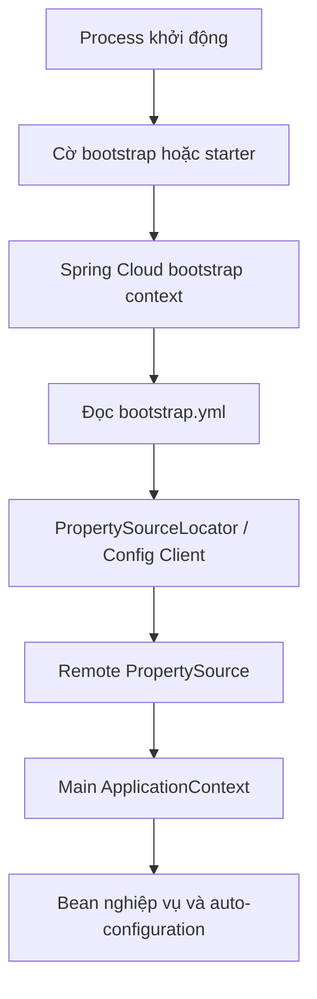

# Bật bootstrap bằng starter hoặc thuộc tính phù hợp phiên bản

## 1. Khi nào cần bật Spring Cloud bootstrap?

Trong mô hình truyền thống, Spring Cloud tạo một **bootstrap context** trước application context chính. Bootstrap context chuẩn bị property source và bean hạ tầng để ứng dụng có thể đọc cấu hình bên ngoài ngay từ đầu. Nó thường làm parent của main application context và có thể dùng `bootstrap.yml` hoặc `bootstrap.properties` để khai báo thông tin kết nối Config Server.

Từ Spring Cloud **2020.0 (Ilford)**, bootstrap không còn được bật mặc định trong cấu hình thông thường. Dự án còn cần cơ chế cũ có thể kích hoạt bằng dependency `spring-cloud-starter-bootstrap` hoặc thuộc tính `spring.cloud.bootstrap.enabled=true`. Tuy nhiên, lựa chọn thuộc tính phải xét phiên bản: `spring.config.use-legacy-processing=true` từng được nêu như cách bật lại ở giai đoạn chuyển đổi đầu tiên, nhưng **không còn kích hoạt bootstrap khi dùng Spring Boot 3 / Spring Cloud 2022.0 trở lên**.

Với ứng dụng mới, Spring Cloud khuyến nghị dùng Config Data API (`spring.config.import`) khi integration hỗ trợ. Bài này tập trung vào trường hợp đã có lý do duy trì bootstrap cũ, cách bật đúng theo phiên bản và cách xác nhận bootstrap thực sự hoạt động.

Nội dung thuộc chương **Bootstrap** của mô-đun **SPRING_CLOUD_CORE**. Trong hệ thống phân tán, bootstrap là một phần của đường nạp cấu hình; nó có thể chuẩn bị property cho Spring Cloud Commons, Context và Config Client trước khi các bean nghiệp vụ được tạo. Cách bật bootstrap cần tương thích với Spring Boot, Spring Cloud release train và cách triển khai ứng dụng.

Sau bài học, người học có thể:

- Xác định vì sao bootstrap không tự bật ở các release train hiện đại.
- Bật bootstrap bằng starter hoặc thuộc tính hệ thống đúng thời điểm.
- Chọn cách kích hoạt phù hợp giữa Spring Cloud 2020.0 và Spring Cloud 2022.0+.
- Cấu hình `bootstrap.yml` cho Config Client và phân biệt nó với `application.yml`.
- Kiểm tra parent context, remote property source và hành vi startup.
- Tránh bật bootstrap cùng Config Data một cách trùng lặp hoặc không có chủ đích.

## 2. Thay đổi theo phiên bản

| Thế hệ | Hành vi bootstrap | Cách xử lý |
| --- | --- | --- |
| Spring Cloud trước 2020.0 | Bootstrap truyền thống thường được kích hoạt mặc định trong các tích hợp legacy | Ứng dụng cũ thường có `bootstrap.yml` và Config Client sử dụng bootstrap lifecycle. Khi nâng cấp, kiểm tra lại hành vi thay vì giả định mặc định vẫn giữ nguyên. |
| Spring Cloud 2020.0 | Bootstrap không còn bật mặc định | Có thể bật bằng `spring-cloud-starter-bootstrap` hoặc `spring.cloud.bootstrap.enabled=true`. Release notes thời kỳ này cũng nêu `spring.config.use-legacy-processing=true` như một lựa chọn chuyển tiếp. |
| Spring Cloud 2022.0 với Spring Boot 3 | `spring.config.use-legacy-processing=true` không còn bật bootstrap do thay đổi trong Boot 3.0 | Dùng `spring.cloud.bootstrap.enabled=true` hoặc `spring-cloud-starter-bootstrap`. |
| Các release train hiện đại | Bootstrap vẫn là cơ chế legacy cần bật rõ ràng | Ưu tiên Config Data cho ứng dụng mới; chỉ bật bootstrap khi integration hoặc kiến trúc hiện hữu cần nó. |

Hai thuộc tính không nên bị xem là đồng nghĩa:

- `spring.cloud.bootstrap.enabled=true` là cờ của Spring Cloud để kích hoạt bootstrap.
- `spring.config.use-legacy-processing=true` là cờ legacy processing từng được dùng trong giai đoạn chuyển đổi Config Data của Spring Boot 2.4. Nó không phải cách bật bootstrap ổn định cho các thế hệ Boot mới.

**Quy tắc thực hành:** nếu dự án dùng Spring Boot 3 và Spring Cloud 2022.0 trở lên, hãy chọn starter hoặc `spring.cloud.bootstrap.enabled=true`. Không dùng `spring.config.use-legacy-processing=true` để giải quyết việc bootstrap không chạy.

## 3. Cách 1 — thêm spring-cloud-starter-bootstrap

Đây là cách rõ ràng ở cấp dependency: ứng dụng đưa starter bootstrap vào classpath để bật cơ chế bootstrap của Spring Cloud.

### 3.1. Maven

Khai báo dependency, để Spring Cloud BOM quản lý version:

```xml
<dependencyManagement>
    <dependencies>
        <dependency>
            <groupId>org.springframework.cloud</groupId>
            <artifactId>spring-cloud-dependencies</artifactId>
            <version>SPRING_CLOUD_RELEASE_TRAIN_DA_CHON</version>
            <type>pom</type>
            <scope>import</scope>
        </dependency>
    </dependencies>
</dependencyManagement>

<dependencies>
    <dependency>
        <groupId>org.springframework.cloud</groupId>
        <artifactId>spring-cloud-starter-config</artifactId>
    </dependency>
    <dependency>
        <groupId>org.springframework.cloud</groupId>
        <artifactId>spring-cloud-starter-bootstrap</artifactId>
    </dependency>
</dependencies>
```

`SPRING_CLOUD_RELEASE_TRAIN_DA_CHON` là placeholder: thay bằng release train tương thích với Spring Boot đang dùng. Không gán version riêng cho starter bootstrap nếu BOM đã quản lý artifact đó.

- `spring-cloud-starter-config` cung cấp Config Client để kết nối Config Server.
- `spring-cloud-starter-bootstrap` bật bootstrap lifecycle.
- Starter bootstrap không tự tạo Config Server và không thay thế Config Client. Nếu mục tiêu là lấy cấu hình từ Config Server, ứng dụng vẫn cần Config Client và thông tin kết nối.

### 3.2. Gradle

Ví dụ với Gradle và Spring Cloud BOM:

```groovy
dependencies {
    implementation platform(
        "org.springframework.cloud:spring-cloud-dependencies:SPRING_CLOUD_RELEASE_TRAIN_DA_CHON"
    )
    implementation "org.springframework.cloud:spring-cloud-starter-config"
    implementation "org.springframework.cloud:spring-cloud-starter-bootstrap"
}
```

Nếu dự án đã dùng plugin quản lý dependency của Spring hoặc một platform ở cấp build, hãy theo cơ chế hiện có và tránh nhập BOM hai lần với các version khác nhau.

### 3.3. Khi nên chọn starter?

Starter phù hợp khi bootstrap là một phần cố định của kiến trúc, nhiều môi trường cần cùng hành vi, hoặc muốn dependency graph thể hiện rõ ứng dụng có dùng bootstrap. Ưu điểm là trạng thái bật được ghi nhận trong build file và dễ review. Đổi lại, starter làm thay đổi classpath; cần kiểm tra BOM và dependency transitive.

## 4. Cách 2 — bật bằng thuộc tính hệ thống

Spring Cloud Config Client hỗ trợ bật bootstrap qua thuộc tính:

```properties
spring.cloud.bootstrap.enabled=true
```

Thuộc tính này phải có mặt **đủ sớm**, dưới dạng Java system property hoặc environment variable. Tài liệu Config Client nêu rõ không nên chỉ đặt cờ này trong `application.yml`, vì file đó thuộc quá trình cấu hình main context và có thể được đọc sau thời điểm cần kích hoạt bootstrap.

### 4.1. Java system property

```bash
java -Dspring.cloud.bootstrap.enabled=true -jar orders-service.jar
```

Đặt cờ trước `-jar`, để JVM chuyển nó thành system property ngay khi khởi chạy.

### 4.2. Environment variable trên Linux/macOS

```bash
SPRING_CLOUD_BOOTSTRAP_ENABLED=true java -jar orders-service.jar
```

Hoặc export cho shell hiện tại:

```bash
export SPRING_CLOUD_BOOTSTRAP_ENABLED=true
java -jar orders-service.jar
```

### 4.3. Environment variable trên PowerShell

```powershell
$env:SPRING_CLOUD_BOOTSTRAP_ENABLED = "true"
java -jar .\orders-service.jar
```

Khi process được chạy bởi Docker, Kubernetes hoặc CI/CD, cấu hình biến môi trường trong manifest/deployment pipeline. Bảo đảm biến được truyền vào **container/process thực sự chạy ứng dụng**, không chỉ được đặt trong terminal của một phiên khác.

### 4.4. Khi nên chọn thuộc tính?

Thuộc tính hệ thống phù hợp khi chỉ một số môi trường hoặc một lần chạy cần bật bootstrap, muốn thử nghiệm migration mà không sửa dependency graph ngay, hoặc deployment đã quản lý tập trung JVM arguments/environment variables. Nếu bootstrap là yêu cầu lâu dài ở mọi môi trường, starter thường dễ thể hiện ý định hơn. Tránh để cờ môi trường không được quản lý khiến local, CI và production có hành vi khác nhau.

## 5. spring.config.use-legacy-processing phù hợp phiên bản nào?

Đây là điểm thường gây nhầm khi nâng cấp.

Trong Spring Cloud 2020.0, release notes ghi nhận có thể bật lại bootstrap bằng thuộc tính `spring.cloud.bootstrap.enabled=true` hoặc `spring.config.use-legacy-processing=true`; các thuộc tính được cung cấp qua environment variable, Java system property hoặc command-line argument.

Ở giai đoạn đó, `spring.config.use-legacy-processing=true` là lựa chọn liên quan cơ chế xử lý cấu hình legacy của Spring Boot 2.4. Tuy nhiên, Spring Cloud 2022.0 ghi rõ thuộc tính này **không còn bật bootstrap do thay đổi trong Spring Boot 3.0**. Với Boot 3 và các release train tương ứng, hãy dùng:

```bash
SPRING_CLOUD_BOOTSTRAP_ENABLED=true
```

hoặc thêm `spring-cloud-starter-bootstrap`.

| Cấu hình | Spring Cloud 2020.0 / giai đoạn Boot 2.4 | Spring Cloud 2022.0 + Boot 3 |
| --- | --- | --- |
| `spring-cloud-starter-bootstrap` | Có thể bật bootstrap | Có thể bật bootstrap |
| `spring.cloud.bootstrap.enabled=true` | Có thể bật bootstrap | Cách bật bằng thuộc tính được khuyến nghị |
| `spring.config.use-legacy-processing=true` | Được release notes 2020.0 nêu như lựa chọn chuyển tiếp | Không còn bật bootstrap |

Không nên lấy ví dụ cũ trên blog hoặc diễn đàn rồi áp dụng cho mọi phiên bản. Khi nâng cấp Boot major hoặc Spring Cloud train, hãy đọc breaking changes và release notes của train mục tiêu.

## 6. Cấu hình bootstrap.yml sau khi đã bật bootstrap

Sau khi bootstrap lifecycle được kích hoạt, ứng dụng có thể dùng `bootstrap.yml` để khai báo thông tin cần thiết cho bootstrap phase. Với Config Client, cấu hình điển hình là:

```yaml
spring:
  application:
    name: orders-service
  cloud:
    config:
      uri: http://config-server:8888
  profiles:
    active: dev
```

Các thuộc tính quan trọng:

- `spring.application.name`: tên ứng dụng mà Config Server dùng để xác định cấu hình.
- `spring.cloud.config.uri`: địa chỉ Config Server; mặc định của Config Client thường là `http://localhost:8888`.
- `spring.profiles.active`: profile cần lấy từ Config Server. Với bootstrap legacy, nếu profile cần thiết cho việc tải cấu hình thì khai báo ở giai đoạn bootstrap phù hợp.
- `spring.cloud.config.label`: nhãn/branch/tag cấu hình cần lấy nếu hệ thống Config Server dùng label.

Ví dụ có thể đặt địa chỉ qua environment variable để không cố định endpoint trong file:

```yaml
spring:
  application:
    name: orders-service
  cloud:
    config:
      uri: ${SPRING_CONFIG_URI:http://localhost:8888}
```

Không commit username/password, token hoặc secret vào `bootstrap.yml`. Dùng secret manager, environment injection hoặc cơ chế credential phù hợp với nền tảng triển khai.

### 6.1. Phân biệt ba loại cấu hình

| File / nguồn | Thời điểm và mục đích |
| --- | --- |
| `bootstrap.yml` | Được đọc trong bootstrap phase khi bootstrap đã bật; thường chứa tên ứng dụng, profile và địa chỉ nguồn cấu hình ngoài. |
| `application.yml` | Cấu hình của main application context và ứng dụng; dùng cho server port, bean properties, logging và các tùy chọn runtime. |
| Environment / system properties | Có thể cung cấp cờ kích hoạt bootstrap đủ sớm và ghi đè các cấu hình khác theo precedence của Spring. |

**Không đặt cờ kích hoạt bootstrap chỉ trong `application.yml` rồi chờ nó tự kích hoạt phase đã qua.** Cần cung cấp cờ bằng starter, system property hoặc environment variable từ trước khi Spring Cloud bắt đầu bootstrap.

## 7. Bootstrap context tham gia vào ApplicationContext như thế nào?

Khi được bật, bootstrap context được tạo trước main application context và thường trở thành parent. Nó có thể chạy các cấu hình bootstrap, tạo các bean cần thiết và tìm các `PropertySourceLocator` để nạp property từ nguồn ngoài. Các property source thích hợp được đưa vào Environment mà ứng dụng chính sử dụng.



Điều cần phân biệt:

- Bootstrap context là một context riêng trong mô hình legacy.
- Main application context chứa controller, service, repository và phần lớn bean của ứng dụng.
- `Environment` cung cấp các property source cho quá trình phân giải cấu hình; quan hệ parent/child và precedence quyết định giá trị cuối cùng.
- Bootstrap properties (các property được tải trong bootstrap phase) không đồng nghĩa với nội dung của file `bootstrap.yml`. Hai khái niệm này có thể có thứ tự ưu tiên khác nhau.

Trong mô hình legacy, remote property source được tạo bởi locator có thể có độ ưu tiên cao. Tuy nhiên, không nên khẳng định chung rằng mọi giá trị trong bootstrap luôn ghi đè mọi giá trị application. Phải kiểm tra property source cụ thể, thứ tự ưu tiên và cấu hình cho phép override của phiên bản đang dùng.

## 8. Xác minh bootstrap đã thực sự được bật

Thấy file `bootstrap.yml` trong project không chứng minh bootstrap đang chạy. Cần kiểm tra cả cấu hình, dependency và hành vi startup.

### 8.1. Kiểm tra dependency

Với Maven:

```bash
./mvnw dependency:tree -Dincludes=org.springframework.cloud:spring-cloud-starter-bootstrap,org.springframework.cloud:spring-cloud-starter-config,org.springframework.cloud:spring-cloud-commons
```

Với Gradle:

```bash
./gradlew dependencyInsight --dependency spring-cloud-starter-bootstrap --configuration runtimeClasspath
```

Kiểm tra version được BOM resolve và bảo đảm các module thuộc release train tương thích.

### 8.2. Kiểm tra cờ ở đúng process

Trong container hoặc máy chạy ứng dụng, xác minh:

- JVM arguments có `-Dspring.cloud.bootstrap.enabled=true` nếu dùng system property.
- Environment của process có `SPRING_CLOUD_BOOTSTRAP_ENABLED=true` nếu dùng biến môi trường.
- Dependency runtime có starter bootstrap nếu chọn cách dependency.

Kiểm tra trong terminal nơi build project không đủ nếu ứng dụng chạy ở container hoặc service manager khác.

### 8.3. Kiểm tra kết quả nạp cấu hình

Đặt một property kiểm chứng không nhạy cảm ở Config Server, ví dụ:

```yaml
app:
  bootstrap:
    marker: "remote-config-loaded"
```

Sau khi khởi động, xác minh bean hoặc một bài integration test đọc được giá trị đó:

```java
@Component
public class BootstrapMarker {
    private final String value;

    public BootstrapMarker(
            @Value("${app.bootstrap.marker:missing}") String value) {
        this.value = value;
    }

    public String value() {
        return value;
    }
}
```

Nếu kết quả là `missing`, kiểm tra theo thứ tự: bootstrap đã được bật chưa; Config Client có trên classpath không; Config Server có truy cập được không; application name/profile/label có đúng không; remote property source có được đưa vào Environment không. Không dùng secret thật làm marker.

Có thể dùng log startup hoặc Actuator `env` trong môi trường phát triển để quan sát nguồn cấu hình, nhưng endpoint này có thể tiết lộ thông tin nhạy cảm. Chỉ expose tạm thời, cấu hình sanitization và bảo vệ truy cập.

## 9. Các lỗi thường gặp

| Triệu chứng | Nguyên nhân có thể | Cách xử lý |
| --- | --- | --- |
| Có `bootstrap.yml` nhưng không gọi Config Server | Bootstrap không còn tự bật từ Spring Cloud 2020.0 | Thêm starter hoặc đặt `spring.cloud.bootstrap.enabled=true` đủ sớm. |
| Dùng Boot 3 nhưng `spring.config.use-legacy-processing=true` không có tác dụng | Thuộc tính cũ không còn kích hoạt bootstrap từ Spring Cloud 2022.0 | Chuyển sang `spring.cloud.bootstrap.enabled=true` hoặc starter. |
| Đặt `spring.cloud.bootstrap.enabled=true` trong `application.yml` nhưng bootstrap vẫn không chạy | Cờ được đọc quá muộn | Đưa thành system property, environment variable hoặc thêm starter. |
| Dependency có starter nhưng Config Server không được gọi | Thiếu Config Client hoặc thiếu `spring.cloud.config.uri` | Thêm Config Client, kiểm tra URI và thông tin kết nối trong bootstrap config. |
| Config Server trả cấu hình sai ứng dụng | `spring.application.name` không đúng | Đặt tên ứng dụng ở bootstrap configuration hoặc environment thích hợp. |
| Profile remote không đúng | `spring.profiles.active` không có ở phase cần thiết hoặc bị ghi đè | Kiểm tra bootstrap profile, active profile và request Config Server. |
| Chạy local được nhưng container không được | Environment/JVM argument không được truyền vào container | Kiểm tra biến và command line của process thực tế. |
| Remote property bị ghi đè bất ngờ | PropertySource precedence hoặc cấu hình override khác nhau | Kiểm tra tên và thứ tự PropertySource; không suy đoán từ tên file. |
| Có cả Config Data và bootstrap legacy | Hai cơ chế cùng kết nối một nguồn | Chọn một cách làm chủ đạo hoặc viết kiểm thử rõ ràng cho giai đoạn chuyển tiếp. |

## 10. Kiểm thử và vận hành theo môi trường

### 10.1. Local development

Local có thể dùng Config Server chạy trên `localhost:8888`, với một marker property không nhạy cảm. Nếu Config Server không chạy, quyết định rõ ứng dụng có được phép tiếp tục với local defaults hay phải fail. Không nên vô tình dùng optional chỉ để che một môi trường dev chưa được chuẩn bị.

### 10.2. CI

CI nên xác minh dependency graph và chạy một startup/integration test với đúng cờ bootstrap. Nếu CI dùng system property, hãy đặt nó trên command line của process test; nếu dùng starter, bảo đảm dependency nằm trong runtime/test classpath như thiết kế.

### 10.3. Container và Kubernetes

Đặt `SPRING_CLOUD_BOOTSTRAP_ENABLED=true` trong environment của container hoặc truyền JVM argument trong entrypoint. Với Config Server, cấu hình URI và credential bằng ConfigMap/Secret hoặc secret manager tương ứng. Bảo đảm Config Server sẵn sàng trước khi readiness của client được xem là thành công nếu remote config là điều kiện bắt buộc.

Không đặt bootstrap enabled trong một ConfigMap được chính Config Server cung cấp nếu ứng dụng cần bootstrap để kết nối tới Config Server đó. Đây là vòng phụ thuộc: ứng dụng cần cờ để khởi động bootstrap nhưng lại cần bootstrap để lấy cờ.

### 10.4. Production

Nếu bootstrap là điều kiện vận hành, ưu tiên biểu diễn nhất quán trong dependency hoặc deployment configuration và ghi lại lý do sử dụng legacy. Bảo vệ endpoint Actuator, không ghi secret vào log, quan sát lỗi kết nối và có chính sách startup khi Config Server không sẵn sàng.

## 11. Quyết định bật bootstrap hay dùng Config Data

| Câu hỏi | Nếu có | Hướng xử lý |
| --- | --- | --- |
| Ứng dụng mới và Config Client hỗ trợ Config Data? | Có | Ưu tiên `spring.config.import=configserver:...`. |
| Thư viện nội bộ yêu cầu bootstrap parent context? | Có | Bật bootstrap bằng starter hoặc cờ phù hợp phiên bản. |
| Ứng dụng chạy Spring Cloud 2022.0 / Boot 3 trở lên? | Có | Dùng `spring.cloud.bootstrap.enabled=true` hoặc starter; không dùng legacy-processing flag. |
| Chỉ cần thử bootstrap ở một môi trường? | Có | Cân nhắc system property/environment variable, quản lý rõ nơi bật. |
| Có cả `spring.config.import` và bootstrap legacy? | Có | Kiểm tra lý do; tránh nạp cùng nguồn hai lần ngoài chủ đích. |

Nếu không có phụ thuộc cụ thể vào bootstrap, Config Data thường có mô hình đơn giản hơn và được khuyến nghị cho ứng dụng hiện đại. Việc giữ bootstrap cần được xem là quyết định kiến trúc có lý do, không chỉ là thói quen từ cấu hình cũ.

## 12. Tài liệu tham khảo chính thức

- [Spring Cloud Config Client — Config Data Import và Config First Bootstrap](https://docs.spring.io/spring-cloud-config/reference/client.html)
- [Spring Cloud 2020.0 Release Notes — thay đổi bootstrap mặc định](https://github.com/spring-cloud/spring-cloud-release/wiki/Spring-Cloud-2020.0-Release-Notes)
- [Spring Cloud 2022.0 Release Notes — thay đổi với Spring Boot 3.0](https://github.com/spring-cloud/spring-cloud-release/wiki/Spring-Cloud-2022.0-Release-Notes)

Tài liệu chính thức cần được đối chiếu theo đúng release train đang chạy; không sao chép thuộc tính từ ví dụ của một thế hệ Spring Cloud sang thế hệ khác mà không kiểm tra.

## 13. Tổng kết và câu hỏi tự kiểm tra

Để bật bootstrap legacy, có hai lựa chọn chính: **thêm `spring-cloud-starter-bootstrap`** vào dependency hoặc **đặt `spring.cloud.bootstrap.enabled=true`** đủ sớm dưới dạng system property/environment variable. Từ Spring Cloud 2020.0, bootstrap không còn bật mặc định. Với Spring Cloud 2022.0 và Spring Boot 3, không dùng `spring.config.use-legacy-processing=true` để bật bootstrap; thuộc tính này không còn hiệu lực cho mục đích đó.

Sau khi bật, Config Client cần có mặt nếu ứng dụng lấy cấu hình từ Config Server; `bootstrap.yml` cung cấp tên ứng dụng, URI, profile và các thông tin bootstrap thích hợp. Hãy xác minh bằng dependency graph, process arguments/environment, log và một property marker không nhạy cảm. Nếu ứng dụng mới không phụ thuộc bootstrap context, hãy cân nhắc Config Data API thay thế.

Câu hỏi tự kiểm tra:

1. Vì sao Spring Cloud 2020.0 không tự bật bootstrap như các cấu hình legacy trước đó?
2. Hai cách chính để bật bootstrap trong release train hiện đại là gì?
3. Vì sao `spring.cloud.bootstrap.enabled=true` cần được cung cấp trước khi main application context đọc `application.yml`?
4. `spring.config.use-legacy-processing=true` có giới hạn gì khi dùng Spring Boot 3?
5. `spring-cloud-starter-bootstrap` khác `spring-cloud-starter-config` ở trách nhiệm nào?
6. Sau khi bật bootstrap, những thuộc tính nào thường được đặt trong `bootstrap.yml` để Config Client kết nối đúng nguồn?
7. Làm sao chứng minh bootstrap đã nạp remote property source mà không để lộ secret?
8. Khi nào nên chuyển sang Config Data thay vì tiếp tục duy trì bootstrap legacy?
