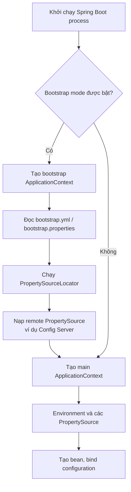
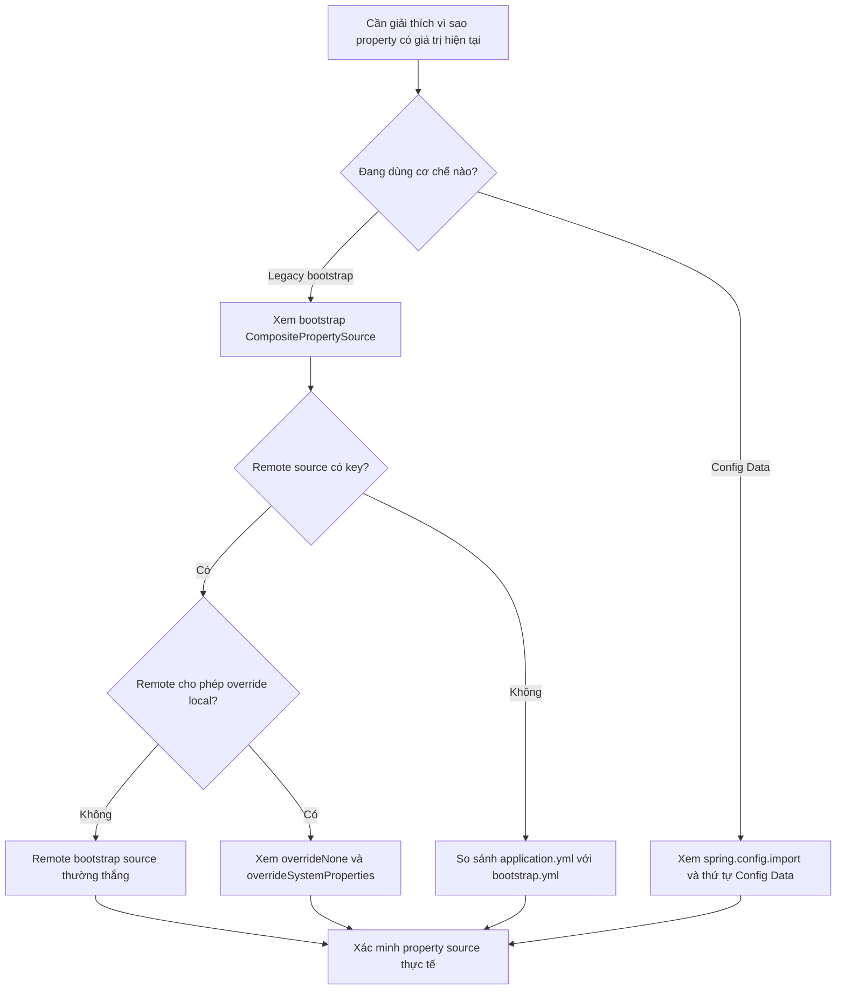

# Nguồn bootstrap có độ ưu tiên cao và tệp bootstrap có độ ưu tiên thấp

## 1. Vấn đề thường gây nhầm lẫn

Trong ứng dụng Spring Cloud dùng cơ chế **bootstrap context** truyền thống, có hai khái niệm thường bị gọi chung là “bootstrap”:

- **Bootstrap property source**: nguồn thuộc tính được nạp trong giai đoạn bootstrap, thường đến từ hệ thống bên ngoài như Spring Cloud Config Server.
- **Tệp `bootstrap.yml` hoặc `bootstrap.properties`**: tệp cấu hình local dùng để khởi tạo bootstrap context.

Hai thứ này **không có cùng độ ưu tiên**. Theo quy tắc của Spring Cloud Context, property source có tên `bootstrap` được tạo từ `PropertySourceLocator` (ví dụ Config Server) có độ ưu tiên cao. Trong khi đó, property source `applicationConfig: [classpath:bootstrap.yml]` chứa các giá trị từ tệp `bootstrap.yml` lại có độ ưu tiên thấp hơn `application.yml` và các property source thông thường của main application context.

Vì vậy, câu “bootstrap có độ ưu tiên cao” chỉ chính xác khi nói về **các thuộc tính được nạp trong giai đoạn bootstrap**, chẳng hạn remote property source. Không thể suy ra rằng mọi thuộc tính viết trong `bootstrap.yml` đều thắng `application.yml`.

Bài học thuộc chương **Bootstrap** của **SPRING_CLOUD_CORE**. Người học cần hiểu cách Spring Cloud nạp cấu hình ngoài, phân biệt bootstrap context với main context, và biết khi nào quy tắc bootstrap truyền thống còn áp dụng. Điều này đặc biệt quan trọng khi tích hợp Spring Cloud Config Client và xử lý các giá trị cấu hình bị ghi đè.

## 2. Bootstrap context là gì?

Trong mô hình bootstrap truyền thống, Spring Cloud tạo một **bootstrap ApplicationContext** làm context cha (parent) của main application context. Bootstrap context được tạo sớm để nạp các nguồn cấu hình cần thiết trước khi ứng dụng chính hoàn tất khởi tạo.

Luồng khái quát:



Bootstrap context thường đảm nhiệm:

- Đọc các thuộc tính cần thiết để kết nối nguồn cấu hình bên ngoài.
- Chạy các thành phần `PropertySourceLocator` để lấy property source từ xa.
- Đưa các property source và cấu hình bootstrap thích hợp vào main context theo cơ chế context hierarchy.
- Trong các cấu hình Spring Cloud có hỗ trợ, xử lý một số chức năng liên quan đến external configuration trước khi ứng dụng chính được tạo.

Bootstrap context là một **Spring ApplicationContext riêng**, không phải một file YAML. Nó có thể có bean và property source riêng. Main context là context con, kế thừa các property source từ parent theo quy tắc của Spring.

Hai context có thể dùng chung `Environment` trong mô hình bootstrap chuẩn. Khi tạo context hierarchy phức tạp bằng `SpringApplicationBuilder`, cần chú ý mỗi context có thể có bootstrap property source riêng; các context con có quy tắc ưu tiên và kế thừa riêng. Không nên giả định mọi context trong hierarchy đều có cùng property source.

## 3. Phân biệt bootstrap property source và tệp bootstrap.yml

Đây là phần cốt lõi của bài học.

### 3.1. Bootstrap property source có độ ưu tiên cao

Nếu bootstrap context tìm thấy `PropertySourceLocator` và locator trả về thuộc tính, Spring Cloud có thể thêm một `CompositePropertySource` có tên `bootstrap` vào main context. Ví dụ phổ biến là property source được tải từ Spring Cloud Config Server.

Nguồn này chứa các thuộc tính **remote**, ví dụ:

```yaml
app:
  greeting: Hello from Config Server
inventory:
  reservation:
    enabled: true
```

Trong mô hình bootstrap truyền thống, property source `bootstrap` được thêm với độ ưu tiên cao. Theo mặc định, các giá trị remote này **không thể bị ghi đè bởi cấu hình local**. Đây là cách hệ thống cấu hình tập trung giữ quyền kiểm soát những giá trị mà server cung cấp.

Lưu ý: độ ưu tiên cao nói trên áp dụng cho property source do locator nạp. Nó không có nghĩa mọi property source trong bootstrap context đều có độ ưu tiên cao.

### 3.2. Tệp bootstrap.yml có độ ưu tiên thấp hơn application.yml

Tệp `bootstrap.yml` (hoặc `bootstrap.properties`) được dùng để cấu hình **bootstrap context**. Các giá trị trong tệp này sau đó được kế thừa sang main context khi thiết lập quan hệ parent-child.

Ví dụ `bootstrap.yml`:

```yaml
spring:
  application:
    name: inventory-service
  cloud:
    config:
      uri: "http://localhost:8888"

app:
  greeting: Hello from bootstrap.yml
```

Tệp `application.yml` của main application:

```yaml
app:
  greeting: Hello from application.yml
```

Nếu không có remote property source cung cấp `app.greeting`, giá trị từ `application.yml` có độ ưu tiên cao hơn giá trị local được kế thừa từ `bootstrap.yml`. Kết quả là:

```text
app.greeting = Hello from application.yml
```

Lý do là property source của main context được ưu tiên hơn property source kế thừa từ parent bootstrap context trong quá trình phân giải thuộc tính.

### 3.3. Bảng so sánh

| Thành phần | Nội dung điển hình | Vai trò | Độ ưu tiên trong bootstrap mode |
| --- | --- | --- | --- |
| `bootstrap` CompositePropertySource | Thuộc tính từ Config Server hoặc `PropertySourceLocator` | Cung cấp cấu hình ngoài trong giai đoạn bootstrap | **Cao**, mặc định không cho local override |
| `applicationConfig: [classpath:bootstrap.yml]` | Các thuộc tính local trong `bootstrap.yml` và file theo profile | Cấu hình bootstrap context, ví dụ địa chỉ Config Server | **Thấp hơn** property source của main context |
| `applicationConfig: [classpath:application.yml]` | Cấu hình local của ứng dụng chính | Cấu hình ứng dụng và giá trị mặc định theo môi trường | Cao hơn `bootstrap.yml` |
| Environment variables / system properties / command line | Giá trị từ môi trường chạy | Override theo quy tắc property source và quyền override của remote source | Phụ thuộc nguồn và chính sách override |

**Không đồng nhất tên file với tên property source.** `bootstrap.yml` thường tạo một property source có tên dạng `applicationConfig: [classpath:bootstrap.yml]`; nó không phải CompositePropertySource có tên `bootstrap` chứa dữ liệu Config Server.

## 4. Ví dụ xác định giá trị cuối cùng

Giả sử ba nguồn cùng định nghĩa `app.greeting`:

**Tệp bootstrap.yml:**

```yaml
app:
  greeting: from-bootstrap-file
```

**Tệp application.yml:**

```yaml
app:
  greeting: from-application-file
```

**Remote configuration từ Config Server:**

```yaml
app:
  greeting: from-config-server
```

Trong bootstrap mode truyền thống, nếu Config Server trả về `app.greeting` và không cấp quyền override cho local source, giá trị remote trong property source `bootstrap` được ưu tiên. Kết quả:

```text
app.greeting = from-config-server
```

Nếu remote source **không định nghĩa** key `app.greeting`, giá trị local của main context được chọn:

```text
app.greeting = from-application-file
```

Trong trường hợp thứ hai, `application.yml` thắng `bootstrap.yml`. Ví dụ này thể hiện chính xác sự khác nhau giữa remote bootstrap property source và tệp bootstrap local.

Có thể quan sát giá trị trong ứng dụng bằng `Environment`:

```java
import org.springframework.core.env.Environment;
import org.springframework.stereotype.Component;

@Component
public class GreetingReader {

    private final Environment environment;

    public GreetingReader(Environment environment) {
        this.environment = environment;
    }

    public String greeting() {
        return environment.getProperty("app.greeting", "default-greeting");
    }
}
```

Không nên chỉ đọc giá trị cuối rồi kết luận nguồn nào đã thắng. Khi debug, cần xem cả tên property source và thứ tự của chúng; Actuator `env` có thể hỗ trợ việc này trong môi trường được bảo vệ.

## 5. Cho phép local configuration ghi đè remote properties

Theo mặc định, remote property source do bootstrap context nạp thường không cho cấu hình local ghi đè. Spring Cloud Config có cơ chế cho phép server **cấp quyền override**.

Điểm quan trọng: thuộc tính `spring.cloud.config.allowOverride=true` phải được đặt trong **remote property source do Config Server trả về**. Đặt nó trong `application.yml` của client không cấp quyền override cho chính client.

### 5.1. Bật quyền override từ phía Config Server

Ví dụ trong file cấu hình remote dành cho ứng dụng:

```yaml
spring:
  cloud:
    config:
      allowOverride: true

app:
  greeting: from-config-server
```

Sau khi remote source cho phép override, có hai thuộc tính điều khiển chi tiết vị trí của remote property source so với cấu hình local.

### 5.2. `overrideNone=true`

```yaml
spring:
  cloud:
    config:
      allowOverride: true
      overrideNone: true
```

Khi `overrideNone=true`, mọi local property source có thể override giá trị remote. Điều này bao gồm cấu hình trong file local của ứng dụng.

Ví dụ, remote cung cấp `app.greeting=from-config-server`, còn `application.yml` khai báo `app.greeting=from-application-file`; local source được phép ghi đè nên giá trị local có thể thắng.

### 5.3. `overrideSystemProperties=false`

```yaml
spring:
  cloud:
    config:
      allowOverride: true
      overrideSystemProperties: false
```

Thiết lập này giới hạn override từ local: system properties, command-line arguments và environment variables có thể ghi đè remote settings, nhưng **local config files** như `application.yml` không được dùng để override remote source.

Bảng tóm tắt:

| Cấu hình remote | Hành vi |
| --- | --- |
| Không khai báo `allowOverride` hoặc `false` | Remote property source không cho local override theo mặc định |
| `allowOverride=true` | Cho phép cấu hình override; các cờ chi tiết điều khiển vị trí và phạm vi |
| `allowOverride=true` + `overrideNone=true` | Bất kỳ local property source nào cũng có thể override remote |
| `allowOverride=true` + `overrideSystemProperties=false` | System properties, command line và environment variables được override; local config files không được override remote |

Hãy dùng các cờ này có chủ đích. Nếu Config Server là nguồn chuẩn cho cấu hình bảo mật hoặc chính sách vận hành, bật `overrideNone=true` có thể làm mỗi service tự ghi đè các giá trị mà nền tảng muốn kiểm soát tập trung.

## 6. Kích hoạt bootstrap mode truyền thống

Từ Spring Boot 2.4, cách mặc định để kết nối Spring Cloud Config Server là **Config Data import** qua `spring.config.import`. Cách này không cần `bootstrap.yml`.

Nếu cần dùng cơ chế bootstrap truyền thống, phải bật bootstrap rõ ràng bằng một trong hai cách:

1. Thêm dependency `spring-cloud-starter-bootstrap` vào classpath.
2. Đặt `spring.cloud.bootstrap.enabled=true` qua system property hoặc environment variable **trước khi ứng dụng khởi động**.

Không đặt cờ kích hoạt bootstrap chỉ trong `bootstrap.yml`, vì tệp này chỉ được đọc sau khi bootstrap process đã được kích hoạt.

### 6.1. Dependency Maven minh họa

Dùng Spring Cloud BOM tương thích với Spring Boot của dự án để quản lý version:

```xml
<dependencyManagement>
    <dependencies>
        <dependency>
            <groupId>org.springframework.cloud</groupId>
            <artifactId>spring-cloud-dependencies</artifactId>
            <version>2025.1.4</version>
            <type>pom</type>
            <scope>import</scope>
        </dependency>
    </dependencies>
</dependencyManagement>

<dependencies>
    <dependency>
        <groupId>org.springframework.cloud</groupId>
        <artifactId>spring-cloud-starter-config</artifactId>
    </dependency>
    <dependency>
        <groupId>org.springframework.cloud</groupId>
        <artifactId>spring-cloud-starter-bootstrap</artifactId>
    </dependency>
</dependencies>
```

Đoạn trên giả định dự án đã kế thừa `spring-boot-starter-parent` hoặc đã nhập Spring Boot BOM riêng để quản lý các dependency của Boot. `spring-cloud-dependencies` chỉ quản lý các module Spring Cloud thuộc release train; hãy chọn version BOM tương thích với dòng Spring Boot của dự án.

### 6.2. Bật bằng environment variable

Linux/macOS:

```bash
SPRING_CLOUD_BOOTSTRAP_ENABLED=true java -jar inventory-service.jar
```

Windows PowerShell:

```powershell
$env:SPRING_CLOUD_BOOTSTRAP_ENABLED = "true"
java -jar inventory-service.jar
```

Nếu dùng system property:

```bash
java -Dspring.cloud.bootstrap.enabled=true -jar inventory-service.jar
```

Các cách trên kích hoạt bootstrap process trước khi ứng dụng chính nạp cấu hình.

## 7. Tệp bootstrap.yml dùng để cấu hình những gì?

Tệp bootstrap local nên chứa các giá trị cần thiết để bắt đầu bootstrap, thường là thông tin nhận diện ứng dụng và địa chỉ nguồn cấu hình từ xa.

Ví dụ:

```yaml
spring:
  application:
    name: inventory-service
  profiles:
    active: dev
  cloud:
    config:
      uri: "http://localhost:8888"
```

- `spring.application.name` giúp Config Server xác định bộ cấu hình dành cho service.
- `spring.profiles.active` cho biết profile mà client yêu cầu từ Config Server. Nếu cần dùng tên ứng dụng và profile để xác định context ID ngay trong bootstrap phase, đặt chúng trong `bootstrap.yml` hoặc nguồn bootstrap tương ứng.
- `spring.cloud.config.uri` chỉ vị trí Config Server trong mô hình config-first bootstrap.

Tệp `bootstrap-dev.yml` hoặc `bootstrap-development.properties` có thể được nạp khi profile tương ứng đã được xác định trong bootstrap context. Có thể đổi tên hoặc vị trí tệp bằng các thuộc tính:

| Thuộc tính | Mặc định | Ý nghĩa |
| --- | --- | --- |
| `spring.cloud.bootstrap.name` | `bootstrap` | Tên cơ sở của tệp bootstrap |
| `spring.cloud.bootstrap.location` | Rỗng | Thay thế các vị trí mặc định bằng vị trí chỉ định |
| `spring.cloud.bootstrap.additional-location` | Rỗng | Bổ sung vị trí cấu hình vào các vị trí mặc định |

Các thuộc tính điều khiển vị trí bootstrap cần được cung cấp đủ sớm, thường qua system property hoặc environment. Cách dùng tương tự nhóm `spring.config.*` của Spring Boot nhưng áp dụng cho bootstrap context.

Không nên đưa toàn bộ cấu hình nghiệp vụ vào `bootstrap.yml`. Hãy để cấu hình ứng dụng thường ngày ở `application.yml` hoặc nguồn remote thích hợp; giữ tệp bootstrap gọn với các giá trị phục vụ quá trình kết nối và khởi tạo cấu hình.

## 8. Phân biệt bootstrap truyền thống với Config Data hiện đại

Hai cơ chế đều có thể kết nối Config Server, nhưng cách khởi tạo và quy tắc property source khác nhau.

### 8.1. Config Data import — cách mặc định hiện đại

Ví dụ trong `application.yml`:

```yaml
spring:
  application:
    name: inventory-service
  profiles:
    active: dev
  config:
    import: "optional:configserver:http://localhost:8888"
```

Ứng dụng cần dependency `spring-cloud-starter-config`. Spring Boot Config Data xử lý import khi nạp cấu hình. Không cần `bootstrap.yml` và không cần tạo bootstrap parent context theo cơ chế legacy chỉ để kết nối Config Server.

Nếu bỏ tiền tố `optional:`, ứng dụng sẽ fail khi không kết nối được Config Server trong quá trình nạp cấu hình. Khi dùng `optional:`, ứng dụng có thể khởi động dù Config Server không sẵn sàng; điều này phù hợp khi remote configuration không bắt buộc ở môi trường đó.

Config Data tải cấu hình theo giai đoạn: đầu tiên với profile `default`, sau đó có thể truy vấn thêm cấu hình cho các profile được kích hoạt. Vì thế nhiều request đến Config Server lúc khởi động có thể là hành vi bình thường.

### 8.2. Legacy config-first bootstrap

Với bootstrap mode truyền thống:

- Bật bootstrap bằng starter hoặc system property/environment.
- Tạo `bootstrap.yml` để đặt `spring.cloud.config.uri`, application name và profile cần thiết.
- Config Client kết nối Config Server trong giai đoạn bootstrap và nạp remote property source.
- Remote property source thường có độ ưu tiên cao theo quy tắc bootstrap, trừ khi server cấp quyền override cho local source.

### 8.3. So sánh nhanh

| Tiêu chí | Legacy bootstrap | Config Data import |
| --- | --- | --- |
| Cách kích hoạt | `spring-cloud-starter-bootstrap` hoặc `spring.cloud.bootstrap.enabled=true` | `spring.config.import` |
| File `bootstrap.yml` | Dùng để cấu hình bootstrap context | Không cần |
| Parent bootstrap context | Có | Không cần cho Config Data flow |
| Nạp Config Server | Qua `PropertySourceLocator` trong bootstrap flow | Qua Config Data loader |
| Cách hiểu precedence | `bootstrap` CompositePropertySource có high precedence; `bootstrap.yml` local thấp hơn `application.yml` | Theo thứ tự Config Data import và property source của Spring Boot |
| Khi nào dùng | Ứng dụng cũ hoặc tích hợp phụ thuộc bootstrap context | Lựa chọn mặc định cho ứng dụng mới |

Không nên trộn hai mô hình mà không có chủ đích. Khi migration từ bootstrap sang Config Data, hãy chuyển địa chỉ Config Server và profile sang `application.yml`/environment, thêm `spring.config.import`, sau đó kiểm tra lại nguồn và độ ưu tiên của từng property. Không thể bê nguyên kết luận “remote bootstrap source luôn thắng” sang mọi trường hợp Config Data.

## 9. Một số chi tiết về phiên bản và context hierarchy

Trong Spring Cloud hiện đại, cách chạy `PropertySourceLocator` đã có thay đổi theo release. Tài liệu Spring Cloud Context ghi nhận rằng trước **Spring Cloud 2022.0.3**, `PropertySourceLocators` (bao gồm locator của Config Client) được chạy trong main application context thay vì bootstrap context theo mặc định. Có thể ép chúng chạy trong bootstrap context bằng `spring.cloud.config.initialize-on-context-refresh=true` đặt trong `bootstrap.yml` ở các phiên bản liên quan.

Từ Spring Cloud 2022.0.3, cơ chế bootstrap property locator được gọi hai lần trong flow được tài liệu mô tả: lần đầu lấy nguồn không theo profile để có cơ hội kích hoạt profile; sau khi main context khởi tạo, locator có thể được gọi lại với các profile đang active để lấy nguồn theo profile. Vì vậy khi đọc log startup hoặc debug số request Config Server, cần đối chiếu đúng release train thay vì áp dụng một mô tả cũ cho mọi phiên bản.

Với context hierarchy tự tạo bằng `SpringApplicationBuilder`, mỗi context có thể có `spring.application.name`, profile và property source riêng. Property source của child context có thể override source của parent; nếu child có source trùng tên với source ở parent, source của parent cùng tên có thể không được đưa vào child. Đây là hành vi context hierarchy của Spring, không nên rút gọn thành một danh sách ưu tiên duy nhất áp dụng cho mọi kiến trúc.

## 10. Các lỗi thường gặp

| Triệu chứng | Nguyên nhân có thể | Cách xử lý |
| --- | --- | --- |
| Có `bootstrap.yml` nhưng Config Server không được gọi | Bootstrap mode chưa được kích hoạt | Thêm `spring-cloud-starter-bootstrap` hoặc bật property qua system property/environment |
| `spring.cloud.bootstrap.enabled=true` đặt trong `bootstrap.yml` nhưng không có tác dụng | Tệp chưa được đọc vì bootstrap chưa được kích hoạt | Cung cấp cờ trước startup qua environment/system property hoặc dùng starter |
| `application.yml` không ghi đè giá trị từ Config Server | Remote source không cho local override theo mặc định | Kiểm tra `spring.cloud.config.allowOverride` được cấp từ remote source và hai cờ override |
| `bootstrap.yml` không thắng `application.yml` | Đây là hành vi đúng của property source hierarchy | Đặt giá trị mặc định ở bootstrap file; dùng remote source nếu cần quyền ưu tiên cao |
| Không biết property đến từ đâu | Chỉ xem giá trị cuối, không xem property source | Dùng Actuator `env` trong môi trường bảo vệ hoặc kiểm tra property source bằng code |
| Config Data import không dùng `bootstrap.yml` | Đang sử dụng flow hiện đại | Đặt `spring.config.import` trong `application.yml`/profile config hoặc environment |
| Có nhiều request đến Config Server lúc startup | Config Data nạp `default` rồi nạp profile active; hoặc locator được gọi nhiều lần theo phiên bản | Đối chiếu log và tài liệu của release train hiện tại |
| Local override không hoạt động như kỳ vọng | Đặt `allowOverride` ở client thay vì remote source, hoặc hiểu sai cờ chi tiết | Đặt quyền ở remote property source và kiểm tra từng nguồn override |

## 11. Quy trình kiểm tra precedence trong dự án

Khi một property có giá trị khác mong đợi, hãy kiểm tra theo trình tự:

1. Xác định ứng dụng đang dùng **legacy bootstrap** hay **Config Data import**.
2. Kiểm tra bootstrap mode có được kích hoạt đúng thời điểm không.
3. Xác nhận Config Client kết nối được Config Server và nhận đúng application/profile.
4. Tìm xem key có nằm trong remote property source hay không.
5. Nếu dùng bootstrap mode, phân biệt property source tên `bootstrap` với `applicationConfig: [classpath:bootstrap.yml]`.
6. Kiểm tra key tương tự trong `application.yml`, file theo profile, environment variables, system properties và command-line arguments.
7. Nếu muốn local override remote, kiểm tra `spring.cloud.config.allowOverride` trong remote source và cấu hình `overrideNone`/`overrideSystemProperties`.
8. Xác minh kết quả sau cùng trong đúng process/profile và kiểm thử lại sau restart.

Sơ đồ quyết định:



## 12. Câu hỏi tự kiểm tra

1. `bootstrap` CompositePropertySource được tạo từ thành phần nào và thường chứa dữ liệu gì?
2. Vì sao tệp `bootstrap.yml` có độ ưu tiên thấp hơn `application.yml` dù tên của nó là “bootstrap”?
3. Trong legacy bootstrap mode, nếu Config Server và `application.yml` cùng định nghĩa một key, giá trị nào được chọn theo mặc định?
4. Vì sao đặt `spring.cloud.config.allowOverride=true` ở `application.yml` của client không đủ để cho phép local override?
5. `overrideNone=true` khác `overrideSystemProperties=false` như thế nào?
6. Vì sao Config Data import không cần `bootstrap.yml`?
7. Cần đặt `spring.cloud.bootstrap.enabled=true` ở đâu để kích hoạt legacy bootstrap?
8. Khi một context con và context cha cùng có property source, quy tắc kế thừa/ghi đè nào cần lưu ý?

## 13. Tài liệu tham khảo chính thức

- [Spring Cloud Context — Application Context Services](https://docs.spring.io/spring-cloud-commons/reference/spring-cloud-commons/application-context-services.html) — bootstrap context, thứ tự property source, `bootstrap.yml`, remote override và context hierarchy.
- [Spring Cloud Config Client](https://docs.spring.io/spring-cloud-config/reference/client.html) — Config Data import, legacy config-first bootstrap, discovery-first lookup và retry.
- [Spring Boot — Externalized Configuration](https://docs.spring.io/spring-boot/reference/features/external-config.html) — property source và Config Data trong ứng dụng Boot.
- [Spring Cloud Release Train Reference](https://docs.spring.io/spring-cloud-release/reference/index.html) — xác định tài liệu và hành vi tương ứng với release train đang sử dụng.

*Tài liệu phân biệt quy tắc của legacy bootstrap với Config Data hiện đại. Trước khi sửa precedence trong production, cần xác định phiên bản Spring Boot/Spring Cloud và kiểm tra property source thực tế của ứng dụng.*
