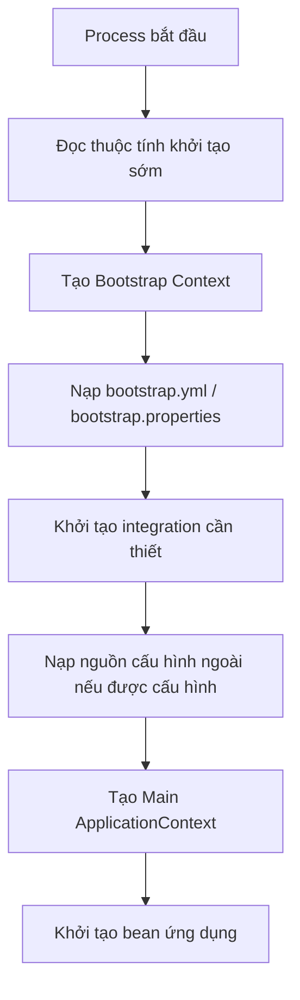

# spring.cloud.bootstrap.name, location và additional-location

Trong một số ứng dụng Spring Cloud, quá trình khởi động có thể tạo một **bootstrap context** trước ApplicationContext chính. Bootstrap context được dùng để nạp cấu hình cần thiết cho giai đoạn khởi tạo, chẳng hạn thông tin để kết nối Config Server hoặc các nguồn cấu hình ngoài. Khi dùng cơ chế bootstrap legacy, ba thuộc tính `spring.cloud.bootstrap.name`, `spring.cloud.bootstrap.location` và `spring.cloud.bootstrap.additional-location` điều khiển tên và vị trí tìm cấu hình bootstrap.

Các thuộc tính này dễ bị nhầm với `spring.config.name`, `spring.config.location` và `spring.config.additional-location` của Spring Boot Config Data. Chúng có tên gần giống nhau nhưng thuộc **hai cơ chế nạp cấu hình và hai thời điểm khởi tạo khác nhau**. Hiểu đúng ranh giới này giúp cấu hình Spring Cloud Config Client ổn định và tránh đặt property ở nơi quá muộn để có tác dụng.

## 1. Bootstrap context là gì?

Trong mô hình bootstrap legacy, Spring Cloud tạo một context cha (bootstrap context) trước context chính của ứng dụng. Context này có thể tạo các bean và property source cần thiết để chuẩn bị môi trường cho ứng dụng Spring Boot.

Luồng khái niệm:



Bootstrap context thường được dùng để chuẩn bị các thông tin cần thiết trước khi bean nghiệp vụ được khởi tạo. Ví dụ, Config Client có thể dùng tên ứng dụng, profile và địa chỉ Config Server để lấy property từ xa. Các property source thu được có thể được đưa vào Environment mà context chính sử dụng.

Một số điểm cần nhớ:

- Bootstrap context là cơ chế trong tiến trình JVM, không phải một máy chủ hoặc registry riêng.
- Config Server, Vault, registry hoặc hệ thống cấu hình khác vẫn là dịch vụ/hạ tầng bên ngoài.
- Bootstrap context giúp khởi tạo các integration sớm để lấy cấu hình; nó không tự tạo nguồn cấu hình.
- Bootstrap context legacy là một cách tổ chức nạp cấu hình của Spring Cloud. Ứng dụng Spring Boot hiện đại có thể dùng Config Data API thay cho cơ chế này.

## 2. Vai trò của ba thuộc tính bootstrap

| Thuộc tính | Vai trò | Giá trị thường gặp |
| --- | --- | --- |
| `spring.cloud.bootstrap.name` | Đặt tên cơ sở của file cấu hình bootstrap | `bootstrap` |
| `spring.cloud.bootstrap.location` | Chỉ định vị trí cấu hình bootstrap; dùng khi muốn điều chỉnh các vị trí tìm kiếm mặc định | `file:/etc/order-service/bootstrap/` |
| `spring.cloud.bootstrap.additional-location` | Bổ sung vị trí tìm cấu hình bootstrap bên cạnh các vị trí mặc định | `file:/etc/order-service/overrides/` |

Theo quy ước legacy, tên bootstrap mặc định là `bootstrap`; ứng dụng thường có `bootstrap.yml` hoặc `bootstrap.properties`. Khi thay tên, loader tìm cấu hình theo tên đã chọn, ví dụ `bootstrap-prod.yml` nếu tên cơ sở là `bootstrap-prod`.

Có thể hiểu ngắn gọn:

- **name** trả lời: “Tìm file bootstrap có tên gì?”
- **location** trả lời: “Tìm cấu hình bootstrap ở vị trí nào?”
- **additional-location** trả lời: “Ngoài vị trí mặc định, tìm thêm ở đâu?”

Ba thuộc tính này điều khiển việc tìm cấu hình của bootstrap context legacy. Chúng không phải thuộc tính chung để định vị mọi file cấu hình của ApplicationContext chính.

## 3. spring.cloud.bootstrap.name

Khi dùng bootstrap legacy, tên file mặc định là `bootstrap`. Có thể đổi tên cơ sở bằng:

```properties
spring.cloud.bootstrap.name=bootstrap-prod
```

Khi đó, loader sử dụng tên được chỉ định để tìm file cấu hình bootstrap tương ứng, ví dụ:

```text
bootstrap-prod.yml
bootstrap-prod.yaml
bootstrap-prod.properties
```

Các định dạng và vị trí được hỗ trợ phụ thuộc cơ chế loader và cấu hình ứng dụng. Điểm quan trọng là `name` thay đổi **tên cơ sở** của file cấu hình bootstrap; nó không đổi `spring.application.name`.

Hai thuộc tính có ý nghĩa riêng:

```yaml
spring:
  application:
    name: order-service
```

`spring.application.name` đặt danh tính logic của ứng dụng, thường được dùng làm tên dịch vụ hoặc tên ứng dụng khi truy cập cấu hình tập trung. `spring.cloud.bootstrap.name` chọn tên file bootstrap trong cơ chế legacy. Đổi tên file bootstrap không làm Service ID tự đổi thành `bootstrap-prod`.

### 3.1. Khi nào cần đổi tên?

Đổi tên có thể hữu ích khi:
- Có nhiều bộ cấu hình bootstrap cần chọn theo mục đích triển khai.
- Một nền tảng đã quy định tên file khác với `bootstrap`.
- Muốn tránh nhầm lẫn giữa các file bootstrap của nhiều ứng dụng hoặc profile.

Tuy nhiên, nếu chỉ cần giá trị khác nhau giữa local, test và production, profile hoặc externalized configuration thường là lựa chọn rõ ràng hơn. Không nên tạo nhiều tên bootstrap nếu một file bootstrap chung cùng các profile đã đáp ứng được nhu cầu.

### 3.2. Phải cung cấp name đủ sớm

Có một vòng phụ thuộc dễ gặp: muốn đọc `bootstrap-prod.yml` thì loader phải biết tên `bootstrap-prod` trước khi đọc file. Vì vậy, đặt `spring.cloud.bootstrap.name` bên trong chính file bootstrap mà nó phải lựa chọn thường là quá muộn để quyết định file ban đầu.

Hãy cung cấp thuộc tính này qua nguồn cấu hình sẵn có trước khi bootstrap context bắt đầu, chẳng hạn JVM system property hoặc biến môi trường:

```bash
java -Dspring.cloud.bootstrap.name=bootstrap-prod -jar order-service.jar
```

Hoặc:

```text
SPRING_CLOUD_BOOTSTRAP_NAME=bootstrap-prod
```

Cách truyền cụ thể phụ thuộc môi trường khởi chạy. Mục tiêu là thuộc tính phải hiện diện trong Environment ở thời điểm bootstrap loader quyết định tên file.

## 4. spring.cloud.bootstrap.location

`spring.cloud.bootstrap.location` chỉ định vị trí mà bootstrap legacy dùng để tìm cấu hình. Ví dụ, một tổ chức lưu cấu hình bootstrap ngoài artifact:

```bash
java \
  -Dspring.cloud.bootstrap.location=file:/etc/order-service/bootstrap/ \
  -jar order-service.jar
```

Thư mục có thể chứa file bootstrap theo tên đã chọn:

```text
/etc/order-service/bootstrap/
  bootstrap.yml
  bootstrap.properties
```

Nếu tên được đặt là `bootstrap-prod`, file tương ứng cần tuân thủ tên đó, ví dụ `bootstrap-prod.yml`.

Với filesystem location, cần chú ý:
- Process có quyền đọc file/thư mục.
- Đường dẫn tồn tại trong filesystem mà process nhìn thấy (đặc biệt khi chạy trong container).
- Dùng URI/prefix phù hợp, ví dụ `file:` cho filesystem.
- Nếu dùng đường dẫn tương đối, kết quả phụ thuộc working directory.
- Nếu dùng nhiều location, cần phân cách và sắp xếp theo cú pháp mà loader hỗ trợ.

Trong cơ chế legacy, `location` được dùng để thay đổi vị trí tìm kiếm bootstrap theo cấu hình đã cung cấp. Khi đặt nó, hãy kiểm tra tài liệu release train đang dùng để biết chính xác các vị trí mặc định nào được thay thế và cách kết hợp với các nguồn khác. Đừng suy ra rằng nó đồng nghĩa với `spring.config.location` của Spring Boot.

## 5. spring.cloud.bootstrap.additional-location

`spring.cloud.bootstrap.additional-location` dùng khi muốn **thêm** nơi tìm cấu hình bootstrap ngoài những vị trí mặc định. Ví dụ, giữ cấu hình bootstrap đóng gói trong ứng dụng nhưng bổ sung một thư mục ghi đè được mount từ môi trường triển khai:

```bash
java \
  -Dspring.cloud.bootstrap.additional-location=file:/etc/order-service/bootstrap-overrides/ \
  -jar order-service.jar
```

Cấu trúc thư mục ví dụ:

```text
classpath:
  bootstrap.yml

/etc/order-service/bootstrap-overrides/:
  bootstrap.yml
```

Đây là mô hình hữu ích khi muốn giữ cấu hình mặc định cùng artifact, nhưng cho phép nền tảng cung cấp thêm cấu hình theo môi trường.

### 5.1. Phân biệt location và additional-location

| Thuộc tính | Ý định | Cách dùng |
| --- | --- | --- |
| `spring.cloud.bootstrap.location` | Chỉ định lại vị trí tìm cấu hình bootstrap | Khi muốn chuyển nơi tìm kiếm sang location được quản lý bên ngoài |
| `spring.cloud.bootstrap.additional-location` | Thêm vị trí tìm kiếm | Khi muốn giữ vị trí mặc định và bổ sung thư mục ngoài |

Tên gọi phản ánh khác biệt quan trọng: `location` dùng để thay đổi vị trí tìm kiếm; `additional-location` dùng để bổ sung vị trí. Cả hai không nên bị coi là hai cách viết tương đương.

Thứ tự ưu tiên nếu cùng một key xuất hiện ở nhiều location còn phụ thuộc quy tắc xử lý của loader và thứ tự location. Hãy xác nhận giá trị hiệu lực qua Environment/log thay vì chỉ dựa vào tên thuộc tính.

## 6. Cung cấp thuộc tính bootstrap qua nguồn nào?

Các thuộc tính dùng để xác định tên/vị trí file bootstrap phải có sẵn **trước khi loader đọc các file đó**. Những cách truyền sớm thường dùng là JVM system properties hoặc biến môi trường của process.

Ví dụ với JVM:

```bash
java \
  -Dspring.cloud.bootstrap.name=bootstrap-prod \
  -Dspring.cloud.bootstrap.location=file:/etc/order-service/bootstrap/ \
  -Dspring.cloud.bootstrap.additional-location=file:/etc/order-service/overrides/ \
  -jar order-service.jar
```

Ví dụ với biến môi trường:

```text
SPRING_CLOUD_BOOTSTRAP_NAME=bootstrap-prod
SPRING_CLOUD_BOOTSTRAP_LOCATION=file:/etc/order-service/bootstrap/
SPRING_CLOUD_BOOTSTRAP_ADDITIONAL_LOCATION=file:/etc/order-service/overrides/
```

Spring Boot relaxed binding cho phép ánh xạ tên property sang biến môi trường theo quy tắc viết hoa và thay dấu chấm/gạch nối bằng dấu gạch dưới. Khi dùng launcher, container hoặc hệ thống điều phối, hãy xác nhận biến môi trường thực sự được đưa vào process.

Không nên đặt các thuộc tính quyết định nơi tìm file bootstrap chỉ trong file mà chúng đang quyết định có được đọc hay không. Đó là vấn đề thứ tự khởi tạo.

## 7. Ví dụ cấu hình bootstrap hoàn chỉnh

Giả sử `order-service` dùng bootstrap legacy và cần lấy cấu hình từ Config Server. Một file bootstrap có thể chứa:

```yaml
spring:
  application:
    name: order-service

  cloud:
    config:
      uri: http://config.internal:8888
      fail-fast: true
```

File này là ví dụ minh họa phần cấu hình client. Việc dùng bootstrap legacy còn phụ thuộc starter/cách kích hoạt bootstrap phù hợp với release train. Nếu muốn thay tên file và location, truyền các thuộc tính điều khiển bootstrap sớm từ JVM hoặc environment:

```bash
java \
  -Dspring.cloud.bootstrap.name=bootstrap \
  -Dspring.cloud.bootstrap.location=file:/etc/order-service/bootstrap/ \
  -jar order-service.jar
```

Trong ví dụ:
- `spring.application.name` định danh ứng dụng cho các integration như Config Client.
- `spring.cloud.config.uri` là địa chỉ Config Server.
- `spring.cloud.config.fail-fast` thể hiện chính sách phản ứng khi không lấy được cấu hình theo cơ chế Config Client tương ứng.
- `spring.cloud.bootstrap.name` và `location` xác định file bootstrap được tìm ở giai đoạn sớm.

Không nhầm `spring.cloud.config.uri` với `spring.cloud.bootstrap.location`: một thuộc tính là endpoint của dịch vụ Config Server; thuộc tính kia là vị trí file cấu hình bootstrap.

## 8. Phân biệt bootstrap legacy với Spring Boot Config Data

Đây là điểm quan trọng nhất khi làm việc với các phiên bản Spring Boot/Spring Cloud khác nhau.

Spring Boot 2.4 giới thiệu Config Data API, thay đổi đáng kể cách nạp cấu hình. Spring Cloud Config Client ở các thế hệ hỗ trợ Config Data có thể dùng:

```yaml
spring:
  application:
    name: order-service
  config:
    import: "optional:configserver:"
  cloud:
    config:
      uri: http://config.internal:8888
```

Trong cơ chế này, `spring.config.import` là điểm vào để nạp Config Server như một Config Data location. Nó không cần dùng bootstrap context legacy chỉ để lấy remote configuration theo cách cũ.

| Nội dung | Bootstrap legacy | Spring Boot Config Data |
| --- | --- | --- |
| Cơ chế | Bootstrap context của Spring Cloud | Config Data API của Spring Boot |
| File cấu hình thường gặp | `bootstrap.yml` / `bootstrap.properties` | `application.yml` / profile file và import |
| Thuộc tính chọn tên file | `spring.cloud.bootstrap.name` | `spring.config.name` |
| Thuộc tính location | `spring.cloud.bootstrap.location` | `spring.config.location` |
| Thuộc tính thêm location | `spring.cloud.bootstrap.additional-location` | `spring.config.additional-location` |
| Config Server | Có thể được khởi tạo trong bootstrap context | Dùng `spring.config.import=configserver:` |
| Mục đích | Cơ chế tương thích/legacy trong các ứng dụng cần bootstrap context | Cơ chế nạp cấu hình hiện đại của Spring Boot |

Các thuộc tính hai cột không thể hoán đổi tùy ý. Nếu ứng dụng dùng Config Data mà bạn chỉ đặt `spring.cloud.bootstrap.location`, điều đó không tự đổi nơi Spring Boot tìm `application.yml`. Ngược lại, `spring.config.location` không phải thuộc tính điều khiển file `bootstrap.yml` trong bootstrap legacy.

### 8.1. Bootstrap legacy có luôn được bật không?

Không nên giả định bootstrap context luôn tự chạy. Ở các thế hệ Spring Cloud mới hơn, cơ chế bootstrap legacy không còn là mặc định cho mọi ứng dụng; muốn dùng cần kích hoạt theo cách được release train hỗ trợ, thường thông qua `spring-cloud-starter-bootstrap` hoặc thuộc tính bật bootstrap được cung cấp sớm như system property/environment variable.

Ví dụ thêm starter trong Maven:

```xml
<dependency>
    <groupId>org.springframework.cloud</groupId>
    <artifactId>spring-cloud-starter-bootstrap</artifactId>
</dependency>
```

Dependency và cách kích hoạt cần tương thích với Spring Boot và Spring Cloud release train của dự án. Không thêm starter chỉ vì thấy một file `bootstrap.yml` trong repository; trước tiên xác định ứng dụng đang dùng cơ chế Config Data hay bootstrap legacy.

### 8.2. Khi nào nên giữ bootstrap legacy?

Có thể cần giữ cơ chế này khi:
- Ứng dụng hiện hữu phụ thuộc bootstrap context hoặc các bootstrap property source initializer.
- Một integration nội bộ được thiết kế cho bootstrap context.
- Việc chuyển sang Config Data cần một đợt thay đổi có kiểm thử và kiểm soát riêng.

Nếu dự án mới dùng Config Data và không có yêu cầu tương thích legacy, nên ưu tiên cơ chế hiện đại được tài liệu phiên bản hỗ trợ. Không nên trộn hai cơ chế chỉ để “thử xem cái nào chạy”; điều đó làm khó hiểu thứ tự nạp và nguồn property hiệu lực.

## 9. Precedence và cách xác định cấu hình nào thắng

Trong một ứng dụng có nhiều nguồn cấu hình, cùng một key có thể xuất hiện trong:
- JVM system properties hoặc environment.
- File bootstrap.
- Property source từ Config Server.
- File application và profile.
- File cấu hình ngoài.
- Tham số dòng lệnh.

Không nên suy luận precedence tổng thể chỉ từ thứ tự các dòng YAML. Bootstrap legacy có quy tắc ghép property source vào Environment chính; Config Server còn có chính sách override riêng; Spring Boot Config Data có quy tắc precedence riêng cho location/profile/import.

Cách an toàn là:
1. Xác định cơ chế nạp đang dùng: bootstrap legacy hay Config Data.
2. Kiểm tra log lúc startup để biết location nào đã được nạp.
3. Quan sát danh sách PropertySource trong Environment nếu cần.
4. Đọc giá trị hiệu lực của key cụ thể.
5. Kiểm tra policy override của Config Server và profile đang active.

Ví dụ kiểm tra giá trị hiệu lực trong ứng dụng:

```java
import org.springframework.core.env.Environment;
import org.springframework.stereotype.Component;

@Component
public class BootstrapDiagnostics {
    private final Environment environment;

    public BootstrapDiagnostics(Environment environment) {
        this.environment = environment;
    }

    public void logIdentity() {
        String name = environment.getProperty("spring.application.name");
        String configUri = environment.getProperty("spring.cloud.config.uri");

        // Chỉ ghi các giá trị không nhạy cảm đã được phép quan sát.
        System.out.println("application.name=" + name);
        System.out.println("config.uri=" + configUri);
    }
}
```

Không log token, mật khẩu, private key hoặc toàn bộ nội dung property source. Nếu cần quan sát chi tiết, giới hạn endpoint quản trị và dùng cơ chế che giá trị nhạy cảm.

## 10. Lỗi thường gặp và cách xử lý

| Hiện tượng | Nguyên nhân có thể | Cách kiểm tra |
| --- | --- | --- |
| Đổi `spring.cloud.bootstrap.name` nhưng file cũ vẫn được nạp | Thuộc tính được đặt quá muộn hoặc bootstrap legacy chưa được kích hoạt | Truyền property qua JVM/environment trước startup; kiểm tra starter/kích hoạt |
| `bootstrap.yml` không được đọc | Legacy bootstrap chưa bật hoặc dependency không phù hợp | Xác định cơ chế nạp cấu hình và release train |
| File ngoài không được tìm thấy | Sai URI, working directory, mount hoặc quyền đọc | Kiểm tra location trong filesystem của process |
| Đặt `spring.cloud.bootstrap.location` nhưng `application.yml` vẫn ở chỗ cũ | Nhầm bootstrap location với Boot Config Data location | Dùng `spring.config.location`/additional-location cho main config khi phù hợp |
| Config Server không được gọi | Cấu hình client đặt sai context, thiếu dependency hoặc đang dùng Config Data mà không import | Kiểm tra Config Client starter, import và log |
| Cấu hình remote không ghi đè giá trị local như mong đợi | Precedence hoặc policy override của Config Server | Kiểm tra PropertySource và thiết lập override |
| Bootstrap context không xuất hiện trong ứng dụng mới | Cơ chế legacy không còn mặc định | Kích hoạt đúng cách theo release train hoặc chuyển sang Config Data |
| Chạy local được nhưng container không đọc file | Đường dẫn tồn tại trên host nhưng chưa mount vào container | Kiểm tra volume, path và user của container |

### 10.1. Quy trình chẩn đoán ngắn

Khi cấu hình bootstrap không có tác dụng, lần lượt trả lời:

1. Dự án có thực sự dùng bootstrap legacy không?
2. Bootstrap mechanism đã được kích hoạt và dependency có mặt chưa?
3. Các thuộc tính `spring.cloud.bootstrap.*` đã có trong Environment trước khi bootstrap loader chạy chưa?
4. Tên file và vị trí có đúng với filesystem/classpath của process không?
5. Config Client có kết nối được Config Server không?
6. Property source mong muốn có được thêm vào Environment không?
7. Giá trị hiệu lực có bị một nguồn có precedence cao hơn ghi đè không?

Đi theo thứ tự này giúp phân biệt lỗi kích hoạt bootstrap, lỗi tìm file, lỗi kết nối remote và lỗi precedence.

## 11. Kiểm thử lựa chọn name/location/additional-location

Các thuộc tính bootstrap quyết định hành vi ở giai đoạn rất sớm. Vì vậy, unit test thông thường tạo một bean sau khi context đã khởi tạo không đủ để xác nhận loader đã chọn đúng file. Cần integration test khởi động ứng dụng với system property/environment được truyền từ trước.

Một kế hoạch kiểm thử có thể gồm:

| Ca kiểm thử | Cấu hình đầu vào | Kết quả cần xác nhận |
| --- | --- | --- |
| Mặc định | Không đặt bootstrap name | Loader dùng quy ước tên mặc định `bootstrap` khi legacy bootstrap hoạt động |
| Đổi tên | `spring.cloud.bootstrap.name=bootstrap-prod` | File theo tên mới được chọn |
| Location riêng | Truyền `spring.cloud.bootstrap.location` | Bootstrap loader tìm ở location đã cấu hình |
| Additional location | Truyền `spring.cloud.bootstrap.additional-location` | Location bổ sung được đưa vào quá trình tìm cấu hình |
| Sai đường dẫn | Location không tồn tại | Hành vi lỗi/optional tùy loader và cách khai báo |
| Legacy chưa bật | Không có starter/kích hoạt bootstrap | Không kỳ vọng các thuộc tính bootstrap legacy điều khiển Config Data |
| Config Server unavailable | Required hoặc optional theo thiết kế | Startup phản ứng đúng với chính sách đã chọn |

Khi kiểm thử, nên tạo các file có key đánh dấu khác nhau để nhận biết nguồn nào thực sự được nạp. Ví dụ, file classpath đặt `bootstrap.source=classpath`, file ngoài đặt `bootstrap.source=external`; sau startup đọc Environment để kiểm tra giá trị hiệu lực.

Không nên chỉ xác nhận process khởi động thành công. Cần xác minh đúng file đã được chọn và property mong muốn thực sự có trong Environment.

## 12. Những nguyên tắc vận hành

- Đặt các thuộc tính chọn tên/vị trí bootstrap trong nguồn có sẵn trước khi bootstrap context khởi tạo.
- Dùng đường dẫn tuyệt đối hoặc URI rõ ràng trong môi trường triển khai để tránh phụ thuộc working directory.
- Bảo đảm container/process có quyền đọc location.
- Ghi rõ ứng dụng đang dùng bootstrap legacy hay Config Data trong tài liệu triển khai.
- Chọn một cơ chế làm nguồn chính cho remote configuration, tránh trộn hai cơ chế không có chủ đích.
- Kiểm tra phiên bản Spring Boot, Spring Cloud release train và Config Client trước khi thay đổi dependency hoặc cú pháp.
- Quan sát property source và giá trị hiệu lực mà không làm lộ secret.
- Kiểm thử cả trường hợp file có mặt, file vắng mặt, Config Server không sẵn sàng và property bị ghi đè.

## Ghi nhớ

Trong bootstrap legacy, `spring.cloud.bootstrap.name` chọn tên file bootstrap, `spring.cloud.bootstrap.location` điều chỉnh vị trí tìm kiếm và `spring.cloud.bootstrap.additional-location` bổ sung vị trí tìm kiếm. Chúng phải được cung cấp đủ sớm để bootstrap loader sử dụng. Hãy phân biệt ba thuộc tính này với `spring.config.name/location/additional-location` của Spring Boot Config Data. Trước khi cấu hình, xác định đúng cơ chế khởi tạo và phiên bản Spring Cloud đang chạy; sau đó kiểm tra file thực tế được nạp và giá trị hiệu lực trong Environment.
