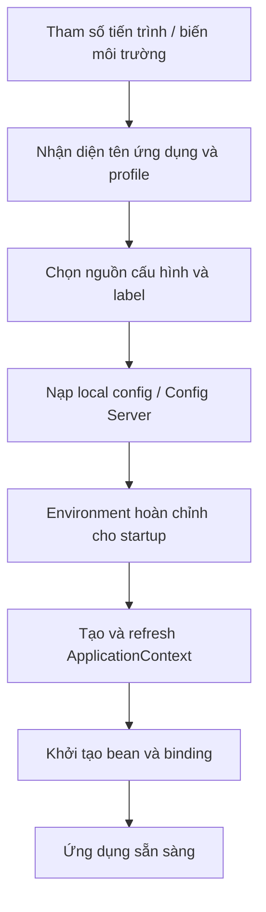

# Nạp cấu hình theo profile trong giai đoạn bootstrap

Một ứng dụng Spring Cloud có thể cần biết **tên ứng dụng, profile, địa chỉ Config Server và label cấu hình** trước khi các bean nghiệp vụ được tạo. Những giá trị này quyết định ứng dụng sẽ lấy bộ cấu hình nào, từ nguồn nào và theo phiên bản nào. Nếu phân biệt không rõ giai đoạn bootstrap với giai đoạn tạo `ApplicationContext` chính, ta dễ gặp lỗi như lấy nhầm cấu hình `default`, kết nối sai Config Server, hoặc một profile hoạt động ở máy phát triển nhưng không có hiệu lực trong container.

Bài học thuộc chương **Bootstrap** của module `SPRING_CLOUD_CORE`. Trọng tâm là cách profile tham gia quá trình nạp cấu hình, vai trò của bootstrap context trong cơ chế Spring Cloud cũ, và cách Spring Boot Config Data kết hợp với Spring Cloud Config Client trong các ứng dụng hiện đại. Đây là nền tảng để hiểu cấu hình bên ngoài, Spring Cloud Context, refresh scope và cách vận hành nhiều instance có cùng một hợp đồng cấu hình.

## 1. Bootstrap là giai đoạn nào?

**Bootstrap** là giai đoạn chuẩn bị những thông tin cần thiết để ứng dụng có thể xây dựng môi trường cấu hình và khởi tạo các thành phần chính. Với ứng dụng Spring Cloud, một số thông tin cần có rất sớm:

- Tên ứng dụng (`spring.application.name`) để Config Server chọn bộ cấu hình tương ứng.
- Profile hoạt động (`spring.profiles.active`) để chọn cấu hình theo môi trường hoặc vai trò triển khai.
- Label (`spring.cloud.config.label`) để chọn nhánh, tag hoặc revision cấu hình ở backend.
- Địa chỉ và thông tin kết nối Config Server (`spring.cloud.config.uri`, TLS, xác thực).
- Các khai báo import và config location để biết cần nạp thêm nguồn cấu hình nào.

Các thông tin này phải sẵn có đủ sớm để hệ thống biết cần đọc cấu hình nào. Sau khi `Environment` được chuẩn bị, Spring tạo và refresh `ApplicationContext`, đăng ký và khởi tạo bean, bind `@ConfigurationProperties`, rồi ứng dụng mới sẵn sàng phục vụ request.



Sơ đồ thể hiện quan hệ khái quát. Cách triển khai cụ thể phụ thuộc dòng Spring Boot/Spring Cloud: cơ chế bootstrap context truyền thống và Config Data API hiện đại có trình tự nội bộ khác nhau. Không nên áp dụng một mô tả duy nhất cho mọi phiên bản.

## 2. Profile là gì và ảnh hưởng đến việc nạp cấu hình ra sao?

Profile là nhãn điều kiện để bật cấu hình hoặc bean phù hợp với một môi trường hay vai trò chạy. Ví dụ:

| Profile | Mục đích minh họa |
| --- | --- |
| `local` | Phát triển trên máy cá nhân |
| `test` | Chạy kiểm thử tích hợp |
| `staging` | Kiểm tra trước production |
| `prod` | Môi trường production |
| `region-a` | Cấu hình riêng cho một vùng triển khai |

Profile không tự tạo ra một môi trường độc lập. Nó tham gia lựa chọn tài liệu cấu hình và điều kiện kích hoạt bean. Ví dụ, `application-prod.yml` có thể ghi đè một số giá trị trong `application.yml` khi profile `prod` được kích hoạt.

### 2.1. Kích hoạt profile

Profile có thể được kích hoạt từ nhiều nguồn:

```yaml
spring:
  profiles:
    active: prod,region-a
```

Hoặc bằng biến môi trường:

```text
SPRING_PROFILES_ACTIVE=prod,region-a
```

Hoặc tham số dòng lệnh:

```bash
java -jar catalog-service.jar --spring.profiles.active=prod,region-a
```

Tham số dòng lệnh có độ ưu tiên cao trong các nguồn cấu hình tiêu chuẩn của Spring Boot, vì vậy có thể ghi đè giá trị profile đến từ Config Data hoặc environment variables. Khi debug, cần kiểm tra giá trị hiệu lực của `spring.profiles.active`, không chỉ đọc một tệp cấu hình.

Nếu không kích hoạt profile nào, Spring Boot sử dụng profile mặc định có tên `default` cho những tài liệu/bean áp dụng theo default profile. Profile `default` là tên quy ước, không có nghĩa ứng dụng tự động dùng môi trường production hay local.

### 2.2. Nhiều profile cùng hoạt động

Một tiến trình có thể kích hoạt nhiều profile, ví dụ:

```text
SPRING_PROFILES_ACTIVE=prod,region-a,metrics
```

Điều này cho phép kết hợp cấu hình theo môi trường, khu vực và năng lực. Khi nhiều tài liệu cùng định nghĩa một key, thứ tự profile và thứ tự ưu tiên property source có thể quyết định giá trị cuối cùng. Trong các trường hợp thông thường, profile được liệt kê sau có thể ghi đè profile trước trong cùng nhóm cấu hình profile-specific; cần kiểm chứng trên nguồn và phiên bản thực tế.

Đừng dùng nhiều profile như một cách thay thế cho quản lý cấu hình có cấu trúc. Nếu các tổ hợp profile quá nhiều và phụ thuộc chéo, nên xem xét profile group hoặc tách rõ cấu hình nền, môi trường và khu vực.

### 2.3. Profile group

Spring Boot hỗ trợ nhóm nhiều profile dưới một tên tổng hợp:

```yaml
spring:
  profiles:
    group:
      production:
        - prod-db
        - prod-metrics
        - prod-security
```

Khi kích hoạt `production`, các profile thành viên được đưa vào tập profile hoạt động theo quy tắc của Spring Boot. Nhờ vậy, lệnh triển khai có thể dùng một tên rõ nghĩa thay vì phải liệt kê nhiều profile con.

Các thuộc tính `spring.profiles.active`, `spring.profiles.default`, `spring.profiles.include` và khai báo profile group phải được đặt trong tài liệu cấu hình không phụ thuộc profile-specific. Không đặt `spring.profiles.active` trong một tài liệu chỉ được kích hoạt bởi profile khác; Spring Boot không cho phép cách cấu hình vòng này. Với tài liệu có điều kiện, dùng `spring.config.activate.on-profile` để xác định khi nào nội dung tài liệu được áp dụng.

## 3. Hai cơ chế nạp cấu hình: legacy bootstrap và Config Data

Trong lịch sử Spring Cloud, bootstrap context được dùng để nạp cấu hình từ xa trước khi tạo context ứng dụng chính. Spring Boot 2.4 đưa vào Config Data API; Spring Cloud Config Client hiện đại tích hợp với cơ chế này qua `spring.config.import`.

| Khía cạnh | Legacy bootstrap context | Config Data API hiện đại |
| --- | --- | --- |
| Cách kích hoạt phổ biến | `spring-cloud-starter-bootstrap` hoặc cờ bootstrap được đặt đủ sớm | Khai báo `spring.config.import` |
| Tệp/cấu hình thường gặp | `bootstrap.yml`, `bootstrap.properties` | `application.yml`, profile-specific documents và config import |
| Cách lấy Config Server | Bootstrap integration của Config Client | Location `configserver:` qua Config Data resolver/loader |
| Vị trí trong kiến trúc | Bootstrap context riêng, thường làm parent của context chính | Nạp trong quy trình Config Data chuẩn bị Environment của Spring Boot |
| Hướng dùng cho ứng dụng mới | Chỉ dùng khi có lý do tương thích/kiến trúc cụ thể | Cách tiếp cận được khuyến nghị cho ứng dụng hiện đại |

Không nên mặc định cả hai cơ chế đều hoạt động hoặc cần được cấu hình cùng lúc. Trong nhiều tổ hợp Spring Boot/Spring Cloud hiện đại, legacy bootstrap không tự bật; muốn dùng phải thêm starter hoặc bật cơ chế tương ứng theo tài liệu của release train. Hãy xác định rõ phiên bản trước khi chọn cách cấu hình.

## 4. Legacy bootstrap context và bootstrap.yml

### 4.1. Bootstrap context hoạt động như thế nào?

Trong cơ chế truyền thống, Spring Cloud tạo một **bootstrap context** riêng trước context chính. Context này chịu trách nhiệm nạp một số cấu hình nền và các property source từ xa. Sau đó context ứng dụng chính được tạo với môi trường đã được bổ sung từ bootstrap.

`bootstrap.yml` hoặc `bootstrap.properties` là nơi thường đặt thông tin cần thiết cho giai đoạn này. Ví dụ:

```yaml
spring:
  application:
    name: catalog-service
  cloud:
    config:
      uri: https://config.internal.example
      label: main
      profile: prod,region-a
```

Các giá trị trong ví dụ giúp Config Client biết tên ứng dụng, địa chỉ server, label và profile cần truy vấn. Không đưa secret trực tiếp vào tệp được commit; dùng cơ chế cấp phát an toàn cho credential/TLS.

### 4.2. Bật cơ chế bootstrap

Với những dòng Spring Cloud sử dụng legacy bootstrap, cơ chế này thường được bật bằng dependency:

```xml
<dependency>
    <groupId>org.springframework.cloud</groupId>
    <artifactId>spring-cloud-starter-bootstrap</artifactId>
</dependency>
```

Hoặc qua thuộc tính hệ thống/biến môi trường được đọc đủ sớm:

```text
SPRING_CLOUD_BOOTSTRAP_ENABLED=true
```

Không đặt cờ kích hoạt bootstrap trong chính nguồn cấu hình chỉ có thể được đọc sau khi bootstrap context đã chạy. Cách bật và trạng thái mặc định phụ thuộc phiên bản Spring Cloud; hãy dùng dependency management tương thích với Spring Boot và kiểm tra release documentation.

### 4.3. Phân biệt bootstrap.yml và application.yml

| Tệp | Vai trò điển hình trong legacy mode |
| --- | --- |
| `bootstrap.yml` | Cấu hình để bootstrap context biết cách nạp cấu hình nền/remote source |
| `application.yml` | Cấu hình ứng dụng chính, dùng để tạo bean và chạy service |
| `application-prod.yml` | Cấu hình ứng dụng dành cho profile `prod` |
| `bootstrap-prod.yml` | Tài liệu bootstrap theo profile nếu cơ chế/phiên bản đang dùng hỗ trợ và profile được xác định đủ sớm |

Giữ `bootstrap.yml` nhỏ và tập trung vào thông tin cần trước khi nạp cấu hình từ xa. Các cấu hình nghiệp vụ như timeout, endpoint downstream, giới hạn xử lý nên đặt ở nguồn cấu hình ứng dụng phù hợp thay vì dồn hết vào bootstrap.

Trong legacy mode, bootstrap context thường là parent context của ứng dụng chính. Điều đó không biến nó thành một context toàn cụm: mỗi JVM vẫn có bootstrap context và application context riêng. Property source có thể được chia sẻ qua quan hệ parent-child trong cùng tiến trình, nhưng không tự chia sẻ giữa các instance.

### 4.4. Tên ứng dụng, profile và label gửi tới Config Server

Config Client cần chọn đúng bộ cấu hình trên Config Server. Các thuộc tính thường gặp:

| Thuộc tính | Ý nghĩa |
| --- | --- |
| `spring.application.name` | Tên ứng dụng mặc định dùng để chọn cấu hình |
| `spring.cloud.config.name` | Tên ứng dụng dùng cho Config Client khi cần ghi đè tên mặc định |
| `spring.cloud.config.profile` | Profile được yêu cầu từ Config Server; nếu không chỉ định, client thường dựa trên profile active/default theo cơ chế tương ứng |
| `spring.cloud.config.label` | Label như branch, tag hoặc commit identifier tùy backend |
| `spring.cloud.config.uri` | Địa chỉ Config Server khi dùng kết nối trực tiếp |

Ví dụ request logic:

```text
application = catalog-service
profiles    = prod,region-a
label       = main
```

Config Server dùng các tham số đó để kết hợp property source chung và property source theo ứng dụng/profile. Nếu sai một trong các tham số, client có thể kết nối thành công nhưng nhận cấu hình không mong muốn. Vì vậy, “HTTP 200 từ Config Server” không đủ để chứng minh đã lấy đúng bộ cấu hình.

## 5. Profile-specific configuration với Config Data API

Với ứng dụng hiện đại, có thể khai báo Config Server import trực tiếp trong `application.yml`:

```yaml
spring:
  application:
    name: catalog-service
  config:
    import: "optional:configserver:https://config.internal.example"
```

`optional:` cho phép ứng dụng tiếp tục khi Config Server không sẵn sàng theo semantics của Config Client. Nếu Config Server là nguồn bắt buộc, bỏ `optional:` để startup thất bại khi không nạp được cấu hình thiết yếu.

Các profile có thể được cấp từ environment variable hoặc tham số khởi động:

```text
SPRING_PROFILES_ACTIVE=prod,region-a
SPRING_CLOUD_CONFIG_LABEL=main
```

Config Client dùng application name, profile và label để lấy cấu hình từ server. Khi có nhiều profile, server có thể trả các property source tương ứng để client hợp nhất theo thứ tự và quy tắc ưu tiên của Config Data.

### 5.1. Tài liệu profile-specific trong application.yml

Spring Boot cho phép nhiều tài liệu YAML được phân tách bằng `---`, với điều kiện kích hoạt profile:

```yaml
catalog:
  client:
    connect-timeout: 2s
    read-timeout: 3s
---
spring:
  config:
    activate:
      on-profile: prod

catalog:
  client:
    connect-timeout: 800ms
    read-timeout: 1500ms
```

Tài liệu thứ hai chỉ được áp dụng khi profile `prod` active. Có thể tổ chức tương tự trong `application-prod.yml`. Các key profile-specific thường có độ ưu tiên cao hơn tài liệu không gắn profile trong cùng ngữ cảnh Config Data.

Không dùng `spring.profiles.active` để kích hoạt chính tài liệu profile-specific. Hãy kích hoạt profile từ nguồn không phụ thuộc profile đó, chẳng hạn biến môi trường `SPRING_PROFILES_ACTIVE`, tham số dòng lệnh hoặc tài liệu cấu hình chung.

### 5.2. Cấu hình profile-specific từ Config Server

Repository cấu hình có thể tổ chức các file như:

```text
config-repo/
  application.yml
  application-prod.yml
  catalog-service.yml
  catalog-service-prod.yml
  catalog-service-region-a.yml
```

Tên file cụ thể phụ thuộc backend và quy ước Config Server. Thông thường, `application` chứa cấu hình dùng chung; tên ứng dụng chứa cấu hình riêng; hậu tố profile biểu thị cấu hình theo profile. Khi client yêu cầu `catalog-service` với profile `prod`, Config Server kết hợp các nguồn phù hợp theo cơ chế của server và trả về cho client.

Ví dụ cấu hình chung:

```yaml
# application.yml trong repository cấu hình
catalog:
  client:
    connect-timeout: 2s
    retries: 2
```

Cấu hình riêng production:

```yaml
# catalog-service-prod.yml
catalog:
  client:
    connect-timeout: 800ms
    retries: 4
```

Cấu hình riêng theo khu vực:

```yaml
# catalog-service-region-a.yml
catalog:
  client:
    base-url: https://catalog-a.internal
```

Hãy kiểm tra response của Config Server và các property source trả về để xác nhận file nào thực sự được áp dụng. Đừng suy ra thứ tự ưu tiên chỉ từ tên file nếu có nhiều profile, label hoặc override policy.

## 6. Thứ tự profile, property source và giá trị hiệu lực

Một giá trị cuối cùng có thể đến từ nhiều lớp:

1. Default trong mã Java hoặc cấu hình ứng dụng.
2. Cấu hình chung `application.yml`.
3. Tài liệu theo profile, ví dụ `application-prod.yml`.
4. Cấu hình từ Config Server được import.
5. Biến môi trường, system property, `SPRING_APPLICATION_JSON` và command line.
6. Các property source được integration hoặc test thêm vào.

Danh sách trên chỉ để hình dung các lớp thường gặp, không phải một thứ tự tuyệt đối cho mọi cấu hình. Thứ tự thực tế phụ thuộc Config Data import, profile, property source và các quy tắc override của Spring Cloud Config. Đặc biệt, Config Server có thể điều khiển khả năng override remote property source bằng các thuộc tính như `spring.cloud.config.allowOverride`, `overrideNone` và `overrideSystemProperties` theo semantics của phiên bản. Một số thuộc tính override này phải được đặt từ **nguồn remote** để có hiệu lực; không nên chỉ thêm chúng ở local client rồi giả định đã thay đổi chính sách.

Ví dụ, nếu `catalog.client.connect-timeout` được đặt thành `2s` ở cấu hình chung, `800ms` ở profile `prod`, và `500ms` ở biến môi trường, giá trị cuối cùng phụ thuộc thứ tự ưu tiên và chính sách remote override đang áp dụng. Cách chắc chắn là kiểm tra `Environment`/property sources trong môi trường đã bảo vệ và quan sát giá trị bind vào bean.

## 7. Nạp cấu hình từ xa có điều kiện theo profile

Đôi khi chỉ một profile mới cần import Config Server hoặc một nguồn ngoài. Config Data hỗ trợ khai báo import trong tài liệu có điều kiện:

```yaml
spring:
  application:
    name: catalog-service
---
spring:
  config:
    activate:
      on-profile: prod
    import: "configserver:https://config.internal.example"
```

Trong ví dụ, location Config Server chỉ được dùng khi tài liệu có điều kiện `prod` được kích hoạt. Cần đặt các thông tin đủ sớm để resolver hoạt động và kiểm thử rõ hành vi khi profile không active. Nếu mọi môi trường đều cần Config Server, khai báo import ở tài liệu chung thường dễ hiểu và dễ vận hành hơn.

Không nên đặt `spring.config.import` trong remote configuration mà ứng dụng chỉ có thể đọc được sau khi đã kết nối Config Server. Để bắt đầu kết nối, client cần biết location từ một nguồn đã có sẵn trước đó.

## 8. Legacy bootstrap và Config Data: chọn và di trú

### 8.1. Khi nào còn cần legacy bootstrap?

Legacy bootstrap có thể vẫn cần cho ứng dụng cũ hoặc integration được thiết kế dựa trên bootstrap context. Nếu hệ thống đang chạy ổn định, trước khi di trú cần kiểm tra:

- Spring Boot và Spring Cloud release train đang dùng.
- Có dependency `spring-cloud-starter-bootstrap` hoặc cờ bật bootstrap không.
- Các file `bootstrap.yml`/`bootstrap-{profile}.yml` đang chứa những thuộc tính nào.
- Có custom `PropertySourceLocator`, bootstrap configuration hoặc thư viện tự viết phụ thuộc bootstrap context không.
- Config Server remote override policy đang được sử dụng ra sao.
- Có cả `spring.config.import=configserver:` và legacy bootstrap cùng nạp một nguồn hay không.

Không nên xóa bootstrap starter chỉ vì thấy `spring.config.import` trong một file. Trước tiên phải xác nhận không còn thành phần cần bootstrap context và kiểm thử hành vi profile/precedence sau khi chuyển.

### 8.2. Quy trình di trú khái quát

1. Ghi nhận profile, tên ứng dụng, URI, label, authentication và các nguồn remote hiện tại.
2. Xác định dependency và extension nào phụ thuộc legacy bootstrap.
3. Chọn Config Data import theo phiên bản Boot/Cloud hỗ trợ.
4. Di chuyển location Config Server và các thuộc tính kết nối cần thiết sang nguồn cấu hình ban đầu phù hợp.
5. Chuyển profile activation sang `spring.profiles.active`, profile-specific documents hoặc profile groups đúng quy tắc.
6. So sánh property sources và giá trị bind trước/sau di trú.
7. Kiểm thử khi Config Server không sẵn sàng, khi profile thay đổi và khi remote property source có key trùng local.
8. Chỉ loại bỏ legacy bootstrap khi đã xác nhận không còn dependency hoặc extension cần nó.

### 8.3. Tránh nạp trùng cấu hình

Nếu legacy bootstrap và Config Data cùng truy cập Config Server, một số property source có thể xuất hiện hai lần hoặc có thứ tự khác dự kiến. Hệ quả là một giá trị bị ghi đè mà khó nhận ra, profile được yêu cầu không nhất quán hoặc startup thực hiện nhiều request hơn cần thiết.

Nên chọn một cơ chế làm đường nạp chính cho Config Server trong từng ứng dụng. Nếu bắt buộc phải duy trì hai cơ chế trong giai đoạn chuyển tiếp, ghi rõ mục đích và xác minh thứ tự property source bằng integration test.

## 9. Profile và bean có điều kiện

Profile còn có thể điều khiển bean nào được đăng ký:

```java
import org.springframework.context.annotation.Profile;
import org.springframework.stereotype.Component;

@Component
@Profile("prod")
public class ProductionAuditPublisher implements AuditPublisher {
    // Implementation dùng trong production.
}
```

Hoặc cấu hình nhiều profile:

```java
@Component
@Profile({"prod", "staging"})
public class RemoteAuditPublisher implements AuditPublisher {
    // Được đăng ký khi một trong các profile phù hợp đang active.
}
```

`@Profile` điều khiển việc đăng ký bean trong context. Nó không tự thay đổi Config Server label, không tự tạo property source và không đồng bộ bean giữa các instance. Nếu hai replica khởi động với profile khác nhau, chúng có thể đăng ký tập bean khác nhau và hành vi service cũng khác nhau.

Với một deployment replica đồng nhất, nên cấp cùng profile cần thiết cho tất cả Pod trong cùng workload. Nếu có replica chuyên biệt theo vai trò hoặc khu vực, hãy thể hiện sự khác biệt đó có chủ đích trong deployment manifest, readiness và monitoring.

## 10. Kiểm thử nạp cấu hình theo profile

Kiểm thử nên xác minh không chỉ việc context khởi động, mà cả **profile thực tế, nguồn cấu hình được chọn và giá trị bean nhận được**.

| Kịch bản | Cách kiểm thử | Điều cần xác nhận |
| --- | --- | --- |
| Không active profile | Khởi động với cấu hình mặc định | Profile `default` và giá trị mặc định được áp dụng |
| Một profile | Kích hoạt `prod` | Tài liệu `prod` được nạp và ghi đè đúng key |
| Nhiều profile | Kích hoạt `prod,region-a` | Thứ tự và kết quả hợp nhất đúng thiết kế |
| Profile group | Kích hoạt group `production` | Các profile thành viên được active theo khai báo |
| Config Server | Dùng server kiểm thử và tên ứng dụng/profile/label cố định | Client nhận đúng property source |
| Required remote config | Tắt Config Server | Startup thất bại như chính sách yêu cầu |
| Optional remote config | Tắt Config Server | Ứng dụng tiếp tục chỉ khi default đủ an toàn |
| Remote/local collision | Cùng key có giá trị khác nhau | Giá trị cuối cùng khớp override policy |
| Legacy bootstrap | Chạy với bootstrap starter/cờ đúng phiên bản | Bootstrap context nạp đúng nguồn và profile |
| Migration | Chạy hai cách trong môi trường test riêng | Kết quả property binding tương đương theo yêu cầu |

Ví dụ test với profile cụ thể:

```java
import org.junit.jupiter.api.Test;
import org.springframework.beans.factory.annotation.Autowired;
import org.springframework.boot.test.context.SpringBootTest;
import org.springframework.core.env.Environment;
import org.springframework.test.context.ActiveProfiles;

@SpringBootTest
@ActiveProfiles({"prod", "region-a"})
class ProfileConfigurationTest {
    @Autowired
    Environment environment;

    @Test
    void loadsExpectedProfiles() {
        // Assert profile prod và region-a đang active.
        // Assert property theo profile có giá trị mong đợi.
    }
}
```

Đây là khung minh họa. Nếu test cần kiểm tra Config Server thật, hãy cấu hình endpoint test riêng hoặc dùng fixture/mock tại ranh giới HTTP; tránh phụ thuộc vào Config Server production. Với legacy bootstrap, cách khởi tạo test context và bật bootstrap có thể cần cấu hình riêng theo phiên bản.

## 11. Chẩn đoán lỗi bootstrap và profile

| Triệu chứng | Nguyên nhân có thể | Hướng kiểm tra |
| --- | --- | --- |
| Client nhận cấu hình `default` | Profile chưa active khi Config Client gửi request | Kiểm tra `SPRING_PROFILES_ACTIVE`, command line và startup log |
| Kết nối Config Server thành công nhưng cấu hình sai | Sai application name, profile hoặc label | Kiểm tra request và property sources server trả về |
| `bootstrap.yml` không có tác dụng | Legacy bootstrap chưa được bật hoặc đang dùng Config Data mode | Kiểm tra dependency bootstrap và cơ chế nạp theo phiên bản |
| `spring.config.import` bị bỏ qua | Import nằm trong tài liệu/profile không được kích hoạt hoặc Config Client không có trên classpath | Kiểm tra active profile, Config Data import và dependency |
| Hai nguồn remote ghi đè lẫn nhau | Legacy bootstrap và Config Data cùng nạp Config Server | Kiểm tra property source trùng và chọn cơ chế chính |
| Local không ghi đè remote như dự kiến | Remote override policy không cho phép | Kiểm tra thuộc tính override do server cấp và semantics phiên bản |
| Một replica dùng profile khác | Deployment env/args hoặc image khác nhau | So sánh Pod spec, process args, image digest và active profiles |
| Startup thất bại khi server vắng mặt | Import bắt buộc hoặc retry hết hạn | Kiểm tra `optional:`, timeout, retry và chính sách fail-fast |
| Startup thành công nhưng thiếu key quan trọng | Import optional bị bỏ qua hoặc profile sai | Kiểm tra validation, readiness và property source thực tế |

Trình tự kiểm tra đề xuất:

1. Ghi lại Spring Boot version và Spring Cloud release train.
2. Xác định ứng dụng đang dùng legacy bootstrap hay Config Data.
3. Kiểm tra tên ứng dụng, profile active, profile yêu cầu Config Server và label.
4. Xác minh Config Server URI, authentication, TLS và khả năng kết nối từ đúng instance.
5. Xem property source được trả về và thứ tự ưu tiên cuối cùng.
6. Kiểm tra giá trị đã bind vào `@ConfigurationProperties` và bean tiêu thụ.
7. So sánh từng replica để tìm khác biệt profile, env, image và revision cấu hình.

Actuator `env`/`configprops` có thể hỗ trợ chẩn đoán nếu được bật và bảo vệ đúng cách. Không công khai các endpoint này tùy tiện vì chúng có thể tiết lộ tên key, cấu trúc cấu hình hoặc dữ liệu nhạy cảm.

## 12. Thực hành: cùng một service chạy staging và production

Giả sử `catalog-service` dùng Config Server. Cấu hình chung trong `application.yml`:

```yaml
spring:
  application:
    name: catalog-service
  config:
    import: "configserver:https://config.internal.example"
```

Trong môi trường staging:

```text
SPRING_PROFILES_ACTIVE=staging,region-a
SPRING_CLOUD_CONFIG_LABEL=main
```

Trong production:

```text
SPRING_PROFILES_ACTIVE=prod,region-a
SPRING_CLOUD_CONFIG_LABEL=release-2026
```

Config Server có thể duy trì cấu hình chung cho `catalog-service`, sau đó áp dụng phần riêng theo profile và label. Cùng một JAR được triển khai ở hai môi trường, nhưng `Environment` và bean properties được bind theo bộ cấu hình được chọn ở từng lần khởi động.

Các bước xác minh:

1. Xác nhận hai workload dùng đúng cùng artifact/image digest nếu mục tiêu là so sánh cấu hình.
2. Ghi lại active profiles và Config Server label của mỗi workload.
3. Kiểm tra Config Server response cho application/profile/label tương ứng.
4. Kiểm tra các giá trị properties quan trọng sau binding, tránh log secret.
5. Xác nhận readiness và health check phản ánh đúng điều kiện cấu hình bắt buộc.
6. Khi thay đổi cấu hình, xác định cần refresh, phát sự kiện hay rollout/restart theo cơ chế ứng dụng đang dùng.

### Câu hỏi tự kiểm tra

1. Vì sao tên ứng dụng và profile cần được biết trước khi lấy cấu hình từ Config Server?
2. Bootstrap context trong legacy Spring Cloud khác Config Data API hiện đại ở điểm nào?
3. Nếu không có profile active, Spring Boot sử dụng profile mặc định nào?
4. Khi nhiều profile cùng active, tại sao phải kiểm tra thứ tự profile và property source?
5. `spring.cloud.config.label` dùng để chọn thông tin gì?
6. Vì sao không nên đặt `spring.profiles.active` trong tài liệu chỉ được kích hoạt bởi một profile?
7. `optional:configserver:` và `configserver:` khác nhau như thế nào khi server không sẵn sàng?
8. Vì sao không nên nạp cùng một Config Server bằng cả legacy bootstrap và Config Data mà không có kế hoạch?
9. Một replica đã nhận profile `prod` có chứng minh replica khác cũng dùng `prod` không?

**Gợi ý đáp án:** (1) Để server chọn đúng cấu hình ứng dụng/profile; (2) Legacy dùng bootstrap context riêng, Config Data nạp location trong quy trình cấu hình chuẩn của Boot; (3) `default`; (4) Vì các nguồn cùng key có thể ghi đè nhau; (5) Branch/tag/revision cấu hình; (6) Tránh vòng phụ thuộc khi xác định profile; (7) Optional cho phép bỏ qua nguồn không sẵn sàng theo semantics loader, required làm startup thất bại; (8) Tránh nạp trùng và precedence khó đoán; (9) Không, mỗi replica có môi trường và tham số khởi động riêng.

## 13. Những nguyên tắc cần nhớ

- Bootstrap là giai đoạn chuẩn bị thông tin cần thiết để nạp cấu hình và tạo context ứng dụng; tên ứng dụng, profile và label phải được xác định đủ sớm.
- Legacy bootstrap context và Config Data API là hai cơ chế khác nhau. Chọn theo phiên bản Spring Boot/Spring Cloud và tránh bật chồng chéo không có chủ đích.
- Profile điều khiển tài liệu cấu hình và bean có điều kiện; khi nhiều profile cùng hoạt động, phải hiểu thứ tự và precedence.
- Config Server chọn dữ liệu theo application, profile và label. Kết nối thành công chưa đủ để khẳng định bộ cấu hình được chọn là đúng.
- `spring.config.import` là cơ chế nạp lúc startup; refresh runtime và truyền sự kiện tới nhiều instance là quy trình riêng.
- Mỗi replica có bootstrap/configuration lifecycle riêng. Cần cấp profile nhất quán và quan sát trạng thái cấu hình của từng instance.
- Kiểm thử cả trường hợp required/optional, profile đơn/nhiều, remote override, Config Server lỗi và khác biệt giữa các replica.

Khi nắm được cách nạp cấu hình theo profile trong giai đoạn bootstrap, người học có thể kiểm soát việc lựa chọn cấu hình từ môi trường đến Config Server, phân biệt hành vi legacy với Config Data và chuẩn bị nền tảng đúng cho Spring Cloud Context, refresh scope cùng các abstraction dùng chung trong hệ thống phân tán.
