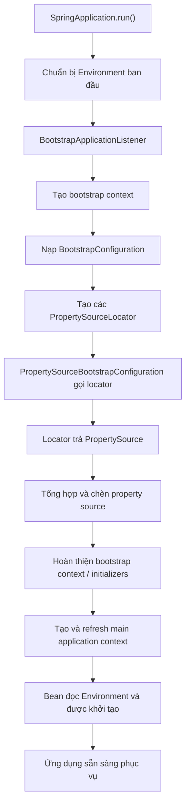
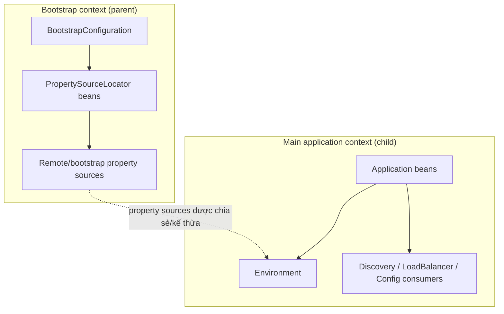
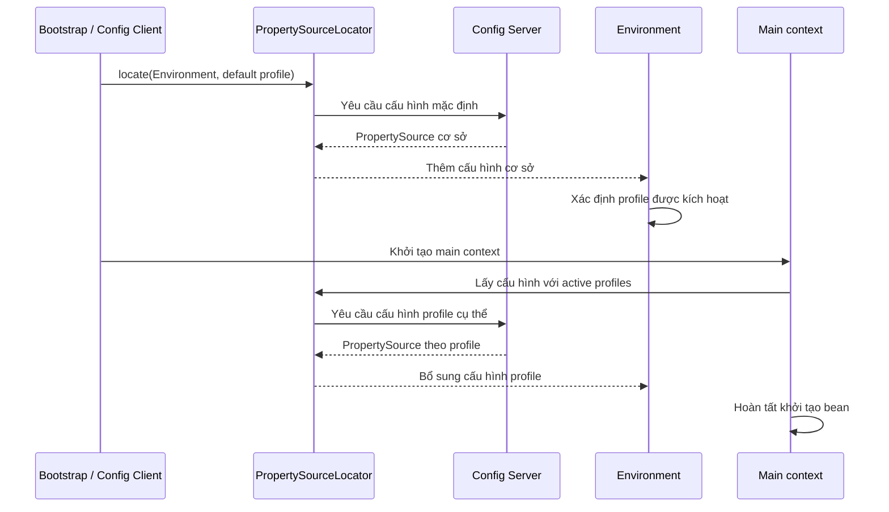
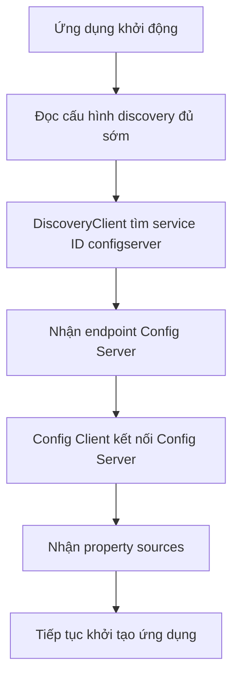

# Vị trí PropertySourceLocator trong trình tự khởi động

Trong một ứng dụng Spring Cloud, cấu hình từ xa cần được nạp vào `Environment` ở thời điểm đủ sớm để các bean và auto-configuration sử dụng đúng giá trị. `PropertySourceLocator` là một extension point của Spring Cloud Context cho **cơ chế bootstrap truyền thống**: nó tìm một hoặc nhiều `PropertySource` từ nguồn bên ngoài và cung cấp chúng cho context đang được khởi tạo.

Hiểu vị trí của `PropertySourceLocator` giúp phân biệt ba việc thường bị nhầm lẫn: tạo bootstrap context, nạp property source và khởi tạo main application context. Điều này đặc biệt quan trọng khi tích hợp Spring Cloud Config, discovery, service registry và các abstraction dùng chung trong **SPRING_CLOUD_CORE**.

Bài học thuộc chương **Bootstrap**. Trọng tâm là vòng đời gọi locator, cách đăng ký locator tùy chỉnh, thứ tự ưu tiên của dữ liệu trả về và sự khác nhau giữa bootstrap legacy với Spring Boot Config Data hiện đại.

## 1. Mục tiêu học tập

Sau bài này, bạn có thể:

- Giải thích vai trò của `PropertySourceLocator` trong Spring Cloud bootstrap.
- Mô tả quan hệ giữa bootstrap context và main application context.
- Xác định lúc nào locator được gọi trong trình tự khởi động.
- Phân biệt `bootstrap.yml` với các property source được locator trả về.
- Đăng ký một locator tùy chỉnh qua `BootstrapConfiguration`.
- Hiểu việc gọi locator nhiều lần để lấy cấu hình mặc định và cấu hình theo profile.
- Giải thích thứ tự ưu tiên của remote property source và quy tắc cho phép local override.
- Phân biệt legacy bootstrap với `spring.config.import`/Config Data.
- Thiết kế locator có thể kiểm thử, an toàn khi được gọi lặp và dễ chẩn đoán.

## 2. PropertySourceLocator giải quyết vấn đề gì?

Giả sử `checkout-service` cần lấy các thuộc tính sau từ một nguồn quản lý tập trung:

```yaml
inventory:
  base-url: https://inventory.internal
  timeout: 800ms
  max-attempts: 3
```

Ứng dụng muốn đọc chúng qua `Environment` hoặc bind vào `@ConfigurationProperties`. Nó không muốn mọi service nghiệp vụ tự gọi HTTP tới Config Server hoặc tự phân tích file YAML từ xa.

`PropertySourceLocator` tách phần tìm cấu hình ra khỏi phần sử dụng cấu hình:

1. Spring Cloud tạo context/bootstrap infrastructure theo cơ chế được bật.
2. Bootstrap infrastructure tìm các bean `PropertySourceLocator`.
3. Mỗi locator nhận `Environment` của ứng dụng sắp được khởi tạo và tìm dữ liệu phù hợp.
4. Locator trả về một hoặc nhiều `PropertySource<?>`.
5. Spring Cloud kết hợp các nguồn đó và đưa chúng vào `Environment` theo quy tắc bootstrap.
6. Main application context và các bean của ứng dụng sử dụng `Environment` đã được bổ sung.

Một locator có thể lấy dữ liệu từ Config Server, cơ sở dữ liệu, dịch vụ cấu hình nội bộ hoặc một nguồn khác. Nó không phải là một registry, không tạo bean nghiệp vụ và cũng không tự refresh mọi bean sau khi cấu hình thay đổi.

## 3. Các thành phần trong cơ chế bootstrap

| Thành phần | Trách nhiệm |
| --- | --- |
| `BootstrapApplicationListener` | Nhận biết giai đoạn khởi động sớm và điều phối việc tạo bootstrap context trong chế độ legacy |
| Bootstrap context | Context cha dùng để chuẩn bị các thành phần và cấu hình bootstrap |
| `BootstrapConfiguration` | Khai báo các lớp cấu hình được nạp vào bootstrap context |
| `PropertySourceLocator` | Tìm và trả về property source cho Environment |
| `PropertySourceBootstrapConfiguration` | Điều phối locator, tổng hợp property source và chèn chúng vào Environment |
| `Environment` | Nơi các property source được tra cứu theo thứ tự ưu tiên |
| Main application context | Context chính chứa bean nghiệp vụ và các tích hợp Spring Boot/Spring Cloud |

`PropertySourceLocator` là hợp đồng mở rộng. `PropertySourceBootstrapConfiguration` là một thành phần điều phối việc gọi hợp đồng đó. `BootstrapApplicationListener` tham gia ở giai đoạn khởi động sớm để dựng bootstrap context trong chế độ legacy.

## 4. Vị trí trong trình tự khởi động

Ở chế độ legacy bootstrap, có thể hình dung luồng tổng quát như sau:



Đây là mô hình khái niệm của chế độ bootstrap truyền thống. Chi tiết thời điểm gọi locator đã thay đổi qua các release Spring Cloud; phần 6 trình bày sự khác biệt quan trọng từ Spring Cloud 2022.0.3.

### 4.1. Bước 1 — SpringApplication bắt đầu chuẩn bị Environment

Khi gọi:

```java
SpringApplication.run(CheckoutApplication.class, args);
```

Spring Boot tạo hoặc chuẩn bị `Environment`, xử lý các nguồn cấu hình ban đầu và phát các sự kiện khởi động tương ứng. Những giá trị có thể đọc ở giai đoạn này gồm tham số JVM, biến môi trường, command-line argument và các thuộc tính đã được chuẩn bị trước đó.

Bootstrap phải được kích hoạt từ một nguồn đủ sớm. Trong legacy mode, có thể dùng starter bootstrap hoặc đặt `spring.cloud.bootstrap.enabled=true` dưới dạng system property/environment variable. Đặt cờ này trong một `application.yml` chỉ được nạp sau đó có thể quá muộn để bật bootstrap.

### 4.2. Bước 2 — BootstrapApplicationListener tạo bootstrap context

Khi bootstrap legacy được bật, `BootstrapApplicationListener` tham gia vào quá trình khởi động sớm. Nó dựng một bootstrap context, nạp các cấu hình bootstrap và các lớp được đăng ký trong `BootstrapConfiguration`.

Bootstrap context thường là **parent context** của main application context. Các context có thể chia sẻ `Environment`; do đó property source được chuẩn bị trong bootstrap có thể được nhìn thấy khi main context phân giải property.

Không nên đồng nhất bootstrap context với một service riêng hoặc một Config Server. Đây là một Spring `ApplicationContext` được tạo sớm để chuẩn bị cấu hình và thành phần cho ứng dụng chính.

### 4.3. Bước 3 — Nạp BootstrapConfiguration

Spring Cloud cho phép thư viện hoặc ứng dụng đăng ký các lớp cấu hình bootstrap bằng entry trong:

```text
META-INF/spring.factories
```

Key được sử dụng là:

```text
org.springframework.cloud.bootstrap.BootstrapConfiguration
```

Các lớp được liệt kê sẽ được dùng để tạo bootstrap context. Chúng có thể khai báo bean `PropertySourceLocator`, `ApplicationContextInitializer` và các thành phần phục vụ quá trình bootstrap.

### 4.4. Bước 4 — Gọi PropertySourceLocator

`PropertySourceBootstrapConfiguration` nhận danh sách locator và gọi phương thức `locate(Environment)` hoặc cơ chế collection tương ứng trong phiên bản Spring Cloud đang dùng.

`Environment` truyền vào là Environment của application context sắp được cấu hình. Nó đã có các property source thông thường do Spring Boot chuẩn bị, nên locator có thể đọc các thông tin nhận diện như:

- `spring.application.name`.
- Profile hiện hành (nếu đã có).
- Địa chỉ hoặc thông tin kết nối được cung cấp từ nguồn bootstrap.
- Các thuộc tính xác định tenant, vùng hoặc nhóm cấu hình.

Ví dụ, Config Client có thể dùng `spring.application.name` để yêu cầu đúng bộ cấu hình cho một service. Locator không nên tự giả định rằng tên ứng dụng luôn có mặt; nếu thiếu, cần có fallback hoặc báo lỗi có chủ đích.

### 4.5. Bước 5 — Chèn property source vào Environment

Locator trả về `PropertySource<?>`. Spring Cloud có thể bọc chúng thành bootstrap property source hoặc đưa nhiều nguồn vào một `CompositePropertySource`.

Main context sử dụng cùng Environment hoặc nhận các property source thông qua quan hệ context cha/con. Khi bean được tạo, `Environment`, `@Value` và `@ConfigurationProperties` có thể đọc các giá trị đã được bổ sung.

Điểm quan trọng: locator **không trả trực tiếp một object cấu hình cho từng service bean**. Nó cung cấp một nguồn thuộc tính cho cơ chế phân giải cấu hình chung.

## 5. Bootstrap context và main application context

### 5.1. Quan hệ cha/con

Trong legacy bootstrap, bootstrap context thường là parent của main application context. Child context kế thừa khả năng nhìn thấy bean và property source từ parent theo quy tắc phân cấp của Spring.



Sơ đồ nhấn mạnh quan hệ cấu hình, không có nghĩa mọi bean trong parent tự động được copy thành bean mới trong child. Context con có quy tắc tra cứu bean và property source riêng; cùng tên property source hoặc bean có thể ảnh hưởng đến kết quả theo quy tắc hierarchy.

### 5.2. Hai loại property source thường bị nhầm

Spring Cloud bootstrap có thể đưa vào main context hai nhóm nguồn khác nhau:

| Nhóm | Nội dung | Vai trò |
| --- | --- | --- |
| `applicationConfig: [classpath:bootstrap.yml]` và các biến thể | Giá trị cấu hình dùng để chuẩn bị bootstrap context | Cung cấp defaults/địa chỉ Config Server và thông tin cần có sớm |
| `bootstrap` composite/property source | Các nguồn được tìm bởi `PropertySourceLocator`, ví dụ cấu hình từ Config Server | Cung cấp cấu hình bên ngoài có thể có ưu tiên cao |

**`bootstrap.yml` không phải chính là remote property source.** File này cấu hình quá trình bootstrap. Property source do locator trả về mới là dữ liệu từ nguồn mà locator truy cập.

Theo tài liệu Spring Cloud hiện hành, property source được thêm trong bootstrap thường có ưu tiên cao và mặc định không cho local configuration ghi đè. Trong khi đó, các giá trị từ `bootstrap.yml` được đưa vào theo cách có mức ưu tiên thấp hơn `application.yml` của main context và có thể dùng làm giá trị mặc định.

### 5.3. Ví dụ bootstrap.yml

```yaml
spring:
  application:
    name: checkout-service
  cloud:
    config:
      uri: http://config-server:8888
```

Trong legacy Config First bootstrap, file `bootstrap.yml` có thể khai báo tên ứng dụng và địa chỉ Config Server. Tên ứng dụng giúp Config Server xác định bộ cấu hình tương ứng; URI chỉ ra endpoint mà client kết nối.

Nếu cần lấy cấu hình theo profile cụ thể trong bootstrap truyền thống, có thể cần khai báo profile ở nguồn bootstrap phù hợp. Với các dòng Spring Cloud mới hơn, cơ chế locator có thể thực hiện lần lấy đầu với profile mặc định và lần tiếp theo với profile đã được kích hoạt; xem phần 6.

## 6. Thay đổi quan trọng từ Spring Cloud 2022.0.3

Không nên mô tả `PropertySourceLocator` như thể mọi phiên bản Spring Cloud đều gọi nó tại cùng một điểm. Tài liệu Spring Cloud Commons ghi nhận các thay đổi quan trọng:

1. **Trước Spring Cloud 2022.0.3:** `PropertySourceLocator`, bao gồm locator của Spring Cloud Config, được chạy trong main application context, không phải bootstrap context.
2. **Từ Spring Cloud 2022.0.3:** Spring Cloud gọi các locator hai lần trong luồng bootstrap được hỗ trợ: lần đầu lấy property source chưa gắn profile để có thể kích hoạt profile; sau khi main application context bắt đầu, lần thứ hai lấy các property source ứng với profile đã active.
3. Nếu cần buộc locator được chạy trong bootstrap context theo cơ chế tương thích được tài liệu mô tả, có thể đặt `spring.cloud.config.initialize-on-context-refresh=true` trong `bootstrap.yml`/`bootstrap.properties`.

### 6.1. Vì sao cần hai lần gọi?

Một Config Server có thể trả về property:

```yaml
spring:
  profiles:
    active: region-ap-southeast
```

Lần lấy đầu tiên dùng profile mặc định có thể trả về giá trị kích hoạt profile bổ sung. Khi profile đã được xác định, lần lấy tiếp theo có thể yêu cầu cấu hình dành riêng cho profile đó.



Đây là mô hình khái niệm của quá trình locator được gọi nhiều lần. Các bước và thời điểm cụ thể phụ thuộc release train, chế độ bootstrap và cấu hình. Hãy kiểm tra log thực tế nếu ứng dụng có nhiều profile hoặc nhiều nguồn từ xa.

### 6.2. Hệ quả với locator tùy chỉnh

Một locator cần giả định rằng nó **có thể được gọi nhiều lần**:

- Không tạo side effect không thể lặp như ghi giao dịch, cấp phát tài nguyên vĩnh viễn hoặc thay đổi trạng thái nghiệp vụ.
- Không dựa vào một lần gọi duy nhất để lưu trạng thái toàn cục.
- Có thể nhận Environment với tập profile khác nhau giữa các lần gọi.
- Nên trả về property source ổn định theo application name/profile.
- Nếu truy cập mạng, cần timeout, xử lý lỗi và chính sách retry rõ ràng.
- Log đủ thông tin nhận diện lần gọi nhưng không ghi token hoặc secret.

Nếu locator lấy cấu hình theo profile, hãy phân biệt rõ phản hồi mặc định và phản hồi profile-specific để tránh ghép nhầm dữ liệu.

## 7. Tạo PropertySourceLocator tùy chỉnh

Tài liệu Spring Cloud cho phép mở rộng bootstrap bằng cách đăng ký một bean `PropertySourceLocator` trong bootstrap context. Ví dụ sau minh họa locator cung cấp thuộc tính theo tên ứng dụng.

### 7.1. Implementation đơn giản

```java
package sample.bootstrap;

import java.util.Map;

import org.springframework.core.env.Environment;
import org.springframework.core.env.MapPropertySource;
import org.springframework.core.env.PropertySource;
import org.springframework.cloud.bootstrap.config.PropertySourceLocator;

public class CheckoutPropertySourceLocator implements PropertySourceLocator {

    @Override
    public PropertySource<?> locate(Environment environment) {
        String applicationName = environment.getProperty(
                "spring.application.name", "unknown-service");

        Map<String, Object> values = Map.of(
                "external-config.application", applicationName,
                "inventory.timeout", "800ms",
                "inventory.max-attempts", 3);

        return new MapPropertySource("checkoutExternalProperties", values);
    }
}
```

Trong ví dụ, locator đọc `spring.application.name` từ Environment đầu vào, rồi trả về `MapPropertySource`. Mã minh họa không gọi mạng; nếu kết nối nguồn cấu hình thật, phần truy cập phải có timeout và cách xử lý lỗi phù hợp.

### 7.2. Đăng ký qua BootstrapConfiguration

Tạo lớp cấu hình bootstrap:

```java
package sample.bootstrap;

import org.springframework.context.annotation.Bean;
import org.springframework.context.annotation.Configuration;
import org.springframework.cloud.bootstrap.config.PropertySourceLocator;

@Configuration(proxyBeanMethods = false)
public class CheckoutBootstrapConfiguration {

    @Bean
    PropertySourceLocator checkoutPropertySourceLocator() {
        return new CheckoutPropertySourceLocator();
    }
}
```

Đăng ký lớp cấu hình trong file:

`src/main/resources/META-INF/spring.factories`

```properties
org.springframework.cloud.bootstrap.BootstrapConfiguration=\
sample.bootstrap.CheckoutBootstrapConfiguration
```

Trong chế độ bootstrap legacy, Spring Cloud dùng key `org.springframework.cloud.bootstrap.BootstrapConfiguration` để tìm các lớp cấu hình bootstrap. Đảm bảo dependency có hỗ trợ bootstrap và bootstrap đã được bật; chỉ có file `spring.factories` không tự kích hoạt toàn bộ legacy bootstrap nếu ứng dụng không dùng cơ chế đó.

### 7.3. Tách package bootstrap khỏi component scan chính

Đặt lớp `CheckoutBootstrapConfiguration` ở package không bị `@ComponentScan` của main application quét nhầm. Nếu cùng package với ứng dụng chính, cấu hình bootstrap có thể xuất hiện thêm trong main context và gây đăng ký bean trùng hoặc khởi tạo sai thời điểm.

Tổ chức ví dụ:

```text
src/main/java/
├── com/example/checkout/
│   └── CheckoutApplication.java
└── sample/bootstrap/
    ├── CheckoutBootstrapConfiguration.java
    └── CheckoutPropertySourceLocator.java
```

Trong dự án thật, nên đặt namespace bootstrap riêng theo tổ chức và xác nhận component scan không bao phủ package đó.

### 7.4. Thứ tự giữa nhiều locator

Khi có nhiều `PropertySourceLocator`, Spring Cloud sắp xếp chúng theo cơ chế `Ordered`/`@Order` trước khi gọi. Một locator không khai báo order thường được xử lý sau các locator có order rõ ràng.

Ví dụ:

```java
@Component
@Order(10)
public class TenantPropertySourceLocator implements PropertySourceLocator {
    // locate(...)
}
```

Không nên suy luận rằng order nhỏ hay lớn luôn đồng nghĩa với thứ tự ưu tiên property source cuối cùng trong mọi cấu hình tùy chỉnh. Cần xem cách framework tổng hợp các nguồn trả về, thứ tự trong `CompositePropertySource` và quy tắc chèn vào Environment của phiên bản đang dùng. Nếu hai locator cùng khai báo một key, hãy viết integration test để xác nhận nguồn thắng.

## 8. Quy tắc ưu tiên của property source từ bootstrap

Các property source được thêm bởi bootstrap thường được đặt trong một nguồn tổng hợp có tên bắt đầu bằng `bootstrap`. Trong cấu hình mặc định, nguồn này có ưu tiên cao so với cấu hình local của ứng dụng.

Giả sử:

```text
bootstrap composite:
  inventory.timeout = 800ms

application.yml:
  inventory.timeout = 2s

command line:
  --inventory.timeout=500ms
```

Không nên chỉ dựa vào ví dụ trên để kết luận giá trị cuối cùng, vì remote property source mặc định có quy tắc bảo vệ override riêng. Với Spring Cloud Config, server-side property `spring.cloud.config.allowOverride` quyết định liệu local source có được phép ghi đè remote source hay không.

### 8.1. Cho phép local override remote property

Theo tài liệu Spring Cloud Context:

- Mặc định, property source từ xa được thêm bởi bootstrap thường không cho local property ghi đè.
- Muốn cho phép local override, remote property source phải khai báo `spring.cloud.config.allowOverride=true`.
- Đặt `spring.cloud.config.allowOverride=true` chỉ ở local application configuration không có tác dụng cấp quyền override.

Sau khi remote source cho phép, có thể tinh chỉnh:

| Thuộc tính | Ý nghĩa |
| --- | --- |
| `spring.cloud.config.allowOverride=true` | Cho phép áp dụng quy tắc override từ local source |
| `spring.cloud.config.overrideNone=true` | Cho phép mọi local property source ghi đè remote source |
| `spring.cloud.config.overrideSystemProperties=false` | Chỉ system properties, command-line arguments và environment variables được ghi đè remote; local config files không được ghi đè |

Các thuộc tính này thuộc cơ chế Spring Cloud Config remote property source; không áp dụng tùy tiện cho mọi `PropertySourceLocator` tùy chỉnh.

### 8.2. Không nhầm bootstrap.yml với bootstrap composite

`bootstrap.yml` cung cấp giá trị cấu hình bootstrap và có thể được dùng làm defaults. Composite do locator tạo ra mới chứa dữ liệu external được locator tìm thấy. Hai nguồn có thể cùng xuất hiện trong Environment nhưng có precedence khác nhau.

Khi điều tra giá trị bị ghi đè, hãy xem:

1. Tên và thứ tự các property source.
2. Nguồn nào thực sự chứa key.
3. Remote source có bật `allowOverride` hay không.
4. Có command-line, JVM hoặc environment property nào khác không.
5. Main context có property source cùng tên hoặc hierarchy làm thay đổi kết quả không.

## 9. Legacy bootstrap và Spring Boot Config Data hiện đại

Spring Boot 2.4 giới thiệu Config Data API qua `spring.config.import`. Đây là cách mặc định hiện đại để kết nối Spring Cloud Config Server. Nó có trình tự nạp cấu hình riêng và **không yêu cầu `bootstrap.yml`**.

### 9.1. Legacy Config First bootstrap

Để dùng legacy bootstrap, có thể thêm `spring-cloud-starter-bootstrap` hoặc bật `spring.cloud.bootstrap.enabled=true` bằng system property/environment variable.

Ví dụ `bootstrap.yml`:

```yaml
spring:
  application:
    name: checkout-service
  cloud:
    config:
      uri: http://config-server:8888
```

Config Client trên classpath sẽ sử dụng địa chỉ bootstrap để kết nối Config Server và đưa remote property source vào Environment theo cơ chế bootstrap.

Trong chế độ này, `PropertySourceLocator` là extension point phù hợp để bổ sung nguồn cấu hình theo hợp đồng bootstrap.

### 9.2. Config Data import hiện đại

Ví dụ `application.yml`:

```yaml
spring:
  application:
    name: checkout-service
  config:
    import: optional:configserver:http://config-server:8888
```

Config Client sử dụng Config Data API để resolve và load nguồn `configserver:` trong quá trình Boot xử lý cấu hình. Một file `bootstrap.yml` không cần thiết cho cách import này.

### 9.3. Hai cơ chế không nên trộn tùy tiện

| Tiêu chí | Legacy bootstrap | Config Data import |
| --- | --- | --- |
| Kích hoạt | `spring-cloud-starter-bootstrap` hoặc `spring.cloud.bootstrap.enabled=true` | Khai báo `spring.config.import=configserver:...` |
| File cấu hình đặc trưng | `bootstrap.yml` | `application.yml`/`application.properties` |
| Điểm mở rộng | `PropertySourceLocator` trong bootstrap infrastructure | `ConfigDataLocationResolver` và `ConfigDataLoader` cho nguồn Config Data tùy chỉnh |
| Vòng đời | Bootstrap context và main context | Boot Config Data processing trước khi hoàn tất ApplicationContext |
| Có cần bootstrap context? | Có | Không cần cho Config Data import |
| Mục tiêu | Tương thích hệ thống dùng bootstrap truyền thống | Cách nạp cấu hình mặc định hiện đại |

Không nên bật legacy bootstrap và đồng thời nạp cùng nguồn qua `spring.config.import` mà không hiểu rõ cách tích hợp. Với một số tích hợp, hai cơ chế có thể xung đột hoặc làm nguồn được nạp lặp. Chọn một đường cấu hình nhất quán theo tài liệu của release train.

Nếu viết một nguồn cấu hình mới dành riêng cho Config Data hiện đại, hãy triển khai extension point Config Data phù hợp thay vì kỳ vọng `PropertySourceLocator` được gọi tự động.

## 10. Discovery First Lookup trong quá trình lấy cấu hình

Spring Cloud Config Client có thể tìm Config Server qua địa chỉ cố định (Config First) hoặc qua `DiscoveryClient` (Discovery First). Với Discovery First, ứng dụng cần đủ cấu hình để truy cập discovery service trước khi tìm Config Server.

Ví dụ cấu hình khái niệm:

```yaml
spring:
  cloud:
    config:
      discovery:
        enabled: true
        service-id: configserver
```

Chi tiết property có thể khác theo phiên bản và provider; phải bổ sung cấu hình discovery tương ứng, chẳng hạn địa chỉ Eureka hoặc Consul. Discovery First có thêm một lượt truy cập mạng để tìm đăng ký Config Server trong lúc startup.

Luồng khái quát:



Đây là mối liên hệ giữa discovery và cấu hình từ xa: discovery giúp tìm Config Server, còn Config Server trả dữ liệu cấu hình. Không nên nhầm `PropertySourceLocator` với `DiscoveryClient`; chúng có trách nhiệm khác nhau.

## 11. Xử lý lỗi và tính sẵn sàng khi bootstrap

Bootstrap diễn ra trước khi ứng dụng phục vụ request, vì vậy lỗi lấy cấu hình có thể làm ứng dụng không khởi động được.

### 11.1. Fail-fast và optional

Với Config Data import:

```yaml
spring:
  config:
    import: configserver:http://config-server:8888
```

Không có tiền tố `optional:` thì ứng dụng sẽ fail nếu không kết nối được Config Server theo hành vi Config Client. Nếu cấu hình là tùy chọn:

```yaml
spring:
  config:
    import: optional:configserver:http://config-server:8888
```

Với legacy bootstrap, có thể dùng `spring.cloud.config.fail-fast=true` để yêu cầu client dừng khởi động khi không lấy được cấu hình. Cần chọn hành vi theo yêu cầu vận hành:

- Cấu hình bắt buộc như credential hoặc endpoint trọng yếu thường nên fail-fast.
- Cấu hình bổ sung không thiết yếu có thể cho phép startup tiếp tục với defaults nếu nghiệp vụ cho phép.

### 11.2. Retry và timeout

Nếu Config Server có thể tạm thời chưa sẵn sàng khi client khởi động, Config Client hỗ trợ retry khi cấu hình phù hợp và có dependency Spring Retry/AOP theo tài liệu của phiên bản. Nên thiết lập:

- Connect/read timeout hợp lý.
- Số lần thử tối đa.
- Backoff tăng dần và giới hạn thời gian tổng.
- Log phân biệt lỗi DNS, kết nối, xác thực và phản hồi cấu hình.
- Health/monitoring để phân biệt ứng dụng đã chạy với cấu hình từ xa bị lỗi.

Không đặt retry vô hạn. Một service có thể tạo vòng khởi động kéo dài và làm rollout không hoàn thành nếu Config Server gặp sự cố kéo dài.

### 11.3. Locator tùy chỉnh nên có hành vi lỗi rõ ràng

Một locator cần xác định:

- Khi không có dữ liệu: trả `null`, collection rỗng hoặc property source rỗng theo hợp đồng đang dùng.
- Khi nguồn không khả dụng: bỏ qua, retry hay ném exception để fail startup?
- Khi dữ liệu không hợp lệ: có dừng startup hay dùng defaults?
- Khi credential hết hạn: báo lỗi xác thực rõ ràng và không log credential.
- Khi locator được gọi nhiều lần: cache có phù hợp không, có làm profile-specific data bị cũ không?

Không nên nuốt mọi exception rồi trả property source rỗng; điều đó có thể khiến ứng dụng khởi động với cấu hình mặc định không an toàn.

## 12. Kiểm thử PropertySourceLocator

Kiểm thử cần xác nhận cả kết quả locator trả về lẫn vị trí nó được gọi trong quá trình khởi động.

### 12.1. Unit test locator

```java
class CheckoutPropertySourceLocatorTest {

    @Test
    void returnsPropertiesForApplication() {
        MockEnvironment environment = new MockEnvironment()
                .withProperty("spring.application.name", "checkout-service");

        CheckoutPropertySourceLocator locator =
                new CheckoutPropertySourceLocator();

        PropertySource<?> source = locator.locate(environment);

        assertThat(source.getProperty("external-config.application"))
                .isEqualTo("checkout-service");
        assertThat(source.getProperty("inventory.timeout"))
                .isEqualTo("800ms");
    }
}
```

Test này kiểm tra logic ánh xạ tên ứng dụng và dữ liệu trả về. Nó không chứng minh locator đã được Spring Cloud nạp vào bootstrap context.

### 12.2. Kiểm thử đăng ký bootstrap

Tạo một integration test khởi động `SpringApplication` với dependency và chế độ bootstrap tương ứng, sau đó kiểm tra:

1. Lớp cấu hình bootstrap có được tìm thấy từ `spring.factories` không.
2. Bean locator có được tạo không.
3. Property source có xuất hiện trong Environment của main context không.
4. `Environment#getProperty(...)` có trả giá trị từ locator không.
5. Giá trị có precedence như dự kiến khi trùng key với `application.yml` không.

Với test dùng Config Server thật, có thể chạy server trong môi trường thử nghiệm hoặc thay endpoint bằng stub có kiểm soát. Không dùng unit test locator để kết luận kết nối mạng và authentication hoạt động.

### 12.3. Kiểm thử locator được gọi nhiều lần

Với release Spring Cloud có hành vi hai lần gọi từ 2022.0.3:

- Ghi nhận số lần gọi và profile của Environment mỗi lần.
- Xác minh lần đầu có thể nhận cấu hình mặc định.
- Xác minh lần sau nhận profile đã active.
- Xác minh không có side effect trùng lặp.
- Xác minh giá trị profile-specific ghi đè đúng theo quy tắc nguồn.

Test phải gắn với release train cụ thể. Nếu test kỳ vọng một lần gọi duy nhất, nó có thể hỏng khi nâng Spring Cloud dù ứng dụng đang hoạt động đúng theo hành vi mới.

### 12.4. Kiểm thử đường Config Data

Nếu ứng dụng sử dụng `spring.config.import=configserver:`, hãy kiểm thử Config Data integration thay vì chỉ kiểm tra `PropertySourceLocator`. Xác minh:

- Import được resolve.
- Config Server có thể kết nối hoặc ứng dụng fail theo `optional`/required.
- Cấu hình default/profile được lấy đúng.
- Thứ tự giữa nhiều import đúng với yêu cầu.
- Giá trị cuối cùng trong Environment và bean binding đúng.

## 13. Quan sát trình tự khởi động

Khi cần xác định locator có được gọi hay không, nên quan sát từng lớp:

1. **Chế độ bootstrap:** ứng dụng có `spring-cloud-starter-bootstrap` hoặc bật cờ bootstrap từ nguồn đủ sớm không?
2. **Đăng ký cấu hình:** key `BootstrapConfiguration` trong `spring.factories` có đúng không?
3. **Package scan:** lớp cấu hình bootstrap có bị quét nhầm vào main context không?
4. **Bean locator:** bootstrap context có tạo bean `PropertySourceLocator` không?
5. **Lời gọi:** log có thể hiện locator được thực thi ở giai đoạn nào và bao nhiêu lần?
6. **Environment:** property source có xuất hiện trong Environment của context đích không?
7. **Precedence:** property source nào thắng khi cùng khai báo một key?
8. **Binding:** bean được tạo có nhận giá trị đã phân giải không?

Một ví dụ log trong locator:

```java
@Override
public PropertySource<?> locate(Environment environment) {
    String applicationName = environment.getProperty(
            "spring.application.name", "unknown-service");
    String[] profiles = environment.getActiveProfiles();

    log.info("Locating external properties for application={} profiles={}",
            applicationName, Arrays.toString(profiles));

    // Fetch or build the PropertySource here.
    return buildPropertySource(applicationName, profiles);
}
```

Chỉ log thông tin nhận diện không nhạy cảm. Không log toàn bộ Environment hoặc nội dung property source nếu chúng có secret.

## 14. Các lỗi thường gặp

| Triệu chứng | Nguyên nhân thường gặp | Hướng xử lý |
| --- | --- | --- |
| Locator không được gọi | Legacy bootstrap chưa bật hoặc ứng dụng đang dùng Config Data | Xác định cơ chế cấu hình; bật bootstrap nếu thật sự dùng legacy |
| Không tìm thấy bean locator | Sai key `BootstrapConfiguration`, sai class name hoặc config không được nạp | Kiểm tra `spring.factories`, dependency và bootstrap context |
| Locator đọc sai application name | `spring.application.name` chưa có ở thời điểm gọi | Đưa giá trị vào nguồn bootstrap đủ sớm hoặc dùng fallback có chủ đích |
| Lần đầu có cấu hình nhưng thiếu profile | Chưa có lần fetch theo profile hoặc locator không xử lý active profiles | Kiểm tra hành vi từ Spring Cloud 2022.0.3 và logic profile |
| Remote property luôn thắng local | Remote source chưa cho phép override | Kiểm tra `spring.cloud.config.allowOverride` được đặt từ remote |
| Locator bị gọi hai lần và tạo dữ liệu trùng | Implementation có side effect hoặc giả định một lần gọi | Làm locator idempotent, xử lý profile/default rõ ràng |
| Property source có mặt nhưng bean vẫn dùng giá trị cũ | Bean đã được tạo trước khi nguồn mới được thêm hoặc chưa refresh | Kiểm tra thứ tự khởi tạo, binding và lifecycle |
| Ứng dụng không khởi động khi Config Server tắt | Import required hoặc fail-fast được bật | Chọn optional/required theo chính sách nghiệp vụ |
| Main context có bean bootstrap trùng | Bootstrap configuration nằm trong component scan | Tách package bootstrap khỏi package ứng dụng chính |
| Dùng PropertySourceLocator với `spring.config.import` nhưng không chạy | Hai cơ chế có extension point khác nhau | Dùng Config Data resolver/loader hoặc chuyển rõ sang legacy bootstrap |

## 15. Nguyên tắc thiết kế cho Spring Cloud Core

- Dùng `PropertySourceLocator` cho tích hợp theo cơ chế bootstrap legacy; xác định rõ ứng dụng có bật bootstrap hay không.
- Giữ locator nhỏ: nhận diện ứng dụng/profile, lấy dữ liệu, trả property source.
- Không đặt logic nghiệp vụ hoặc logic đăng ký service vào locator.
- Làm locator an toàn khi gọi nhiều lần và không tạo side effect không cần thiết.
- Thiết kế timeout, retry, fail-fast và fallback theo mức độ bắt buộc của cấu hình.
- Đăng ký `BootstrapConfiguration` bằng đúng key và tách package khỏi component scan chính.
- Phân biệt bootstrap properties trong `bootstrap.yml` với remote property source do locator trả về.
- Kiểm tra thứ tự precedence và quy tắc remote override thay vì giả định local luôn thắng.
- Với Config Data hiện đại, dùng `spring.config.import` và extension point Config Data tương ứng.
- Kiểm thử cả logic locator, đăng ký bootstrap, profile-specific fetch và kết quả Environment cuối cùng.

## 16. Tổng kết

`PropertySourceLocator` là extension point của Spring Cloud Context để tìm property source trong cơ chế bootstrap truyền thống. Nó được tạo trong bootstrap infrastructure, nhận Environment của ứng dụng cần cấu hình và trả về nguồn thuộc tính để Spring Cloud tổng hợp, chèn vào Environment. Bootstrap context và main application context có quan hệ cha/con; property source từ bootstrap có thể được main context sử dụng trong quá trình tạo bean.

Thời điểm gọi locator phụ thuộc phiên bản. Trước Spring Cloud 2022.0.3, locator được chạy trong main context; từ 2022.0.3, tài liệu mô tả việc gọi hai lần để hỗ trợ profile activation và lấy cấu hình profile-specific. Vì vậy, locator tùy chỉnh phải chịu được nhiều lần gọi và cần kiểm thử theo release train thực tế.

Trong cách tích hợp hiện đại, Spring Cloud Config mặc định dùng Spring Boot Config Data qua `spring.config.import`. Cơ chế này không cần `bootstrap.yml` và không nên được đồng nhất với legacy `PropertySourceLocator`. Chọn đúng extension point và hiểu đúng thứ tự khởi động sẽ giúp cấu hình ngoài được nạp đúng lúc, tránh lỗi bean, profile và precedence trong hệ thống phân tán.

## 17. Tài liệu tham khảo

- [Spring Cloud Commons — Spring Cloud Context: Application Context Services](https://docs.spring.io/spring-cloud-commons/reference/spring-cloud-commons/application-context-services.html)
- [Spring Cloud Commons — Customizing the Bootstrap Property Sources](https://docs.spring.io/spring-cloud-commons/reference/spring-cloud-commons/application-context-services.html#customizing-the-bootstrap-property-sources)
- [Spring Cloud Config — Client Side Usage and Config Data Import](https://docs.spring.io/spring-cloud-config/reference/client.html)
- [Spring Cloud Config — Config First Bootstrap](https://docs.spring.io/spring-cloud-config/reference/client.html#config-first-bootstrap)
- [Spring Cloud Commons source — PropertySourceBootstrapConfiguration](https://github.com/spring-cloud/spring-cloud-commons/blob/main/spring-cloud-context/src/main/java/org/springframework/cloud/bootstrap/config/PropertySourceBootstrapConfiguration.java)
