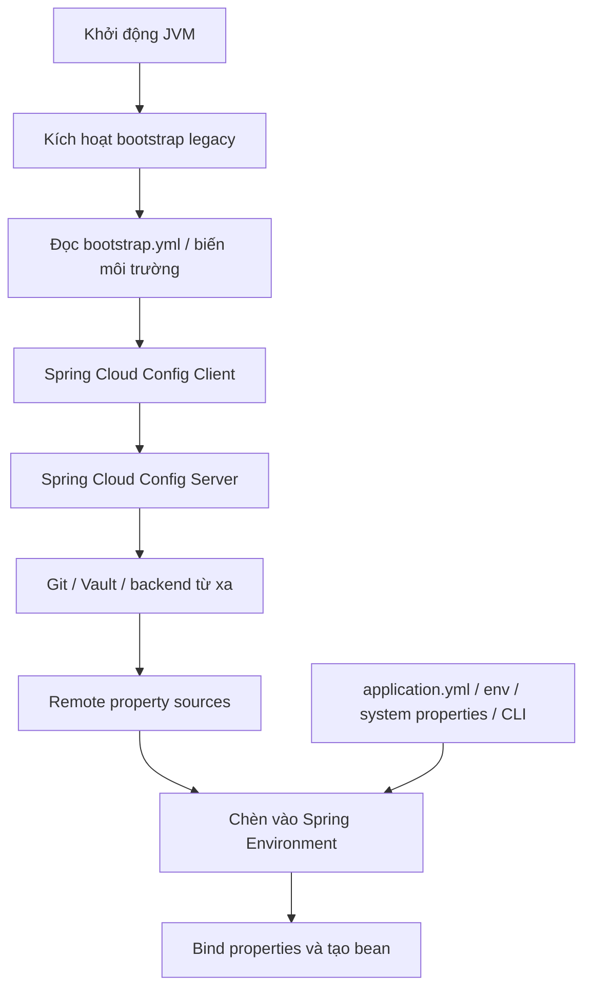

# allowOverride, overrideNone và overrideSystemProperties trong config-first bootstrap

Trong mô hình cấu hình tập trung, Spring Cloud Config Server cung cấp một hoặc nhiều **remote property source** cho ứng dụng. Remote configuration thường chứa endpoint, timeout, feature flag và các giá trị vận hành dùng chung. Tuy nhiên, mỗi môi trường cũng có thể cần một số giá trị cục bộ do nền tảng triển khai truyền vào.

Spring Cloud Context cung cấp ba thuộc tính để quyết định **vị trí ưu tiên của remote property source so với các nguồn cấu hình cục bộ** khi dùng cơ chế **config-first bootstrap**:

- `spring.cloud.config.allowOverride`
- `spring.cloud.config.overrideNone`
- `spring.cloud.config.overrideSystemProperties`

Ba thuộc tính này không thay đổi nội dung file cấu hình. Chúng điều khiển cách Spring Cloud chèn remote property sources vào `Environment` của ứng dụng, từ đó quyết định giá trị nào được đọc khi nhiều nguồn cùng khai báo một khóa.

Bài học thuộc chương **Bootstrap** của module **SPRING_CLOUD_CORE**. Trọng tâm là hiểu đúng quyền cho phép override, so sánh các tổ hợp cờ, áp dụng vào một dịch vụ thực tế và kiểm thử thứ tự ưu tiên. Cơ chế được trình bày là bootstrap legacy; không áp dụng các kết luận này một cách máy móc cho Spring Boot Config Data import.

## 1. Mục tiêu học tập

Sau bài học, người học có thể:

- Giải thích remote property source và vị trí của nó trong `Environment` khi dùng config-first bootstrap.
- Phân biệt vai trò của `allowOverride`, `overrideNone` và `overrideSystemProperties`.
- Xác định nơi phải khai báo quyền override và giải thích vì sao đặt `allowOverride` trong file local không cấp quyền.
- Dự đoán giá trị hiệu lực khi cùng một khóa xuất hiện trong remote configuration, `application.yml`, biến môi trường, system property và command-line argument.
- Thiết kế chính sách để remote configuration giữ quyền kiểm soát hoặc cho phép từng lớp cấu hình cục bộ ghi đè.
- Kiểm thử và chẩn đoán lỗi do cấu hình bị ghi đè ngoài dự kiến.
- Phân biệt config-first bootstrap với cơ chế `spring.config.import` hiện đại của Spring Boot.

## 2. Bối cảnh: remote property source trong config-first bootstrap

Trong config-first bootstrap, ứng dụng tạo một **bootstrap context** trước application context chính. Bootstrap context nạp cấu hình tối thiểu để biết cách kết nối Config Server, thường thông qua `bootstrap.yml` hoặc biến môi trường. Config Client lấy cấu hình từ xa rồi đưa các property sources đó vào môi trường cấu hình của ứng dụng.

Luồng khái quát:



`Environment` chứa nhiều `PropertySource`. Khi cùng một khóa xuất hiện trong nhiều nguồn, Spring tra cứu từ nguồn có độ ưu tiên cao nhất trước. Nguồn đứng trước có thể quyết định giá trị được bind vào bean.

Ví dụ cùng khai báo khóa `billing.payment.timeout`:

| Nguồn | Giá trị |
| --- | --- |
| Config Server | `2s` |
| `application.yml` cục bộ | `5s` |
| Biến môi trường | `3s` |
| Java system property | `4s` |
| Tham số dòng lệnh | `6s` |

Nếu không kiểm soát thứ tự, người vận hành có thể nghĩ rằng tham số dòng lệnh sẽ luôn thắng, trong khi remote property source lại được đặt ở vị trí ưu tiên cao hơn. Ba cờ trong bài học quyết định cách sắp xếp này trong config-first bootstrap.

### 2.1. Kích hoạt bootstrap legacy

Từ Spring Cloud 2020.0, bootstrap không còn được bật mặc định trong các cấu hình mới. Một dự án muốn dùng config-first bootstrap phải chủ động bật nó bằng một trong hai cách:

**Cách 1: đặt system property hoặc environment variable trước khi ứng dụng khởi động.**

PowerShell:

```powershell
$env:SPRING_CLOUD_BOOTSTRAP_ENABLED = 'true'
java -jar billing-service.jar
```

Bash:

```bash
SPRING_CLOUD_BOOTSTRAP_ENABLED=true java -jar billing-service.jar
```

**Cách 2: thêm starter bootstrap** vào Maven project. Phiên bản dependency được quản lý bởi Spring Cloud BOM tương thích với Spring Boot:

```xml
<dependency>
    <groupId>org.springframework.cloud</groupId>
    <artifactId>spring-cloud-starter-bootstrap</artifactId>
</dependency>
```

Trong dự án dùng cơ chế này, `bootstrap.yml` ở phía client có thể khai báo thông tin cần thiết để tìm Config Server:

```yaml
spring:
  application:
    name: billing-service
  cloud:
    config:
      uri: http://config-server:8888
```

`bootstrap.yml` là cấu hình bootstrap **cục bộ của client**. Nó cho biết client kết nối tới đâu. Các cờ cho phép ghi đè remote properties cần được đặt trong **cấu hình từ xa mà Config Server trả về**, như phần tiếp theo.

## 3. Ba thuộc tính điều khiển điều gì?

### 3.1. `allowOverride` — remote source có cho phép ghi đè không?

`spring.cloud.config.allowOverride` là cờ cấp quyền cho các nguồn cấu hình cục bộ ghi đè remote property source.

- `true`: cho phép áp dụng chính sách override chi tiết do hai cờ còn lại xác định.
- `false`: giữ remote property source ở vị trí ưu tiên cao; các cờ `overrideNone` và `overrideSystemProperties` không thể mở quyền override.

**Điểm quan trọng:** quyền này phải được cấp từ **remote property source** (ví dụ file trong Git repository mà Config Server phục vụ). Đặt `spring.cloud.config.allowOverride=true` trong `application.yml` hoặc `bootstrap.yml` của client không thể tự cấp quyền ghi đè cho chính client.

Ví dụ trong remote file `billing-service-prod.yml`:

```yaml
spring:
  cloud:
    config:
      allowOverride: true
```

Tệp trên được Config Server trả về cho `billing-service` với profile `prod`. Client mới có thể áp dụng chính sách chi tiết của `overrideNone` và `overrideSystemProperties`.

Một số phiên bản Spring Cloud Commons liệt kê giá trị mặc định của thuộc tính này là `true` trong configuration metadata. Tuy nhiên, hướng dẫn Config Server yêu cầu remote property source cấp quyền một cách tường minh. Để hành vi ổn định và dễ review giữa các release train, hãy khai báo rõ `allowOverride` trong cấu hình từ xa thay vì phụ thuộc vào giá trị mặc định.

### 3.2. `overrideNone` — remote source có xuống cuối danh sách không?

`spring.cloud.config.overrideNone` có ý nghĩa khi `allowOverride=true`.

- `true`: remote properties có độ ưu tiên thấp nhất; các property source cục bộ hiện có có thể ghi đè chúng, bao gồm file cấu hình của ứng dụng.
- `false`: không tự động đưa remote properties xuống cuối danh sách. Khi đó `overrideSystemProperties` quyết định remote nằm trước hay sau nhóm system properties, command line và environment variables.

Giá trị mặc định thường là `false`.

Nói cách khác, `overrideNone=true` cho phép cấu hình cục bộ ở mọi lớp thông thường thắng remote configuration. Điều này hữu ích khi remote chỉ cung cấp default dùng chung và từng triển khai cần tự chọn endpoint hoặc timeout.

### 3.3. `overrideSystemProperties` — remote source có thắng system properties không?

`spring.cloud.config.overrideSystemProperties` cũng chỉ có ý nghĩa khi `allowOverride=true` và `overrideNone=false`.

- `true`: remote properties được đặt trước các nguồn system properties và environment; remote có thể thắng system properties, command-line arguments và environment variables.
- `false`: system properties, command-line arguments và environment variables có thể ghi đè remote properties, nhưng các file cấu hình cục bộ như `application.yml` vẫn nằm sau remote và không thắng được remote.

Giá trị mặc định thường là `true`.

Tên thuộc tính có thể khiến người đọc hiểu nhầm. Hãy đọc nó theo chiều **remote properties có được phép ghi đè system properties hay không**. Khi đặt `false`, quyền ưu tiên được nhường cho nhóm system/environment/CLI.

## 4. Ma trận thứ tự ưu tiên

Để so sánh, giả sử ứng dụng có các nguồn sau và tất cả cùng khai báo `billing.payment.timeout`:

- Remote Config Server: `2s`
- File `application.yml` cục bộ: `5s`
- Biến môi trường `BILLING_PAYMENT_TIMEOUT`: `3s`
- Java system property `-Dbilling.payment.timeout=4s`: `4s`
- Command-line argument `--billing.payment.timeout=6s`: `6s`

Bảng dưới đây biểu diễn thứ tự từ **ưu tiên cao xuống ưu tiên thấp** trong config-first bootstrap:

| allowOverride | overrideNone | overrideSystemProperties | Thứ tự ưu tiên chính |
| --- | --- | --- | --- |
| `false` | Bất kỳ | Bất kỳ | Remote → CLI/system/env → local config |
| `true` | `true` | Bất kỳ | CLI/system/env/local config → Remote |
| `true` | `false` | `false` | CLI/system/env → Remote → local config |
| `true` | `false` | `true` | Remote → CLI/system/env → local config |

Thứ tự giữa CLI, system properties, environment variables và các file cấu hình cục bộ vẫn theo thứ tự ưu tiên của Spring Boot. Bảng tập trung vào vị trí của remote property source so với các nhóm cục bộ.

### 4.1. Không cho phép local override

Cấu hình từ xa:

```yaml
spring:
  cloud:
    config:
      allowOverride: false
      overrideNone: true
      overrideSystemProperties: false

billing:
  payment:
    timeout: 2s
```

Dù hai cờ còn lại được đặt là `true` hoặc `false`, `allowOverride=false` khiến remote source giữ vị trí ưu tiên cao. Với ví dụ trên, giá trị hiệu lực là `2s`.

Đây là lựa chọn phù hợp khi tổ chức cần tập trung kiểm soát một số giá trị quan trọng và không muốn từng ứng dụng tự thay đổi bằng file, biến môi trường hay tham số chạy. Tuy nhiên, hãy cân nhắc nhu cầu vận hành khẩn cấp và quy trình thay đổi remote configuration.

### 4.2. Chỉ cho phép CLI, system properties và environment override

Cấu hình từ xa:

```yaml
spring:
  cloud:
    config:
      allowOverride: true
      overrideNone: false
      overrideSystemProperties: false

billing:
  payment:
    timeout: 2s
```

Trong trường hợp này:

- Tham số dòng lệnh `6s` có thể thắng remote.
- System property `4s` có thể thắng remote.
- Environment variable `3s` có thể thắng remote.
- Giá trị trong file `application.yml` cục bộ `5s` vẫn thấp hơn remote.

Nếu không có CLI, system property hoặc environment variable, giá trị remote `2s` được sử dụng thay cho `5s` trong file local.

Chế độ này hữu ích khi muốn file cấu hình cục bộ không vô tình thay đổi chính sách chung, nhưng nền tảng triển khai vẫn có thể truyền giá trị runtime rõ ràng.

### 4.3. Cho phép mọi nguồn cục bộ override remote

Cấu hình từ xa:

```yaml
spring:
  cloud:
    config:
      allowOverride: true
      overrideNone: true
      overrideSystemProperties: true

billing:
  payment:
    timeout: 2s
```

Khi `overrideNone=true`, remote source được đặt ở cuối danh sách. Các nguồn cục bộ có thể thắng remote. Với các giá trị trong ví dụ, CLI `6s` vẫn có độ ưu tiên cao nhất; nếu không có CLI, system property, environment variable hoặc file cấu hình cục bộ có thể cung cấp giá trị theo thứ tự ưu tiên Spring Boot.

Trong chế độ này, `overrideSystemProperties` không còn quyết định vị trí remote vì `overrideNone` đã đưa remote xuống cuối. Đặt `overrideSystemProperties` là `true` hay `false` không thay đổi kết quả của nhánh này.

### 4.4. Giữ remote ở vị trí cao nhất

Cấu hình từ xa:

```yaml
spring:
  cloud:
    config:
      allowOverride: true
      overrideNone: false
      overrideSystemProperties: true

billing:
  payment:
    timeout: 2s
```

Remote source được đặt ở đầu danh sách. Giá trị `2s` thắng các giá trị `5s`, `3s`, `4s` và `6s` trong ví dụ. Mặc dù `allowOverride=true`, các giá trị của hai cờ chi tiết vẫn quyết định remote có thực sự nhường quyền ưu tiên hay không.

Đây cũng là tổ hợp giá trị mặc định được liệt kê trong configuration properties của một số release train: `allowOverride=true`, `overrideNone=false` và `overrideSystemProperties=true`. Vì vậy, chỉ nhìn `allowOverride=true` không đủ để kết luận rằng local configuration đang được phép ghi đè remote.

## 5. Ví dụ triển khai với billing-service

Giả sử `billing-service` dùng Config Server. Remote repository có file `billing-service-prod.yml`:

```yaml
spring:
  cloud:
    config:
      allowOverride: true
      overrideNone: false
      overrideSystemProperties: false

billing:
  payment:
    base-url: https://payment.prod.internal
    timeout: 2s
```

Client có `application.yml`:

```yaml
spring:
  application:
    name: billing-service

billing:
  payment:
    timeout: 5s
```

Client khởi động với profile `prod` và environment variable:

```powershell
$env:SPRING_PROFILES_ACTIVE = 'prod'
$env:BILLING_PAYMENT_TIMEOUT = '3s'
java -jar billing-service.jar
```

Vì remote cấu hình `overrideSystemProperties=false`, biến môi trường có thể thắng remote. Giá trị timeout hiệu lực là `3s`. File local khai báo `5s` không thắng remote trong tổ hợp này.

Nếu thêm tham số dòng lệnh:

```bash
java -jar billing-service.jar \
  --spring.profiles.active=prod \
  --billing.payment.timeout=6s
```

thì `6s` thắng `3s` theo thứ tự ưu tiên giữa các nguồn cục bộ của Spring Boot.

Nếu muốn file `application.yml` cục bộ cũng thắng remote, đổi trong **remote repository**:

```yaml
spring:
  cloud:
    config:
      allowOverride: true
      overrideNone: true
```

Khi đó `overrideNone` đưa remote source xuống cuối, cho phép file local, environment, system properties và CLI cung cấp giá trị riêng.

## 6. Vì sao phải đặt cờ trong remote repository?

Ba cờ mô tả chính sách của **remote property source**. Config Server trả property source cùng metadata về quyền override; Config Client sử dụng metadata đó khi chèn nguồn từ xa vào `Environment`.

Đặt cờ ở client local không có tác dụng cấp quyền cho remote source. Ví dụ dưới đây không thể tự mở quyền override nếu remote source không cho phép:

```yaml
# application.yml ở phía client
spring:
  cloud:
    config:
      allowOverride: true
      overrideNone: true
```

Cấu hình cần được phục vụ từ repository/backend mà Config Server đọc, ví dụ:

```text
config-repo/
├── application.yml
├── application-prod.yml
├── billing-service.yml
└── billing-service-prod.yml
```

Có thể đặt các cờ trong file dùng chung như `application-prod.yml` hoặc file riêng `billing-service-prod.yml`, tùy phạm vi áp dụng. Nếu đặt ở file chung, nhiều ứng dụng có thể nhận cùng chính sách. Nếu đặt ở file riêng, chính sách chỉ gắn với cấu hình của dịch vụ tương ứng.

Khi kiểm tra, hãy gọi Config Server với đúng application/profile/label để xác nhận remote response thực sự chứa các cờ này. Không chỉ nhìn file trên Git vì client có thể đang dùng profile, label hoặc revision khác.

## 7. Phân biệt với spring.cloud.config.server.overrides

Spring Cloud Config có một tính năng khác tên là **server property overrides**. Tính năng này cho phép quản trị viên khai báo một map cấu hình chung trong Config Server:

```yaml
spring:
  cloud:
    config:
      server:
        overrides:
          company.region: ap-southeast-1
          company.support-contact: platform-team
```

Đây là cấu hình ở phía **Config Server**, dùng để bổ sung các property chung cho ứng dụng client. Nó không phải ba cờ `allowOverride`, `overrideNone` và `overrideSystemProperties`.

| Nhóm thuộc tính | Nơi khai báo | Mục đích |
| --- | --- | --- |
| `spring.cloud.config.allowOverride` | Remote property source mà client nhận | Cấp quyền cho local property sources ghi đè remote |
| `spring.cloud.config.overrideNone` | Remote property source mà client nhận | Đưa remote xuống độ ưu tiên thấp nhất |
| `spring.cloud.config.overrideSystemProperties` | Remote property source mà client nhận | Điều khiển remote đứng trước hay sau system properties/environment |
| `spring.cloud.config.server.overrides` | Cấu hình của Config Server | Cung cấp property chung cho các client |

Không dùng `server.overrides` để giải quyết lỗi local config không ghi đè được remote. Hai tính năng xử lý hai vấn đề khác nhau.

## 8. Quan hệ với Spring Boot Config Data import

Các cờ trong bài học thuộc cơ chế **config-first bootstrap legacy**. Chúng điều khiển vị trí remote property sources được bootstrap context chèn vào `Environment`.

Từ Spring Boot 2.4, cách tích hợp Config Server phổ biến cho dự án mới là **Config Data import**:

```yaml
spring:
  config:
    import: "configserver:http://config-server:8888"
```

Với cách này, `spring.config.import` quyết định vị trí và thứ tự import trong quá trình nạp Config Data. `overrideNone` được tài liệu Spring Cloud Commons ghi rõ là chỉ có tác dụng với config-first bootstrap. Vì vậy:

- Không dùng `overrideNone` để dự đoán thứ tự ưu tiên trong ứng dụng chỉ dùng `spring.config.import`.
- Không giả định việc đặt `allowOverride` trong remote repository sẽ thay đổi thứ tự Config Data giống legacy bootstrap.
- Với Config Data, xem vị trí khai báo import, thứ tự các import, profile-specific config và quy tắc ưu tiên của Spring Boot.
- Khi chuyển từ bootstrap legacy sang Config Data, phải viết lại kiểm thử precedence cho các nguồn thực tế; không chỉ sao chép ba cờ sang file mới.

Một dự án có thể còn bootstrap legacy vì lý do tương thích hoặc migration chưa hoàn tất. Hãy xác định rõ cơ chế đang hoạt động trước khi chẩn đoán.

## 9. Kiểm thử thứ tự ưu tiên

Không nên chỉ kiểm tra ứng dụng khởi động thành công. Cần kiểm tra giá trị thực tế mà bean nhận được.

### 9.1. Chuẩn bị một khóa thử nghiệm

Remote configuration:

```yaml
spring:
  cloud:
    config:
      allowOverride: true
      overrideNone: false
      overrideSystemProperties: false

demo:
  precedence:
    source: remote
```

Local `application.yml`:

```yaml
demo:
  precedence:
    source: local-file
```

Biến môi trường:

```powershell
$env:DEMO_PRECEDENCE_SOURCE = 'environment'
```

Java system property và command line:

```bash
java -Ddemo.precedence.source=system \
  -jar app.jar \
  --demo.precedence.source=command-line
```

### 9.2. Ma trận kết quả mong đợi

| Cấu hình từ xa | Nguồn có thể thắng remote | Giá trị cuối trong ví dụ |
| --- | --- | --- |
| `allowOverride=false` | Không có local override theo chính sách remote | `remote` |
| `allowOverride=true, overrideNone=false, overrideSystemProperties=true` | Remote đứng trên các nguồn local | `remote` |
| `allowOverride=true, overrideNone=false, overrideSystemProperties=false` | CLI, system properties, environment | `command-line` |
| `allowOverride=true, overrideNone=true` | Mọi nguồn local, kể cả application file | `command-line` |

Để kiểm tra từng lớp riêng, hãy chạy nhiều lần và bỏ lần lượt command-line argument, system property hoặc environment variable. Khi không còn nguồn runtime nào, kiểm tra xem file local có thắng remote hay không trong tổ hợp `overrideNone=true`.

### 9.3. Quan sát PropertySource

Có thể kiểm tra nguồn và giá trị hiệu lực bằng một test integration hoặc endpoint chẩn đoán đã bảo vệ. `/actuator/env` có thể hiển thị property sources và origin tùy phiên bản, dependency và cấu hình exposure.

Khi dùng Actuator:

- Chỉ expose endpoint cần thiết.
- Bảo vệ bằng authentication/authorization và giới hạn network.
- Không chia sẻ output có token, password, API key hoặc dữ liệu nhạy cảm.
- Kiểm tra tên property source và thứ tự, không chỉ nhìn một giá trị đã được resolved.

Có thể bật log phù hợp cho bootstrap/Config Client trong môi trường thử nghiệm để xác nhận remote source đã được tải. Không bật log quá chi tiết trong production nếu nó có thể in thông tin nhạy cảm.

## 10. Sự cố thường gặp

| Triệu chứng | Nguyên nhân thường gặp | Cách xử lý |
| --- | --- | --- |
| Đặt `allowOverride=true` trong file local nhưng local vẫn không thắng | Quyền override phải đến từ remote property source | Đưa cờ vào file mà Config Server thực sự phục vụ |
| Environment variable không thắng remote | `overrideSystemProperties=true` hoặc `allowOverride=false` | Kiểm tra đủ cả ba cờ trong remote response |
| Environment variable thắng nhưng `application.yml` không thắng | `overrideSystemProperties=false` và `overrideNone=false` | Đây là hành vi dự kiến; nếu cần file local thắng, đặt `overrideNone=true` ở remote |
| Tất cả local config đều thắng remote ngoài dự kiến | `overrideNone=true` | Kiểm tra chính sách remote và profile/label đang dùng |
| CLI vẫn không thắng remote | Remote được đặt ở vị trí ưu tiên cao | Kiểm tra `allowOverride` và `overrideSystemProperties` |
| Chỉ một môi trường gặp lỗi precedence | Remote profile file có cờ khác hoặc profile/label sai | So sánh response Config Server theo đúng profile và label |
| Không thấy hiệu lực của ba cờ trong ứng dụng mới | Dự án dùng Config Data import, không dùng bootstrap legacy | Xác định cơ chế nạp cấu hình; thiết kế precedence theo Config Data |
| Cấu hình từ Git đã sửa nhưng app vẫn giữ giá trị cũ | Instance chưa restart/refresh hoặc đang dùng revision cũ | Xác nhận label/version và cơ chế cập nhật cấu hình |

### 10.1. Kiểm tra từng lớp theo thứ tự

Khi gặp sự cố, thực hiện lần lượt:

1. Xác nhận bootstrap legacy thực sự được kích hoạt bằng system property/environment hoặc starter bootstrap.
2. Xác nhận Config Client đã kết nối đúng Config Server.
3. Kiểm tra application name, profile và label để chắc chắn đúng remote file được tải.
4. Gọi endpoint Config Server hoặc xem property source đã được nạp để xác nhận remote response có đủ ba cờ.
5. Kiểm tra các cờ nằm trong remote repository, không chỉ trong `bootstrap.yml` hoặc `application.yml` local.
6. Xác nhận giá trị của từng cờ và dự đoán thứ tự ưu tiên theo ma trận.
7. Kiểm tra property origin/value hiệu lực trong client bằng kênh chẩn đoán được bảo vệ.
8. Nếu đã thay remote config, restart hoặc refresh theo cơ chế dự án; kiểm tra instance thực tế đã nhận revision mới.

Không thay cả ba cờ cùng lúc trong lúc debug. Hãy thay từng giá trị, chạy lại cùng một phép thử và ghi lại nguồn thắng để biết chính xác yếu tố nào làm thay đổi kết quả.

## 11. Lựa chọn chính sách cho production

Không có một tổ hợp cờ phù hợp với mọi khóa cấu hình. Hãy phân loại property theo quyền kiểm soát mong muốn:

| Loại cấu hình | Chính sách thường phù hợp | Lý do |
| --- | --- | --- |
| Endpoint dịch vụ nội bộ đã được nền tảng kiểm soát | Remote ưu tiên cao | Tránh instance tự trỏ sang endpoint ngoài dự kiến |
| Timeout hoặc pool size cần điều chỉnh theo từng workload | Cho phép env/system/CLI override | Nền tảng có thể điều chỉnh runtime mà không sửa repository |
| Giá trị mặc định dùng chung nhưng từng ứng dụng có thể tùy biến | `overrideNone=true` | File local của ứng dụng có thể thay giá trị chung |
| Feature flag có kiểm soát tập trung | Remote ưu tiên cao hoặc policy riêng | Giảm nguy cơ bật/tắt ngoài quy trình |
| Secret và credential | Secret manager cùng quyền truy cập riêng | Precedence không thay thế bảo vệ secret |

Một remote property source có quyền cao có thể giúp tổ chức giữ chính sách nhất quán, nhưng cũng khiến thao tác override khẩn cấp từ local environment không có hiệu lực. Ngược lại, đưa remote xuống cuối giúp từng workload tự chủ nhưng làm giảm khả năng kiểm soát tập trung. Hãy chọn dựa trên quyền vận hành, quy trình thay đổi và hậu quả nếu một nguồn cấu hình bị đặt sai.

Ba cờ này chỉ điều khiển **độ ưu tiên cấu hình**. Chúng không thay thế xác thực Config Server, phân quyền repository, quản lý secret, review thay đổi hoặc audit.

## 12. Bài tập vận dụng

Một dịch vụ `order-service` nhận `order.processing.timeout` từ Config Server với giá trị `3s`. Ứng dụng local khai báo `5s`, environment variable khai báo `4s` và command line khai báo `6s`.

Hãy trả lời và kiểm chứng:

1. Với `allowOverride=false`, giá trị nào có hiệu lực?
2. Với `allowOverride=true`, `overrideNone=false`, `overrideSystemProperties=true`, giá trị nào có hiệu lực?
3. Với `allowOverride=true`, `overrideNone=false`, `overrideSystemProperties=false`, giá trị nào có hiệu lực?
4. Với `allowOverride=true` và `overrideNone=true`, giá trị nào có hiệu lực?
5. Vì sao đặt `allowOverride=true` trong file local không cấp quyền override cho remote property source?
6. Nếu ứng dụng chuyển từ bootstrap legacy sang `spring.config.import`, cần thay đổi cách kiểm thử precedence như thế nào?

**Yêu cầu thực hành:** dựng Config Server test hoặc backend cấu hình giả lập; chạy client với từng tổ hợp cờ được đặt trong remote configuration; kiểm tra giá trị được bind vào bean và ghi lại PropertySource đứng đầu. Không chỉ dựa trên suy luận từ tên cờ.

## 13. Ghi nhớ

- `allowOverride` là quyền do remote property source cấp; khai báo ở local client không tự cấp quyền.
- `allowOverride=false` giữ remote source ở vị trí ưu tiên cao.
- `allowOverride=true` mới cho phép hai cờ chi tiết quyết định cách local override.
- `overrideNone=true` đưa remote properties xuống độ ưu tiên thấp nhất, cho phép mọi nguồn local ghi đè.
- `overrideNone=false` và `overrideSystemProperties=false` cho phép CLI, system properties và environment thắng remote; local config files vẫn thấp hơn remote.
- `overrideSystemProperties=true` đặt remote ở vị trí có thể thắng system properties, CLI, environment và file local.
- `overrideNone` chỉ có tác dụng trong config-first bootstrap; không áp dụng ma trận này cho Config Data import.
- Luôn kiểm tra remote response, application/profile/label và property origin trước khi kết luận giá trị nào đang có hiệu lực.

## 14. Tài liệu tham khảo

- [Spring Cloud Reference — Overriding the Values of Remote Properties](https://docs.spring.io/spring-cloud/docs/current/reference/htmlsingle/#_overriding_the_values_of_remote_properties): mô tả quyền override và hai cờ chi tiết trong bootstrap.
- [Spring Cloud Config — Using Bootstrap To Override Properties](https://docs.spring.io/spring-cloud-config/reference/server/environment-repository/using-bootstrap-to-override-properties.html): hướng dẫn khai báo quyền override trong cấu hình từ xa.
- [Spring Cloud Commons — Configuration Properties](https://docs.spring.io/spring-cloud-commons/reference/configprops.html): mô tả các thuộc tính và giá trị mặc định theo release train.
- [PropertySourceBootstrapConfiguration.java](https://github.com/spring-cloud/spring-cloud-commons/blob/main/spring-cloud-context/src/main/java/org/springframework/cloud/bootstrap/config/PropertySourceBootstrapConfiguration.java): implementation chèn remote property sources theo ba cờ.

