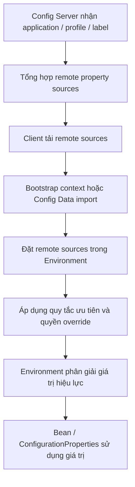

# Phạm vi áp dụng của quy tắc ghi đè từ nguồn cấu hình từ xa

## 1. Mục tiêu và phạm vi

Một ứng dụng Spring Boot có thể nhận cấu hình từ file local, biến môi trường, Java system properties, tham số dòng lệnh và nguồn từ xa như Spring Cloud Config Server. Khi cùng một khóa xuất hiện ở nhiều nơi, cần biết nguồn nào có thể ghi đè nguồn khác và quy tắc đó được áp dụng trong giai đoạn nào.

Spring Cloud có các thuộc tính điều khiển vị trí của remote property source so với nguồn local. Tuy nhiên, đây không phải công tắc chung cho mọi loại cấu hình. Quy tắc trong bài tập trung vào remote property source được đưa vào ứng dụng qua **legacy config-first bootstrap**. Dự án dùng Spring Boot Config Data import cần được xem xét riêng.

Bài học thuộc chương **Bootstrap** của module **SPRING_CLOUD_CORE**, tập trung vào Spring Cloud Commons, Spring Cloud Context, cấu hình ngoài, tương thích Spring Boot và vận hành các abstraction chung.

Sau bài này, người học có thể:

- Giải thích mặc định remote property source trong bootstrap có ưu tiên cao và không cho local source ghi đè.
- Phân biệt ba thuộc tính `spring.cloud.config.allowOverride`, `spring.cloud.config.overrideNone` và `spring.cloud.config.overrideSystemProperties`.
- Xác định nơi phải khai báo quyền override và nguồn local nào được phép ghi đè.
- Phân biệt remote property source với operator overrides của Config Server.
- Phân biệt legacy bootstrap với Config Data import hiện đại.
- Kiểm chứng thứ tự hiệu lực bằng `Environment`, Actuator và integration test.
- Không nhầm quyền ghi đè với cơ chế refresh hoặc một ranh giới bảo mật.

## 2. Hai lớp ưu tiên cần tách biệt

Khi nói “cấu hình từ xa thắng cấu hình local”, có thể đang nói đến hai việc khác nhau:

1. **Thứ tự bên trong cấu hình do Config Server trả về:** server tổng hợp file dùng chung, file theo ứng dụng, profile, label và repository thành remote property sources.
2. **Thứ tự giữa remote property source và nguồn của client:** sau khi client nhận dữ liệu, remote source nằm ở đâu trong `Environment` và local source có được phép ghi đè hay không.

Ví dụ, một file profile-specific trong Git có thể thắng file mặc định trong cùng remote repository. Điều đó chưa trả lời được biến môi trường trong container có thể ghi đè giá trị remote hay không.



Quy tắc trong bài tập trung vào bước E–F. Nó không tự quyết định Config Server lấy nhánh Git, profile hay file nào.

## 3. Mặc định trong legacy config-first bootstrap

Trong mô hình bootstrap truyền thống, Spring Cloud tạo một **bootstrap ApplicationContext** trước application context chính. Bootstrap context dùng để nạp các thành phần cấu hình ban đầu, thường bao gồm việc kết nối Spring Cloud Config Server và thêm remote property source vào Environment.

Remote property source được thêm qua bootstrap context mặc định có ưu tiên cao và **không thể bị cấu hình local ghi đè** theo cơ chế thông thường. Mục tiêu là để chính sách cấu hình tập trung không vô tình bị mỗi ứng dụng thay đổi.

Ví dụ remote repository trả về:

```yaml
# Remote repository: order-service-prod.yml
orders:
  timeout: 3s
  retry:
    max-attempts: 4
```

Client có file local:

```yaml
# application-prod.yml trong ứng dụng client
orders:
  timeout: 5s
```

Với bootstrap remote property source và hành vi mặc định, giá trị remote `orders.timeout=3s` có thể tiếp tục thắng file local `5s`. Chỉ sửa file local không bảo đảm thay đổi giá trị hiệu lực.

### 3.1. Bootstrap context và bootstrap.yml không phải cùng một property source

Hai khái niệm thường bị nhầm:

- **Bootstrap context:** application context cha được Spring Cloud sử dụng để khởi tạo các nguồn cấu hình từ xa và bootstrap configuration.
- **bootstrap.yml / bootstrap.properties:** file cấu hình local có thể được dùng để thiết lập bootstrap context.

File `bootstrap.yml` không đồng nghĩa với remote property source. File bootstrap local có thể có ưu tiên thấp hơn `application.yml` của application context chính, trong khi remote property source được bootstrap context đưa vào có thể có ưu tiên cao hơn các nguồn local đó.

Khi cần xác định nguồn nào thắng, hãy xem tên và vị trí thực tế của property source trong Environment thay vì suy luận từ tên file.

### 3.2. Bật legacy bootstrap

Ở các phiên bản Spring Cloud hiện hành, cách legacy bootstrap cần được bật rõ ràng, ví dụ qua starter `spring-cloud-starter-bootstrap` hoặc property `spring.cloud.bootstrap.enabled=true` được cung cấp sớm bằng system property/environment variable.

Ví dụ cấu hình bootstrap local:

```yaml
# bootstrap.yml
spring:
  application:
    name: order-service
  cloud:
    config:
      uri: http://config-server:8888
```

Khi bootstrap đã được bật và Config Client có trên classpath, client khởi tạo remote property source trong quá trình bootstrap. File bootstrap không bắt buộc với cách Config Data import hiện đại.

Không nên thêm `bootstrap.yml` chỉ vì dự án có Spring Cloud Config Client. Trước hết xác định dự án dùng config-first bootstrap hay Config Data import; hai cách có quy trình khởi tạo và quy tắc áp dụng khác nhau.

## 4. Ba thuộc tính điều khiển quyền ghi đè

Spring Cloud mô tả ba thuộc tính liên quan đến vị trí remote property source:

| Thuộc tính | Ý nghĩa | Điểm cần nhớ |
| --- | --- | --- |
| `spring.cloud.config.allowOverride` | Cho phép remote property source nhường quyền theo các thiết lập override chi tiết | Phải được cấp quyền từ remote property source; đặt riêng ở local client không cấp quyền |
| `spring.cloud.config.overrideNone` | Đưa external/remote properties xuống ưu tiên thấp để mọi local property source có thể ghi đè | Có hiệu lực cho config-first bootstrap theo metadata hiện hành |
| `spring.cloud.config.overrideSystemProperties` | Điều khiển remote properties có nằm trên system properties hay không | `false` cho phép system properties, command line và environment variables ghi đè remote; local config files vẫn không ghi đè theo chế độ này |

### 4.1. allowOverride: quyền phải được cấp từ phía remote

Muốn client được phép ghi đè remote property source, remote source phải cấp quyền bằng:

```yaml
spring:
  cloud:
    config:
      allow-override: true
```

Cấu hình này phải nằm trong repository/nguồn cấu hình mà Config Server trả về cho client. Đặt `spring.cloud.config.allow-override=true` trong `application.yml` local hoặc `bootstrap.yml` local không thể tự cấp quyền override cho client.

Đây là ranh giới quan trọng: **remote configuration quyết định có cho phép client áp dụng các quy tắc override hay không**. Nếu remote source không cấp quyền theo cách tài liệu yêu cầu, việc tự đặt property tại client không làm thay đổi chính sách.

### 4.2. overrideNone: mọi nguồn local có thể ghi đè

Khi remote source đã cho phép override, thiết lập:

```yaml
spring:
  cloud:
    config:
      allow-override: true
      override-none: true
```

cho phép **bất kỳ local property source nào** ghi đè remote property source. Ví dụ, local `application-prod.yml` có thể cung cấp giá trị thay thế cho khóa được remote repository định nghĩa.

`overrideNone` có nghĩa remote properties được đặt ở mức ưu tiên thấp hơn các local sources, chứ không có nghĩa xóa remote source hoặc tắt Config Server.

Theo metadata cấu hình Spring Cloud hiện hành, `spring.cloud.config.override-none` mặc định là `false` và chỉ có hiệu lực khi sử dụng config-first bootstrap. Đây là giới hạn cần ghi nhớ khi đọc tài liệu cũ hoặc chuyển dự án sang Config Data import.

### 4.3. overrideSystemProperties: chỉ cho phép nhóm nguồn runtime ghi đè

Một chế độ hẹp hơn là:

```yaml
spring:
  cloud:
    config:
      allow-override: true
      override-system-properties: false
```

Khi áp dụng trong bootstrap override policy, **system properties, command-line arguments và environment variables** có thể ghi đè remote properties; các local config files như `application.yml` không được quyền ghi đè remote properties theo chế độ này.

Tên thuộc tính dễ gây hiểu nhầm. Có thể đọc theo góc nhìn remote source:

- `override-system-properties: true`: external/remote properties được phép nằm trên system properties theo mặc định được mô tả trong metadata.
- `override-system-properties: false`: system properties, command line và environment variables được phép đứng trên remote properties.

Giá trị mặc định được metadata hiện hành ghi nhận cho `override-system-properties` là `true`. Hãy đặt giá trị tường minh trong remote repository nếu muốn chính sách dễ kiểm toán và tránh phụ thuộc mặc định theo phiên bản.

### 4.4. Bảng quyết định

Giả sử cùng khóa `orders.timeout` xuất hiện ở remote Config Server, local application file, environment variable và command line:

| Chính sách bootstrap | Local application file | Environment variable | System property / command line |
| --- | --- | --- | --- |
| Remote không cấp quyền override | Remote thắng | Remote thắng theo chính sách remote mặc định | Remote thắng theo chính sách remote mặc định |
| `allowOverride=true`, `overrideNone=false`, `overrideSystemProperties=true` | Remote thắng | Remote thắng | Remote thắng |
| `allowOverride=true`, `overrideNone=false`, `overrideSystemProperties=false` | Remote thắng | Local thắng | Local thắng |
| `allowOverride=true`, `overrideNone=true` | Local thắng | Local thắng | Local thắng |

Bảng mô tả quy tắc của bootstrap remote property source. Khi các cờ kết hợp không rõ ràng, không nên đặt nhiều chính sách trái mục tiêu cùng lúc; hãy chọn một chế độ, kiểm thử với đúng release train và kiểm tra thứ tự thực tế trong Environment.

## 5. Ví dụ thực hành với remote repository

Giả sử Config Server phục vụ `order-service/prod` từ repository Git. Remote file chứa:

```yaml
# order-service-prod.yml trong config repository
spring:
  cloud:
    config:
      allow-override: true
      override-none: false
      override-system-properties: false

orders:
  timeout: 3s
```

Client có file:

```yaml
# application-prod.yml trong ứng dụng
orders:
  timeout: 4s
```

Môi trường triển khai:

```bash
ORDERS_TIMEOUT=5s
```

Lệnh chạy:

```bash
java -jar order-service.jar --orders.timeout=6s
```

Với chế độ bootstrap được mô tả ở trên:

- Remote repository cấp quyền override.
- Local application file không thể ghi đè remote vì `overrideNone=false`.
- Environment variable có thể ghi đè remote vì `overrideSystemProperties=false`.
- Command-line argument có thể ghi đè remote.
- Nếu không có command line, giá trị từ environment variable có thể thắng remote.

Kết quả mong đợi trong ví dụ là `6s`. Nếu bỏ tham số `--orders.timeout=6s` thì kết quả có thể là `5s`. File local khai báo `4s` không thắng remote theo chế độ đã chọn.

Nếu muốn local application file cũng ghi đè remote, chuyển chính sách remote sang `override-none: true` và kiểm thử lại trong config-first bootstrap.

## 6. Phạm vi áp dụng: không phải mọi nguồn remote đều giống nhau

### 6.1. Không áp dụng cho mọi externalized configuration

Quy tắc trong phần này nói về remote property sources được bootstrap context đưa vào client, thường là từ Spring Cloud Config Server. Nó không tự động thay đổi thứ tự của:

- Các file Config Data local do Spring Boot nạp.
- Biến môi trường của hệ điều hành nếu không có remote bootstrap source liên quan.
- Java system properties và command-line arguments trong một ứng dụng Boot thuần.
- Property source do ứng dụng tự thêm bằng `EnvironmentPostProcessor` hoặc `PropertySourceLocator`.
- Mọi hệ thống cấu hình khác như Consul, Vault hoặc custom provider nếu tích hợp của chúng không sử dụng đúng cơ chế/thuộc tính này.

Các provider khác có thể có chính sách ưu tiên riêng. Hãy đọc tài liệu của integration tương ứng và kiểm tra property sources thực tế.

### 6.2. Không áp dụng cho thứ tự giữa các repository ở Config Server

Config Server có thể tổng hợp cấu hình từ nhiều repository hoặc nhiều file. Thứ tự giữa các nguồn remote được quyết định bởi cấu hình server, repository order, application/profile/label và cơ chế EnvironmentRepository.

Ví dụ, một remote file dùng chung `application.yml` có thể cung cấp mặc định; file riêng `order-service.yml` và file theo profile `order-service-prod.yml` có thể có độ ưu tiên cao hơn. Đây là **thứ tự tạo remote Environment ở phía server**.

Các cờ `allowOverride`, `overrideNone` và `overrideSystemProperties` điều khiển quan hệ giữa remote source và local source phía client; chúng không sắp xếp lại các file/repository ở phía server.

### 6.3. Không đồng nghĩa với Config Server operator overrides

Config Server còn có tính năng `spring.cloud.config.server.overrides` để người vận hành cung cấp các giá trị chung cho các client. Ví dụ cấu hình ở phía server:

```yaml
spring:
  cloud:
    config:
      server:
        overrides:
          company.region: ap-southeast
          company.support-url: https://support.example.com
```

Đây là **operator-provided property overrides**, khác với `spring.cloud.config.allowOverride` ở remote repository:

| Cơ chế | Ai cấu hình? | Mục tiêu |
| --- | --- | --- |
| `allowOverride` / `overrideNone` / `overrideSystemProperties` | Chủ sở hữu remote property source | Quyết định local client được ghi đè remote source ở mức nào |
| `spring.cloud.config.server.overrides` | Người vận hành Config Server | Cung cấp giá trị chung cho các client |

Tính năng operator overrides hữu ích để đưa một số giá trị mặc định chung vào tất cả ứng dụng. Tuy nhiên, tài liệu Spring Cloud cũng lưu ý hệ thống cấu hình không thể ép buộc ứng dụng sử dụng dữ liệu theo một cách bất khả xâm phạm. Không nên xem property override là ranh giới bảo mật; các ràng buộc bảo mật cần được thực thi ở nơi thích hợp.

## 7. Bootstrap truyền thống và Config Data import hiện đại

Spring Boot 2.4 giới thiệu cơ chế Config Data import; đây là cách mặc định hiện đại để kết nối Spring Cloud Config Server. Hai mô hình cần được nhận diện riêng:

| Đặc điểm | Config-first bootstrap (legacy) | Config Data import |
| --- | --- | --- |
| Kích hoạt | Bật bootstrap bằng starter hoặc `spring.cloud.bootstrap.enabled=true` | Khai báo `spring.config.import` |
| File bootstrap | Có thể dùng `bootstrap.yml` để cung cấp URI và cấu hình bootstrap | Không cần `bootstrap.yml` cho cách import này |
| Thời điểm nạp remote | Qua bootstrap context trước application context chính | Trong quy trình Config Data của Spring Boot |
| Cờ `overrideNone` | Có hiệu lực theo tài liệu cấu hình hiện hành | Metadata hiện hành ghi rõ chỉ có hiệu lực với config-first bootstrap |
| Cách xác minh | Kiểm tra bootstrap property source và vị trí remote source | Kiểm tra Config Data imports, thứ tự import và Environment sau khi khởi động |

Ví dụ Config Data import:

```yaml
spring:
  application:
    name: order-service
  config:
    import: optional:configserver:http://config-server:8888
```

Cách này không cần `bootstrap.yml`. Tiền tố `optional:` cho phép ứng dụng tiếp tục nếu Config Server không sẵn sàng theo semantics của Config Data import; nếu cấu hình remote bắt buộc để ứng dụng chạy an toàn, hãy bỏ `optional:` để lỗi kết nối làm startup thất bại rõ ràng.

Khi chuyển từ bootstrap sang Config Data:

1. Không sao chép nguyên xi giả định về thứ tự property source từ mô hình cũ.
2. Kiểm tra tài liệu release train đang dùng và metadata của các thuộc tính override.
3. Kiểm tra `spring.config.import`, các import khác và profile-specific config.
4. Chạy integration test với local file, environment variable, system property và command line cùng khai báo một khóa.
5. Dùng Actuator `env` hoặc API Environment để xác minh remote source nằm ở đâu.
6. Chỉ kết luận sau khi xác minh bằng phiên bản dependency thực tế.

Nếu cần local override trong Config Data mode, hãy sử dụng cơ chế được tài liệu hiện hành hỗ trợ cho cấu hình đó, chẳng hạn thứ tự import/profile hoặc placeholder phù hợp; không giả định `overrideNone` là công tắc dùng chung cho cả hai mô hình.

## 8. Placeholder: cách tạo giá trị remote có thể tùy biến

Một cách khác để cho phép ứng dụng tùy biến mà không thay đổi toàn bộ thứ tự property source là khai báo placeholder trong remote configuration.

Ví dụ remote config:

```yaml
orders:
  banner: \${ORDERS_BANNER:Thông báo mặc định từ Config Server}
```

Trong remote YAML, dấu gạch chéo ngược giữ placeholder để Config Server không resolve nó quá sớm; Spring Environment ở phía client sẽ resolve biểu thức khi ứng dụng đọc cấu hình. Với file `.properties`, cần escape dấu gạch chéo theo cú pháp của định dạng đó. Client cung cấp `ORDERS_BANNER` trong nguồn cấu hình local phù hợp; nếu không có giá trị, phần mặc định trong biểu thức được sử dụng.

Cách này khác với việc cho local ghi đè trực tiếp khóa `orders.banner`:

- Remote property source vẫn sở hữu khóa `orders.banner`.
- Ứng dụng local cung cấp khóa tham chiếu `ORDERS_BANNER`.
- Giá trị cuối cùng của `orders.banner` được tạo từ placeholder.
- Nếu ứng dụng không cung cấp biến tham chiếu, default value trong remote expression được dùng.

Placeholder phù hợp khi muốn Config Server cung cấp cấu trúc/chính sách mặc định nhưng vẫn để từng client cung cấp một đầu vào cụ thể. Không dùng placeholder để đưa secret vào log hoặc tạo một cơ chế quản lý secret thay thế.

## 9. Override không đồng nghĩa refresh

Quy tắc override trả lời **nguồn nào thắng khi Environment phân giải property**. Nó không quyết định khi nào ứng dụng lấy cấu hình mới hoặc bean nào sẽ dùng giá trị mới.

Cần tách ba việc:

1. **Nạp cấu hình:** client kết nối Config Server và nhận remote property sources khi khởi động hoặc khi cơ chế nạp được gọi.
2. **Phân giải ưu tiên:** Environment chọn giá trị theo property source order và override policy.
3. **Áp dụng runtime:** bean được bind lại, refresh scope tạo lại bean hoặc ứng dụng được restart tùy loại cấu hình.

Spring Cloud Config Client không mặc định polling Config Server để phát hiện mọi thay đổi. Muốn nhiều instance cập nhật cấu hình, cần thiết kế trigger/notification phù hợp, ví dụ Spring Cloud Bus hoặc cơ chế refresh được kiểm soát.

`@RefreshScope` hỗ trợ tạo lại một số bean sau refresh; nó không thay đổi quy tắc remote/local override. Nếu local source vẫn không được phép ghi đè remote, việc refresh chỉ làm ứng dụng đọc lại cùng chính sách ưu tiên. Tương tự, `allowOverride=true` không tự làm bean đang chạy cập nhật khi Git repository thay đổi.

## 10. Kiểm tra chính sách bằng Actuator và integration test

### 10.1. Kiểm tra property source trong runtime

Với Spring Boot Actuator đã được cấu hình và bảo vệ, endpoint `/actuator/env` có thể cho thấy remote source và các source local:

```text
GET /actuator/env/orders.timeout
```

Khi kiểm tra:

- Xác nhận remote property source có được nạp hay không.
- Ghi nhận tên source và origin nếu có.
- Kiểm tra file local, environment variable, system property và command line có chứa cùng khóa không.
- Đối chiếu giá trị cuối cùng với chính sách override đã chọn.

Không expose endpoint `env` công khai hoặc tắt sanitization tùy tiện; dữ liệu cấu hình có thể chứa credential và secret.

### 10.2. Ma trận integration test

Một test nên chạy ứng dụng theo đúng mô hình bootstrap hoặc Config Data thực tế, với các giá trị khác nhau cho cùng một khóa.

| Test case | Remote | Local file | Environment | Command line | Điều cần xác minh |
| --- | --- | --- | --- | --- | --- |
| Mặc định remote thắng | `3s` | `4s` | Không đặt | Không đặt | Remote source có ưu tiên cao |
| Cho phép mọi local source | `3s` | `4s` | `5s` | `6s` | Với `overrideNone=true`, local source được phép thắng |
| Chỉ cho runtime source ghi đè | `3s` | `4s` | `5s` | `6s` | Với `overrideSystemProperties=false`, local file không thắng nhưng env/CLI có thể thắng |
| Remote không cấp quyền | `3s` | `4s` | `5s` | `6s` | Local override flags không được client tự cấp |
| Config Data import | `3s` | `4s` | `5s` | `6s` | Xác minh theo thứ tự Config Data của phiên bản đang dùng, không giả định overrideNone áp dụng |

Không nên chỉ mock một Map hoặc PropertySource rồi kết luận bootstrap integration hoạt động. Cần có test context hoặc test container với Config Server/test server để xác minh remote source thật được đưa vào Environment như thế nào.

### 10.3. Kiểm tra khi rollout

Trong môi trường nhiều instance:

- Ghi nhận application name, active profiles, Config Server label và phiên bản cấu hình.
- Xác minh tất cả instance nhận cùng một chính sách override dự kiến.
- Kiểm tra nguồn local được inject bởi container/manifest có thay đổi kết quả hay không.
- Sau refresh hoặc restart, xác minh cả giá trị Environment lẫn bean đã bind.
- Theo dõi lỗi kết nối Config Server và quyết định rõ fail-fast hay cho phép khởi động với cấu hình local.
- Không ghi giá trị secret vào log khi so sánh các instance.

## 11. Các lỗi và ngộ nhận thường gặp

| Ngộ nhận / triệu chứng | Nguyên nhân | Cách xử lý |
| --- | --- | --- |
| Đặt `allow-override=true` trong application.yml nhưng local vẫn không thắng | Quyền phải được cấp trong remote property source | Cập nhật repository mà Config Server trả về |
| `overrideNone=true` không có tác dụng | Có thể đang dùng Config Data import thay vì config-first bootstrap | Xác định mô hình nạp config và kiểm tra metadata/version |
| Local application.yml vẫn thua environment variable | Remote source đang được đặt trên local source theo chính sách hiện hành | Kiểm tra cả ba override flags và vị trí property source |
| Muốn chỉ env/CLI ghi đè nhưng local file cũng thắng | Dùng sai chế độ override hoặc nhầm với `overrideNone=true` | Dùng `overrideSystemProperties=false` trong phạm vi bootstrap phù hợp |
| Thay đổi Git repository nhưng client không cập nhật | Config Client không mặc định polling liên tục | Thiết kế refresh/Bus hoặc rollout |
| `bootstrap.yml` không được đọc | Legacy bootstrap chưa được bật hoặc dự án đang dùng Config Data import | Xác minh starter/property và cách kết nối Config Server |
| Config Server có giá trị chung không bị client đổi | Đang dùng `server.overrides` hoặc một remote policy khác | Phân biệt operator overrides với client override permission |
| Test pass nhưng production khác | Test context có property source riêng hoặc deployment inject nguồn khác | Chạy test theo cấu hình deploy và kiểm tra Environment runtime |
| Nghĩ remote override là bảo mật tuyệt đối | Client vẫn có thể được khởi chạy với nguồn khác hoặc thay đổi cách sử dụng config | Dùng authorization/validation ở tầng thực thi, không dựa vào thứ tự property |

## 12. Checklist thiết kế chính sách override

Trước khi đưa một dịch vụ vào production, hãy trả lời:

1. Client đang dùng legacy config-first bootstrap hay Spring Boot Config Data import?
2. Remote property source đến từ Config Server repository, custom locator hay provider khác?
3. Có yêu cầu cho local application file override remote không?
4. Có chỉ cho phép environment/system/CLI override remote không?
5. `allowOverride` đã được khai báo ở đúng remote source chưa?
6. Chính sách có tương thích với Spring Cloud release train đang chạy không?
7. `server.overrides` có đang được dùng cho giá trị chung không?
8. Placeholder hoặc profile-specific local config có phải giải pháp phù hợp hơn không?
9. Khi remote config thay đổi, cơ chế refresh/rollout nào sẽ áp dụng?
10. Có integration test xác nhận giá trị cuối cùng và property source order không?
11. Actuator diagnostic có được bảo vệ và sanitize không?
12. Nếu Config Server không truy cập được, client sẽ fail-fast hay chạy với cấu hình local?

## 13. Tài liệu tham khảo chính thức

- [Spring Cloud Context — Overriding the Values of Remote Properties](https://docs.spring.io/spring-cloud/docs/current/reference/htmlsingle/#overriding-bootstrap-properties): quy tắc allowOverride, overrideNone và overrideSystemProperties cho remote property sources được thêm qua bootstrap context.
- [Spring Cloud Config Client](https://docs.spring.io/spring-cloud-config/reference/client.html): Config Data import hiện đại, legacy config-first bootstrap và cách client kết nối Config Server.
- [Spring Cloud Commons — Configuration Properties](https://docs.spring.io/spring-cloud-commons/reference/configprops.html): giá trị mặc định và phạm vi hiệu lực của các thuộc tính cấu hình Spring Cloud.
- [Spring Cloud Config — Property Overrides](https://docs.spring.io/spring-cloud-config/reference/server/environment-repository/property-overrides.html): tính năng operator-provided overrides ở phía Config Server.
- [Spring Cloud Config — Environment Repository](https://docs.spring.io/spring-cloud-config/reference/server/environment-repository.html): cách server tổng hợp cấu hình theo application, profile, label và repository.

**Ghi nhớ:** Quy tắc remote override của Spring Cloud bootstrap điều khiển quan hệ giữa remote property source và local source của client. Quyền override phải được cấp từ phía remote; `overrideNone` cho phép mọi local source ghi đè, còn `overrideSystemProperties=false` chỉ cho system properties, command line và environment variables ghi đè. Hãy xác định đúng mô hình bootstrap hay Config Data import trước khi áp dụng, rồi kiểm chứng thứ tự thực tế trong Environment.
