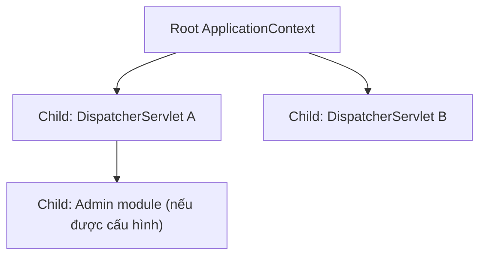
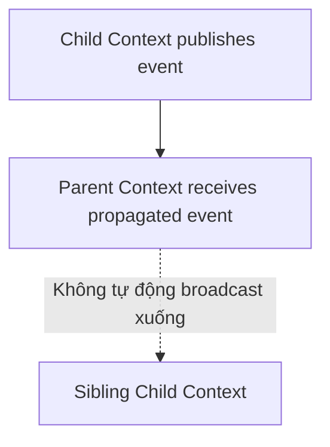

# Context cha, context con và phạm vi nhìn thấy bean

Spring Framework cho phép một ứng dụng có nhiều `ApplicationContext` liên kết theo quan hệ cha–con. Mô hình này thường xuất hiện khi một ứng dụng cần chia cấu hình nền tảng dùng chung với cấu hình của từng web application, từng `DispatcherServlet`, hoặc khi Spring Cloud tạo context phục vụ giai đoạn bootstrap trong một số kiến trúc legacy.

Điểm quan trọng nhất là **bean được tìm kiếm theo hướng từ context con lên context cha**. Context con có thể sử dụng bean do cha quản lý; context cha không nhìn thấy bean chỉ được khai báo trong context con. Mỗi context vẫn là một container riêng, có danh sách bean, lifecycle và trạng thái riêng.

Bài học thuộc chương **Phân cấp context** của module **SPRING_CLOUD_CORE**. Hiểu đúng hierarchy giúp thiết kế ranh giới bean, tránh khởi tạo trùng, xử lý property source có chủ đích và kiểm thử những ứng dụng có nhiều context.

## 1. ApplicationContext là container có thể có quan hệ phân cấp

Một ứng dụng Spring đơn giản thường chỉ cần một `ApplicationContext`. Context chứa các bean, cấu hình và dịch vụ nền tảng của ứng dụng. Khi cần chia phạm vi, ta có thể tạo một context khác và đặt context thứ nhất làm parent.

Ví dụ khái niệm:

```text
Parent ApplicationContext
  ├── DataSource
  ├── Repository
  ├── SharedService
  └── Child ApplicationContext
        ├── Controller
        ├── ViewResolver
        └── Web-specific components
```

Trong ví dụ này:
- Parent quản lý các bean dùng chung.
- Child quản lý các bean chỉ thuộc phạm vi web cụ thể.
- Bean trong child có thể tra cứu bean ở parent.
- Parent không thể tra cứu bean chỉ tồn tại ở child.

Một context có thể có tối đa một parent trực tiếp, nhưng một parent có thể có nhiều child. Vì vậy hierarchy có thể là cây nhiều tầng, không chỉ hai cấp.



Đây là quan hệ giữa các Spring context trong cùng tiến trình hoặc cùng ứng dụng. Nó không đồng nghĩa với quan hệ giữa hai microservice, hai JVM hay hai container. Muốn giao tiếp giữa các tiến trình cần HTTP, messaging hoặc giao thức phân tán.

## 2. Quy tắc nhìn thấy bean: child nhìn lên parent

Khi một bean trong context con cần một bean khác, Spring có thể tìm bean tại context con trước; nếu không tìm thấy theo tên, việc tra cứu có thể tiếp tục ở parent theo cơ chế phân cấp của BeanFactory.

| Hướng tra cứu | Có thể truy cập? | Giải thích |
| --- | --- | --- |
| Child → bean khai báo trong child | Có | Bean thuộc container hiện tại |
| Child → bean khai báo trong parent | Có | Parent BeanFactory được dùng làm nơi tra cứu tiếp |
| Parent → bean khai báo trong child | Không | Parent không biết các bean chỉ được tạo ở child |
| Child A → bean chỉ có trong Child B | Không trực tiếp | Hai child là các nhánh riêng; chúng có thể cùng dùng bean ở parent |
| Parent → bean của chính parent | Có | Parent tra cứu trong phạm vi của nó và các ancestor của nó nếu có |

Ví dụ:
- `SharedService` được khai báo trong parent.
- `OrderController` được khai báo trong child.
- Controller có thể inject `SharedService`.
- Một bean trong parent không thể inject `OrderController` của child.

**Chiều nhìn thấy không đối xứng.** Đây là nguyên tắc nền tảng khi quyết định đặt bean vào context nào.

## 3. Ví dụ tạo parent và child context

Spring hỗ trợ tạo context theo chương trình. Ví dụ dưới đây sử dụng `SpringApplicationBuilder` của Spring Boot để minh họa một parent và một child:

```java
import org.springframework.boot.autoconfigure.SpringBootApplication;
import org.springframework.boot.builder.SpringApplicationBuilder;
import org.springframework.context.annotation.Bean;
import org.springframework.context.annotation.Configuration;

@Configuration
class ParentConfiguration {
    @Bean
    SharedCatalog sharedCatalog() {
        return new SharedCatalog();
    }
}

@Configuration
class ChildConfiguration {
    @Bean
    OrderFacade orderFacade(SharedCatalog catalog) {
        return new OrderFacade(catalog);
    }
}

class SharedCatalog {
    String description() {
        return "Shared catalog";
    }
}

class OrderFacade {
    private final SharedCatalog catalog;

    OrderFacade(SharedCatalog catalog) {
        this.catalog = catalog;
    }

    String describeCatalog() {
        return catalog.description();
    }
}

public class HierarchyApplication {
    public static void main(String[] args) {
        new SpringApplicationBuilder(ParentConfiguration.class)
                .child(ChildConfiguration.class)
                .run(args);
    }
}
```

Ví dụ cho thấy bean `orderFacade` được tạo trong child có thể nhận `SharedCatalog` từ parent. Khi chạy dự án thực tế, cần cấu hình source, package scan và lifecycle phù hợp; ví dụ rút gọn này chỉ minh họa quan hệ bean.

### 3.1. Đặt parent trước khi refresh child

Parent cần được thiết lập trước khi child hoàn tất quá trình refresh và khởi tạo bean phụ thuộc vào parent. API tạo hierarchy như `SpringApplicationBuilder` quản lý thứ tự này. Nếu tự tạo context thủ công, hãy đặt parent trước khi gọi `refresh()`.

Ví dụ với context thuần Spring:

```java
import org.springframework.context.annotation.AnnotationConfigApplicationContext;

AnnotationConfigApplicationContext parent =
        new AnnotationConfigApplicationContext(ParentConfiguration.class);

AnnotationConfigApplicationContext child =
        new AnnotationConfigApplicationContext();

child.setParent(parent);
child.register(ChildConfiguration.class);
child.refresh();
```

Ở đây child được tạo, gán parent rồi mới refresh. Sau khi refresh, child có thể resolve bean từ parent. Trong ứng dụng thực tế, phải quản lý việc đóng cả hai context theo đúng vòng đời; không để parent bị đóng khi child còn cần sử dụng các bean của parent.

## 4. Bean trùng tên: child có thể che bean của parent

Giả sử cả parent và child đều có bean tên `messageProvider`:

```java
@FunctionalInterface
interface MessageProvider {
    String message();
}

@Configuration
class ParentConfiguration {
    @Bean
    MessageProvider messageProvider() {
        return () -> "parent";
    }
}

@Configuration
class ChildConfiguration {
    @Bean
    MessageProvider messageProvider() {
        return () -> "child";
    }
}
```

Khi tra cứu bean theo tên từ child, bean cục bộ của child được ưu tiên. Bean parent vẫn tồn tại trong parent; child không thay đổi hoặc ghi đè định nghĩa bean trong parent.

| Nơi gọi | Kết quả tra cứu `messageProvider` |
| --- | --- |
| Parent context | Bean `messageProvider` của parent |
| Child context | Bean `messageProvider` của child nếu có bean cục bộ cùng tên; nếu không mới tra parent |

Đây là **shadowing trong hierarchy**, khác với việc khai báo hai bean trùng tên trong cùng một BeanFactory. Chính sách cho phép ghi đè bean definition trong một context là một vấn đề cấu hình riêng; Spring Boot có thể tắt bean definition overriding theo mặc định ở một số cấu hình.

### 4.1. Trùng kiểu nhưng khác tên

Nếu parent và child cùng có bean cùng kiểu nhưng khác tên, việc inject theo kiểu có thể có nhiều candidate tùy phạm vi tìm kiếm và cách phân giải dependency. Khi có nhiều bean cùng thỏa mãn, ứng dụng có thể cần:
- `@Qualifier` để chỉ rõ bean mong muốn.
- `@Primary` để chỉ định candidate ưu tiên trong phạm vi phân giải phù hợp.
- Đổi tên hoặc chuyển bean sang context phù hợp để giảm nhập nhằng.

Không nên dựa vào thứ tự khởi tạo để đoán bean nào được inject. Hãy thiết kế tên, qualifier và phạm vi context rõ ràng.

## 5. Singleton là singleton trong từng context

Một lỗi hiểu nhầm phổ biến là cho rằng `singleton` nghĩa là chỉ có một object trong toàn bộ JVM. Trong Spring, singleton là một instance cho mỗi bean definition trong mỗi BeanFactory/ApplicationContext quản lý nó.

Ví dụ:
- Parent có singleton `SharedClock`.
- Child A và Child B đều tra cứu `SharedClock` từ parent.
- Cả hai dùng cùng object do parent quản lý.
- Nếu Child A tự khai báo bean `LocalClock`, object đó thuộc riêng Child A.
- Child B không tự nhìn thấy `LocalClock` của Child A.

```text
Parent context
  └── SharedClock (singleton P)
       ↑             ↑
       |             |
Child A             Child B
  └── LocalCache A    └── LocalCache B
      (singleton A)      (singleton B)
```

Singleton của parent được dùng chung bởi các child truy cập tới chính bean đó. Singleton trong mỗi child là instance riêng. Nếu hai context độc lập cùng khai báo một bean class giống nhau, chúng có thể tạo hai singleton khác nhau.

Điều này quan trọng với:
- Cache và trạng thái mutable.
- Connection pool và client dùng chung.
- Bộ đếm, scheduler và thread.
- Bean có tài nguyên cần đóng khi context dừng.

Không đặt một object mutable dùng chung trong parent nếu các child cần trạng thái tách biệt. Ngược lại, đặt client thread-safe dùng chung ở parent có thể tránh tạo nhiều pool/kết nối giống nhau nếu vòng đời và cấu hình thực sự dùng chung.

## 6. Vòng đời của parent và child

Mỗi ApplicationContext có lifecycle riêng: tạo, refresh, chạy, đóng. Trong hierarchy, parent thường phải sẵn sàng trước child để child có thể resolve dependency từ parent.

Các nguyên tắc thực hành:
- Tạo/refresh parent trước child.
- Đảm bảo parent vẫn hoạt động khi child còn sử dụng bean parent.
- Đóng child trước parent khi ứng dụng tự quản lý lifecycle nhiều context.
- Không đóng một context dùng chung trong khi context khác vẫn phụ thuộc vào nó.
- Khi tạo nhiều child, xác định rõ ai sở hữu và đóng từng context.

Với `SpringApplicationBuilder`, Spring Boot hỗ trợ dựng context hierarchy; ứng dụng vẫn cần quản lý việc chạy và đóng context phù hợp với cách khởi tạo. Với context tạo thủ công, giữ reference tới các context và đóng đúng thứ tự.

### 6.1. Bean destruction và tài nguyên

Khi context đóng, bean singleton do context đó quản lý có thể nhận callback hủy như `@PreDestroy`, `DisposableBean.destroy()` hoặc custom destroy method. Bean lấy từ parent vẫn thuộc lifecycle của parent; child không nên tự coi mình là chủ sở hữu bean đó.

Ví dụ, nếu parent quản lý một connection pool dùng chung, đóng child không nên đóng pool. Parent chỉ đóng pool khi chính parent kết thúc và không còn child cần dùng.

## 7. ApplicationEvent trong context hierarchy

Spring event có hành vi lan truyền trong hierarchy. Khi một event được publish trong child context, event đó có thể được chuyển tiếp lên parent. Listener trong parent vì thế có thể nhận event được phát từ child. Event được phát từ parent không tự động lan xuống các child.



Điều này có nghĩa event nội bộ vẫn là event trong phạm vi context hierarchy của cùng ứng dụng, không phải message phân tán tới mọi JVM.

Ví dụ minh họa:

```java
import org.springframework.context.ApplicationEventPublisher;
import org.springframework.context.event.EventListener;
import org.springframework.stereotype.Component;

@Component
class ChildEventPublisher {
    private final ApplicationEventPublisher publisher;

    ChildEventPublisher(ApplicationEventPublisher publisher) {
        this.publisher = publisher;
    }

    void publishOrderCreated(String orderId) {
        publisher.publishEvent(new OrderCreatedEvent(orderId));
    }
}

class OrderCreatedEvent {
    private final String orderId;

    OrderCreatedEvent(String orderId) {
        this.orderId = orderId;
    }

    String orderId() {
        return orderId;
    }
}

@Component
class ParentEventListener {
    @EventListener
    void onOrderCreated(OrderCreatedEvent event) {
        System.out.println("Received order " + event.orderId());
    }
}
```

Nếu publisher thuộc child và listener thuộc parent, event có thể được parent nhận thông qua cơ chế propagation. Nếu cần chuyển event tới một service chạy ở JVM khác, dùng message broker hoặc HTTP; không dựa vào ApplicationEvent.

## 8. Environment và PropertySource trong hierarchy

Bean hierarchy và property source hierarchy có liên quan nhưng là hai khía cạnh khác nhau.

- **Bean hierarchy:** child BeanFactory có thể tra cứu bean ở parent.
- **Environment/property sources:** cấu hình có thể được kế thừa/ghép giữa các Environment theo cách context được tạo và cấu hình.

Khi một ConfigurableEnvironment được merge với Environment của parent, property source và profile của parent có thể được đưa vào Environment của child. Các property source riêng của child có thể được sắp xếp ở vị trí ưu tiên cao hơn các nguồn được merge từ parent. Cách tạo context và cấu hình Environment quyết định chính xác việc chia sẻ/merge.

Không nên kết luận rằng chỉ cần đặt parent context thì mọi loại state trong Environment tự động chia sẻ cùng một object. Hãy xác định child dùng Environment riêng, Environment được merge hay Environment dùng chung theo cách dựng context.

### 8.1. Ví dụ khái niệm về cấu hình cha và con

Giả sử parent cung cấp property mặc định:

```text
app.region = ap-southeast-1
app.timeout = 5s
```

Child A có cấu hình riêng:

```text
app.timeout = 2s
app.feature.admin = true
```

Nếu các Environment được ghép theo quy tắc để property source của child có ưu tiên cao hơn parent, kết quả tra cứu tại child có thể là:

| Property | Giá trị hiệu lực tại child |
| --- | --- |
| `app.region` | `ap-southeast-1` từ parent |
| `app.timeout` | `2s` từ child |
| `app.feature.admin` | `true` từ child |

Đây là minh họa precedence; không phải cam kết rằng mọi context builder hoặc mọi Spring Cloud bootstrap version đều tạo thứ tự y hệt. Khi cần chắc chắn, hãy kiểm tra PropertySource thực tế trong Environment.

### 8.2. Đừng nhầm kế thừa Environment với bean visibility

Một property xuất hiện trong child Environment không có nghĩa bean của parent tự nhìn thấy mọi bean child. Ngược lại, child có thể dùng bean parent ngay cả khi cấu hình property của hai context được tổ chức riêng.

Hãy kiểm tra hai câu hỏi độc lập:
1. Bean được tạo trong context nào và context nào có thể tra cứu nó?
2. Property được nạp vào Environment nào và nguồn nào có precedence?

## 9. Spring MVC: ví dụ phổ biến của context cha–con

Trong ứng dụng Spring MVC truyền thống, một mô hình phổ biến là root WebApplicationContext quản lý các bean dùng chung, còn mỗi DispatcherServlet có WebApplicationContext con chứa cấu hình web riêng.

```text
Root WebApplicationContext
  ├── Service
  ├── Repository
  ├── DataSource
  └── DispatcherServlet WebApplicationContext
        ├── Controller
        ├── HandlerMapping
        ├── ViewResolver
        └── Web-specific configuration
```

Controller trong child có thể inject service từ root context. Service trong root không thể inject controller được tạo trong child.

Nếu ứng dụng có hai DispatcherServlet, mỗi servlet có thể có child context riêng và cùng sử dụng bean nền tảng từ root. Các controller và view resolver của servlet A không tự động nhìn thấy bean riêng của servlet B.

### 9.1. Tránh component scan chồng lấn

Nếu root và child cùng scan một package rộng, bean có thể bị tạo ở cả hai context. Điều này gây:
- Service/repository được khởi tạo hai lần.
- Transaction manager hoặc client bị tạo trùng.
- Bean cùng tên che nhau giữa parent và child.
- Controller vô tình được đăng ký ở root và child.

Nên phân chia package/configuration rõ ràng:
- Root scan các thành phần nghiệp vụ và persistence dùng chung.
- Child scan controller và cấu hình web thuộc servlet.
- Dùng `@Import` hoặc cấu hình Java tường minh khi cần chia sẻ bean.

Cấu trúc cụ thể phụ thuộc cách ứng dụng dùng Spring Boot auto-configuration hay Spring MVC truyền thống. Không nên sao chép nguyên cấu hình context hierarchy của ứng dụng cũ sang ứng dụng Boot hiện đại mà chưa kiểm tra cách servlet context được dựng.

## 10. Liên hệ với Spring Cloud bootstrap context

Trong một số phiên bản/cấu hình Spring Cloud legacy, bootstrap context được tạo làm context cha của main ApplicationContext. Nó phục vụ việc khởi tạo sớm các thành phần và property source, ví dụ Config Client cần lấy cấu hình trước khi context chính hoàn tất.

Mô hình khái niệm:

```text
Bootstrap Context (legacy)
  ├── bootstrap-related beans
  ├── property source locators / bootstrap infrastructure
  └── Main ApplicationContext
        ├── application beans
        └── web / business beans
```

Cần phân biệt:
- Bootstrap context legacy là một context trong hierarchy của ứng dụng.
- Config Server là dịch vụ bên ngoài cung cấp cấu hình.
- Config Client/provider là code chạy trong ứng dụng để lấy dữ liệu.
- PropertySource là cách biểu diễn nguồn property trong Environment.
- Spring Boot Config Data là cơ chế nạp cấu hình hiện đại, có thể thay thế nhu cầu bootstrap legacy trong nhiều ứng dụng.

Từ các thế hệ Spring Cloud mới, bootstrap legacy không còn được bật mặc định trong mọi trường hợp; ứng dụng có thể dùng `spring.config.import=configserver:` theo Config Data. Nếu vẫn dùng bootstrap context, cần kích hoạt đúng dependency/cấu hình theo release train. Không nên giả định mọi dự án Spring Cloud đều có bootstrap parent context.

## 11. Khi nào nên dùng hierarchy và khi nào không?

Một context đơn giản thường dễ hiểu và dễ vận hành hơn. Hierarchy hữu ích khi có ranh giới cấu hình rõ ràng, ví dụ root/servlet context hoặc nhiều ứng dụng con chia sẻ bean nền tảng.

| Tình huống | Có thể cân nhắc hierarchy? | Lý do |
| --- | --- | --- |
| Ứng dụng Boot thông thường chỉ có một web stack | Thường không cần | Một context đủ quản lý bean và lifecycle |
| Nhiều DispatcherServlet có cấu hình riêng | Có | Mỗi servlet có child context, dùng chung service ở root |
| Nhiều module cần dùng chung một số bean nền | Có thể | Parent chứa bean dùng chung; child chứa cấu hình riêng |
| Muốn chia sẻ bean giữa các microservice khác JVM | Không | Context hierarchy không phải giao thức mạng |
| Muốn tách cấu hình theo profile | Không nhất thiết | Profile/PropertySource có thể đủ mà không cần nhiều context |
| Muốn cô lập hoàn toàn state giữa các module | Cần cân nhắc | Child vẫn có thể truy cập parent; hierarchy không phải ranh giới bảo mật |

Không tạo hierarchy chỉ để giải quyết mọi vấn đề về cấu hình hoặc module. Nếu các module cần độc lập về lifecycle, classloader, triển khai hoặc quyền truy cập, cần kiến trúc module/process phù hợp thay vì chỉ dựa vào ApplicationContext parent-child.

## 12. Kiểm thử context hierarchy

Spring Test hỗ trợ `@ContextHierarchy` để mô tả chuỗi context trong integration test. Ví dụ:

```java
import org.junit.jupiter.api.Test;
import org.junit.jupiter.api.extension.ExtendWith;
import org.springframework.test.context.junit.jupiter.SpringExtension;
import org.springframework.test.context.ContextConfiguration;
import org.springframework.test.context.ContextHierarchy;

@ExtendWith(SpringExtension.class)
@ContextHierarchy({
    @ContextConfiguration(classes = ParentConfiguration.class),
    @ContextConfiguration(classes = ChildConfiguration.class)
})
class ContextHierarchyTest {

    @Test
    void childContextCanUseParentBean() {
        // Test có thể inject bean thuộc child,
        // bean đó sử dụng SharedCatalog được tạo ở parent.
    }
}
```

Ví dụ minh họa cấu trúc test; trong bài test thực tế, khai báo field inject hoặc test method parameter để xác nhận bean cần kiểm tra. Spring Test tạo context theo hierarchy đã khai báo và có thể cache các context giữa các test khi cấu hình tương thích.

Các ca kiểm thử nên có:

| Ca kiểm thử | Kết quả cần xác nhận |
| --- | --- |
| Bean chỉ ở parent | Child resolve được bean đó |
| Bean chỉ ở child | Parent không resolve được bean đó |
| Bean cùng tên ở parent và child | Lookup tại child dùng bean local; parent vẫn dùng bean của parent |
| Bean cùng kiểu khác tên | Dependency resolution không mơ hồ hoặc dùng qualifier rõ ràng |
| Hai child cùng dùng singleton parent | Cả hai tham chiếu cùng bean do parent quản lý |
| Mỗi child có singleton riêng | Mỗi context có instance độc lập |
| Event phát từ child | Listener ở parent có thể nhận event được propagate |
| Event phát từ parent | Không giả định event tự lan xuống child |
| Child Environment được merge | Xác nhận property source và precedence thực tế |
| Đóng child | Bean child được hủy theo lifecycle; parent vẫn được quản lý riêng |

### 12.1. Kiểm tra bean visibility trực tiếp

Có thể kiểm tra bằng API context trong test:

```java
assertThat(child.containsBean("sharedCatalog")).isTrue();
assertThat(parent.containsBean("sharedCatalog")).isTrue();

assertThat(child.containsBean("orderFacade")).isTrue();
assertThat(parent.containsBean("orderFacade")).isFalse();
```

Ở đây `containsBean` trên child có thể trả true cho bean được tìm thấy thông qua hierarchy; để xác định bean có được khai báo cục bộ trong context hay không, cần kiểm tra BeanFactory cục bộ hoặc nguồn bean definition phù hợp. Không nên dùng `containsBean` một mình để suy ra nơi bean được tạo.

## 13. Lỗi thường gặp và cách chẩn đoán

| Hiện tượng | Nguyên nhân có thể | Cách xử lý |
| --- | --- | --- |
| Child không inject được bean parent | Parent chưa được gắn trước refresh, bean không tồn tại hoặc không phải candidate | Kiểm tra hierarchy, thời điểm refresh và tên/qualifier |
| Parent không thấy bean child | Thiết kế đang đặt bean ở child nhưng lại yêu cầu parent dùng nó | Chuyển abstraction dùng chung lên parent hoặc đổi ranh giới |
| Bean được tạo hai lần | Component scan chồng lấn hoặc cùng cấu hình được import ở hai context | Thu hẹp scan và phân chia configuration |
| Child dùng bean khác mong đợi | Bean local che bean parent cùng tên | Kiểm tra bean name, qualifier và thứ tự context |
| Autowiring mơ hồ | Nhiều bean cùng kiểu được nhìn thấy trong phạm vi phân giải | Dùng qualifier/primary hoặc điều chỉnh phạm vi |
| Cache/state không đồng nhất giữa child | Mỗi child tạo singleton riêng | Đặt bean dùng chung ở parent nếu phù hợp hoặc dùng kho đồng bộ |
| Parent bị đóng khi child còn hoạt động | Lifecycle nhiều context không được điều phối đúng | Đóng child trước parent, quản lý chủ sở hữu context |
| Listener parent không nhận event | Event phát ngoài hierarchy, listener không được đăng ký hoặc event propagation không như giả định | Kiểm tra context chứa publisher/listener và event type |
| Property khác nhau giữa parent và child | Environment không được merge/chia sẻ như dự kiến hoặc precedence khác | Kiểm tra Environment, PropertySource và cách dựng context |

Khi debug, hãy log định danh context và tên bean thay vì chỉ log class. Với nhiều context cùng chứa một bean class, class name không đủ để biết object thuộc context nào.

## Ghi nhớ

Context cha–con tạo ra một hierarchy của BeanFactory/ApplicationContext. Child có thể tra cứu bean cục bộ và bean từ parent; parent không nhìn thấy bean chỉ được khai báo ở child. Singleton được quản lý theo từng container, event từ child có thể propagate lên parent, còn Environment/property sources cần được kiểm tra riêng theo cách merge và precedence thực tế. Dùng hierarchy khi cần chia sẻ bean nền tảng với các phạm vi con có ranh giới rõ ràng; đừng xem nó là cơ chế giao tiếp giữa microservice hoặc ranh giới bảo mật.
