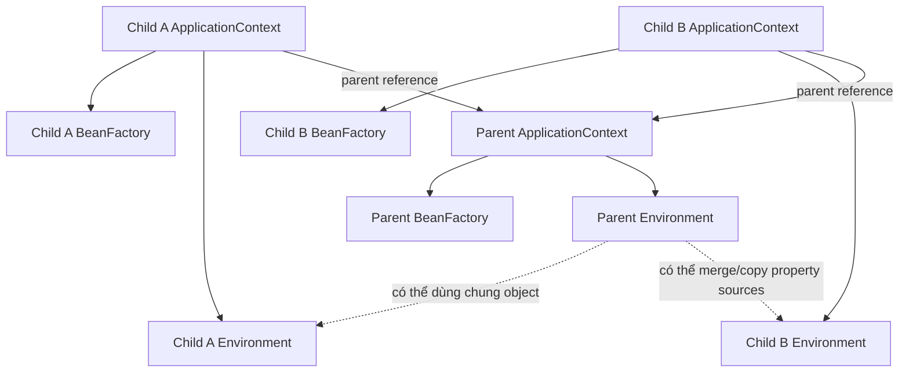
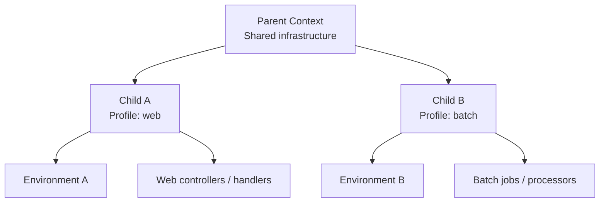

# Chia sẻ Environment và các trường hợp không chia sẻ

## 1. Vì sao cần phân biệt Environment?

Trong một ứng dụng Spring, `ApplicationContext` quản lý bean, vòng đời component, resource và sự kiện. Mỗi context có một `Environment` để đọc property, kiểm tra profile đang hoạt động và truy cập các `PropertySource` như file cấu hình, biến môi trường, system properties hoặc nguồn cấu hình từ xa.

Khi một ứng dụng có **context hierarchy** (phân cấp context), chẳng hạn một context cha chứa các bean dùng chung và nhiều context con chứa thành phần web riêng, câu hỏi thường gặp là: các context có đang dùng chung một `Environment` hay mỗi context có môi trường riêng?

Câu trả lời ảnh hưởng trực tiếp đến cách cấu hình được phân giải:

- Nếu hai context dùng **cùng một object Environment**, thay đổi active profile hoặc danh sách property source trên object đó có thể được mọi context sử dụng object này nhìn thấy.
- Nếu mỗi context dùng **Environment riêng**, chúng có thể có profile, property source và giá trị cấu hình khác nhau. Các giá trị chung có thể được truyền sang child bằng cơ chế merge/copy, nhưng hai Environment không tự động trở thành một object duy nhất.
- Quan hệ **parent-child của ApplicationContext** còn quyết định cách tìm bean. Việc dùng chung Environment không làm bean factory của hai context hợp nhất.

Bài học thuộc chương **Phân cấp context** của **SPRING_CLOUD_CORE**. Trọng tâm là hiểu ranh giới giữa context, bean factory, Environment và property source; sau đó chọn cách chia sẻ phù hợp khi dùng Spring Boot `SpringApplicationBuilder` và Spring Cloud Context.

## 2. Bốn khái niệm không nên đánh đồng

| Khái niệm | Chứa hoặc quản lý | Có được chia sẻ tự động? |
| --- | --- | --- |
| `ApplicationContext` | Bean, lifecycle, resource loader, event publisher, quan hệ parent | Mỗi context là một container riêng; có thể thiết lập parent-child |
| `BeanFactory` bên trong context | Định nghĩa bean và instance bean của context đó | Không hợp nhất giữa các context |
| `Environment` | Active/default profiles, property resolver và các property source | Tùy cách tạo context và cấu hình builder |
| `PropertySource` | Một nguồn key/value cụ thể, ví dụ system environment hoặc Config Server | Có thể được thêm vào nhiều Environment, nhưng điều đó không đồng nghĩa hai Environment là cùng object |

Một cách hình dung:



Sơ đồ thể hiện các lựa chọn có thể có. Quan hệ parent-child của context không tự động nói rằng Environment của chúng phải là cùng một object. Ngược lại, hai context có thể cùng tham chiếu một Environment nhưng vẫn có BeanFactory riêng.

## 3. Parent-child context chia sẻ bean theo quy tắc nào?

Trong phân cấp Spring:

- **Child có thể tìm bean trong chính nó và trong parent.** Vì thế child có thể sử dụng service, repository hoặc infrastructure bean được khai báo ở parent.
- **Parent không tìm ngược bean trong child.** Parent không biết những bean được tạo ở context con.
- **Hai sibling không tìm thấy bean riêng của nhau.** Chúng chỉ có thể dùng bean thuộc chính context hoặc ancestor chung.
- Khi child và parent cùng có bean cùng tên, tra cứu từ child ưu tiên bean của child; bean parent vẫn thuộc container cha.

Ví dụ:

```java
@Configuration(proxyBeanMethods = false)
public class ParentConfiguration {

    @Bean
    Clock applicationClock() {
        return Clock.systemUTC();
    }

    @Bean
    SharedFormatter sharedFormatter() {
        return new SharedFormatter();
    }
}
```

Child context khai báo bean phụ thuộc vào bean parent:

```java
@Configuration(proxyBeanMethods = false)
public class WebChildConfiguration {

    @Bean
    ReportService reportService(
            Clock applicationClock,
            SharedFormatter sharedFormatter) {
        return new ReportService(applicationClock, sharedFormatter);
    }
}
```

Khi cấu hình hierarchy bằng `SpringApplicationBuilder`, child có thể resolve `Clock` và `SharedFormatter` từ parent. Nhưng nếu một bean thuộc parent cố inject `ReportService`, quá trình tìm kiếm không đi xuống child để tìm bean đó.

| Nơi gọi tra cứu | Bean nằm ở parent | Bean nằm ở child A | Bean nằm ở sibling B |
| --- | --- | --- | --- |
| Parent | Có | Không | Không |
| Child A | Có | Có | Không |
| Sibling B | Có | Không | Có |

Điều này rất hữu ích khi muốn đặt các bean dùng chung như cache client, connection factory hoặc service dùng chung ở parent, còn controller, handler hoặc adapter riêng ở từng child.

**Lưu ý:** bean ở parent chỉ có một instance trong parent container. Các child tra cứu bean đó sẽ nhận cùng bean instance từ parent; chúng không tự tạo bản sao của bean parent. Còn bean được khai báo riêng trong mỗi child có vòng đời và instance riêng.

## 4. Chia sẻ cùng một Environment object

Một `ConfigurableEnvironment` có thể được truyền cho nhiều context. Khi nhiều context cùng giữ **tham chiếu đến chính object đó**, chúng cùng đọc danh sách property source và profile của object.

Ví dụ dùng `SpringApplicationBuilder`:

```java
import org.springframework.boot.builder.SpringApplicationBuilder;
import org.springframework.context.ConfigurableApplicationContext;
import org.springframework.core.env.ConfigurableEnvironment;
import org.springframework.core.env.StandardEnvironment;

public class HierarchyApplication {

    public static void main(String[] args) {
        ConfigurableEnvironment sharedEnvironment =
                new StandardEnvironment();

        ConfigurableApplicationContext childContext =
                new SpringApplicationBuilder(ParentConfiguration.class)
                        .environment(sharedEnvironment)
                        .child(WebChildConfiguration.class)
                        .environment(sharedEnvironment)
                        .run(args);

        ConfigurableApplicationContext parentContext =
                (ConfigurableApplicationContext) childContext.getParent();

        boolean sameEnvironment =
                childContext.getEnvironment()
                        == parentContext.getEnvironment();

        System.out.println("Same Environment: " + sameEnvironment);
    }
}
```

Điểm quan trọng trong ví dụ là truyền **cùng biến `sharedEnvironment`** vào builder của parent và child. Phép so sánh `==` kiểm tra identity của object, không chỉ so sánh xem hai Environment có cùng giá trị property hay không.

Khi hai context dùng chung Environment:

- `getProperty("app.region")` được resolve qua cùng danh sách property source.
- Active profiles và default profiles được đọc từ cùng object.
- Việc thêm, xóa hoặc sắp xếp property source trên object đó ảnh hưởng đến tất cả context đang dùng nó.
- Nếu có thao tác thay đổi Environment trong runtime, mọi context có thể nhìn thấy thay đổi ở mức property resolver.

Tuy nhiên, **cùng Environment không có nghĩa bean đã tạo sẽ tự khởi tạo lại**. Ví dụ bean đã đọc `@Value` trong constructor vẫn giữ giá trị đã nhận. Để cập nhật bean theo thay đổi cấu hình, cần cơ chế rebind hoặc refresh thích hợp, chẳng hạn các cơ chế Spring Cloud Context hỗ trợ; việc chia sẻ Environment một mình không thay thế refresh lifecycle.

### 4.1. Khi nào nên chia sẻ?

Chia sẻ một Environment object có thể phù hợp khi:

- Parent và các child là các phần của cùng một ứng dụng logic, cần cùng profile và cùng nguồn cấu hình.
- Cấu hình chung phải nhất quán trong suốt vòng đời hierarchy.
- Bạn chủ động muốn một thay đổi property source được nhìn thấy từ mọi context dùng chung object.
- Ứng dụng có quy trình quản lý thay đổi cấu hình tập trung và kiểm soát rõ thời điểm cập nhật.

Cần cân nhắc vì một context có thể thay đổi profile hoặc property source làm ảnh hưởng các context còn lại. Điều này tạo coupling: một child không còn hoàn toàn độc lập về môi trường cấu hình.

## 5. Các trường hợp Environment không dùng chung

Không phải context nào cũng cần cùng một profile hoặc cùng nguồn cấu hình. Ví dụ, một ứng dụng có thể tạo hai child phục vụ hai tenant hoặc hai web adapter có cấu hình riêng.

Có thể chủ động truyền các Environment riêng:

```java
import org.springframework.boot.builder.SpringApplicationBuilder;
import org.springframework.core.env.ConfigurableEnvironment;
import org.springframework.core.env.StandardEnvironment;

public class IsolatedEnvironmentApplication {

    public static void main(String[] args) {
        ConfigurableEnvironment parentEnvironment =
                new StandardEnvironment();

        ConfigurableEnvironment childEnvironment =
                new StandardEnvironment();

        new SpringApplicationBuilder(ParentConfiguration.class)
                .environment(parentEnvironment)
                .child(WebChildConfiguration.class)
                .environment(childEnvironment)
                .run(args);
    }
}
```

Trong ví dụ, hai context vẫn có quan hệ parent-child về bean lookup, nhưng được cấp hai Environment object khác nhau. Các active profile và property source của mỗi object có thể được cấu hình độc lập trước khi context refresh.

Những trường hợp thường không nên chia sẻ cùng một Environment:

- Hai ứng dụng độc lập chỉ tình cờ chạy trong cùng JVM.
- Các child cần profile hoặc cấu hình riêng, chẳng hạn một child dùng `web` và child khác dùng `batch`.
- Các module cần nguồn cấu hình độc lập theo tenant hoặc theo môi trường.
- Một context cần thay đổi property source mà không làm thay đổi cách context khác resolve property.
- Các sibling có lifecycle và yêu cầu cấu hình khác nhau.

Nếu hai context được tạo từ hai `SpringApplication` riêng biệt, không có parent-child hierarchy và không truyền cùng Environment, chúng hoạt động với môi trường cấu hình riêng. Việc cùng chạy trong một process không làm chúng tự chia sẻ Environment.

### 5.1. Environment riêng không đồng nghĩa hoàn toàn không có giá trị chung

Một child có thể có Environment riêng nhưng vẫn cần một phần cấu hình từ parent. Khi đó, có thể dùng `ConfigurableEnvironment.merge(parentEnvironment)` trước khi context refresh:

```java
ConfigurableEnvironment parentEnvironment =
        new StandardEnvironment();
parentEnvironment.setActiveProfiles("shared");

ConfigurableEnvironment childEnvironment =
        new StandardEnvironment();
childEnvironment.setActiveProfiles("web");

childEnvironment.merge(parentEnvironment);
```

Phương thức `merge` thêm active profiles, default profiles và property sources từ Environment cha vào Environment con. Khi có property source cùng tên ở cả hai, source của child được giữ lại và source trùng tên của parent bị loại khỏi danh sách được merge. Vì vậy cấu hình local của child có thể giữ quyền ưu tiên của nó.

**Merge không phải chia sẻ live object.** Việc merge không làm parent và child trỏ đến cùng một Environment. Những thay đổi về danh sách property source hoặc profile ở parent sau khi merge không tự động cập nhật sang child. Hãy hoàn tất cấu hình parent trước khi merge nếu muốn child nhận đầy đủ nguồn cấu hình tại thời điểm đó.

## 6. Phân biệt chia sẻ, kế thừa và merge

Ba cách dưới đây có kết quả khác nhau:

| Cách làm | Hai context có cùng Environment object? | Child nhận giá trị chung? | Parent thay đổi sau đó có tự phản ánh? |
| --- | --- | --- | --- |
| Truyền cùng object bằng `.environment(sharedEnvironment)` | Có | Có, vì cùng object | Có ở mức property source/profile của object dùng chung |
| Dùng Environment riêng, rồi `childEnvironment.merge(parentEnvironment)` | Không | Có các profile/property source được merge tại thời điểm gọi | Không tự đồng bộ danh sách/profile sau merge |
| Không chia sẻ, không merge | Không | Không nhận property source riêng của parent qua Environment merge | Không |

Ngoài ra, **bean inheritance/lookup** là một cơ chế khác: child context có thể tìm bean từ parent nhờ quan hệ context hierarchy ngay cả khi hai context dùng Environment riêng. Vì thế không thể dùng việc child inject được bean parent để kết luận chúng đang dùng chung Environment.

## 7. SpringApplicationBuilder và các lưu ý khi tạo hierarchy

`SpringApplicationBuilder` hỗ trợ tạo parent, child và sibling context:

```java
new SpringApplicationBuilder(ParentConfiguration.class)
        .child(WebChildConfiguration.class)
        .run(args);
```

Một số quy tắc cần nhớ:

- `parent(...)` thiết lập ứng dụng cha; `child(...)` tạo ứng dụng con; `sibling(...)` tạo một ứng dụng cùng parent với context hiện tại.
- Builder truyền/copy các thiết lập môi trường và default arguments xuống child theo API của phiên bản Boot. Nếu yêu cầu **cùng một Environment object**, truyền cùng instance rõ ràng qua `environment(...)` và kiểm tra identity tại runtime.
- Các context trong hierarchy có BeanFactory riêng; child được tra cứu bean từ parent, nhưng parent không tra cứu ngược.
- Các sibling không tự nhìn thấy bean của nhau. Mỗi sibling có thể có profile và nguồn cấu hình riêng, dù có thể nhận các giá trị chung từ parent theo cách khởi tạo.
- Thành phần web nên nằm ở child context; parent thường là non-web context để tránh xung đột vòng đời và web server.

Ví dụ parent dùng cho bean dùng chung, child dùng cho web application:

```java
new SpringApplicationBuilder(SharedInfrastructureConfiguration.class)
        .web(WebApplicationType.NONE)
        .child(WebApplication.class)
        .web(WebApplicationType.SERVLET)
        .run(args);
```

Cách tổ chức này tách các bean hạ tầng dùng chung khỏi cấu hình web của ứng dụng con. Chỉ dùng hierarchy khi có nhu cầu thật sự; nhiều ứng dụng Spring Boot thông thường chỉ cần một ApplicationContext.

### 7.1. Sibling context có thể có cấu hình khác nhau

Giả sử một parent chứa bean dùng chung và hai child đảm nhiệm hai adapter:



Child A và child B có thể nhận property source chung từ parent, nhưng mỗi child vẫn có thể có property source riêng. Nếu một child cần thay đổi `server.port` hoặc một cờ tính năng, không nên vô tình làm thay đổi cấu hình của sibling bằng cách dùng chung một Environment object.

## 8. Spring Cloud Bootstrap context và Environment

Trong cơ chế **legacy bootstrap** của Spring Cloud, bootstrap context là parent context của main application context. Tài liệu Spring Cloud mô tả bootstrap context và main context chia sẻ một Environment để các thuộc tính được nạp trong giai đoạn bootstrap có thể được phân giải trong ứng dụng chính.

Bootstrap context có thể dùng `PropertySourceLocator` để nạp cấu hình ngoài, ví dụ từ Spring Cloud Config Server. Các property source được nạp trong giai đoạn này có thể được thêm vào Environment với độ ưu tiên cao. Đây là hành vi của cơ chế bootstrap truyền thống; không nên suy rộng rằng mọi ApplicationContext hierarchy tự tạo đều chia sẻ Environment theo cùng quy tắc.

Khi mở rộng hierarchy bằng `SpringApplicationBuilder`:

- Bootstrap context là parent của ancestor cao nhất mà ứng dụng tự tạo.
- Mỗi context trong hierarchy có thể có bootstrap property source riêng, đôi khi rỗng, để tránh vô tình đẩy giá trị từ parent xuống mọi descendant.
- Nếu có Config Server, mỗi context về nguyên tắc có thể dùng `spring.application.name` khác nhau và nhận remote property source khác nhau.
- Property từ child có thể override property từ parent theo quy tắc context hierarchy.
- Nếu child có property source trùng tên với source của parent, source của parent cùng tên không được đưa vào kết quả phân giải của child.

Tài liệu Spring Cloud cũng lưu ý việc chia sẻ một Environment xuyên suốt toàn bộ hierarchy không nên được giả định mặc định. Spring Boot Builder có thể truyền/copy các thiết lập môi trường xuống child; nếu thiết kế cần identity của Environment, hãy chỉ rõ object cần chia sẻ và kiểm tra trên phiên bản đang chạy.

### 8.1. Bootstrap hiện đại và Config Data

Từ Spring Boot 2.4, Spring Cloud Config Client mặc định sử dụng Config Data import qua `spring.config.import`. Cơ chế này không cần legacy bootstrap context chỉ để nạp cấu hình từ Config Server.

Điều đó không xóa bỏ khả năng tạo context hierarchy trong ứng dụng; nó chỉ thay đổi cách cấu hình từ xa được nạp. Khi debug một hệ thống, hãy xác định ứng dụng có bật legacy bootstrap hay đang dùng Config Data để hiểu đúng nguồn property và context liên quan.

## 9. Property source precedence trong context hierarchy

Khi mỗi context có các property source khác nhau, việc phân giải key tuân theo quy tắc ưu tiên của Spring:

1. Property source của child có thể override giá trị cùng key trong parent.
2. Nếu child có property source trùng tên với parent, source cùng tên của parent không được thêm vào child.
3. Khi child và parent có source khác tên nhưng cùng key, thứ tự property source trong Environment quyết định giá trị được trả về.
4. Remote property source do Spring Cloud bootstrap nạp có quy tắc ưu tiên riêng; không áp dụng một cách máy móc cho mọi context hierarchy.

Ví dụ:

```text
Parent Environment:
  applicationConfig: [classpath:application.yml]
    app.region = ap-southeast

Child Environment:
  childOverrides
    app.region = eu-west
```

Nếu child có property source đứng trước và cung cấp key `app.region`, child sẽ trả về `eu-west`. Giá trị parent vẫn tồn tại trong parent context; nó chỉ không phải kết quả cuối khi tra cứu từ child.

Để kiểm tra, có thể xem từng source:

```java
ConfigurableEnvironment environment = context.getEnvironment();

for (PropertySource<?> source : environment.getPropertySources()) {
    System.out.println(source.getName());
}
```

Không in toàn bộ property value trong production vì nguồn cấu hình có thể chứa password, token hoặc thông tin nhạy cảm. Khi debug, ưu tiên in tên source và một số key không nhạy cảm.

## 10. Environment dùng chung có tự làm mới bean không?

Không. Environment là nguồn để resolve property; bean được tạo trong từng context vẫn thuộc BeanFactory của context đó.

Ví dụ hai context dùng cùng Environment, nhưng một bean đã đọc property lúc khởi tạo:

```java
@Component
public class RegionLabel {

    private final String region;

    public RegionLabel(@Value("${app.region:unknown}") String region) {
        this.region = region;
    }

    public String getRegion() {
        return region;
    }
}
```

Nếu property source được thay đổi sau khi bean đã được tạo, field `region` không tự thay đổi chỉ vì Environment object dùng chung. Tương tự, chia sẻ Environment không tự kích hoạt `EnvironmentChangeEvent` hay `RefreshScope`.

Trong Spring Cloud Context, `EnvironmentChangeEvent` có thể thông báo các key đã thay đổi; cơ chế phù hợp có thể rebind `@ConfigurationProperties`. Bean trong `@RefreshScope` có thể được tạo lại khi target bị invalidated và được truy cập lại. Tuy nhiên cần bảo đảm Environment đã có giá trị mới và cơ chế refresh được gọi trong từng context có liên quan.

Nếu hierarchy có nhiều child context, đừng giả định refresh một context sẽ tự refresh mọi sibling. Cần xác định context nào nhận sự kiện, bean nào thuộc context đó và cơ chế broadcast/điều phối nếu cần cập nhật nhiều instance.

## 11. Cách kiểm tra Environment thực tế trong ứng dụng

Có thể tạo một component đơn giản để báo cáo identity của Environment và profile đang hoạt động:

```java
import org.springframework.context.ApplicationContext;
import org.springframework.core.env.Environment;
import org.springframework.stereotype.Component;

import java.util.Arrays;

@Component
public class ContextEnvironmentReport {

    private final ApplicationContext context;
    private final Environment environment;

    public ContextEnvironmentReport(
            ApplicationContext context,
            Environment environment) {
        this.context = context;
        this.environment = environment;
    }

    public void printReport() {
        System.out.println("Context ID: " + context.getId());
        System.out.println("Parent: " + context.getParent());
        System.out.println("Active profiles: "
                + Arrays.toString(environment.getActiveProfiles()));
        System.out.println("app.region: "
                + environment.getProperty("app.region"));
    }
}
```

Trong mỗi context, gọi report tương ứng và đối chiếu:

- Context ID và parent reference cho biết vị trí của context trong hierarchy.
- Active profiles cho biết nhóm cấu hình được áp dụng.
- Property value cho biết giá trị cuối cùng mà Environment resolve.
- Để xác nhận cùng object, lấy Environment của hai context và so sánh bằng `==`; so sánh giá trị property không đủ chứng minh object identity.

Trong kiểm thử, có thể xác minh các trường hợp:

| Kiểm thử | Cách kiểm tra | Kết quả mong đợi |
| --- | --- | --- |
| Parent bean được child dùng | Inject bean parent vào bean child | Thành công |
| Parent tìm bean child | Tra cứu bean chỉ khai báo ở child từ parent | Không tìm thấy |
| Sibling tìm bean nhau | Tra cứu bean chỉ khai báo ở sibling khác | Không tìm thấy |
| Cùng Environment | So sánh `child.getEnvironment() == parent.getEnvironment()` | `true` khi truyền cùng object |
| Environment riêng | So sánh identity sau khi cấp hai object riêng | `false` |
| Merge Environment | Gọi `childEnv.merge(parentEnv)` trước refresh | Child nhận profile/property sources được merge |
| Parent thay đổi sau merge | Thay danh sách source/profile ở parent sau merge | Child không tự đồng bộ danh sách/profile mới |

## 12. Những lỗi thiết kế thường gặp

| Nhầm lẫn | Hệ quả | Cách hiểu đúng |
| --- | --- | --- |
| “Parent và child luôn dùng chung mọi thứ.” | Bean và cấu hình bị coupling ngoài ý muốn | Chỉ chia sẻ đúng thành phần cần thiết; BeanFactory và Environment là hai khái niệm riêng |
| “Child có thể inject bean từ sibling.” | Lỗi `NoSuchBeanDefinitionException` | Sibling chỉ có parent chung; không nhìn thấy bean của nhau |
| “Parent có thể inject bean từ child.” | Parent không khởi tạo được bean phụ thuộc child | Đặt bean ở parent nếu cần dùng chung hoặc chuyển dependency về child |
| “Cùng giá trị property nghĩa là cùng Environment.” | Debug sai nguyên nhân cấu hình | Kiểm tra object identity và property source list |
| “Merge Environment là live synchronization.” | Child không nhận thay đổi cấu hình mới như mong đợi | Merge chỉ thêm profiles/property sources tại thời điểm gọi; không tự đồng bộ các thay đổi sau đó |
| “Dùng chung Environment làm bean tự refresh.” | Bean đã khởi tạo vẫn giữ giá trị cũ | Cần cơ chế rebind/refresh riêng |
| “Mỗi context đều có cùng remote config.” | Child nhận sai cấu hình ứng dụng | Mỗi context có thể có `spring.application.name` và remote property source riêng |
| “Config Data luôn tạo bootstrap parent context.” | Hiểu sai cấu trúc context của ứng dụng mới | Config Data import không cần legacy bootstrap context |

## 13. Nguyên tắc chọn mô hình

- Chọn **một Environment dùng chung** khi các context cần cùng profile, cùng property source và phải quan sát cùng các thay đổi runtime.
- Chọn **Environment riêng** khi mỗi child/sibling có cấu hình hoặc vòng đời độc lập.
- Chọn **merge** khi child cần nhận cấu hình nền của parent tại thời điểm khởi tạo nhưng vẫn cần giữ khả năng override riêng.
- Tách bean dùng chung ở parent và bean đặc thù ở child; tránh để parent phụ thuộc ngược vào bean của child.
- Với Spring Cloud bootstrap, phân biệt Environment của bootstrap/main context với các Environment của hierarchy do ứng dụng tự xây dựng.
- Khi có nghi ngờ về hành vi cụ thể, kiểm tra identity, profile và property source trên phiên bản Spring Boot/Spring Cloud thực tế.

## 14. Câu hỏi tự kiểm tra

1. `ApplicationContext` và `Environment` khác nhau ở trách nhiệm nào?
2. Vì sao child có thể tìm bean của parent nhưng parent không tìm được bean chỉ có trong child?
3. Hai sibling context có thể nhìn thấy bean riêng của nhau không?
4. Chia sẻ cùng một Environment object ảnh hưởng thế nào đến active profiles và property sources?
5. `ConfigurableEnvironment.merge(parent)` khác truyền cùng object Environment ở điểm nào?
6. Vì sao thay đổi Environment không tự làm field đã inject bằng `@Value` đổi theo?
7. Trong legacy Spring Cloud bootstrap, bootstrap context và main context có quan hệ Environment ra sao?
8. Khi mỗi child cần một `spring.application.name` khác nhau, cần lưu ý điều gì về remote property source?
9. Làm thế nào kiểm tra hai context có thực sự dùng cùng một Environment object?

## 15. Tài liệu tham khảo chính thức

- [Spring Cloud Context — Application Context Services](https://docs.spring.io/spring-cloud-commons/reference/spring-cloud-commons/application-context-services.html) — bootstrap context, context hierarchy, Environment và property source.
- [Spring Boot — SpringApplicationBuilder](https://docs.spring.io/spring-boot/api/java/org/springframework/boot/builder/SpringApplicationBuilder.html) — API parent, child, sibling và cấu hình Environment.
- [Spring Boot — SpringApplication](https://docs.spring.io/spring-boot/reference/features/spring-application.html) — tạo context hierarchy bằng fluent builder.
- [Spring Framework — ApplicationContext API](https://docs.spring.io/spring-framework/docs/current/javadoc-api/org/springframework/context/ApplicationContext.html) — vai trò context và quan hệ parent.
- [Spring Framework — ConfigurableEnvironment API](https://docs.spring.io/spring-framework/docs/current/javadoc-api/org/springframework/core/env/ConfigurableEnvironment.html) — quản lý profiles, property sources và phương thức `merge`.

*Tài liệu phân biệt rõ bean hierarchy, Environment identity và việc merge property source. Hành vi chi tiết của builder và bootstrap cần được đối chiếu với đúng phiên bản Spring Boot/Spring Cloud mà ứng dụng đang sử dụng.*
