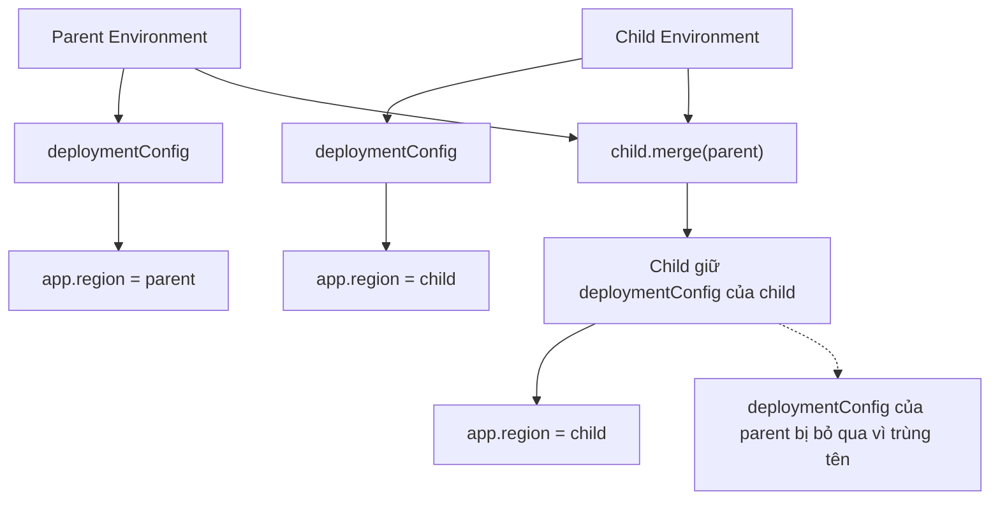

# Thuộc tính cùng tên và PropertySource cùng tên giữa các context

Trong ứng dụng Spring có nhiều `ApplicationContext`, cấu hình có thể được cung cấp từ nhiều `PropertySource` ở context cha và context con. Một key như `app.region` có thể xuất hiện ở nhiều nguồn; đó là tình huống bình thường và Spring giải quyết bằng thứ tự ưu tiên. Tuy nhiên, **tên của PropertySource cũng có ý nghĩa riêng**: Spring dùng tên này để nhận diện nguồn trong danh sách `MutablePropertySources` và khi ghép Environment giữa các context.

Cần phân biệt hai tình huống:

1. **Trùng tên property key:** nhiều nguồn cùng chứa `app.region`. Giá trị hiệu lực phụ thuộc nguồn nào được tra cứu trước.
2. **Trùng tên PropertySource:** hai nguồn khác nhau cùng có tên `deploymentConfig`. Khi chúng nằm trong cùng một danh sách nguồn hoặc được merge, Spring xử lý theo tên nguồn; hai nguồn không đơn giản cùng tồn tại như hai mục độc lập.

Sự khác biệt này đặc biệt quan trọng trong context hierarchy, Spring Cloud Config và các ứng dụng có nhiều cấu hình theo tenant/module.

## 1. Hai loại tên cần phân biệt

Giả sử một ứng dụng có cấu hình:

```text
PropertySource name: tenantOverrides
  app.region = ap-southeast-1
  app.timeout = 2s
```

Trong ví dụ này:
- `tenantOverrides` là **tên nguồn** (PropertySource name).
- `app.region` và `app.timeout` là **tên property key**.
- `ap-southeast-1` và `2s` là các giá trị.

| Thành phần | Ví dụ | Dùng để làm gì? |
| --- | --- | --- |
| Property key | `app.region` | Mã ứng dụng tra cứu giá trị trong Environment |
| PropertySource name | `tenantOverrides` | Nhận diện một nguồn trong danh sách PropertySource |
| Property value | `ap-southeast-1` | Giá trị trả về khi tra cứu key |

Property key có thể trùng giữa nhiều PropertySource. PropertySource name được dùng như định danh của nguồn trong một collection; việc trùng tên nguồn có thể làm nguồn này thay thế hoặc bị bỏ qua khi thêm/merge.

Ví dụ, hai nguồn khác tên cùng khai báo một key là hợp lệ:

```text
Environment
  1. tenantOverrides
       app.region = ap-southeast-1
  2. platformDefaults
       app.region = ap-southeast-2
```

Nếu `tenantOverrides` đứng trước, `Environment.getProperty("app.region")` nhận giá trị `ap-southeast-1`. Đây là **trùng key**, không phải trùng tên nguồn.

## 2. Tra cứu property key cùng tên

Khi gọi `Environment.getProperty("app.region")`, Spring tra cứu các PropertySource theo thứ tự trong `MutablePropertySources`. Nguồn đầu tiên cung cấp giá trị khác `null` sẽ quyết định kết quả.

Ví dụ:

```java
import java.util.Map;
import org.springframework.core.env.ConfigurableEnvironment;
import org.springframework.core.env.MapPropertySource;
import org.springframework.core.env.StandardEnvironment;

ConfigurableEnvironment environment = new StandardEnvironment();

environment.getPropertySources().addFirst(
        new MapPropertySource(
                "tenantOverrides",
                Map.of("app.region", "ap-southeast-1")
        )
);

environment.getPropertySources().addLast(
        new MapPropertySource(
                "platformDefaults",
                Map.of(
                        "app.region", "ap-southeast-2",
                        "app.timeout", "5s"
                )
        )
);

String region = environment.getProperty("app.region");
// ap-southeast-1

String timeout = environment.getProperty("app.timeout");
// 5s
```

Trong ví dụ:
- `app.region` xuất hiện ở cả hai nguồn; nguồn đầu thắng.
- `app.timeout` chỉ có ở nguồn sau; Spring tiếp tục tra cứu và lấy được giá trị.
- Hai nguồn có tên khác nhau nên cả hai cùng nằm trong danh sách.

Đây là cơ chế precedence cơ bản của Environment. Khi context con được merge Environment từ context cha, nguyên tắc tra cứu vẫn áp dụng; thứ tự giữa nguồn con và nguồn cha quyết định giá trị hiệu lực.

### 2.1. Giá trị null và chuỗi rỗng

Khi một PropertySource không có key hoặc trả về `null`, quá trình tra cứu tiếp tục sang nguồn kế tiếp. Nếu nguồn có key với giá trị chuỗi rỗng `""`, chuỗi rỗng là một giá trị khác `null` và có thể che giá trị ở nguồn thấp hơn.

```text
1. tenantOverrides
     app.region = ""
2. platformDefaults
     app.region = ap-southeast-1
```

Trong trường hợp này, kết quả có thể là chuỗi rỗng. Nếu quy tắc nghiệp vụ coi chuỗi rỗng là thiếu cấu hình, cần chuẩn hóa hoặc validation riêng. Không nên giả định Spring tự bỏ qua mọi giá trị rỗng.

## 3. PropertySource name là định danh trong MutablePropertySources

Mỗi `PropertySource` có một tên được truyền khi khởi tạo:

```java
MapPropertySource source = new MapPropertySource(
        "tenantOverrides",
        Map.of("app.region", "ap-southeast-1")
);
```

Tên này được dùng trong `MutablePropertySources` để truy cập, sắp xếp, thay thế hoặc loại bỏ nguồn. Trong Spring, phép so sánh bằng của `PropertySource` dựa trên tên nguồn. Do đó, hai object PropertySource khác nhau nhưng cùng tên được xem là cùng định danh khi quản lý trong collection này.

Ví dụ:

```java
MapPropertySource first = new MapPropertySource(
        "runtimeOverrides",
        Map.of("app.timeout", "2s")
);

MapPropertySource second = new MapPropertySource(
        "runtimeOverrides",
        Map.of("app.timeout", "4s")
);
```

Hai object có map khác nhau nhưng cùng tên `runtimeOverrides`. Nếu thêm cả hai vào cùng `MutablePropertySources` qua API add, nguồn mới sẽ thay thế vị trí/định danh của nguồn cũ thay vì tạo hai mục cùng tên.

### 3.1. addFirst/addLast với tên nguồn đã tồn tại

`MutablePropertySources.addFirst` và `addLast` loại bỏ nguồn có cùng tên trước khi chèn nguồn mới. Vì thế, gọi add với tên đã có vừa có thể thay thế object cũ, vừa thay đổi vị trí ưu tiên tùy phương thức.

```java
import org.springframework.core.env.MutablePropertySources;

MutablePropertySources sources = new StandardEnvironment().getPropertySources();

sources.addFirst(new MapPropertySource(
        "runtimeOverrides",
        Map.of("app.timeout", "2s")
));

sources.addFirst(new MapPropertySource(
        "runtimeOverrides",
        Map.of("app.timeout", "4s")
));

// Chỉ còn một nguồn tên runtimeOverrides.
// Giá trị tra cứu từ nguồn đó là 4s.
```

Nếu cần hai nguồn độc lập cùng đóng góp property, hãy đặt tên khác nhau, ví dụ:
- `moduleA.runtimeOverrides`
- `moduleB.runtimeOverrides`

Không dùng chung một tên chỉ vì hai nguồn có cùng định dạng hoặc cùng loại class. Tên nên mô tả nguồn dữ liệu và phạm vi sở hữu.

## 4. Cùng tên PropertySource trong hai Environment độc lập

Giả sử parent và child có hai Environment riêng. Mỗi Environment có danh sách PropertySource riêng, nên cùng tên nguồn có thể xuất hiện trong cả hai mà chưa tạo xung đột:

```text
Parent Environment
  deploymentConfig
    app.region = parent-region

Child Environment
  deploymentConfig
    app.region = child-region
```

Ở thời điểm này, parent tra cứu trong danh sách của parent; child tra cứu trong danh sách của child. Hai collection độc lập nên cùng tên `deploymentConfig` không tự động thay thế nhau.

Tuy nhiên, khi hai Environment được merge, quy tắc trùng tên mới có tác dụng. Đây là lý do cần hiểu rõ cách tạo context hierarchy và thời điểm gọi `ConfigurableEnvironment.merge`.

## 5. ConfigurableEnvironment.merge xử lý tên nguồn trùng như thế nào?

`ConfigurableEnvironment.merge(parent)` ghép các profile và PropertySource của Environment cha vào Environment hiện tại (thường là Environment của child). Về nguyên tắc:
- Các PropertySource đang có ở child được giữ lại.
- PropertySource của parent được thêm vào sau các nguồn child.
- Nếu child đã có PropertySource cùng tên, nguồn parent trùng tên sẽ bị bỏ qua.
- Vì nguồn child đứng trước nguồn parent được thêm vào, các key cùng tên ở nguồn child thường có precedence cao hơn.

Điểm quan trọng: **khi tên nguồn trùng, Spring bỏ qua PropertySource parent trùng tên như một đơn vị; nó không hợp nhất từng key của hai nguồn cùng tên.**

Sơ đồ:



### 5.1. Ví dụ: tên nguồn khác nhau thì cả hai được giữ

```java
import java.util.Map;
import org.springframework.core.env.MapPropertySource;
import org.springframework.core.env.StandardEnvironment;

StandardEnvironment parent = new StandardEnvironment();
parent.getPropertySources().addFirst(
        new MapPropertySource(
                "platformDefaults",
                Map.of(
                        "app.region", "ap-southeast-2",
                        "app.timeout", "5s"
                )
        )
);

StandardEnvironment child = new StandardEnvironment();
child.getPropertySources().addFirst(
        new MapPropertySource(
                "tenantOverrides",
                Map.of("app.region", "ap-southeast-1")
        )
);

child.merge(parent);

String region = child.getProperty("app.region");
// ap-southeast-1: nguồn child đứng trước

String timeout = child.getProperty("app.timeout");
// 5s: key không có ở nguồn child nên lấy từ parent
```

Hai nguồn có tên khác nhau nên parent source được thêm vào danh sách child sau các nguồn hiện có. Child override key trùng; key chỉ có ở parent vẫn được nhìn thấy từ child.

### 5.2. Ví dụ: tên nguồn giống nhau thì nguồn parent bị bỏ qua

```java
StandardEnvironment parent = new StandardEnvironment();
parent.getPropertySources().addFirst(
        new MapPropertySource(
                "deploymentConfig",
                Map.of(
                        "app.region", "parent-region",
                        "app.timeout", "5s"
                )
        )
);

StandardEnvironment child = new StandardEnvironment();
child.getPropertySources().addFirst(
        new MapPropertySource(
                "deploymentConfig",
                Map.of("app.region", "child-region")
        )
);

child.merge(parent);

String region = child.getProperty("app.region");
// child-region

String timeout = child.getProperty("app.timeout");
// null nếu không có nguồn khác khai báo app.timeout
```

Mặc dù parent có `app.timeout`, PropertySource `deploymentConfig` của parent không được thêm vào child vì child đã có nguồn cùng tên. Spring không lấy riêng key `app.timeout` để ghép vào map của child.

Đây là nguyên nhân có thể khiến một số property “biến mất” sau khi ghép Environment: hai nguồn được đặt cùng tên dù chúng chứa những tập key khác nhau.

### 5.3. Tên mặc định giống nhau có thể gây va chạm

Một số integration tạo PropertySource với tên có quy ước. Nếu nhiều context cùng dùng một tên cho các nguồn có nội dung khác nhau, khi merge có thể xảy ra việc nguồn parent bị bỏ qua. Không nên dựa vào tên nội bộ của framework để tạo logic nghiệp vụ hoặc mặc định rằng hai nguồn cùng tên có nội dung giống nhau.

Khi tự tạo PropertySource, hãy chọn tên ổn định và có namespace, ví dụ `orders.tenantOverrides` hoặc `platform.sharedDefaults`. Khi tích hợp thư viện bên thứ ba, quan sát tên nguồn thực tế trong Environment và kiểm tra hành vi merge của phiên bản đang sử dụng.

## 6. Khi context cha–con được thiết lập

Khi gọi `AbstractApplicationContext.setParent(parent)`, nếu Environment của parent là `ConfigurableEnvironment`, Spring gọi `merge` để đưa profile và PropertySource từ parent vào Environment của child. Vì vậy, các quy tắc của `ConfigurableEnvironment.merge` không chỉ là thao tác thủ công trong test; chúng liên quan trực tiếp tới cách context hierarchy được dựng. Với context hoặc Environment tùy biến, vẫn cần kiểm tra cách khởi tạo cụ thể.

Ví dụ thủ công:

```java
import org.springframework.context.annotation.AnnotationConfigApplicationContext;

AnnotationConfigApplicationContext parent =
        new AnnotationConfigApplicationContext(ParentConfiguration.class);

AnnotationConfigApplicationContext child =
        new AnnotationConfigApplicationContext();

child.setParent(parent);
child.register(ChildConfiguration.class);
child.refresh();
```

Khi dùng context builder hoặc framework tạo context tự động, cách tạo Environment có thể được tùy biến. Nếu ứng dụng đặt Environment dùng chung, thay Environment riêng hoặc có integration chỉnh thứ tự PropertySource, hãy kiểm tra cấu hình cụ thể thay vì mặc định mọi context luôn có cùng một cách merge.

Các ví dụ dùng `Map.of` yêu cầu Java 9 trở lên. Với dự án Java 8, có thể thay bằng `HashMap`/`LinkedHashMap` hoặc `Collections.singletonMap`.

### 6.1. Bean hierarchy và PropertySource hierarchy là hai vấn đề riêng

| Nội dung | Bean hierarchy | PropertySource hierarchy |
| --- | --- | --- |
| Đối tượng được quản lý | Bean definition và bean instance | Nguồn key/value |
| Cơ chế chính | BeanFactory parent lookup | Environment và MutablePropertySources |
| Quy tắc quan trọng | Child tra cứu lên parent; parent không tra child | Tra cứu theo thứ tự nguồn; merge có quy tắc tên nguồn |
| Trùng tên | Bean local có thể che bean parent khi tra cứu từ child | Tên nguồn trùng có thể làm nguồn parent bị bỏ qua khi merge |
| Ảnh hưởng | Dependency injection và bean lookup | Giá trị property hiệu lực |

Một bean trong child có thể đọc property đã được merge từ parent. Nhưng điều đó không có nghĩa bean parent có thể inject bean child. Đừng dùng quy tắc PropertySource để suy luận bean visibility hoặc ngược lại.

## 7. Tình huống thực tế: cấu hình nền tảng và tenant

Giả sử một nền tảng Spring Cloud chạy nhiều tenant. Parent cung cấp cấu hình nền tảng, còn mỗi child context có cấu hình riêng cho tenant.

Cấu hình mong muốn:

```text
Parent:
  platformDefaults
    app.region = ap-southeast-1
    app.timeout = 5s
    app.currency = VND

Child tenant-A:
  tenantAOverrides
    app.timeout = 2s
    app.brand = A

Child tenant-B:
  tenantBOverrides
    app.timeout = 3s
    app.brand = B
```

Tên nguồn khác nhau cho phép mỗi child nhận cấu hình nền tảng từ parent và ghi đè những key riêng:

| Key | Tenant A | Tenant B |
| --- | --- | --- |
| `app.region` | `ap-southeast-1` | `ap-southeast-1` |
| `app.timeout` | `2s` | `3s` |
| `app.currency` | `VND` | `VND` |
| `app.brand` | `A` | `B` |

Nếu cả ba source đều được đặt tên `applicationConfig`, child có thể ngăn nguồn parent cùng tên được merge. Vì vậy, hãy đặt tên nguồn phản ánh đúng phạm vi và mục đích, ví dụ `platformDefaults`, `tenantAOverrides`, `tenantBOverrides`.

### 7.1. Khi nào nên dùng cùng tên?

Chỉ dùng cùng tên khi hai nguồn đại diện cho cùng một định danh logic và chính sách merge mong muốn là giữ một nguồn theo quy tắc của framework. Ví dụ, child cố ý cung cấp một nguồn `deploymentConfig` hoàn chỉnh để thay thế nguồn cùng tên của parent.

Nếu ý định là **bổ sung từng key** từ parent và child, hãy dùng tên khác nhau. Việc đặt tên nguồn giống nhau không có nghĩa “hai map cùng tên sẽ được merge key-by-key”.

## 8. Liên hệ với Spring Cloud Config và bootstrap

Spring Cloud Config Client có thể đưa property từ Config Server vào Environment dưới dạng PropertySource. Trong kiến trúc có bootstrap context legacy, property source có thể được chuẩn bị trong bootstrap hierarchy rồi được chia sẻ/ghép vào main context theo cơ chế của phiên bản.

Cần phân biệt:
- Config Server là dịch vụ bên ngoài cung cấp cấu hình.
- Config Client/provider là code chạy trong ứng dụng để lấy dữ liệu.
- PropertySource là cấu trúc trong Spring để biểu diễn dữ liệu cấu hình.
- Environment là nơi mã ứng dụng tra cứu property.
- Context hierarchy quyết định phạm vi bean và cách Environment được gắn/merge theo cấu hình.

Trong các thế hệ Spring Boot dùng Config Data API, remote configuration thường được khai báo qua `spring.config.import=configserver:`. Cơ chế bootstrap legacy có cách khởi tạo khác. Không nên suy luận một tên PropertySource cụ thể luôn tồn tại ở mọi release train hoặc dùng tên nội bộ của Config Client làm hợp đồng giữa các module.

Nếu Config Client nạp property source vào child, còn parent có nguồn cùng tên, cần kiểm tra thứ tự và quy tắc merge. Tốt nhất dùng tên nguồn riêng cho các nguồn có nội dung/phạm vi khác nhau, và kiểm thử hành vi với phiên bản thực tế.

## 9. Refresh và việc thay đổi PropertySource

Thay đổi PropertySource và refresh bean là hai bước riêng:
1. Cập nhật/thay thế nguồn trong Environment.
2. Làm cho bean đang dùng cấu hình mới đọc lại giá trị theo cơ chế phù hợp.

Ví dụ, nếu thay một MapPropertySource bằng nguồn mới cùng tên, `MutablePropertySources.addFirst` có thể loại nguồn cũ và đặt nguồn mới vào đầu danh sách. Lần đọc Environment tiếp theo sẽ dùng nguồn mới. Nhưng bean đã nhận giá trị qua `@Value` khi khởi tạo không tự động thay field trong mọi trường hợp.

Với Spring Cloud Context, `@RefreshScope` có thể giúp tạo lại target bean khi refresh được kích hoạt và Environment đã được cập nhật. Nó không tự giải quyết xung đột tên PropertySource. Nếu nguồn parent bị bỏ qua trong quá trình merge, refresh bean vẫn không thể đọc key chưa từng được đưa vào Environment.

Quy trình nên là:
- Xác định source nào cần thay đổi.
- Đặt tên và thứ tự nguồn đúng.
- Cập nhật Environment/PropertySource.
- Kích hoạt refresh nếu bean cần đọc lại cấu hình.
- Kiểm tra giá trị hiệu lực và trạng thái bean sau refresh.

## 10. Kiểm tra và quan sát PropertySource trong runtime

Có thể liệt kê tên và loại PropertySource trong Environment để hiểu cấu trúc:

```java
import org.springframework.core.env.ConfigurableEnvironment;
import org.springframework.core.env.PropertySource;

void inspectSources(ConfigurableEnvironment environment) {
    for (PropertySource<?> source : environment.getPropertySources()) {
        System.out.printf("%s (%s)%n",
                source.getName(),
                source.getClass().getSimpleName());
    }
}
```

Nếu cần kiểm tra nguồn cụ thể, có thể dùng `get(name)` và tra cứu key trên source đó. Với CompositePropertySource, kiểm tra các source con theo thứ tự.

Không nên log tất cả giá trị cấu hình trong production vì có thể làm lộ secret. Chỉ ghi tên nguồn, kiểu nguồn và key không nhạy cảm; với key nhạy cảm, dùng masking hoặc bỏ qua hoàn toàn.

### 10.1. Các câu hỏi khi debug

1. Parent và child đang dùng Environment riêng hay cùng một Environment?
2. Environment của child đã merge parent chưa?
3. Key có mặt ở PropertySource nào?
4. Tên PropertySource của parent có trùng với một nguồn child không?
5. Nếu trùng, nguồn parent có bị bỏ qua khi merge không?
6. Thứ tự top-level PropertySource là gì?
7. Nếu nguồn là composite, thứ tự các nguồn con ra sao?
8. Giá trị đầu tiên tìm được là null, chuỗi rỗng hay giá trị hợp lệ?
9. Bean đã bind property trước đó có cần refresh không?

Trả lời những câu hỏi này giúp tìm đúng nguyên nhân khi property không có giá trị như mong đợi.

## 11. Kiểm thử trùng key và trùng tên nguồn

Nên kiểm thử riêng hai tình huống: key trùng giữa các nguồn khác tên và source name trùng giữa parent/child.

### 11.1. Test key trùng, source name khác

```java
import static org.assertj.core.api.Assertions.assertThat;

import java.util.Map;
import org.junit.jupiter.api.Test;
import org.springframework.core.env.MapPropertySource;
import org.springframework.core.env.StandardEnvironment;

class EnvironmentMergeTest {

    @Test
    void childPropertyWinsAndParentProvidesMissingKeys() {
        StandardEnvironment parent = new StandardEnvironment();
        parent.getPropertySources().remove("systemProperties");
        parent.getPropertySources().remove("systemEnvironment");
        parent.getPropertySources().addFirst(new MapPropertySource(
                "platformDefaults",
                Map.of(
                        "app.region", "parent-region",
                        "app.timeout", "5s"
                )
        ));

        StandardEnvironment child = new StandardEnvironment();
        child.getPropertySources().remove("systemProperties");
        child.getPropertySources().remove("systemEnvironment");
        child.getPropertySources().addFirst(new MapPropertySource(
                "tenantOverrides",
                Map.of("app.region", "child-region")
        ));

        child.merge(parent);

        assertThat(child.getProperty("app.region"))
                .isEqualTo("child-region");
        assertThat(child.getProperty("app.timeout"))
                .isEqualTo("5s");
    }
}
```

Test này xác nhận nguồn child có precedence cao hơn khi hai source có tên khác nhau và key trùng; key chỉ có ở parent vẫn được tra cứu.

### 11.2. Test source name trùng

```java
@Test
void parentSourceWithDuplicateNameIsNotMerged() {
    StandardEnvironment parent = new StandardEnvironment();
    parent.getPropertySources().remove("systemProperties");
    parent.getPropertySources().remove("systemEnvironment");
    parent.getPropertySources().addFirst(new MapPropertySource(
            "deploymentConfig",
            Map.of(
                    "app.region", "parent-region",
                    "app.timeout", "5s"
            )
    ));

    StandardEnvironment child = new StandardEnvironment();
    child.getPropertySources().remove("systemProperties");
    child.getPropertySources().remove("systemEnvironment");
    child.getPropertySources().addFirst(new MapPropertySource(
            "deploymentConfig",
            Map.of("app.region", "child-region")
    ));

    child.merge(parent);

    assertThat(child.getProperty("app.region"))
            .isEqualTo("child-region");
    assertThat(child.getProperty("app.timeout")).isNull();
}
```

Test này xác nhận hành vi quan trọng: khi child đã có source tên `deploymentConfig`, source cùng tên từ parent không được thêm vào. Property `app.timeout` của parent vì thế không có trong child thông qua source đó.

### 11.3. Test addFirst thay thế source cùng tên

```java
@Test
void addingSourceWithSameNameReplacesExistingSource() {
    StandardEnvironment environment = new StandardEnvironment();
    environment.getPropertySources().remove("systemProperties");
    environment.getPropertySources().remove("systemEnvironment");

    environment.getPropertySources().addFirst(new MapPropertySource(
            "runtimeOverrides",
            Map.of("app.timeout", "2s")
    ));

    environment.getPropertySources().addFirst(new MapPropertySource(
            "runtimeOverrides",
            Map.of("app.timeout", "4s")
    ));

    assertThat(environment.getProperty("app.timeout")).isEqualTo("4s");
    int count = 0;
    for (org.springframework.core.env.PropertySource<?> source
            : environment.getPropertySources()) {
        if (source.getName().equals("runtimeOverrides")) {
            count++;
        }
    }
    assertThat(count).isEqualTo(1);
}
```

Ba test trên tách biệt ba khái niệm:
- Key trùng được giải quyết bằng precedence.
- Source name trùng khi merge khiến source parent bị bỏ qua.
- Source name trùng khi add vào cùng collection khiến nguồn cũ được thay thế.

## 12. Lỗi thường gặp và cách xử lý

| Hiện tượng | Nguyên nhân có thể | Cách kiểm tra |
| --- | --- | --- |
| Child không nhận property chỉ có ở parent | Parent source chưa được merge hoặc tên nguồn bị trùng với source child | Kiểm tra `child.getPropertySources()` và source names |
| Một số key parent biến mất sau merge | Parent PropertySource cùng tên với nguồn child bị bỏ qua toàn bộ | Đổi tên nguồn nếu cần bổ sung key, hoặc chủ ý thay thế toàn nguồn |
| Giá trị property không như mong đợi | Key xuất hiện ở nhiều nguồn và nguồn ưu tiên cao hơn thắng | Kiểm tra thứ tự PropertySource và giá trị của từng source |
| Thêm source mới nhưng source cũ không còn | Hai nguồn có cùng tên trong cùng MutablePropertySources | Đặt tên riêng hoặc chủ ý dùng thao tác replace |
| Child có giá trị mới nhưng bean vẫn giữ giá trị cũ | Bean đã bind/inject trước khi Environment đổi | Kiểm tra refresh scope hoặc tạo lại bean |
| Hai context dùng cùng tên source nhưng độc lập | Chưa merge nên mỗi collection có source riêng | Kiểm tra cách thiết lập parent và Environment |
| Source cùng tên bị thay thế ngoài ý muốn | Tên quá chung, ví dụ `customProperties` dùng cho nhiều module | Dùng namespace ổn định theo module/tenant/provider |

## 13. Nguyên tắc đặt tên PropertySource

Để giảm lỗi khi có nhiều context và nhiều nguồn cấu hình:

- Đặt tên mô tả **nguồn dữ liệu và phạm vi sở hữu**, ví dụ `platformDefaults`, `orders.tenantA`, `orders.runtimeOverrides`.
- Tránh dùng một tên chung như `customProperties` cho nhiều nguồn khác nội dung.
- Dùng cùng tên khi muốn cùng một định danh nguồn được thay thế/ưu tiên theo chính sách merge đã hiểu rõ.
- Nếu muốn ghép property từ nhiều nguồn, dùng các tên khác nhau và xác định thứ tự ưu tiên.
- Kiểm tra tên nguồn trong runtime khi tích hợp provider bên thứ ba.
- Không coi tên PropertySource là namespace bảo mật; việc đặt tên khác nhau không tự cách ly quyền truy cập hoặc che giấu secret.

## Ghi nhớ

Trùng **property key** nghĩa là nhiều nguồn cùng khai báo một giá trị; Spring chọn giá trị theo thứ tự tra cứu của Environment. Trùng **PropertySource name** nghĩa là hai nguồn có cùng định danh trong collection; khi merge Environment, source parent cùng tên với source child bị bỏ qua, còn khi add vào cùng MutablePropertySources, nguồn cùng tên hiện có được thay thế. Nếu cần bổ sung key từ parent, hãy đặt source name khác nhau. Khi debug context hierarchy, kiểm tra riêng Environment nào được dùng, source nào được merge, tên nguồn và thứ tự precedence trước khi kết luận property đã mất hoặc bị ghi đè.
