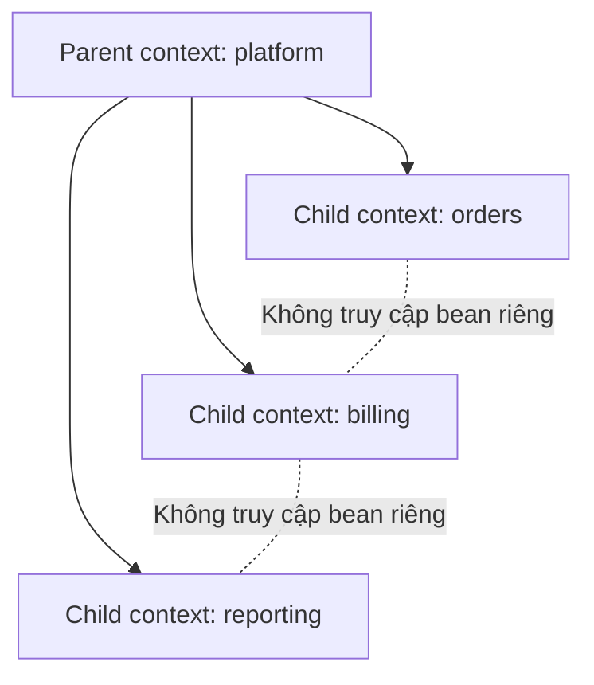

# Định danh ứng dụng, context ID và nguồn cấu hình riêng

> **Chương:** Phân cấp context  
> **Module:** `SPRING_CLOUD_CORE` — các nền tảng cốt lõi của Spring Cloud trong hệ thống phân tán, gồm Spring Cloud Commons, Context, cấu hình bên ngoài, discovery, service registry, giao tiếp dịch vụ và vận hành các abstraction chung.  
> **Trọng tâm:** Trong một tiến trình có thể có nhiều Spring ApplicationContext. Tên ứng dụng, ID của context và tên bộ cấu hình từ xa có quan hệ với nhau nhưng không phải một khái niệm. Hiểu đúng chúng giúp mỗi context nhận đúng cấu hình và tránh rò rỉ property giữa parent, child và sibling.

## 1. Vì sao phải phân biệt định danh?

Một ứng dụng Spring Boot thông thường thường chỉ có một ApplicationContext, nên nhiều nhóm dùng `spring.application.name` như thể đó là tên của mọi thứ. Khi hệ thống phát triển thành một ứng dụng có context hierarchy, cách hiểu này dễ gây lỗi:

- hai context trong cùng JVM cùng dùng một `spring.application.name`, khiến log hoặc thông tin quản trị khó phân biệt;
- Config Client lấy nhầm cấu hình của service khác vì tên dùng để tra cứu trên Config Server không đúng;
- một child context nhận property từ parent ngoài dự kiến;
- hai sibling context tưởng rằng chúng có chung profile hoặc cùng `Environment`, trong khi mỗi context có cấu hình riêng;
- instance ID trong registry bị trùng vì nhóm phát triển đồng nhất service name, context ID và instance ID.

Để tránh nhầm lẫn, cần phân biệt ít nhất bốn định danh:

| Định danh | Ý nghĩa | Ví dụ |
| --- | --- | --- |
| **Application name** (`spring.application.name`) | Tên logic của ứng dụng/service | `order-service` |
| **ApplicationContext ID** (`context.getId()`) | ID của một Spring context cụ thể trong tiến trình | `order-service:prod:8081` hoặc ID do ứng dụng đặt |
| **Config lookup name** (`spring.cloud.config.name`) | Tên/tập tên file cấu hình mà Config Client yêu cầu | `order-service,shared-database` |
| **Instance ID** | ID của một bản chạy cụ thể được registry hoặc nền tảng nhận diện | `order-service:node-2:8081` |

Một số mặc định của framework hoặc provider có thể dùng application name để tạo context ID hoặc instance ID. Điều đó không làm cho các khái niệm trở thành một. Cần biết **ai tạo ID, dùng ID vào việc gì và phạm vi duy nhất của nó là ở đâu**.

### Kết quả học tập

Sau bài này, người học có thể:

1. giải thích quan hệ giữa `spring.application.name`, ApplicationContext ID và instance ID;
2. mô tả cách Spring Cloud Config dùng application, profile và label để tìm remote property source;
3. phân biệt `spring.cloud.config.name` với `spring.application.name`;
4. thiết kế parent, child và sibling context với nguồn cấu hình riêng;
5. hiểu Environment và PropertySource được kế thừa, ghi đè và cô lập ra sao;
6. cấu hình và kiểm tra `SpringApplicationBuilder` mà không vô tình chia sẻ Environment;
7. chẩn đoán lỗi lấy nhầm cấu hình, ID trùng và property bị parent/child ghi đè.

## 2. Application name và ApplicationContext ID

### 2.1. `spring.application.name` là tên logic

`spring.application.name` thường mô tả tên ứng dụng mà hệ sinh thái Spring Cloud sử dụng để nhận diện service. Nó có thể được dùng làm:

- tên mặc định để Config Client tìm cấu hình trên Config Server;
- service name mặc định khi một discovery provider đăng ký instance;
- một phần thông tin nhận diện trong log, metric, tracing hoặc các tích hợp nền tảng;
- giá trị đầu vào để Spring Boot tạo ApplicationContext ID trong cơ chế initializer tương ứng.

Ví dụ:

```yaml
spring:
  application:
    name: order-service
```

Tên này nên ổn định theo vai trò logic của service, không gắn với hostname, IP hay tên pod cụ thể. Khi chạy nhiều replica của `order-service`, các replica thường dùng chung application name nhưng có instance ID khác nhau.

### 2.2. ApplicationContext ID xác định context trong JVM

`ApplicationContext` là container quản lý bean, Environment, event và vòng đời của một phần ứng dụng Spring. `getId()` trả về ID của context đó.

Spring Boot có `ContextIdApplicationContextInitializer`; initializer này dùng `spring.application.name` để tạo ApplicationContext ID và dùng `application` nếu không có tên. Trong mô hình Spring Cloud legacy bootstrap, tài liệu Spring Cloud lưu ý rằng nếu muốn `spring.application.name` được dùng làm context ID thì cần đặt property trong `bootstrap.yml` hoặc `bootstrap.properties`.

Điều này quan trọng trong hierarchy: một JVM có thể chứa nhiều context. Nếu từng context có vai trò khác nhau, nên đặt application name phù hợp trong Environment của từng context và kiểm tra ID thực tế sau khi khởi tạo. Khi cần ID tùy chỉnh, có thể sử dụng initializer hoặc cơ chế tạo context phù hợp với phiên bản; không nên giả định chỉ đổi `spring.application.name` là luôn tạo ra một ID duy nhất.

Ví dụ kiểm tra:

```java
ConfigurableApplicationContext context =
        SpringApplication.run(OrderApplication.class, args);

System.out.println("contextId = " + context.getId());
System.out.println("applicationName = "
        + context.getEnvironment().getProperty("spring.application.name"));
```

Hai giá trị có thể liên quan nhưng biểu đạt hai điều khác nhau: một là ID của context, một là property tên ứng dụng trong Environment.

### 2.3. Application name không phải instance ID

Giả sử `order-service` chạy ba replica:

| Replica | `spring.application.name` | Instance ID minh họa |
| --- | --- | --- |
| Pod A | `order-service` | `order-service:pod-a:8080` |
| Pod B | `order-service` | `order-service:pod-b:8080` |
| Pod C | `order-service` | `order-service:pod-c:8080` |

Discovery registry cần phân biệt các instance để cập nhật health, địa chỉ và metadata. Application name gom chúng vào cùng một dịch vụ logic. Instance ID cần duy nhất theo quy tắc của registry hoặc nền tảng triển khai.

Một số provider có thể tạo instance ID mặc định từ Spring ApplicationContext ID và port. Ví dụ, Spring Cloud Consul dùng context ID làm instance ID mặc định trong một số cấu hình, nhưng cho phép override bằng property riêng. Đây là quy tắc của provider, không phải bảo đảm chung cho mọi registry.

**Không dùng context ID thay cho một instance ID có quy tắc rõ ràng** nếu ứng dụng có nhiều context, nhiều server port hoặc chạy nhiều replica trong cùng host.

## 3. Config Client tìm cấu hình bằng định danh nào?

### 3.1. Ba tham số application, profile và label

Spring Cloud Config Server phục vụ cấu hình theo dạng:

```text
/{application}/{profile}/{label}
```

Config Client mặc định ánh xạ:

- `application` từ `spring.application.name`;
- `profile` từ các active profile trong Environment;
- `label` theo cấu hình của client/server, thường là một nhãn version của repository.

Ví dụ một request khái niệm:

```text
/order-service/prod/release-2026
```

Nghĩa là lấy cấu hình cho ứng dụng `order-service`, profile `prod`, từ nhãn `release-2026`. Với backend Git mặc định, label có thể là branch, tag hoặc commit ID. Giá trị mặc định của label tùy cấu hình server và phiên bản; không nên hardcode giả định `master`.

### 3.2. `spring.cloud.config.name` có thể ghi đè application name

`spring.cloud.config.name` điều khiển tên dùng để tìm remote property sources. Nếu không đặt, Config Client dùng `spring.application.name`. Có thể khai báo một tên hoặc danh sách tên phân tách bằng dấu phẩy để chia sẻ file cấu hình giữa một nhóm ứng dụng.

Ví dụ:

```yaml
spring:
  application:
    name: order-service
  cloud:
    config:
      name: order-service,shared-database
      profile: prod
      label: release-2026
```

Trong ví dụ, application name vẫn là `order-service`, còn Config Client yêu cầu thêm bộ cấu hình `shared-database`. Cách này hữu ích khi nhiều service cùng dùng cấu hình chung như Redis, datasource hoặc telemetry.

`spring.cloud.config.profile` và `spring.cloud.config.label` cũng có thể ghi đè giá trị profile/label được dùng để truy vấn. Cần kiểm tra đúng property theo phiên bản Config Client.

### 3.3. Config Server có cấu hình chung và cấu hình riêng

Config Server có thể phục vụ một nguồn `application` làm cấu hình nền dùng chung cho các ứng dụng. Ngoài ra, từng application có file riêng, profile-specific file và các tên cấu hình chia sẻ được yêu cầu qua `spring.cloud.config.name`.

Ví dụ repository:

```text
config-repo/
  application.yml
  application-prod.yml
  order-service.yml
  order-service-prod.yml
  shared-database.yml
  shared-database-prod.yml
  billing-service.yml
  billing-service-prod.yml
```

Với `spring.application.name=order-service` và `spring.cloud.config.name=order-service,shared-database`, Config Server có thể trả các property source nền `application`, phần theo profile, cấu hình riêng `order-service` và nhóm `shared-database`. Thứ tự property source do Config Server trả về quyết định giá trị nào ghi đè giá trị nào; nguồn xuất hiện sau trong danh sách thường có độ ưu tiên cao hơn theo quy tắc của repository.

Khi đặt application name, tránh dùng tiền tố dành riêng `application-` trong tên service vì có thể gây nhầm lẫn khi Config Server phân giải tên property source.

### 3.4. `spring.application.name` và Config lookup name không buộc phải giống nhau

Có thể dùng cùng tên để đơn giản hóa, nhưng hai property có trách nhiệm riêng:

| Cấu hình | Giá trị | Ý nghĩa |
| --- | --- | --- |
| `spring.application.name` | `order-service` | Nhận diện service logic và có thể làm context ID đầu vào |
| `spring.cloud.config.name` | `order-service,shared-database` | Yêu cầu nhiều nhóm remote config |
| `spring.cloud.config.profile` | `prod,metrics` | Profile dùng khi lấy remote config |
| `spring.cloud.config.label` | `release-2026` | Phiên bản nguồn cấu hình |

Đổi `spring.cloud.config.name` không tự đổi service name trong registry. Đổi `spring.application.name` có thể ảnh hưởng nhiều tích hợp khác, vì vậy phải xem tác động trước khi thay đổi.

## 4. Nguồn cấu hình riêng trong context hierarchy

### 4.1. Parent, child và sibling

Spring hỗ trợ xây dựng context hierarchy. Context con có thể truy cập bean từ context cha; context cha không truy cập ngược bean được khai báo chỉ trong context con. Các context sibling không tự động nhìn thấy bean của nhau.

Ví dụ một ứng dụng modular trong cùng JVM:

- **Parent context:** chứa bean hạ tầng dùng chung như một số adapter, clock hoặc client nền tảng;
- **Order context:** chứa controller, service và repository của đơn hàng;
- **Billing context:** chứa thành phần thanh toán;
- **Reporting context:** chứa thành phần báo cáo.



Sơ đồ thể hiện quan hệ bean visibility. Mỗi child có thể có profile, property source và cấu hình riêng; việc chia sẻ Environment là một quyết định khác với việc chia sẻ parent context.

### 4.2. `SpringApplicationBuilder`

`SpringApplicationBuilder` cung cấp API để tạo parent, child và sibling context:

```java
ConfigurableApplicationContext context =
        new SpringApplicationBuilder(PlatformConfiguration.class)
                .properties("spring.application.name=platform")
                .child(OrderConfiguration.class)
                    .properties("spring.application.name=order-service")
                .sibling(BillingConfiguration.class)
                    .properties("spring.application.name=billing-service")
                .run(args);
```

Đây là ví dụ minh họa cách tổ chức builder; trong dự án thực tế cần kiểm tra cách cấu hình Environment, profile, web application type và server port cho từng context. Nếu các child cùng tạo web server, cần cấu hình port riêng hoặc thiết kế một context làm web entry point.

Phương thức `properties(...)` thêm default properties cho builder. System properties, environment variables hoặc command-line arguments có thể có độ ưu tiên cao hơn, vì vậy hãy xác nhận `spring.application.name` hiệu lực của từng context thay vì chỉ đọc chuỗi đã khai báo trong builder.

Có thể dùng `getParent()` để đi lên hierarchy và kiểm tra từng context. Nếu cần lấy cả các context do builder tạo, hãy giữ reference hoặc đăng ký listener phù hợp thay vì suy đoán chúng từ tên.

### 4.3. Mỗi context có Environment riêng theo mặc định

Một điểm dễ nhầm: **SpringApplicationBuilder có thể chia sẻ một Environment cho toàn bộ hierarchy, nhưng đó không phải mặc định**. Theo hành vi mặc định, mỗi context có Environment riêng; child thường bắt đầu từ các giá trị phù hợp được kế thừa từ parent rồi bổ sung cấu hình của nó.

Điều này cho phép `orders` và `billing` có profile hoặc remote config khác nhau. Nếu ứng dụng chủ động chia sẻ Environment, việc thay đổi property/profile có thể ảnh hưởng rộng hơn dự kiến. Trước khi chọn chia sẻ, hãy xác định liệu hai context có thực sự cần cùng một bộ cấu hình và vòng đời hay không.

### 4.4. Bootstrap property source riêng cho từng context

Trong mô hình Spring Cloud bootstrap legacy, bootstrap context được thêm làm parent của context cấp cao nhất do ứng dụng tạo. Mỗi context trong hierarchy có một property source tên `bootstrap` riêng, có thể rỗng. Cách này ngăn property từ một parent vô tình được nâng thành nguồn bootstrap dùng chung cho mọi descendant.

Nếu có Config Server, về nguyên tắc từng context trong hierarchy có thể có `spring.application.name` khác nhau và nhận remote property source khác nhau. Đây là khả năng quan trọng khi một JVM cần chạy nhiều mô-đun có cấu hình riêng.

Không nên giả định chỉ có một remote config request cho cả hierarchy. Cũng không nên giả định mọi context chắc chắn sẽ được nạp remote config: cần kiểm tra cách khởi tạo từng context, dependency và phiên bản Spring Cloud.

## 5. PropertySource kế thừa và ghi đè như thế nào?

### 5.1. Quy tắc cơ bản

Spring Environment chứa danh sách PropertySource theo thứ tự. Khi nhiều nguồn cùng khai báo một key, nguồn có độ ưu tiên cao hơn được dùng.

Trong context hierarchy, Spring áp dụng quy tắc kế thừa property source của parent và xử lý các nguồn của child. Nhìn chung:

- property ở child có thể ghi đè property từ parent;
- các property source cùng tên có quy tắc xử lý riêng;
- nếu child có property source trùng tên với parent, nguồn parent cùng tên không được đưa vào child như một bản sao riêng;
- profile của child có thể khác parent nếu Environment của chúng không bị chia sẻ.

Điều này quan trọng hơn việc chỉ so sánh giá trị cuối cùng: cần biết **property source nào cung cấp giá trị đó**.

### 5.2. Ví dụ nguồn cùng tên

Giả sử parent có:

```yaml
# Parent context
platform:
  region: ap-southeast-1
feature:
  audit: true
```

Child `orders` có nguồn riêng:

```yaml
# Child orders
platform:
  region: ap-southeast-2
order:
  reservation-timeout: 3s
```

Child có thể nhận `platform.region=ap-southeast-2` và giữ `feature.audit=true` từ parent nếu property source được tổ chức theo cách cho phép kế thừa. Nhưng nếu child thêm một PropertySource trùng tên với nguồn parent, Spring có thể loại nguồn parent cùng tên khỏi danh sách kế thừa; các key khác chỉ có ở parent trong nguồn đó cũng có thể biến mất khỏi child.

Vì vậy, tên PropertySource cần được chọn có chủ đích. Không đặt mọi cấu hình tùy chỉnh vào một nguồn tên chung rồi vô tình tạo xung đột giữa các context.

### 5.3. Remote `bootstrap` source và file bootstrap không giống nhau

Trong legacy mode, cần phân biệt:

- property source tên `bootstrap`, thường chứa dữ liệu remote do `PropertySourceLocator` trả về, có thể có độ ưu tiên cao;
- `applicationConfig: [classpath:bootstrap.yml]`, chứa các giá trị file bootstrap, thường có precedence thấp hơn `application.yml` và các nguồn bình thường của child.

Tên file `bootstrap.yml` không đồng nghĩa mọi property trong file đó luôn có ưu tiên cao nhất. Remote property source và bootstrap file là hai nguồn khác nhau.

### 5.4. Kiểm tra property source trong runtime

Có thể quan sát các property source trong Environment:

```java
ConfigurableEnvironment environment =
        (ConfigurableEnvironment) context.getEnvironment();

for (PropertySource<?> source : environment.getPropertySources()) {
    System.out.println(source.getName());
}
```

Để kiểm tra một key, ghi cả giá trị hiệu lực và nguồn sở hữu giá trị nếu công cụ quan sát hỗ trợ. Với Spring Boot Actuator, endpoint `env` có thể hỗ trợ điều tra khi đã được bật và bảo vệ. Hãy masking secret; không log credential hoặc private key.

## 6. Định danh và cấu hình riêng trong ví dụ orders/billing

### 6.1. Mục tiêu

Giả sử một tiến trình chứa hai context con:

- `orders` sử dụng cấu hình remote `order-service`;
- `billing` sử dụng cấu hình remote `billing-service`;
- cả hai cùng kế thừa một số bean hạ tầng từ parent `platform`;
- mỗi context có profile và nguồn cấu hình riêng.

Bảng mong muốn:

| Thuộc tính | Parent | Child orders | Child billing |
| --- | --- | --- | --- |
| `spring.application.name` | `platform` | `order-service` | `billing-service` |
| Config lookup name | `platform-shared` | `order-service,shared-db` | `billing-service,shared-db` |
| Profile | `common` | `prod` | `prod,payment` |
| Context ID mong muốn | `platform` | `orders-context` | `billing-context` |
| Remote config | Nền tảng dùng chung | Đơn hàng + database chung | Thanh toán + database chung |

Context ID mong muốn trong bảng là mục tiêu quản trị, không phải giá trị tự động luôn được sinh từ các property trên. Hãy kiểm tra `context.getId()` và dùng initializer phù hợp nếu cần ID riêng.

### 6.2. Cấu hình Config Client cho từng context

Trong Environment của `orders`:

```yaml
spring:
  application:
    name: order-service
  cloud:
    config:
      name: order-service,shared-db
      profile: prod
      label: release-2026
```

Trong Environment của `billing`:

```yaml
spring:
  application:
    name: billing-service
  cloud:
    config:
      name: billing-service,shared-db
      profile: prod,payment
      label: release-2026
```

Hai context dùng cùng Config Server nhưng yêu cầu tập cấu hình khác nhau. Nếu cả hai đều có property `datasource.pool-size`, giá trị có thể khác nhau mà không cần đổi tên bean hoặc service logic. Để tránh nhầm, hãy dùng prefix riêng cho cấu hình theo domain, ví dụ `orders.datasource` và `billing.datasource`, trừ khi cả hai thật sự cần cùng một contract.

### 6.3. Một lưu ý quan trọng về parent config

Không nên để parent tải một remote config quá rộng rồi mặc định mọi child đều kế thừa nguyên vẹn. Chỉ đưa vào parent các giá trị thực sự dùng chung và an toàn để chia sẻ. Mỗi child nên có property source riêng cho endpoint, credential, timeout, feature flag và profile thuộc domain của nó.

Nếu dùng Spring Cloud Config, remote property source của mỗi context phải được kiểm tra tên, thứ tự và precedence. Đặc biệt chú ý nguồn `bootstrap` riêng của từng context và quy tắc loại trừ khi trùng tên với nguồn parent.

## 7. Application name trong discovery và service registry

### 7.1. Service name và instance metadata

Discovery thường đăng ký một service ID logic, thường lấy từ `spring.application.name`. Mỗi instance có địa chỉ, port, health status và metadata riêng.

Ví dụ:

```text
Service ID: order-service
  Instance A: 10.0.1.11:8080, zone=az-a
  Instance B: 10.0.1.12:8080, zone=az-b
```

Load balancer tìm theo service ID `order-service`, sau đó chọn một instance. Context ID không phải thứ mà caller nên dùng thay service ID để tìm tất cả replica.

### 7.2. Nhiều context trong một JVM cần ID instance rõ ràng

Nếu hai context đều tạo discovery client hoặc đăng ký service instance, cần kiểm tra:

- chúng có dùng chung `spring.application.name` hay không;
- mỗi context có server port riêng không;
- provider tạo instance ID từ context ID hay từ property riêng;
- metadata có phân biệt module/context không;
- shutdown của một context có deregister nhầm instance của context khác không.

Nếu cả hai context đại diện cho hai service độc lập, nên dùng application name khác nhau. Nếu chúng chỉ là hai module của cùng một service logic, có thể dùng chung service ID nhưng phải tạo instance identity và lifecycle phù hợp với provider.

Không phải mọi ứng dụng cần nhiều web context trong cùng một JVM. Với microservice độc lập, triển khai mỗi service ở tiến trình/container riêng thường đơn giản hơn về scale, health, failure isolation và cấu hình.

## 8. Các lỗi thiết kế thường gặp

### 8.1. Dùng một application name cho mọi context

Hệ quả có thể là:

- Config Client lấy cùng bộ cấu hình cho cả hai child;
- service registry gom hai thành phần vào cùng một service ID ngoài dự kiến;
- context ID khó phân biệt;
- log và metric không chỉ rõ context nào phát sinh lỗi.

Cách xử lý: xác định hai context có phải cùng một ứng dụng logic không. Nếu khác domain/service, đặt `spring.application.name` riêng trong Environment của từng context. Nếu cùng service, giữ application name chung nhưng đặt context ID và instance ID riêng khi cần.

### 8.2. Đổi context ID nhưng tưởng Config Server sẽ đổi theo

Config Client mặc định tìm cấu hình theo `spring.application.name`, không phải chỉ theo `context.getId()`. Đổi ID context không tự thay remote application name. Nếu muốn đổi tên bộ config, đặt `spring.cloud.config.name`; nếu muốn đổi tên ứng dụng logic, xem xét `spring.application.name` và tác động tới registry.

### 8.3. Đổi `spring.cloud.config.name` rồi mong service registry đổi tên

`spring.cloud.config.name` chỉ điều khiển tên cấu hình remote mà Config Client yêu cầu. Nó không tự thay service ID mặc định của discovery. Muốn đổi service name, cấu hình `spring.application.name` theo đúng mục đích.

### 8.4. Chia sẻ Environment mà không nhận biết

Nếu builder được cấu hình dùng chung Environment, property/profile thay đổi ở một context có thể ảnh hưởng context khác. Điều này dễ gây lỗi khi `orders` và `billing` cần profile hoặc remote config riêng.

Chỉ chia sẻ Environment nếu hai context thực sự cần một nguồn cấu hình và vòng đời chung. Nếu cần một số giá trị chung, có thể đưa chúng vào parent property source hoặc một cấu hình dùng chung thay vì chia sẻ toàn bộ Environment.

### 8.5. PropertySource cùng tên vô tình loại nguồn parent

Một child tạo PropertySource trùng tên với nguồn parent có thể khiến nguồn parent cùng tên không được đưa vào child. Khi một property “biến mất”, kiểm tra danh sách nguồn và tên nguồn trước khi kết luận Config Server không trả dữ liệu.

### 8.6. Cho rằng profile tự động giống nhau

Mỗi context có thể có Environment và active profiles riêng. Nếu ứng dụng chia sẻ Environment thì profile được chia sẻ; nếu không, phải xác định profile cho từng context. Không suy từ tên context hoặc application name rằng profile luôn là `prod`.

## 9. Quy trình chẩn đoán theo định danh

Khi một context nhận sai cấu hình, kiểm tra theo trình tự:

1. **Context nào đang chạy?** Ghi `context.getId()`, parent ID và tên class cấu hình.
2. **Application name là gì?** Đọc `spring.application.name` từ Environment của chính context đó.
3. **Config lookup name là gì?** Kiểm tra `spring.cloud.config.name`, hoặc giá trị mặc định từ application name.
4. **Profile/label nào được gửi?** Đọc active profiles và các override của Config Client.
5. **Property source nào hiện diện?** Kiểm tra tên, thứ tự và origin của các nguồn.
6. **Environment có shared không?** Xem cách tạo builder/hierarchy và liệu code có gọi API chia sẻ Environment.
7. **Nguồn parent có bị thay thế không?** Kiểm tra PropertySource trùng tên và thứ tự precedence.
8. **Service registry dùng ID nào?** Phân biệt service ID, context ID và instance ID.
9. **Có đang đọc nhầm context không?** Log context ID cùng request/correlation ID để đối chiếu.

### 9.1. Bảng triệu chứng và hướng kiểm tra

| Triệu chứng | Nguyên nhân có thể | Bằng chứng cần xem |
| --- | --- | --- |
| `orders` lấy config của `billing` | `spring.application.name` hoặc `spring.cloud.config.name` bị đặt chung/ghi đè | Environment và request Config Server |
| Hai context có cùng ID | Cùng property tên ứng dụng hoặc initializer tạo ID giống nhau | `getId()` của từng context |
| Child không thấy property parent | Child có PropertySource trùng tên hoặc Environment không kế thừa như dự kiến | Danh sách PropertySource theo context |
| Sibling có profile khác nhau | Mỗi sibling có Environment riêng | Active profiles từng context |
| Hai instance bị registry ghi đè | Instance ID trùng | Registry ID và cấu hình provider |
| Đổi context ID nhưng config không đổi | Config lookup vẫn dựa trên application/config name | `spring.application.name`, `spring.cloud.config.name` |
| Local thấy property, production không thấy | Profile, label hoặc Config Server backend khác nhau | Config request và property source origin |

## 10. Kiểm thử context hierarchy và nguồn cấu hình

### 10.1. Kiểm thử riêng từng Environment

Một bài kiểm thử integration nên xác nhận:

- context ID khác nhau nếu thiết kế yêu cầu;
- `spring.application.name` của từng context đúng;
- Config lookup name/profile/label đúng;
- property source riêng của child không làm mất giá trị parent ngoài ý muốn;
- sibling không vô tình chia sẻ Environment;
- bean visibility đúng với parent/child;
- discovery registration tạo service/instance ID mong muốn.

Không chỉ kiểm tra một property cuối cùng. Hãy xác nhận cả nguồn property source và profile để phát hiện trường hợp giá trị đúng do một cấu hình sai khác tình cờ ghi đè.

### 10.2. Kiểm thử với Config Server giả lập

Có thể dùng mock HTTP server hoặc Config Server test instance trả các cấu hình phân biệt:

```yaml
# order-service-prod.yml
module:
  name: orders
  datasource:
    pool-size: 12
```

```yaml
# billing-service-prod.yml
module:
  name: billing
  datasource:
    pool-size: 6
```

Sau khi khởi tạo hierarchy, kiểm tra `orders` nhận `module.name=orders`, `billing` nhận `module.name=billing`, và các bean ở parent không phụ thuộc vào property chỉ có ở child. Nếu hai context cùng dùng `shared-db`, xác nhận giá trị chung được áp dụng theo đúng thứ tự nguồn.

### 10.3. Quan sát runtime an toàn

Actuator `env` và `configprops` có thể hỗ trợ kiểm tra cấu hình hiệu lực; endpoint cần được bảo vệ và masking dữ liệu nhạy cảm. Log nên bao gồm:

- context ID;
- application name;
- active profile;
- instance ID hoặc service registration ID khi cần;
- tên property source, không ghi toàn bộ nội dung nhạy cảm.

Không log password, token, secret key hoặc toàn bộ Environment. Khi debug Config Client, ưu tiên log metadata về request application/profile/label và kết quả fetch thay vì in credential.

## 11. Khuyến nghị thiết kế

- Đặt `spring.application.name` theo service logic, ổn định giữa các replica.
- Dùng context ID để nhận diện context trong tiến trình; bảo đảm khác nhau khi có nhiều context cùng JVM nếu công cụ vận hành cần phân biệt.
- Dùng `spring.cloud.config.name` khi một service cần thêm cấu hình chia sẻ hoặc tên bộ cấu hình khác application name.
- Đặt profile và label một cách rõ ràng theo môi trường và quy trình phát hành.
- Chỉ tạo context hierarchy khi có lý do modularization hoặc chia sẻ bean; không dùng hierarchy để mô phỏng nhiều microservice nếu các service cần failure/scale isolation độc lập.
- Giữ Environment riêng nếu các context có cấu hình khác nhau; chia sẻ có chủ đích khi chúng thực sự có cùng vòng đời và nguồn cấu hình.
- Dùng tên PropertySource riêng cho nguồn tùy chỉnh theo context; tránh trùng tên với nguồn parent không chủ ý.
- Đặt cấu hình dùng chung ở parent hoặc nhóm config chung có kiểm soát; cấu hình nhạy cảm/domain-specific để trong context tương ứng.
- Kiểm tra service ID và instance ID theo discovery provider; không giả định mọi provider dùng cùng một mặc định.
- Ghi nhận version Spring Boot/Spring Cloud và kiểm thử lại hierarchy khi nâng release train vì bootstrap/configuration lifecycle có thể thay đổi.

## 12. Bài tập vận dụng

### Bài tập 1 — Application name và context ID

Một JVM chứa `orders` và `billing`. Cả hai có `spring.application.name=platform`, nhưng nhóm vận hành cần phân biệt hai context trong log và Actuator. Hãy nêu ba cách tiếp cận: tách application name nếu chúng là hai service logic, đặt context ID riêng nếu vẫn là cùng service, hoặc đưa thêm module identifier vào log/metric. Giải thích tác động của từng cách tới Config Server và registry.

### Bài tập 2 — Lấy nhầm remote config

`billing` nhận cấu hình của `orders`. `context.getId()` của billing đúng là `billing-context`, nhưng Config Server trả file `orders-prod.yml`. Hãy xác định property nào cần kiểm tra và vì sao đổi context ID không đủ. Đề xuất kiểm tra `spring.application.name` và `spring.cloud.config.name`.

### Bài tập 3 — Property parent biến mất

Parent có PropertySource tên `platform-defaults` chứa hai key `platform.region` và `platform.timezone`. Child thêm PropertySource cũng tên `platform-defaults` chỉ chứa `platform.region`. Hãy dự đoán điều gì xảy ra với property source của parent và đề xuất cách đặt tên nguồn riêng để tránh loại bỏ ngoài ý muốn.

### Bài tập 4 — Chia sẻ Environment

Hai sibling context cần cùng `spring.application.name` nhưng profile khác nhau. Nhóm phát triển bật chia sẻ Environment để tránh lặp cấu hình. Phân tích vì sao cách này có thể làm mất sự độc lập profile; đề xuất dùng Environment riêng và một nguồn property chung ở parent nếu cần.

### Bài tập 5 — Instance ID trùng

Hai context đăng ký cùng service name và cùng port, provider tạo instance ID dựa trên context ID. Khi cả hai context có cùng ID, registry chỉ hiển thị một instance. Hãy mô tả cách kiểm tra và chọn một quy tắc ID duy nhất phù hợp với provider.

### Tự kiểm tra nhanh

1. `spring.application.name` có đồng nghĩa `context.getId()` không? **Không; framework có thể dùng application name để tạo context ID, nhưng hai giá trị có mục đích riêng.**
2. Config Client mặc định lấy application từ đâu? **Từ `spring.application.name`, trừ khi `spring.cloud.config.name` ghi đè.**
3. Đổi context ID có tự đổi Config Server lookup name không? **Không.**
4. Mỗi context trong hierarchy có thể có remote config riêng không? **Có, nếu mỗi context có Environment và cấu hình Config Client phù hợp.**
5. Environment có được chia sẻ mặc định bởi SpringApplicationBuilder không? **Không; có thể cấu hình chia sẻ, nhưng mặc định mỗi context có Environment riêng.**
6. Child property source cùng tên parent có thể gây tác động gì? **Nguồn parent cùng tên có thể không được đưa vào child.**
7. Application name có phải instance ID không? **Không; nhiều replica cùng application name nhưng phải có instance identity riêng.**

## 13. Checklist trước khi triển khai

Trước khi đưa một ứng dụng nhiều context vào vận hành, xác nhận:

1. Từng context có application name phù hợp với vai trò logic.
2. Context ID được kiểm tra bằng `getId()` và đủ rõ trong log.
3. Config lookup name/profile/label đã được xác nhận.
4. Remote config trả đúng property sources cho từng context.
5. Parent/child/sibling hierarchy và bean visibility đúng thiết kế.
6. Mỗi context có Environment riêng hay dùng chung đã được quyết định rõ.
7. PropertySource tùy chỉnh có tên riêng và precedence có kiểm thử.
8. Discovery service ID và instance ID không xung đột.
9. Actuator và log không làm lộ secret.
10. Startup, refresh và shutdown của từng context được kiểm thử độc lập.

**Thông điệp cốt lõi:** `spring.application.name` nhận diện ứng dụng logic và thường là đầu vào mặc định cho Config Client; ApplicationContext ID nhận diện một context cụ thể; `spring.cloud.config.name` chọn tên bộ cấu hình từ xa; instance ID phân biệt một bản chạy trong registry. Trong hierarchy, mỗi context có thể có Environment, profile và remote property source riêng. Chỉ khi định danh, property source và quy tắc kế thừa được thiết kế rõ ràng, các context mới nhận đúng cấu hình và vận hành độc lập như mong muốn.

**Tài liệu tham khảo:** [Spring Cloud Commons — Application Context Services và Context Hierarchies](https://docs.spring.io/spring-cloud-commons/reference/spring-cloud-commons/application-context-services.html), [Spring Cloud Config Client — Locating Remote Configuration Resources](https://docs.spring.io/spring-cloud-config/reference/client.html), [Spring Boot ContextIdApplicationContextInitializer API](https://docs.spring.io/spring-boot/api/java/org/springframework/boot/context/ContextIdApplicationContextInitializer.html) và [Spring Cloud](https://spring.io/projects/spring-cloud). Chi tiết bootstrap, discovery và context ID có thể thay đổi theo release train/provider; đối chiếu tài liệu đúng phiên bản đang dùng.
