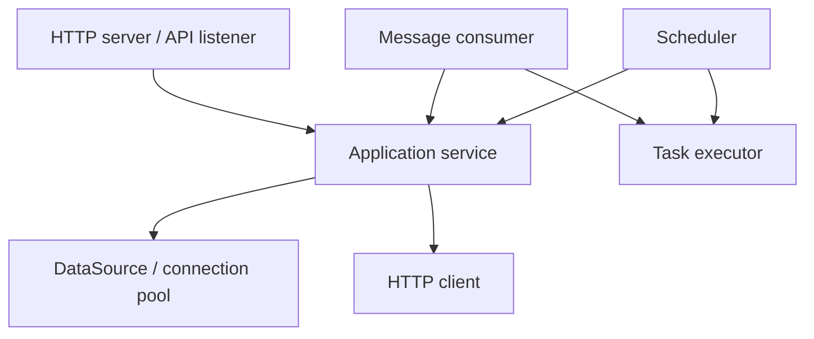
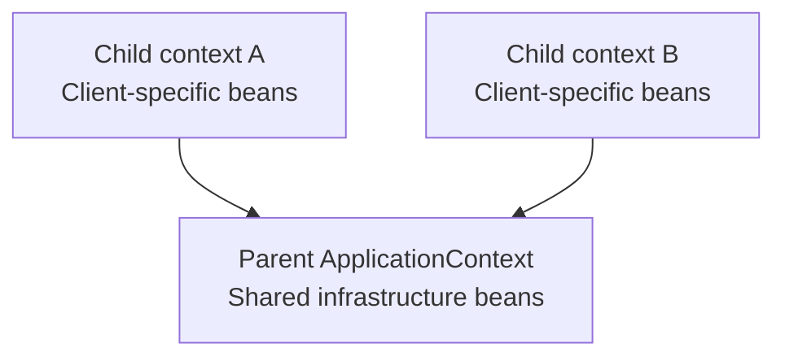
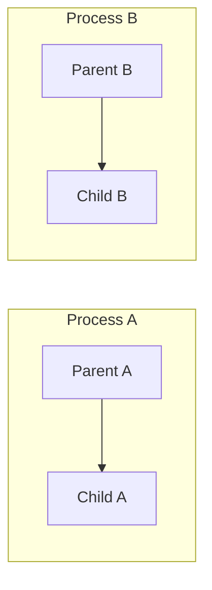

# Vòng đời đóng context và quản lý tài nguyên phụ thuộc

Một ứng dụng Spring Cloud thường sở hữu nhiều tài nguyên sống lâu hơn một request: connection pool, HTTP client, message listener, scheduler, executor, cache, file handle và các thành phần kết nối hệ thống bên ngoài. Spring quản lý vòng đời bean trong `ApplicationContext`, nhưng để dừng ứng dụng an toàn, các thành phần phải được **dừng theo đúng thứ tự phụ thuộc**. Nếu đóng database pool khi consumer vẫn đang xử lý message, hoặc dừng process khi request còn ghi dữ liệu, ứng dụng có thể mất công việc đang chạy và để lại tài nguyên không được giải phóng.

Bài học thuộc chương **Phân cấp context** của module `SPRING_CLOUD_CORE`. Nội dung tập trung vào cách đóng `ApplicationContext`, quan hệ parent-child, callback hủy bean, `Lifecycle`/`SmartLifecycle`, graceful shutdown và cách quản lý tài nguyên có phụ thuộc trong một tiến trình nhiều context hoặc nhiều instance.

## 1. Vì sao vòng đời đóng context quan trọng?

Trong lúc hoạt động, một service có thể tạo ra đồ thị phụ thuộc như sau:



Khi shutdown, những thành phần nhận công việc mới như HTTP server, message consumer và scheduler cần ngừng nhận việc trước. Các tác vụ đang chạy cần có thời gian hoàn tất hoặc được đưa về trạng thái có thể retry. Sau đó mới đóng executor, client và connection pool mà các tác vụ đó sử dụng.

Nếu thứ tự bị đảo ngược, có thể xảy ra các tình huống:

- Consumer vẫn lấy message mới trong khi executor đã bị shutdown.
- Request đang chạy cần truy cập database nhưng connection pool đã đóng.
- Scheduler bắt đầu một job mới trong lúc dependency đã dừng.
- Thread do ứng dụng tự tạo vẫn chạy sau khi context đóng, giữ classloader hoặc socket và làm JVM không thoát.
- Một tác vụ bị hủy giữa chừng nhưng message đã được acknowledge, dẫn đến mất xử lý.

**Đóng context là một phần của thiết kế vận hành**, không chỉ là thao tác kết thúc tiến trình.

## 2. `ApplicationContext.close()` làm những gì?

`ConfigurableApplicationContext` cung cấp `close()` để đóng context một cách có kiểm soát. Trong một context thông thường, quy trình đóng khái quát gồm:

1. Đánh dấu context không còn hoạt động và phát `ContextClosedEvent`.
2. Yêu cầu `LifecycleProcessor` dừng các bean có tham gia lifecycle.
3. Hủy các singleton do `BeanFactory` quản lý, gọi callback destroy thích hợp.
4. Đóng `BeanFactory` và giải phóng cấu trúc quản lý nội bộ của context.

Chi tiết nội bộ và các hook cụ thể có thể thay đổi theo phiên bản Spring; thứ tự trên giúp hiểu trách nhiệm của từng giai đoạn. Không nên đặt một quy trình cleanup dài và phụ thuộc nhiều tài nguyên vào listener sự kiện rồi giả định nó thay thế cơ chế lifecycle/destroy của bean.

### 2.1. Đóng context bằng code

```java
import org.springframework.context.annotation.AnnotationConfigApplicationContext;

public class ContextLifecycleExample {
    public static void main(String[] args) {
        AnnotationConfigApplicationContext context =
                new AnnotationConfigApplicationContext(AppConfiguration.class);

        try {
            // Sử dụng các bean trong context.
        } finally {
            context.close();
        }
    }
}
```

`close()` giải phóng các singleton được context quản lý và gọi các callback hủy tương ứng. Với ứng dụng Spring Boot, thông thường `SpringApplication` quản lý context và đăng ký cơ chế đóng khi JVM shutdown. Nếu tự tạo context phụ, context con hoặc context kiểm thử bằng code, chủ sở hữu phải xác định rõ ai chịu trách nhiệm gọi `close()`.

### 2.2. Shutdown hook

`ConfigurableApplicationContext` có `registerShutdownHook()` để đăng ký hook đóng context khi JVM đi vào quá trình shutdown:

```java
ConfigurableApplicationContext context =
        new AnnotationConfigApplicationContext(AppConfiguration.class);
context.registerShutdownHook();
```

Shutdown hook hữu ích với ứng dụng Java tự quản lý context. Không nên đăng ký nhiều hook cho cùng một context hoặc tự tạo hook riêng nếu framework đã quản lý việc đó. Hook chỉ chạy trong các tình huống JVM shutdown có thể thực hiện hook; nó không bảo đảm được gọi khi process bị kill cưỡng bức, máy mất điện hoặc hết thời gian termination.

### 2.3. `stop()` khác `close()`

`stop()` và `close()` không cùng ý nghĩa:

| Thao tác | Tác động chính | Context còn dùng được không? |
| --- | --- | --- |
| `Lifecycle.stop()` / `context.stop()` | Dừng các thành phần tham gia lifecycle | Context vẫn còn hoạt động; bean chưa bị hủy chỉ vì gọi stop |
| `context.close()` | Đóng context, dừng lifecycle và hủy singleton | Không; context đã đóng |
| JVM/process kết thúc | Kết thúc tiến trình, có thể kích hoạt shutdown hook | Không còn tiến trình để sử dụng context |

Có thể stop một context để tạm dừng các thành phần lifecycle mà không hủy toàn bộ bean. Khi đóng context, Spring thực hiện quy trình dừng và destruction tương ứng. Nếu cần restart thành phần, phải dùng đúng lifecycle contract của bean; không tự giả định rằng gọi `start()` sau khi `close()` sẽ mở lại context đã đóng.

## 3. Callback hủy bean

Spring hỗ trợ nhiều cách để bean giải phóng tài nguyên khi context đóng. Chọn một cách phù hợp với loại tài nguyên và tránh để nhiều lớp cùng đóng một tài nguyên mà không có quy ước sở hữu rõ ràng.

### 3.1. `@PreDestroy`

`@PreDestroy` đánh dấu phương thức được gọi trong quá trình hủy bean:

```java
import jakarta.annotation.PreDestroy;
import org.springframework.stereotype.Component;

@Component
public class CatalogClientHolder {
    private final CatalogHttpClient client;

    public CatalogClientHolder(CatalogHttpClient client) {
        this.client = client;
    }

    @PreDestroy
    public void release() {
        // Chỉ đóng client nếu bean này là chủ sở hữu tài nguyên.
        client.close();
    }
}
```

Trong ví dụ, `CatalogClientHolder` chỉ nên gọi `client.close()` nếu nó thực sự sở hữu client. Nếu client được inject từ một bean khác và bean đó chịu trách nhiệm đóng, việc đóng ở cả hai nơi có thể tạo lỗi double-close hoặc làm hỏng bean còn đang được sử dụng.

Spring Framework hiện đại sử dụng `jakarta.annotation.PreDestroy`; ứng dụng Spring cũ có thể dùng namespace `javax.annotation`. Chọn import tương ứng với phiên bản và dependency của dự án.

### 3.2. `DisposableBean`

Bean có thể triển khai `DisposableBean`:

```java
import org.springframework.beans.factory.DisposableBean;
import org.springframework.stereotype.Component;

@Component
public class LocalBuffer implements DisposableBean {
    @Override
    public void destroy() {
        // Giải phóng buffer hoặc tài nguyên do bean sở hữu.
    }
}
```

Ưu điểm là hợp đồng destroy rõ ràng trong Spring. Nhược điểm là lớp phải phụ thuộc trực tiếp vào API Spring. Với code nghiệp vụ muốn giữ ít phụ thuộc framework, `@PreDestroy` hoặc custom destroy method thường linh hoạt hơn.

### 3.3. Custom destroy method với `@Bean`

Với bean tạo từ `@Bean`, có thể khai báo rõ phương thức hủy:

```java
import org.springframework.context.annotation.Bean;
import org.springframework.context.annotation.Configuration;

@Configuration
public class ClientConfiguration {
    @Bean(destroyMethod = "close")
    CatalogHttpClient catalogHttpClient() {
        return new CatalogHttpClient();
    }
}
```

Spring cũng có thể suy luận một số phương thức hủy phổ biến như `close` hoặc `shutdown` cho bean được khai báo bằng `@Bean` nếu phù hợp. Ghi `destroyMethod` tường minh giúp người đọc thấy rõ quyền sở hữu và hành vi cần thực hiện. Có thể tắt suy luận bằng `destroyMethod = ""` trong trường hợp đặc biệt, chẳng hạn tài nguyên do container bên ngoài quản lý.

### 3.4. So sánh các cơ chế

| Cơ chế | Hợp đồng | Phù hợp khi |
| --- | --- | --- |
| `@PreDestroy` | Callback annotation | Bean cần đóng tài nguyên với ít phụ thuộc API Spring |
| `DisposableBean` | Interface Spring | Muốn triển khai trực tiếp lifecycle contract của Spring |
| `@Bean(destroyMethod = "...")` | Tên method do cấu hình khai báo | Bean được tạo bằng factory method và có API close/shutdown |
| `Lifecycle` / `SmartLifecycle` | Start/stop có thứ tự và điều phối | Component nền cần khởi động/dừng theo phase hoặc chờ stop bất đồng bộ |

Callback destroy thường phù hợp để giải phóng tài nguyên cục bộ. Với một consumer hoặc server cần ngừng nhận việc, chờ xử lý đang chạy và báo hoàn tất, `SmartLifecycle` diễn đạt tốt hơn.

## 4. Thứ tự hủy bean theo quan hệ phụ thuộc

Spring quản lý quan hệ phụ thuộc giữa các singleton. Nếu bean A phụ thuộc bean B, B phải còn tồn tại trong khi A được hủy; vì vậy bean phụ thuộc thường được hủy trước dependency mà nó sử dụng.

Ví dụ:

```java
@Service
public class OrderService {
    private final OrderRepository repository;

    public OrderService(OrderRepository repository) {
        this.repository = repository;
    }

    @PreDestroy
    public void close() {
        // Hoàn tất công việc nội bộ cần repository trước khi repository bị hủy.
    }
}
```

Khi `OrderService` phụ thuộc `OrderRepository`, Spring có thông tin dependency từ quá trình inject và quản lý thứ tự destruction phù hợp. Không cần dùng `@DependsOn` chỉ để thay thế constructor injection.

### 4.1. `@DependsOn` và thứ tự khởi tạo/hủy

`@DependsOn` khai báo một bean phụ thuộc vào bean khác theo tên:

```java
import org.springframework.context.annotation.DependsOn;
import org.springframework.stereotype.Component;

@Component
@DependsOn("schemaInitializer")
public class CatalogCache {
    // Bean này cần schemaInitializer được khởi tạo trước.
}
```

Với singleton, bean được chỉ định trong `@DependsOn` được khởi tạo trước bean phụ thuộc và được hủy sau bean phụ thuộc. Dùng nó khi có quan hệ thứ tự khởi tạo phụ không được thể hiện bằng injection. Nếu bean thực sự cần một dependency để hoạt động, hãy khai báo dependency qua constructor hoặc method parameter.

### 4.2. Không đóng dependency do bean khác sở hữu

Một quy tắc quan trọng là **mỗi tài nguyên có chủ sở hữu lifecycle rõ ràng**. Ví dụ:

- Bean `DataSource` sở hữu connection pool và chịu trách nhiệm đóng pool.
- Service inject `DataSource` chỉ sử dụng connection, không tự đóng toàn bộ pool trong `@PreDestroy`.
- Bean `ExecutorService` sở hữu executor; các service gửi task vào executor không tự shutdown executor nếu không phải chủ sở hữu.
- HTTP client dùng chung được một configuration bean quản lý; các service sử dụng client không tự đóng client.

Đóng tài nguyên ở nơi không sở hữu nó có thể khiến bean khác gặp lỗi trong khi context vẫn đang shutdown.

## 5. Lifecycle và SmartLifecycle

### 5.1. Khi nào dùng Lifecycle?

`Lifecycle` cung cấp hợp đồng `start()`, `stop()` và `isRunning()` cho các thành phần có trạng thái chạy/dừng. `LifecycleProcessor` trong context điều phối những bean tham gia hợp đồng này khi context được refresh, stop hoặc close.

Ví dụ đơn giản:

```java
import org.springframework.context.Lifecycle;
import org.springframework.stereotype.Component;

@Component
public class LocalPoller implements Lifecycle {
    private boolean running;

    @Override
    public void start() {
        running = true;
        // Bắt đầu hoạt động poll cục bộ.
    }

    @Override
    public void stop() {
        running = false;
        // Ngừng poll và giải phóng trạng thái chạy.
    }

    @Override
    public boolean isRunning() {
        return running;
    }
}
```

`Lifecycle` phù hợp với thành phần cần start/stop nhưng không cần điều khiển thứ tự phức tạp hoặc stop bất đồng bộ. Việc triển khai thực tế phải bảo đảm `start()`/`stop()` có thể được gọi an toàn theo trạng thái và không tạo nhiều thread/task ngoài ý muốn.

### 5.2. SmartLifecycle và phase

`SmartLifecycle` mở rộng `Lifecycle`, cho phép khai báo:

- `isAutoStartup()` để cho biết có tự khởi động khi context refresh không.
- `getPhase()` để xác định thứ tự khởi động và dừng.
- `stop(Runnable callback)` để báo khi dừng bất đồng bộ đã hoàn tất.

Thông thường, phase thấp hơn được khởi động trước; khi dừng, phase cao hơn được dừng trước. Điều này hữu ích khi thành phần nhận công việc cần dừng trước thành phần hạ tầng mà nó sử dụng.

Ví dụ consumer có phase cao:

```java
import org.springframework.context.SmartLifecycle;
import org.springframework.stereotype.Component;

@Component
public class CatalogMessageConsumer implements SmartLifecycle {
    private volatile boolean running;

    @Override
    public void start() {
        running = true;
        // Bắt đầu nhận message.
    }

    @Override
    public void stop(Runnable callback) {
        running = false;
        // Ngừng nhận message mới, chờ message đang xử lý hoàn tất.
        callback.run();
    }

    @Override
    public void stop() {
        stop(() -> { });
    }

    @Override
    public boolean isRunning() {
        return running;
    }

    @Override
    public boolean isAutoStartup() {
        return true;
    }

    @Override
    public int getPhase() {
        return 100;
    }
}
```

Đây là khung minh họa lifecycle; trong consumer thật, `stop(Runnable)` phải gọi callback **sau khi** listener đã ngừng nhận message mới và công việc đang chạy đã hoàn tất hoặc được chuyển về trạng thái retry an toàn. Gọi callback ngay lập tức trong khi task vẫn đang chạy sẽ báo sai rằng consumer đã dừng.

Nếu component dừng bất đồng bộ, cần có timeout và chính sách khi hết thời gian. Không giữ callback mãi mà không hoàn tất; context cần biết thành phần đã dừng để tiếp tục shutdown.

### 5.3. Thiết kế phase theo đồ thị phụ thuộc

Giả sử consumer sử dụng executor, còn executor gửi task dùng repository và DataSource. Mục tiêu shutdown là:

1. Consumer ngừng nhận message mới.
2. Consumer chờ xử lý đang chạy hoàn tất.
3. Executor ngừng nhận task mới và chờ task còn lại.
4. Repository/service hoàn tất callback cleanup.
5. DataSource/connection pool đóng sau cùng.

Có thể dùng phase cho các thành phần `SmartLifecycle` và dependency graph cho thứ tự destruction của bean. Không phải mọi bean đều triển khai `SmartLifecycle`; connection pool thường có destroy callback riêng. Vì vậy cần phối hợp phase, quan hệ dependency và callback destroy thay vì chỉ gán phase tùy ý.

## 6. Context hierarchy: ai đóng context nào?

Spring hỗ trợ quan hệ parent-child giữa các `ApplicationContext`. Context con có thể tìm bean từ context cha; context cha không nhìn thấy bean chỉ tồn tại trong context con.



Mỗi context quản lý vòng đời các bean do chính context đó sở hữu. Khi đóng child A, singleton thuộc A được hủy; parent vẫn hoạt động và child B vẫn có thể sử dụng bean của parent. Đóng child **không tự động đồng nghĩa** đóng parent. Chủ sở hữu ứng dụng phải quản lý thứ tự đóng context trong hierarchy.

### 6.1. Tạo parent-child context

```java
import org.springframework.context.annotation.AnnotationConfigApplicationContext;

public class ContextHierarchyExample {
    public static void main(String[] args) {
        AnnotationConfigApplicationContext parent =
                new AnnotationConfigApplicationContext(SharedConfiguration.class);

        AnnotationConfigApplicationContext child =
                new AnnotationConfigApplicationContext();
        child.setParent(parent);
        child.register(ClientConfiguration.class);
        child.refresh();

        try {
            // Child dùng được bean thuộc parent và bean riêng của child.
        } finally {
            child.close();
            parent.close();
        }
    }
}
```

Trong ví dụ, child được đóng trước parent vì child có thể dùng tài nguyên do parent cung cấp. Nếu parent bị đóng trước, child vẫn còn tham chiếu tới các bean parent đã bị hủy và có thể lỗi khi tiếp tục hoạt động.

### 6.2. Bean dùng chung và quyền sở hữu

Không đăng ký cùng một tài nguyên vật lý như connection pool vào nhiều context với nhiều chủ sở hữu độc lập nếu chưa có cơ chế ownership rõ ràng. Nếu parent tạo `DataSource` và child chỉ inject để sử dụng, parent là chủ sở hữu; child không tự đóng `DataSource`. Nếu mỗi child tạo client riêng, từng child chịu trách nhiệm đóng client của mình.

Một số thành phần Spring Cloud dùng context con theo tên để cô lập cấu hình client hoặc integration. Ví dụ, các factory tạo named child context có thể sở hữu nhiều context con. Khi đóng factory hoặc context quản lý, cần xác minh API lifecycle của factory có đóng toàn bộ child context mà nó tạo ra hay không. Không giữ tham chiếu tới child context tự tạo mà không có quy trình đóng tương ứng.

### 6.3. Parent không phải cơ chế chia sẻ trạng thái giữa các JVM

Parent-child chỉ là quan hệ trong cùng một tiến trình. Hai replica của một service vẫn có cây context riêng:



Đóng context trong JVM A không đóng context trong JVM B. Muốn điều phối shutdown toàn cụm, cần nền tảng orchestration, service registry/traffic management, message broker hoặc giao thức điều phối thích hợp. Lifecycle của Spring chỉ quản lý thành phần trong phạm vi tiến trình/context.

## 7. Quản lý executor, scheduler và message consumer

### 7.1. Executor phải có chủ sở hữu

Không nên tạo thread pool bằng `Executors.newFixedThreadPool(...)` trong một service rồi quên shutdown. Hãy để Spring quản lý executor hoặc cung cấp callback hủy rõ ràng.

Ví dụ khai báo executor:

```java
import java.util.concurrent.ExecutorService;
import java.util.concurrent.Executors;
import org.springframework.context.annotation.Bean;
import org.springframework.context.annotation.Configuration;

@Configuration
public class TaskConfiguration {
    @Bean(destroyMethod = "shutdown")
    ExecutorService catalogExecutor() {
        return Executors.newFixedThreadPool(8);
    }
}
```

Đoạn ví dụ bảo đảm gọi `shutdown()` khi bean bị hủy. Tuy nhiên, `shutdown()` chỉ từ chối task mới và cho task đã nhận tiếp tục; nếu cần chờ có giới hạn, có thể dùng một wrapper bean quản lý `awaitTermination`, hoặc dùng executor Spring có tùy chọn shutdown phù hợp. Không block vô hạn trong destroy callback.

Với `ThreadPoolTaskExecutor`, cấu hình shutdown có thể điều khiển chờ task hoàn tất và thời gian chờ. Hãy kiểm tra thuộc tính của đúng phiên bản Spring Framework/Spring Boot, và bảo đảm timeout của executor phù hợp với timeout shutdown tổng thể.

### 7.2. Scheduler

Scheduler cũng cần ngừng lập lịch công việc mới khi context đóng. Nếu một job đang chạy, cần quyết định:

- Chờ job hoàn tất trong khoảng thời gian giới hạn.
- Hủy interrupt nếu job hỗ trợ interruption an toàn.
- Ghi nhận trạng thái chưa hoàn tất để instance khác có thể tiếp tục.
- Đảm bảo job có tính idempotent hoặc có khóa/claim bền vững nếu nhiều replica cùng chạy.

`@Scheduled` đăng ký tác vụ theo context/JVM. Khi scale lên nhiều replica, mỗi replica có thể chạy lịch riêng; shutdown callback không biến scheduler thành scheduler phân tán.

### 7.3. Message consumer

Consumer cần có chiến lược dừng rõ ràng:

1. Dừng poll hoặc ngừng nhận message mới.
2. Chờ các message đang xử lý hoàn tất trong thời gian cho phép.
3. Acknowledge message chỉ sau khi xử lý đã commit theo hợp đồng của hệ thống.
4. Nếu không thể hoàn tất, để message có thể được retry hoặc xử lý lại theo chính sách broker.
5. Đóng connection/channel sau khi listener đã dừng.

Không nên acknowledge trước khi kết quả nghiệp vụ đã được lưu bền vững nếu yêu cầu không mất dữ liệu. Shutdown có thể xảy ra giữa lúc ghi database và acknowledge; thiết kế cần xử lý khả năng message được giao lại bằng idempotency hoặc transaction phù hợp.

## 8. Graceful shutdown của Spring Boot web application

Đối với ứng dụng web, đóng context an toàn cần phối hợp với embedded web server. Spring Boot hỗ trợ graceful shutdown cho các server tích hợp khi được cấu hình:

```yaml
server:
  shutdown: graceful

spring:
  lifecycle:
    timeout-per-shutdown-phase: 20s
```

Khi shutdown, web server ngừng nhận request mới theo cơ chế của server và cho các request đang xử lý thời gian hoàn tất. `spring.lifecycle.timeout-per-shutdown-phase` xác định thời gian chờ tối đa cho từng phase lifecycle trong quá trình dừng. Giá trị thực tế nên dựa vào thời gian request, công việc nền và termination budget của nền tảng.

Graceful shutdown không bảo đảm mọi request đều hoàn tất trong mọi tình huống. Request bị treo, dependency không phản hồi hoặc process hết thời gian cho phép vẫn có thể bị kết thúc. Ứng dụng cần timeout ở client/database, giới hạn thời gian xử lý và khả năng retry an toàn.

### 8.1. Phối hợp với Kubernetes

Khi Kubernetes kết thúc Pod, container nhận tín hiệu dừng và có một khoảng thời gian termination trước khi bị kill cưỡng bức. `terminationGracePeriodSeconds` đặt ngân sách thời gian cho quá trình này; `preStop` hook nếu có cũng tiêu thụ thời gian trong ngân sách đó.

Ví dụ fragment:

```yaml
spec:
  terminationGracePeriodSeconds: 45
  containers:
    - name: catalog-service
      image: catalog-service:1.0.0
```

Ngân sách shutdown cần lớn hơn thời gian ứng dụng cần để ngừng nhận traffic, hoàn tất request đang chạy, dừng consumer và đóng tài nguyên. Nếu timeout của Spring dài hơn termination grace period, Kubernetes có thể kill process trước khi Spring hoàn tất.

Một quy trình triển khai thường gồm:

1. Pod bắt đầu terminating và không còn được chọn cho traffic mới theo cơ chế Service/Endpoint của Kubernetes.
2. Ứng dụng nhận tín hiệu dừng, chuyển sang trạng thái không sẵn sàng và ngừng nhận công việc mới.
3. Request đang chạy, consumer và job được xử lý theo graceful policy.
4. Context đóng và giải phóng tài nguyên.
5. Nếu hết termination grace period, process có thể bị kill cưỡng bức.

Readiness probe nên phản ánh khả năng nhận traffic; liveness probe không nên biến một quá trình shutdown bình thường thành restart ngoài ý muốn. `preStop` không phải giải pháp thay thế cho lifecycle trong ứng dụng; nó chỉ hỗ trợ điều phối bên ngoài và phải được tính vào tổng thời gian.

### 8.2. Thời gian shutdown cần nhất quán

Ví dụ một request có thể chạy tối đa 10 giây, consumer cần tối đa 15 giây để hoàn tất batch hiện tại và phase lifecycle có timeout 20 giây. Nếu termination grace period của Pod chỉ 15 giây, hệ thống có thể kill process trước khi consumer hoàn tất.

Hãy thiết kế một ngân sách thời gian có chủ đích:

| Thành phần | Giới hạn cần xác định |
| --- | --- |
| Load balancer/endpoint removal | Thời gian ngừng gửi traffic mới |
| Web server | Thời gian chờ request đang xử lý |
| Message consumer | Thời gian drain message đang chạy |
| Scheduler/executor | Thời gian chờ task hoàn tất hoặc hủy an toàn |
| Bean cleanup | Thời gian đóng connection/client/resource |
| Container runtime | Tổng termination grace period |

Các timeout nên có khoảng dự phòng cho log, network delay và scheduler jitter. Không cấu hình mọi timeout bằng nhau rồi kỳ vọng toàn bộ giai đoạn đều được cấp đủ thời gian độc lập.

## 9. Sự cố và các giới hạn của callback shutdown

Callback destroy là cơ hội giải phóng tài nguyên, không phải cơ chế bảo đảm giao dịch nghiệp vụ được hoàn tất. Có những tình huống callback không chạy hoặc không thể hoàn tất:

- Process bị `SIGKILL`, runtime kill cưỡng bức hoặc máy chủ mất điện.
- JVM crash hoặc lỗi native nghiêm trọng.
- Shutdown hook không được thực thi trong tình huống kết thúc bất thường.
- Callback chờ một dependency đã lỗi hoặc bị đóng trước đó.
- Một thread bị treo khiến callback không hoàn tất trước timeout.
- Tác vụ nền bị interrupt nhưng code không xử lý interruption đúng cách.

Do đó, dữ liệu nghiệp vụ cần bền vững phải được commit vào kho dữ liệu trước khi xác nhận hoàn tất. Với job dài, nên lưu trạng thái tiến trình, checkpoint hoặc lease/claim có thể phục hồi. Với message, cần acknowledgment/retry và idempotency. Với request HTTP, client có thể retry nên API ghi dữ liệu cần xử lý request lặp.

### 9.1. Xử lý interruption đúng cách

Khi thread chờ bị interrupt, không nên nuốt tín hiệu rồi tiếp tục chờ vô hạn:

```java
try {
    executor.awaitTermination(10, TimeUnit.SECONDS);
} catch (InterruptedException ex) {
    Thread.currentThread().interrupt();
}
```

Đây là mẫu khôi phục interrupt flag. Trong code cleanup thực tế, cần kết hợp với chính sách shutdown: sau timeout có thể gọi `shutdownNow()` nếu task được thiết kế để xử lý interruption an toàn, đồng thời ghi nhận task chưa hoàn tất để phục hồi.

### 9.2. Không đặt tác vụ nặng trong ContextClosedEvent listener

`ContextClosedEvent` hữu ích để quan sát thời điểm context đóng hoặc ghi nhận metric. Tuy nhiên, listener sự kiện không thay thế lifecycle phase hoặc destroy callback. Nếu nhiều listener cùng thực hiện cleanup nặng, thứ tự và thời gian chờ có thể khó quản lý.

Với component cần dừng có thứ tự, hãy dùng `SmartLifecycle`; với tài nguyên đơn lẻ, dùng destroy callback. Listener nên giữ trách nhiệm nhẹ, không thực hiện network call vô hạn hoặc chờ consumer drain mà không có timeout.

## 10. Kiểm thử vòng đời đóng context

Kiểm thử shutdown nên xác nhận cả callback và quan hệ thứ tự, không chỉ kiểm tra context đóng mà không ném exception.

| Mục tiêu | Kịch bản | Điều cần xác nhận |
| --- | --- | --- |
| Destroy callback | Tạo context rồi gọi `close()` | `@PreDestroy`/destroy method được gọi |
| Dependency order | Bean A phụ thuộc bean B | A được hủy trước B |
| `@DependsOn` | Khai báo phụ thuộc khởi tạo theo tên | Bean được chỉ định khởi tạo trước và hủy sau bean phụ thuộc |
| Lifecycle phase | Hai `SmartLifecycle` bean có phase khác nhau | Start theo thứ tự phase; stop theo thứ tự ngược |
| Async stop | Consumer chỉ gọi callback sau drain | Context chờ callback trong timeout phù hợp |
| Parent-child | Đóng child trước parent | Child resources đóng, parent vẫn hoạt động |
| Prototype | Tạo prototype và đóng context | Caller chịu trách nhiệm cleanup prototype |
| Graceful web shutdown | Có request đang chạy rồi gửi tín hiệu shutdown | Request được chờ trong giới hạn cấu hình |
| Executor | Submit task rồi đóng context | Task dừng/hoàn tất theo policy, không còn thread ngoài ý muốn |
| Kubernetes termination | Xóa Pod trong môi trường test | Thời gian thực tế nằm trong termination budget |

Ví dụ kiểm thử callback destroy với context độc lập:

```java
import java.util.concurrent.atomic.AtomicBoolean;
import org.junit.jupiter.api.Test;
import org.springframework.context.annotation.AnnotationConfigApplicationContext;

class ContextCloseTest {
    @Test
    void closesManagedResource() {
        AtomicBoolean closed = new AtomicBoolean();

        try (AnnotationConfigApplicationContext context =
                     new AnnotationConfigApplicationContext()) {
            context.registerBean("resource", TestResource.class,
                    () -> new TestResource(closed));
            context.refresh();
        }

        // Assert closed.get() == true.
    }

    static class TestResource {
        private final AtomicBoolean closed;

        TestResource(AtomicBoolean closed) {
            this.closed = closed;
        }

        @jakarta.annotation.PreDestroy
        void close() {
            closed.set(true);
        }
    }
}
```

Đây là khung minh họa; test cần Jakarta Annotation API phù hợp với phiên bản Spring và nên dùng assertion thực tế. Không cần thêm một `@Configuration` class nếu đăng ký bean trực tiếp như ví dụ.

### 10.1. Kiểm thử thứ tự shutdown

Có thể inject một recorder dùng chung vào hai bean, ghi lại sự kiện start/stop/destroy rồi assert thứ tự mong đợi. Với `SmartLifecycle`, hãy kiểm tra cả trường hợp callback stop được gọi bất đồng bộ và trường hợp timeout. Không dùng `Thread.sleep()` làm bằng chứng chắc chắn về thứ tự; ưu tiên latch/future hoặc test double điều khiển được.

### 10.2. Kiểm thử graceful shutdown ở cấp tiến trình

Một integration test có thể:

1. Khởi động ứng dụng ở port test với `server.shutdown=graceful`.
2. Gửi request có thời gian xử lý được kiểm soát.
3. Trong khi request đang chạy, gửi tín hiệu shutdown tới process.
4. Xác nhận request đang chạy hoàn tất trong timeout, request mới bị từ chối/không còn được nhận theo server behavior.
5. Xác nhận log shutdown và resource cleanup được thực hiện.

Kịch bản này cần quản lý process và timeout cẩn thận. Unit test callback không thể thay thế hoàn toàn integration test của server/container.

## 11. Thực hành: dừng service có HTTP, consumer và database

Giả sử `catalog-service` có ba thành phần: HTTP API, message consumer và PostgreSQL connection pool. Mục tiêu là ngừng nhận công việc mới, drain công việc đang chạy, rồi đóng tài nguyên.

**Bước 1 — Xác định quyền sở hữu:** DataSource được cấu hình bean riêng và sở hữu pool; service chỉ sử dụng repository; consumer sở hữu listener container; executor có bean quản lý lifecycle.

**Bước 2 — Cấu hình graceful shutdown của server:**

```yaml
server:
  shutdown: graceful
spring:
  lifecycle:
    timeout-per-shutdown-phase: 30s
```

**Bước 3 — Dừng consumer:** ngừng poll message mới, đợi xử lý đang chạy hoàn tất, chỉ acknowledge sau commit, và để message chưa xử lý có thể được giao lại.

**Bước 4 — Dừng scheduler/executor:** ngừng tạo task mới, chờ task hiện tại theo giới hạn thời gian, lưu checkpoint hoặc để task có thể retry nếu chưa hoàn tất.

**Bước 5 — Đóng tài nguyên:** đóng HTTP client, executor và connection pool theo quan hệ ownership/dependency. Không để service tự đóng DataSource được context quản lý.

**Bước 6 — Căn chỉnh với nền tảng:** đặt termination grace period lớn hơn ngân sách shutdown ứng dụng và kiểm tra thời gian `preStop` nếu có.

**Bước 7 — Kiểm thử lỗi:** thử một message xử lý chậm, một request ghi database đang chạy, một dependency mất kết nối và một lần shutdown hết timeout. Xác nhận không mất dữ liệu đã commit, message chưa hoàn tất có thể retry, và không còn thread/resource bị rò rỉ.

### Câu hỏi tự kiểm tra

1. `ApplicationContext.close()` thực hiện những nhóm công việc chính nào?
2. `stop()` khác `close()` ở điểm nào?
3. Nếu bean A phụ thuộc bean B, thứ tự destruction thông thường là gì?
4. `@DependsOn` ảnh hưởng thế nào đến thứ tự khởi tạo và hủy singleton?
5. Vì sao `SmartLifecycle` phù hợp với consumer cần drain bất đồng bộ?
6. Phase cao hơn được khởi động và dừng theo thứ tự nào so với phase thấp hơn?
7. Đóng child context có tự động đóng parent không?
8. Vì sao prototype bean không được Spring tự động gọi destroy callback giống singleton?
9. `server.shutdown=graceful` bảo đảm điều gì và không bảo đảm điều gì?
10. Vì sao Kubernetes termination grace period phải lớn hơn tổng thời gian shutdown cần thiết?

**Gợi ý đáp án:** (1) Phát sự kiện đóng, dừng lifecycle, hủy singleton và đóng bean factory; (2) Stop dừng thành phần lifecycle nhưng context còn hoạt động, close hủy context; (3) A được hủy trước B; (4) Bean được chỉ định khởi tạo trước và hủy sau bean phụ thuộc; (5) Vì có callback báo hoàn tất sau khi drain; (6) Phase thấp start trước, phase cao stop trước; (7) Không; (8) Vì prototype được giao cho caller và container không theo dõi đầy đủ destruction sau khi giao; (9) Ngừng nhận request mới và chờ request đang chạy trong giới hạn, nhưng không bảo đảm trước kill cưỡng bức; (10) Nếu hết ngân sách, process có thể bị kill trước khi cleanup hoàn tất.

## 12. Những nguyên tắc cần nhớ

- Mỗi `ApplicationContext` quản lý vòng đời bean thuộc phạm vi của nó; context con và context cha cần có chủ sở hữu shutdown rõ ràng.
- `close()` dừng lifecycle và hủy singleton; `stop()` chỉ dừng các thành phần tham gia lifecycle mà không thay thế việc đóng context.
- Dùng `@PreDestroy`, `DisposableBean` hoặc custom destroy method cho cleanup tài nguyên có chủ sở hữu rõ ràng.
- Bean phụ thuộc cần được hủy trước dependency mà nó sử dụng; dùng dependency injection để biểu đạt quan hệ, `@DependsOn` cho thứ tự phụ trợ.
- Dùng `SmartLifecycle` khi cần phase và dừng bất đồng bộ; callback chỉ báo hoàn tất sau khi component đã thực sự dừng.
- Dừng nhận công việc mới trước, drain công việc đang chạy, sau đó mới đóng executor, client và connection pool.
- Graceful shutdown cần đồng bộ timeout của Spring Boot, server, consumer, executor và termination grace period của nền tảng.
- Callback shutdown không thay thế tính bền vững nghiệp vụ; job và message phải có khả năng retry/phục hồi khi process bị kill.
- Kiểm thử thứ tự destruction, parent-child ownership, async stop và shutdown ở cấp process/container.

Hiểu vòng đời đóng context giúp các thành phần Spring Cloud được dừng có trật tự trong từng JVM. Khi quyền sở hữu tài nguyên, quan hệ phụ thuộc và ngân sách graceful shutdown được thiết kế rõ, ứng dụng có thể triển khai cuốn chiếu, scale và phục hồi sau sự cố mà giảm nguy cơ bỏ dở công việc hoặc rò rỉ tài nguyên.
