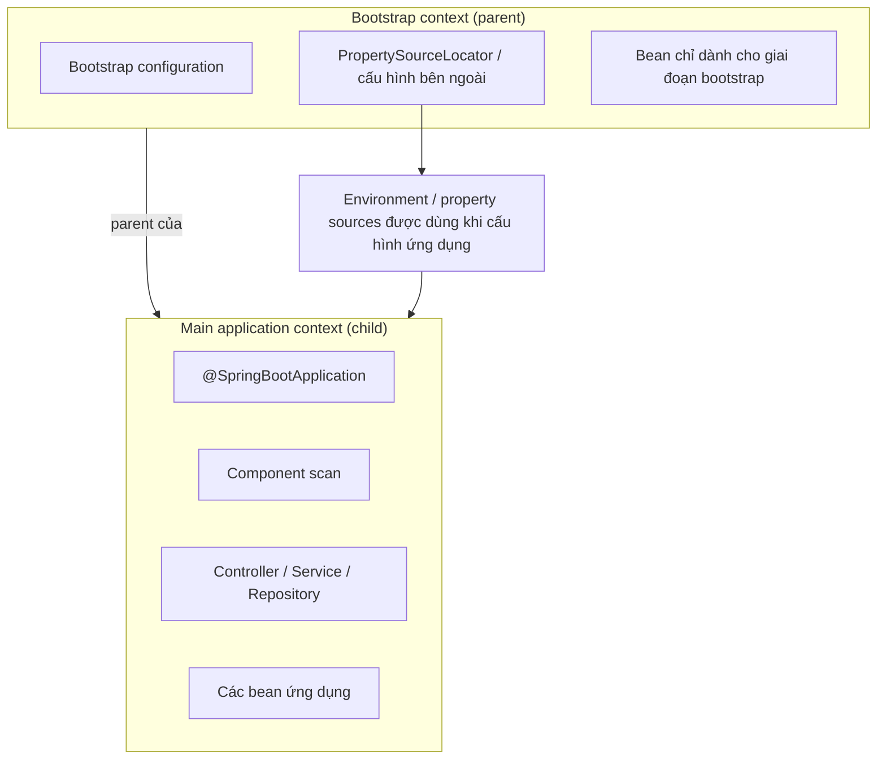
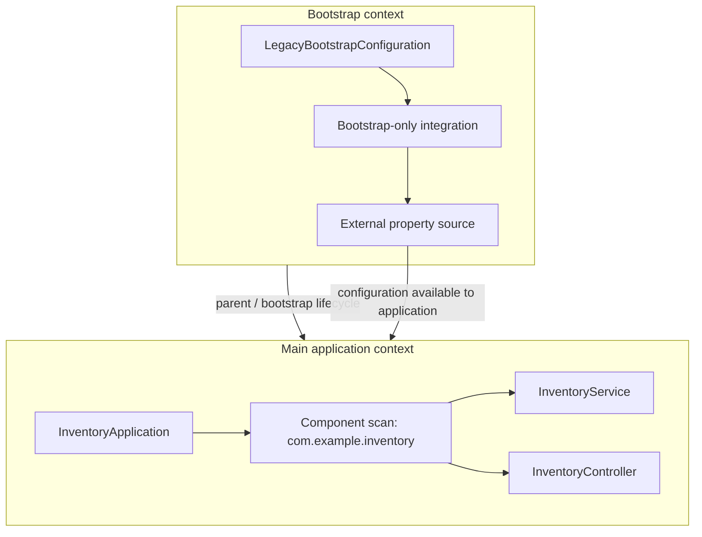

# Tránh component scan đưa cấu hình bootstrap vào context chính

Trong một ứng dụng Spring Cloud sử dụng cơ chế bootstrap context kiểu cũ, ứng dụng có thể có hai Spring ApplicationContext liên quan với nhau: **bootstrap context** và **main application context**. Bootstrap context được dùng để chuẩn bị cấu hình ban đầu và các thành phần tích hợp bootstrap; main context chứa các bean nghiệp vụ và phần lớn cấu hình ứng dụng.

Một lỗi tổ chức package thường gặp là đặt class cấu hình bootstrap bên trong package mà `@SpringBootApplication` của ứng dụng quét. Vì `@Configuration` cũng là một component, component scan có thể phát hiện class đó và đăng ký nó vào main context, trong khi cơ chế bootstrap đã nạp cùng class vào bootstrap context. Kết quả là một cấu hình chỉ định chạy ở bootstrap lại xuất hiện ở context chính, tạo bean hoặc property source ngoài dự kiến.

Bài học thuộc chương **Phân cấp context** của **SPRING_CLOUD_CORE**. Trọng tâm là hiểu context hierarchy, cách component scan hoạt động, vì sao bootstrap configuration cần nằm ngoài phạm vi quét của ứng dụng chính, cách tổ chức package và kiểm thử để tránh đăng ký nhầm.

> **Phạm vi:** bài này giải thích cơ chế **legacy bootstrap context** của Spring Cloud. Với ứng dụng hiện đại, Spring Boot Config Data cùng `spring.config.import` thường là hướng tích hợp cấu hình bên ngoài được ưu tiên. Không phải ứng dụng Spring Cloud nào cũng cần bootstrap context.

## 1. Mục tiêu học tập

Sau bài này, người học có thể:

1. Phân biệt bootstrap context và main application context trong mô hình legacy.
2. Giải thích quan hệ parent–child và hướng nhìn thấy bean giữa hai context.
3. Mô tả cách `@SpringBootApplication` kích hoạt component scan theo package.
4. Nhận diện vì sao class bootstrap được component scan phát hiện có thể được nạp thêm vào main context.
5. Tổ chức package và cấu hình scan để giữ bootstrap-only configuration ở đúng context.
6. Phân biệt legacy bootstrap với Spring Boot Config Data.
7. Kiểm thử cấu trúc context và chẩn đoán bean/property source bị đăng ký sai nơi.

## 2. Bootstrap context và main application context

### 2.1. Hai context có vai trò khác nhau

Trong legacy bootstrap mode, Spring Cloud tạo một context cha trước khi main application context được xây dựng. Bootstrap context xử lý các thành phần cần thiết ở giai đoạn sớm, chẳng hạn cấu hình để lấy property từ nguồn bên ngoài, một số thành phần mã hóa/giải mã cấu hình hoặc extension do ứng dụng đăng ký cho bootstrap.

Main application context được tạo sau đó để chạy ứng dụng thực tế: controller, service, repository, client nghiệp vụ, scheduler và các cấu hình thông thường.



Sơ đồ thể hiện quan hệ khái quát. Chi tiết nạp property source, chia sẻ Environment và thứ tự khởi tạo có thể thay đổi theo release train, Config Client và cách ứng dụng bật bootstrap. Khi cần dựa vào một hành vi cụ thể, hãy xem tài liệu của đúng phiên bản Spring Cloud đang dùng.

### 2.2. Quy tắc parent–child

Trong Spring ApplicationContext hierarchy:

- **Child context có thể tra cứu bean từ parent context** nếu không tìm thấy bean phù hợp trong chính nó.
- **Parent context không tra cứu ngược bean của child.** Bootstrap context không thể dựa vào một service hoặc repository chỉ được tạo trong main context.
- Bean định nghĩa trong child có thể che khuất bean cùng tên ở parent khi tra cứu từ child.
- Hai context là hai container riêng. Cùng một class được đăng ký ở cả hai nơi có thể tạo ra hai instance khác nhau, dù tên bean giống nhau.

Đây là lý do cấu hình bootstrap nên phụ thuộc vào những thành phần sẵn có ở giai đoạn bootstrap. Không đặt logic bootstrap vào một service nghiệp vụ chỉ tồn tại sau khi main context được tạo.

Ví dụ, một `PropertySourceLocator` cần đọc endpoint Config Server hoặc xác thực để lấy cấu hình không nên phụ thuộc vào `OrderRepository` hay `InventoryService` của ứng dụng. Các bean đó chưa thuộc bootstrap context và sẽ tạo quan hệ phụ thuộc sai chiều.

### 2.3. Bootstrap không phải context chứa toàn bộ ứng dụng

Bootstrap context không phải nơi đặt controller, business service hay toàn bộ component scan. Nó nên nhỏ, tập trung vào các thành phần cần chạy sớm. Main context mới là nơi ứng dụng đăng ký component thông thường.

Nếu bootstrap configuration bật component scan trên package gốc quá rộng, nó có thể kéo cả bean nghiệp vụ vào parent context. Khi đó main context không thể được parent nhìn thấy theo chiều ngược lại; ứng dụng có thể có hai bản bean hoặc lỗi thiếu dependency khi bootstrap cố tạo bean nghiệp vụ.

## 3. Vì sao component scan phát hiện nhầm cấu hình bootstrap?

### 3.1. @SpringBootApplication bao gồm component scan

`@SpringBootApplication` là annotation tổng hợp, bao gồm `@SpringBootConfiguration`, `@EnableAutoConfiguration` và `@ComponentScan`. Nếu không chỉ định phạm vi khác, component scan lấy package chứa class main làm package gốc và quét các package con.

Ví dụ:

```java
package com.example.inventory;

import org.springframework.boot.autoconfigure.SpringBootApplication;

@SpringBootApplication
public class InventoryApplication {

    public static void main(String[] args) {
        SpringApplication.run(InventoryApplication.class, args);
    }
}
```

Với package trên, Spring Boot mặc định quét `com.example.inventory` và các package con. Các class được nhận diện như component, bao gồm `@Component`, `@Service`, `@Repository`, `@Controller` và `@Configuration`, có thể được đăng ký vào main context.

### 3.2. @Configuration cũng là component

Một bootstrap class thường được viết như sau:

```java
package com.example.inventory.bootstrap;

import org.springframework.context.annotation.Configuration;

@Configuration
public class LegacyBootstrapConfiguration {

    // Các bean phục vụ bootstrap
}
```

Nếu class nằm trong package con của `com.example.inventory`, component scan mặc định của `InventoryApplication` có thể phát hiện nó. Điều này vẫn xảy ra dù class đã được đăng ký riêng cho bootstrap context qua cơ chế legacy.

Cần phân biệt hai cơ chế:

1. **Bootstrap registration:** Spring Cloud nạp class vào bootstrap context theo danh sách cấu hình bootstrap.
2. **Component scan:** Spring phát hiện class vì package của nó nằm trong vùng quét của main application context.

Một class có thể bị phát hiện bởi cả hai cơ chế. Việc đã đăng ký trong bootstrap không tự động loại class khỏi component scan của main context.

### 3.3. Ví dụ package dễ gây lỗi

```text
com.example.inventory
├── InventoryApplication.java
├── api/
├── service/
├── repository/
└── bootstrap/
    └── LegacyBootstrapConfiguration.java
```

Vì `bootstrap` là package con của `com.example.inventory`, class cấu hình bootstrap nằm trong vùng quét mặc định. Nếu nó đồng thời được đăng ký trong `spring.factories` cho bootstrap context, class có thể được nạp ở cả parent và child.

Vấn đề không nhất thiết biểu hiện bằng một lỗi duy nhất. Tùy bean và nội dung cấu hình, ứng dụng có thể:

- Tạo hai instance của client hoặc locator ở hai context.
- Đăng ký cùng một integration trong cả parent và child.
- Tạo thêm property source hoặc gọi nguồn cấu hình nhiều lần.
- Gặp bean ambiguity, bean shadowing hoặc xung đột tên trong cùng một context.
- Khởi tạo bean bootstrap ở thời điểm muộn trong main context, khi các giả định về vòng đời không còn đúng.
- Khó kiểm soát việc refresh, shutdown hoặc quản lý tài nguyên vì hai context có vòng đời riêng.

Không phải mọi trường hợp đều phát sinh `BeanDefinitionOverrideException`: parent và child có registry riêng. Lỗi ghi đè thường liên quan nhiều definition cùng tên trong **cùng một context**, trong khi đăng ký cùng class ở parent và child thường tạo ra hai bean thuộc hai container khác nhau.

## 4. Cơ chế đăng ký legacy bootstrap configuration

Trong legacy bootstrap mode, Spring Cloud cho phép mở rộng bootstrap context qua key `org.springframework.cloud.bootstrap.BootstrapConfiguration` trong file `META-INF/spring.factories`.

Ví dụ file:

```properties
org.springframework.cloud.bootstrap.BootstrapConfiguration=\
com.example.bootstrap.LegacyBootstrapConfiguration
```

Class được liệt kê sẽ được sử dụng làm cấu hình bootstrap theo cơ chế của Spring Cloud. Với nhiều class, phân tách bằng dấu phẩy theo cú pháp properties:

```properties
org.springframework.cloud.bootstrap.BootstrapConfiguration=\
com.example.bootstrap.LegacyBootstrapConfiguration,\
com.example.bootstrap.CustomPropertySourceConfiguration
```

Đây là cơ chế đăng ký dành cho bootstrap configuration của Spring Cloud. Nó khác cơ chế đăng ký auto-configuration hiện đại của Spring Boot qua `AutoConfiguration.imports`; không thay file hoặc key này bằng key auto-configuration của Boot.

### 4.1. Đặt bootstrap class ngoài package được quét

Cách đơn giản và dễ kiểm soát nhất là đặt bootstrap configuration ở package độc lập, nằm ngoài package gốc của ứng dụng.

Ví dụ:

```text
com.example
├── bootstrap
│   └── LegacyBootstrapConfiguration.java
└── inventory
    ├── InventoryApplication.java
    ├── api/
    ├── service/
    └── repository/
```

Class main nằm trong `com.example.inventory`, vì vậy scan mặc định đi xuống các package con của `com.example.inventory`, không quét ngược sang package anh em `com.example.bootstrap`.

Nếu class main được đặt tại `com.example` thay vì `com.example.inventory`, package bootstrap lại trở thành package con và có thể bị quét. Vì thế, hãy xác định package gốc thật sự của class main, không chỉ nhìn tên folder.

### 4.2. Khai báo bootstrap class

```java
package com.example.bootstrap;

import org.springframework.context.annotation.Bean;
import org.springframework.context.annotation.Configuration;

@Configuration(proxyBeanMethods = false)
public class LegacyBootstrapConfiguration {

    @Bean
    BootstrapMarker bootstrapMarker() {
        return new BootstrapMarker("legacy-bootstrap");
    }
}

record BootstrapMarker(String source) {
}
```

`BootstrapMarker` là bean minh họa để thể hiện class được đăng ký trong bootstrap context. Một cấu hình thật có thể khai báo thành phần hỗ trợ nạp property source, client lấy cấu hình hoặc các extension chỉ cần ở giai đoạn bootstrap.

Nếu cấu hình này cần bean properties, hãy đăng ký chúng theo cơ chế phù hợp với bootstrap context. Đừng giả định mọi bean do component scan của main application tạo ra đều có thể được inject vào đây.

## 5. Các cách ngăn main context quét bootstrap configuration

### 5.1. Ưu tiên tách package

Đặt class bootstrap ngoài package gốc của main application là giải pháp dễ đọc nhất. Cách này giảm phụ thuộc vào filter và ít bị ảnh hưởng khi nhóm thêm component mới.

Quy tắc ví dụ:

- Main application: `com.example.inventory`.
- Component nghiệp vụ: `com.example.inventory.api`, `com.example.inventory.service`, `com.example.inventory.repository`.
- Bootstrap-only configuration: `com.example.bootstrap`.

Khi ứng dụng có nhiều module, nên thống nhất quy ước package ngay từ đầu. Đừng đặt mọi class vào package `com.example` rồi dùng component scan toàn bộ root nếu trong đó có những cấu hình dành riêng cho context khác.

### 5.2. Giới hạn scanBasePackages

Nếu cấu trúc hiện tại không thể di chuyển bootstrap class, có thể thu hẹp phạm vi scan:

```java
package com.example;

import org.springframework.boot.autoconfigure.SpringBootApplication;

@SpringBootApplication(
    scanBasePackages = {
        "com.example.inventory.api",
        "com.example.inventory.service",
        "com.example.inventory.repository"
    }
)
public class InventoryApplication {
    public static void main(String[] args) {
        SpringApplication.run(InventoryApplication.class, args);
    }
}
```

Ví dụ chỉ quét các package ứng dụng cần thiết. Vì đã thay phạm vi mặc định, cần bảo đảm mọi component, mapper hoặc class cấu hình nghiệp vụ cần thiết đều được đăng ký theo một cơ chế rõ ràng.

`scanBasePackages` là alias của phạm vi `@ComponentScan` trên `@SpringBootApplication`. Nó không tự cấu hình phạm vi cho mọi cơ chế scan khác, chẳng hạn `@EntityScan` hoặc `@EnableJpaRepositories`. Nếu ứng dụng dùng JPA hoặc repository scanning, hãy khai báo các phạm vi đó riêng khi cần.

### 5.3. Dùng exclude filter khi cần giữ package rộng

Nếu ứng dụng cần quét một package rộng nhưng phải loại một bootstrap class cụ thể, có thể dùng `@ComponentScan` với filter. Cần tổ chức annotation cấu hình sao cho chỉ có một định nghĩa component scan được áp dụng; không thêm một `@ComponentScan` thứ hai một cách tùy tiện lên class đã có `@SpringBootApplication`.

Ví dụ dùng cấu hình ứng dụng tường minh thay cho `@SpringBootApplication` tổng hợp:

```java
@Configuration
@EnableAutoConfiguration
@ComponentScan(
    basePackages = "com.example",
    excludeFilters = @ComponentScan.Filter(
        type = FilterType.ASSIGNABLE_TYPE,
        classes = LegacyBootstrapConfiguration.class
    )
)
class InventoryApplicationConfiguration {
}
```

Trong ví dụ đầy đủ, cần import `ComponentScan`, `FilterType`, `Configuration` và `EnableAutoConfiguration`. Cách này cho phép loại class cụ thể khỏi component scan của main context. Tuy nhiên, filter chỉ có tác dụng với scan được cấu hình ở đây; nếu một component scan khác cũng quét package bootstrap, class vẫn có thể được phát hiện qua scan đó.

Với một bootstrap package riêng biệt, package separation thường rõ ràng hơn exclude filter.

### 5.4. Không dùng component scan trong bootstrap để quét toàn ứng dụng

Một bootstrap configuration cũng có thể khai báo `@ComponentScan`. Nếu scan root bao trùm package ứng dụng, nó có thể đưa controller/service/repository vào parent context trước khi main context được tạo.

```java
@Configuration
@ComponentScan("com.example")
class LegacyBootstrapConfiguration {
}
```

Đây là thiết kế nguy hiểm nếu mục đích chỉ là đăng ký một vài bean bootstrap. Parent không thể nhìn thấy bean của child; việc quét toàn bộ application package trong parent còn có thể tạo bản sao bean và khiến dependency nghiệp vụ bị khởi tạo quá sớm.

Thay vì scan toàn package, hãy khai báo tường minh các bean bootstrap cần thiết bằng `@Bean` hoặc giới hạn component scan vào một package bootstrap nhỏ, riêng biệt.

## 6. Cấu trúc context đúng trong một ứng dụng mẫu

Giả sử ứng dụng inventory có một cấu hình lấy property source từ hệ thống bên ngoài trong legacy bootstrap mode.



Cấu trúc package tương ứng:

```text
src/main/java/
└── com/example/
    ├── bootstrap/
    │   └── LegacyBootstrapConfiguration.java
    └── inventory/
        ├── InventoryApplication.java
        ├── api/
        │   └── InventoryController.java
        ├── service/
        │   └── InventoryService.java
        └── repository/
            └── InventoryRepository.java

src/main/resources/
└── META-INF/
    └── spring.factories
```

Và nội dung `spring.factories`:

```properties
org.springframework.cloud.bootstrap.BootstrapConfiguration=\
com.example.bootstrap.LegacyBootstrapConfiguration
```

Main application quét `com.example.inventory`; bootstrap configuration được nạp qua cơ chế bootstrap. Hai đường đăng ký có mục tiêu và vòng đời khác nhau.

## 7. Phân biệt legacy bootstrap với Spring Boot Config Data

Một nguyên nhân gây nhầm lẫn là tài liệu cũ thường mô tả `bootstrap.yml` và bootstrap context như cách mặc định để nạp cấu hình bên ngoài. Trong các thế hệ Spring Cloud hiện đại, bootstrap context kiểu cũ không còn là cơ chế mặc định trong mọi ứng dụng. Spring Boot Config Data là cách tích hợp được ưu tiên cho nhiều trường hợp.

### 7.1. Config Data import

Một ứng dụng dùng Spring Cloud Config Client có thể khai báo:

```yaml
spring:
  application:
    name: inventory-service
  config:
    import: "optional:configserver:"
```

Với dependency Config Client phù hợp, Config Data import cho phép ứng dụng lấy cấu hình từ Config Server trong quá trình nạp cấu hình. Cơ chế này không đòi hỏi phải đặt một class `BootstrapConfiguration` trong component scan của main application.

Nếu nguồn Config Server là bắt buộc, có thể bỏ prefix `optional:` theo hướng dẫn của phiên bản đang dùng. Cần phân biệt optional import với property bắt buộc: Config Server không truy cập được có thể được bỏ qua theo semantics optional, nhưng property nghiệp vụ không có default vẫn có thể khiến ứng dụng lỗi khi được sử dụng.

### 7.2. Khi nào vẫn dùng bootstrap context?

Một số hệ thống cũ hoặc extension đặc thù vẫn dùng bootstrap context. Trong trường hợp đó, ứng dụng cần bật legacy bootstrap theo cách được tài liệu release train hỗ trợ, thường thông qua dependency `spring-cloud-starter-bootstrap` hoặc cấu hình bật bootstrap được cung cấp sớm cho tiến trình.

Không nên chỉ thêm starter vì thấy một ví dụ cũ. Trước khi chọn cơ chế, hãy xác định:

- Ứng dụng đang dùng release train nào?
- Config Client có đang dùng `spring.config.import` không?
- Có `PropertySourceLocator` hoặc bootstrap extension cần chạy trước main context không?
- Có phụ thuộc vào `bootstrap.yml` hoặc bootstrap property sources cũ không?
- Cơ chế hiện tại có migration path sang Config Data không?

Không nên vô tình bật cả hai cơ chế chỉ để chữa lỗi thiếu property. Hãy đọc migration notes và tài liệu của đúng phiên bản Spring Cloud.

### 7.3. Bảng so sánh

| Tiêu chí | Legacy bootstrap context | Spring Boot Config Data |
| --- | --- | --- |
| Mục tiêu | Tạo context bootstrap cha để xử lý cấu hình sớm | Nạp property sources trong quy trình Config Data của Boot |
| Cách mở rộng | `BootstrapConfiguration`, `spring.factories` | Config Data import/resolver và cấu hình nguồn tương ứng |
| File/cấu hình thường gặp | `bootstrap.yml` khi bootstrap được bật | `application.yml`, `spring.config.import` |
| Component scan | Cần tách bootstrap-only class khỏi scan của main context | Không cần component scan một bootstrap configuration chỉ để import Config Server |
| Sử dụng | Tương thích hệ thống legacy hoặc extension cần bootstrap context | Hướng hiện đại cho external config khi integration hỗ trợ |
| Rủi ro chính | Đăng ký nhầm class vào main context, phức tạp parent–child | Sai import, optional/required semantics, precedence và kết nối nguồn config |

## 8. Những dấu hiệu cho thấy bootstrap configuration bị quét nhầm

Khi một class được nạp ở nhiều context, dấu hiệu có thể không xuất hiện ngay tại startup. Hãy kiểm tra các biểu hiện sau:

- Bean bootstrap xuất hiện trong main context dù chỉ nên tồn tại ở parent.
- Constructor của bootstrap bean chạy hai lần, một lần trong mỗi context.
- Property source locator hoặc client lấy cấu hình được gọi nhiều lần ngoài dự kiến.
- Có hai client, scheduler, listener hoặc resource pool cho cùng một integration.
- Một bean ở main context bị bean cùng tên ở parent che khuất hoặc ngược lại khi tra cứu.
- Một cấu hình dựa trên bean nghiệp vụ bị lỗi khi chạy trong bootstrap context.
- Shutdown hoặc refresh thực hiện trên một context nhưng tài nguyên ở context kia vẫn tồn tại.
- Condition report hoặc log cho thấy cùng một cấu hình được xử lý trong hai ApplicationContext.

Hai lần khởi tạo không phải bằng chứng duy nhất của lỗi component scan: có thể có hai bean được thiết kế có chủ đích hoặc nhiều application context hợp lệ. Hãy kiểm tra context ID, parent context, bean definition source và đường đăng ký class trước khi kết luận.

## 9. Chẩn đoán context và bean registration

### 9.1. Kiểm tra tên và quan hệ context

Có thể log thông tin context khi ứng dụng khởi động:

```java
@Component
class ContextDiagnostics implements ApplicationContextAware {

    @Override
    public void setApplicationContext(ApplicationContext context) {
        ApplicationContext parent = context.getParent();

        log.info("Context id: {}", context.getId());
        log.info("Context name: {}", context.getDisplayName());
        log.info("Parent context: {}",
            parent == null ? "<none>" : parent.getId());
    }
}
```

Đây là ví dụ minh họa; cần khai báo logger và import phù hợp. Đặt diagnostic bean trong main context để quan sát context chính. Nếu cần kiểm tra bootstrap context, hãy dùng hook hoặc logging tương ứng của bootstrap lifecycle trong phiên bản Spring Cloud đang chạy.

Không log toàn bộ property values hoặc bean object có thể chứa credential. Context ID, bean type và nguồn đăng ký thường đủ để bắt đầu điều tra.

### 9.2. Kiểm tra bean definition

Khi biết context nào đang chứa bean, có thể kiểm tra bean names và bean definition metadata:

```java
ConfigurableApplicationContext configurable =
    (ConfigurableApplicationContext) applicationContext;

String[] names = configurable.getBeanFactory()
    .getBeanNamesForType(LegacyBootstrapMarker.class);

for (String name : names) {
    BeanDefinition definition =
        configurable.getBeanFactory().getBeanDefinition(name);

    log.info("Bean {} from {}", name, definition.getResourceDescription());
}
```

`resourceDescription` có thể giúp nhận ra bean đến từ class cấu hình hoặc file nào. Việc kiểm tra này nên được dùng trong diagnostic/test code, không phải logic nghiệp vụ thường xuyên.

Nếu cùng một bean type xuất hiện trong parent và child, hãy kiểm tra cả hai context. Chỉ nhìn `getBeanNamesForType` ở child có thể không thể hiện đầy đủ các bean được định nghĩa trong parent theo cách bạn mong đợi; hãy truy vấn riêng từng context.

### 9.3. Xác định đường đăng ký

Với class cấu hình bị nạp nhầm, hãy kiểm tra:

1. Nó có nằm trong `org.springframework.cloud.bootstrap.BootstrapConfiguration` của `spring.factories` không?
2. Package của class có nằm dưới package gốc `@SpringBootApplication` không?
3. Có `@ComponentScan` nào khác quét package đó không?
4. Có `@Import` hoặc cấu hình tường minh nào đưa class vào main context không?
5. Có test configuration hoặc auto-configuration nào đăng ký cùng class không?

Mục tiêu là tìm đúng đường tạo bean trong context chính. Chỉ xóa entry trong `spring.factories` có thể làm bootstrap integration ngừng hoạt động, trong khi nguyên nhân scan nhầm vẫn còn.

## 10. Kiểm thử để ngăn tái diễn

Một bài test chỉ xác nhận ứng dụng khởi động thành công chưa đủ để chứng minh bootstrap-only class không bị scan. Nên kiểm thử ranh giới package và bean xuất hiện trong context.

### 10.1. Kiểm thử main context không chứa bootstrap-only bean

Có thể dùng `ApplicationContextRunner` để tạo một context thử với cấu hình component scan của ứng dụng:

```java
class MainComponentScanTests {

    private final ApplicationContextRunner runner =
        new ApplicationContextRunner()
            .withUserConfiguration(InventoryApplicationConfiguration.class);

    @Test
    void mainContextDoesNotScanBootstrapOnlyConfiguration() {
        runner.run(context -> {
            assertThat(context)
                .doesNotHaveBean(BootstrapMarker.class);
        });
    }
}
```

Test giả định `InventoryApplicationConfiguration` sử dụng phạm vi scan đã giới hạn và `BootstrapMarker` chỉ được tạo bởi legacy bootstrap configuration. Nếu main context có chủ đích sử dụng bean type này qua một adapter khác, hãy assert bean cụ thể hoặc marker chỉ dành cho bootstrap để tránh test sai.

### 10.2. Kiểm thử parent–child visibility

Một test nhỏ với Spring context có thể xác nhận quy tắc tra cứu:

```java
@Test
void childCanResolveParentBeanButParentCannotResolveChildBean() {
    AnnotationConfigApplicationContext parent =
        new AnnotationConfigApplicationContext();
    parent.registerBean("parentMarker", BootstrapMarker.class,
        () -> new BootstrapMarker("parent"));
    parent.refresh();

    AnnotationConfigApplicationContext child =
        new AnnotationConfigApplicationContext();
    child.setParent(parent);
    child.registerBean("childMarker", MainMarker.class,
        MainMarker::new);
    child.refresh();

    assertThat(child.getBean(BootstrapMarker.class))
        .isSameAs(parent.getBean(BootstrapMarker.class));

    assertThat(parent.containsBean("childMarker")).isFalse();

    child.close();
    parent.close();
}
```

Đây là test minh họa nguyên tắc parent–child của Spring Framework, không khởi chạy đầy đủ Spring Cloud bootstrap lifecycle. Test integration riêng mới xác nhận được bootstrap listener và `spring.factories` của ứng dụng thực sự hoạt động như mong đợi.

### 10.3. Kiểm thử artifact đã đóng gói

Bootstrap registration được đọc từ tài nguyên trên classpath, vì vậy nên kiểm tra cả jar đã build:

- File `META-INF/spring.factories` có trong artifact legacy bootstrap.
- Key `org.springframework.cloud.bootstrap.BootstrapConfiguration` liệt kê đúng class.
- Không có class bootstrap bị component scan từ main application.
- Main application context không tạo bootstrap-only marker.
- Bootstrap extension được nạp đúng một lần ở bootstrap context theo thiết kế.
- Nếu dùng Config Data thay legacy bootstrap, test xác nhận `spring.config.import` và remote property source hoạt động.

Test trên classpath IDE có thể bỏ sót vấn đề resource filtering hoặc đóng gói jar. Với thư viện bootstrap dùng chung, kiểm tra artifact phát hành là một bước quan trọng.

## 11. Cách sửa theo từng tình huống

| Tình huống | Nguyên nhân thường gặp | Cách xử lý |
| --- | --- | --- |
| Bootstrap class xuất hiện ở parent và child | Package nằm trong component scan, đồng thời được đăng ký bootstrap | Chuyển class ra ngoài scan root hoặc thu hẹp scan |
| Bootstrap config không được nạp ở parent | Thiếu `spring.factories` entry hoặc legacy bootstrap chưa bật | Kiểm tra artifact, key đăng ký và cách enable theo version |
| Parent cố inject service nghiệp vụ | Bootstrap config scan toàn application package | Chỉ khai báo bean bootstrap; bỏ component scan rộng |
| Bean bị tạo hai lần trong cùng context | Có nhiều đường import/scan/auto-config | Xác định definition source, loại đường đăng ký trùng |
| Property source được nạp nhiều lần | Locator bị đăng ký ở nhiều context hoặc nhiều lần | Kiểm tra registration và lifecycle của locator |
| Ứng dụng mới dùng Config Data nhưng vẫn có bootstrap code cũ | Cấu hình legacy còn sót sau migration | Xác định extension còn cần thiết; chuyển sang Config Data hoặc bật legacy có chủ đích |

Không nên sửa bằng cách tắt toàn bộ component scan. Cách đó có thể làm controller, service hoặc repository không được đăng ký. Hãy thu hẹp đúng package hoặc loại đúng bootstrap configuration.

## 12. Checklist thiết kế package và context hierarchy

Trước khi phát hành ứng dụng hoặc starter có legacy bootstrap extension, hãy kiểm tra:

1. **Package gốc của main class:** xác định chính xác vùng component scan mặc định.
2. **Vị trí bootstrap class:** đặt ngoài vùng quét của main context.
3. **Bootstrap registration:** liệt kê class qua đúng key trong `spring.factories`.
4. **Phạm vi bean:** bootstrap chỉ chứa thành phần cần thiết ở giai đoạn sớm.
5. **Hướng dependency:** bootstrap không phụ thuộc bean chỉ tồn tại trong main context.
6. **Component scan trong bootstrap:** tránh quét package ứng dụng rộng.
7. **Đường đăng ký trùng:** kiểm tra `@Import`, `@ComponentScan`, `spring.factories` và cấu hình test.
8. **Cơ chế cấu hình:** phân biệt legacy bootstrap với Config Data import.
9. **Kiểm thử:** xác nhận bootstrap-only bean không xuất hiện trong main context.
10. **Đóng gói:** xác nhận tài nguyên `spring.factories` có trong jar nếu legacy mode cần dùng.
11. **Phiên bản:** đối chiếu tài liệu của release train Spring Cloud và Spring Boot đang chạy.
12. **Vòng đời:** kiểm tra shutdown, refresh và việc đóng tài nguyên ở đúng context.

## 13. Câu hỏi tự kiểm tra và bài tập

### Câu hỏi

1. Bootstrap context trong legacy Spring Cloud có vai trò gì so với main application context?
2. Vì sao child context có thể tra cứu bean ở parent nhưng parent không thể tra cứu bean ở child?
3. Vì sao một class `@Configuration` nằm dưới package của `@SpringBootApplication` có thể xuất hiện trong main context?
4. Đăng ký class qua `spring.factories` có tự động loại class đó khỏi component scan không?
5. Vì sao cùng một class được đăng ký trong parent và child không nhất thiết gây `BeanDefinitionOverrideException`?
6. Vì sao bootstrap configuration không nên component scan toàn package nghiệp vụ?
7. `scanBasePackages` có tự thay đổi phạm vi của `@EntityScan` và `@EnableJpaRepositories` không?
8. Spring Boot Config Data khác legacy bootstrap context ở điểm nào?

### Bài tập 1. Sửa cấu trúc package

Ứng dụng có cấu trúc:

```text
com.acme
├── Application.java
├── order/
├── payment/
└── bootstrap/
    └── ExternalConfigBootstrap.java
```

`Application.java` dùng `@SpringBootApplication`, còn `ExternalConfigBootstrap` được đăng ký trong `spring.factories`.

Hãy giải thích vì sao class bootstrap có thể bị quét vào main context. Đề xuất hai cách sửa: chuyển package bootstrap ra ngoài scan root hoặc thu hẹp phạm vi component scan. Với mỗi cách, nêu những component khác cần kiểm tra để không bị bỏ sót.

### Bài tập 2. Điều tra hai lần khởi tạo

Log cho thấy `ExternalConfigBootstrap` được khởi tạo hai lần và một property source locator gọi remote endpoint nhiều lần.

Hãy lập kế hoạch điều tra:

- Xác định ID của từng ApplicationContext và parent của chúng.
- Kiểm tra `spring.factories` trong jar.
- Kiểm tra package gốc của `@SpringBootApplication`.
- Tìm component scan và `@Import` bổ sung.
- Kiểm tra bean definition source trong parent và child.
- Sửa đúng đường đăng ký rồi kiểm thử lại.

### Bài tập 3. Chọn cơ chế cấu hình

Một ứng dụng Spring Boot hiện đại chỉ cần lấy cấu hình từ Spring Cloud Config Server và không có custom bootstrap extension.

Hãy xác định có cần bật legacy bootstrap context không, mô tả cách dùng `spring.config.import`, và nêu các trường hợp mà một hệ thống legacy vẫn cần bootstrap configuration.

## 14. Nguồn tham chiếu

- [Spring Cloud Commons Reference — Application Context Services](https://docs.spring.io/spring-cloud-commons/reference/spring-cloud-commons/application-context-services.html): bootstrap context, context hierarchy và các dịch vụ context.
- [Spring Cloud Config Reference — Client](https://docs.spring.io/spring-cloud-config/reference/client.html): tích hợp Config Client và cách nạp cấu hình từ Config Server.
- [Spring Boot Reference — Structuring Your Code](https://docs.spring.io/spring-boot/reference/using/structuring-your-code.html): package gốc và cách tổ chức component scan.
- [Spring Framework Reference — ApplicationContext and BeanFactory](https://docs.spring.io/spring-framework/reference/core/beans/basics.html): container, bean definitions và cơ chế tra cứu bean.

## Ghi nhớ

Trong legacy Spring Cloud, bootstrap context là parent được tạo sớm để chuẩn bị cấu hình; main application context là child chứa các bean của ứng dụng. Component scan của `@SpringBootApplication` chỉ dựa trên package và các filter, không biết một class được dự định dành riêng cho bootstrap. Vì vậy, hãy đặt bootstrap configuration ngoài scan root, đăng ký nó qua đúng cơ chế legacy và giữ bootstrap context nhỏ. Với ứng dụng hiện đại, cân nhắc Spring Boot Config Data để nạp cấu hình bên ngoài mà không cần duy trì bootstrap context cũ.
