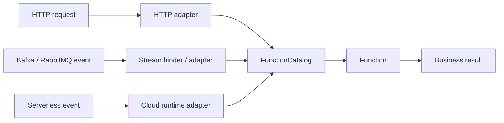

# What Is Spring Cloud Function and the Problem of Deploying Business Logic as Functions

## 1. From a Real-World Problem to the Idea of "Business Logic as a Function"

Suppose a sales system needs to apply the same rule: an order with a total amount greater than 0 and not exceeding 1,000,000 VND receives preliminary approval. This rule might be invoked from several places:

- An HTTP API receiving order-check requests from a web application.
- An order event from Kafka or RabbitMQ.
- A task running on a serverless platform when a new event arrives.
- Another processing flow within the same Java application.

If you place the rule directly inside a `@RestController`, a Kafka listener, or a cloud platform handler, you can easily end up duplicating logic, duplicating tests, and editing multiple places whenever the policy changes. You could also extract the logic into a plain Java service yourself, but when you want to package and expose that service across different input types, each adapter still has to handle looking up the function, invoking it, and converting data.

**Spring Cloud Function** (the `SPRING_CLOUD_FUNCTION` module) provides a consistent model for defining logic using Java functional interfaces, registering them in Spring, and exposing them to different invocation environments. The goal is to **write the business rule once, then connect it to HTTP, event streams, or serverless environments using the appropriate adapter**.



The diagram illustrates **logic reuse**. Connecting to Kafka, RabbitMQ, or a serverless platform still requires its own dependencies, configuration, message conventions, and deployment approach; Spring Cloud Function does not automatically turn an application into every kind of service simply by declaring a bean.

## 2. What Is Spring Cloud Function?

Spring Cloud Function is a project in the Spring Cloud ecosystem built around interfaces from the `java.util.function` package: `Supplier<T>`, `Function<T, R>`, and `Consumer<T>`. You can create beans of these types with `@Bean`, then let the framework discover, register, look up, compose, and convert data when invoking the functions.

Three components should be clearly distinguished:

| Component | Responsibility | Example |
| --- | --- | --- |
| **Business function** | Receives data, applies rules, produces a result or side effect; independent of how the call is delivered. | `Function<OrderRequest, OrderDecision>` |
| **`FunctionCatalog`** | Catalog for looking up registered functions by name or composition expression; provides the framework's unified invocation layer. | `catalog.lookup("decideOrder")` |
| **Adapter** | Connects a specific protocol or runtime to the function: receives data, invokes the function, and handles the result according to that environment. | HTTP adapter, Spring Cloud Stream, serverless platform adapter |

Spring Cloud Function **does not replace Spring Boot**: an application typically still uses Spring Boot to initialize the context and configure dependencies. Nor is it **synonymous with a FaaS service**: `Function` is just a programming model; deploying to AWS Lambda or a similar platform is one integration capability.

The key to the model is a clear boundary between **what the rule should do** and **who calls the rule and over which protocol**.

## 3. Three Core Function Types

| Type | Conceptual Signature | Role | Business Example |
| --- | --- | --- | --- |
| `Supplier<T>` | `() -> T` | Produces data without needing an input payload. | Providing a configuration snapshot, generating a record for a polling cycle. |
| `Function<T, R>` | `T -> R` | Transforms an input into a result. | Validating an order, calculating a priority score, normalizing data. |
| `Consumer<T>` | `T -> void` | Receives data to perform a side effect without returning a business value. | Writing an audit log, sending a notification, persisting data. |

Plain Java example:

```java
Supplier<String> version = () -> "policy-v1";
Function<String, String> normalize = value -> value.trim().toLowerCase();
Consumer<String> audit = value -> System.out.println("Received: " + value);

String currentVersion = version.get();
String normalized = normalize.apply("  ORDER-A17  ");
audit.accept(normalized);
```

These are standard JDK interfaces, without needing Spring Cloud Function yet. The framework comes into play when functions are declared as beans and need to be discovered and invoked through adapters.

Note: `Supplier` does not mean it runs automatically on a schedule. When it triggers depends on the environment: an HTTP request might call `get()`, while a messaging flow might poll according to its configuration. `Consumer` can produce side effects, but the `void` signature itself does not guarantee that data was persisted or that a message was successfully sent.

## 4. Example: Implementing an Order Approval Rule

### 4.1. Defining Spring Functions

In a Spring Boot application using Java 17 or later and compatible Spring Boot/Spring Cloud versions, you can place the following beans in an application class:

```java
import java.math.BigDecimal;
import java.util.function.Consumer;
import java.util.function.Function;
import java.util.function.Supplier;

import org.slf4j.Logger;
import org.slf4j.LoggerFactory;
import org.springframework.boot.SpringApplication;
import org.springframework.boot.autoconfigure.SpringBootApplication;
import org.springframework.context.annotation.Bean;

@SpringBootApplication
public class OrderFunctionApplication {
    private static final Logger log =
            LoggerFactory.getLogger(OrderFunctionApplication.class);

    public static void main(String[] args) {
        SpringApplication.run(OrderFunctionApplication.class, args);
    }

    public record OrderRequest(String orderId, BigDecimal amount) {}
    public record OrderDecision(
            String orderId, boolean approved, String reason) {}

    @Bean
    Function<OrderRequest, OrderDecision> decideOrder() {
        return request -> {
            boolean approved = request.amount() != null
                    && request.amount().compareTo(BigDecimal.ZERO) > 0
                    && request.amount().compareTo(
                            new BigDecimal("1000000")) <= 0;

            String reason = approved ? "APPROVED" : "INVALID_AMOUNT";
            return new OrderDecision(request.orderId(), approved, reason);
        };
    }

    @Bean
    Consumer<OrderDecision> auditDecision() {
        return decision -> log.info(
                "orderId={}, approved={}, reason={}",
                decision.orderId(), decision.approved(), decision.reason());
    }

    @Bean
    Supplier<String> policyVersion() {
        return () -> "order-policy-v1";
    }
}
```

In this example:

1. `decideOrder` is a `Function` that receives a request and returns a decision; it does not know whether the data came from HTTP or a message broker.
2. `auditDecision` is a `Consumer` demonstrating a side effect (logging).
3. `policyVersion` is a `Supplier` that requires no input payload.
4. The `@Bean` method name is by default the registered function name so the framework or adapter can look it up.

This is a minimal rule example. In a real system, you would validate `orderId`, missing fields, complex rules, and design appropriate error codes. For monetary amounts, using `BigDecimal` avoids binary floating-point rounding errors in currency calculations.

### 4.2. Invoking the Same Function over HTTP

To expose functions over HTTP in a Spring Boot application, add the `org.springframework.cloud:spring-cloud-starter-function-web` starter and manage versions with a Spring Cloud BOM compatible with Spring Boot. Maven dependency example:

```xml
<dependency>
    <groupId>org.springframework.cloud</groupId>
    <artifactId>spring-cloud-starter-function-web</artifactId>
</dependency>
```

After the application starts on port 8080, the HTTP adapter can map function names to paths. Example call:

```bash
curl -X POST http://localhost:8080/decideOrder \
  -H "Content-Type: application/json" \
  -d '{"orderId":"A-17","amount":750000}'
```

Expected business result:

```json
{
  "orderId": "A-17",
  "approved": true,
  "reason": "APPROVED"
}
```

Another example:

```bash
curl http://localhost:8080/policyVersion
```

For `policyVersion`, the adapter calls `Supplier.get()` to retrieve the current value. For `auditDecision`, the adapter can accept a POST request and call `Consumer.accept()`; since `Consumer` has no return value, you should not design clients to rely on a JSON business response from this function.

**What is reused?** The `decideOrder` lambda itself. The HTTP adapter handles receiving the request, converting JSON to `OrderRequest`, and converting `OrderDecision` to the response. If the invocation source later changes to a message broker, the amount comparison rule can stay unchanged.

## 5. `FunctionCatalog`: Looking Up Functions by Name

Once function beans are registered, `FunctionCatalog` is the entry point for selecting and invoking them. Illustration when a `catalog` object has been injected by Spring:

```java
import org.springframework.cloud.function.context.FunctionCatalog;

// catalog is injected from the Spring ApplicationContext.
Function<OrderFunctionApplication.OrderRequest,
         OrderFunctionApplication.OrderDecision> function =
        catalog.lookup("decideOrder");

var decision = function.apply(
        new OrderFunctionApplication.OrderRequest(
                "A-18", new BigDecimal("250000")));
```

`catalog.lookup("decideOrder")` looks up a function by name; the application does not need to write its own `if/else` or `switch` chain to map a name to a piece of business logic. In practice, the catalog also manages wrapped function forms that the framework can adapt for type conversion and message handling.

The function name is part of the integration configuration: renaming a bean can break HTTP endpoints or message bindings referencing that name. Therefore, treat an exposed function name as a contract that must be managed during upgrades.

## 6. Function Composition: Chaining Processing Steps

Instead of writing one giant function, you can create multiple small steps and compose them in order. For example:

```java
@Bean
Function<String, String> normalizeCustomer() {
    return input -> input.trim().toLowerCase(java.util.Locale.ROOT);
}

@Bean
Function<String, String> addCustomerPrefix() {
    return input -> "customer:" + input;
}
```

Spring Cloud Function's composition expression uses the `|` character:

```text
normalizeCustomer|addCustomerPrefix
```

The processing flow is:

```text
"  Alice  "
     |
     v
normalizeCustomer  ->  "alice"
     |
     v
addCustomerPrefix  ->  "customer:alice"
```

You can ask the catalog to retrieve the composed function:

```java
Function<String, String> pipeline =
        catalog.lookup("normalizeCustomer|addCustomerPrefix");

String result = pipeline.apply("  Alice  ");
// result = "customer:alice"
```

For adapters that use configuration-based function selection, one way to declare it is:

```yaml
spring:
  cloud:
    function:
      definition: "normalizeCustomer|addCustomerPrefix"
```

The `spring.cloud.function.definition` property specifies the function or function expression selected for the corresponding adapter/binding; it **does not automatically configure endpoints, topics, or triggers for every platform**. Composition steps run **from left to right** and must be type-compatible: if the first step is `Function<A, B>`, the next step must be able to receive `B` (or data convertible by the framework's conversion mechanism). Composing a `Function` into a `Consumer` generally has no output payload to forward further.

Composition is useful for normalization, validation, and data enrichment pipelines. When steps have side effects or require transactions, you must clearly define retry and failure points; a chain of functions does not automatically provide exactly-once processing guarantees.

## 7. Payload, `Message`, and Type Conversion

In the HTTP example, the input is `OrderRequest` and the output is `OrderDecision`, not `HttpServletRequest` or `ResponseEntity`. This is an intentional choice: business logic only knows its own data structures. The adapter/framework is responsible for converting external payloads into the appropriate Java types when configured and supported by a converter.

There are two common ways to design data types:

| Declaration | Best When | Things to Watch Out For |
| --- | --- | --- |
| `Function<OrderRequest, OrderDecision>` | Only business content is needed; you want easy testing and reuse. | HTTP headers, message keys, or trace information are not available in the function parameter. |
| `Function<Message<OrderRequest>, Message<OrderDecision>>` | You need to read/write message metadata, such as a correlation ID or business headers. | You must decide which headers to keep, create, or drop; avoid letting transport metadata drive core rules. |

`Message<T>` here is `org.springframework.messaging.Message<T>`, which has a **payload** and **headers**. The framework can assist with message conversion, but conversion depends on data types, content types, dependencies, and adapter configuration. Do not assume any arbitrary JSON, Avro, header, or event will automatically map correctly.

When designing a data contract, clearly specify field names, types, units (e.g., amount in VND), nullability rules, and how schema versioning is handled. A function decoupled from transport protocols can still depend heavily on the **payload contract**.

## 8. One Logic, Multiple Deployment Options

| Invocation Environment | Typical Integration | Additional Configuration Required |
| --- | --- | --- |
| **HTTP** | `spring-cloud-starter-function-web` creates an adapter for registered functions. | Paths, HTTP methods, JSON mapping, authentication, timeouts, error codes. |
| **Kafka / RabbitMQ** | Spring Cloud Stream with the corresponding binder invokes the function via message channels. | Broker, destination/topic, consumer group, serializer, retry, acknowledgment, dead-letter policy. |
| **Serverless** | A runtime-specific adapter packages/invokes the function. | Handler/entry point, triggers, access permissions, packaging, runtime, timeout, and resource limits. |
| **Another Spring Application** | Inject the bean or look it up via `FunctionCatalog`. | Java contract, transaction boundary, processing flow, and error handling at the caller. |

For example, a system receives requests via HTTP in its initial phase. Later, the business wants to process orders asynchronously via events: the Spring Cloud Stream adapter receives an event, converts the payload to `OrderRequest`, invokes `decideOrder`, and sends `OrderDecision` to an output channel. The amount-checking logic remains the function written in section 4, provided the data contract and rules stay unchanged.

Key point to remember: **protocol independence in the business core does not mean every environment shares the same semantics**. HTTP is a request/response model; messaging systems typically deliver asynchronously and may redeliver; serverless has cold starts, timeouts, and its own event formats. Choosing the right adapter completes the deployment.

## 9. Where Should the Business Boundary Be Placed?

A practical division of responsibilities:

```text
[HTTP / Kafka / Serverless]
            |
            v
   [Transport adapter]
    - Receive/send data
    - Format conversion
    - Security, environment-specific retries
            |
            v
   [Business function]
    - Condition checks
    - Computation
    - Return domain result
            |
            v
   [Integration port when needed]
    - Repository / API / event publisher
```

- Prefer `Function` beans with clear inputs and outputs; the fewer side effects they have, the easier they are to test and compose.
- Use `Consumer` when you need to record something or perform an action; with side effects, consider idempotency (reprocessing the same event does not cause incorrect results).
- Use `Supplier` for data sources triggered on demand or via polling; avoid assuming it is a standalone scheduler.
- Keep REST status codes, Kafka offsets, cloud-specific headers, and authentication mechanisms in the integration layer unless they genuinely belong to the business contract.
- For business logic that needs a database, transactions, or external service calls, you can inject dependencies into the function bean; doing so does not automatically turn I/O operations into a pure function.

For instance, unit tests for `decideOrder` can instantiate and call `apply()`, verifying `approved` and `reason` without starting an HTTP server or Kafka. Then, test the adapter integration separately to ensure JSON mapping, routing, and error cases match the contract. These two layers of testing answer two different questions: **are the rules correct** and **does the environment send/receive properly**.

## 10. Common Misconceptions

| Common Misconception | Accurate Understanding |
| --- | --- |
| "Having a `Function` bean automatically gives you a Kafka consumer." | You need Spring Cloud Stream, a binder, bindings, and the corresponding broker configuration. |
| "Using Spring Cloud Function requires running serverless." | It can run as a regular Spring Boot application exposed over HTTP or messaging. |
| "Composition can chain any kind of functions." | Output/input types must be compatible; errors and side effects still need design. |
| "Functions are stateless in all cases." | Lambdas can access stateful beans and data; thread safety and lifecycle are still managed by the developer. |
| "The framework guarantees no duplicate event processing." | Delivery guarantees depend on the broker, binding, transactions, and retry mechanisms; business logic must implement idempotency where appropriate. |
| "Decoupling a function from HTTP is enough to deploy to any cloud." | You need the right runtime adapter, packaging process, trigger configuration, and data compatibility verification. |

## 11. When Should You Choose Spring Cloud Function?

**Suitable** when you have many independent input-data -> output-data processing units; want to share logic across HTTP, messaging, or serverless; want configurable composition; or want to standardize how functions are discovered and invoked within a Spring application.

**Not strictly necessary** if the application only has a few standard CRUD endpoints with no need for composition or multiple adapters. A Spring service with a clear controller may be simpler. Whichever model you choose, you still need to design data contracts, error handling, security, and operational monitoring.

When starting a feature, you can check three questions: **(1)** Which `Supplier`, `Function`, or `Consumer` best represents the business rule? **(2)** What data types are the payload and the result? **(3)** Which adapter will trigger the function, and what does that environment require regarding timeouts, retries, schemas, and side effects? Answering these three questions helps establish the right boundary between **reusable logic** and **deployment**.
