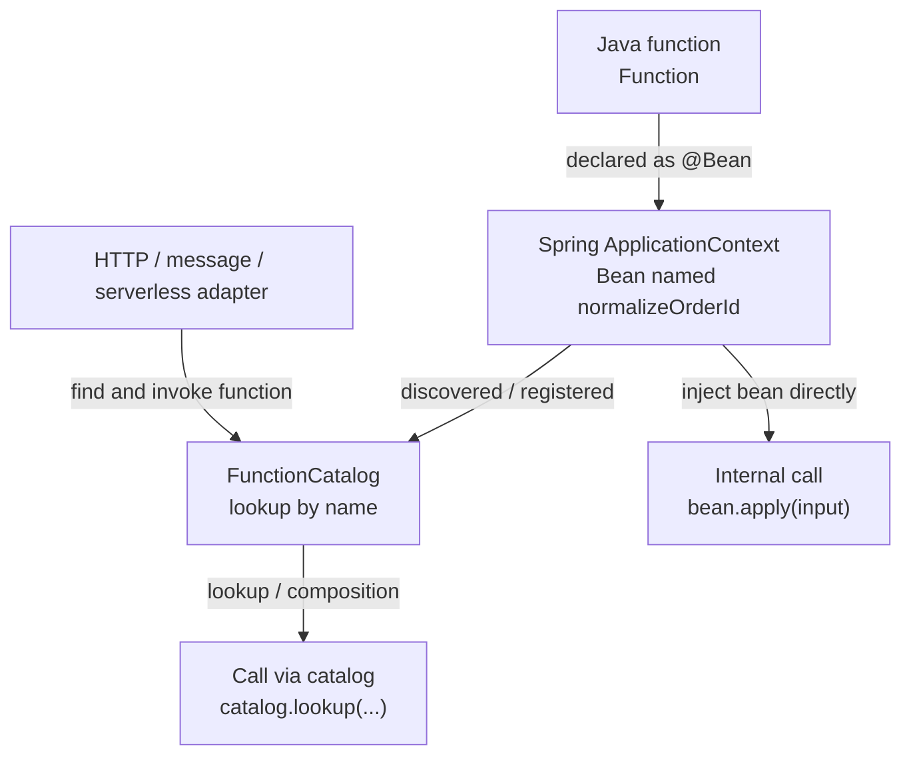

# Relationship Between Java Functions, Spring Beans, and Functions in FunctionCatalog

## 1. One Logic, Three Perspectives

When building applications with **Spring Cloud Function** (`SPRING_CLOUD_FUNCTION`), developers often hear three ways of describing the same thing:

1. "I write a **Java function** of type `Function<String, String>`."
2. "I register that function as a **Spring bean** with `@Bean`."
3. "I retrieve the function from **`FunctionCatalog`** to invoke it by name."

These three statements describe **three related roles**, not three separate business implementations. The processing core can still be the exact same lambda, while how it is managed and accessed differs.

Suppose a business rule requires normalizing an order ID: trimming leading/trailing whitespace and converting letters to lowercase. This rule can be used when receiving an HTTP request, an order event, or a direct Java call. To reuse the same rule without forcing it to know about HTTP, Kafka, or a serverless runtime, you need to understand where the logic is defined and where it is "exposed" to the caller.



**Core point:** `FunctionCatalog` is not a new business data type. It is **the mechanism for registering and looking up functions**, while also supporting capabilities such as composition and type adaptation depending on the context.

## 2. First Layer: Plain Java Functions

Java provides functional interfaces in `java.util.function`:

| Interface | Invocation | Result | Example |
| --- | --- | --- | --- |
| `Supplier<T>` | `get()` | Produces a value `T`, taking no parameters. | Retrieving the current policy version. |
| `Function<T, R>` | `apply(T)` | Returns a value `R` from input data `T`. | Normalizing an order ID. |
| `Consumer<T>` | `accept(T)` | Returns no value; typically performs a side effect. | Logging a processing decision. |

Plain Java example, without Spring:

```java
import java.util.Locale;
import java.util.function.Function;

Function<String, String> normalizeOrderId =
        input -> input.trim().toLowerCase(Locale.ROOT);

String result = normalizeOrderId.apply("  ORDER-42  ");
System.out.println(result); // order-42
```

Here:

- `normalizeOrderId` is just an object implementing the `Function` interface, created from a lambda.
- `apply()` executes the logic directly inside the Java application.
- No function name in `FunctionCatalog`, Spring bean, HTTP endpoint, or message binding exists from the snippet above alone.
- You can pass `normalizeOrderId` to another method or unit test it without starting Spring.

A `Function` **is not inherently a pure function** in the mathematical sense: a lambda can still read shared state, query a database, or call an API. Protocol independence comes from **how inputs, outputs, and dependencies are designed**, not merely from choosing the `Function` interface.

## 3. Second Layer: Registering a Java Function as a Spring Bean

A Spring bean is an object managed by the **Spring ApplicationContext**. When you declare a `@Bean` method returning a `Function`, Spring creates the bean and places it into the container. The Java function still uses `apply()`, but now it has a name and participates in Spring's dependency injection, configuration, scope, and lifecycle mechanisms.

Minimal example:

```java
import java.util.Locale;
import java.util.function.Function;
import org.springframework.context.annotation.Bean;
import org.springframework.context.annotation.Configuration;

@Configuration
public class OrderFunctionConfig {
    @Bean
    Function<String, String> normalizeOrderId() {
        return input -> input.trim().toLowerCase(Locale.ROOT);
    }
}
```

Once the application builds the ApplicationContext, the bean typically has the name `normalizeOrderId` — matching the `@Bean` method name. Another Spring component can inject it:

```java
import java.util.function.Function;
import org.springframework.beans.factory.annotation.Qualifier;
import org.springframework.stereotype.Service;

@Service
public class OrderService {
    private final Function<String, String> normalize;

    public OrderService(
            @Qualifier("normalizeOrderId")
            Function<String, String> normalize) {
        this.normalize = normalize;
    }

    public String acceptOrderId(String rawId) {
        return normalize.apply(rawId);
    }
}
```

At this point, calling `normalize.apply(rawId)` is still **a normal Java method call**. Spring helps locate and provide the `Function` object without changing the normalization rule itself.

If there are multiple beans of type `Function<String, String>`, injecting by type alone can be ambiguous. `@Qualifier("normalizeOrderId")` specifies which bean to inject. You can assign a custom name with `@Bean("publicFunctionName")`; in that case, integration configuration and lookups must use that exact registered name.

**Important distinction:** Spring can manage many ordinary beans, such as repositories, services, or controllers. Not every bean appears as a business function in `FunctionCatalog`; catalog registration focuses on function definitions recognized by the framework or registered explicitly.

## 4. Third Layer: FunctionCatalog Provides Naming and a Unified Entry Point

`FunctionCatalog` is in the package `org.springframework.cloud.function.context.FunctionCatalog`. For function beans recognized by Spring Cloud Function, the catalog enables:

- **Lookup by name:** `catalog.lookup("normalizeOrderId")`.
- **Lookup of composition expressions:** `catalog.lookup("normalizeOrderId|addOrderPrefix")`.
- **Invocation adaptation within Spring Cloud Function:** returned functions can be wrapped by the framework to support type conversion, message handling, and composition.
- **Integration point for adapters:** an HTTP adapter, Spring Cloud Stream, or a serverless runtime adapter can select a function by name/configuration and invoke it.

Example when `FunctionCatalog catalog` is injected:

```java
Function<String, String> function =
        catalog.lookup("normalizeOrderId");

if (function == null) {
    throw new IllegalStateException("Function not registered");
}

String result = function.apply("  ORDER-42  ");
// result = "order-42"
```

How to interpret the result of `lookup()` accurately:

- In **business terms**, it is the logic of the registered function.
- As a **Java object**, the lookup result **must not be assumed to be the exact same instance** as the original bean; the framework may return a wrapper prepared for data conversion and composition.
- In terms of **types**, the generic type in the example helps the compiler express what the author expects; it does not automatically validate payload contents at runtime.
- If the function name is wrong or the definition cannot be resolved, you should not proceed to call `apply()`; handle the missing/lookup-failure case properly.

You can compare them as follows:

| Question | Spring bean | FunctionCatalog |
| --- | --- | --- |
| How is this function managed by the container? | ApplicationContext manages lifecycle and dependencies. | Relies on registered functions; does not replace the container. |
| How do I retrieve the function? | Inject by name/type or `ApplicationContext.getBean(...)`. | `lookup("functionName")` or a composition expression. |
| How do I invoke the business logic? | `bean.apply(input)`. | `catalog.lookup(...).apply(input)` after lookup. |
| Can I compose functions by name? | Can write `andThen()` or `compose()` in Java. | Can use the expression `functionA|functionB`. |
| Does it support HTTP/Kafka automatically? | Not automatically just by being a bean. | Acts as the entry point used by adapters; adapters still must be added and configured. |

## 5. Complete Example: Comparing Both Invocation Styles in One Application

The example below uses Spring Boot, Spring Cloud Function, and Java 17 or later. With Maven, one option for an application with an HTTP adapter is:

```xml
<dependency>
    <groupId>org.springframework.cloud</groupId>
    <artifactId>spring-cloud-starter-function-web</artifactId>
</dependency>
```

The application must manage Spring Cloud versions using a BOM **compatible with the Spring Boot version** in use. The starter above brings in the components needed for `FunctionCatalog` and the HTTP adapter; if the application only needs internal function lookup, you can choose the appropriate Spring Cloud Function dependency without the web starter.

An illustrative `FunctionCatalogDemoApplication.java` file:

```java
import java.util.Locale;
import java.util.function.Consumer;
import java.util.function.Function;
import java.util.function.Supplier;

import org.springframework.beans.factory.annotation.Qualifier;
import org.springframework.boot.ApplicationRunner;
import org.springframework.boot.SpringApplication;
import org.springframework.boot.autoconfigure.SpringBootApplication;
import org.springframework.cloud.function.context.FunctionCatalog;
import org.springframework.context.annotation.Bean;

@SpringBootApplication
public class FunctionCatalogDemoApplication {

    public static void main(String[] args) {
        SpringApplication.run(
                FunctionCatalogDemoApplication.class, args);
    }

    @Bean
    Function<String, String> normalizeOrderId() {
        return input -> input.trim().toLowerCase(Locale.ROOT);
    }

    @Bean
    Function<String, String> addOrderPrefix() {
        return id -> "order:" + id;
    }

    @Bean
    Supplier<String> policyVersion() {
        return () -> "order-policy-v1";
    }

    @Bean
    Consumer<String> auditOrderId() {
        return id -> System.out.println("AUDIT: " + id);
    }

    @Bean
    ApplicationRunner compareWaysToInvoke(
            @Qualifier("normalizeOrderId")
            Function<String, String> bean,
            FunctionCatalog catalog) {

        return arguments -> {
            String input = "  ORDER-42  ";

            // Option 1: inject and invoke the Spring bean directly.
            String directResult = bean.apply(input);

            // Option 2: look up by name and invoke through the catalog.
            Function<String, String> registered =
                    catalog.lookup("normalizeOrderId");
            if (registered == null) {
                throw new IllegalStateException(
                        "Missing function: normalizeOrderId");
            }
            String catalogResult = registered.apply(input);

            // Option 3: retrieve a composed function from two beans.
            Function<String, String> pipeline =
                    catalog.lookup(
                            "normalizeOrderId|addOrderPrefix");
            if (pipeline == null) {
                throw new IllegalStateException(
                        "Missing composed function");
            }
            String composedResult = pipeline.apply(input);

            System.out.println("Direct : " + directResult);
            System.out.println("Catalog: " + catalogResult);
            System.out.println("Compose: " + composedResult);
        };
    }
}
```

Once the ApplicationContext initializes successfully, the `ApplicationRunner` output demonstrates the results:

```text
Direct : order-42
Catalog: order-42
Compose: order:order-42
```

The output shows that **the exact same normalization rule** is invoked both directly and through the catalog. Only the third call adds the `addOrderPrefix` step, because the catalog looks up the composition expression. This is composition in action; it does not mean Spring duplicated the normalization logic.

For `Supplier` and `Consumer`, lookup works similarly, except the invocation methods are `get()` and `accept()`:

```java
Supplier<String> version = catalog.lookup("policyVersion");
Consumer<String> audit = catalog.lookup("auditOrderId");

if (version != null && audit != null) {
    System.out.println(version.get());
    audit.accept("order-42");
}
```

Thus, `FunctionCatalog` serves as a common entry point for all three types: `Supplier`, `Function`, and `Consumer`.

## 6. Why Keep Generic Type Information?

`Function<String, String>` specifies the function's input and output types. With complex objects, for example:

```java
public record OrderRequest(String orderId, long amount) {}
public record OrderDecision(String orderId, boolean approved) {}

@Bean
Function<OrderRequest, OrderDecision> decideOrder() {
    return request -> new OrderDecision(
            request.orderId(), request.amount() > 0);
}
```

This declaration clearly states the **business payload types**. When calling directly, the caller must supply an `OrderRequest`:

```java
OrderDecision decision = decideOrder().apply(
        new OrderRequest("ORDER-42", 500_000L));
```

When an HTTP or messaging adapter receives data such as JSON, the framework can use the registered type metadata and appropriate converters to construct an `OrderRequest` before invoking the function. Each conversion also depends on content type, configuration, supporting libraries, and the message format provided.

This **does not mean** you can pass any raw JSON string directly into `FunctionCatalog.lookup(...).apply(...)` and expect it to be converted automatically. Direct Java calls, catalog wrappers, and HTTP/messaging adapters have different data entry points.

Avoid declaring beans with overly generic raw types, such as:

```java
// Avoid when the framework needs to infer specific payload types:
@Bean
Function rawFunction() {
    return value -> value;
}
```

A raw `Function` return type loses generic information essential for input/output type inference. Prefer full types like `Function<OrderRequest, OrderDecision>`. For dynamically registered functions or hard-to-infer types, Spring Cloud Function also provides explicit registration mechanisms to supply type metadata; the specific API depends on the version in use.

## 7. Composition Connects Function Names to Data Flows

Java has `Function.andThen()` to chain two `Function` instances:

```java
Function<String, String> normalize =
        value -> value.trim().toLowerCase(Locale.ROOT);
Function<String, String> prefix =
        value -> "order:" + value;

Function<String, String> javaPipeline =
        normalize.andThen(prefix);

String result = javaPipeline.apply("  ORDER-42  ");
// "order:order-42"
```

In Spring Cloud Function, you can express the same order **using registered bean names**:

```text
normalizeOrderId|addOrderPrefix
```

At that point, `catalog.lookup("normalizeOrderId|addOrderPrefix")` creates an invocation handle for the corresponding pipeline. The expression reads **from left to right**: the output of the first function becomes the input of the next. Types must be compatible — for example, `Function<A, B>` composed with `Function<B, C>` forms an `A -> B -> C` flow.

For adapters that support selecting functions via configuration, you can declare:

```yaml
spring:
  cloud:
    function:
      definition: "normalizeOrderId|addOrderPrefix"
```

The `spring.cloud.function.definition` property specifies the function name or expression that the adapter/binding should use. It **does not automatically turn** beans into a Kafka listener, an HTTP server, or a serverless trigger. Protocol integration still requires dedicated dependencies and environment configuration.

Furthermore, configuring a function selection does not remove all other beans from the Spring context; the catalog and application can still hold many functions serving different purposes.

## 8. Role of Message and Data Conversion

The **Spring Cloud Function** model aims for logic reuse via `Supplier`, `Function`, and `Consumer` across multiple invocation environments. This reuse relies on separating the *business payload* from *transport metadata*.

For example, a function:

```java
Function<OrderRequest, OrderDecision>
```

cares only about the order structure. If you need to process headers, correlation IDs, or message metadata, an alternative signature is:

```java
Function<Message<OrderRequest>, Message<OrderDecision>>
```

`Message<T>` is a type from `org.springframework.messaging` containing a payload and headers. When an adapter has sufficient type information and an appropriate converter, it can help construct data matching the contract declared by the function. When using `Message`, the function author must decide which headers to keep, copy, or create; never assume every HTTP or broker metadata header will automatically exist in another invocation environment.

Practical division of responsibilities:

| Task | Typical Place of Execution |
| --- | --- |
| Normalizing `orderId`, checking limits | Business function. |
| Managing beans, injecting dependencies | Spring ApplicationContext. |
| Looking up functions by name, composition, preparing wrappers | Spring Cloud Function and `FunctionCatalog`. |
| Receiving HTTP requests, mapping bodies, returning HTTP responses | HTTP adapter. |
| Subscribing to/publishing on Kafka or RabbitMQ | Spring Cloud Stream and binder/binding. |
| Receiving events sent by a serverless platform | Runtime-specific adapter and configuration. |

## 9. Call the Bean Directly or Through FunctionCatalog?

**Calling a Spring bean directly** fits when a Java component already knows the exact dependency it needs, wants compiler-checked types, and wants a simple internal call flow. For instance, `OrderService` simply injects `normalizeOrderId` and calls `apply()`; there is no need to look up by name on every call.

**Calling through `FunctionCatalog`** fits when the caller receives a *function name* from configuration, wants to compose pipelines via expressions, or is building/using an adapter connecting HTTP, event systems, or serverless runtimes to registered functions. The catalog avoids writing a custom `Map<String, Function<?, ?>>`, though transport dependencies still must be configured.

| Scenario | Usually Suitable Approach | Reason |
| --- | --- | --- |
| A Java service always uses a fixed normalization rule | Inject the `Function` bean | Clear dependency, minimal configuration. |
| An adapter selects behavior by name from configuration | `FunctionCatalog.lookup(name)` | Determines the invoked function at runtime. |
| Need to chain two business steps by name | Catalog composition | Adjusts the processing pipeline via controlled expressions. |
| Java code wants to chain two existing `Function` instances | `andThen()` | No need to depend on the catalog for local calls. |
| Need to process Kafka events | Function + catalog + Spring Cloud Stream binder | The catalog supplies the function; the binder handles the messaging system. |

When calling the catalog dynamically by name, allow only trusted and controlled names or pipelines; never take an arbitrary function name supplied by a client and execute it unchecked. A function with side effects could alter data if invoked in the wrong context.

## 10. Common Conceptual and Technical Mistakes

1. **Confusing "declared a lambda" with "registered a Spring bean":** a lambda created inside a local Java method cannot yet be looked up by name in the catalog.
2. **Confusing "have a Spring bean" with "exposed over HTTP":** the appropriate adapter, dependencies, and configuration must exist; not every bean is an HTTP endpoint.
3. **Renaming a `@Bean` but forgetting to update configuration:** lookups and compositions reference the registered name and may fail to find the function.
4. **Using a raw `Function` type:** strips generic metadata, making input/output conversion hard to determine or causing it to fail.
5. **Assuming the bean and the lookup result are the same object:** the catalog may return a wrapper; test behavior rather than using reference comparison with `==`.
6. **Composing functions with incompatible types:** the previous step's output does not match the next step's input, requiring a contract redesign.
7. **Confusing function selection configuration with event-processing guarantees:** brokers can redeliver messages; transactions, retries, idempotency, and errors must be handled in the integration/application layer.
8. **Assuming function beans are stateless:** beans usually have singleton scope; a lambda holding mutable state can hit bugs under concurrent requests. Prefer stateless functions and design for concurrency when state is needed.
9. **Putting `@Transactional` on a `@Bean` factory method and thinking every `apply()` call is wrapped in a transaction:** metadata on the bean factory method does not automatically guarantee transactions when the lambda executes; place transaction boundaries on the service/proxy actually executing the business logic and verify the behavior.

## 11. Testing Each Boundary Properly

You should verify two separate concerns:

**Is the Java logic correct?** Instantiate the `Function` and call `apply()`, without needing an HTTP server or broker:

```java
Function<String, String> function =
        new FunctionCatalogDemoApplication().normalizeOrderId();

String actual = function.apply("  ORDER-42  ");
// assertEquals("order-42", actual);
```

**Does Spring register and resolve the function name properly?** In an integration test that starts the Spring context, inject `FunctionCatalog`, call `lookup("normalizeOrderId")`, and verify the output. Also test the `normalizeOrderId|addOrderPrefix` composition. If integrating HTTP or Stream, test JSON/message conversion, function selection, binding configuration, and error handling separately.

A quick design checklist for every function:

- **Java:** What are the input/output signatures, and does the logic handle boundary data properly?
- **Spring:** What is the bean name, which dependencies are injected, and does the bean hold state?
- **Catalog:** What name is looked up, is there composition, and is the type metadata sufficient?
- **Adapter:** How is data received/converted/responded to, and who manages retries or operational errors?

When you distinguish these four questions, you can write **reusable business logic** in Java, let Spring manage it as a bean, and expose that same logic through `FunctionCatalog` for HTTP, event, or serverless invocations without mixing transport details into business rules.
