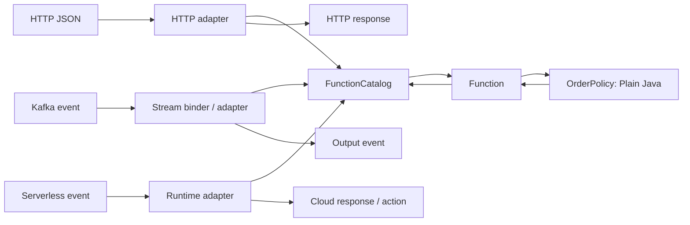

# Decoupling Business Logic from Transport Protocols and Execution Runtimes

## 1. The Problem: One Rule, Many Invocation Points

An order-processing system has a rule: grant preliminary approval only to orders with a valid ID and an amount greater than 0 and not exceeding 1,000,000 VND. Initially, the application receives orders over HTTP. As traffic grows, another system publishes events through Kafka. Later, the operations team wants to run the same rule in a serverless environment.

If the rule is written directly inside a `@RestController`:

```java
@PostMapping("/orders/validate")
public ResponseEntity<?> validate(@RequestBody OrderRequest request) {
    // Check order ID and amount and decide right here.
    // The rule depends on the controller, HTTP response, and request intake.
    ...
}
```

then when event consumption is needed, a developer can easily copy-paste the `if/else` block into a Kafka listener. When the approval policy changes, the two paths risk producing different results. The flaw lies in **where the rule is placed**: business logic is mixed with code that receives and returns data over a specific protocol.

In the **Spring Cloud Function** (`SPRING_CLOUD_FUNCTION`) module, the goal is to develop reusable logic with `Supplier`, `Function`, and `Consumer`, independent of the calling protocol; use `FunctionCatalog` and composition when needed; and deploy the same function over HTTP, events, or serverless environments. To achieve this, you need to separate three questions:

1. **Business logic:** "Given an order, what is the preliminary approval decision?"
2. **Data transport:** "Does the data arrive via an HTTP body, a Kafka message, or a cloud event?"
3. **Execution:** "Who starts the application, triggers the function, manages runtime execution, and handles errors?"

The rule should answer the first question; adapters and runtimes handle the other two.

## 2. Distinguishing Business Logic, Protocols, and Execution Runtimes

| Layer | Primary Responsibility | Example | Expected Stability |
| --- | --- | --- | --- |
| **Business logic (domain / use case)** | Determines decisions and rules over data meaningful to the business. | Amount checks, order classification, risk scoring. | Remains unchanged when only transport/delivery changes. |
| **Data contract** | Represents business inputs and results with explicit types. | `OrderRequest`, `OrderDecision`. | Evolves in a controlled way when business rules or schemas change. |
| **Protocol adapter** | Reads external data, converts types, selects a function, and builds protocol responses. | HTTP adapter, Spring Cloud Stream + Kafka binder. | Varies independently per protocol. |
| **Runtime / execution platform** | Starts up, allocates resources, invokes handlers, and manages execution time and limits. | Spring Boot process, container, AWS Lambda, or another serverless runtime. | Swappable without changing the business algorithm, as long as the contract still fits. |

**Decoupling from protocols does not mean the application uses no protocols.** You still need something to receive requests or events. What is decoupled is **the decision-making logic**, which does not directly depend on `HttpServletRequest`, `ResponseEntity`, Kafka offsets, or cloud-provider-specific event types.

**Decoupling from runtimes also does not mean there are no operational constraints.** Serverless has execution time and resource limits; event streams have retries and redelivery; HTTP has timeouts and status codes. You keep the core logic stable while designing the integration layer so these differences are handled in the right place.

## 3. Recommended Architecture: Business Core and Adapters



The arrows connecting adapters to `FunctionCatalog` represent **function selection and invocation**; the arrows between `Function` and `OrderPolicy` represent rule execution. The resulting output is transformed by each adapter into an appropriate response or message. The diagram illustrates deployment modes that **substitute for each other** or coexist when the application is properly configured; it does not imply that HTTP, Kafka, and serverless are enabled automatically by a single bean.

A clean way to organize it is:

```text
Business model:
    OrderRequest  ──>  OrderPolicy  ──>  OrderDecision

Spring layer:
    @Bean Function<OrderRequest, OrderDecision> evaluateOrder

Application boundary:
    HTTP adapter | Stream binder | Serverless adapter
```

The business core is used via plain Java types and methods; the Spring layer turns that core into a named function so adapters can look it up consistently.

## 4. Step 1: Define a Protocol-Independent Business Contract

Place the input type, result type, and rule set in the Java core. For example, an `OrderPolicy.java` file:

```java
package example.orders;

import java.math.BigDecimal;
import java.util.Objects;

public final class OrderPolicy {

    public record OrderRequest(
            String orderId,
            BigDecimal totalVnd) {}

    public record OrderDecision(
            String orderId,
            boolean approved,
            String reason) {}

    private static final BigDecimal MAX_TOTAL =
            new BigDecimal("1000000");

    public OrderDecision evaluate(OrderRequest request) {
        Objects.requireNonNull(request, "request");

        if (request.orderId() == null ||
                request.orderId().isBlank()) {
            return new OrderDecision(
                    request.orderId(), false, "MISSING_ORDER_ID");
        }

        BigDecimal total = request.totalVnd();
        if (total == null || total.signum() <= 0) {
            return new OrderDecision(
                    request.orderId(), false, "INVALID_AMOUNT");
        }

        if (total.compareTo(MAX_TOTAL) > 0) {
            return new OrderDecision(
                    request.orderId(), false, "LIMIT_EXCEEDED");
        }

        return new OrderDecision(
                request.orderId(), true, "APPROVED");
    }
}
```

With this rule:

- `OrderRequest` and `OrderDecision` hold business-meaningful information: order ID, total amount, decision result, and reason.
- There are no HTTP request parameters, Kafka headers, or cloud context objects.
- `OrderPolicy.evaluate()` does not access the network, a database, or shared mutable state; given the same input, it returns the same output. This style makes testing and message redelivery simpler.
- `BigDecimal` is better suited for monetary comparisons than binary floating-point numbers. The example assumes `totalVnd` is expressed in VND and that rounding rules are agreed upon by the data producer.
- `reason` is a stable business decision code; each adapter can map this code into details suited to its protocol.

Invoke directly in Java to verify:

```java
import java.math.BigDecimal;
import example.orders.OrderPolicy;

var policy = new OrderPolicy();
var request = new OrderPolicy.OrderRequest(
        "OD-42", new BigDecimal("850000"));

OrderPolicy.OrderDecision result = policy.evaluate(request);
// result = OrderDecision("OD-42", true, "APPROVED")
```

No Spring, HTTP server, or Kafka is required to verify the rule above. That is the first benefit of separating business logic.

## 5. Step 2: Register the Java Core as a Spring Cloud Function

Spring Cloud Function builds on the interfaces in `java.util.function`. For a "receive request -> compute decision" case, `Function<T, R>` is the natural fit.

Add `OrderFunctions.java`:

```java
package example.orders;

import java.util.function.Function;

import org.springframework.context.annotation.Bean;
import org.springframework.context.annotation.Configuration;

import example.orders.OrderPolicy.OrderRequest;
import example.orders.OrderPolicy.OrderDecision;

@Configuration
public class OrderFunctions {

    @Bean
    OrderPolicy orderPolicy() {
        return new OrderPolicy();
    }

    @Bean
    Function<OrderRequest, OrderDecision> evaluateOrder(
            OrderPolicy policy) {
        return policy::evaluate;
    }
}
```

A standard Spring Boot application can start with:

```java
package example.orders;

import org.springframework.boot.SpringApplication;
import org.springframework.boot.autoconfigure.SpringBootApplication;

@SpringBootApplication
public class OrderApplication {
    public static void main(String[] args) {
        SpringApplication.run(OrderApplication.class, args);
    }
}
```

Notable detail: the `evaluateOrder` bean simply **delegates** computation to `OrderPolicy`. The default bean name is `evaluateOrder`, which `FunctionCatalog` and adapters can use to locate the function:

```java
import java.util.function.Function;
import org.springframework.cloud.function.context.FunctionCatalog;

// catalog is injected by Spring; snippet illustrates an internal call.
Function<OrderPolicy.OrderRequest, OrderPolicy.OrderDecision> fn =
        catalog.lookup("evaluateOrder");

if (fn == null) {
    throw new IllegalStateException("evaluateOrder not registered");
}

var decision = fn.apply(
        new OrderPolicy.OrderRequest(
                "OD-42", new BigDecimal("850000")));
```

`FunctionCatalog` helps adapters or application components find functions by name and supports features such as composition, message handling, and type conversion in the appropriate context. The catalog may return a wrapper around the function; do not rely on the assumption that the looked-up object is the exact original bean instance.

The `OrderPolicy` business class does not need to import Spring Cloud Function libraries. If the delivery mechanism changes, you only swap dependencies, configuration, or adapters at the application boundary.

## 6. Step 3A: Expose the Function over HTTP

When HTTP is needed, add the Maven dependency:

```xml
<dependency>
    <groupId>org.springframework.cloud</groupId>
    <artifactId>spring-cloud-starter-function-web</artifactId>
</dependency>
```

The application must use compatible Spring Boot and Spring Cloud versions, managed via an appropriate BOM. When the HTTP adapter runs on port 8080, the function name can be used as the path. Example:

```bash
curl -X POST http://localhost:8080/evaluateOrder \
  -H "Content-Type: application/json" \
  -d '{"orderId":"OD-42","totalVnd":850000}'
```

Expected business result:

```json
{
  "orderId": "OD-42",
  "approved": true,
  "reason": "APPROVED"
}
```

On the HTTP path, the adapter handles URLs, HTTP methods, content types, JSON parsing, and writing the response. It converts the payload to `OrderRequest`, invokes `evaluateOrder`, and converts `OrderDecision` into response data. `OrderPolicy` never decides HTTP status codes 200, 400, or 500.

**Distinguishing business errors from protocol errors:** An order whose amount exceeds the limit receives `approved=false` with `reason=LIMIT_EXCEEDED` from the rule; that is a **valid business outcome**. Malformed JSON, by contrast, is an HTTP input error that the adapter must handle according to the API contract. Depending on product requirements, an application may need a custom HTTP layer to map decisions to different status codes, while keeping the evaluation rule untouched.

## 7. Step 3B: Process the Same Function via Events

Suppose another service publishes order events to the Kafka topic `orders-submitted`. We want to apply the exact same `evaluateOrder` rule and publish results to the `orders-decided` topic.

With **Spring Cloud Stream**, you need the corresponding binder dependency, such as `org.springframework.cloud:spring-cloud-stream-binder-kafka` (and compatible Spring Cloud Stream dependencies). Using the functional binding model, an illustrative configuration is:

```yaml
spring:
  cloud:
    function:
      definition: evaluateOrder
    stream:
      bindings:
        evaluateOrder-in-0:
          destination: orders-submitted
          group: order-policy
          content-type: application/json
        evaluateOrder-out-0:
          destination: orders-decided
          content-type: application/json
      kafka:
        binder:
          brokers: localhost:9092
```

Meaning:

- `spring.cloud.function.definition` selects the `evaluateOrder` function for binding use.
- `evaluateOrder-in-0` is the first input binding of the function; the consumer reads events from `orders-submitted`.
- `evaluateOrder-out-0` is the first output binding; the `OrderDecision` result is routed to `orders-decided`.
- `group` sets the consumer group on the receiving side to coordinate message consumption.
- The Kafka binder handles broker connectivity, deserialization/message conversion, and forwarding output according to configuration.

The incoming event can carry a similar JSON payload:

```json
{
  "orderId": "OD-42",
  "totalVnd": 850000
}
```

When an appropriate converter is active, the payload becomes `OrderRequest`, the function computes `OrderDecision`, and the resulting data is sent to the output topic. **There is no need to rewrite the approval rule inside a Kafka listener.**

However, a message topic does not have the same semantics as HTTP:

- Event producers do not necessarily wait for a synchronous response.
- During error handling, the binder/broker may retry or route messages to a dead-letter destination depending on configuration.
- An event may be redelivered. If the business logic has side effects such as deducting inventory or recording a payment, you must handle **idempotency** and transaction boundaries at the appropriate place.
- Event ordering may depend on partitions, keys, and consumer setup; global ordering must not be assumed by default.

These responsibilities belong to the stream integration and operations layer. A `Function` does not automatically provide "exactly-once" guarantees simply by being registered in the catalog.

## 8. Step 3C: Deploy in a Serverless Environment

A serverless platform typically triggers a handler when an event arrives. The runtime has its own event format and response convention. Spring Cloud Function provides adapters tailored to specific environments; you must choose the dependency, handler, and packaging matching the actual platform.

The core of an adapter can be visualized with the following **pseudocode** (`decode` and `encode` represent runtime-specific data conversion, not specific Java APIs):

```text
handle(platformEvent):
    request = decode(platformEvent) -> OrderRequest
    function = FunctionCatalog.lookup("evaluateOrder")
    decision = function.apply(request)
    return encode(decision) -> platformResponse
```

The adapter defines the invocation entry point and handles the cloud event format. `OrderPolicy` continues to accept `OrderRequest` and return `OrderDecision` just as in HTTP and Kafka.

Items that still must be prepared specifically for serverless include a compatible Java runtime, adapter dependency, handler entry point, packaging, resource permissions, trigger configuration, memory configuration, timeouts, and error observability. If one deployment targets AWS Lambda, these pieces must follow AWS's contract; if using another runtime, packaging and handler contracts may differ.

Protocol-independent business logic **can be reused** on serverless; that does not mean a JAR file can run by itself on any cloud provider without configuration.

## 9. How Do Supplier, Function, and Consumer Affect Boundaries?

| Java Type | Logic Shape | Typical Trigger Point | What to Watch When Switching Environments |
| --- | --- | --- | --- |
| `Supplier<T>` | Takes no payload, returns data. | Read endpoint, poller, or event source. | `Supplier` does not schedule itself; the adapter/runtime decides when to call it. |
| `Function<T, R>` | Receives a request, returns a result. | HTTP request/response or input/output message. | HTTP returns synchronously; events usually produce an asynchronous output message. |
| `Consumer<T>` | Receives data, returns `void`. | Message sink, logging, or state updates. | Side effects require idempotency and error handling; there is no result payload to forward. |

If a use case naturally takes the shape "input -> decision", prefer `Function`. If a use case primarily writes data or emits commands, you can use `Consumer`, but be careful with transactions and redelivered events. For data sources requiring no input, `Supplier` is a better fit. Composition can chain type-compatible functions, for example:

```text
normalizeOrder | evaluateOrder
```

The condition is that the output of `normalizeOrder` must be compatible with the input of `evaluateOrder`. The `|` character specifies left-to-right composition in Spring Cloud Function; it does not automatically create brokers, endpoints, or schedulers.

## 10. Keep the Business Contract Independent Without Ignoring Metadata

To decouple protocols effectively, the incoming data must be a **clear domain contract**, not an "arbitrary object." Questions to resolve:

| Question | Illustrative Design |
| --- | --- |
| What unit is the amount in? | `totalVnd` is defined in VND, with agreed rounding rules. |
| Can the order ID be blank? | `MISSING_ORDER_ID` is returned by the rule. |
| How are rejection reasons represented? | Stable `reason` codes understood by both HTTP clients and event consumers. |
| What if the schema changes? | Manage payload versions and conversion rules at the system boundary. |
| Need a correlation ID or trace ID? | Read/write metadata in the adapter, or pass explicitly in the contract when business logic truly needs it. |
| Need a broker key, Kafka offset, or HTTP header? | Keep them in the transport layer unless they are genuine business data. |

If a function needs to handle message headers, Spring provides `org.springframework.messaging.Message<T>`, which carries a payload and headers:

```java
Function<Message<OrderRequest>, Message<OrderDecision>>
```

That signature is useful in messaging flows, though it ties the logic to Spring Messaging concepts. When the problem only needs business data, `Function<OrderRequest, OrderDecision>` is usually easier to reuse. Generic type information should be preserved in full so the framework knows the input/output payload types when a suitable converter is present.

**Not every conversion succeeds automatically.** Content type, conversion libraries, message headers, binder configuration, and Java data types determine how an adapter turns JSON or an event into an `OrderRequest`. Do not expect to pass an arbitrary JSON string into `apply()` and always receive a typed object.

## 11. Same Rule, Different Operational Semantics

| Aspect | HTTP | Event System | Serverless |
| --- | --- | --- | --- |
| **Trigger** | Client sends a request. | Broker delivers a message per subscription. | Platform invokes handler on trigger. |
| **Receiving Result** | Immediate response within the request upon success. | Typically an output message or side effect. | Response/action per runtime contract. |
| **Timeout** | Client, server, proxy, and gateway. | Consumer/binder, processing, and broker. | Runtime and trigger limits. |
| **Retry** | Client/API gateway may retry. | Redelivery/retry per policy. | Platform- and trigger-dependent retries. |
| **Data Errors** | Can return 4xx errors per API contract. | Can route to error stream, retry, or dead-letter. | Can return error response or trigger runtime retry. |
| **Observability** | Request ID, HTTP tracing, status code. | Message key, correlation ID, consumer lag, retries. | Invocation ID, logs/tracing, cold starts, timeouts. |

Each adapter must preserve the **semantics of its environment**, rather than forcing every call to behave like a "fake HTTP request." For instance, an `approved=false` result should not be confused with an exception that causes the broker to retry continuously. For unparseable payloads, errors can be handled at the boundary and sent to an error queue instead of turning a parse failure into a fake business decision.

## 12. Place Error Handling and Side Effects in the Right Layer

Scenarios can be grouped into three categories:

1. **Valid business outcome:** amount exceeds limit -> `OrderDecision(approved=false, reason=LIMIT_EXCEEDED)`. HTTP returns a business response; Stream may emit a rejection event; serverless produces a result per the trigger contract.
2. **Malformed input:** corrupted JSON, unconvertible to `OrderRequest`, or missing a critical field required by the adapter. You need validation and input error handling at the integration layer; only pass data into the domain once it is intelligible.
3. **System failures:** database unavailable, downstream API timeout, message send failure. These errors require appropriate retries, circuit breakers, transactions, or operational monitoring.

For **read-data -> return-decision** functions, reprocessing is generally safer when the function is stateless. When deducting inventory or processing payments:

- Use a business-linked idempotency key (such as a transaction ID) to prevent duplicate writes during retries.
- Define a valid transaction boundary for the database; remember Kafka and databases have separate guarantees and do not form a distributed transaction automatically.
- Separate computing the decision from executing side effects when doing so improves error control.
- Do not hold mutable state in a singleton `Function` bean without concurrency management.

Layer separation **does not eliminate** the need for authentication, authorization, schema validation, secret security, or logging. It places those responsibilities in the right layer so they can evolve independently.

## 13. Layered Testing to Verify True Decoupling

### 13.1. Unit Tests for Business Logic

Test `OrderPolicy` without starting Spring Boot. Example with JUnit Jupiter:

```java
package example.orders;

import static org.junit.jupiter.api.Assertions.assertEquals;
import static org.junit.jupiter.api.Assertions.assertFalse;
import static org.junit.jupiter.api.Assertions.assertTrue;

import java.math.BigDecimal;
import org.junit.jupiter.api.Test;

class OrderPolicyTest {
    private final OrderPolicy policy = new OrderPolicy();

    @Test
    void approvesValidOrder() {
        var decision = policy.evaluate(
                new OrderPolicy.OrderRequest(
                        "OD-42", new BigDecimal("850000")));

        assertTrue(decision.approved());
        assertEquals("APPROVED", decision.reason());
    }

    @Test
    void rejectsOrderAboveLimit() {
        var decision = policy.evaluate(
                new OrderPolicy.OrderRequest(
                        "OD-43", new BigDecimal("1000001")));

        assertFalse(decision.approved());
        assertEquals("LIMIT_EXCEEDED", decision.reason());
    }
}
```

Add boundary cases: exactly 1,000,000 VND, amount equal to 0, negative values, null total, blank order ID, and null request. Unit tests evaluate **only the business rules**.

### 13.2. Integration Tests for Spring and the Catalog

Start the Spring test context, inject `FunctionCatalog`, and verify you can `lookup("evaluateOrder")`, call it with `OrderRequest`, and receive the expected `OrderDecision`. This verifies the function is registered and resolved by Spring under the right name; it is distinct from plain Java unit testing.

### 13.3. Contract Tests per Adapter

- **HTTP:** JSON body converts to the right type; response preserves schema; bad requests, content types, and error codes match the API contract.
- **Kafka:** messages decode properly, input/output bindings target the right destinations; observe retries, dead-letter policies, and duplicate-event scenarios.
- **Serverless:** handler accepts the expected event format, triggers the right function, and returns responses matching the runtime contract; verify timeout settings and platform-handled errors.

If you only change adapter code, `OrderPolicy` unit tests should not need changes. If the limit rule changes, unit tests must reflect the new policy while contract tests confirm each environment still sends and receives data properly. That is a sign the architecture separates responsibilities well.

## 14. When Do You Need an Application Layer or Ports?

Not every business operation is a side-effect-free calculation. When a use case needs to query limits from a database or call a pricing service, you can introduce an **interface (port)** into the business/application layer and let an adapter provide the implementation:

```java
public interface LimitProvider {
    BigDecimal maxAmountFor(String customerId);
}

public final class ApprovalService {
    private final LimitProvider limits;

    public ApprovalService(LimitProvider limits) {
        this.limits = limits;
    }

    // Approval logic depends on the LimitProvider interface,
    // not on JDBC, HTTP clients, or cloud SDKs.
}
```

In this case, Spring can inject a `LimitProvider` implementation into the service, then register a `Function` that calls the service. The key is that dependencies point **from adapters toward the business contract**, avoiding HTTP/broker-specific APIs in the rule layer. If time, randomness, or configuration affects decisions, pass them through controllable dependencies (such as `Clock`) so tests remain predictable.

However, do not wrap every tiny function in multiple abstraction layers just because the framework allows it. For a simple transformation without I/O, a plain `Function` bean is enough. Introduce ports when they solve real dependencies.

## 15. Workflow for Applying This to a New Use Case

1. **Write the business description:** "What is the input, and which conditions produce which output?" Remove terms like HTTP, topic, or Lambda unless they are actual domain rules.
2. **Finalize input/output types:** specify field names, types, units, missing-value rules, rejection reasons, and schema versioning.
3. **Implement Java logic and unit tests:** start with `OrderPolicy.evaluate()`; test edge cases.
4. **Register the appropriate `Supplier`, `Function`, or `Consumer`:** assign a stable bean name; use `FunctionCatalog` and composition if name-based routing or chaining is needed.
5. **Choose an adapter per environment:** add the HTTP starter, Spring Cloud Stream binder, or serverless adapter, then configure the corresponding endpoint/topic/trigger.
6. **Design operational semantics:** handle validation, retries, idempotency, timeouts, transactions, authentication, and observability at the appropriate boundaries.
7. **Run integration tests:** verify the same business payload yields the same decision across every invocation path while testing protocol and runtime errors.

**Final check criterion:** If replacing HTTP with Kafka forces you to duplicate the limit-checking logic or import `KafkaHeaders` into `OrderPolicy`, the boundary is not clear enough. If you can reuse `OrderPolicy` and `evaluateOrder` and only add the appropriate adapter, contract, and deployment configuration, you have achieved the goal of **decoupling business logic from transport protocols and execution runtimes**.
