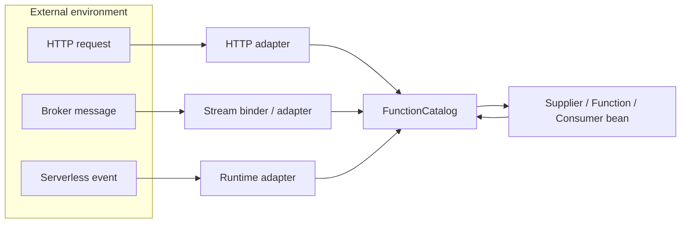

# Roles of Supplier, Function, Consumer, and Adapters

## 1. One Business Operation Can Be Triggered in Many Ways

Suppose a sales system performs three tasks:

1. Provides the current order-approval policy version.
2. Receives order details and returns a preliminary approval decision.
3. Records approval decisions for activity tracking.

These three tasks have different input and output shapes. The first **produces data**, the second **transforms data**, and the third **consumes data to perform an action**. They can be invoked from HTTP, an event system, or a serverless environment, while the business rules themselves do not need to know which protocol triggered them.

In the **Spring Cloud Function** (`SPRING_CLOUD_FUNCTION`) module, those three roles are represented by standard Java interfaces: `Supplier<T>`, `Function<T, R>`, and `Consumer<T>`. Spring Cloud Function registers and looks up functions via `FunctionCatalog`, supports composition, handles/converts messages, and connects to **adapters**. An adapter receives data from the external environment, triggers the right function, and routes the result where it needs to go.

To understand this model, you must distinguish **the invocation shape of a function** from **how the environment triggers it and transports data**.

## 2. Three Java Interfaces Expressing Three Responsibilities

All three interfaces live in the JDK's `java.util.function` package:

| Interface | Method | Input | Output | Common Role |
| --- | --- | --- | --- | --- |
| `Supplier<T>` | `T get()` | No payload parameter. | A value of type `T`. | Data source, reading a snapshot, emitting records periodically with a poller. |
| `Function<T, R>` | `R apply(T input)` | A value of type `T`. | A value of type `R`. | Transforming, normalizing, validating, computing, and making decisions. |
| `Consumer<T>` | `void accept(T input)` | A value of type `T`. | No return value. | Logging, persisting data, sending commands/notifications, or producing side effects. |

You can visualize the data flows as follows:

```text
Supplier<T>             Function<T, R>             Consumer<T>
     ┌─────────┐          ┌───────────┐            ┌───────────┐
     │  get()  │          │ apply(T)  │            │ accept(T) │
     └────┬────┘          └───────────┘            └───────────┘
          │               T ───▶ │ ───▶ R          T ───▶ │
          ▼
          T                                         (no R)
```

The `get()`, `apply()`, and `accept()` methods are **ordinary Java calls**. They do not send HTTP requests, register Kafka consumers, or create serverless triggers on their own.

Plain Java example:

```java
import java.util.Locale;
import java.util.function.Consumer;
import java.util.function.Function;
import java.util.function.Supplier;

Supplier<String> getPolicyVersion = () -> "policy-2026-11";

Function<String, String> normalizeOrderId =
        value -> value.trim().toLowerCase(Locale.ROOT);

Consumer<String> auditOrderId =
        value -> System.out.println("AUDIT: " + value);

String version = getPolicyVersion.get();
String orderId = normalizeOrderId.apply("  ORDER-42  ");
auditOrderId.accept(orderId);
```

This snippet uses pure Java interfaces. When you want Spring to manage them and adapters to find them, you register them as beans.

## 3. Supplier: A Function Acting as a Data Source

`Supplier<T>` is useful when an application needs to **generate or read a value without requiring an input parameter for the current call**.

Example policy-version provider:

```java
@Bean
Supplier<String> policyVersion() {
    return () -> "order-policy-v1";
}
```

Each time someone or an adapter calls `get()`, the function returns the string `order-policy-v1`. A supplier can also read data from an injected service, repository, or API; in that case, you must account for I/O errors, latency, and concurrent calls.

**Common mistake:** `Supplier` is not a scheduler. The function only defines *what to retrieve when called*; the adapter or caller decides *when to call it*.

| Context | How a `Supplier` May Be Triggered |
| --- | --- |
| Internal Java | A service calls `supplier.get()` whenever it needs the data. |
| HTTP | A client sends a request to the endpoint mapped to the supplier; the web adapter calls `get()`. |
| Spring Cloud Stream | A suitable poller invokes the supplier and publishes the result to the output binding. |
| Serverless | The runtime triggers a handler on an event; an adapter can invoke the supplier if that fits the handler contract. |

If a supplier publishes data to a message broker, you must choose the polling interval and emission rate deliberately. A supplier that generates a new transaction on every `get()` can create duplicate data if the adapter re-triggers it. If the goal is to read a snapshot, clarify whether each call returns a fresh snapshot or a cached one.

## 4. Function: A Transformation and Decision Function

`Function<T, R>` fits situations with a clear business input that require a definite output. This is the easiest shape to reuse across environments:

```java
@Bean
Function<String, String> normalizeOrderId() {
    return value -> value.trim()
            .toLowerCase(java.util.Locale.ROOT);
}
```

In real business logic, domain data types are typically used:

```java
public record OrderRequest(String orderId, BigDecimal totalVnd) {}
public record OrderDecision(
        String orderId, boolean approved, String reason) {}

@Bean
Function<OrderRequest, OrderDecision> decideOrder() {
    return request -> {
        boolean validId = request.orderId() != null
                && !request.orderId().isBlank();
        boolean validAmount = request.totalVnd() != null
                && request.totalVnd().signum() > 0
                && request.totalVnd().compareTo(
                        new BigDecimal("1000000")) <= 0;

        boolean approved = validId && validAmount;
        return new OrderDecision(
                request.orderId(),
                approved,
                approved ? "APPROVED" : "REJECTED");
    };
}
```

When invoked directly, `decideOrder.apply(request)` accepts an `OrderRequest` and returns an `OrderDecision`. When invoked via HTTP, the adapter receives JSON first and converts it to `OrderRequest`. When invoked from Kafka, the binder receives the message, decodes the payload, and invokes the same function; the result can then be published to a topic. The core `Function` keeps the exact same signature.

**A `Function` is not necessarily a pure function.** It can query a database, mutate state, or emit events. Even so, a `Function` that only computes and returns a result is generally easier to test, compose, and reprocess on duplicate message deliveries than one with many side effects.

## 5. Consumer: A Function That Consumes Data and Performs an Action

`Consumer<T>` fits when the business outcome of an operation is a **side effect**, such as writing an audit log, saving a record, or sending a notification:

```java
@Bean
Consumer<OrderDecision> auditDecision() {
    return decision -> System.out.printf(
            "AUDIT order=%s approved=%s reason=%s%n",
            decision.orderId(),
            decision.approved(),
            decision.reason());
}
```

The caller executes `auditDecision.accept(decision)` and receives no result object. This **does not mean the action always succeeds**: the function can still throw an exception, fail to write, or be invoked again. Each protocol and adapter has its own way of representing completion or failure.

Operational considerations:

- With Kafka or other brokers, a message can be redelivered after an error or consumer restart; side effects must be designed to be **idempotent** if writing or charging twice is unacceptable.
- When HTTP invokes a consumer, clients should not expect a decision JSON body from `accept()`. If the business logic needs to return a result, consider `Function<Request, Result>` or an appropriate API contract.
- If a consumer sends emails or calls external services, timeouts, retries, and failure monitoring must be defined; the `void` return type does not replace these policies.
- Logging only illustrates a side effect. For audit trails that require durable storage, use persistent storage and check for write errors accordingly.

## 6. What Does an Adapter Do?

In Spring Cloud Function, an **adapter** is the component connecting a function to an external trigger or platform. Its responsibilities fall into three parts:

1. **Receive and interpret input:** HTTP body, message payload, cloud event, or related metadata.
2. **Locate and invoke the function:** select a registered bean, usually through `FunctionCatalog`, then call `get()`, `apply()`, or `accept()` based on the function type.
3. **Deliver the result back to the environment:** return an HTTP response, publish an output message, or produce a response/action per the runtime's contract.



The diagram only illustrates the selection and invocation relationship; how responses, messages, and side effects are handled is governed by each adapter. **`FunctionCatalog` is not an HTTP server or a Kafka broker.** It is the function registry and lookup point, while adapters handle protocol connectivity.

Comparing specific roles:

| Component | What It Knows and Manages | What It Does Not Handle Automatically |
| --- | --- | --- |
| `Supplier` | How to retrieve or generate a value. | Polling schedule, endpoints, topic names. |
| `Function` | Rule transforming `T` to `R`. | HTTP status codes, broker offsets, cloud permissions. |
| `Consumer` | Action to perform with `T`. | Exactly-once message delivery guarantees, distributed transactions. |
| `FunctionCatalog` | Function list/names, lookups, composition, and framework adaptation. | Starting brokers or generating triggers for any runtime. |
| **Adapter** | Converting data and triggering functions for a protocol/runtime. | Deciding domain pass/fail rules already defined by the business core. |

In documentation, the word *adapter* is sometimes also used for internal framework wrappers, such as a wrapper supporting `Message` conversion. In this article, "protocol/runtime adapter" refers to components connecting to HTTP, Stream, and serverless environments.

## 7. Spring Boot Example: Three Clearly Named Functions

In a Spring Boot application with Java 17 or later and a compatible Spring Cloud version, you can declare all three functions:

```java
package example.functions;

import java.math.BigDecimal;
import java.util.function.Consumer;
import java.util.function.Function;
import java.util.function.Supplier;

import org.slf4j.Logger;
import org.slf4j.LoggerFactory;
import org.springframework.boot.SpringApplication;
import org.springframework.boot.autoconfigure.SpringBootApplication;
import org.springframework.context.annotation.Bean;

@SpringBootApplication
public class OrderFunctionsApplication {
    private static final Logger log =
            LoggerFactory.getLogger(OrderFunctionsApplication.class);
    private static final BigDecimal LIMIT =
            new BigDecimal("1000000");

    public static void main(String[] args) {
        SpringApplication.run(OrderFunctionsApplication.class, args);
    }

    public record PolicyInfo(String version, BigDecimal maxTotalVnd) {}
    public record OrderRequest(String orderId, BigDecimal totalVnd) {}
    public record OrderDecision(
            String orderId, boolean approved, String reason) {}

    @Bean
    Supplier<PolicyInfo> policyInfo() {
        return () -> new PolicyInfo("v1", LIMIT);
    }

    @Bean
    Function<OrderRequest, OrderDecision> decideOrder() {
        return request -> {
            boolean validId = request != null
                    && request.orderId() != null
                    && !request.orderId().isBlank();
            BigDecimal amount = request == null
                    ? null : request.totalVnd();
            boolean validAmount = amount != null
                    && amount.signum() > 0
                    && amount.compareTo(LIMIT) <= 0;
            boolean approved = validId && validAmount;
            return new OrderDecision(
                    request == null ? null : request.orderId(),
                    approved,
                    approved ? "APPROVED" : "REJECTED");
        };
    }

    @Bean
    Consumer<OrderDecision> auditDecision() {
        return decision -> log.info(
                "AUDIT orderId={}, approved={}, reason={}",
                decision.orderId(),
                decision.approved(),
                decision.reason());
    }
}
```

Each `@Bean` method creates a Spring function bean with default names `policyInfo`, `decideOrder`, and `auditDecision` respectively. Spring Cloud Function can discover and register these function beans in `FunctionCatalog`. **The function signatures remain pure JDK interfaces**; registering them with Spring does not turn the function bodies into HTTP- or Kafka-dependent code.

The condensed example above places all code in one class for readability. In larger applications, separate domain models, policies/services, and bean configuration classes. In particular, if an approval decision requires I/O or transactions, the logic can live in a service injected into the `@Bean Function`.

## 8. Looking Up and Invoking via FunctionCatalog

Once Spring Cloud Function is configured in the application, a Spring component can inject `org.springframework.cloud.function.context.FunctionCatalog` to select functions by name.

```java
// catalog has been injected by Spring; snippet illustrates usage inside a bean/service.
Supplier<OrderFunctionsApplication.PolicyInfo> supply =
        catalog.lookup("policyInfo");

Function<OrderFunctionsApplication.OrderRequest,
         OrderFunctionsApplication.OrderDecision> decide =
        catalog.lookup("decideOrder");

Consumer<OrderFunctionsApplication.OrderDecision> audit =
        catalog.lookup("auditDecision");

if (supply == null || decide == null || audit == null) {
    throw new IllegalStateException("Missing registered function");
}

var policy = supply.get();
var decision = decide.apply(
        new OrderFunctionsApplication.OrderRequest(
                "OD-42", new BigDecimal("800000")));
audit.accept(decision);
```

This snippet shows that the catalog does not erase the differences among the three function types: `get()` still takes no parameters, `apply()` still returns a result, and `accept()` still returns no business value.

The result of `lookup()` may be a framework-wrapped function rather than the exact original Spring bean instance. Generic types in code express the caller's expectations; you still need properly declared function types, configured converters, and runtime payload validation. If a lookup by a missing name returns `null`, handle the not-found case instead of invoking methods on `null`.

## 9. How Does the HTTP Adapter Trigger Each Function Type?

With Spring Boot, one way to provide an HTTP adapter is to add the `spring-cloud-starter-function-web` Maven dependency and a compatible Spring Cloud BOM:

```xml
<dependency>
    <groupId>org.springframework.cloud</groupId>
    <artifactId>spring-cloud-starter-function-web</artifactId>
</dependency>
```

With the application running on port 8080 and the HTTP adapter mapping by function name, illustrative calls are:

### 9.1. Supplier over HTTP

```bash
curl http://localhost:8080/policyInfo
```

Expected data result:

```json
{
  "version": "v1",
  "maxTotalVnd": 1000000
}
```

The HTTP adapter accepts no business payload for `Supplier.get()`. It triggers the function and converts `PolicyInfo` into an HTTP response according to the data conversion configuration.

### 9.2. Function over HTTP

```bash
curl -X POST http://localhost:8080/decideOrder \
  -H "Content-Type: application/json" \
  -d '{"orderId":"OD-42","totalVnd":800000}'
```

Expected business result:

```json
{
  "orderId": "OD-42",
  "approved": true,
  "reason": "APPROVED"
}
```

The HTTP adapter converts JSON into `OrderRequest`, calls `decideOrder.apply(request)`, and converts `OrderDecision` into the response. The logic does not need to accept `HttpServletRequest` or construct `ResponseEntity`.

### 9.3. Consumer over HTTP

```bash
curl -i -X POST http://localhost:8080/auditDecision \
  -H "Content-Type: application/json" \
  -d '{"orderId":"OD-42","approved":true,"reason":"APPROVED"}'
```

The adapter converts JSON into `OrderDecision` and triggers `auditDecision.accept(decision)`. Because `Consumer` returns `void`, there is no new `OrderDecision` body from the business logic; the exact HTTP status code and response body should be verified against the adapter, configuration, and version in use.

**API note:** An `approved=false` outcome is a valid business result, not automatically an HTTP 4xx error. Conversely, malformed JSON or an unsupported content type is an error at the data-ingestion layer. When strict HTTP status codes and error bodies are required, you can add a dedicated HTTP layer while still reusing the `Function` bean.

## 10. Messaging Adapters and Spring Cloud Stream

For Kafka or RabbitMQ, **Spring Cloud Stream** and its corresponding binder connect functional beans to message streams. Spring Cloud Function provides the function model; Spring Cloud Stream and the binder provide bindings and broker communication.

### 10.1. Function: Input and Output

Example using the Kafka binder and selecting `decideOrder` via configuration:

```yaml
spring:
  cloud:
    function:
      definition: decideOrder
    stream:
      bindings:
        decideOrder-in-0:
          destination: orders-submitted
          group: order-policy
          content-type: application/json
        decideOrder-out-0:
          destination: orders-decided
          content-type: application/json
      kafka:
        binder:
          brokers: localhost:9092
```

The application also needs a compatible Kafka binder dependency, such as `org.springframework.cloud:spring-cloud-stream-binder-kafka`. Configuration breakdown:

- `decideOrder-in-0` is the first input binding; the broker delivers events from `orders-submitted`.
- `decideOrder-out-0` is the first output binding; the function result is sent to `orders-decided`.
- `group` is the consumer group on the receiving side, coordinating message consumption.
- Content types and converters convert payloads between JSON and Java types when properly configured.

When a message with payload `{"orderId":"OD-42","totalVnd":800000}` arrives, the binder/adapter converts the data into `OrderRequest` and calls `Function.apply()`. Then the `OrderDecision` output is converted into an outgoing message.

### 10.2. Supplier: A Polled Source Emitting Messages

If selecting `policyInfo` alone as a source:

```yaml
spring:
  cloud:
    function:
      definition: policyInfo
    stream:
      bindings:
        policyInfo-out-0:
          destination: policy-version-events
          content-type: application/json
      poller:
        fixed-delay: 5000
```

This is a separate example configuration **for a source application**, not meant to be used simultaneously with the `decideOrder` configuration above. Spring Cloud Stream's poller can trigger the supplier periodically; `fixed-delay` configures the interval between polls (in milliseconds). On each `get()` call, if the adapter forwards the result, the topic may receive a new message. The polling policy should be chosen based on actual needs and the Spring Cloud Stream version in use.

Because `policyInfo` in this example always returns the same data, every poll will likely emit duplicate values. For real event sources, you must determine when new events exist, apply duplicate control mechanisms, and avoid generating unwanted transactions simply because the supplier was polled again.

### 10.3. Consumer: The Sink of a Stream

If selecting `auditDecision` alone:

```yaml
spring:
  cloud:
    function:
      definition: auditDecision
    stream:
      bindings:
        auditDecision-in-0:
          destination: orders-decided
          group: audit-service
          content-type: application/json
```

The input binding converts messages to `OrderDecision`, then calls `Consumer.accept()`. Since the consumer returns no value, there is no `auditDecision-out-0` output binding for this signature. The outcome is a side effect (writing the audit), not an automatic output message.

**In an application with multiple function beans**, `spring.cloud.function.definition` chooses which function or expression the adapter should bind. Multiple definitions can be used depending on framework capabilities and configuration, with each binding clearly specified; the three YAML snippets here intentionally illustrate **three separate operating modes**.

## 11. Serverless Environments Use Dedicated Adapters

In a serverless model, the platform invokes a handler on a trigger: a gateway request, object storage event, queue, or other source. The adapter for that runtime reads the event, initializes or reuses the Spring context, looks up the function, and produces a result following the platform's contract.

Pseudocode describing the flow when a runtime uses `decideOrder`:

```text
handle(platformEvent):
    payload = decode(platformEvent) -> OrderRequest
    fn = functionCatalog.lookup("decideOrder")
    result = fn.apply(payload)
    return encode(result) -> platformResponse
```

`decode` and `encode` only represent the adapter's duties, **not fixed Spring Cloud Function API names**. For each platform, you need the appropriate adapter dependency, handler entry point, event types, packaging, permissions, trigger configuration, timeout, and memory settings.

The three function types can behave differently on serverless:

- `Supplier`: triggered by the runtime to fetch a value, if the handler/trigger supports calls without a business payload.
- `Function`: receives the converted payload and returns a result that the runtime can encode into a response or output data.
- `Consumer`: processes an event to produce a side effect with no business return value; the runtime determines success/failure acknowledgment per its contract.

Serverless does not inherently guarantee that an event is invoked only once. Asynchronous triggers or queues can retry; a consumer with side effects must implement idempotency and error tracking. Reuse lies in the **function logic**, not in sharing all cloud deployment details.

## 12. Message, Payload Conversion, and Metadata

When working with transport protocols, external inputs are usually not already typed Java objects. For example, a JSON request or JSON message must be converted into `OrderRequest` based on generic types, content type, and a compatible converter.

There are two ways to declare the function:

| Function Shape | When to Use | Consequence |
| --- | --- | --- |
| `Function<OrderRequest, OrderDecision>` | Logic only cares about domain data. | Keeps the function independent of message headers and easy to use over HTTP/events/serverless. |
| `Function<Message<OrderRequest>, Message<OrderDecision>>` | Need to read or create metadata such as correlation IDs or business headers. | The function sees the `org.springframework.messaging.Message` abstraction and must manage headers. |

`Message<T>` holds a payload and headers. Example of a function handling messages:

```java
import java.util.function.Function;
import org.springframework.messaging.Message;
import org.springframework.messaging.support.MessageBuilder;

@Bean
Function<Message<String>, Message<String>> tagOrderMessage() {
    return input -> MessageBuilder
            .withPayload("processed:" + input.getPayload())
            .copyHeaders(input.getHeaders())
            .setHeader("processedBy", "order-service")
            .build();
}
```

Using `Message` does not mean all headers in Kafka, HTTP, and a cloud platform will be identical. Certain headers may be mapped, altered, or absent depending on the adapter/binder. Rely only on headers truly needed by business logic; core domain data should live in a payload with an explicit contract.

**Preserve type information:** declaring `Function<OrderRequest, OrderDecision>` instead of raw `Function` helps the framework recognize input/output types for conversion. Even so, do not assume passing an arbitrary JSON string to `catalog.lookup(...).apply(...)` will always convert automatically into the right object: behavior also depends on wrappers, converters, and the specific invocation path.

## 13. Composition: Combining Function Roles

Spring Cloud Function can compose registered function beans using a function-name expression, for example:

```text
normalizeOrderId|addPrefix
```

When both beans have type `Function<String, String>`, evaluation proceeds from left to right. The output of the first function feeds into the second.

An order-processing pipeline could be designed as:

```text
Function<OrderRequest, OrderRequest> normalizeOrder
                     |
                     v
Function<OrderRequest, OrderDecision> decideOrder
                     |
                     v
Consumer<OrderDecision> auditDecision
```

The expression `normalizeOrder|decideOrder|auditDecision` (with those beans actually declared and type-compatible) ends in a consumer, so it produces no decision payload to forward after `auditDecision`. If the goal is to **publish results to Kafka**, you typically use a pipeline ending in a `Function`, such as `normalizeOrder|decideOrder`, and place the audit consumer in a separate stream subscribing to the output.

When composing functions, verify:

1. **Type compatibility:** the previous step's output must be a valid input for the next step.
2. **Output semantics:** ending with `Consumer` yields no return value; ending with `Function` can produce an output.
3. **Error handling:** a failure in one step can fail the entire pipeline; the adapter dictates retry behavior.
4. **Side effects:** if the pipeline is re-invoked, side effects can repeat.

A `Supplier` can start a pipeline since it needs no input payload, though **when it triggers is still decided by the adapter/poller**. Composition organizes logic; it does not create schedules or transport infrastructure.

## 14. Errors, Retries, and Concurrency: Who Is Responsible?

A function type describes the invocation shape, not the full behavior on failure.

| Scenario | Function's Responsibility | Typical Adapter / System Responsibility |
| --- | --- | --- |
| Business-invalid data | Return a rejection decision or domain error per contract. | Translate the outcome to an HTTP response or message. |
| Malformed JSON | No valid domain payload exists to evaluate yet. | Handle parse/conversion errors, return an error, or route to an error stream. |
| Function throws an exception | Signal an unhandled error or system dependency failure. | Retry, acknowledge message, dead-letter, HTTP status code, or cloud error mechanism. |
| Supplier produces duplicate values | Ensure semantics of generated data when re-invoked. | Choose polling settings and emit data at an appropriate rate. |
| Consumer called multiple times for the same event | Execute side effects safely or idempotently as needed. | Coordinate delivery, retries, and monitoring. |
| Concurrent requests/events arrive | Avoid uncontrolled mutable state in singleton beans. | Manage concurrency, resources, and backpressure per adapter. |

In particular, **`Consumer.accept()` returning `void` is not a broker acknowledgment**. The broker/binder has its own acknowledgment policy. Likewise, `Function.apply()` returning an object does not prove the output message was successfully published; sending belongs to the transport layer.

## 15. Testing the Three Function Types and Adapters

Separate tests by responsibility so that changing protocols does not force rewriting all rule tests from scratch.

**Testing Java logic:** call `get()`, `apply()`, and `accept()` directly. For consumers with side effects, use fakes or mocks of dependencies to verify the expected action.

```java
var application = new OrderFunctionsApplication();

var info = application.policyInfo().get();
// assertEquals("v1", info.version());

var decision = application.decideOrder().apply(
        new OrderFunctionsApplication.OrderRequest(
                "OD-42", new BigDecimal("800000")));
// assertTrue(decision.approved());
```

The snippet above demonstrates calling bean factory methods directly; it does not test the Spring context. For complex business rules, extract the logic into a standalone Java service for cleaner unit tests.

**Testing function registration:** start the Spring test context, inject `FunctionCatalog`, look up each name (`policyInfo`, `decideOrder`, `auditDecision`), and verify invocation types/results. Also test composition when composition configuration exists.

**Testing adapters:** for HTTP, test routes and JSON mapping; for Stream, test bindings, converters, retries, and destinations; for serverless, test events/handlers/responses per the target runtime. These are distinct contracts even though they all share the `decideOrder` logic.

## 16. Choosing the Right Function Type and Adapter

When analyzing a use case, you can start from what the caller needs:

| Design Question | Usually Reasonable Choice |
| --- | --- |
| "I want to retrieve a value with no input payload?" | `Supplier<T>`. |
| "I need to turn a request into a decision/result?" | `Function<T, R>`. |
| "I only need to perform an action with the received data?" | `Consumer<T>`; design for idempotency where needed. |
| "I want a request/response API?" | HTTP adapter, aligning function types with the HTTP contract. |
| "I want to consume/publish events on a broker?" | Spring Cloud Stream with the corresponding binder. |
| "I want to run on a cloud platform trigger?" | Runtime-compatible serverless adapter plus handler/trigger configuration. |
| "I want to select functions by name or chain steps?" | `FunctionCatalog` and composition; verify type compatibility. |

The ultimate test criterion is that **the same rule can be invoked from multiple environments without introducing HTTP, broker, or runtime details into the business core**. `Supplier`, `Function`, and `Consumer` describe how a function accepts and returns data; `FunctionCatalog` defines registration and lookup; **adapters** govern how the outside world triggers the function and receives results. When this boundary is preserved, a single function can be reused across HTTP, events, or serverless with appropriate deployment configuration.
