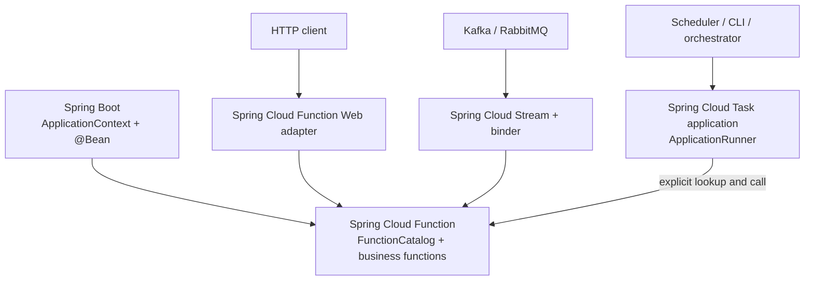
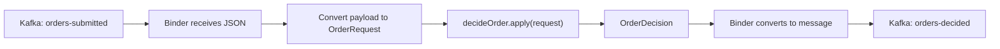

# Relationship with Spring Boot, Spring Cloud Stream, and Spring Cloud Task

## 1. Why Can the Same Function Appear in Multiple Types of Spring Applications?

Suppose an e-commerce system has a preliminary approval rule: an order must have an ID, a total amount greater than 0, and not exceeding 1,000,000 VND. The rule is used in three scenarios:

- A client sends a request to an HTTP API and wants the decision immediately.
- Another service publishes order events to Kafka; the system needs to return results via a new event.
- At the end of the day, a one-off job processes a list of orders for reconciliation and then exits.

If you copy the same `if/else` block three times into a controller, a consumer, and a job, every policy change requires updating multiple places. **Spring Cloud Function** (the `SPRING_CLOUD_FUNCTION` module) lets you express the rule as a `Supplier`, `Function`, or `Consumer`, register it in `FunctionCatalog`, and let integration components trigger the function in different environments.

In this picture, **Spring Boot**, **Spring Cloud Stream**, and **Spring Cloud Task** do not play the same role. Understanding how responsibilities are divided helps you choose the right deployment model for the same business logic.

## 2. Distinguishing the Responsibilities of the Four Components

| Component | Core Question It Answers | Related Capabilities | What It Does Not Do Automatically |
| --- | --- | --- | --- |
| **Spring Boot** | How do we start and configure a Spring application? | ApplicationContext, auto-configuration, bean management, dependencies, and application lifecycle. | Does not automatically register Kafka topics or expose every bean as an HTTP function. |
| **Spring Cloud Function** | How do we define, locate, and compose logic as functions? | `Supplier`, `Function`, `Consumer`, `FunctionCatalog`, composition, and payload/message conversion support. | Does not decide which system triggers the function or when. |
| **Spring Cloud Stream** | How do we connect functions to messaging systems? | Functional bindings, Kafka/RabbitMQ binders, destination connections, message conversion. | Does not replace the business logic inside `Function.apply()`; is not a one-off job runner. |
| **Spring Cloud Task** | How do we track the lifecycle of a short-lived application that runs and terminates? | Recording start/end times and task execution metadata, integrating with batch/CLI execution environments. | Is not a message binder, scheduler, or automatic adapter for `FunctionCatalog`. |

**Spring Boot is usually the common startup foundation** for all three application models. Spring Cloud Function provides a way to express logic; Spring Cloud Stream is one way to connect that logic to message streams; Spring Cloud Task manages the lifecycle of a **single application execution** and can invoke the same logic when a developer explicitly integrates it.



The diagram depicts **deployment options you can choose among**, not a requirement to enable all components simultaneously in one application. The HTTP and Stream adapters have built-in integration with the functional model; with Task, an application typically writes an entry point such as an `ApplicationRunner` to look up and invoke the function.

## 3. First: Build a Shared Business Contract

For the same rule to run over an API, messaging, or a task, the processing core should not accept `HttpServletRequest`, Kafka `ConsumerRecord`, or a cloud-platform runtime object. Start with the domain's own data types.

Example `OrderModels.java` file, using Java 17 or later:

```java
package demo.orders;

import java.math.BigDecimal;

public final class OrderModels {
    private OrderModels() {}

    public record OrderRequest(
            String orderId, BigDecimal amountVnd) {}

    public record OrderDecision(
            String orderId, boolean approved, String reason) {}
}
```

Next, define the function bean in `OrderFunctionConfig.java`:

```java
package demo.orders;

import java.math.BigDecimal;
import java.util.function.Function;

import org.springframework.context.annotation.Bean;
import org.springframework.context.annotation.Configuration;

import demo.orders.OrderModels.OrderDecision;
import demo.orders.OrderModels.OrderRequest;

@Configuration
public class OrderFunctionConfig {
    private static final BigDecimal MAX_AMOUNT =
            new BigDecimal("1000000");

    @Bean
    public Function<OrderRequest, OrderDecision> decideOrder() {
        return request -> {
            if (request == null) {
                throw new IllegalArgumentException(
                        "OrderRequest must not be null");
            }

            boolean validId = request.orderId() != null
                    && !request.orderId().isBlank();
            BigDecimal amount = request.amountVnd();
            boolean validAmount = amount != null
                    && amount.signum() > 0
                    && amount.compareTo(MAX_AMOUNT) <= 0;

            boolean approved = validId && validAmount;
            return new OrderDecision(
                    request.orderId(),
                    approved,
                    approved ? "APPROVED" : "REJECTED");
        };
    }
}
```

The function has the default Spring bean name `decideOrder`. It takes an `OrderRequest`, produces an `OrderDecision`, and does not depend on how the data arrived. The structure of `OrderRequest` is the **shared contract**: adapters must convert source data into this type before calling the function.

A plain Java invocation:

```java
import java.math.BigDecimal;
import demo.orders.OrderFunctionConfig;
import demo.orders.OrderModels.OrderRequest;

var function = new OrderFunctionConfig().decideOrder();
var decision = function.apply(
        new OrderRequest("ORD-101", new BigDecimal("850000")));
// decision.approved() == true
```

Up to this point, neither HTTP nor Kafka is needed. This is the most important boundary: **the same logic is verified in plain Java before choosing how to deploy it**.

## 4. Spring Boot: Bean Management and Application Startup Environment

Spring Boot provides `SpringApplication` and auto-configuration so a Spring application runs with its selected dependencies. Example entry point:

```java
package demo.orders;

import org.springframework.boot.SpringApplication;
import org.springframework.boot.autoconfigure.SpringBootApplication;

@SpringBootApplication
public class OrderHttpApplication {
    public static void main(String[] args) {
        SpringApplication.run(OrderHttpApplication.class, args);
    }
}
```

Because `OrderFunctionConfig` is in the same package `demo.orders`, it is discovered by standard component scanning. Spring manages the `decideOrder` bean; when the appropriate Spring Cloud Function library is present, the framework registers recognized function beans into `FunctionCatalog`.

From a Spring component with `FunctionCatalog catalog` injected, you can look it up:

```java
import java.util.function.Function;
import org.springframework.cloud.function.context.FunctionCatalog;
import demo.orders.OrderModels.OrderRequest;
import demo.orders.OrderModels.OrderDecision;

Function<OrderRequest, OrderDecision> function =
        catalog.lookup("decideOrder");

if (function == null) {
    throw new IllegalStateException(
            "Function decideOrder is not registered");
}

OrderDecision result = function.apply(
        new OrderRequest("ORD-101", new BigDecimal("850000")));
```

This snippet assumes `catalog` has been injected; to turn it into a complete compilable example, place the call inside a service or `ApplicationRunner` and import `BigDecimal`. The catalog may return a wrapper that supports data conversion/composition; do not assume it is the exact same instance as the original bean.

**Spring Boot does not automatically expose an endpoint just because a `@Bean Function` exists.** To invoke the function over HTTP using Spring Cloud Function's mechanism, you need the web adapter; to receive events from a broker, you need Spring Cloud Stream with a binder; to run as a short-lived task, you need the appropriate entry point and lifecycle.

## 5. Spring Boot + Spring Cloud Function Web: Invoking over HTTP

An application requiring request/response interactions can add the Maven dependency:

```xml
<dependency>
    <groupId>org.springframework.cloud</groupId>
    <artifactId>spring-cloud-starter-function-web</artifactId>
</dependency>
```

The dependency must match compatible Spring Boot and Spring Cloud versions, typically managed via a BOM. Spring Cloud Function Web provides the HTTP adapter mechanism to turn requests into function calls and results into responses.

Once the application is running on `localhost:8080` with appropriate web configuration, for example:

```bash
curl -X POST http://localhost:8080/decideOrder \
  -H "Content-Type: application/json" \
  -d '{"orderId":"ORD-101","amountVnd":850000}'
```

Expected business result:

```json
{
  "orderId": "ORD-101",
  "approved": true,
  "reason": "APPROVED"
}
```

In this flow, the HTTP adapter handles paths, HTTP methods, content types, and JSON <-> Java mapping. It uses `FunctionCatalog` to find the registered function and call `apply()`. The `decideOrder` business code does not need to know HTTP status codes or client headers.

A malformed request is a data-ingestion error; an order with an invalid amount in well-formed JSON can produce `OrderDecision(approved=false)`. Both cases must be handled per the chosen API contract, avoiding treating every business rejection as a protocol error.

## 6. Spring Cloud Stream: Turning a Function into an Event Processor

Spring Cloud Stream structures communication with messaging systems through **bindings** and **binders**. A binder integrates with a specific broker — for instance, the Kafka binder connects to Kafka and the RabbitMQ binder connects to RabbitMQ. With the functional model, Stream uses function definitions from Spring Cloud Function to know which handler to invoke.

To use Kafka, an application can add the appropriate Maven dependency:

```xml
<dependency>
    <groupId>org.springframework.cloud</groupId>
    <artifactId>spring-cloud-stream-binder-kafka</artifactId>
</dependency>
```

In a project with proper dependency management, `spring-cloud-stream` and the binder must align with the application's Spring Cloud version. With the `decideOrder` bean above, an example configuration is:

```yaml
spring:
  cloud:
    function:
      definition: decideOrder
    stream:
      bindings:
        decideOrder-in-0:
          destination: orders-submitted
          group: order-policy
          content-type: application/json
        decideOrder-out-0:
          destination: orders-decided
          content-type: application/json
      kafka:
        binder:
          brokers: localhost:9092
```

Detailed explanation:

| Configuration Item | Meaning |
| --- | --- |
| `spring.cloud.function.definition` | Selects the `decideOrder` function for Stream to bind. |
| `decideOrder-in-0` | First input binding of the function; receives data from `orders-submitted`. |
| `decideOrder-out-0` | First output binding; sends `OrderDecision` to `orders-decided`. |
| `group: order-policy` | Consumer group for the receiving application. |
| `content-type: application/json` | Indicates payload format for the corresponding conversion mechanism. |
| `spring.cloud.stream.kafka.binder.brokers` | List of Kafka brokers the binder connects to. |

With input:

```json
{"orderId":"ORD-101","amountVnd":850000}
```

the typical processing flow is:



**What is reused** is the `decideOrder` bean and the data contract. **What changes** is where payloads arrive, where results go, consumer management, retries, acknowledgments, and broker configuration.

Asynchrony introduces characteristics that must be evaluated separately:

- A producer emitting an event does not necessarily wait for a decision within the same connection as in HTTP.
- The broker/binder may redeliver events on errors or restarts; logic with side effects must manage idempotency.
- Global event ordering is not guaranteed by default; Kafka generally preserves order only per partition.
- `Function.apply()` returning `OrderDecision` does not guarantee the output has already been delivered; the binder and broker still carry out message transmission.

Spring Cloud Stream **uses** Spring Cloud Function as its processing model, but that **does not mean** Spring Cloud Function connects to a broker on its own without a binder and bindings.

## 7. Similarities and Differences Between HTTP APIs and Stream

| Attribute | Spring Cloud Function Web | Spring Cloud Stream |
| --- | --- | --- |
| Invocation source | HTTP client. | Broker message. |
| Input to `Function<T, R>` | Payload converted from the request. | Payload after a converter processes the message. |
| Output | HTTP response per adapter and API contract. | Message sent to an output destination. |
| Function selection | Route/function name and adapter configuration. | `spring.cloud.function.definition` and functional bindings. |
| Integration component | Web adapter. | Binder and message bindings. |
| Errors to manage | HTTP status, timeout, body, API security. | Retries, dead-letter, consumer group, offset/acknowledgment. |
| Typical lifecycle | Server continuously waiting for requests. | Long-running consumer receiving events. |

Because timing contracts differ, **do not force an event into a fake HTTP response** inside core logic. Returning `OrderDecision` is a genuine business outcome; each adapter decides when and how to publish the result.

## 8. Spring Cloud Task: Tracking a Short-Lived Application That Runs and Exits

**Spring Cloud Task** serves programs with a **finite lifecycle**: start up, do work, and terminate. It provides a mechanism to record execution metadata such as start time, end time, and status information; durable persistence of that metadata depends on `TaskRepository` and database configuration.

Typical scenarios:

- Reconciling pending orders at the end of the day.
- Importing a CSV file and running an order classification rule.
- Running a one-off data sync on an operational command.
- Executing a maintenance program triggered by an external scheduler or orchestrator.

Key distinctions:

- **Task is not a scheduler:** Spring Cloud Task does not decide to run at 23:00 every day by itself. A cron job, Kubernetes CronJob, scheduler, or external agent must launch the program.
- **Task is not a binder:** it does not subscribe to Kafka messages or map a `Function` into a consumer on its own.
- **Task is not Spring Batch:** Task tracks a single application run; Spring Batch adds `Job`, `Step`, chunk-oriented reading/writing, restarts, and checkpoints when the problem requires them. The two projects can work together, but neither requires the other.
- **Task does not mean serverless:** a task can run in a normal JVM/container. Serverless has its own handler and trigger mechanisms; using the functional model still requires an appropriate adapter.

Spring Cloud Task can **reuse** the same `decideOrder`, but the application must explicitly invoke the function, for example from an `ApplicationRunner`.

## 9. Example: Invoking FunctionCatalog Inside a Spring Cloud Task

Suppose there is **a separately deployed application** with an entry point for the task. The project uses Spring Boot, Spring Cloud Function context, and Spring Cloud Task. Main Maven dependencies:

```xml
<dependencies>
    <dependency>
        <groupId>org.springframework.cloud</groupId>
        <artifactId>spring-cloud-function-context</artifactId>
    </dependency>
    <dependency>
        <groupId>org.springframework.cloud</groupId>
        <artifactId>spring-cloud-starter-task</artifactId>
    </dependency>
</dependencies>
```

Compatible versions must be selected through the project's dependency management. Assume `OrderModels` and `OrderFunctionConfig` are brought into the Task application via a shared library module or source files in the same package.

Example `OrderTaskApplication.java`:

```java
package demo.orders;

import java.math.BigDecimal;
import java.util.List;
import java.util.function.Function;

import org.springframework.boot.ApplicationArguments;
import org.springframework.boot.ApplicationRunner;
import org.springframework.boot.SpringApplication;
import org.springframework.boot.autoconfigure.SpringBootApplication;
import org.springframework.cloud.function.context.FunctionCatalog;
import org.springframework.cloud.task.configuration.EnableTask;
import org.springframework.context.annotation.Bean;

import demo.orders.OrderModels.OrderDecision;
import demo.orders.OrderModels.OrderRequest;

@SpringBootApplication
@EnableTask
public class OrderTaskApplication {

    public static void main(String[] args) {
        SpringApplication.run(OrderTaskApplication.class, args);
    }

    @Bean
    ApplicationRunner runOrderCheck(FunctionCatalog catalog) {
        return args -> {
            String id = requireSingle(args, "orderId");
            BigDecimal amount = new BigDecimal(
                    requireSingle(args, "amountVnd"));

            Function<OrderRequest, OrderDecision> function =
                    catalog.lookup("decideOrder");
            if (function == null) {
                throw new IllegalStateException(
                        "Missing function: decideOrder");
            }

            OrderDecision decision = function.apply(
                    new OrderRequest(id, amount));
            System.out.printf(
                    "order=%s approved=%s reason=%s%n",
                    decision.orderId(),
                    decision.approved(),
                    decision.reason());
        };
    }

    private static String requireSingle(
            ApplicationArguments args, String option) {
        List<String> values = args.getOptionValues(option);
        if (values == null || values.size() != 1) {
            throw new IllegalArgumentException(
                    "Expected exactly one --" + option + " argument");
        }
        return values.get(0);
    }
}
```

In this example, `ApplicationRunner` uses command-line arguments to build an `OrderRequest`, explicitly calls `lookup("decideOrder")`, and invokes `apply()`. **Spring Cloud Task does not automatically discover `decideOrder` as a job step to run**: the `ApplicationRunner` code itself defines the work of one execution.

Configuration so the application does not start a web server:

```yaml
spring:
  main:
    web-application-type: none
```

Run once, with the packaged and configured Task JAR:

```bash
java -jar order-task.jar --orderId=ORD-101 --amountVnd=850000
```

Illustrative output:

```text
order=ORD-101 approved=true reason=APPROVED
```

Once the runner and required operations complete, if no background components keep the JVM alive, the application can exit. Spring Cloud Task manages execution lifecycle information per its configuration. For task history to be queryable long-term, `TaskRepository` must be configured with a persistent datasource and corresponding schema; do not assume metadata is persisted durably if the application only uses transient storage.

The example intentionally prints the decision to stdout to focus on the function call. A real reconciliation task might read a file or list from a database, call the same function per record, write results, handle per-record errors, and produce a summary report. **`TaskRepository` tracks task runs**, while business results must be written to a suitable datastore or system if durable storage is needed.

## 10. One Use Case, Three Practical Deployment Models

You can organize the codebase as follows:

```text
Shared business library (packaged independently of protocols)
  ├── OrderModels
  └── OrderFunctionConfig
              |
      +-------+----------+
      |                  |
  API application    Stream application      Task application
  Spring Boot        Spring Boot             Spring Boot
  Function Web       Cloud Stream + binder   Cloud Task + runner
      |                  |                       |
   HTTP POST         Kafka events             CLI / scheduler
      |                  |                       |
      +------------------+-----------------------+
                         |
              decideOrder.apply(OrderRequest)
                         |
                    OrderDecision
```

This is a **source-code reuse diagram**. In deployment, each application has its own Spring ApplicationContext and bean instances; there is no single Java instance shared over the network. Business code and contracts are reused via a shared dependency or module.

| Scenario | Usually Suitable Choice | Reason |
| --- | --- | --- |
| Users must see the decision immediately | Spring Boot + Function Web or a controller calling the bean. | Clear request/response and HTTP contract. |
| A service publishes events requiring continuous processing | Spring Boot + Spring Cloud Stream. | Binder receives/publishes messages and manages consumers. |
| Periodic batch data processing and then exiting | Spring Boot + Spring Cloud Task. | Fits finite applications, tracking each execution. |
| Processing many records with checkpoints/restarts | Spring Cloud Task combined with Spring Batch if needed. | Batch provides `Job`/`Step`, checkpoints, and retry/skip by design. |
| Trigger lives on a specific FaaS platform | Spring Cloud Function + corresponding serverless adapter. | Handler and packaging match the provider's runtime. |

There is no requirement to bundle Web, Stream, and Task into the same JAR. Separating them into distinct deployable applications lets each execution path tailor its lifecycle and resources to its goal. If organizing multiple entry points in one repository, be careful with component scanning and which auto-configurations are included in each artifact.

## 11. How Do FunctionCatalog and Composition Relate to These Environments?

`FunctionCatalog` supports lookup by name or composition expression:

```java
Function<OrderRequest, OrderDecision> function =
        catalog.lookup("decideOrder");
```

If you add a `Function<OrderRequest, OrderRequest> normalizeOrder` bean, you can look up the pipeline:

```java
Function<OrderRequest, OrderDecision> pipeline =
        catalog.lookup("normalizeOrder|decideOrder");
```

The `normalizeOrder|decideOrder` flow executes from left to right. Output from the earlier step must be compatible with the input of the next step. Depending on the adapter:

- **HTTP:** can select a function/pipeline to produce the response for a request.
- **Stream:** `spring.cloud.function.definition` can select a pipeline to attach to bindings. With composition, default binding names must be determined according to the actual definition/function name Stream uses and the version running.
- **Task:** `ApplicationRunner` can look up the pipeline directly and call `apply()` on the data it reads.

What they share is the ability to select a function or composition by name. What differs is **who triggers** the pipeline and **where the result goes**. The `spring.cloud.function.definition` property specifies the function definition for the appropriate adapter; it does not replace endpoint, topic, schedule, or task entry-point configuration.

## 12. Supplier and Consumer Are Also Shaped by the Application Type

Not every use case is a `Function<T, R>`:

| Function Type | On HTTP/Boot | With Spring Cloud Stream | In Spring Cloud Task |
| --- | --- | --- | --- |
| `Supplier<T>` | Web adapter can call `get()` when a request arrives. | Poller can call `get()` and emit results as output messages. | Runner explicitly calls `get()` once or multiple times per task logic. |
| `Function<T, R>` | Receives payload, returns data over HTTP. | Receives input message, produces output message when bindings match. | Runner explicitly calls `apply()` on each item to process. |
| `Consumer<T>` | Receives payload and performs a side effect; no business output. | Sink handles incoming messages, typically with no output binding. | Runner explicitly calls `accept()` to perform the action. |

In particular, **`Supplier` is not a scheduler**: a Stream poller can pace a supplier; Task requires an external program to launch it; HTTP only triggers on request. Likewise, **`Consumer` returning `void` does not mean the broker acknowledged the message or the side effect committed**. Completion must rely on proper I/O, transaction, and operational mechanisms.

## 13. Data Contracts and Message Conversion: An Essential Piece

Decoupling business logic from protocols only works well when input/output contracts are clear. In the example:

```text
OrderRequest(orderId: String, amountVnd: BigDecimal)
            |
            v
       decideOrder
            |
            v
OrderDecision(orderId: String, approved: boolean, reason: String)
```

- **HTTP adapter** reads the JSON body and maps it to `OrderRequest`.
- **Stream binder** decodes the message with the right content type/converter into `OrderRequest`.
- **Task runner** constructs the `OrderRequest` object from arguments, files, or a database.

The three paths can produce the same Java object, yet they do not automatically provide the same validation level. For instance, `amountVnd` might be missing, wrongly typed, or in a different unit in the source data. Normalize and validate at the appropriate boundary; business rules must still handle valid/invalid values according to policy.

When message metadata is required, Spring Cloud Function can use `org.springframework.messaging.Message<T>`:

```java
Function<Message<OrderRequest>, Message<OrderDecision>>
```

Switching from raw payloads to `Message<T>` enables handling headers/correlation IDs, though it couples the function to messaging abstractions. If the business logic does not need headers, prefer `Function<OrderRequest, OrderDecision>` for easier reuse across Task and HTTP.

JSON -> Java object conversion also depends on message contents, generic types, converter libraries, and binder/adapter configuration. Do not assume that passing any JSON string directly into `Function.apply()` will automatically turn into an `OrderRequest`.

## 14. Error-Handling Semantics Vary by Environment

**The same function does not mean the same failure policy.** Suppose `decideOrder` throws an exception because a critical dependency is unavailable:

| Environment | Typical Consequences and Handling |
| --- | --- |
| HTTP | Adapter/API can return 5xx per error contract; clients may retry according to policy. |
| Stream | Consumer/binder may retry, redeliver, or route messages to a dead-letter destination depending on configuration. |
| Task | The run can fail, be recorded via metadata/exit status, and be re-triggered by an orchestrator. |

If the function merely returns a rejection decision, such as `approved=false`, that is **not an exception** requiring infinite broker retries or marking the Task as failed. Conversely, if processing a record has side effects like updating inventory, design idempotency around a business key, even when the same task reruns or an event is redelivered.

Key operational principles:

1. Separate **business outcomes** from **unhandled errors**.
2. Define retry policies in the HTTP client, Stream binder, or Task orchestrator.
3. Do not hold uncontrolled mutable state in singleton beans across concurrent requests/consumer threads.
4. Use transactions and idempotency for writes; Spring Cloud Function and Task do not automatically guarantee distributed transactions across Kafka and a database.
5. Monitor request logs, consumer lag/retries, `TaskExecution`, and business outcomes separately.

## 15. Which Tests Belong at Each Layer?

A testing strategy should reflect each component's responsibilities:

| Scope | What to Verify | Requires Broker / Web / Task Runtime? |
| --- | --- | --- |
| Java function | `decideOrder.apply()` returns correct results for normal and edge-case inputs. | No. |
| Spring Boot and FunctionCatalog | Beans are scanned, lookup by name succeeds, composition is valid. | Requires Spring test context; does not necessarily require a broker. |
| Web adapter | Routes, JSON conversion, responses, and error contracts match expectations. | Requires an HTTP test environment. |
| Stream binder | Binding names, destinations, conversion, retries, and output publishing work properly. | Requires a binder test or integrated broker depending on scope. |
| Spring Cloud Task | Runner selects the right function, parses arguments, completes/fails properly, and records metadata. | Requires testing the Task app and repository if verifying durable metadata. |

Example unit test for pure logic without starting the application:

```java
import static org.junit.jupiter.api.Assertions.assertTrue;

import java.math.BigDecimal;
import org.junit.jupiter.api.Test;

import demo.orders.OrderFunctionConfig;
import demo.orders.OrderModels.OrderRequest;

class OrderFunctionTest {
    @Test
    void approvesOrderWithinLimit() {
        var function = new OrderFunctionConfig().decideOrder();
        var result = function.apply(
                new OrderRequest("ORD-101", new BigDecimal("850000")));

        assertTrue(result.approved());
    }
}
```

Add cases for zero, negative amounts, boundary values, amounts above the limit, null/blank order IDs, and null requests. For Task, add tests for missing arguments, invalid `BigDecimal` values, and exit behavior when the runner fails; for Stream, specifically test redelivery of the same message.

## 16. Pitfalls to Avoid

| Common Misconception | Accurate Understanding |
| --- | --- |
| "Having Spring Boot means functions are automatically callable via HTTP." | You need the web adapter or a custom controller; Boot only manages the app and dependencies. |
| "Spring Cloud Stream replaces Spring Cloud Function." | Stream uses the functional model to connect functions to message brokers; logic and binders have distinct duties. |
| "Just adding `@Bean Function` automatically creates a Kafka consumer." | You must select the function, add a binder, and configure bindings/destinations. |
| "Spring Cloud Task automatically invokes every Function in the catalog." | Task tracks lifecycle; a runner/job must explicitly look up and call the function. |
| "Spring Cloud Task is a cron scheduler." | An external scheduler launches the program; Task tracks each execution. |
| "Task and Stream always have to run together." | They solve two different lifecycle models and are usually deployed separately. |
| "Task already supports per-item retry like Spring Batch." | When you need jobs/steps, checkpoints, and step-level restarts, consider Spring Batch. |
| "Because the function is protocol-independent, message conversion is unnecessary." | Adapters still need payload types, content types, schemas, and converters. |
| "Deploying serverless means using Spring Cloud Task." | Serverless uses runtime-specific adapters/handlers; Task does not automatically become a FaaS handler. |

## 17. How to Choose When Starting a Project

For each use case, answer in order:

1. **Business shape:** Is there an input? Is there a return value? Choose `Supplier`, `Function`, or `Consumer` and define the payload.
2. **Trigger timing:** Do you need request/response latency, continuous event listening, or finite execution on command?
3. **Integration method:** Use the web adapter, Stream binder, or a runner inside a Task application? If targeting FaaS, select the matching runtime adapter.
4. **Data contract:** Are JSON/schemas, message headers, CLI arguments, and mappings to Java objects consistent?
5. **Operations:** Who owns timeouts, retries, idempotency, transactions, observability, and scheduling?

**Conclusion:** Spring Boot provides the environment where beans and Spring applications run; Spring Cloud Function defines and organizes logic callable through `FunctionCatalog`; Spring Cloud Stream connects that logic to event streams; Spring Cloud Task tracks short-lived programs and lets runners invoke that same logic. When these boundaries are clear, the team can keep `decideOrder` and the `OrderRequest -> OrderDecision` contract intact while deploying over HTTP, brokers, batch tasks, or serverless adapters as real needs dictate.
