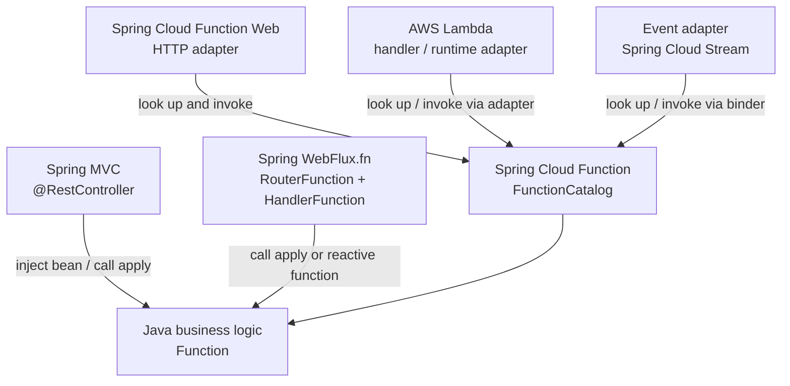
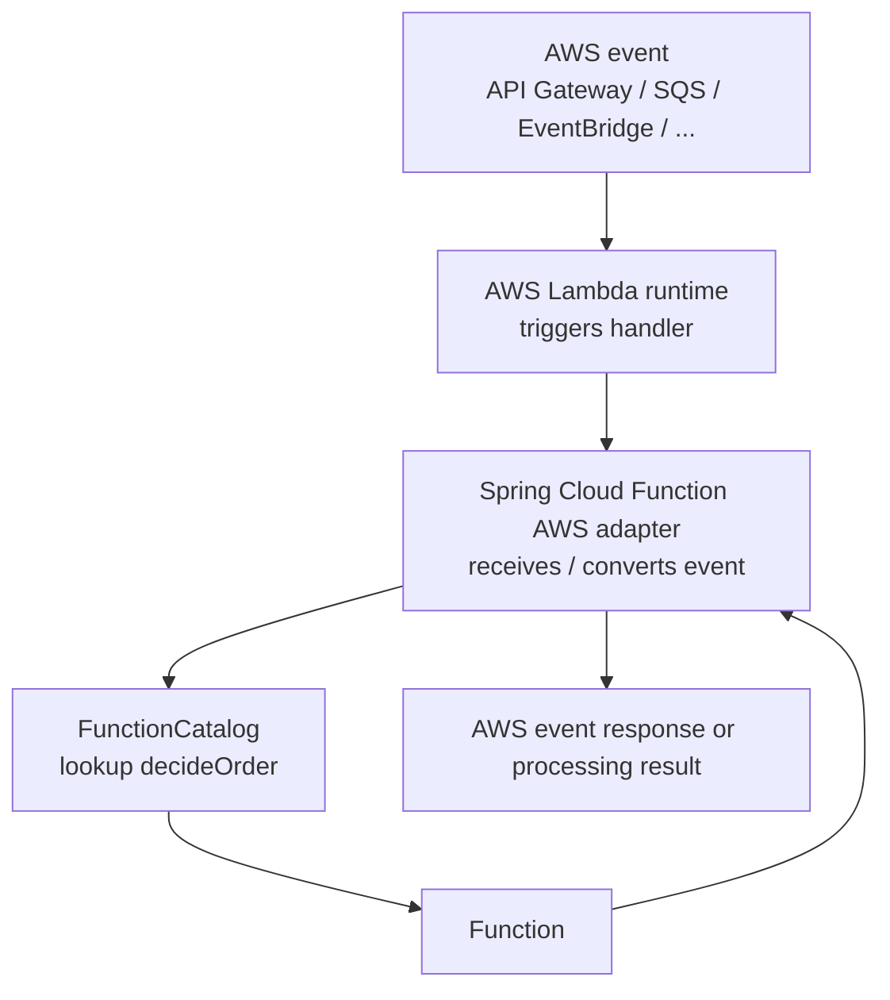

# Distinguishing Business Functions from Controllers, WebFlux.fn, and AWS Lambda

## 1. One Rule Can Appear in Many Deployment Forms

Suppose an e-commerce system has an order-approval rule: grant preliminary approval only when the order ID is valid and the total amount is greater than 0 and up to 1,000,000 VND. Initially, the application exposes an HTTP API; next, the system needs to consume events; and finally, the team wants to deploy the rule on AWS Lambda.

At least four concepts commonly appear in the requirements:

- **Business function:** receives order data and returns an approval decision.
- **Spring MVC controller:** receives HTTP requests and builds HTTP responses using annotations.
- **WebFlux.fn:** uses routers and handlers to handle HTTP in a functional style.
- **AWS Lambda:** a serverless execution service; the platform invokes a handler when an event arrives.

These concepts are **not at the same level**. In the **Spring Cloud Function** (`SPRING_CLOUD_FUNCTION`) module, the goal is to express logic using Java's `Supplier`, `Function`, and `Consumer`, register and look them up via `FunctionCatalog`, compose them when needed, and connect them to HTTP, events, or serverless. Controllers, WebFlux.fn, and Lambda are ways to **route external calls to the logic**, not necessarily the place where business rules should live.

## 2. Four Concepts Answering Four Different Questions

| Concept | Question It Answers | Typical APIs / Types | Primary Scope |
| --- | --- | --- | --- |
| **Java business function** | Which decision does the input data produce? | `Function<OrderRequest, OrderDecision>`, `apply()` | Domain rules and data contracts. |
| **Spring MVC controller** | How are HTTP URLs/methods/bodies received and responded to? | `@RestController`, `@PostMapping`, `ResponseEntity` | HTTP requests/responses in Spring MVC. |
| **WebFlux.fn** | How is an HTTP route mapped to a reactive handler? | `RouterFunction<ServerResponse>`, `ServerRequest`, `Mono<ServerResponse>` | HTTP routing/handling in Spring WebFlux. |
| **AWS Lambda** | Which code runs when the platform emits an event, where does it run, and under what limits? | Lambda handler, runtime, triggers, event/response contracts | AWS's serverless execution platform. |

Spring Cloud Function sits between **Spring-managed Java functions** and **adapters**. `FunctionCatalog` helps look up functions by name, supports function composition, and assists with data conversion in framework-supported contexts. Even so, declaring `@Bean Function` alone does not automatically create a controller, WebFlux route, Kafka consumer, or Lambda trigger.



The diagram depicts **invocation paths selected or combined by design**. MVC and WebFlux.fn can call a business bean directly; the Spring Cloud Function Web adapter and Lambda adapter can go through `FunctionCatalog`. What is reused is the business code and contract. Each deployed application can instantiate its own bean instances inside its own Spring ApplicationContext.

## 3. Write the Business Core Before Choosing a Protocol

Separate the data types and approval rules from HTTP and AWS.

File `OrderDomain.java`:

```java
package demo.orders;

import java.math.BigDecimal;
import java.util.Objects;

public final class OrderDomain {
    private OrderDomain() {}

    public record OrderRequest(
            String orderId, BigDecimal totalVnd) {}

    public record OrderDecision(
            String orderId, boolean approved, String reason) {}

    public static final class OrderPolicy {
        private static final BigDecimal MAX_TOTAL =
                new BigDecimal("1000000");

        public OrderDecision decide(OrderRequest request) {
            Objects.requireNonNull(request, "request");

            if (request.orderId() == null
                    || request.orderId().isBlank()) {
                return new OrderDecision(
                        request.orderId(), false, "MISSING_ORDER_ID");
            }

            BigDecimal amount = request.totalVnd();
            if (amount == null || amount.signum() <= 0) {
                return new OrderDecision(
                        request.orderId(), false, "INVALID_AMOUNT");
            }
            if (amount.compareTo(MAX_TOTAL) > 0) {
                return new OrderDecision(
                        request.orderId(), false, "LIMIT_EXCEEDED");
            }

            return new OrderDecision(
                    request.orderId(), true, "APPROVED");
        }
    }
}
```

This method only takes `OrderRequest` and returns `OrderDecision`. There is no `HttpServletRequest`, `ServerRequest`, `APIGatewayProxyRequestEvent`, or AWS interface in the signature. A plain Java check:

```java
import java.math.BigDecimal;
import demo.orders.OrderDomain.OrderPolicy;
import demo.orders.OrderDomain.OrderRequest;

var policy = new OrderPolicy();
var output = policy.decide(
        new OrderRequest("ORD-42", new BigDecimal("850000")));

// output.approved() == true
// output.reason().equals("APPROVED")
```

**Important point:** "Business function" is a design concept; it does not have to be a Java lambda. Here `OrderPolicy.decide()` is an ordinary Java method. When we want Spring Cloud Function to manage it, we can use a method reference to turn it into a `Function`.

## 4. Registering the Same Rule as a Spring Cloud Function

With a Spring Boot application and compatible Spring Boot/Spring Cloud versions, configure the beans:

```java
package demo.orders;

import java.util.function.Function;

import org.springframework.context.annotation.Bean;
import org.springframework.context.annotation.Configuration;

import demo.orders.OrderDomain.OrderDecision;
import demo.orders.OrderDomain.OrderPolicy;
import demo.orders.OrderDomain.OrderRequest;

@Configuration
public class OrderFunctionConfig {

    @Bean
    OrderPolicy orderPolicy() {
        return new OrderPolicy();
    }

    @Bean
    Function<OrderRequest, OrderDecision> decideOrder(
            OrderPolicy policy) {
        return policy::decide;
    }
}
```

Spring creates a bean with the default name `decideOrder`. With the appropriate Spring Cloud Function dependencies, functional beans are recognized by the framework and placed into `FunctionCatalog`; a Spring component with the catalog injected can call:

```java
import java.util.function.Function;
import org.springframework.cloud.function.context.FunctionCatalog;
import demo.orders.OrderDomain.OrderDecision;
import demo.orders.OrderDomain.OrderRequest;

// Example inside a service/runner with FunctionCatalog catalog injected.
Function<OrderRequest, OrderDecision> function =
        catalog.lookup("decideOrder");

if (function == null) {
    throw new IllegalStateException("Missing function: decideOrder");
}

OrderDecision result = function.apply(
        new OrderRequest("ORD-42", new BigDecimal("850000")));
```

This does not create an endpoint or a Lambda handler. It creates **a lookup handle for a named function**, making it convenient for adapters to select by configuration. The catalog may return a framework-prepared wrapper, so do not rely on the assumption that the wrapper and the original bean are the exact same Java object.

## 5. Case 1: Using a Spring MVC Controller

Spring MVC typically uses annotations like `@RestController`, `@PostMapping`, and `@RequestBody`. The controller is responsible for receiving the HTTP request; the business function is responsible for evaluating the order.

Example inside a **Spring MVC application** that already has the `decideOrder` bean:

```java
package demo.orders;

import java.util.function.Function;

import org.springframework.beans.factory.annotation.Qualifier;
import org.springframework.http.MediaType;
import org.springframework.http.ResponseEntity;
import org.springframework.web.bind.annotation.PostMapping;
import org.springframework.web.bind.annotation.RequestBody;
import org.springframework.web.bind.annotation.RestController;

import demo.orders.OrderDomain.OrderDecision;
import demo.orders.OrderDomain.OrderRequest;

@RestController
public class OrderController {
    private final Function<OrderRequest, OrderDecision> decide;

    public OrderController(
            @Qualifier("decideOrder")
            Function<OrderRequest, OrderDecision> decide) {
        this.decide = decide;
    }

    @PostMapping(
            path = "/api/orders/decision",
            consumes = MediaType.APPLICATION_JSON_VALUE,
            produces = MediaType.APPLICATION_JSON_VALUE)
    public ResponseEntity<OrderDecision> decide(
            @RequestBody OrderRequest request) {
        return ResponseEntity.ok(decide.apply(request));
    }
}
```

An HTTP request:

```bash
curl -X POST http://localhost:8080/api/orders/decision \
  -H "Content-Type: application/json" \
  -d '{"orderId":"ORD-42","totalVnd":850000}'
```

Expected response payload:

```json
{
  "orderId": "ORD-42",
  "approved": true,
  "reason": "APPROVED"
}
```

In this simple example, the controller chooses to return `200 OK` for a computed business outcome, even when `approved=false`. If the API requires different status codes, request validation, or custom error bodies, the controller (or the application's HTTP layer) can perform that mapping **without modifying `OrderPolicy`**.

**A controller is not synonymous with Spring Cloud Function:** a controller can invoke any Java service, even without using `java.util.function.Function` or `FunctionCatalog`. Conversely, Spring Cloud Function can run without any user-written controller.

## 6. Case 2: Using WebFlux.fn

**Spring WebFlux.fn** is the functional HTTP routing model of **Spring WebFlux**, built around interfaces such as `RouterFunction<ServerResponse>` and `HandlerFunction<ServerResponse>`. A handler typically has the conceptual signature:

```java
ServerRequest -> Mono<ServerResponse>
```

This is **WebFlux's HTTP API**, not Spring Cloud Function's `Function<T, R>`. Although both use a functional style, they have different responsibilities:

- `RouterFunction` selects a handler based on path, HTTP method, and other request predicates.
- `ServerRequest` holds HTTP request information; `ServerResponse` describes the HTTP response.
- `Mono` or `Flux` represents reactive processing and asynchronous completion.
- A handler can **delegate** to a `Function<OrderRequest, OrderDecision>` bean to reuse business logic.

### 6.1. Handler Reusing the `decideOrder` Bean

In a Spring WebFlux application, for example:

```java
package demo.orders;

import java.util.function.Function;

import org.springframework.beans.factory.annotation.Qualifier;
import org.springframework.http.MediaType;
import org.springframework.stereotype.Component;
import org.springframework.web.reactive.function.server.ServerRequest;
import org.springframework.web.reactive.function.server.ServerResponse;

import reactor.core.publisher.Mono;

import demo.orders.OrderDomain.OrderDecision;
import demo.orders.OrderDomain.OrderRequest;

@Component
public class OrderHandler {
    private final Function<OrderRequest, OrderDecision> decide;

    public OrderHandler(
            @Qualifier("decideOrder")
            Function<OrderRequest, OrderDecision> decide) {
        this.decide = decide;
    }

    public Mono<ServerResponse> decide(ServerRequest request) {
        return request.bodyToMono(OrderRequest.class)
                .map(decide::apply)
                .flatMap(decision -> ServerResponse.ok()
                        .contentType(MediaType.APPLICATION_JSON)
                        .bodyValue(decision));
    }
}
```

### 6.2. Router Mapping HTTP Requests to the Handler

```java
package demo.orders;

import org.springframework.context.annotation.Bean;
import org.springframework.context.annotation.Configuration;
import org.springframework.http.MediaType;
import org.springframework.web.reactive.function.server.RouterFunction;
import org.springframework.web.reactive.function.server.RouterFunctions;
import org.springframework.web.reactive.function.server.ServerResponse;

import static org.springframework.web.reactive.function.server.RequestPredicates.POST;
import static org.springframework.web.reactive.function.server.RequestPredicates.accept;

@Configuration
public class OrderRoutes {
    @Bean
    RouterFunction<ServerResponse> routes(OrderHandler handler) {
        return RouterFunctions.route(
                POST("/api/orders/decision")
                        .and(accept(MediaType.APPLICATION_JSON)),
                handler::decide);
    }
}
```

The two examples in section 5 (Spring MVC controller) and section 6 (WebFlux.fn) are **two alternative ways to write the HTTP layer** for the same illustrative endpoint; when deploying, pick one or split routes to avoid path conflicts. The `decideOrder` bean can be reused in both applications.

**Threading note in WebFlux:** `OrderPolicy` in this example only performs short in-memory computations, so `map(decide::apply)` is fine for illustration. If `decideOrder` calls JDBC, synchronous APIs, or long-blocking operations, calling it directly like this can block WebFlux's event-loop threads. In that case, use genuinely reactive dependencies or offload blocking work to an appropriate scheduler (such as `Schedulers.boundedElastic()`) and verify load and timeout strategies. Using WebFlux.fn **does not automatically make a blocking Java function non-blocking**.

## 7. Case 3: Using the Spring Cloud Function Web Adapter

Spring Cloud Function includes a **web adapter** that exposes function beans over HTTP without writing a manual controller or router for each function. A Spring Boot application can add the Maven dependency:

```xml
<dependency>
    <groupId>org.springframework.cloud</groupId>
    <artifactId>spring-cloud-starter-function-web</artifactId>
</dependency>
```

With the `decideOrder` bean, the default endpoint can map by function name (depending on the adapter and configuration):

```bash
curl -X POST http://localhost:8080/decideOrder \
  -H "Content-Type: application/json" \
  -d '{"orderId":"ORD-42","totalVnd":850000}'
```

The typical processing flow is **HTTP request -> web adapter -> FunctionCatalog -> decideOrder bean -> HTTP response**. The web adapter performs routing and payload conversion according to the framework's capabilities.

Compared with a controller:

| Criterion | Application-Written Controller | Spring Cloud Function Web Adapter |
| --- | --- | --- |
| HTTP paths and methods | Explicitly declared via annotations. | Based on the adapter's routing/configuration mechanism. |
| Custom HTTP responses and error contracts | Easy to write custom mappings in controller code. | Must check the extent of customization supported by the adapter. |
| Invoking business functions | Inject bean, call `apply()`, or use a service. | Typically looked up via `FunctionCatalog`. |
| Amount of HTTP boilerplate | More when there are many specialized endpoints. | Potentially less for endpoints that invoke functions directly. |

**Do not enable endpoints with overlapping routes simultaneously** from both a controller and the web adapter expecting the framework to guess which one takes priority. Deliberately configure routes, active components, and verify actual mappings.

## 8. Case 4: Deploying on AWS Lambda

**AWS Lambda** is a Function-as-a-Service (FaaS) platform: AWS spins up an execution environment on demand and triggers a **Lambda handler** when an event arrives from a configured source. Lambda can receive events from API Gateway, SQS, EventBridge, and many other services. Therefore:

1. **Lambda is not a Java `Function<T, R>` interface.** It is a compute service that runs code and defines an event/handler contract.
2. **A Lambda handler is not a Spring MVC controller or a WebFlux.fn handler.** It must satisfy the contract of the Lambda runtime and the specific event source.
3. **Spring Cloud Function has an AWS Lambda adapter** to connect registered function beans with the appropriate handler/runtime, enabling reuse of `decideOrder`.

### 8.1. Processing Flow of a Lambda Adapter



The pseudocode below **only explains responsibilities**, not real Spring or AWS method names:

```text
onAwsEvent(event, context):
    businessInput = decodeForEventType(event)  # OrderRequest
    fn = functionCatalog.lookup("decideOrder")
    decision = fn.apply(businessInput)           # OrderDecision
    return encodeForEventType(decision)
```

In many AWS-supporting versions of Spring Cloud Function, the adapter provides an invoker class such as `org.springframework.cloud.function.adapter.aws.FunctionInvoker`. In real deployments, verify **the handler name, dependencies, bootstrap requirements, packaging format, and supported versions**; there is no single Lambda configuration guaranteed to work across every runtime and event source.

Example Spring Cloud Function configuration to select a function when an application contains multiple beans:

```yaml
spring:
  cloud:
    function:
      definition: decideOrder
```

This property selects which function is invoked within a supporting adapter; **it does not automatically create a Lambda function, IAM role, API Gateway route, or event source mapping**.

### 8.2. Why Can the External Payload Differ for the Same Function?

Suppose the trigger source is a **direct invocation** with a caller-defined JSON payload:

```json
{
  "orderId": "ORD-42",
  "totalVnd": 850000
}
```

With a packaging/adapter setup supporting the right mapping, this payload can be converted into an `OrderRequest`. However, an event from **API Gateway** usually also includes the HTTP method, headers, body, and metadata; an event from **SQS** usually contains a list of records, each with a body and queue metadata. Those events **are not automatically equivalent to an `OrderRequest` object**.

Before calling the business core, the adapter or glue code must clearly handle:

- Identifying the event source and how to extract the business payload/records.
- Decoding the body (if needed) and converting it into `OrderRequest` per contract.
- Invoking once per request or iterating across multiple records in a batch.
- Producing responses or handling errors per the corresponding contract; for SQS, consider retries and partial batch failures where applicable.
- Timeout rules, memory limits, cold starts, concurrency, IAM, and external dependencies.

**Protocol independence** lies in the fact that `OrderPolicy.decide()` does not change. Every event must be converted into the same **business data contract**; pointing to a function name alone does not make AWS magically decode every event into the right type.

## 9. Are WebFlux.fn and AWS Lambda Two Equivalent Types of "Function"?

No. They use the word *function* in different contexts:

| Criterion | Spring Cloud Function Business Function | WebFlux.fn Handler | AWS Lambda Handler |
| --- | --- | --- | --- |
| Conceptual signature | `T -> R`, `() -> T`, `T -> void` | `ServerRequest -> Mono<ServerResponse>` | Event/context -> response or completion per runtime. |
| HTTP-aware? | Not required. | Yes, because `ServerRequest` and `ServerResponse` are HTTP abstractions. | Maybe or maybe not; depends on trigger source and adapter. |
| Who calls it? | Java code, catalog, or adapter. | WebFlux HTTP router. | AWS Lambda runtime. |
| Where lifecycle is managed | By the app/beans/container hosting the function. | Spring WebFlux runtime/application. | AWS controls invocations and the execution environment. |
| Data conversion | Relies on caller or adapter. | Handler/framework reads request and builds response. | Handler/adapter decodes event and builds appropriate output. |
| Requires Spring Cloud Function? | Yes, if you want framework features like the catalog. | No; can call ordinary services. | No; Lambda runs any Java code, and Spring is only one option. |
| Can reuse `OrderPolicy`? | Yes. | Yes, by having the handler invoke the bean. | Yes, via handler/adapter. |

**WebFlux.fn is a functional HTTP programming style**, whereas **AWS Lambda is an execution platform**. You can design a system using WebFlux.fn in a long-running server application alongside a separate Lambda function, both sharing the `OrderPolicy` library. Putting an entire WebFlux HTTP server inside Lambda is not the required path to running `decideOrder` on Lambda.

## 10. When to Use FunctionCatalog Instead of Injecting a Bean Directly?

In the controller and WebFlux.fn examples, the `Function<OrderRequest, OrderDecision>` bean is injected directly because the handler **already knows exactly** which logic to call. When an adapter must choose among multiple functions or use configuration-driven composition, `FunctionCatalog` is a better fit:

```java
Function<OrderRequest, OrderDecision> fn =
        catalog.lookup("decideOrder");
```

If you also add a `Function<OrderRequest, OrderRequest> normalizeOrder` bean, you can look up:

```java
Function<OrderRequest, OrderDecision> pipeline =
        catalog.lookup("normalizeOrder|decideOrder");
```

The condition is that the output of `normalizeOrder` is compatible with the input of `decideOrder`; the `|` symbol expresses **left-to-right** composition. An HTTP adapter, Stream binder, or Lambda adapter can select a function/pipeline via supported configuration. Both composed functions remain Java business logic; composition **does not automatically create** HTTP routes, Kafka subscriptions, or Lambda triggers.

Spring Cloud Function also supports `Supplier<T>` and `Consumer<T>`:

- `Supplier<T>` takes no input payload — for example, providing the policy version. When it is called is decided by an HTTP client, poller, or runtime.
- `Function<T, R>` receives a request and returns a result; ideal for approval rules.
- `Consumer<T>` receives data to perform a side effect such as auditing; it returns no business value, and success or retries are governed by the calling environment and I/O design.

If an external client supplies the name of the function to execute, the application must **restrict the allowed set of names**; never expose unrestricted lookup to consumers with side effects.

## 11. Four Data-Conversion Questions the Architecture Must Solve

A `Function<OrderRequest, OrderDecision>` has a clean Java contract, yet it still must receive payloads from the outside world. The edge layers must answer:

1. **Serialization:** JSON body, message bytes, event object, or another format? Are compatible converters and content types configured?
2. **Schema:** What are the `orderId` and `totalVnd` fields, and how are missing or mistyped values handled? Is there versioning when the schema evolves?
3. **Metadata:** Are HTTP headers, correlation IDs, Kafka keys, or AWS request IDs needed by business logic? If yes, pass them through an appropriate abstraction; if not, keep them in the adapter.
4. **Results and errors:** `approved=false` means something very different from an exception, bad JSON, or a timeout. Each protocol/runtime must map them to its own response or failure mechanism.

Example of a function that wants messages with headers:

```java
Function<Message<OrderRequest>, Message<OrderDecision>>
```

`Message<T>` is from `org.springframework.messaging`. It is useful when the flow genuinely needs business headers, though it couples the signature to messaging abstractions. For an approval rule that only needs order fields, `Function<OrderRequest, OrderDecision>` is easier to share across controllers, WebFlux.fn, and Lambda.

Do not assume any JSON string passed directly into `catalog.lookup(...).apply(...)` will automatically convert into `OrderRequest`. Behavior also depends on wrappers, invocation path, generic type metadata, and configured converters.

## 12. One Business Decision, Multiple Error Semantics

The exact same `OrderDecision(approved=false)` result can be delivered to callers in different ways:

| Scenario | Spring MVC Controller | WebFlux.fn | AWS Lambda |
| --- | --- | --- | --- |
| Valid order, approved | Converts result into an HTTP response. | `Mono` containing a `ServerResponse` with the result body. | Adapter encodes result according to invocation type. |
| Order rejected by policy | Still a business outcome; controller maps status per API contract. | Handler constructs `ServerResponse` per API contract. | Handler/adapter returns business outcome; not necessarily treated as a function failure. |
| Malformed JSON | Framework/controller handles request-parsing error. | WebFlux decoder/handler handles body error. | Adapter/handler handles event-decoding error; contract depends on trigger. |
| External dependency times out | HTTP timeout/5xx or error contract. | Reactive chain emits error; needs error-handler policy. | Invocation fails or times out; retries depend on trigger type. |
| Same request/event resent | Can be reprocessed per request. | Can be reprocessed per request. | Async/queue triggers may retry; handle idempotency when side effects exist. |

For stateful operations such as payments or inventory deductions, design **idempotency**, transactions, and retry handling. Never assume AWS Lambda runs only once, that WebFlux prevents concurrent invocations, or that an HTTP `200` response automatically means a transaction with an external system committed.

## 13. Choosing a Solution for Each Scenario

| Need | Typically Suitable Approach | Reason |
| --- | --- | --- |
| API with rich HTTP rules, custom security/error responses | Spring MVC controller calling business beans or services. | Full control over the HTTP contract. |
| Reactive API coordinating asynchronous publishers | WebFlux.fn handler invoking appropriate logic or services. | Functional routing and `Mono`/`Flux` pipelines. |
| Quickly expose `Function` beans over HTTP with minimal adapter code | Spring Cloud Function Web. | Built-in mapping from HTTP to `FunctionCatalog`. |
| Consuming and publishing Kafka/RabbitMQ events | Spring Cloud Stream + corresponding binder. | Functional bindings handle messaging without embedding broker logic in business functions. |
| Running event-driven workloads on AWS FaaS infrastructure | Spring Cloud Function AWS adapter or Lambda handler calling the Java core. | Satisfies runtime contract and reuses logic. |
| Running short-lived tasks on command or external schedule | Spring Boot runner, optionally paired with Spring Cloud Task. | Manages single executions without a persistent HTTP server or message consumer. |

These options are not mutually exclusive: one system can have an MVC API and a Stream event processor sharing the same business library, and a separate Lambda can import that library as well. Base the choice on **required protocols, concurrency model, error contracts, operational cost, and deployment team**, not just the word "Function" in the technology name.

## 14. Layered Testing to Guarantee True Logic Reuse

### 14.1. Unit Tests Checking Only Rules

Neither an HTTP server nor an AWS runtime is required to test `OrderPolicy`:

```java
package demo.orders;

import static org.junit.jupiter.api.Assertions.assertEquals;
import static org.junit.jupiter.api.Assertions.assertFalse;
import static org.junit.jupiter.api.Assertions.assertTrue;

import java.math.BigDecimal;
import org.junit.jupiter.api.Test;
import demo.orders.OrderDomain.OrderPolicy;
import demo.orders.OrderDomain.OrderRequest;

class OrderPolicyTest {
    private final OrderPolicy policy = new OrderPolicy();

    @Test
    void approvesValidOrder() {
        var decision = policy.decide(
                new OrderRequest(
                        "ORD-42", new BigDecimal("850000")));
        assertTrue(decision.approved());
        assertEquals("APPROVED", decision.reason());
    }

    @Test
    void rejectsAmountOverLimit() {
        var decision = policy.decide(
                new OrderRequest(
                        "ORD-43", new BigDecimal("1000001")));
        assertFalse(decision.approved());
        assertEquals("LIMIT_EXCEEDED", decision.reason());
    }
}
```

Add cases for exactly 1,000,000 VND, negative, zero, null amount, blank order ID, and null request. This is **business testing**, not testing routers or Lambda adapters.

### 14.2. Integration Tests for Each Invocation Path

- **Spring Cloud Function:** start the Spring test context, inject `FunctionCatalog`, look up `decideOrder` or a composition, and compare results against direct calls.
- **Spring MVC:** use an appropriate tool like `MockMvc` to verify URLs, JSON bodies, HTTP statuses, and error mappings.
- **WebFlux.fn:** use `WebTestClient` to verify routers, handlers, bodies, and reactive/error states.
- **AWS Lambda:** test the handler with real event JSON from the trigger source (direct invocation, API Gateway, SQS, etc.) and verify decoding, function invocation, response, and the source's retry/failure contract.

If only a URL or trigger type changes, **business unit tests do not need to change**. If the limit policy changes, business unit tests reflect the new policy while integration tests continue verifying that data transport conforms to contract.

## 15. Common Misconceptions

1. **"`@Bean Function` is equivalent to `@RestController`."** False: a function bean represents logic, while a controller represents HTTP mapping. An integration layer is needed to provide endpoints.
2. **"WebFlux.fn is reactive Spring Cloud Function."** False: WebFlux.fn is Spring WebFlux's HTTP routing/handling API; it can invoke Spring Cloud Function, but does not strictly depend on it.
3. **"Having `Mono` means all logic inside is non-blocking."** False: calling JDBC or synchronous I/O inside `map()` can still block the event loop.
4. **"An AWS Lambda handler is also a `Function<OrderRequest, OrderDecision>`."** Not necessarily: the handler must satisfy AWS's runtime/event contract; an adapter can bridge it to the `Function` bean.
5. **"Same JSON means the exact same mapping works everywhere."** Insufficient: API Gateway, SQS, and direct invocation have different event envelopes and error-handling mechanisms.
6. **"Setting `spring.cloud.function.definition` deploys the Lambda."** That property only selects the function/pipeline; deployment, IAM, triggers, packaging, and handler setup are separate steps.
7. **"Enabling both an MVC controller and the Function Web adapter merges overlapping routes automatically."** You must design routes, function selection, and inspect configuration to avoid conflicts.
8. **"`FunctionCatalog` is where business results are stored."** The catalog manages lookup/composition; results are computed when functions run, and persistence belongs to dependencies and the application.
9. **"Serverless guarantees exactly-once execution."** Asynchronous triggers or queues can retry; when side effects exist, guard against duplicate processing.

## 16. Practice Exercise

To verify that you distinguish these concepts properly, deploy the same `OrderPolicy` in two separate applications or two separate configurations:

1. Use a Spring MVC controller at `POST /api/orders/decision`, inject `Function<OrderRequest, OrderDecision>`, and return JSON.
2. Replace the HTTP layer with a WebFlux.fn router and handler at the same URL, keeping `OrderPolicy` and `OrderFunctionConfig` unchanged.
3. Test cases with amount 0, valid amounts, and over-limit amounts; compare the business output between the two paths.
4. Write an AWS Lambda deployment specification using `FunctionCatalog` or a Lambda handler calling the core; identify the event source, payload fields, response contract, timeout, and retry behavior.
5. Mark which lines of code are **business logic**, which are **HTTP adapter**, and which steps are **AWS runtime configuration**.

Success criterion: replacing the controller with WebFlux.fn or using AWS Lambda without **copying the approval conditions**. `FunctionCatalog` helps invoke named functions and composition when needed; adapters convert data and call functions per protocol, while **Spring MVC, WebFlux.fn, and AWS Lambda each stay within their own layer's responsibilities**.
