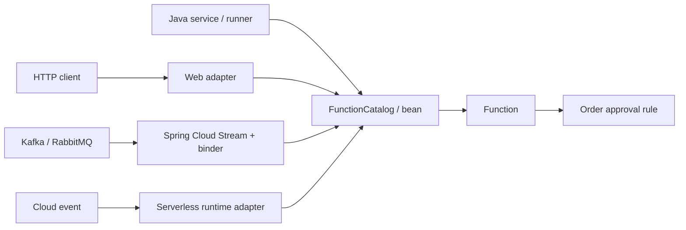
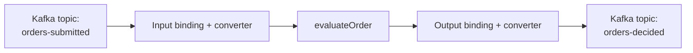

# Running Modes: In-Application, HTTP, Messaging, and Serverless

## 1. One Business Function Can Run in Four Environments

Suppose an order service needs to enforce a rule: the order ID must not be blank, and the amount must be greater than 0 and not exceed 1,000,000 VND. The service may need to return a decision immediately to an admin dashboard, process an event from Kafka, or respond when triggered by a serverless platform. Instead of rewriting the rule at every entry point, you define **one business function with a clear data contract**, then choose the appropriate activation mechanism.

In the **Spring Cloud Function** (`SPRING_CLOUD_FUNCTION`) module, logic is expressed via Java interfaces `Supplier<T>`, `Function<T, R>`, and `Consumer<T>`. Spring Cloud Function manages lookup via `FunctionCatalog`, composition, and message conversion in contexts supported by an adapter. One function can be used inside a Java application, exposed over HTTP, connected to a messaging system, or packaged for a serverless environment.

**"Running the same function" means reusing the code and business contract.** Each process or deployment environment still has its own Spring ApplicationContext, beans, configuration, dependencies, and lifecycle. There is no single Java object shared across multiple processes just because they declare the same function name.



The diagram shows **entry-point options**. Depending on the invocation style, the result after `Function.apply()` is used directly by the caller, converted into an HTTP response, emitted as an output message, or encoded per the runtime's contract.

## 2. Orientation Table for the Four Running Modes

| Running Mode | Who Triggers It? | Integration Component | Form of Result | Use When |
| --- | --- | --- | --- | --- |
| **In-application** | Java service, runner, internal task. | Bean injection or `FunctionCatalog.lookup()`. | Returns a Java object to the caller. | Logic used within the same process, testing, local tasks. |
| **HTTP** | Client sends a request. | Spring Cloud Function Web adapter or custom controller. | HTTP response after payload conversion. | APIs requiring request/response. |
| **Messaging** | Broker delivers messages to a consumer or poller triggers a source. | Spring Cloud Stream and corresponding Kafka/RabbitMQ binder. | Output message or side effect; typically asynchronous. | Event processing, integrating services via a broker. |
| **Serverless** | Platform invokes a handler per event/trigger. | Adapter matching the cloud runtime. | Response or side effect per the event source's contract. | Event-driven workloads, invocation-based operations. |

What stays fixed is the **business signature**; what changes is the **adapter, trigger semantics, and operational policies**. An HTTP API has client/gateway timeouts; messages can be redelivered; serverless has its own timeouts and environment-initialization behavior.

## 3. Creating a Shared Business Core

Start with Java types that contain only domain data. Examples use Java 17 or later.

File `OrderDomain.java`:

```java
package demo.orders;

import java.math.BigDecimal;
import java.util.Objects;

public final class OrderDomain {
    private OrderDomain() {}

    public record OrderRequest(
            String orderId,
            BigDecimal amountVnd) {}

    public record OrderDecision(
            String orderId,
            boolean approved,
            String reason) {}

    public static final class OrderPolicy {
        private static final BigDecimal MAX_AMOUNT =
                new BigDecimal("1000000");

        public OrderDecision evaluate(OrderRequest input) {
            Objects.requireNonNull(input, "input");

            String id = input.orderId();
            if (id == null || id.isBlank()) {
                return new OrderDecision(id, false, "MISSING_ORDER_ID");
            }

            BigDecimal amount = input.amountVnd();
            if (amount == null || amount.signum() <= 0) {
                return new OrderDecision(id, false, "INVALID_AMOUNT");
            }
            if (amount.compareTo(MAX_AMOUNT) > 0) {
                return new OrderDecision(id, false, "LIMIT_EXCEEDED");
            }

            return new OrderDecision(id, true, "APPROVED");
        }
    }
}
```

**Notable characteristics** of `OrderPolicy.evaluate()`:

- Accepts `OrderRequest` and returns `OrderDecision`, without using `HttpServletRequest`, Kafka records, or cloud events.
- Rules are expressed in terms of domain data and can be unit tested like any plain Java method.
- Given the same input, output is deterministic because the example uses no mutable state or I/O.
- `BigDecimal` handles monetary comparisons more accurately than binary floating-point types; the contract must define the VND unit and rounding at the source.
- The `reason` code is a business result; adapters decide how to represent it as JSON, a message, or an event response.

Next, register the rule as a functional Spring bean in `OrderFunctionConfig.java`:

```java
package demo.orders;

import java.util.function.Function;
import org.springframework.context.annotation.Bean;
import org.springframework.context.annotation.Configuration;

import demo.orders.OrderDomain.OrderDecision;
import demo.orders.OrderDomain.OrderPolicy;
import demo.orders.OrderDomain.OrderRequest;

@Configuration
public class OrderFunctionConfig {

    @Bean
    OrderPolicy orderPolicy() {
        return new OrderPolicy();
    }

    @Bean
    Function<OrderRequest, OrderDecision> evaluateOrder(
            OrderPolicy policy) {
        return policy::evaluate;
    }
}
```

The `evaluateOrder` bean has the signature `Function<OrderRequest, OrderDecision>` and default name `evaluateOrder`. This is the **Spring Cloud Function contract** that each environment uses. The same rule can also be provided as a shared library across multiple deployed applications.

To bootstrap a standard Spring Boot application:

```java
package demo.orders;

import org.springframework.boot.SpringApplication;
import org.springframework.boot.autoconfigure.SpringBootApplication;

@SpringBootApplication
public class OrderApplication {
    public static void main(String[] args) {
        SpringApplication.run(OrderApplication.class, args);
    }
}
```

In the following examples, the application uses Spring Boot, appropriate Spring Cloud dependencies, and a Spring Cloud BOM **compatible with the Spring Boot version**. Specific dependencies vary by deployment path, while `OrderRequest`, `OrderDecision`, and the `evaluateOrder` bean remain unchanged.

## 4. Mode 1: Invoking the Function Inside a Java Application

The simplest case requires no transport protocol: a service in the same Spring ApplicationContext wants to evaluate an order. Two approaches are common.

### 4.1. Inject the Bean and Call Directly

A Spring component can inject the `Function`:

```java
package demo.orders;

import java.util.function.Function;
import org.springframework.beans.factory.annotation.Qualifier;
import org.springframework.stereotype.Service;
import demo.orders.OrderDomain.OrderDecision;
import demo.orders.OrderDomain.OrderRequest;

@Service
public class OrderPreviewService {
    private final Function<OrderRequest, OrderDecision> evaluate;

    public OrderPreviewService(
            @Qualifier("evaluateOrder")
            Function<OrderRequest, OrderDecision> evaluate) {
        this.evaluate = evaluate;
    }

    public OrderDecision preview(OrderRequest request) {
        return evaluate.apply(request);
    }
}
```

The advantage is explicit Java types and dependencies visible right in the constructor. If the system has a single fixed use case, calling directly like this suffices; not every internal call needs a name-based lookup.

### 4.2. Look Up via FunctionCatalog

When selecting functions by name or composing steps from configuration, use `org.springframework.cloud.function.context.FunctionCatalog`:

```java
// Illustrative snippet inside a service/runner with FunctionCatalog catalog injected.
Function<OrderRequest, OrderDecision> fn =
        catalog.lookup("evaluateOrder");

if (fn == null) {
    throw new IllegalStateException(
            "Function evaluateOrder was not registered");
}

OrderDecision decision = fn.apply(
        new OrderRequest("ORD-101", new BigDecimal("750000")));
// OrderDecision("ORD-101", true, "APPROVED")
```

A console application can call this from an `ApplicationRunner`, read data from arguments, and exit afterward if no background component keeps the JVM alive. Choose the appropriate Spring Cloud Function context dependency and disable the web server when running as a console app:

```yaml
spring:
  main:
    web-application-type: none
```

This runs **within the same process**, not over HTTP or serverless. If the application has a task scheduler or batch runner, those components decide when to call the function; `FunctionCatalog` only helps look up the function by name and provides an invocation handle.

The lookup result may be a framework-prepared wrapper around the bean for composition or data conversion. Therefore, do not use `==` expecting lookup to return the exact original Spring bean instance. What matters is the **contract and the result**.

## 5. Mode 2: Exposing the Function over HTTP

To have Spring Cloud Function provide an HTTP adapter, add the Maven dependency:

```xml
<dependency>
    <groupId>org.springframework.cloud</groupId>
    <artifactId>spring-cloud-starter-function-web</artifactId>
</dependency>
```

When the application runs on port 8080 with the web adapter configured, you can call the function by its endpoint name. Example:

```bash
curl -X POST http://localhost:8080/evaluateOrder \
  -H "Content-Type: application/json" \
  -d '{"orderId":"ORD-101","amountVnd":750000}'
```

Expected business result:

```json
{
  "orderId": "ORD-101",
  "approved": true,
  "reason": "APPROVED"
}
```

Processing flow:

```text
HTTP POST /evaluateOrder
    → HTTP adapter reads JSON body
    → converts payload into OrderRequest
    → looks up/invokes evaluateOrder.apply(request)
    → converts OrderDecision into JSON response
```

This is **one automated HTTP adaptation mechanism**, not Spring turning every arbitrary bean into a REST controller. If you need an API with custom paths, status codes, validation, or error bodies, you can write a `@RestController` that calls the same `evaluateOrder` bean:

```java
@RestController
class OrderController {
    private final Function<OrderRequest, OrderDecision> evaluate;

    OrderController(
            @Qualifier("evaluateOrder")
            Function<OrderRequest, OrderDecision> evaluate) {
        this.evaluate = evaluate;
    }

    @PostMapping("/api/orders/decision")
    OrderDecision decide(@RequestBody OrderRequest request) {
        return evaluate.apply(request);
    }
}
```

The controller snippet is **a separate HTTP option**, requiring the corresponding Spring Web dependency and annotation imports. Do not enable endpoints with overlapping paths from both a controller and the adapter without verifying how Spring routes requests.

**Distinguishing business results from HTTP errors:** an over-limit order can return `approved=false`; that is a valid decision. Conversely, malformed JSON or a missing content type may prevent the HTTP adapter from building an `OrderRequest`; this error must be mapped to an HTTP error per the API contract. A function should not construct `ResponseEntity` itself when the goal is reuse across Kafka or serverless.

## 6. Mode 3: Processing Messages with Spring Cloud Stream

For Kafka or RabbitMQ, applications typically use **Spring Cloud Stream** with the corresponding binder. Spring Cloud Stream connects a function to input/output channels via *functional bindings*; the binder handles broker communication and many operational aspects of message streams.

Example adding the Kafka binder:

```xml
<dependency>
    <groupId>org.springframework.cloud</groupId>
    <artifactId>spring-cloud-stream-binder-kafka</artifactId>
</dependency>
```

With the same `evaluateOrder` bean from section 3, configure `application.yml`:

```yaml
spring:
  cloud:
    function:
      definition: evaluateOrder
    stream:
      bindings:
        evaluateOrder-in-0:
          destination: orders-submitted
          group: order-policy
          content-type: application/json
        evaluateOrder-out-0:
          destination: orders-decided
          content-type: application/json
      kafka:
        binder:
          brokers: localhost:9092
```

When the application runs with an active Kafka broker and proper binder configuration:

- The `evaluateOrder-in-0` binding receives messages from `orders-submitted`.
- The binder and converter transform the payload into `OrderRequest` based on generic types and content type.
- Spring Cloud Function invokes `evaluateOrder.apply(request)`.
- The `OrderDecision` result is converted into a message sent via `evaluateOrder-out-0` to `orders-decided`.
- `group: order-policy` defines the consumer group for the receiving side.

Example incoming event payload:

```json
{"orderId":"ORD-101","amountVnd":750000}
```

Outgoing event payload in business terms:

```json
{"orderId":"ORD-101","approved":true,"reason":"APPROVED"}
```



Unlike HTTP, the producer typically **does not wait synchronously for the result over the same connection**. An event can be redelivered by the broker; the binder can apply retries, dead-lettering, or acknowledgment strategies depending on configuration and version. A function returning an object successfully does not by itself prove the broker persisted the output. When logic has side effects such as updating inventory or charging payments, appropriate transaction boundaries and idempotency are required.

### 6.1. Supplier and Consumer in Messaging

With `Function<T, R>`, messages arrive and produce output messages. The other two function types have distinct roles:

| Function Type | Typical Binding | How It Is Triggered |
| --- | --- | --- |
| `Supplier<T>` | Output only, e.g., `policyVersion-out-0`. | Poller or configured source trigger mechanism. |
| `Function<T, R>` | Input and output, e.g., `evaluateOrder-in-0` / `evaluateOrder-out-0`. | An input message arrives to be processed. |
| `Consumer<T>` | Input only, e.g., `auditDecision-in-0`. | An input message arrives to execute a side effect. |

Example source:

```java
@Bean
Supplier<String> policyVersion() {
    return () -> "policy-v1";
}
```

`Supplier` does not run periodically on its own; if a poller is configured, the adapter invokes `get()` at the configured interval. A supplier that always returns the same value can emit duplicate messages when polled repeatedly. With `Consumer`, `accept()` returns `void` and creates no output binding; message acknowledgment is still governed by the broker/binder.

These three functional configurations should be chosen according to the application's purpose. Do not assume every `Supplier`, `Function`, and `Consumer` bean will automatically bind the way you want when multiple beans exist. Declare `spring.cloud.function.definition` appropriately and verify the binding names of the active pipeline.

## 7. Mode 4: Serverless

In the **serverless** model, code is packaged for a platform to invoke on an event/trigger. AWS Lambda is a common example, though the handler contract, event envelope, packaging, and configuration depend on the **specific platform**.

Spring Cloud Function provides adapters for several serverless runtimes. The goal is to connect the runtime's handler to a registered function without introducing platform SDKs into `OrderPolicy`.

Conceptual processing flow:

```text
Cloud trigger (HTTP gateway / queue / event bus / ...)
    → runtime initializes or reuses environment
    → adapter receives event, converts format
    → FunctionCatalog.lookup("evaluateOrder")
    → evaluateOrder.apply(OrderRequest)
    → adapter converts OrderDecision back to trigger contract
```

Example configuration to select a function:

```yaml
spring:
  cloud:
    function:
      definition: evaluateOrder
```

The `spring.cloud.function.definition` property selects the function or composition when supported by the adapter; **it does not automatically create** an AWS Lambda function, IAM role, event source mapping, or deployment. You must select version-compatible adapter and handler artifacts, build the package per the runtime's instructions, and configure permissions, environment variables, memory, timeouts, and triggers.

### 7.1. The Event Envelope Matters More Than the Function Name

A **direct invocation** might send a caller-defined payload:

```json
{"orderId":"ORD-101","amountVnd":750000}
```

However, an API Gateway event typically includes HTTP metadata and a body; an SQS event may contain a list of records, each with its own body. The adapter or handler must know **how to extract the business payload from the envelope**. Do not assume every Lambda JSON event can be passed straight into `Function<OrderRequest, OrderDecision>`.

Pseudocode example (not fixed Spring/AWS API names):

```text
handle(platformEvent):
    orderRequest = decodeEvent(platformEvent)
    fn = functionCatalog.lookup("evaluateOrder")
    decision = fn.apply(orderRequest)
    return encodeForTrigger(decision)
```

For batch event sources, the handler must decide how to process each record, whether one record's error fails the entire batch, and how partial-failure reporting works if the platform supports it. With asynchronous triggers, an event can be retried, so idempotency is needed whenever business logic produces side effects.

### 7.2. Constraints Outside the Function Contract

Even though the logic stays unchanged, serverless deployments must account for cold starts, Spring context startup time, execution time limits, memory, networking, and resource permissions. If a function must call a database, HTTP client, or secrets manager, the adapter/runtime needs corresponding connectivity configuration. These constraints are not solved merely by switching `@RestController` to `@Bean Function`.

## 8. Detailed Semantic Comparison Across the Four Environments

| Aspect | In-Application | HTTP | Messaging | Serverless |
| --- | --- | --- | --- | --- |
| **Call initiation** | Java calls `apply()`. | Client sends a request. | Broker delivers a message or poller runs. | Platform invokes handler. |
| **Input data** | Existing Java object. | Body, path, query, headers. | Payload and message headers. | Event envelope per trigger. |
| **Result** | Object returned to caller. | HTTP response. | Output message or side effect. | Response, ack, or side effect per contract. |
| **Synchrony** | Depends on direct caller code. | Usually request/response. | Usually asynchronous via broker. | Depends on sync/async trigger. |
| **Errors** | Exception or business result. | HTTP status/body or timeout. | Retries, redelivery, dead-letter per binder. | Failure/retry per runtime/event source. |
| **Lifecycle management** | Running JVM and Spring context. | Web server/gateway. | Consumer and broker. | Cloud runtime/invocation. |
| **Addressing / routing** | Bean name or code reference. | Endpoint and HTTP method. | Destination, binding, group. | Handler, trigger, event source. |

For example, the same order `ORD-101` with amount 750,000 VND produces the same `OrderDecision`. Yet it can surface as:

- The return value of `OrderPreviewService.preview()`.
- A JSON response from `POST /evaluateOrder`.
- A JSON payload on topic `orders-decided`.
- Data returned by a Lambda adapter following the trigger source's contract.

**Business consistency** is what can be tested in the Java layer; **transport correctness** must be tested separately in each adapter.

## 9. Messages, Data Types, and Payload Conversion

Spring Cloud Function supports message conversion in appropriate contexts, but that does not mean arbitrary payloads automatically map correctly. For environments to share a function, keep the contract explicit:

```text
OrderRequest {
  orderId: String
  amountVnd: BigDecimal
}
       |
       v
Function<OrderRequest, OrderDecision>
       |
       v
OrderDecision {
  orderId: String
  approved: boolean
  reason: String
}
```

Common pitfalls:

1. **Generic types:** the `Function<OrderRequest, OrderDecision>` signature gives the framework the metadata needed to infer input/output types; avoid raw `Function` declarations.
2. **Content type:** HTTP or Stream must have a matching converter to process JSON; configuring `application/json` alone does not guarantee schema correctness.
3. **Metadata:** HTTP headers, Kafka keys, correlation IDs, or Lambda request IDs carry their own semantics. Bring them into the domain only when rules genuinely require them.
4. **Schema version:** renaming `amountVnd`, changing currency units, or altering event structure is a contract change requiring versioning.
5. **Invalid data:** unparseable JSON is a conversion error, whereas `amountVnd=0` can be structurally valid input rejected by business rules.

When Spring Messaging headers are needed, you can define:

```java
Function<Message<OrderRequest>, Message<OrderDecision>>
```

`Message<T>` belongs to `org.springframework.messaging` and contains a payload and headers. This type is useful when metadata is part of the work, though it couples the signature to messaging abstractions. If you only need to evaluate an order, `Function<OrderRequest, OrderDecision>` is simpler and easier to call from HTTP, internal Java, and serverless alike.

## 10. FunctionCatalog and Composition Across Multiple Environments

An application might need two steps: normalize the order ID, then evaluate it. You declare an additional bean:

```java
@Bean
Function<OrderRequest, OrderRequest> normalizeOrder() {
    return request -> new OrderRequest(
            request.orderId() == null
                    ? null : request.orderId().strip(),
            request.amountVnd());
}
```

With beans named `normalizeOrder` and `evaluateOrder`, Spring Cloud Function allows looking up the composition:

```java
Function<OrderRequest, OrderDecision> pipeline =
        catalog.lookup("normalizeOrder|evaluateOrder");
```

Execution flows left to right; the `OrderRequest` output of `normalizeOrder` becomes the input of `evaluateOrder`. To use the pipeline in an adapter that supports definition configuration:

```yaml
spring:
  cloud:
    function:
      definition: "normalizeOrder|evaluateOrder"
```

This expression specifies **which logic to invoke**, while exposing HTTP routes, Stream bindings, or serverless handlers remains up to the adapter. For Stream, default binding names for a composition may depend on the pipeline definition and version; verify the actual generated names or set explicit binding names per the corresponding mechanism before deploying.

Error note for composition: if `normalizeOrder` throws an exception, `evaluateOrder` receives no input; the adapter interprets the failure according to its own mechanism. Composition does not automatically add transactions or guarantee exactly-once processing.

## 11. How Do Supplier and Consumer Run Differently from Function?

The main example uses `Function<T, R>` because there is an input and a decision is needed. The other two interfaces fit different task shapes:

```java
@Bean
Supplier<String> policyVersion() {
    return () -> "order-policy-v1";
}

@Bean
Consumer<OrderDecision> auditDecision() {
    return decision -> System.out.println(
            "AUDIT " + decision.orderId()
                    + " -> " + decision.reason());
}
```

| Environment | Supplier | Consumer |
| --- | --- | --- |
| **In-application** | Caller invokes `get()` when a snapshot is needed. | Caller invokes `accept()` when a side effect is needed. |
| **HTTP** | Adapter can expose an endpoint to read the value. | Adapter can receive POST and call `accept()`; no business result object. |
| **Messaging** | Poller/source sends data to an output binding. | Input binding receives data and executes side effects, typically with no output binding. |
| **Serverless** | Handler/adapter is triggered to fetch a value if the contract fits. | Handler/adapter processes the event and reports completion/failure per runtime, returning no business value. |

`Supplier` is not a scheduler; `Consumer` returning `void` is not a broker commit acknowledgment. Especially for consumers writing to a database, idempotency is required whenever HTTP requests, messages, or cloud events can be re-executed.

## 12. Testing Along the Boundaries of Each Deployment Mode

A system that reuses logic should have **two layers of tests with distinct purposes**.

### 12.1. Business Unit Tests, Without HTTP, Kafka, or Cloud

```java
package demo.orders;

import static org.junit.jupiter.api.Assertions.assertEquals;
import static org.junit.jupiter.api.Assertions.assertTrue;
import java.math.BigDecimal;
import org.junit.jupiter.api.Test;
import demo.orders.OrderDomain.OrderPolicy;
import demo.orders.OrderDomain.OrderRequest;

class OrderPolicyTest {
    private final OrderPolicy policy = new OrderPolicy();

    @Test
    void approvesOrderWithinLimit() {
        var decision = policy.evaluate(
                new OrderRequest(
                        "ORD-101", new BigDecimal("750000")));
        assertTrue(decision.approved());
        assertEquals("APPROVED", decision.reason());
    }
}
```

Add tests for null/blank order ID, null amount, zero, negative, exact 1,000,000, and over-limit values. These belong to the business contract and do not require running a broker.

### 12.2. Integration / Contract Tests for Each Adapter

| Execution Path | What to Verify |
| --- | --- |
| **In-application** | Beans are created by Spring, `FunctionCatalog.lookup("evaluateOrder")` succeeds, composition order and data are correct. |
| **HTTP** | Endpoints, JSON mapping, status codes, parse errors, authentication, and timeouts match the API contract. |
| **Messaging** | Bindings/destinations, groups, converters, output events, redelivery, retries, and dead-letter handling when applicable. |
| **Serverless** | Real event envelopes, handler configuration, record mapping, trigger response/failure semantics, and timeouts/cold starts. |

When only a broker or endpoint changes, `OrderPolicy` unit tests stay intact; when the amount limit rule changes, unit tests must be updated for the new policy. Good design separates the cost of testing **business rules** from the cost of testing **deployment**.

## 13. Common Deployment Mistakes

| Misconception | Accurate Understanding |
| --- | --- |
| "Having `@Bean Function` runs automatically." | You need a caller, adapter, or trigger. Beans do not schedule themselves. |
| "If HTTP works, Kafka receives messages automatically." | You need Spring Cloud Stream, a binder, bindings, and broker configuration. |
| "`FunctionCatalog` is an HTTP server." | The catalog registers/looks up functions; the web adapter connects to HTTP. |
| "`Supplier` emits data exactly once automatically." | Frequency is controlled by the caller/poller/runtime; it can be re-triggered. |
| "Returning successfully from `Function` means the output event was durably written." | Sending/acknowledgment belongs to the binder/broker and can fail after the function produces a result. |
| "`Consumer` returning `void` means the broker acknowledged the message." | The return type does not control acknowledgment or transactions. |
| "JSON in Kafka is identical to JSON in every cloud event." | Event envelopes/schemas and converters vary by invocation source. |
| "Serverless guarantees each event is processed only once." | Some triggers retry or redeliver, requiring idempotency for side effects. |
| "Composition lets you chain any two functions." | Output/input types must match; side effects and errors still need design. |
| "You can run Web adapter, Stream binder, and Lambda without changing dependencies." | Each environment has its own adapter, runtime, and packaging/configuration. |

## 14. Workflow for Choosing a Running Mode for a New Feature

1. **Define the business operation:** what are the input and output? If a result is returned, use `Function<T, R>`; if only producing data, consider `Supplier`; if only performing an action, consider `Consumer`.
2. **Write and test the Java core:** remove HTTP/broker/cloud details from the rules; finalize schemas and data units.
3. **Register the bean with a stable name:** e.g., `evaluateOrder`; look up via `FunctionCatalog` when dynamic name selection or composition is needed.
4. **Choose the entry point:** inject inside the application, use the web adapter for APIs, Stream binder for events, or serverless adapter for cloud triggers.
5. **Configure per environment:** endpoints, destinations/groups, handlers/triggers, content types, and corresponding dependencies.
6. **Design error handling and operations:** separate business decisions from parse/I/O errors; address retries, idempotency, transactions, tracing, and timeouts.
7. **Test contracts and deployments:** verify the same domain data yields the same decision, while each adapter reads and returns data per its own contract.

**Self-practice exercise:** take `OrderPolicy` and `evaluateOrder` from section 3 and invoke them once from an `ApplicationRunner`, once with `curl` via Spring Cloud Function Web, and once via a message on a configured Kafka broker. Then describe the payload, adapter, and handler needed to reuse the function on an AWS Lambda trigger. The business result for `ORD-101` and 750,000 VND must stay consistent; **the transport path, trigger timing, and result recording** may differ. That is the goal of running the same logic across **in-application, HTTP, messaging, and serverless**.
