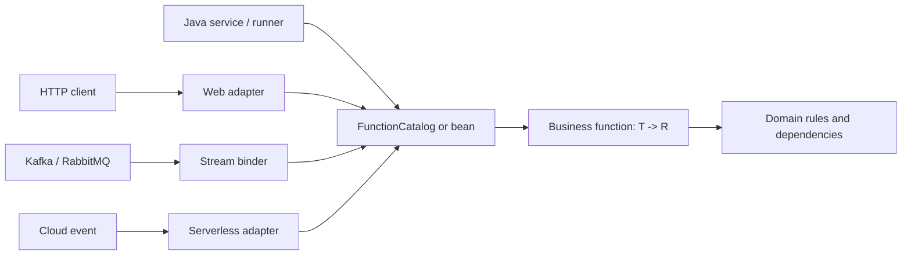

# Suitable Use Cases and Limitations of the Function Model

## 1. Why Know When to Use — and Not Use — the Function Model?

An e-commerce system may need to calculate shipping fees for the same cart across three paths: a checkout screen sending an HTTP request, another service emitting an event after order creation, and a serverless task handling scheduled requests. If the fee rule is written three times in a controller, a message listener, and a cloud handler, policy changes easily cause inconsistent results.

**Spring Cloud Function** (the `SPRING_CLOUD_FUNCTION` module) solves a key part of this problem: expressing business logic via standard Java interfaces `Supplier`, `Function`, and `Consumer`; registering and looking up functions via `FunctionCatalog`; and supporting composition and message handling/conversion in appropriate contexts. Adapters can invoke the same function over HTTP, event systems, or a serverless runtime.

However, **writing code in a functional style does not automatically make a system simpler**. A request that runs for hours, spans multiple distributed transactions, and requires checkpoints is unlikely to fit a simple `Function` chain. An API needing fine-grained HTTP status control, authentication, and specialized streaming may still require a controller or WebFlux handler. Learning the function model must go hand in hand with understanding its **boundaries**.

The goal of this article is to answer three questions:

1. **When** should a use case be expressed as a `Supplier`, `Function`, or `Consumer`?
2. **When** should you use `FunctionCatalog`, composition, and adapters instead of writing a plain Java service?
3. **Which limitations** remain the responsibility of business logic, protocols, storage systems, and deployment platforms?

## 2. The Function Model Is a Way to Organize Logic, Not a Complete Architecture

The three core interfaces come from `java.util.function`:

| Interface | Method | Shape | Business Example |
| --- | --- | --- | --- |
| `Supplier<T>` | `get()` | Takes no input, returns `T`. | Providing the current fee schedule version. |
| `Function<T, R>` | `apply(T)` | Takes `T`, returns `R`. | Calculating shipping fees based on cart and delivery region. |
| `Consumer<T>` | `accept(T)` | Takes `T`, returns no value. | Writing an audit log or sending a notification. |

These interfaces define **the Java invocation shape**, not automatically when calls occur, where data comes from, how security works, or how errors are handled. Spring Cloud Function adds capabilities so functions can be managed as beans, looked up by name, composed, and consumed by adapters.



**What can stay the same:** type `T`, type `R`, fee-calculation rules, and business unit tests.

**What cannot be ignored:** HTTP mapping, message bindings, schema/versioning, resource permissions, transactions, retries, timeouts, and runtime requirements. Adapters help **connect** these parts; they do not replace that entire infrastructure.

## 3. Cases Where Spring Cloud Function Fits Especially Well

### 3.1. A Transformation with Clear Input and Output

Operations such as normalization, classification, fee calculation, rule checking, data enrichment, or scoring have a natural `T -> R` contract. When the core is mostly **stateless** and deterministic, the function is easy to unit test and has minimal environment dependencies.

Example: `ShippingRequest -> ShippingQuote`. The request data does not need HTTP headers, Kafka offsets, or cloud context.

### 3.2. The Same Rule Invoked Across Multiple Protocols

A function can be called directly from Java, exposed via Spring Cloud Function Web, connected to a broker via a Spring Cloud Stream binder, or triggered by a serverless adapter. **Logic reuse** is the benefit; each invocation path still has its own dependencies and configuration.

This is helpful when an organization wants to move from synchronous APIs to event-driven processing without duplicating business conditions.

### 3.3. Event Sources and Sinks with Simple Shapes

`Supplier` makes sense when emitting a value on a cadence **determined by a poller**; `Consumer` fits a sink performing an action. `Function` fits when transforming an input event into an output event.

Example: receive `OrderCreated`, compute `ShippingQuote`, emit `ShippingQuoted`. For straightforward pipelines with clear schemas, Spring Cloud Stream's functional bindings can make handler code easier to follow.

### 3.4. Selecting Functions and Chaining Steps by Name

`FunctionCatalog.lookup("normalize|quote")` can represent a pipeline of registered functions. Composition helps organize **type-compatible** steps and switch pipeline selection via configuration without building a custom function-name registry.

The benefit is clearest when the pipeline is a relatively linear transformation chain. Workflows with branching, timers, long-lived state, and complex compensation do not automatically reduce to simple composition.

### 3.5. Testing Business Logic Independently of Infrastructure

The Java core can be tested using `apply()` alone. HTTP, Kafka, or serverless adapters have their own contract tests. When updating a shipping fee formula, rule tests change without having to rewrite logic across every entry point.

### 3.6. Packaging a Processing Endpoint for Serverless

A `Function` with relatively small inputs/outputs, execution time within runtime limits, and manageable dependencies can be a good FaaS candidate. Spring Cloud Function lets you reuse the bean with a corresponding adapter, though cold starts and Spring context startup still require measurement.

## 4. Complete Example of a Well-Suited Function

Suppose the shipping fee policy is:

- The request must have non-blank `orderId` and `region`.
- The order subtotal must be non-negative.
- Orders with a subtotal of 500,000 VND or more receive free shipping.
- Other orders have a base fee of 20,000 VND in zone `INNER` and 40,000 VND in zone `OUTER`.
- Any region outside the supported set is treated as invalid input, not defaulted to `OUTER`.

### 4.1. Defining Data Types and Plain Java Logic

```java
package example.shipping;

import java.math.BigDecimal;
import java.util.Locale;
import java.util.Objects;

public final class ShippingPolicy {
    private static final BigDecimal FREE_THRESHOLD =
            new BigDecimal("500000");
    private static final BigDecimal INNER_FEE =
            new BigDecimal("20000");
    private static final BigDecimal OUTER_FEE =
            new BigDecimal("40000");

    public record ShippingRequest(
            String orderId,
            String region,
            BigDecimal subtotalVnd) {}

    public record ShippingQuote(
            String orderId,
            BigDecimal feeVnd,
            String tariffCode) {}

    public ShippingQuote quote(ShippingRequest request) {
        Objects.requireNonNull(request, "request");
        if (request.orderId() == null || request.orderId().isBlank()) {
            throw new IllegalArgumentException("Missing orderId");
        }
        if (request.region() == null) {
            throw new IllegalArgumentException("Missing region");
        }
        BigDecimal subtotal = request.subtotalVnd();
        if (subtotal == null || subtotal.signum() < 0) {
            throw new IllegalArgumentException("Invalid subtotal");
        }

        String region = request.region().strip()
                .toUpperCase(Locale.ROOT);
        BigDecimal baseFee = switch (region) {
            case "INNER" -> INNER_FEE;
            case "OUTER" -> OUTER_FEE;
            default -> throw new IllegalArgumentException(
                    "Unsupported region: " + region);
        };

        if (subtotal.compareTo(FREE_THRESHOLD) >= 0) {
            return new ShippingQuote(
                    request.orderId(), BigDecimal.ZERO, "FREE");
        }
        return new ShippingQuote(
                request.orderId(), baseFee, region);
    }
}
```

The `ShippingRequest/ShippingQuote` contract belongs to the shipping domain. `ShippingPolicy` does not read HTTP requests, inspect `MessageHeaders`, or open Kafka connections. If only the data-ingestion mechanism changes, `quote()` needs no edits.

Plain Java invocation example:

```java
var policy = new ShippingPolicy();
var request = new ShippingPolicy.ShippingRequest(
        "ORD-204", "inner", new BigDecimal("450000"));

var quote = policy.quote(request);
// feeVnd = 20000, tariffCode = "INNER"
```

### 4.2. Registering as a Spring Cloud Function Bean

```java
package example.shipping;

import java.util.function.Function;
import org.springframework.context.annotation.Bean;
import org.springframework.context.annotation.Configuration;

import example.shipping.ShippingPolicy.ShippingRequest;
import example.shipping.ShippingPolicy.ShippingQuote;

@Configuration
public class ShippingFunctions {
    @Bean
    ShippingPolicy shippingPolicy() {
        return new ShippingPolicy();
    }

    @Bean
    Function<ShippingRequest, ShippingQuote> quoteShipping(
            ShippingPolicy policy) {
        return policy::quote;
    }
}
```

The bean has the default name `quoteShipping`. With the appropriate Spring Cloud Function dependencies, the framework detects the function bean and enables lookup via `FunctionCatalog`:

```java
// Placed inside a Spring service/runner with FunctionCatalog catalog injected.
Function<ShippingPolicy.ShippingRequest,
         ShippingPolicy.ShippingQuote> function =
        catalog.lookup("quoteShipping");

if (function == null) {
    throw new IllegalStateException("quoteShipping not registered");
}

var result = function.apply(
        new ShippingPolicy.ShippingRequest(
                "ORD-204", "INNER", new BigDecimal("450000")));
```

**Distinction:** Injecting `Function<ShippingRequest, ShippingQuote>` directly also lets you call `apply()`. `FunctionCatalog` is especially helpful when selection by name, composition, or adapter integration is required; you do not have to use catalog lookup every time when the dependency is fixed.

### 4.3. Same Function over HTTP or Messaging

When `spring-cloud-starter-function-web` is installed using Spring Boot with a compatible Spring Cloud BOM, the web adapter can map the function name to an endpoint:

```bash
curl -X POST http://localhost:8080/quoteShipping \
  -H "Content-Type: application/json" \
  -d '{"orderId":"ORD-204","region":"INNER","subtotalVnd":450000}'
```

Expected business result:

```json
{
  "orderId": "ORD-204",
  "feeVnd": 20000,
  "tariffCode": "INNER"
}
```

When running in a Spring Cloud Stream application with a matching Kafka binder, the same bean can be selected:

```yaml
spring:
  cloud:
    function:
      definition: quoteShipping
    stream:
      bindings:
        quoteShipping-in-0:
          destination: shipping-requests
          group: shipping-calculator
          content-type: application/json
        quoteShipping-out-0:
          destination: shipping-quotes
          content-type: application/json
      kafka:
        binder:
          brokers: localhost:9092
```

This Stream snippet is only an example for **messaging deployment**: `spring-cloud-stream-binder-kafka`, a broker, and compatible dependency versions are required. The same `ShippingRequest` can arrive from a JSON message; the binder and converter handle transport and invoke `quoteShipping`.

With serverless, the corresponding handler/adapter can convert a matching event into `ShippingRequest` and invoke the same bean. **There is no single packaging model across every runtime**: AWS Lambda, API Gateway, SQS, or other platforms may use different event envelopes and retry semantics.

## 5. Evaluation Criteria Before Choosing the Function Model

A use case with the traits below is usually a **strong candidate**:

| Criterion | Favorable Signal | Signal Requiring Caution |
| --- | --- | --- |
| **Data contract** | Clear request and result types exist. | Input is long-lived session state or must inspect many parts of an HTTP session. |
| **Protocol coupling** | Rules need only the business payload. | Rules constantly inspect cookies, broker offsets, or cloud event metadata. |
| **Processing locality** | A transformation or logic step with clear boundaries. | Long-running workflow waiting for human approvals, multiple timers, and compensations. |
| **Statefulness** | Stateless, or state lives in well-bounded dependencies. | Relies on mutable state in a singleton bean or local state across invocations. |
| **Testability** | Can be unit tested via inputs/outputs. | Must boot the whole system to tell whether the function is right or wrong. |
| **Multi-environment** | One piece of logic needed across APIs, events, or FaaS. | Only a single complex HTTP endpoint with no need for composition. |
| **Error semantics** | Domain decisions can be separated from transport/I/O errors. | Needs distributed transactions or exactly-once guarantees across multiple services. |
| **Performance** | Latency, memory, and cold starts suit the environment. | Resource constraints make runtime initialization infeasible. |

This is a **decision-support table**, not an absolute set of mandates. A `Function` can call a database; however, if it depends heavily on side effects and hard-to-control retries, the benefits of the functional style shrink considerably.

## 6. First Limitation: Function Types Do Not Guarantee Purity or Statelessness

`java.util.function.Function<T, R>` is simply an interface with an `apply()` method. A lambda can still read/write a database, call external APIs, or hold state:

```java
// Anti-pattern if a singleton bean is called concurrently by multiple threads.
AtomicInteger totalCalls = new AtomicInteger();
Function<String, Integer> countCalls =
        orderId -> totalCalls.incrementAndGet();
```

`AtomicInteger` prevents data races on the counter, yet does not solve **business semantics**. When running multiple instances, each instance has its own counter; on restarts or serverless cold starts, state can disappear. If a system-wide total is needed, use an appropriate datastore and consistency strategy.

If a function uses the current time, random numbers, or a frequently changing fee table, the result is no longer a fixed transformation either. Make those dependencies explicit in the design (e.g., `Clock`, repositories, or versioned rule tables) so tests remain predictable and reprocessing effects are understood.

**Recommendation:** keep data-transformation steps as simple and free of side effects as possible; for write operations, place transaction and idempotency boundaries in the appropriate service/adapter.

## 7. Second Limitation: Composition Does Not Replace a Workflow Engine

Spring Cloud Function supports composing type-compatible functions. For example:

```java
@Bean
Function<ShippingPolicy.ShippingRequest,
         ShippingPolicy.ShippingRequest> normalizeRegion() {
    return req -> new ShippingPolicy.ShippingRequest(
            req.orderId(),
            req.region() == null ? null : req.region().strip(),
            req.subtotalVnd());
}
```

When both `normalizeRegion` and `quoteShipping` beans are registered:

```java
Function<ShippingPolicy.ShippingRequest,
         ShippingPolicy.ShippingQuote> pipeline =
        catalog.lookup("normalizeRegion|quoteShipping");
```

The `A|B` expression runs left to right. The output of `normalizeRegion` must match the input of `quoteShipping`.

Composition fits **chains of transformation steps**. However, a flow such as "reserve inventory -> wait 30 minutes for payment -> refund on failure -> alert after 24 hours" also requires:

- Durable workflow state persisted across multiple events and restarts.
- Timers, timeouts, controlled retries, and compensation steps.
- Coordination across multiple services that may independently fail or redeploy.
- Per-execution tracking and resumability after crashes.

`FunctionCatalog` does not provide these capabilities on its own. You may need a **workflow orchestrator, saga, Spring Batch, or dedicated state system**, depending on the problem. Composition does not turn steps into an atomic transaction or a checkpointed job system.

## 8. Third Limitation: Message Conversion Does Not Mean Every Payload Is Valid

A function declared as:

```java
Function<ShippingRequest, ShippingQuote>
```

has clear type metadata. Yet the HTTP adapter, Spring Cloud Stream binder, or serverless adapter must still convert JSON/events/messages into Java objects according to content types, converters, and schemas.

For example, the payload:

```json
{"orderId":"ORD-204","region":"INNER","subtotalVnd":450000}
```

can produce a `ShippingRequest` when handled properly by an adapter. Payloads from AWS SQS usually arrive inside an event containing multiple records, each with its own body; they are **not automatically** a `ShippingRequest`. Likewise, a raw JSON string passed straight into an ordinary `Function.apply()` call will not automatically turn into a domain object.

Distinguish clearly:

| Issue | Appropriate Place to Handle |
| --- | --- |
| Unreadable JSON or wrong content type | Adapter and message converter. |
| Missing required fields or invalid field types | Boundary validation/contract and domain rules per policy. |
| Negative `subtotalVnd` or unsupported shipping region | Business rule returning a rejection or throwing a controlled domain error. |
| HTTP headers, Kafka keys, correlation IDs | Adapter or message metadata; pass into the function only if needed. |
| Schema changes between producer/consumer versions | Versioning, schema registry, or data-compatibility strategy. |

If a function genuinely needs headers, you can declare `Function<Message<T>, Message<R>>` using `org.springframework.messaging.Message`. This is helpful, though it couples the contract to messaging abstractions and reduces independence compared with plain domain payloads.

Prefer full generic types such as `Function<ShippingRequest, ShippingQuote>`, avoiding raw `Function` types that lose metadata needed for input/output inference. The catalog may return a wrapper to assist composition and conversion, but do not assume every type is automatically validated at runtime.

## 9. Fourth Limitation: Retries, Idempotency, and Transactions Are Not Guaranteed by FunctionCatalog

Consider a `Consumer<PaymentCaptured>` that updates an order status. If a broker redelivers the same event after the handler already updated the database, the side effect could execute a second time.

`Consumer.accept()` returning `void` **does not mean** the broker acknowledged the message, the database committed, or the sender will not retry. `Function.apply()` returning `ShippingQuote` likewise **does not prove** the output message was durably saved by the broker.

Different environments exhibit different characteristics:

| Context | Common Risk | Handling Approach |
| --- | --- | --- |
| HTTP | Client/gateway retries requests on timeout. | Idempotency keys, API contracts, and business state checks. |
| Messaging | Messages are redelivered, retried, or sent to a dead-letter destination. | Record processed event IDs, proper transactions, retry/DLQ policies. |
| Serverless | Asynchronous invocations or queue triggers retry; batches may reprocess. | Deduplication, partial-failure handling, and runtime timeouts. |
| Internal Java calls | Exceptions occur across multiple I/O steps. | Define transaction boundaries or rollback/compensation mechanisms. |

In particular, when an operation spans a database and a broker, **never assume an atomic transaction across both systems**. Consider transactional outbox, idempotent consumers, choreography/sagas, or transaction mechanisms specifically supported and verified on your infrastructure.

**The function model does not make distributed failures disappear**; it helps isolate rules from transport details so those failures can be handled systematically.

## 10. Fifth Limitation: Performance and Reactivity Do Not Appear Automatically

A synchronous `Function<T, R>` can run very fast in memory, or it can make blocking JDBC calls or synchronous HTTP client requests. Placing that function in a WebFlux, Stream, or serverless application **does not turn blocking code into non-blocking code**.

In WebFlux, calling a blocking function directly on an event-loop thread can hurt throughput and raise latency. When a reactive model is needed, design around `Mono`/`Flux` and non-blocking data sources, or isolate blocking work onto an appropriate scheduler after load testing.

In serverless, JVM and Spring ApplicationContext initialization time can contribute to **cold starts**; memory, database connection counts, concurrency, and timeouts are runtime-specific operational limits. Measure realistically before deciding Spring Cloud Function meets your latency targets.

In Stream, parallelism and throughput also depend on partitions, consumer concurrency, broker speed, and backpressure/error policies. Do not measure processing capacity solely by `apply()` execution time while ignoring serialization, networking, and output publishing.

The function model is **a way to organize processing points**, not a performance guarantee.

## 11. Sixth Limitation: Security and Function Exposure Must Be Designed Separately

A clearly named function in the catalog can be selected by an adapter to expose externally. However, **registering a bean does not automatically add authentication, authorization, rate limiting, or input validation**.

Suppose an application has two functions:

```java
Function<ShippingRequest, ShippingQuote> quoteShipping;
Consumer<String> cancelAllShipments;
```

If clients are allowed to pass arbitrary function names to execute, a consumer with dangerous side effects could be invoked improperly. Allowed function/pipeline names should come from controlled configuration or an explicit allowlist, never from untrusted client strings without validation.

Security controls must be enforced at adapters, gateways, application services, and infrastructure:

- User/service authentication and per-action authorization.
- Restricting which function names or compositions can be triggered.
- Validating input data, payload size, and content type.
- Never logging secrets or sensitive data.
- Applying least privilege to IAM, brokers, and databases.
- Protecting endpoints against repeated requests, traffic spikes, and unauthorized access.

Reusing the same logic across multiple environments can **expand** the attack surface if exposed functions are not strictly governed.

## 12. Problems That Should Not Be Forced into a Single Function

| Scenario | Why a Single `Function` Is Not Enough | Usually Suitable Architectural Direction |
| --- | --- | --- |
| A REST API with rich HTTP semantics, file uploads/streaming, per-route authorization | Most of the complexity lies in the HTTP contract. | MVC controller or WebFlux.fn calling services/business functions. |
| Long-running jobs lasting hours with checkpoints and per-record retries | Requires state tracking and job orchestration. | Spring Batch, Spring Cloud Task, and an orchestrator as needed. |
| Workflows with branching, user wait steps, timeouts, and compensation | Linear composition does not persist long-lived state. | Workflow engine/saga or appropriate state machine. |
| Operations requiring multi-aggregate transactions, locks, and strong consistency | The `T -> R` signature does not express full transaction boundaries. | Application service and appropriate transaction manager. |
| Specialized protocol integration needing manual offset/ack control | Default adapters may not expose the required controls. | Custom consumer/adapter or advanced Stream configuration. |
| An application with a single simple internal service | Catalog, extra dependencies, and config may be unnecessary overhead. | Plain Spring service/Java method; add SCF when clear benefits exist. |
| FaaS workloads with strict cold-start and footprint limits | A full Spring context may increase latency/resource usage. | Benchmark and pick suitable runtime/packaging or lightweight handlers. |

This does not mean Spring Cloud Function **cannot** participate in the systems above. It can represent **a single business step** inside a larger workflow, batch job, or API. Just do not confuse "defining a processing step" with "managing the entire lifecycle and state of the system."

## 13. Comparison with Java Services, Controllers, and Spring Cloud Stream

A useful selection criterion is identifying where the real complexity lives:

| Tool / Approach | Best Fit When | Relationship with Spring Cloud Function |
| --- | --- | --- |
| **Java method / Spring `@Service`** | Logic is used in one app, dependencies are known, and no registry is needed. | Can stay as-is; no requirement to wrap it as a `Function`. |
| **Spring Cloud Function** | Need a functional model, catalog, composition, or multiple adapters. | Provides the function contract and invocation mechanism. |
| **Spring MVC `@RestController`** | Need full control over HTTP methods, routes, status codes, and error schemas. | Controller can inject and call `Function`. |
| **WebFlux.fn** | Functional HTTP routing with reactive processing flows. | Handlers can call business functions, though WebFlux.fn is its own HTTP API. |
| **Spring Cloud Stream** | Connecting sources/sinks to Kafka, RabbitMQ, and other brokers. | Functional bindings use the function model, while still needing binders/config. |
| **Spring Cloud Task / Spring Batch** | Running finite jobs, batch processing, restarts/checkpoints. | Can call the same functions from runners/jobs, while Task/Batch owns the lifecycle. |
| **Serverless runtime adapter** | Invoking logic from a cloud runtime's event source. | Translates events/responses to and from registered functions. |

**There is no architectural rule forcing every method in a project to become a `Function`.** Only business boundaries that benefit from independent function invocation need to be modeled that way.

## 14. The Cost of Splitting Too Many Tiny Functions

Functional thinking often encourages pipelines like `normalize -> validate -> enrich -> decide`. That works well when each step has a clear contract and is reused. However, over-splitting can cause:

- Many bean names and composition strings that are hard to manage.
- Complex intermediate type contracts; a minor change in one step breaks the pipeline.
- Ambiguity over which step owns validation, error handling, and logging.
- Tracing and debugging across wrappers/adapters becoming harder than a clear service call.
- Unnecessary payload conversions or extra I/O round-trips.

A good pipeline has **natural business boundaries**, such as normalizing an address and then calculating a fee. Do not extract `subtotal >= threshold` into its own Spring bean just to create another "function."

Conversely, an oversized function mixing validation, fee calculation, payment calls, email sending, and inventory updates is also hard to test and retry. Split by responsibility and task semantics, not simply by code length.

## 15. Testing Along the Proper Boundaries

### 15.1. Unit Tests for Business Logic

`ShippingPolicy` is plain Java and can be tested without a Spring context:

```java
package example.shipping;

import static org.junit.jupiter.api.Assertions.assertEquals;
import static org.junit.jupiter.api.Assertions.assertThrows;

import java.math.BigDecimal;
import org.junit.jupiter.api.Test;

class ShippingPolicyTest {
    private final ShippingPolicy policy = new ShippingPolicy();

    @Test
    void chargesInnerFeeBelowThreshold() {
        var quote = policy.quote(
                new ShippingPolicy.ShippingRequest(
                        "ORD-204", "INNER",
                        new BigDecimal("450000")));

        assertEquals(new BigDecimal("20000"), quote.feeVnd());
        assertEquals("INNER", quote.tariffCode());
    }

    @Test
    void offersFreeShippingAtThreshold() {
        var quote = policy.quote(
                new ShippingPolicy.ShippingRequest(
                        "ORD-205", "OUTER",
                        new BigDecimal("500000")));

        assertEquals(BigDecimal.ZERO, quote.feeVnd());
        assertEquals("FREE", quote.tariffCode());
    }

    @Test
    void rejectsUnsupportedRegion() {
        assertThrows(IllegalArgumentException.class,
                () -> policy.quote(
                        new ShippingPolicy.ShippingRequest(
                                "ORD-206", "UNKNOWN",
                                new BigDecimal("100000"))));
    }
}
```

Add cases for nulls, blank order IDs, negative subtotals, the 499,999/500,000 VND boundary, normalized regions, and duplicate data. These tests verify **the rules**, not HTTP routes or brokers.

### 15.2. Integration Tests for the Catalog and Adapters

| Test Layer | Questions to Answer |
| --- | --- |
| **Spring context** | Is `quoteShipping` registered with the expected name and type metadata? |
| **FunctionCatalog** | Do lookup and composition return expected results? Are invalid names handled? |
| **HTTP** | Is the JSON body converted into `ShippingRequest` properly? Do error codes/bodies match the API contract? |
| **Stream** | Do bindings consume/publish on the right topics? Are converters, retries, and DLQs configured properly? |
| **Serverless** | Do event envelopes, handlers, timeouts, and trigger response/failure semantics match the trigger source? |
| **Side effects** | Is reprocessing the same event safe and idempotent as required? |

Only by testing both the business contract **and** the integration boundaries can you confirm the function model is applied properly. Having `apply()` pass in unit tests does not prove HTTP serialization, Kafka acknowledgments, or serverless deployment are correct.

## 16. Decision Exercise: Which Path Should You Choose?

Consider three scenarios:

**A. A shipping-fee calculation service** receives a request, returns a quote, and needs to run over both HTTP and event processing. The logic is relatively stateless with stable input/output types. This is a strong candidate for `Function<ShippingRequest, ShippingQuote>`, exposable through different adapters.

**B. An account-management API** has large file uploads, complex sessions, many routes, resource-level authorization, and custom HTTP status codes. A controller or WebFlux.fn may be a better entry point. Individual calculations such as permission-policy evaluation can still live as separate business functions, without forcing the entire API into `FunctionCatalog`.

**C. A payment workflow** must wait for bank confirmation, reserve inventory, send notifications, and compensate after a timeout. Some individual steps can be expressed as `Function` or `Consumer`. However, **workflow state, controlled retries, idempotency, and compensation** require other components; simple composition cannot replace them.

To decide, ask yourself:

1. Can the inputs and outputs be expressed as a clear domain contract?
2. Is there practical value in reusing the same rule across multiple environments or via composition?
3. Does the function have minimal state and side effects, or are stateful dependencies clearly managed?
4. Which layer owns protocols, authentication, timeouts, retries, and transactions?
5. If HTTP is swapped for a broker or serverless, do the business conditions have to change?
6. Are the runtime, testing, debugging, and operational costs justified by the benefits?

## 17. Conclusion and Guiding Principles

**Spring Cloud Function fits best when you need a clear, function-shaped business boundary that can be tested independently and reused across different trigger points.** `Supplier` produces data, `Function` transforms data into a result, and `Consumer` processes input and typically performs side effects. `FunctionCatalog` and composition support registration, lookup, and chaining; web adapters, Spring Cloud Stream binders, and serverless adapters connect them to concrete execution environments.

The key limitation is that **a function signature does not automatically provide durable state, distributed transactions, workflow orchestration, security, exactly-once guarantees, or high performance in every runtime**. Those requirements must be designed and tested at the appropriate layers.

A sound choice is not "turn everything into a function," but rather **use functions for parts that truly are business logic with clear contracts, and use controllers, message binders, services, workflow engines, or runtime adapters for the responsibilities they were built to solve**.
