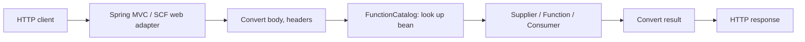

# Exposing a Functional Bean as an HTTP Endpoint in Spring Cloud Function

## 1. Problem and Objectives

In a typical Spring Boot application, developers usually use `@RestController` and `@PostMapping` to expose an API. With **Spring Cloud Function (SCF)**, you can place business logic into standard Java beans—`Supplier`, `Function`, `Consumer`—and use the **HTTP adapter** to expose them as endpoints. The same bean can continue to be used in event streams or serverless environments via the corresponding adapter without rewriting the core logic.

For example, pricing calculation from an item SKU and quantity can be expressed as `Function<QuoteRequest, QuoteResponse>`. When web integration is added, the client sends JSON to `POST /quote`; SCF converts the body into `QuoteRequest`, invokes the function, and serializes `QuoteResponse` to JSON.

After this lesson, learners will be able to:

- Distinguish between a **functional bean**, `FunctionCatalog`, and the HTTP adapter.
- Expose `Supplier`, `Function`, and `Consumer` as endpoints without manually writing a controller for each bean.
- Call endpoints with `text/plain` and `application/json` payloads, and understand common HTTP methods and status codes.
- Customize paths, select which functions are exposed, and invoke function chains (*composition*).
- Recognize the limitations of using SCF instead of a full REST API.

## 2. How Does SCF Turn a Bean into an Endpoint?

In SCF's programming model, the three function types have distinct semantics:

| Bean type | Java contract | Meaning | Typical HTTP invocation |
| --- | --- | --- | --- |
| `Supplier<O>` | `O get()` | Produces data, takes no input | `GET /supplierName` |
| `Function<I, O>` | `O apply(I input)` | Accepts data and returns a result | `POST /functionName` |
| `Consumer<I>` | `void accept(I input)` | Accepts data to perform an action, with no business return value | `POST /consumerName` |

SCF discovers and registers matching beans in **`FunctionCatalog`**. When an application includes `spring-cloud-function-web` in a Spring MVC environment, the adapter's auto-configuration creates HTTP mappings to the functions. The bean name becomes the default path name.



**Key takeaway:** `@Bean Function<...>` only declares a function in the application. The ability for the function to receive HTTP requests comes from the web adapter dependency and configuration. You do not need to add `@RequestMapping` to the function.

## 3. Setting Up the Spring Boot Project

The example below assumes a working Spring Boot project using Java 17 or higher to declare DTOs with `record`. With Maven, you need Spring MVC and SCF's HTTP adapter:

```xml
<dependencies>
    <dependency>
        <groupId>org.springframework.boot</groupId>
        <artifactId>spring-boot-starter-web</artifactId>
    </dependency>
    <dependency>
        <groupId>org.springframework.cloud</groupId>
        <artifactId>spring-cloud-function-web</artifactId>
    </dependency>
</dependencies>
```

In a real project, manage Spring Boot and Spring Cloud Function versions using a compatible BOM. Do not attach an arbitrary SCF version to an existing Spring Boot project. You can use `spring-cloud-starter-function-web` as a convenient starter option when creating a new project. With Spring Boot 4.x, the recommended MVC starter name is `spring-boot-starter-webmvc`; the dependency example above also works for Spring Boot 3.x projects.

No extra configuration is needed yet to expose named functions; the web adapter uses the `/` path prefix by default. The examples below run on `http://localhost:8080`.

## 4. Complete Example: Five Functional Beans in One Application

Create the class `FunctionHttpApplication.java`:

```java
package demo.scf;

import java.math.BigDecimal;
import java.util.Locale;
import java.util.function.Consumer;
import java.util.function.Function;
import java.util.function.Supplier;

import org.springframework.boot.SpringApplication;
import org.springframework.boot.autoconfigure.SpringBootApplication;
import org.springframework.context.annotation.Bean;

@SpringBootApplication
public class FunctionHttpApplication {

    public static void main(String[] args) {
        SpringApplication.run(FunctionHttpApplication.class, args);
    }

    // Function: cleans input, can be composed with another function.
    @Bean
    public Function<String, String> normalize() {
        return String::trim;
    }

    // Function: example of text processing via text/plain.
    @Bean
    public Function<String, String> uppercase() {
        return text -> text.toUpperCase(Locale.ROOT);
    }

    // Function: receives JSON, executes business logic, and returns JSON.
    @Bean
    public Function<QuoteRequest, QuoteResponse> quote() {
        return request -> {
            if (request == null
                    || request.sku() == null
                    || request.sku().isBlank()
                    || request.quantity() <= 0) {
                throw new IllegalArgumentException(
                        "sku must have a value and quantity must be > 0");
            }

            BigDecimal unitPrice = new BigDecimal("120000");
            BigDecimal totalPrice = unitPrice.multiply(
                    BigDecimal.valueOf(request.quantity()));
            return new QuoteResponse(
                    request.sku(), request.quantity(), totalPrice);
        };
    }

    // Supplier: generates data when the client calls GET.
    @Bean
    public Supplier<ServiceStatus> serviceStatus() {
        return () -> new ServiceStatus("SPRING_CLOUD_FUNCTION", "READY");
    }

    // Consumer: processes input; example only logs length to avoid logging raw data.
    @Bean
    public Consumer<String> auditEvent() {
        return payload -> System.out.println(
                "Received event with length: " + payload.length());
    }

    public record QuoteRequest(String sku, int quantity) {}

    public record QuoteResponse(
            String sku, int quantity, BigDecimal totalPrice) {}

    public record ServiceStatus(String service, String state) {}
}
```

The beans `normalize`, `uppercase`, `quote`, `serviceStatus`, and `auditEvent` are named after their `@Bean` methods. SCF uses those names when looking up functions in the catalog and mapping URLs. The price `120000` in the example is just a fixed sample value; a real application would retrieve prices from a controlled data source.

Start the application with:

```bash
./mvnw spring-boot:run
```

On Windows, you can run `.\mvnw.cmd spring-boot:run`; if the project does not have the Maven Wrapper, use `mvn spring-boot:run`. The `curl` commands below use Bash-style shell syntax; in Windows PowerShell, call `curl.exe` to avoid PowerShell's legacy alias.

## 5. Calling Each Endpoint over HTTP

### 5.1. Function Accepting and Returning Text

```bash
curl -i -X POST http://localhost:8080/uppercase \
  -H 'Content-Type: text/plain' \
  -H 'Accept: text/plain' \
  --data 'spring cloud function'
```

The business result is `SPRING CLOUD FUNCTION`, and the typical HTTP status is **200 OK**. The adapter reads the input string, invokes `uppercase.apply(...)`, and writes the result to the response body.

SCF also supports passing values via the path for a `Function`:

```bash
curl -i http://localhost:8080/uppercase/hello
```

This example passes `hello` as the argument and receives `HELLO`. Passing input in the path is suitable for simple values; for DTOs or complex structures, using a JSON request body is clearer.

### 5.2. Function Accepting and Returning JSON

```bash
curl -i -X POST http://localhost:8080/quote \
  -H 'Content-Type: application/json' \
  -H 'Accept: application/json' \
  --data '{"sku":"BOOK-001","quantity":2}'
```

Typical response body:

```json
{
  "sku": "BOOK-001",
  "quantity": 2,
  "totalPrice": 240000
}
```

You do not need to write `@RequestBody` or `@ResponseBody` because the adapter converts HTTP payloads based on the parameter and return types. For reliable conversion, declare concrete generic types on the function and specify the proper `Content-Type` and `Accept` headers.

### 5.3. Supplier: GET Without a Body

```bash
curl -i -H 'Accept: application/json' \
  http://localhost:8080/serviceStatus
```

Typical response (200 OK):

```json
{
  "service": "SPRING_CLOUD_FUNCTION",
  "state": "READY"
}
```

Each request invokes `serviceStatus.get()`. This is **illustrative** status data returned by the bean, not a Spring Boot Actuator health check result.

### 5.4. Consumer: Accepts Data, Returns No Business Value

```bash
curl -i -X POST http://localhost:8080/auditEvent \
  -H 'Content-Type: text/plain' \
  --data 'order-created'
```

The adapter invokes `auditEvent.accept("order-created")`. For a valid POST request, the Consumer mapping typically returns **202 Accepted** and may echo the input data according to SCF's HTTP contract. This **does not mean** the application has durably persisted anything to a database, completed an asynchronous job, or guaranteed exactly-once processing. In the example, the Consumer simply prints a line to the console when called.

### 5.5. Method and Response Reference Table

| HTTP method | Sample path | Bean | Typical result |
| --- | --- | --- | --- |
| `GET` | `/serviceStatus` | `Supplier` | `200 OK`, body produced by the Supplier |
| `POST` or `PUT` | `/uppercase` | `Function` | `200 OK`, body is the function result |
| `GET` | `/uppercase/hello` | `Function` | `200 OK`, processes the value from the path |
| `POST` or `PUT` | `/auditEvent` | `Consumer` | `202 Accepted` |
| `DELETE` | `/auditEvent` | `Consumer` | `204 No Content` under default mapping |

These are **SCF web adapter mapping rules**, not a custom resource-oriented REST contract. Conversion errors, business logic exceptions, and security configurations can change the actual status code returned.

## 6. Configuring Paths and Selecting Exposed Functions

### 6.1. Changing the URL Prefix

Configure in `application.properties`:

```properties
spring.cloud.function.web.path=/api/functions
```

After restarting, the URL to invoke `uppercase` becomes `POST /api/functions/uppercase`, and `serviceStatus` becomes `GET /api/functions/serviceStatus`. Remember to update client URLs when changing the prefix.

### 6.2. Exposing Only a Subset of Functions

If an application defines multiple beans but you only want to expose predefined functions, use a semicolon to list them:

```properties
spring.cloud.function.definition=uppercase;quote;serviceStatus
```

Under **function filtering** rules, only the listed functions are exposed over HTTP. When multiple functions are listed with `;`, the adapter does not automatically map a single function to the root path `/`. This is also a way to reduce the number of public endpoints, though it **does not replace authentication and authorization**.

### 6.3. Mapping a Composition to the Root Path

Both `normalize` and `uppercase` have type `Function<String, String>`, so they can be chained sequentially: data passes through `normalize` first, then `uppercase`.

When **filtering is not configured** as in section 6.2, you can invoke a composition directly using a comma in the URL:

```bash
curl -i -X POST http://localhost:8080/normalize,uppercase \
  -H 'Content-Type: text/plain' \
  --data '  spring cloud function  '
```

The output is `SPRING CLOUD FUNCTION`. Composition names in SCF configuration are typically written with `|`:

```properties
# Alternative configuration for the filtering example in section 6.2
spring.cloud.function.definition=normalize|uppercase
```

When only one composition is selected like this, SCF can map that composition to the root path `/` (or the root path under `spring.cloud.function.web.path` if the prefix was changed). In PowerShell or other shells, remember to quote values containing `|` when passing them via command-line arguments, because `|` has special meaning in the shell.

**Distinguishing separators:** `|` chains functions in sequence; `;` lists multiple exposed functions or compositions. When there is only one function in the catalog, SCF allows calling the root path `/` directly; when there are multiple functions, call them by explicit name or configure `definition`.

### 6.4. Mapping by HTTP Method When Needed

SCF supports properties of the form `spring.cloud.function.http.<METHOD>` to assign functions per method, for example:

```properties
spring.cloud.function.http.GET=serviceStatus
spring.cloud.function.http.POST=uppercase;quote;auditEvent
```

When you need to design complex REST contracts, custom response codes, pagination, API versioning, or HTTP-level validation/exception handling, use Spring MVC/WebFlux mechanisms as well rather than expecting the functional HTTP adapter to replace the entire web framework.

## 7. Body, Headers, and Message Conversion

**Body and content negotiation.** `text/plain` fits `Function<String, String>`, while `application/json` fits DTOs such as `QuoteRequest`. `Content-Type` describes the request format; `Accept` describes the desired response format. If you send JSON while declaring `text/plain`, or if the function's generic type is too ambiguous, SCF may fail to convert the payload properly.

**Headers and `Message<T>`.** When you need to access HTTP metadata inside your logic, you can declare a function that accepts `org.springframework.messaging.Message<String>`:

```java
@Bean
public Function<org.springframework.messaging.Message<String>, String> inspect() {
    return message -> "Length=" + message.getPayload().length();
}
```

In this case, the adapter places HTTP headers into `MessageHeaders`. For a `Message<?>` response, message headers can be transferred to HTTP response headers. HTTP query parameters are represented in the `http_request_param` message header, so they **do not automatically become separate Java parameters** of `Function.apply()`. Validate and constrain client-supplied metadata before using it for sensitive processing.

**Multi-element data.** For functions accepting/returning collections or reactive types, handling multiple items and streaming differs from the single-value examples above. The SCF web adapter supports certain streaming representations, including `Accept: text/event-stream` for multi-value responses; verify the payload contract and client accordingly instead of assuming every function returns a single JSON object.

## 8. Testing Endpoints and Common Errors

You can test the HTTP adapter at the integration level with `@SpringBootTest` and `TestRestTemplate` (add `spring-boot-starter-test` in the project's test scope). **The following test snippet uses Spring Boot 3.x APIs**:

```java
package demo.scf;

import org.junit.jupiter.api.Test;
import org.springframework.beans.factory.annotation.Autowired;
import org.springframework.boot.test.context.SpringBootTest;
import org.springframework.boot.test.web.client.TestRestTemplate;
import org.springframework.http.HttpEntity;
import org.springframework.http.HttpHeaders;
import org.springframework.http.HttpStatus;
import org.springframework.http.MediaType;
import org.springframework.http.ResponseEntity;

import static org.assertj.core.api.Assertions.assertThat;

@SpringBootTest(webEnvironment = SpringBootTest.WebEnvironment.RANDOM_PORT)
class FunctionHttpIntegrationTest {

    @Autowired
    private TestRestTemplate http;

    @Test
    void uppercaseIsAvailableThroughHttp() {
        HttpHeaders headers = new HttpHeaders();
        headers.setContentType(MediaType.TEXT_PLAIN);

        ResponseEntity<String> response = http.postForEntity(
                "/uppercase",
                new HttpEntity<>("hello", headers),
                String.class);

        assertThat(response.getStatusCode()).isEqualTo(HttpStatus.OK);
        assertThat(response.getBody()).contains("HELLO");
    }
}
```

In **Spring Boot 4.x**, `TestRestTemplate` resides in the `org.springframework.boot.resttestclient` package; auto-configuration and test dependency modules have also changed. When using Spring Boot 4.x, update imports and test dependencies according to the version in use (or use `RestTestClient`); do not copy the Boot 3.x test template verbatim into Boot 4.x.

| Symptom | Cause to check | Resolution |
| --- | --- | --- |
| `404 Not Found` when calling a bean name | Missing web adapter, wrong prefix, wrong bean name, or bean filtered out by `definition` | Check dependencies, URL, `@Bean` name, and export configuration |
| `405 Method Not Allowed` or unexpected method | Calling an unmapped method, or `spring.cloud.function.http.<METHOD>` is set | Cross-check the HTTP method against the bean type and configuration |
| `400/415` or payload decoding error | Wrong `Content-Type`, JSON does not match DTO type | Send body in the right format and declare explicit input types |
| `500` when business data is invalid | Function throws an exception not mapped to an appropriate HTTP error | Separate validation and error-handling conventions; do not assume `IllegalArgumentException` yields `400` |
| Calling `/` runs a different function than expected | Multiple functions in catalog or `definition` points to a composition | Call the named endpoint explicitly; check route configuration |
| Consumer returns `202` with no visible result | `Consumer.accept()` returns no value; demo example only logs to console | Check the side effect performed by the Consumer and design according to actual feedback needs |

Besides HTTP integration tests, you can test logic directly through `FunctionCatalog` to verify the function still runs independently of the transport. For real applications, also test invalid inputs, access permissions, and external dependency failures.

## 9. When Should You Use Automatic Exposure?

**Suitable** when you need to quickly expose a low-state processor, a data transformer, or a reusable business function over HTTP—especially when the same logic is also invoked from Spring Cloud Stream, an event adapter, or a serverless platform.

**Consider alternatives** when the API requires a very specific REST contract: resource-oriented URLs, varied status codes, rich validation, multi-layered security, complex transactional workflows, or detailed OpenAPI documentation. SCF provides a way to invoke functions over HTTP, whereas Spring MVC/WebFlux handles deeper API design requirements.

In production deployments:

1. Keep beans focused on **business logic**, avoiding dependencies on `HttpServletRequest` or web adapter response types if the goal is reuse across HTTP, events, and serverless.
2. Expose only the functions actually needed; use `spring.cloud.function.definition` if there are internal beans.
3. Enforce authentication, authorization, TLS, payload size limits, and input validation at the HTTP boundary; never trust client-chosen function names or routing headers.
4. Clearly define synchronous/asynchronous contracts and idempotency for Consumers with side effects. The adapter's `202` status does not by itself guarantee queue processing or transaction success.
5. Add logging, metrics, and tracing, and run end-to-end tests for endpoints before publishing them.

## 10. Practice Exercises

1. Add a `Function<String, Integer> countCharacters` bean; call it with `POST /countCharacters` using `text/plain`. What result is returned over HTTP?
2. Compose `normalize|uppercase` and compare the result with calling only `uppercase` on a string with leading and trailing spaces.
3. Change the prefix to `/v1/functions` and verify that the JSON endpoint `quote` still works.
4. Expose only `quote` and `serviceStatus` via `spring.cloud.function.definition`, try calling `/auditEvent` again, and explain the result.
5. Discuss how to return a `400 Bad Request` error when `quantity <= 0`: which part is business validation, and which part belongs to the HTTP contract?

## References

- [Spring Cloud Function — Standalone Web Applications](https://docs.spring.io/spring-cloud-function/reference/spring-cloud-function/standalone-web-applications.html): exporting beans, HTTP methods, paths, function filtering, and composition.
- [Spring Cloud Function — Programming Model](https://docs.spring.io/spring-cloud-function/reference/spring-cloud-function/programming-model.html): organizing `Supplier`, `Function`, `Consumer`, routing, and messages.
- [Spring Cloud Function — Functional Bean Definitions](https://docs.spring.io/spring-cloud-function/reference/functional.html): declaring and testing functional beans, and looking up `FunctionCatalog`.
