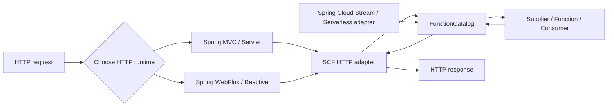

# Choosing a Web Module and Comparing MVC/WebFlux Support by Version in Spring Cloud Function

## 1. Why Does Choosing the Right Web Module Matter?

**Spring Cloud Function (SCF)** focuses on reusable business logic modeled as `Supplier<T>`, `Function<I, O>`, and `Consumer<T>`, registered and looked up through `FunctionCatalog`. Functions can be invoked via HTTP, Spring Cloud Stream events, or serverless environment adapters. To serve **HTTP**, the application needs a bridging layer (*web adapter*) between the HTTP protocol and the catalog.

When building an HTTP application, there are **three independent yet related decisions**:

1. **HTTP runtime:** use Spring MVC (Servlet) or Spring WebFlux (reactive)?
2. **SCF web module:** add the appropriate starter to automatically expose functional beans as endpoints, or use only SCF core and build your own controller/handler?
3. **Versions:** align Spring Boot, the Spring Cloud release train, and the Spring Cloud Function version. The mere existence of an artifact on Maven Central is not enough to conclude that a version combination is supported.

If you choose the wrong combination, the application may start on an unexpected stack, expose no HTTP endpoints, or fail due to incompatible dependencies.

### Learning Objectives

- Distinguish among `spring-cloud-function-context`, `spring-cloud-function-web`, `spring-cloud-starter-function-web`, and `spring-cloud-starter-function-webflux`.
- Decide when to choose Spring MVC, WebFlux, or **no web adapter**.
- Look up the right Spring Boot ↔ Spring Cloud ↔ SCF version combination and recognize changes in Spring Boot 4.
- Create two HTTP applications sharing the same functional beans while choosing different starters.
- Verify the actual runtime and resolve conflicts when both MVC and WebFlux are present.

## 2. What Role Does Each Module Play?

| Artifact | Role | Automatically exposes HTTP endpoints for SCF? | When to use |
| --- | --- | --- | --- |
| `org.springframework.cloud:spring-cloud-function-context` | Provides functional bean management/lookup, `FunctionCatalog`, composition, and SCF-layer conversion | **No**, when using only this module | Business libraries, event processing, applications without an HTTP server |
| `org.springframework.cloud:spring-cloud-function-web` | SCF's HTTP adapter component; requires an appropriate web environment | **Yes**, when paired with the right runtime and auto-configuration | You already have a Spring Boot web starter and want to add the SCF HTTP adapter manually |
| `org.springframework.cloud:spring-cloud-starter-function-web` | Convenience starter combining the SCF web adapter and Spring MVC runtime | **Yes**, in a properly configured MVC application | Quickly exposing beans over HTTP with Servlet/MVC |
| `org.springframework.cloud:spring-cloud-starter-function-webflux` | Convenience starter combining the SCF web adapter and Spring WebFlux runtime | **Yes**, in a properly configured WebFlux application | Quickly exposing functions over HTTP using the reactive model |
| `org.springframework.boot:spring-boot-starter-web` / `spring-boot-starter-webmvc` | **Spring Boot's** web starter for MVC | **No**, without an adapter or custom controller | Building MVC web applications in general |
| `org.springframework.boot:spring-boot-starter-webflux` | **Spring Boot's** web starter for reactive HTTP | **No**, without an adapter or custom handler | Building WebFlux applications in general |

**Two rules to avoid confusion:**

- `spring-cloud-function-web` is an **SCF** artifact; `spring-boot-starter-web` and `spring-boot-starter-webflux` are **Boot** starters. Adding only a Boot web starter does not automatically turn `Function` beans into endpoints.
- `spring-cloud-starter-function-webflux` is the SCF starter name for WebFlux. Do not assume an artifact named `spring-cloud-function-webflux` exists, and do not mix dependencies with overlapping roles when the starter already provides them.

Connection model:



The **`Supplier`, `Function`, `Consumer`** layer should remain as independent of the web framework as possible. You can reuse existing logic when switching transports, and you do not need to migrate an entire application to WebFlux just to use `Flux` or `WebClient` in an isolated component.

## 3. Choosing MVC or WebFlux?

| Criterion | Spring MVC | Spring WebFlux |
| --- | --- | --- |
| Web model | Servlet API; typically handles requests using a request-per-thread model | Reactive Streams; supports asynchronous, non-blocking processing |
| Common web servers | Tomcat, Jetty, or a compatible Servlet container | Reactor Netty by default; can also run on supported Servlet containers |
| Suitable when | Existing MVC systems, synchronous APIs, dependencies are mainly JDBC/JPA or blocking SDKs | End-to-end reactive I/O pipelines, streaming, high concurrent connection counts, or applications already on WebFlux |
| SCF starter | `spring-cloud-starter-function-web` | `spring-cloud-starter-function-webflux` |
| Basic logic signatures | `Function<String, String>` works normally | The same `Function<String, String>` bean can be reused; reactive pipelines are an optional choice |
| What to avoid | Assuming Servlet is asynchronous by default | Putting JDBC, `Thread.sleep()`, or blocking I/O onto the event loop and expecting it to become non-blocking |

**Scenario-based recommendations:**

1. Already have an MVC application with JPA and REST controllers: prefer the **MVC starter** to preserve your deployment model; do not switch frameworks just to expose a few functions.
2. Already have a WebFlux application using reactive drivers and needing streaming: prefer the **WebFlux starter**, and thoroughly test the adapter's reactive contract.
3. Writing a pricing, data normalization, or business validation library for **HTTP + events + serverless**: place beans in a separate module with SCF core; add the adapter only in the runnable application.
4. API requires complex REST resources, multiple routes, validation, authorization, and custom response codes: use Spring MVC/WebFlux controllers or a WebFlux functional router for HTTP control; you can still look up logic via `FunctionCatalog`.

**WebFlux does not automatically make functions faster.** If `Function.apply()` calls a blocking data store and blocks the thread, choosing WebFlux will not produce a non-blocking execution flow. Performance depends on the entire request path and workload characteristics.

## 4. Version Support Matrix

SCF versions are typically managed **through the Spring Cloud release train**. The table below uses GA milestones and version lines; the information was verified against official documentation as of **November 24, 2026**. Older lines may no longer receive open-source maintenance even if historically compatible.

| Spring Boot | Spring Cloud release train | Spring Cloud Function | HTTP MVC | HTTP WebFlux | Notes |
| --- | --- | --- | --- | --- | --- |
| **4.2.x** | **2026.0.x** (Paddington) | **5.1.x** | Yes | Yes | Spring Cloud 2026.0.0 and Boot 4.2.0 released in November 2026 |
| **4.0.x / 4.1.x** | **2025.1.x** (Oakwood) | **5.0.x** | Yes | Yes | Boot 4.1 support starts from release train 2025.1.2 |
| **3.5.x** | **2025.0.x** (Northfields) | **4.3.x** | Yes | Yes | Use the release train targeted for Boot 3.5 |
| **3.4.x** | **2024.0.x** (Moorgate) | **4.2.x** | Yes | Yes | Historical compatibility line |
| **3.2.x / 3.3.x** | **2023.0.x** (Leyton) | **4.1.x** | Yes | Yes | Boot 3.3 support starts from 2023.0.2 |
| **3.0.x / 3.1.x** | **2022.0.x** (Kilburn) | **4.0.x** | Yes | Yes | Boot 3.1 support starts from 2022.0.3 |

**Key point:** the “Yes” cells mean **the corresponding SCF line provides MVC and WebFlux starters**. They do not mean that every feature, codec, media type, reactive response, and HTTP behavior is identical across every patch version. Test the features you rely on and check release train support timelines when building production systems.

### Historical Context Before Spring Boot 3

| SCF | MVC | WebFlux | What to know |
| --- | --- | --- | --- |
| **1.x** | Yes | No equivalent WebFlux starter option | The initial web adapter was based on Spring MVC/Servlet |
| **From 2.0** | Yes | Yes | SCF added `spring-cloud-starter-function-webflux`, typically running with Reactor Netty by default |
| **3.x onward** | Yes | Yes | Specific changes depend on the compatible Spring Boot/Spring Cloud release train |

Do not use SCF 1.x/2.x dependency examples directly in Boot 3/4 projects. Older documentation may reference different starter names, legacy APIs, or different functional application bootstrap mechanisms.

### Notable Changes in Spring Boot 4

- In Spring Boot 3.x, the familiar MVC starter is `spring-boot-starter-web`.
- In Spring Boot 4.x, the explicit starter for MVC is **`spring-boot-starter-webmvc`**; `spring-boot-starter-web` is deprecated in favor of this starter. WebFlux continues to use `spring-boot-starter-webflux`.
- The **SCF** starters remain named `spring-cloud-starter-function-web` and `spring-cloud-starter-function-webflux`. Do not rename the SCF starter just because Boot renamed its MVC starter.
- Foundational changes in Spring Framework 7/Boot 4, including several APIs and JSON/test dependencies, are why keeping the BOM aligned to the proper version line is essential.

### How to Read the Matrix to Choose Versions

**Example A:** an application runs Boot 3.5.x → choose Spring Cloud 2025.0.x → SCF 4.3.x. Then decide between MVC or WebFlux based on the runtime in use.

**Example B:** a Boot 4.1.x application → choose a sufficiently recent Spring Cloud 2025.1.x version → SCF 5.0.x.

**Example C:** building a new application on Boot 4.2.0 as of November 24, 2026 → choose Spring Cloud **2026.0.0** → SCF **5.1.0**. This is a GA version set from the same release train; do not take SCF 5.1.0 and place it onto Boot 3.5.

Always obtain the BOM from [Spring Initializr](https://start.spring.io/) or the [Spring Cloud compatibility table](https://spring.io/projects/spring-cloud/) and review the [release notes](https://spring.io/blog/2026/11/20/spring-cloud-2026-0-0-has-been-released/) before upgrading.

## 5. Maven Example: Same Functions, Choosing Either Web Starter

This example uses **Spring Boot 4.2.0 + Spring Cloud 2026.0.0**, corresponding to Spring Cloud Function 5.1.0. For Spring Boot 3.x, substitute the parent and BOM according to the table in section 4.

Create `pom.xml` for a Spring MVC application:

```xml
<?xml version="1.0" encoding="UTF-8"?>
<project xmlns="http://maven.apache.org/POM/4.0.0"
         xmlns:xsi="http://www.w3.org/2001/XMLSchema-instance"
         xsi:schemaLocation="http://maven.apache.org/POM/4.0.0
         https://maven.apache.org/xsd/maven-4.0.0.xsd">
    <modelVersion>4.0.0</modelVersion>

    <parent>
        <groupId>org.springframework.boot</groupId>
        <artifactId>spring-boot-starter-parent</artifactId>
        <version>4.2.0</version>
        <relativePath/>
    </parent>

    <groupId>demo</groupId>
    <artifactId>scf-web-choice</artifactId>
    <version>0.0.1-SNAPSHOT</version>
    <properties>
        <java.version>17</java.version>
    </properties>

    <dependencyManagement>
        <dependencies>
            <dependency>
                <groupId>org.springframework.cloud</groupId>
                <artifactId>spring-cloud-dependencies</artifactId>
                <version>2026.0.0</version>
                <type>pom</type>
                <scope>import</scope>
            </dependency>
        </dependencies>
    </dependencyManagement>

    <dependencies>
        <!-- SCF HTTP adapter + Spring MVC runtime -->
        <dependency>
            <groupId>org.springframework.cloud</groupId>
            <artifactId>spring-cloud-starter-function-web</artifactId>
        </dependency>
    </dependencies>

    <build>
        <plugins>
            <plugin>
                <groupId>org.springframework.boot</groupId>
                <artifactId>spring-boot-maven-plugin</artifactId>
            </plugin>
        </plugins>
    </build>
</project>
```

**Want to use WebFlux?** Keep the same POM and **only change** the dependency inside `<dependencies>` to:

```xml
<dependency>
    <groupId>org.springframework.cloud</groupId>
    <artifactId>spring-cloud-starter-function-webflux</artifactId>
</dependency>
```

The WebFlux starter pulls in SCF's web adapter along with the required WebFlux components. Keep **a single SCF web starter** as the primary choice and avoid including both in the same application.

### When You Already Have a Spring Boot Web Starter

If the application already has an MVC or WebFlux framework configured and only needs the SCF adapter, you can add directly:

```xml
<dependency>
    <groupId>org.springframework.cloud</groupId>
    <artifactId>spring-cloud-function-web</artifactId>
</dependency>
```

In that case, the web runtime still comes from Boot's existing web starter (such as `spring-boot-starter-webmvc` on Boot 4 or `spring-boot-starter-webflux`). This is a manual configuration approach; verify auto-configuration behavior, the web application class, and runtime dependencies for the selected release. For a simple sample application, using an SCF starter is usually easier to manage.

**Do not add an explicit SCF version number directly on the dependency** when the BOM already manages compatible versions. If you omit the BOM, Maven may fail to resolve versions or you will have to manage them manually and risk mismatched dependency pairs.

## 6. Running the Same Functional Beans on MVC and WebFlux

Create `src/main/java/demo/WebChoiceApplication.java`:

```java
package demo;

import java.util.Locale;
import java.util.function.Consumer;
import java.util.function.Function;
import java.util.function.Supplier;

import org.springframework.boot.SpringApplication;
import org.springframework.boot.autoconfigure.SpringBootApplication;
import org.springframework.context.annotation.Bean;

@SpringBootApplication
public class WebChoiceApplication {

    public static void main(String[] args) {
        SpringApplication.run(WebChoiceApplication.class, args);
    }

    @Bean
    public Function<String, String> uppercase() {
        return text -> text.toUpperCase(Locale.ROOT);
    }

    @Bean
    public Function<String, String> trim() {
        return String::trim;
    }

    @Bean
    public Supplier<String> greeting() {
        return () -> "Hello from SCF";
    }

    @Bean
    public Consumer<String> receive() {
        return text -> System.out.println(
                "Received text length = " + text.length());
    }
}
```

The `uppercase` and `trim` beans can be looked up through `FunctionCatalog` or composed together. They have no dependency on Servlet requests, `ServerRequest`, `Mono`, or `Flux`, so the exact same Java source works on both HTTP runtimes.

Run with Maven:

```bash
mvn spring-boot:run
```

Verify the endpoints. With both the MVC and WebFlux starters, the following commands produce the same **business results**:

```bash
curl -i -X POST http://localhost:8080/uppercase \
  -H 'Content-Type: text/plain' \
  -H 'Accept: text/plain' \
  --data 'hello function'
# Response body: HELLO FUNCTION

curl -i -H 'Accept: text/plain' \
  http://localhost:8080/greeting
# Response body: Hello from SCF

curl -i -X POST http://localhost:8080/receive \
  -H 'Content-Type: text/plain' \
  --data 'sample event'
# Check console log: Received text length = 12
```

These commands use Bash syntax; in PowerShell, use `curl.exe` and adapt the quoting to PowerShell syntax. Restart the application whenever you change starters.

### FunctionCatalog and Composition Independent of the HTTP Runtime

You can compose the two declared `Function<String, String>` beans via configuration:

```properties
spring.cloud.function.definition=trim|uppercase
```

When only this composition is selected, SCF can map it to the root path `/`. Alternatively, invoke the composition directly in the URL if filtering is not applied:

```bash
curl -i -X POST 'http://localhost:8080/trim,uppercase' \
  -H 'Content-Type: text/plain' \
  --data '  hello cloud  '
# Response body: HELLO CLOUD
```

In SCF configuration, `|` means **chain functions sequentially**; `;` means **list multiple functions/compositions** to expose. A function in the catalog can be reused to process events via another adapter without copying business logic from the web layer.

If you need to change the URL prefix, use:

```properties
spring.cloud.function.web.path=/api/functions
```

Then, when root-path composition mapping is not active, `POST /uppercase` becomes `POST /api/functions/uppercase`. This prefix applies to the SCF adapter and does not automatically rewrite paths of custom controllers you wrote yourself.

## 7. When an Application Accidentally Has Both MVC and WebFlux

Spring Boot chooses the web application type based on classes present on the **runtime classpath**. If both MVC and WebFlux are present, **MVC is usually preferred by default**. Importing `Mono`, adding `WebClient`, or installing `spring-boot-starter-webflux` in an application that already includes MVC **does not prove the HTTP server is running WebFlux**.

A misleading example:

```xml
<dependencies>
    <dependency>
        <groupId>org.springframework.cloud</groupId>
        <artifactId>spring-cloud-starter-function-web</artifactId>
    </dependency>
    <dependency>
        <groupId>org.springframework.cloud</groupId>
        <artifactId>spring-cloud-starter-function-webflux</artifactId>
    </dependency>
</dependencies>
```

This is a configuration **you should not use to pick arbitrarily**. The two starters bring in different web frameworks; Boot's classpath detection can make the application run Servlet/MVC even when the author expected reactive.

If you need to force the application type for testing:

```properties
spring.main.web-application-type=reactive
```

However, setting a property **cannot replace inspecting dependencies**; an auto-configuration requiring Servlet may fail to activate when running reactive, or vice versa. The durable fix is to use the right starter and keep only the dependencies you actually need.

### How to Confirm the Active Runtime

1. Inspect the **dependency tree** and look for transitively pulled web starters:

   ```bash
   mvn dependency:tree
   ```

2. Check Boot's startup logs: web server names like Tomcat or Netty and web context beans suggest the active stack. To be certain, inspect the actual `ApplicationContext`:

   ```java
   import org.springframework.boot.ApplicationRunner;
   import org.springframework.context.ApplicationContext;
   import org.springframework.context.annotation.Bean;

   @Bean
   ApplicationRunner printWebContext(ApplicationContext context) {
       return args -> System.out.println(
               "Web context = " + context.getClass().getName());
   }
   ```

   MVC typically uses `AnnotationConfigServletWebServerApplicationContext`; WebFlux typically uses `AnnotationConfigReactiveWebServerApplicationContext`. The log line confirms runtime behavior, rather than relying on assumptions from a single starter name.

3. Send a real HTTP request to `POST /uppercase` and inspect status, `Content-Type`, and body. For WebFlux testing, use `WebTestClient`; for MVC, you can use `MockMvc` or an integrated HTTP client. Choose test dependencies matching your **Spring Boot version**, as Boot 4 split/renamed several starters and test utilities.

## 8. Distinguishing the WebFlux HTTP Adapter from Reactive Business Logic

The following two decisions are not synonymous:

- **Choosing the WebFlux server:** HTTP is dispatched by the reactive web stack.
- **Writing reactive functions:** bean logic uses `Mono<T>`, `Flux<T>`, or non-blocking data publishers.

A `Function<String, String>` bean can run on MVC or WebFlux; choosing WebFlux does not automatically change its signature to `Function<Mono<String>, Mono<String>>`. Conversely, using Reactor inside one module does not mean the entire HTTP server must be WebFlux.

If you need multi-item streaming, WebFlux is generally a better fit. Still, you must test input payloads, return types, the `Accept: text/event-stream` header, codec/serialization, and client disconnects. The SCF adapter has specific payload conversion rules, so you should not infer from Java generics alone that every endpoint streams identically.

When you need HTTP metadata inside a function, you can accept Spring Messaging's `Message<T>`. The web adapter can copy request headers into `MessageHeaders` and transfer output message headers back to the HTTP response. This remains a messaging abstraction, unlike injecting `HttpServletRequest` directly into business logic.

## 9. Common Module and Version Selection Errors

| Symptom | What to check | How to fix |
| --- | --- | --- |
| App starts, but `/uppercase` returns `404` | Only Boot web starter is present without SCF web adapter; or bean is filtered by `spring.cloud.function.definition` | Add the right SCF starter or `spring-cloud-function-web`; check URL and configuration |
| Spring Cloud refuses to start or throws `NoSuchMethodError` / `ClassNotFoundException` | Boot–Cloud–SCF combination spans mismatched release trains or has transitive version overrides | Use a BOM matching the compatibility table; remove unnecessary version overrides |
| Intended Netty/WebFlux, but app boots Servlet/Tomcat | Both MVC and WebFlux are on the classpath | Inspect the dependency tree; remove unnecessary MVC starters; verify the context |
| `FunctionCatalog` exists, but no HTTP endpoints are exposed | Only SCF core is declared; no web adapter or web runtime | Decide if HTTP is actually needed; if so, add the appropriate web module |
| WebFlux runs, but requests stall under high load | Blocking I/O inside the function, synchronous JDBC/JPA calls, or event-loop blocking | Profile the I/O path, switch to reactive drivers, or isolate blocking work properly |
| `415 Unsupported Media Type`, `406 Not Acceptable`, or DTO fails to bind | Wrong `Content-Type`, `Accept`, generic type, or JSON codec | Check payload format and adapter conversion behavior on the current version |
| Boot 3 → Boot 4 migration fails on dependencies/tests | MVC web starter and test APIs changed while the Cloud BOM is still on the Boot 3 line | Switch to a Boot 4–compatible Cloud release train and matching starter/test artifacts |
| `POST /receive` returns `202` with no JSON result | `Consumer` has no return value | Verify side effects; if a business JSON response is needed, choose `Function` |

## 10. Role of Spring Cloud Gateway in Newer Versions

In the **Spring Cloud 2025.0.0-RC1** announcement, the project team noted that **Spring Cloud Function Web is essentially being positioned for replacement** by Spring Cloud Function integration within Spring Cloud Gateway. This should be interpreted accurately:

- The web starter artifacts still exist in recent SCF lines and remain useful for learning, prototyping, or existing applications.
- When designing new production systems requiring routing, security policies, gateway filters, and centralized HTTP control, **evaluate Spring Cloud Gateway combined with Spring Cloud Function** on the corresponding release train.
- Having a Gateway does not force every application onto WebFlux: Spring Cloud Gateway now offers both MVC and WebFlux variants, chosen according to architecture and version.
- Do not treat the web adapter as a complete replacement for `@RestController` / `RouterFunction`; the adapter primarily serves invoking functions over HTTP, especially in stateless and serverless models.

This direction is why you should check the [release notes](https://spring.io/blog/2025/05/01/spring-cloud-2025-0-0-rc1-released/) when starting a new project, rather than assuming from artifact names that future support remains unchanged.

## 11. Practice Exercises

1. Given a Boot 3.5.x application using MVC and a JDBC repository, select the exact Spring Cloud release train, SCF line, and starter. Explain why you should not arbitrarily pick SCF 5.1.
2. Starting from the MVC POM in section 5, switch to the WebFlux starter **without modifying** `WebChoiceApplication`. Check the output of `POST /uppercase` and the web context class name.
3. Add both SCF starters to the POM in a test environment. Using the dependency tree and runtime logs, explain why the active HTTP server type differs from what you expected.
4. Keep only `spring-cloud-function-context` in a pure business-logic module. Explain why `FunctionCatalog` remains useful even though `/uppercase` exposes no endpoint.
5. Map out an upgrade path from Boot 3.4.x/Cloud 2024.0.x to Boot 4.2.x/Cloud 2026.0.x. Which areas need checking regarding BOM, MVC starter, test stack, JSON conversion, and HTTP contracts?
6. For a workload needing 50,000 concurrent HTTP connections while querying blocking JDBC, evaluate what conditions must change for WebFlux to deliver real benefits.

## Official References

- [Spring Cloud — Release train and Spring Boot compatibility matrix](https://spring.io/projects/spring-cloud/).
- [Spring Cloud 2026.0.0 released on November 20, 2026](https://spring.io/blog/2026/11/20/spring-cloud-2026-0-0-has-been-released/): confirms Boot 4.2.0, SCF 5.1.0.
- [Spring Cloud Function — Standalone Web Applications](https://docs.spring.io/spring-cloud-function/reference/spring-cloud-function/standalone-web-applications.html): HTTP adapter, mapping, conversion, composition, and function filtering.
- [Spring Cloud Function — Functional Bean Definitions](https://docs.spring.io/spring-cloud-function/reference/functional.html): bean declarations and `FunctionCatalog`.
- [Spring Boot — Build Systems](https://docs.spring.io/spring-boot/reference/using/build-systems.html): starter list and MVC starter renaming in Boot 4.
- [Spring Boot — Reactive Web Applications](https://docs.spring.io/spring-boot/reference/web/reactive.html): WebFlux behavior and MVC selection when both web stacks are present.
- [Spring Cloud Function WebFlux starter on Maven Central](https://central.sonatype.com/artifact/org.springframework.cloud/spring-cloud-starter-function-webflux): verify artifact coordinates and transitive dependencies.
- [Spring Cloud 2025.0.0-RC1 release notes](https://spring.io/blog/2025/05/01/spring-cloud-2025-0-0-rc1-released/): notes the direction of integrating SCF with Spring Cloud Gateway.
