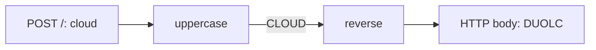

# Function-Name Paths and Root Path Rules in Spring Cloud Function

## 1. From Functional Beans to HTTP Addresses

**Spring Cloud Function (SCF)** lets you place business logic inside Java beans following the `Supplier<T>`, `Function<I, O>`, or `Consumer<T>` contracts. These beans are registered and looked up via `FunctionCatalog`, so the same logic can be invoked over HTTP, events, or serverless environments without coupling directly to a transport protocol.

When a Spring Boot application enables the **SCF HTTP adapter**, part of the function invocation contract is mapped into URLs:

- **Named path:** `/{functionName}` (for example `/uppercase`).
- **Root path:** `/`, which can represent the sole function in the catalog or a function/composition selected via configuration.
- **Application-configured prefix:** `spring.cloud.function.web.path` (for example `/api/functions`), prepended before the paths above.

The important topic is not merely memorizing URLs. You need to know **which function SCF chooses** when there is one bean, multiple beans, a composition, or function filtering configuration. Otherwise, clients may receive `404 Not Found`, invoke the wrong function, or expose more endpoints than intended.

### Learning Objectives

After this lesson, you will be able to:

1. Determine the default URL from the bean name in `FunctionCatalog`.
2. Explain when `/` can be invoked without a function name.
3. Select a default function or composition via `spring.cloud.function.definition`.
4. Distinguish between `|` for **composing functions** and `;` for **listing/filtering functions**.
5. Apply URL prefixes, HTTP methods, and path parameters, and verify routing in real deployments.

## 2. Distinguishing Bean Name, Catalog Function Name, and HTTP Path

Consider a bean:

```java
@Bean
public Function<String, String> uppercase() {
    return text -> text.toUpperCase(java.util.Locale.ROOT);
}
```

By default, the bean name is `uppercase`. SCF registers it in the catalog, and the HTTP adapter uses that name as a path segment. A `POST /uppercase` request is translated into a call equivalent to:

```java
Function<String, String> function = catalog.lookup("uppercase");
String result = function.apply("hello"); // "HELLO"
```

The snippet above only illustrates `FunctionCatalog` lookup: in practice, the catalog handles appropriate generics and the adapter is responsible for request/response conversion. The `Function` itself **stores no URL** and requires no `@PostMapping`.


If you want a bean name different from the method name, you can declare:

```java
@Bean("makeUpper")
public Function<String, String> uppercase() {
    return text -> text.toUpperCase(java.util.Locale.ROOT);
}
```

Then the exposed name is `makeUpper`: the named URL is `/makeUpper`, and `/uppercase` **is no longer the default URL just because the Java method is named `uppercase`**. The URL segment is derived from the registered function name, not from the class name, package, or a REST endpoint name imagined by the developer.

**Assumptions throughout these examples:** the application runs at `http://localhost:8080`, uses the default `/` prefix, has no custom `server.servlet.context-path`, and has no overlapping custom controller or gateway routes.

## 3. Case A: Only One Function in FunctionCatalog

This is the simplest rule: **if there is only one Supplier, Function, or Consumer in the catalog, the name segment in the URL is optional**. When `uppercase` is the sole function bean, the two calls below are equivalent:

```bash
# With function name
curl -i -X POST 'http://localhost:8080/uppercase' \
  -H 'Content-Type: text/plain' \
  -H 'Accept: text/plain' \
  --data 'hello'

# Without function name: root path
curl -i -X POST 'http://localhost:8080/' \
  -H 'Content-Type: text/plain' \
  -H 'Accept: text/plain' \
  --data 'hello'
```

Both requests execute `uppercase.apply("hello")` and produce the business result `HELLO`, typically with HTTP `200 OK`.

The same rule applies according to each bean type's HTTP contract:

| Sole bean in catalog | Named path | Root path | Typical HTTP method |
| --- | --- | --- | --- |
| `Supplier<String> greeting` | `GET /greeting` | `GET /` | `GET` |
| `Function<String, String> uppercase` | `POST /uppercase` | `POST /` | `POST` or `PUT` |
| `Consumer<String> audit` | `POST /audit` | `POST /` | `POST`, `PUT`, or `DELETE` |

For `Consumer`, `POST`/`PUT` typically returns `202 Accepted`; `DELETE` typically returns `204 No Content`. That is the HTTP adapter status, not a guarantee that the event was durably stored.

The critical condition is **only one function available in the catalog**, not “the source code only has one class” or “I only intend to use one endpoint.” Another dependency might contribute additional functional beans to the application context. When a second bean is added, behavior on the root path can change.

## 4. Minimal Runnable Example

Create a Spring Boot project with the Spring Cloud Function HTTP starter suitable for Spring MVC:

```xml
<dependency>
    <groupId>org.springframework.cloud</groupId>
    <artifactId>spring-cloud-starter-function-web</artifactId>
</dependency>
```

This dependency assumes the project already uses a compatible **Spring Boot parent/BOM** and **Spring Cloud dependencies BOM**. Do not assign an SCF version independently of the release train. If the project uses WebFlux, choose the corresponding WebFlux SCF starter; the function-name and path rules below belong to SCF's HTTP adapter.

Create `src/main/java/demo/PathDemoApplication.java`:

```java
package demo;

import java.util.Locale;
import java.util.function.Function;
import org.springframework.boot.SpringApplication;
import org.springframework.boot.autoconfigure.SpringBootApplication;
import org.springframework.context.annotation.Bean;

@SpringBootApplication
public class PathDemoApplication {
    public static void main(String[] args) {
        SpringApplication.run(PathDemoApplication.class, args);
    }

    @Bean
    public Function<String, String> uppercase() {
        return text -> text.toUpperCase(Locale.ROOT);
    }
}
```

After starting the application via `mvn spring-boot:run` (or the project's Maven Wrapper), send requests to **both** `/uppercase` and `/`. This exercise confirms actual root routing rather than merely seeing a registered bean.

## 5. Case B: Multiple Functions in the Catalog

Keep the `uppercase` bean and add another bean **in the same application class**:

```java
@Bean
public Function<String, String> reverse() {
    return text -> new StringBuilder(text).reverse().toString();
}
```

Now the catalog has at least two functions, `uppercase` and `reverse`. Under default configuration, SCF exposes endpoints **by name**:

```bash
curl -i -X POST 'http://localhost:8080/uppercase' \
  -H 'Content-Type: text/plain' --data 'abc'
# Body: ABC

curl -i -X POST 'http://localhost:8080/reverse' \
  -H 'Content-Type: text/plain' --data 'abc'
# Body: cba
```

**The root path `/` no longer picks a function automatically.** Without additional configuration, you should not rely on `POST /` to invoke `uppercase`; there is not enough information to select a function.

| Available functions | URL `/uppercase` | URL `/reverse` | Root URL `/` |
| --- | --- | --- | --- |
| Only `uppercase` | Calls `uppercase` | No `reverse` bean to call | Calls `uppercase` |
| `uppercase` and `reverse` | Calls `uppercase` | Calls `reverse` | Does not infer a default function |
| Multiple functions, with one function/composition selected via `definition` | Still governed by naming and config rules | Still governed by naming and config rules | Can be mapped to the selected function/composition |

To avoid unintended behavior changes when a team adds a new bean, production clients should use named paths or configure an **explicit** default function.

## 6. Selecting a Function or Composition for the Root Path

When multiple functions exist, SCF lets you designate a default function or composition with a property:

```properties
spring.cloud.function.definition=uppercase
```

With a single function selected, `POST /` can be mapped to `uppercase`. This helps build a single root HTTP endpoint in a function-as-a-service style.

Second example: composing `uppercase` and `reverse`. The line below means **run `uppercase` and pass its result to `reverse`**:

```properties
spring.cloud.function.definition=uppercase|reverse
```

Request:

```bash
curl -i -X POST 'http://localhost:8080/' \
  -H 'Content-Type: text/plain' \
  --data 'cloud'
# Business result: DUOLC
```

Order explanation: `cloud` → `uppercase` → `CLOUD` → `reverse` → `DUOLC`.



### Often Overlooked: Fallback When `definition` Is Set

Under SCF's *Function Mapping* rules, `spring.cloud.function.definition` is also used when a URL **cannot be resolved to a function name**. For example, if the catalog has `uppercase` and `reverse`, the default definition is `uppercase|reverse`, and a client sends `POST /some-name`, when fallback applies, the adapter may still execute the default composition.

Therefore, **do not treat a path mismatch with bean names as a reliable access-denial mechanism**. When an API should only expose one public URL, enforce security rules, restrict endpoints, and test fallback behavior on the exact runtime version. When strict URL matching and `404` for every unknown path are required, consider a custom controller or router.

Note: `definition` selects the active function; **it does not rename the bean** from `uppercase` to `some-name`.

## 7. Invoking a Composition Directly by Name in the URL

When restrictive filtering is not configured, SCF allows clients to invoke a compatible chain of functions by joining names with a **comma** or **pipe** in the path:

```bash
curl -i -X POST 'http://localhost:8080/uppercase,reverse' \
  -H 'Content-Type: text/plain' \
  --data 'cloud'
# Body: DUOLC
```

Semantically, the path `/uppercase,reverse` and the definition `uppercase|reverse` both express sequential composition. In URLs, commas are usually more convenient because `|` has special meaning in shells and may require URL-encoding as `%7C`.

Example of chaining multiple functions:

```text
POST /uppercase,reverse
Body: abc

uppercase("abc") -> "ABC"
reverse("ABC")   -> "CBA"
Response body    -> CBA
```

**Requirement:** the output of the preceding function must be compatible with the input of the next function. `Function<String, String>` composes cleanly with `Function<String, String>`; for differing DTO types, inspect `FunctionCatalog`'s conversion rules and write tests. You cannot arbitrarily compose a `Consumer<T>` (which produces no output) with a function expecting a non-void input and expect a business response.

## 8. Differences Between `|` and `;`

The two delimiters serve completely different purposes:

| Property | Meaning | Root path | Functions exposed over HTTP |
| --- | --- | --- | --- |
| No `definition` set, only one bean `uppercase` | Only one target in the catalog | Yes: `/` | `/uppercase` and `/` |
| No `definition` set, two beans `uppercase`, `reverse` | Each function has its own named path | No automatic root function | `/uppercase`, `/reverse`; composition available |
| `definition=uppercase|reverse` | A single **composition** is selected | **Yes**, points to the composition | Verify named URLs and actual fallback behavior |
| `definition=uppercase;reverse` | **Filtering**, exposing only the two listed functions | **No** | `/uppercase`, `/reverse` |
| `definition=uppercase|reverse;greeting` | Filtering, exposing one composition and one function | **No** | `/uppercase,reverse` and `/greeting` |

These properties are configured **as alternatives** per scenario—do not write multiple lines with the same property name expecting Spring to merge them. `|` composes functions; `;` lists multiple functions/compositions to export; when a semicolon-separated filter list is present, there is no automatic root mapping.

For example, to expose only two functions in an API and hide remaining internal beans:

```properties
spring.cloud.function.definition=uppercase;reverse
```

With this list, requests to `/uppercase` and `/reverse` have valid targets, `/` is not automatically assigned, and the composition `/uppercase,reverse` **is not exposed** unless that composition itself is listed. This is **endpoint filtering**, not a replacement for authentication and authorization.

To expose a composition without exposing its individual components as standalone endpoints:

```properties
spring.cloud.function.definition=uppercase|reverse;greeting
```

This assumes an additional `greeting` bean exists (for example, `Supplier<String>`). The two published endpoints are `/uppercase,reverse` and `/greeting`; the root path is not automatically assigned.

## 9. Changing the URL Prefix Without Renaming Functions

The HTTP adapter's default prefix is `/`. You can configure:

```properties
spring.cloud.function.web.path=/api/functions
```

With the `uppercase` and `reverse` beans, named mappings shift to:

```text
POST /api/functions/uppercase
POST /api/functions/reverse
POST /api/functions/uppercase,reverse
```

When a default function or composition is selected, **SCF's root path** also shifts under the new prefix. For example:

```properties
spring.cloud.function.web.path=/api/functions
spring.cloud.function.definition=uppercase|reverse
```

You can test with:

```bash
curl -i -X POST 'http://localhost:8080/api/functions/' \
  -H 'Content-Type: text/plain' \
  --data 'cloud'
# Body: DUOLC
```

**Distinguishing path layers:**

| Configuration/concept | Effect |
| --- | --- |
| `spring.cloud.function.web.path` | Changes the **SCF HTTP adapter prefix**, e.g., `/api/functions` |
| Bean name in `FunctionCatalog` | Determines the `/uppercase` segment after the prefix |
| `spring.cloud.function.definition` | Selects a default function/composition or filters the exported set |
| `server.servlet.context-path` (MVC/Servlet) | Sets the overall **context path** of the Servlet application, not the function name |
| Reverse proxy or Spring Cloud Gateway | May rewrite external paths before forwarding requests to the application |

On certain versions/runtimes, `/api/functions` and `/api/functions/` may follow different trailing-slash matching rules. Test with the exact target paths, especially after upgrading Spring Framework or when a proxy rewrites paths. Do not assume all trailing-slash variants behave identically.

## 10. HTTP Methods and Path Arguments

**The function name determines the target, while the HTTP method and bean type determine how it is invoked.** For example:

| Method | Pattern | Bean type | Purpose | Typical status |
| --- | --- | --- | --- | --- |
| `GET` | `/{supplier}` | `Supplier<T>` | Generate data | `200 OK` |
| `POST`, `PUT` | `/{function}` | `Function<I, O>` | Read body and return result | `200 OK` |
| `GET` | `/{function}/{item}` | `Function<I, O>` | Pass `item` as the function input | `200 OK` |
| `POST`, `PUT` | `/{consumer}` | `Consumer<I>` | Pass body to consumer | `202 Accepted` |
| `DELETE` | `/{consumer}` | `Consumer<I>` | Invoke consumer via DELETE mapping | `204 No Content` |

Example invoking `Function<String, String> uppercase` via GET with data in the path:

```bash
curl -i 'http://localhost:8080/uppercase/hello'
# Body: HELLO
```

**Do not assume** that `GET /uppercase` (without `/{item}`) works the same as `POST /uppercase` just because the function name matches. Each bean type has its own HTTP method rules; in addition, applications can use `spring.cloud.function.http.GET`, `spring.cloud.function.http.POST`, etc., to customize mappings.

Query parameters like `?name=An` are not how beans are selected in the catalog. For `Message<?>` inputs, the adapter can place request parameters into the `http_request_param` message header. When designing HTTP APIs, clearly separate path segments selecting a **function** from paths/queries carrying **input data**.

Do not confuse `/uppercase/hello` with the composition `/uppercase,reverse`: a `/` after the function name passes an *item* in a GET call, whereas a comma joins **multiple function names**.

## 11. Real-World Scenario: One Handler Across HTTP, Events, and Serverless

Suppose business logic for normalizing order IDs is written once:

```java
@Bean
public Function<String, String> normalizeOrderId() {
    return id -> id.trim().toUpperCase(java.util.Locale.ROOT);
}
```

In an HTTP application, it can be called via `POST /normalizeOrderId` or `POST /` if it is the sole bean. In an event-driven application, the same `Function<String, String>` can be invoked by a binding/adapter using its configured name. In serverless deployments, the platform's function invoker maps incoming events to `FunctionCatalog`.

**The HTTP path is not a mandatory contract of the function.** Changing `spring.cloud.function.web.path` affects only the HTTP adapter, not `normalizeOrderId` itself or event binding names. Conversely, renaming the bean can affect both the HTTP path and function-selection configuration in other transports.

In a multi-channel deployment, standardize stable function names (such as `normalizeOrderId`), manage HTTP prefixes outside the bean, and write separate tests for each adapter.

## 12. Diagnosing Routing Issues

When a client hits the wrong path, check in order:

1. **Is the HTTP adapter active?** The application must include the SCF web starter/adapter matching the Spring MVC or WebFlux runtime. Having `FunctionCatalog` alone does not mean HTTP endpoints are exposed.
2. **Is the bean in the catalog?** Check the `@Bean` name, functional bean type, and whether `@Bean("...")` accidentally changed the name.
3. **How many functions exist?** The root path auto-selects only when there is one function; multiple functions require named calls or setting `definition`.
4. **Is filtering active?** If `definition` uses `;` to list functions, only listed functions/compositions are published and there is no automatic root mapping.
5. **Was a prefix or context path changed?** Separate the SCF prefix, Servlet context path, and gateway rewrites to avoid duplicated or missing path segments.
6. **Is the HTTP method right?** `GET` typically calls a Supplier or a Function with `/{item}`; `POST` calls a Function/Consumer.
7. **Are body and headers right?** Send `text/plain` for plain strings; send `application/json` with matching headers for DTOs.

| Symptom | Likely explanation | How to verify |
| --- | --- | --- |
| `POST /` returns `404` after adding a new bean | There is no longer a single function; root has no target | Call `/uppercase`; inspect catalog and `definition` |
| `POST /uppercase` returns `404` | Bean was renamed, filtered out, or prefix changed | Check `@Bean`, `definition`, and `web.path` |
| `POST /unknown` still runs | A default function/composition may be set via `definition` | Check fallback mapping, test with identifiable input, and enforce access control |
| `POST /uppercase,reverse` is not exposed | Filtering may be enabled listing only individual functions | Add the composition to `definition` if needed |
| `GET /uppercase` behaves differently from POST | Missing `/{item}` or wrong method for a Function | Send `POST /uppercase` or `GET /uppercase/hello` |
| URL containing `|` is interpreted by the shell | The shell treats `|` as a pipe | Use a comma, quote the URL, or URL-encode `%7C` |
| `/api/functions/` works while `/api/functions` fails | Trailing-slash difference in runtime or proxy | Check actual route mappings and client-generated URLs |

### Regression Testing When Function Count Changes

A simple HTTP test suite should verify **both named paths and the root path** when the application intentionally exposes root. Manual verification template:

```bash
# 1. Verify the function is invoked by name.
curl -i -X POST 'http://localhost:8080/uppercase' \
  -H 'Content-Type: text/plain' --data 'hello'

# 2. Expect success only if a root mapping actually exists.
curl -i -X POST 'http://localhost:8080/' \
  -H 'Content-Type: text/plain' --data 'hello'

# 3. Verify composition if export is allowed.
curl -i -X POST 'http://localhost:8080/uppercase,reverse' \
  -H 'Content-Type: text/plain' --data 'hello'

# 4. Verify a path not in the contract.
curl -i -X POST 'http://localhost:8080/not-a-function' \
  -H 'Content-Type: text/plain' --data 'hello'
```

Compare **status code, response body, and the actual function invoked**. In step 4, do not assume the server must return `404` if a default definition is configured, because the adapter may fall back to the default function.

## 13. Practice

1. Declare only a `Function<String, String> trim` bean. List two POST URLs that both invoke it. Why?
2. Add `Function<String, String> uppercase` alongside `trim`. Explain what changes at `POST /` and how to call each function individually.
3. Set `spring.cloud.function.definition=trim|uppercase`. Given the body `"  hello  "`, predict the output when calling root and trace the execution order.
4. Replace the configuration with `spring.cloud.function.definition=trim;uppercase`. Is `/` still mapped automatically? Is the composition exposed?
5. Change the prefix to `/v1/func`. Write the URL for the `trim` bean and the root URL for the `trim|uppercase` composition.
6. In a project, `POST /anything` still invokes logic even though no bean named `anything` exists. Analyze which configuration could cause this and what should be tested before deployment.
7. Compare `GET /uppercase/hello`, `POST /uppercase`, and `POST /uppercase,reverse`. In each URL, which part is the function name, input, or composition chain?

## References

- [Spring Cloud Function Reference — Standalone Web Applications](https://docs.spring.io/spring-cloud-function/reference/spring-cloud-function/standalone-web-applications.html), especially *Function Mapping rules*, *Function Filtering rules*, and the HTTP method table.
- [Spring Cloud Function Reference — Programming Model](https://docs.spring.io/spring-cloud-function/reference/spring-cloud-function/programming-model.html): registering functions, `FunctionCatalog`, and composition.
- [Spring Cloud Function Reference — Functional Bean Definitions](https://docs.spring.io/spring-cloud-function/reference/functional.html): bean definitions and using the catalog.

> **Remember:** With **one function**, the name in the path is optional. With **multiple functions**, named paths are the default rule. `spring.cloud.function.definition` can either select **a target for root** or **filter the exported target list**; the behavior of these two modes must be distinguished.
