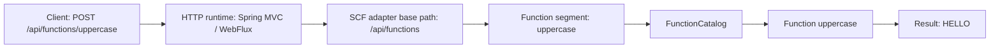
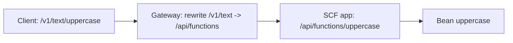

# Customizing Paths with `spring.cloud.function.web.path` in Spring Cloud Function

## 1. Problem: Changing URLs Without Modifying Business Logic

In **Spring Cloud Function (SCF)**, we write business logic as Java beans such as `Supplier<T>`, `Function<I, O>`, and `Consumer<T>`. SCF registers these beans in `FunctionCatalog`, where the HTTP adapter, event adapters, or serverless environments can look them up and execute them. As a result, a function that normalizes order IDs can serve multiple protocols without depending directly on `HttpServletRequest` or a specific web class.

When the HTTP adapter is enabled, the function name normally becomes part of the URL. For example, an `uppercase` bean can be invoked via `POST /uppercase`. However, a deployment team may want all HTTP functions under `/api/functions` to simplify routing, security, and API versioning:

```text
Before: POST http://localhost:8080/uppercase
After:  POST http://localhost:8080/api/functions/uppercase
```

You do not need to modify the `uppercase` bean, rename the Java method, or write an extra `@PostMapping`. Just configure:

```properties
spring.cloud.function.web.path=/api/functions
```

This property **changes the root base path of endpoints exposed by the SCF HTTP adapter**. It does not alter logic, bean names in `FunctionCatalog`, or the paths of other REST controllers.

### Learning Objectives

After this lesson, you will be able to:

1. Explain which URLs `spring.cloud.function.web.path` affects.
2. Configure the base path via `application.properties`, `application.yml`, environment variables, or startup arguments.
3. Predict URLs for a single function, multiple functions, a default function, and a composition.
4. Distinguish the SCF base path from the Servlet context path, WebFlux base path, and URLs exposed by a reverse proxy.
5. Test path changes, diagnose routing errors, and manage changes during API releases.

## 2. What Does `spring.cloud.function.web.path` Control?

By default, SCF's HTTP adapter uses the **root path `/`**. For example, with three beans `uppercase`, `greeting`, and `auditEvent`:

| Function type | Typical method | Default URL |
| --- | --- | --- |
| `Function<String, String> uppercase` | `POST` or `PUT` | `/uppercase` |
| `Supplier<String> greeting` | `GET` | `/greeting` |
| `Consumer<String> auditEvent` | `POST` or `PUT` | `/auditEvent` |

After setting `spring.cloud.function.web.path=/api/functions`, the paths become:

| Function | Method | New URL |
| --- | --- | --- |
| `uppercase` | `POST` | `/api/functions/uppercase` |
| `greeting` | `GET` | `/api/functions/greeting` |
| `auditEvent` | `POST` | `/api/functions/auditEvent` |

Conceptually, the URL is formed from these parts:

```text
Public URL =
  scheme + host + port
  + [HTTP server context path/base path]
  + [SCF HTTP adapter base path]
  + [function name or composition if applicable]
```

Bracketed parts depend on configuration. If a reverse proxy or API gateway sits in front, the URL seen by clients may also differ from the internal URL because the proxy performs rewrites.



**Property scope:**

- **Does:** change the prefix of endpoints registered by the SCF HTTP adapter.
- **Does not:** change `@Bean` names, `FunctionCatalog` contents, composition order, or `Function.apply()` itself.
- **Does not:** automatically expose HTTP endpoints if the application lacks an SCF web adapter.
- **Does not:** configure security, access permissions, API versioning, or API gateway rewrites.
- **Does not:** change the paths of `@RestController`, Actuator, or routes defined through other mechanisms.

Per SCF conventions, a **non-empty** value for the base path should start with `/`, e.g., `/api/functions` rather than `api/functions`. Avoid a trailing `/` in the configuration unless necessary, and test trailing-slash behavior on your exact Spring Framework and gateway versions.

## 3. Sample Project: Same Logic Before and After Changing the Path

Assume you have a Spring Boot project configured with a **compatible Spring Cloud BOM**. To use the SCF HTTP adapter with Spring MVC, you can add:

```xml
<dependency>
    <groupId>org.springframework.cloud</groupId>
    <artifactId>spring-cloud-starter-function-web</artifactId>
</dependency>
```

If the project uses WebFlux, choose the corresponding WebFlux SCF starter for your version. Starter selection determines the HTTP runtime; **`spring.cloud.function.web.path` remains SCF's path setting**, not a choice between Servlet and reactive runtimes.

Create `src/main/java/demo/ScfPathApplication.java`:

```java
package demo;

import java.util.Locale;
import java.util.function.Consumer;
import java.util.function.Function;
import java.util.function.Supplier;

import org.springframework.boot.SpringApplication;
import org.springframework.boot.autoconfigure.SpringBootApplication;
import org.springframework.context.annotation.Bean;

@SpringBootApplication
public class ScfPathApplication {

    public static void main(String[] args) {
        SpringApplication.run(ScfPathApplication.class, args);
    }

    @Bean
    public Function<String, String> uppercase() {
        return text -> text.toUpperCase(Locale.ROOT);
    }

    @Bean
    public Function<String, String> normalize() {
        return String::trim;
    }

    @Bean
    public Supplier<String> greeting() {
        return () -> "Hello from Spring Cloud Function";
    }

    @Bean
    public Consumer<String> auditEvent() {
        return payload -> System.out.println(
            "Received payload length: " + payload.length());
    }
}
```

These four beans demonstrate SCF's three primary function types and two `Function<String, String>` beans that can be composed. None of the beans needs to know which URL the request was sent to.

### 3.1. Running with Default Configuration

Before adding `spring.cloud.function.web.path`, run the application:

```bash
mvn spring-boot:run
```

Invoke directly by name:

```bash
curl -i -X POST 'http://localhost:8080/uppercase' \
  -H 'Content-Type: text/plain' \
  -H 'Accept: text/plain' \
  --data 'hello'
# Response body: HELLO
```

### 3.2. Changing the SCF Base Path

In `src/main/resources/application.properties`, add:

```properties
spring.cloud.function.web.path=/api/functions
```

Restart the application and call the new URLs:

```bash
curl -i -X POST 'http://localhost:8080/api/functions/uppercase' \
  -H 'Content-Type: text/plain' \
  -H 'Accept: text/plain' \
  --data 'hello'
# Response body: HELLO

curl -i 'http://localhost:8080/api/functions/greeting'
# Response body: Hello from Spring Cloud Function
```

Under this configuration, `POST /uppercase` **is no longer the default SCF endpoint**. If requests are still handled at the old URL, check whether a custom controller, gateway rewrite, or another mapping configuration is serving that path.

## 4. Ways to Declare the Same Configuration

Spring Boot supports multiple configuration sources. The examples below are **mutually alternative ways**; do not set all of them simultaneously.

### Method 1: `application.properties`

```properties
spring.cloud.function.web.path=/api/functions
```

### Method 2: `application.yml`

```yaml
spring:
  cloud:
    function:
      web:
        path: /api/functions
```

### Method 3: Environment Variables

Thanks to Spring Boot's **relaxed binding** rules, you can use:

```bash
export SPRING_CLOUD_FUNCTION_WEB_PATH=/api/functions
mvn spring-boot:run
```

In PowerShell, set the variable before starting Java:

```powershell
$env:SPRING_CLOUD_FUNCTION_WEB_PATH = '/api/functions'
mvn spring-boot:run
```

### Method 4: Command-Line Arguments

```bash
java -jar app.jar --spring.cloud.function.web.path=/api/functions
```

`app.jar` is a placeholder name for the built JAR. In Docker, Kubernetes, or cloud runtimes, the same property can be supplied via environment variables or deployment configuration.

**Which approach should you choose?** For stable routes in a single environment, configure them in managed configuration files. If the same artifact runs across multiple environments, setting the base path via environment variables or deployment arguments may be more convenient. Always verify the **effective configuration value** when multiple sources define the same key; Spring Boot follows a property source precedence order, so a runtime argument can override a file value.

## 5. Combining the Base Path with Function Selection Rules

The `spring.cloud.function.web.path` property controls the **URL root**, whereas `FunctionCatalog` and `spring.cloud.function.definition` control **which function is invoked**. Both sets of rules must be considered together.

Assume every scenario in this section uses:

```properties
spring.cloud.function.web.path=/api/functions
```

### 5.1. Single-Function Case

If the catalog contains only `uppercase`, the function name in the path is optional. You can call:

```text
POST /api/functions/uppercase
POST /api/functions
```

Both route to `uppercase`. SCF documentation states that when there is only one function, the path name is optional. Depending on the version and matching rules, a trailing-slash variant like `/api/functions/` may need to be tested separately; do not assume all trailing-slash variants behave identically without verifying.

**Note:** The example code in section 3 has **four beans**, so to test the “single function” condition, temporarily remove or disable the other three beans. Do not assume the multi-bean example automatically picks `uppercase` as the default.

### 5.2. Multi-Function Case

With a catalog containing `uppercase`, `normalize`, `greeting`, and `auditEvent`:

```text
POST /api/functions/uppercase
POST /api/functions/normalize
GET  /api/functions/greeting
POST /api/functions/auditEvent
```

The root path `/api/functions` has no unique target to choose automatically. Clients should use named URLs, or the application must set a default function via `spring.cloud.function.definition`.

### 5.3. Setting a Default Function at the Base Path

```properties
spring.cloud.function.web.path=/api/functions
spring.cloud.function.definition=uppercase
```

Now you can send:

```bash
curl -i -X POST 'http://localhost:8080/api/functions' \
  -H 'Content-Type: text/plain' \
  --data 'spring'
# Response body: SPRING
```

This maps the **selected function** at SCF's root, rather than renaming the bean to `api` or `functions`.

### 5.4. Setting a Composition as Default

Both `normalize` and `uppercase` have the signature `Function<String, String>`. We can compose them:

```properties
spring.cloud.function.web.path=/api/functions
spring.cloud.function.definition=normalize|uppercase
```

Calling the base path:

```bash
curl -i -X POST 'http://localhost:8080/api/functions' \
  -H 'Content-Type: text/plain' \
  --data '  spring cloud  '
# Response body: SPRING CLOUD
```

Execution order: `normalize` trims leading/trailing whitespace, then `uppercase` converts to uppercase.

A composition can also be invoked by name using a comma when it is exposed:

```text
POST /api/functions/normalize,uppercase
```

The `|` character in properties expresses function composition; a comma in URLs is more convenient because `|` is easily interpreted as a pipe by shells and may need URL-encoding.

### 5.5. Exposing Only Listed Functions

When `spring.cloud.function.definition` contains a `;`-separated list, the HTTP adapter applies **function filtering**:

```properties
spring.cloud.function.web.path=/api/functions
spring.cloud.function.definition=uppercase;greeting
```

With this configuration, only `uppercase` and `greeting` are in the published list; there is no automatic mapping for the base path `/api/functions`. Unlisted endpoints such as `normalize`, `auditEvent`, or compositions are not exposed by the SCF adapter.

### URL Matrix

| Catalog and configuration | Example callable URLs | Base path `/api/functions` |
| --- | --- | --- |
| Only one bean `uppercase`, no `definition` | `POST /api/functions/uppercase` | Calls `uppercase` |
| Multiple beans, no `definition` | `/api/functions/{function-name}` | No default function |
| Multiple beans, `definition=uppercase` | Default selected function | Calls `uppercase` |
| `definition=normalize|uppercase` | Selected composition | Calls `normalize` then `uppercase` |
| `definition=uppercase;greeting` | `/api/functions/uppercase`, `/api/functions/greeting` | **No** automatic root mapping |
| `definition=normalize|uppercase;greeting` | `/api/functions/normalize,uppercase`, `/api/functions/greeting` | **No** automatic root mapping |

One caveat when selecting a **single** `definition`: SCF also has a fallback mechanism when a function name cannot be resolved from the URL; requests with non-existent names may be handled by the default function/composition. Therefore, **the base path is not a security filter**. If you require strict HTTP routing and rejection of all other URLs, control routes via the web framework/gateway, test fallback behavior, and apply proper authorization.

## 6. Distinguishing the SCF Base Path from Other Path Types

A common cause of `404` errors is configuring multiple prefix layers simultaneously and remembering only one of them.

| Configuration | Scope | Example | Effect on `uppercase` |
| --- | --- | --- | --- |
| `spring.cloud.function.web.path` | Only **SCF HTTP adapter** endpoints | `/api/functions` | Prepends SCF prefix |
| `server.servlet.context-path` | Entire **Servlet application** (Spring MVC) | `/order-service` | Prepends MVC application prefix |
| `spring.webflux.base-path` | Base path for **WebFlux handlers** | `/order-service` | Prepends prefix for the corresponding WebFlux runtime |
| `server.port` | HTTP listening port | `8090` | Changes port, does not change path |
| `@RequestMapping`, `RouterFunction` | Application-defined custom routes | `/v1/orders` | Not automatically modified by SCF properties |
| Reverse proxy / API Gateway | Client-visible path, may be rewritten | `/public/v1` | May differ from the path forwarded to the application |

### 6.1. Combining with the Servlet Context Path

Spring MVC application example:

```properties
server.port=8090
server.servlet.context-path=/order-service
spring.cloud.function.web.path=/api/functions
```

Clients then invoke `uppercase` at:

```text
POST http://localhost:8090/order-service/api/functions/uppercase
```

The order is **application context path** → **SCF base path** → **function name**. Do not put `/order-service` again inside `spring.cloud.function.web.path`, or the prefix will be duplicated in the URL.

### 6.2. In WebFlux Applications

In a WebFlux application, do not use `server.servlet.context-path` to express the base path for reactive web handlers. Spring Boot provides `spring.webflux.base-path` for WebFlux:

```properties
spring.webflux.base-path=/order-service
spring.cloud.function.web.path=/api/functions
```

The corresponding URL model is `/order-service/api/functions/uppercase`, provided the selected SCF HTTP adapter and WebFlux runtime version support that mapping. Verify with an actual integration request; do not draw conclusions solely from dependency names or server startup logs.

### 6.3. Behind an API Gateway

For example, clients want to call `https://api.example.com/v1/text/uppercase`, while the internal application exposes `/api/functions/uppercase`.



If the gateway simply **forwards the original path** without rewriting, backend configuration must match the path arriving from the gateway. If the gateway **rewrites**, you must know the actual path forwarded to the application. Keep API versioning (`/v1`) placement consistent between the gateway and the SCF base path to avoid confusion and breaking client contracts.

## 7. Using `spring.cloud.function.web.path` to Organize APIs

Reasonable organizational patterns:

| Need | Suggested configuration | Sample URL |
| --- | --- | --- |
| Group utility functions | `/api/functions` | `/api/functions/uppercase` |
| Version the HTTP contract | `/v1/functions` | `/v1/functions/normalize` |
| Use one composition as the primary endpoint | `/v1/normalize` + one `definition` | `POST /v1/normalize` |
| Host inside an MVC app with a context path | `server.servlet.context-path=/app` and `web.path=/functions` | `/app/functions/uppercase` |

Setting a base path does not force you to design every API around this structure. What matters is that URLs exposed to clients remain consistent, tested, and governed by a clear versioning policy. If you need a multi-route REST resource like `GET /orders/{id}`, `PATCH /orders/{id}`, `DELETE /orders/{id}` with varied status codes and custom validation, consider Spring MVC/WebFlux controllers or routers. The SCF HTTP adapter primarily serves **invoking functions**.

### Benefits of a Stable Path

- Clients can easily tell URLs belonging to SCF endpoints apart from regular controller APIs.
- Gateways can group routing, rate limiting, and monitoring under a clear prefix.
- External API releases can be decoupled from internal bean renames when the gateway manages the mapping appropriately.
- A bean remains usable from event adapters or serverless runtimes even if the HTTP URL changes.

However, **changing the base path changes the HTTP contract**. Existing clients calling `/uppercase` will not automatically switch to `/api/functions/uppercase`. If external consumers already exist, prepare a migration plan: update documentation, client apps, gateway rules, and monitor logs for old requests.

## 8. Testing Configuration After Changing Paths

Assume the sample application from section 3 runs with `web.path=/api/functions` and **no** `definition`:

```bash
# 1. Function accepting text: expect 200 and body HELLO.
curl -i -X POST 'http://localhost:8080/api/functions/uppercase' \
  -H 'Content-Type: text/plain' \
  -H 'Accept: text/plain' \
  --data 'hello'

# 2. Supplier: expect 200 and greeting body.
curl -i 'http://localhost:8080/api/functions/greeting'

# 3. Consumer: send data and check side effect in console.
curl -i -X POST 'http://localhost:8080/api/functions/auditEvent' \
  -H 'Content-Type: text/plain' \
  --data 'order-created'

# 4. Check old route: no longer SCF's default mapping.
curl -i -X POST 'http://localhost:8080/uppercase' \
  -H 'Content-Type: text/plain' \
  --data 'hello'

# 5. Check composition when function filtering is not enabled.
curl -i -X POST 'http://localhost:8080/api/functions/normalize,uppercase' \
  -H 'Content-Type: text/plain' \
  --data '  hello  '
```

In step 5, the business result is `HELLO`. In real applications, verify HTTP status, `Content-Type`, response body, actual bean invocation, and side-effect results; checking only `200` is not enough.

### Minimum Verification Checklist

| Test case | What to verify |
| --- | --- |
| Call function via new prefixed URL | HTTP adapter matches the URL and invokes the right bean |
| Call old URL | Explicitly confirm whether it is still supported or needs redirect/rewrite |
| Call base path with one/multiple functions | Root mapping matches the catalog and `definition` |
| Call composition | Function names and order execute properly |
| Call non-existent path | Whether fallback triggers; ensure no unintended route exposure |
| Combine context path and gateway | No missing or duplicated prefixes |
| Authenticated requests | Security configuration covers the new path as well |
| URL with/without trailing `/` | Behavior matches the runtime and proxy in use |

Do not assume `GET /api/functions/uppercase` works the same as `POST /api/functions/uppercase`. Under SCF's typical mapping, a `Function` accepts a body via `POST`/`PUT`, while the GET variant typically uses `/{function}/{item}`, for example:

```bash
curl -i 'http://localhost:8080/api/functions/uppercase/hello'
# Response body: HELLO
```

Adjusting the URL does not remove existing HTTP method and content negotiation rules.

## 9. Common Errors and How to Fix Them

| Symptom | Possible cause | How to check/fix |
| --- | --- | --- |
| `POST /uppercase` returns `404` after config change | Path moved under the new base path | Call `POST /api/functions/uppercase` |
| `POST /api/functions/uppercase` returns `404` | SCF web adapter not enabled, wrong bean name, `definition` filters out the function, or different configured path | Check dependencies, `FunctionCatalog`, and effective properties |
| URL duplicates `/app/app/functions` | Context path placed in both `server.servlet.context-path` and `web.path` | Separate each prefix into its own property |
| Client calls via gateway get `404`, internal calls succeed | Gateway forwards/rewrites incorrectly or omits the prefix | Inspect the URL received by the backend and verify rewrite rules |
| Only one function exists, but calling base path fails to match | Trailing slash difference, context path, or actual config | Test root variants, inspect runtime mappings, write contract tests |
| Adding a new bean breaks previous root behavior | Catalog no longer has a single function | Configure a default `definition` or use named URLs |
| Calling an unknown path still executes a function | Fallback behavior when `definition` is set | Test unknown paths and enforce access controls |
| Endpoint matches path but returns `415`/`400` | Wrong `Content-Type`, payload, or data type; not necessarily a routing bug | Check headers and the function's generic input type |
| Config file changed, but app ignores it | App not restarted, or value overridden by CLI/env/profile | Check property sources, active profile, and redeploy |
| New endpoint fails authentication | Security filter/gateway rules still match the old pattern | Update security rules and run access tests |

### Quick Diagnostic Steps

Follow in order:

1. Confirm the **effective** value of `spring.cloud.function.web.path` in the running environment.
2. Confirm the Spring MVC/WebFlux runtime and SCF HTTP adapter are actually loaded.
3. List bean names in `FunctionCatalog` or inspect via logging/Actuator if appropriately enabled.
4. Check the number of functions, `spring.cloud.function.definition`, and whether `;` filtering is enabled.
5. Check `server.servlet.context-path`, `spring.webflux.base-path`, or gateway rewrites.
6. Use `curl -i` to observe real requests, statuses, and bodies instead of guessing from URLs alone.

**Security:** the base path only organizes routes; it does not protect functions. SCF can pass HTTP header information into `MessageHeaders` when using `Message<?>`; never let external clients pick sensitive functions via routing headers without control. Apply Spring Security/API gateway rules, authorization, and input limits suited to the API.

## 10. Practice Questions

1. A catalog has only `Function<String, String> uppercase`; `spring.cloud.function.web.path=/v1/fn` is set. Write two valid URLs to invoke this function and explain why both work.
2. After adding `normalize`, `greeting`, and `auditEvent`, does `POST /v1/fn` still invoke `uppercase` by default? What configuration is needed to explicitly select one function?
3. Set `spring.cloud.function.definition=normalize|uppercase` and `spring.cloud.function.web.path=/text`. What is the result of `POST /text` with body `"  hello  "`?
4. If `definition=uppercase;greeting`, why does `POST /api/functions` not invoke `uppercase` automatically? Which endpoints remain exposed?
5. Spring MVC runs on port `9090`, with `server.servlet.context-path=/backend` and `web.path=/api/functions`. Write the full URL for `POST /uppercase`.
6. A gateway receives `/public/v1/uppercase` and rewrites it to `/api/functions/uppercase`. Which property must be set on the backend? What happens if the gateway forwards the original URL without updating backend configuration?
7. Why does changing `spring.cloud.function.web.path` not affect a Spring Cloud Stream application that invokes the same `uppercase` bean from events?
8. Name at least three checks to perform before changing a URL currently used by production clients.

## Official References

- [Spring Cloud Function — Standalone Web Applications](https://docs.spring.io/spring-cloud-function/reference/spring-cloud-function/standalone-web-applications.html): configuring `spring.cloud.function.web.path`, named mapping, root mapping, filtering, composition, and HTTP methods.
- [Spring Cloud Function — Programming Model](https://docs.spring.io/spring-cloud-function/reference/spring-cloud-function/programming-model.html): `Supplier`, `Function`, `Consumer`, `FunctionCatalog`, and message processing.
- [Spring Cloud Function — Functional Bean Definitions](https://docs.spring.io/spring-cloud-function/reference/functional.html): declaring beans for function applications.
- [Spring Boot — Servlet Web Applications](https://docs.spring.io/spring-boot/reference/web/servlet.html): Servlet applications, context paths, and server configuration.
- [Spring Boot — Reactive Web Applications](https://docs.spring.io/spring-boot/reference/web/reactive.html): WebFlux runtime and web configuration options.

> **Remember:** `spring.cloud.function.web.path` changes the **root address of the SCF HTTP adapter**. Bean selection, composition, and filtering rules are still governed by `FunctionCatalog` and `spring.cloud.function.definition`. Changing the URL only requires configuration, but requires testing contracts with clients and related proxy/security layers.
