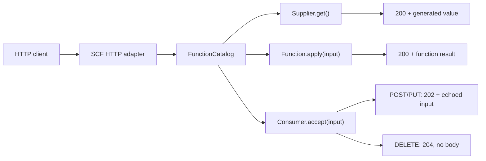

# HTTP Methods and Responses for Supplier, Function, and Consumer in Spring Cloud Function

## 1. Why Does the Same Endpoint Shape Produce Different Responses?

In **Spring Cloud Function (SCF)**, business logic is declared using standard Java functional beans:

- `Supplier<O>`: produces data without accepting input parameters.
- `Function<I, O>`: accepts input data and returns a result.
- `Consumer<I>`: accepts input data to process it without returning a business value.

Beans are managed via `FunctionCatalog` and can be invoked from HTTP, Spring Cloud Stream, or serverless adapters. When the **SCF HTTP adapter** is added, each function type follows distinct rules for **HTTP method**, **request body**, **response body**, and **HTTP status**.

For example, when sending the same body `"hello"` to a handler:

- `Function<String, String> uppercase` returns `"HELLO"` with a typical status of `200 OK`.
- `Consumer<String> auditEvent` processes the input string and typically returns `202 Accepted`; the adapter may echo the input in the response, though the Consumer produces no business result of its own.
- `Supplier<String> greeting` does not read a body; clients typically invoke it via `GET` and receive `200 OK`.

This difference comes from **the function's Java contract and the HTTP adapter's rules**, not from the path name or class naming.

### Learning Objectives

After this lesson, learners will be able to:

1. Accurately match default HTTP methods, paths, requests, responses, and statuses for all three function types.
2. Practice calling `Supplier`, `Function`, and `Consumer` with `curl` using plain text and JSON.
3. Distinguish `200 OK`, `202 Accepted`, and `204 No Content`, avoiding false assumptions about processing state.
4. Understand the impact of `Content-Type`, `Accept`, headers, `Message<?>`, and multi-element data.
5. Analyze common HTTP errors and know when custom REST/controller mechanisms are needed.

## 2. SCF's Default HTTP Mapping Table

The table below is based on Spring Cloud Function's *Standalone Web Applications* rules. `/{function}`, `/{supplier}`, and `/{consumer}` are **bean names registered by SCF in `FunctionCatalog`**, not Java class names. It assumes the HTTP adapter is enabled, the default base path is `/`, and requests use matching media types.

| HTTP method | Path | Request | Response | Typical status |
| --- | --- | --- | --- | --- |
| `GET` | `/{supplier}` | No body needed | Value/object produced by the Supplier | **200 OK** |
| `POST` | `/{function}` | Text or JSON in body | Result of `Function.apply(input)` | **200 OK** |
| `PUT` | `/{function}` | Text or JSON in body | Result of `Function.apply(input)` | **200 OK** |
| `GET` | `/{function}/{item}` | Input in `{item}` segment | Result after converting `item` to input | **200 OK** |
| `POST` | `/{consumer}` | Text or JSON in body | Echoes input data while passing payload to Consumer | **202 Accepted** |
| `PUT` | `/{consumer}` | Text or JSON in body | Echoes input data while passing payload to Consumer | **202 Accepted** |
| `DELETE` | `/{consumer}` | Text or JSON per adapter contract | No response body | **204 No Content** |

These statuses represent **typical adapter behavior when the request is valid and the function succeeds**. They do not guarantee every request returns those statuses: JSON decoding failures, wrong URLs, wrong methods, business exceptions, and security configuration can all change the response.

### Reading the Table as a Data Flow



Note: a `Function` **can have side effects**, and a `Supplier` **can return different values on each call**. The interface name itself does not guarantee an operation is safe, pure, idempotent, or read-only.

## 3. Java Example to Practice All Three Function Types

Prepare a Spring Boot application with the **Spring Cloud Function web starter** and a compatible Spring Boot/Spring Cloud BOM. For a Spring MVC project, the Maven dependency is typically:

```xml
<dependency>
    <groupId>org.springframework.cloud</groupId>
    <artifactId>spring-cloud-starter-function-web</artifactId>
</dependency>
```

You do not need to specify a version on the dependency if the project imports the Spring Cloud BOM matching your Spring Boot line. For WebFlux applications, use the SCF WebFlux starter for your release train and verify behavior on that runtime. The examples below assume a typical MVC SCF HTTP adapter setup.

Create `src/main/java/demo/FunctionHttpMethodsApplication.java`. The example uses Java 17+ for `record` DTOs:

```java
package demo;

import java.math.BigDecimal;
import java.util.Locale;
import java.util.function.Consumer;
import java.util.function.Function;
import java.util.function.Supplier;

import org.springframework.boot.SpringApplication;
import org.springframework.boot.autoconfigure.SpringBootApplication;
import org.springframework.context.annotation.Bean;

@SpringBootApplication
public class FunctionHttpMethodsApplication {

    public static void main(String[] args) {
        SpringApplication.run(FunctionHttpMethodsApplication.class, args);
    }

    // GET: produces simple status information.
    @Bean
    public Supplier<ServiceStatus> serviceStatus() {
        return () -> new ServiceStatus("SPRING_CLOUD_FUNCTION", "READY");
    }

    // POST/PUT, or GET /uppercase/{item}.
    @Bean
    public Function<String, String> uppercase() {
        return text -> text.toUpperCase(Locale.ROOT);
    }

    // POST/PUT: JSON input/output.
    @Bean
    public Function<QuoteRequest, QuoteResponse> quote() {
        return request -> {
            if (request == null || request.sku() == null
                    || request.sku().isBlank()
                    || request.quantity() <= 0) {
                throw new IllegalArgumentException("Invalid quote request");
            }

            BigDecimal unitPrice = new BigDecimal("120000");
            BigDecimal total = unitPrice.multiply(
                    BigDecimal.valueOf(request.quantity()));

            return new QuoteResponse(
                    request.sku(), request.quantity(), total);
        };
    }

    // POST/PUT/DELETE: has side effects, no Java return value.
    @Bean
    public Consumer<AuditEvent> auditEvent() {
        return event -> System.out.printf(
                "Audit received: type=%s, reference=%s%n",
                event.type(), event.reference());
    }

    public record ServiceStatus(String service, String state) {}
    public record QuoteRequest(String sku, int quantity) {}
    public record QuoteResponse(
            String sku, int quantity, BigDecimal totalPrice) {}
    public record AuditEvent(String type, String reference) {}
}
```

In this example:

- `serviceStatus` returns an object; JSON serialization is handled by the HTTP adapter and message converter/codec.
- `uppercase` converts the input string to uppercase, illustrating HTTP plain text.
- `quote` accepts JSON and returns JSON; the fixed price `120000` is for learning purposes only.
- `auditEvent` only writes to the console; a real application might call a service or write to an event/database, requiring explicit error contracts and delivery guarantees.

Run the project:

```bash
mvn spring-boot:run
```

The `curl` commands below use Bash syntax. In Windows PowerShell, call `curl.exe` and use the corresponding line-continuation syntax.

## 4. Supplier: GET Returns Data Produced by the Function

### 4.1. Supplier Contract

The `Supplier<ServiceStatus> serviceStatus` bean accepts no input data from HTTP. Under default configuration, the corresponding request is:

```http
GET /serviceStatus HTTP/1.1
Host: localhost:8080
Accept: application/json
```

Call with `curl`:

```bash
curl -i 'http://localhost:8080/serviceStatus' \
  -H 'Accept: application/json'
```

Typical response:

```http
HTTP/1.1 200 OK
Content-Type: application/json

{"service":"SPRING_CLOUD_FUNCTION","state":"READY"}
```

`200 OK` means the HTTP request succeeded and the value produced by the Supplier was written to the response. Another Supplier might return a `String`, a JSON object, or a multi-element source depending on the declared return type.

### 4.2. Is GET Guaranteed Not to Mutate State?

In general HTTP semantics, GET is a *safe* read method with respect to application-managed state. However, Java's `Supplier.get()` **does not enforce this rule automatically**: a developer can still write a Supplier that increments a counter, calls a billable API, or modifies a database.

To keep the HTTP contract predictable, use GET Suppliers for repeatable reads/data generation without unexpected side effects. If a GET endpoint performs mutating side effects, caches, crawlers, or monitoring tools may trigger unintended logic.

### 4.3. When Can the Root Path Be Called?

If there is only **one functional bean** in the catalog, you can call the Supplier at `GET /` instead of `GET /serviceStatus`. However, our sample app has **four beans**, so you must include the name unless a default function is configured via `spring.cloud.function.definition`. This rule applies equally to Supplier, Function, and Consumer.

## 5. Function: POST and PUT Return the Result of apply()

### 5.1. Text-Processing Function via POST

Request:

```bash
curl -i -X POST 'http://localhost:8080/uppercase' \
  -H 'Content-Type: text/plain' \
  -H 'Accept: text/plain' \
  --data 'spring cloud function'
```

Typical response:

```http
HTTP/1.1 200 OK
Content-Type: text/plain

SPRING CLOUD FUNCTION
```

The HTTP adapter converts the request body to `String`, invokes `uppercase.apply(...)`, and writes the result to the response body. If the client sends `PUT` with the same body:

```bash
curl -i -X PUT 'http://localhost:8080/uppercase' \
  -H 'Content-Type: text/plain' \
  -H 'Accept: text/plain' \
  --data 'hello'
```

Under default mapping, the business result is `HELLO` and the status remains **200 OK**.

### 5.2. Function Accepting JSON and Returning JSON

For the `quote` bean accepting `QuoteRequest` and returning `QuoteResponse`:

```bash
curl -i -X POST 'http://localhost:8080/quote' \
  -H 'Content-Type: application/json' \
  -H 'Accept: application/json' \
  --data '{"sku":"BOOK-001","quantity":2}'
```

Typical response:

```http
HTTP/1.1 200 OK
Content-Type: application/json

{"sku":"BOOK-001","quantity":2,"totalPrice":240000}
```

The key requirement is that the generic types of `Function<I, O>` are specific enough for the converter to know to deserialize the JSON body into `QuoteRequest`, and that an appropriate JSON codec is available in the environment.

### 5.3. Function Also Supports GET with Input in the Path

SCF supports the pattern:

```text
GET /{function}/{item}
```

Example:

```bash
curl -i 'http://localhost:8080/uppercase/hello'
# Status: 200 OK
# Body: HELLO
```

In this request, `uppercase` is the function name, while `hello` is **input data extracted from the path**. If the input contains spaces, slashes, or special characters, it must be properly URL-encoded. GET invocation fits simple inputs; for complex DTOs, passing JSON in a POST/PUT body is much easier to control.

**Do not assume `GET /uppercase` (without `/{item}`) is equivalent to `POST /uppercase`.** SCF distinguishes methods and path shapes; matching the function name alone is not enough to satisfy every HTTP method.

### 5.4. PUT and Idempotency

In HTTP semantics, PUT is expected to be **idempotent**: executing the same request multiple times should have the same intended effect as executing it once. However, the SCF adapter can invoke the exact same `Function.apply()` via either POST or PUT; **it does not verify whether your code is idempotent**.

If a Function deducts money, issues an invoice, or sends an email when called over PUT, business side effects may repeat. When designing real APIs, explicitly enforce appropriate HTTP methods, retry handling, and idempotency keys when needed rather than relying on the HTTP method name alone.

## 6. Consumer: POST/PUT Return 202, DELETE Returns 204

### 6.1. Consumer Has No Java Return Value

Sample bean:

```java
@Bean
public Consumer<AuditEvent> auditEvent() {
    return event -> System.out.println(event.reference());
}
```

The `void accept(AuditEvent event)` signature provides no return object. Yet the SCF HTTP adapter still needs to produce an HTTP response so the client knows the request reached the endpoint.

### 6.2. POST/PUT: 202 Accepted and Echoing Input Data

Send a sample event:

```bash
curl -i -X POST 'http://localhost:8080/auditEvent' \
  -H 'Content-Type: application/json' \
  -H 'Accept: application/json' \
  --data '{"type":"ORDER_CREATED","reference":"ORD-100"}'
```

Under the default HTTP contract described in SCF documentation, the adapter passes the data into the Consumer while **echoing the input in the response** and returning **202 Accepted**. With the sample JSON, the response may look like:

```http
HTTP/1.1 202 Accepted
Content-Type: application/json

{"type":"ORDER_CREATED","reference":"ORD-100"}
```

Exact formatting of headers, whitespace, and JSON may vary by version, converter, and configuration. Do not build clients that depend on the echoed body matching the request byte-for-byte. The key point is that **the Consumer produces no new business value**; echoing the input is adapter behavior.

For `PUT /auditEvent`, default mapping behaves similarly: input is passed to the Consumer and the typical response is `202 Accepted`.

### 6.3. 202 Accepted Does Not Mean “Saved”

HTTP status **202 Accepted** generally indicates a request was accepted for processing. In SCF, however, this status is simply the default mapping for Consumer and **does not by itself prove that the application has a queue, asynchronous processing, or durable persistence**.

Distinguish carefully:

| Assertion | Can it be concluded from `202`? |
| --- | --- |
| The HTTP adapter returned a status accepting the request | **Yes** |
| The Consumer was invoked by the adapter along the success path | **Typically yes**, if no error occurred |
| A database transaction was committed | **No**, unless guaranteed by business design |
| An event was acknowledged and durably stored by a broker | **No** |
| Work runs completely asynchronously | **No** |
| Processing is “exactly once” without duplicates on retry | **No** |

In our example, `auditEvent` prints to the console. A `202` status does not turn a console log into a reliable audit trail. If you need transactional guarantees, retries, an outbox, or broker acknowledgments, design and test those explicitly.

### 6.4. DELETE: 204 No Content

SCF also maps DELETE for Consumers:

```bash
curl -i -X DELETE 'http://localhost:8080/auditEvent' \
  -H 'Content-Type: application/json' \
  --data '{"type":"ORDER_REMOVED","reference":"ORD-100"}'
```

Typical response:

```http
HTTP/1.1 204 No Content
```

`204 No Content` means **the response contains no body**. Do not try to parse JSON from a 204 DELETE response. The HTTP adapter passes input to the Consumer according to its mapping, but the DELETE method **does not magically turn Consumer code into a resource-deletion operation**. In the example, the Consumer still just logs to the console.

Note on DELETE with a request body: some HTTP clients, proxies, middleware, or API gateways have strict policies regarding DELETE bodies. When building a resource-deletion API by ID, a controller/router with a `/resources/{id}` path and explicit contract is usually more interoperable.

## 7. Why Do Content-Type and Accept Matter?

The SCF HTTP adapter supports **plain text** and **JSON**, relying on the function's input and output types to convert payloads.

| Header | Role | Example |
| --- | --- | --- |
| `Content-Type` | Describes the **format of the request body** sent by the client | `text/plain`, `application/json` |
| `Accept` | Indicates the **response format** the client wants to receive | `text/plain`, `application/json` |
| `Content-Length` | Size of the HTTP body | Handled by the HTTP client/runtime |
| Custom headers | Request metadata | `X-Correlation-ID`, `X-Tenant-ID` (if defined by the application) |

Correct example for `Function<String, String> uppercase`:

```bash
curl -i -X POST 'http://localhost:8080/uppercase' \
  -H 'Content-Type: text/plain' \
  -H 'Accept: text/plain' \
  --data 'hello'
```

Correct example for `Function<QuoteRequest, QuoteResponse> quote`:

```bash
curl -i -X POST 'http://localhost:8080/quote' \
  -H 'Content-Type: application/json' \
  -H 'Accept: application/json' \
  --data '{"sku":"BOOK-001","quantity":2}'
```

A **wrong `Content-Type`** can trigger `415 Unsupported Media Type`, corrupted decoding, or conversion errors. Being **unable to produce a response matching `Accept`** can trigger `406 Not Acceptable`, depending on the HTTP runtime and codec configuration. These error statuses are decided by the web/converter layer, not the success paths in SCF's HTTP table.

### 7.1. Message Enables Header Access

If a function declares its input as `org.springframework.messaging.Message<T>`, the adapter can populate `MessageHeaders` with HTTP headers. For example:

```java
@Bean
public Function<org.springframework.messaging.Message<String>, String>
        describeInput() {
    return message ->
            "payloadLength=" + message.getPayload().length();
}
```

With a `Message<?>` return type, headers on the output message can be copied into HTTP response headers. HTTP query parameters are stored by the adapter in the `http_request_param` message header as a map; they do not automatically become separate Java parameters on `Function.apply()`.

According to SCF documentation, **most request headers are copied to response headers by default**. To exclude specific headers, you can configure:

```properties
spring.cloud.function.http.ignored-headers=X-Internal-Token,X-Tenant-Secret
```

This configuration is SCF's header filter and does not replace sensitive-header stripping policies at reverse proxies, security middleware, or application code. For client-supplied headers, always validate trustworthiness before using them for access control or tenant selection.

### 7.2. Multi-Element Data and Streaming

The earlier examples used single-value payloads. If a function returns a collection or a reactive type such as `Flux<T>`, the HTTP adapter can emit multiple items; clients can request server-sent events with:

```http
Accept: text/event-stream
```

In this case, the response is not necessarily a single complete JSON object like the `quote` example. Streaming, backpressure, and client cancellation must be tested on the actual HTTP runtime and SCF version in use. Using `Flux` in a bean does not by itself prove all internal dependencies are non-blocking.

## 8. How the HTTP Adapter Finds the Right Function

HTTP methods work **together with** function selection rules from `FunctionCatalog`:

1. If the catalog has only one functional bean, the URL name can be omitted; e.g., `POST /` invokes the sole Function.
2. If there are multiple beans, default routes follow bean names: `/serviceStatus`, `/quote`, `/auditEvent`.
3. A default function or composition can be selected via `spring.cloud.function.definition`.
4. When `definition` lists multiple functions/compositions separated by `;`, the adapter applies filtering: only listed entries are exposed, and there is no automatic root mapping.
5. The prefix can be changed via `spring.cloud.function.web.path`; HTTP methods and response semantics per bean type do not change because of the prefix.

Example for the same application in section 3:

```properties
spring.cloud.function.web.path=/api/functions
```

The URL table then becomes:

| Method | URL | Bean | Typical success status |
| --- | --- | --- | --- |
| GET | `/api/functions/serviceStatus` | Supplier | 200 |
| POST | `/api/functions/quote` | Function | 200 |
| PUT | `/api/functions/uppercase` | Function | 200 |
| POST | `/api/functions/auditEvent` | Consumer | 202 |
| DELETE | `/api/functions/auditEvent` | Consumer | 204 |

This is **only a path change**. Adding a URL prefix does not turn a Supplier into a Consumer or change `202` into `200`.

### Customizing Method Mappings

SCF allows assigning function/composition names to HTTP methods using properties of the form:

```properties
spring.cloud.function.http.GET=serviceStatus
spring.cloud.function.http.POST=quote;auditEvent
spring.cloud.function.http.PUT=quote
spring.cloud.function.http.DELETE=auditEvent
```

In this example, `;` separates function names mapped to the same method; `|` can be used for composition. This **configures function selection per HTTP method**—it does not enforce GET safety, PUT idempotency, or DELETE resource-removal semantics. When using these properties, test which methods are actually exposed on your running SCF version.

## 9. Reading Status Codes Correctly

| Status | General HTTP meaning | In SCF examples | What must not be assumed |
| --- | --- | --- | --- |
| **200 OK** | Request processed successfully | Supplier returns data; Function returns result | Does not prove purity, idempotency, or durable persistence |
| **202 Accepted** | Request accepted for processing | Consumer receives input via POST/PUT; adapter typically echoes input | Does not guarantee a queue, async execution, or committed transaction |
| **204 No Content** | Processed successfully, no response body | Consumer receives mapped DELETE | Does not by itself prove a record was deleted |
| **400 Bad Request** | Invalid request | Can appear when input is malformed or unparseable | Do not assume every business exception becomes 400 |
| **404 Not Found** | No matching URL/route found | Wrong function name, wrong prefix, or bean not exposed | Does not guarantee unknown paths return 404 if a fallback function is configured |
| **405 Method Not Allowed** | Route exists, but method is invalid | Calling GET/POST/PUT/DELETE outside supported mappings | Does not mean the bean processed the request |
| **406/415** | Cannot satisfy requested/sent media type | Wrong `Accept` or `Content-Type` | Not necessarily a business logic bug in the function |
| **500 Internal Server Error** | Server-side processing error | Function/Consumer throws an unmapped exception | Never expose raw stack traces or internal data to clients |

In particular, if `quote` throws `IllegalArgumentException` when `quantity <= 0`, the adapter **does not guarantee turning that business error into `400 Bad Request`**. If your API contract requires exact status codes and error bodies, build an error-handling layer at the HTTP boundary (Spring MVC/WebFlux exception handling or controllers/routers) instead of only throwing exceptions from a Function.

## 10. Testing All Methods Thoroughly with curl

When running the application from section 3 with the default path, you can verify the main branches:

```bash
# 1. Supplier GET -> 200, JSON body.
curl -i -H 'Accept: application/json' \
  'http://localhost:8080/serviceStatus'

# 2. Function POST text -> 200, body HELLO.
curl -i -X POST 'http://localhost:8080/uppercase' \
  -H 'Content-Type: text/plain' \
  -H 'Accept: text/plain' --data 'hello'

# 3. Function PUT text -> 200, body HELLO.
curl -i -X PUT 'http://localhost:8080/uppercase' \
  -H 'Content-Type: text/plain' \
  -H 'Accept: text/plain' --data 'hello'

# 4. Function GET/{item} -> 200, body HELLO.
curl -i 'http://localhost:8080/uppercase/hello'

# 5. Function POST JSON -> 200, QuoteResponse body.
curl -i -X POST 'http://localhost:8080/quote' \
  -H 'Content-Type: application/json' \
  -H 'Accept: application/json' \
  --data '{"sku":"BOOK-001","quantity":2}'

# 6. Consumer POST -> 202, may show echoed input.
curl -i -X POST 'http://localhost:8080/auditEvent' \
  -H 'Content-Type: application/json' \
  --data '{"type":"ORDER_CREATED","reference":"ORD-100"}'

# 7. Consumer PUT -> 202, input is passed to Consumer.
curl -i -X PUT 'http://localhost:8080/auditEvent' \
  -H 'Content-Type: application/json' \
  --data '{"type":"ORDER_CHANGED","reference":"ORD-100"}'

# 8. Consumer DELETE -> 204, no response body.
curl -i -X DELETE 'http://localhost:8080/auditEvent' \
  -H 'Content-Type: application/json' \
  --data '{"type":"ORDER_REMOVED","reference":"ORD-100"}'
```

Beyond status codes, verify **body contents, media types, headers, and actual side effects**. For the Consumer in this example, inspect the console to confirm data reached the bean. You cannot verify event durability merely by receiving a 202 status.

### Self-Check Table

| Request | Primary expectation | Additional checks |
| --- | --- | --- |
| `GET /serviceStatus` | 200 + status JSON | Field types, Content-Type |
| `POST /uppercase` | 200 + uppercase text | Input transformed properly |
| `PUT /uppercase` | 200 + uppercase text | Consistent with POST |
| `GET /uppercase/hello` | 200 + uppercase text | Path item decoded |
| `POST /quote` | 200 + result DTO | `totalPrice` calculated accurately |
| `POST /auditEvent` | 202 + echoed input | Side effect in console |
| `DELETE /auditEvent` | 204 + empty body | Side effect per Consumer logic |
| Wrong Content-Type or malformed JSON | Runtime 4xx/5xx error | Invalid command not persisted to real systems |

## 11. Common Design Mistakes

### 11.1. Using a Consumer While Expecting a Result DTO

If the client needs to receive `{"orderId":"...","status":"CREATED"}` immediately after processing, `Consumer<OrderRequest>` is insufficient because `accept()` returns `void`. Consider `Function<OrderRequest, OrderResponse>` or an appropriate controller/API to construct the business response.

### 11.2. Treating 202 as Background Processing

A simple Consumer can execute synchronously within the request thread. If you need early acknowledgment and deferred processing, you must design a queue/worker, job status tracking, result lookup, and retries. The adapter's 202 status does not automatically provide any of those components.

### 11.3. Assuming PUT Prevents Duplicate Requests

SCF simply invokes the code inside your `Function` or `Consumer`. For side effects such as payments, enforce idempotency yourself through business design, request idempotency keys, or database constraints.

### 11.4. Treating DELETE as Full REST CRUD

SCF supporting `DELETE /{consumer}` does not make it a resource-oriented REST controller. A Consumer named `auditEvent` does not inherently know which resource to delete. When true `DELETE /orders/{id}` semantics are required, design explicit routes, validation, authorization, and status codes at the web layer.

### 11.5. Overusing the HTTP Adapter for Complex Public APIs

The SCF web adapter is useful for quickly exposing protocol-independent logic over HTTP. However, a production API with pagination, OAuth/security, versioning, file uploads, error contracts, and specialized status codes usually requires Spring MVC or WebFlux features. Business logic can still live inside functional beans for reuse across HTTP, events, and serverless.

## 12. Practice Exercises

1. Given `Supplier<String> greeting` returning `"Hello"`, write the expected method, URL, HTTP status, and response body when the application has multiple functional beans.
2. `Function<String, String> uppercase` receives `"scf"`. Compare `POST /uppercase`, `PUT /uppercase`, and `GET /uppercase/scf`.
3. Why can `POST /auditEvent` return 202 with the input payload even though Java's `Consumer.accept()` returns `void`?
4. If `DELETE /auditEvent` returns 204, should the client try to parse the response as JSON? Can it conclude that a record was deleted?
5. For `Function<QuoteRequest, QuoteResponse>`, write a valid JSON request and explain the roles of `Content-Type` and `Accept`.
6. When `quantity = -1` causes the Function to throw `IllegalArgumentException`, why should you not assume a 400 response by default? What design yields consistent API error responses?
7. If you want `quote` to accept POST and `auditEvent` to accept DELETE, write the corresponding `spring.cloud.function.http.*` properties and propose tests to run.
8. Analyze the differences between: “Consumer returns 202”, “event was persisted in a message broker”, “worker finished processing”, and “no request was processed twice.”
9. Try configuring `spring.cloud.function.web.path=/api/functions`. Rewrite the URLs for `serviceStatus`, `quote`, and `auditEvent`, and verify statuses still match each bean type.

## References

- [Spring Cloud Function Reference — Standalone Web Applications](https://docs.spring.io/spring-cloud-function/reference/spring-cloud-function/standalone-web-applications.html): method/path/request/response/status matrix, content-type conversion, streaming, message headers, function mapping, and HTTP method routing.
- [Spring Cloud Function Reference — Programming Model](https://docs.spring.io/spring-cloud-function/reference/spring-cloud-function/programming-model.html): `Supplier`, `Function`, `Consumer`, `FunctionCatalog`, and composition.
- [Spring Cloud Function Reference — Functional Bean Definitions](https://docs.spring.io/spring-cloud-function/reference/functional.html): declaring functional beans and organizing transport-independent logic.
- [HTTP Semantics — RFC 9110](https://www.rfc-editor.org/rfc/rfc9110.html): semantics of GET/POST/PUT/DELETE and status codes 200, 202, and 204.

> **Remember:** `Supplier → GET → 200`, `Function → POST/PUT (or GET with item) → 200`, `Consumer → POST/PUT → 202 or DELETE → 204`. This is the **default HTTP contract of the SCF web adapter** on successful execution; business state, transactional guarantees, and specific error handling must still be designed and tested by the application.
