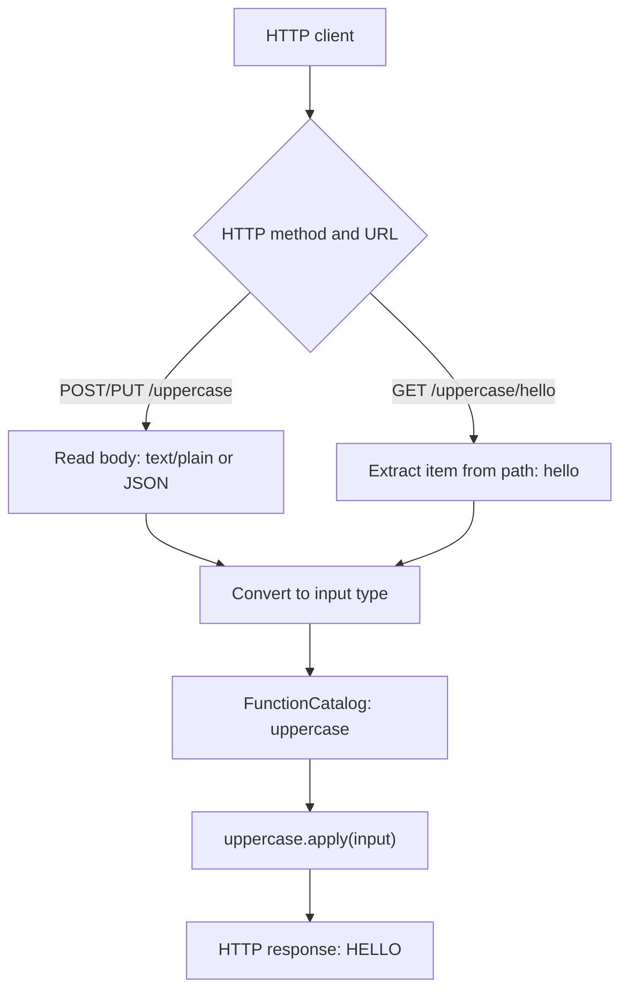
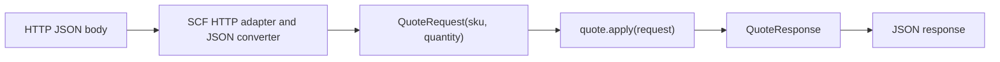

# Passing Inputs via Request Body and Path Variables in Spring Cloud Function

## 1. Problem and Objectives

In **Spring Cloud Function (SCF)**, business logic can be written once as a `Supplier<T>`, `Function<I, O>`, or `Consumer<I>` and registered in `FunctionCatalog`. The HTTP adapter, event systems, or serverless runtimes look up the same function while adapting input data from different sources. As a result, a function does not need to depend directly on `HttpServletRequest` or Spring MVC's `@RequestBody` annotation.

Over HTTP, there are two ways to pass **primary business values** into a function:

1. **Request body:** send text or JSON via `POST /{function}` or `PUT /{function}`. The adapter reads the body, converts it into the function's parameter type, and invokes `apply(...)` or `accept(...)`.
2. **Path variable:** place a single value into the URL `GET /{function}/{item}`. The adapter extracts `item`, converts it into the input type, and invokes the function.

In addition, **query parameters** like `?lang=vi` are request metadata: SCF can place them inside the `http_request_param` message header when the function uses `Message<?>`. Distinguish query parameters from the `{item}` path variable itself.

For example, with a `Function<String, String> uppercase` bean, the two commands below produce the same business result under default configuration:

```bash
# Data "hello" is in the HTTP request body:
curl -i -X POST http://localhost:8080/uppercase \
  -H 'Content-Type: text/plain' \
  -H 'Accept: text/plain' \
  --data 'hello'

# Data "hello" is in the final path segment:
curl -i 'http://localhost:8080/uppercase/hello'
```

Both can receive body `HELLO` and a typical status of `200 OK`. The difference lies in **how data is transmitted, encoded, and constrained**.

### Learning Objectives

After this lesson, you will be able to:

- Read HTTP method rules and determine where SCF extracts input data.
- Practice passing `String` via `text/plain`, DTOs via `application/json`, and single values via URLs.
- Distinguish path parameters, query parameters, and HTTP headers when building functional beans.
- Use `Message<T>` when a function genuinely needs HTTP metadata while keeping core business logic reusable.
- Diagnose errors caused by URI encoding, content negotiation, DTO conversion, or picking the wrong endpoint.

## 2. Input Handling Rules of the HTTP Adapter

According to SCF's *Standalone Web Applications* documentation, the HTTP adapter exposes functions with the following default rules:

| Bean type | HTTP method | Default path | Input data source | Typical response |
| --- | --- | --- | --- | --- |
| `Supplier<O>` | `GET` | `/{supplier}` | No body required | `200 OK`, data generated by `get()` |
| `Function<I, O>` | `POST` | `/{function}` | Request body | `200 OK`, result of `apply()` |
| `Function<I, O>` | `PUT` | `/{function}` | Request body | `200 OK`, result of `apply()` |
| `Function<I, O>` | `GET` | `/{function}/{item}` | One value in the path | `200 OK`, result of `apply()` |
| `Consumer<I>` | `POST` / `PUT` | `/{consumer}` | Request body | `202 Accepted`, adapter echoes input |
| `Consumer<I>` | `DELETE` | `/{consumer}` | Data per adapter contract | `204 No Content` |

These statuses assume the request reached the endpoint and succeeded; path, method, codec, or business errors can produce different responses. `{function}` is **the bean name registered in `FunctionCatalog`**. It differs from `{item}`, which is the **input value** for a GET invocation.



**Do not infer:** `GET /uppercase` is not automatically equivalent to `POST /uppercase`, and `GET /uppercase/hello` does not mean the function takes two separate Java parameters. A Function still has exactly one parameter `I` in `apply(I input)`.

## 3. Setting Up a Practice Application

The example uses Spring Boot with Spring MVC and the SCF HTTP starter. In a Maven project already managing Spring Boot and Spring Cloud versions via a **compatible BOM**, add:

```xml
<dependency>
    <groupId>org.springframework.cloud</groupId>
    <artifactId>spring-cloud-starter-function-web</artifactId>
</dependency>
```

When using WebFlux, choose the corresponding SCF WebFlux starter for your active release train; the examples below focus on the HTTP adapter contract. **Do not** pin an arbitrary SCF version mismatched with the active BOM line.

Create `src/main/java/demo/FunctionInputApplication.java` (Java 17+ to use `record`):

```java
package demo;

import java.math.BigDecimal;
import java.util.Locale;
import java.util.function.Consumer;
import java.util.function.Function;
import java.util.function.Supplier;

import org.springframework.boot.SpringApplication;
import org.springframework.boot.autoconfigure.SpringBootApplication;
import org.springframework.context.annotation.Bean;
import org.springframework.messaging.Message;

@SpringBootApplication
public class FunctionInputApplication {

    public static void main(String[] args) {
        SpringApplication.run(FunctionInputApplication.class, args);
    }

    // Text processing: works with POST body and GET /uppercase/{item}.
    @Bean
    public Function<String, String> uppercase() {
        return text -> text.toUpperCase(Locale.ROOT);
    }

    // Sample DTO: suited for receiving JSON in the body.
    @Bean
    public Function<QuoteRequest, QuoteResponse> quote() {
        return request -> {
            if (request == null
                    || request.sku() == null
                    || request.sku().isBlank()
                    || request.quantity() <= 0) {
                throw new IllegalArgumentException("Invalid quote request");
            }

            BigDecimal unitPrice = new BigDecimal("120000");
            BigDecimal total = unitPrice.multiply(
                    BigDecimal.valueOf(request.quantity()));
            return new QuoteResponse(
                    request.sku(), request.quantity(), total);
        };
    }

    // Read payload and request metadata via Spring Messaging.
    @Bean
    public Function<Message<String>, String> inspect() {
        return message -> {
            String payload = message.getPayload();
            boolean hasQueryParams =
                    message.getHeaders().containsKey("http_request_param");
            return "input=" + payload
                    + "; hasQueryParams=" + hasQueryParams;
        };
    }

    @Bean
    public Consumer<String> audit() {
        return payload -> System.out.println(
                    "Received input length=" + payload.length());
    }

    @Bean
    public Supplier<String> greeting() {
        return () -> "Hello from Spring Cloud Function";
    }

    public record QuoteRequest(String sku, int quantity) {}

    public record QuoteResponse(
            String sku, int quantity, BigDecimal totalPrice) {}
}
```

The price `120000` in the `quote` bean is a fixed sample value. In a real application, look up pricing and validate data according to business rules. The `inspect` function uses `Message<String>` to examine metadata; the quoting logic inside `quote` remains independent of HTTP.

Start the application:

```bash
mvn spring-boot:run
```

The `curl` examples use Bash line-continuation syntax. If running in Windows PowerShell, use `curl.exe` and adapt line breaks accordingly. The examples assume the app listens on `http://localhost:8080` with no custom URL prefix configured.

## 4. Passing Strings via the Request Body

### 4.1. Sending `text/plain` to a Function

Request:

```bash
curl -i -X POST 'http://localhost:8080/uppercase' \
  -H 'Content-Type: text/plain' \
  -H 'Accept: text/plain' \
  --data 'spring cloud function'
```

The body sent by the HTTP client is:

```text
spring cloud function
```

SCF reads the string, invokes `uppercase.apply("spring cloud function")`, and writes the result:

```http
HTTP/1.1 200 OK
Content-Type: text/plain

SPRING CLOUD FUNCTION
```

Actual headers (such as `Content-Length`, encoding) may vary by runtime. For `Function<String, String>`, `text/plain` is straightforward: the body is plain text rather than a double-quoted JSON string.

### 4.2. Using PUT with a Body

Under default mapping, a `Function` can also accept `PUT`:

```bash
curl -i -X PUT 'http://localhost:8080/uppercase' \
  -H 'Content-Type: text/plain' \
  -H 'Accept: text/plain' \
  --data 'hello'
```

The response body is still `HELLO`. However, allowing both POST and PUT to call the same function **does not guarantee your code is automatically idempotent**. If the function has side effects such as charging a payment or sending an email, retries can repeat them; the application must design behavior to match its HTTP contract.

### 4.3. Preserving Newline Characters

When sending multi-line content, verify that your HTTP client preserves bytes verbatim. For example:

```bash
printf 'first line\nsecond line\n' |
  curl -i -X POST 'http://localhost:8080/uppercase' \
    -H 'Content-Type: text/plain; charset=UTF-8' \
    -H 'Accept: text/plain' \
    --data-binary @-
```

`--data-binary @-` reads from stdin and preserves raw bytes as sent by curl; `--data` applies special processing when reading from files. When byte-for-byte preservation matters, specify the charset, enforce size limits, and test input/output behavior.

## 5. Passing a JSON DTO via the Request Body

For data with multiple fields, a JSON object in the body is usually far better than concatenating values onto the URL. The `quote` bean accepts a `QuoteRequest(String sku, int quantity)` object.

```bash
curl -i -X POST 'http://localhost:8080/quote' \
  -H 'Content-Type: application/json' \
  -H 'Accept: application/json' \
  --data '{"sku":"BOOK-001","quantity":2}'
```

Data flow:



Expected business response:

```json
{
  "sku": "BOOK-001",
  "quantity": 2,
  "totalPrice": 240000
}
```

The HTTP layer uses `Content-Type: application/json` to know how to read the body and uses the generic signature `Function<QuoteRequest, QuoteResponse>` to convert the payload. The `Accept: application/json` header tells the server the client wants JSON in the response.

**No `@RequestBody` is needed on `apply()`** because it is a Java function, not a controller method. You only need MVC/WebFlux constructs like `@RequestBody`, `@PathVariable`, and web-layer binding/validation if you switch to a custom HTTP controller.

### 5.1. Malformed Body or Mismatched Content Type

Consider three requests:

```bash
# A. Syntactically valid JSON, but quantity is invalid for business rules:
curl -i -X POST 'http://localhost:8080/quote' \
  -H 'Content-Type: application/json' \
  --data '{"sku":"BOOK-001","quantity":0}'

# B. Malformed JSON syntax:
curl -i -X POST 'http://localhost:8080/quote' \
  -H 'Content-Type: application/json' \
  --data '{"sku":"BOOK-001","quantity":'

# C. JSON body declared as text/plain:
curl -i -X POST 'http://localhost:8080/quote' \
  -H 'Content-Type: text/plain' \
  --data '{"sku":"BOOK-001","quantity":2}'
```

These are three distinct classes of problems. Case A may throw `IllegalArgumentException` inside business logic; Case B triggers a JSON parse failure; Case C may prevent the converter from selecting a valid conversion. **Do not assume all of them return 400**: the final status depends on the HTTP adapter, codec, and exception-handling setup. When an API requires a specific error contract, add HTTP exception handling or a controller/router.

### 5.2. Arrays or Lists as Input

A request with a JSON array body differs from a JSON object:

```json
[
  {"sku":"BOOK-001","quantity":2},
  {"sku":"BOOK-002","quantity":3}
]
```

Do not assume `Function<QuoteRequest, QuoteResponse>` automatically processes an array as single `QuoteRequest` elements. SCF has specific rules for multi-element payloads and reactive/collection types; if batching is needed, define an explicit contract such as `Function<List<QuoteRequest>, List<QuoteResponse>>` or another suitable shape, and test the converter and request size limits.

## 6. Passing a Single Value via a Path Variable

SCF supports `GET /{function}/{item}`, where:

- `{function}`: the bean name registered in the catalog.
- `{item}`: **a single value** extracted by the adapter from the path and converted into the function's input.

With `uppercase`, call:

```bash
curl -i 'http://localhost:8080/uppercase/hello'
```

The adapter reads `hello` and executes the equivalent of:

```java
String result = uppercase.apply("hello"); // "HELLO"
```

Typical status is `200 OK`, with response body `HELLO`. For simple inputs, this invocation style is concise and handy for quick tests.

### 6.1. Why Isn't `@PathVariable` Needed?

In the SCF HTTP adapter, `GET /uppercase/hello` maps to `Function<String, String>` according to built-in rules. The `apply()` method takes only a `String`. You do not declare:

```java
// This is an example of a Spring MVC controller signature,
// NOT the signature of Function<String, String>.
@GetMapping("/uppercase/{item}")
public String controllerMethod(@PathVariable String item) {
    return item.toUpperCase(Locale.ROOT);
}
```

The controller snippet merely illustrates the difference in how HTTP routes are defined. With the SCF adapter, **the route is derived from the function name**, while business logic keeps the Java signature `Function<I, O>`.

### 6.2. URLs with Whitespace and Special Characters

A string containing spaces must be encoded when it appears in a URI:

```bash
curl -i 'http://localhost:8080/uppercase/hello%20world'
# Expected input after URL decoding: "hello world"
# Response body: HELLO WORLD
```

Characters such as `#`, `?`, `/`, and `%` have special meanings in URIs. If sent unencoded, they can create fragments, query strings, extra segments, or escape sequences. Never concatenate user input directly into URLs via string concatenation. Use a URI builder that applies proper **path-segment** percent-encoding, and test against your actual web server and gateway.

In particular, a `/` percent-encoded as `%2F` may be blocked or decoded differently by servlet containers, proxies, or gateways according to their policies. For arbitrary text containing slashes, newlines, JSON, or long payloads, **prefer passing data in the request body**.

### 6.3. Do Not Infer Multiple Path Variables

The pattern documented by SCF for HTTP functions is `/{function}/{item}`. For instance:

```text
GET /quote/BOOK-001/2
```

Do not assume SCF automatically binds `BOOK-001` to the `sku` field and `2` to the `quantity` field of a record. The `quote` function takes a single `QuoteRequest` parameter; SCF does not provide multi-path-variable binding into fields like a controller with `@PathVariable`.

If you need multiple business parameters, use a JSON body or write a custom HTTP controller/router for URLs like `/orders/{orderId}/items/{itemId}`, then invoke the functional bean from that web layer.

## 7. Distinguishing Path Variables from Query Parameters

Consider the URL:

```text
GET /inspect/hello?lang=vi&mode=short
```

Breakdown:

| Part | Value | Role |
| --- | --- | --- |
| `inspect` | Bean name | SCF looks up the target function |
| `hello` | Path item | Payload passed into the function |
| `lang=vi` | Query parameter | Request metadata |
| `mode=short` | Query parameter | Request metadata |

SCF documentation notes that query parameters are placed in a **message header** named `http_request_param`, whose value is a `Map` of request parameters. They **do not** automatically become a second argument to `Function.apply()`.

With the `Function<Message<String>, String> inspect` bean in our example:

```bash
curl -i 'http://localhost:8080/inspect/hello?lang=vi&mode=short'
```

The `inspect` function inspects:

```java
String input = message.getPayload();
Object requestParams =
        message.getHeaders().get("http_request_param");
```

Expected business response (when the adapter places query parameters into headers per the active contract):

```text
input=hello; hasQueryParams=true
```

SCF also provides the constant `HeaderUtils.HTTP_REQUEST_PARAM` to avoid typing the key string manually. Our example uses the string literal for readability and to avoid extra imports while learning the concept.

### 7.1. HTTP Headers Are Also Metadata

When a function accepts `Message<T>`, HTTP headers are mapped into `MessageHeaders`:

```java
@Bean
public Function<Message<String>, String> describe() {
    return message -> {
        String payload = message.getPayload();
        Object trace = message.getHeaders().get("x-trace-id");
        return "payload=" + payload + ", tracePresent=" + (trace != null);
    };
}
```

This assumes Spring Messaging is on the classpath via the SCF starter. Header names may be normalized or filtered depending on the HTTP layer. Do not rely on specific runtime types or treat client-supplied headers as trusted data.

```bash
curl -i -X POST 'http://localhost:8080/describe' \
  -H 'Content-Type: text/plain' \
  -H 'X-Trace-Id: req-100' \
  --data 'hello'
```

The function keeps a single `Message<String>` parameter holding **payload + metadata**. This is how you use Spring Messaging's abstraction when the same function receives data from both HTTP and events. To maximize transport independence, translate truly needed metadata into a domain model or separate adapter layer.

### 7.2. When to Choose Query Parameters?

Query parameters usually suit **non-sensitive query controls**, such as filters, sorting, or display options. However, if a function needs those parameters, explicitly design how to read `http_request_param` or use a controller/router for typed parameter binding. Avoid using query parameters as a substitute for a JSON DTO request body.

## 8. Comparing Body, Path, and Query

| Criterion | Request body | Path item `/{item}` | Query parameters |
| --- | --- | --- | --- |
| Typical SCF invocation | `POST` / `PUT /{function}` | `GET /{function}/{item}` | Appended to URL, e.g., `?lang=vi` |
| Suitable data | Text, JSON, multi-field DTOs, batches with explicit contracts | One short, simple value | Non-sensitive filters and options |
| How it reaches the function | Payload converted to `I` by converter | `item` converted to `I` | `http_request_param` header in `Message<?>` |
| Encoding | Choose proper `Content-Type` and charset | Percent-encode each path segment | Percent-encode query names/values |
| URL logging exposure | Body can still be logged if misconfigured | Path routinely appears in access logs | Query routinely appears in access logs |
| Large or multi-line data | Usually better suited; still enforce size limits | Discouraged | Discouraged |
| Multi-field DTO | Works well with JSON | Does not auto-bind multiple fields | Requires custom binding logic |
| Example signature | `Function<QuoteRequest, QuoteResponse>` | `Function<String, String>` | `Function<Message<String>, String>` |

**Never put passwords, tokens, or sensitive personal data in paths or query strings**: URLs can appear in browser history, reverse proxy logs, tracing, monitoring, and sometimes referrer headers. For sensitive data, control logging, TLS, access permissions, and retention across every layer—even when sent in the body.

## 9. Function Selection Remains a Separate Rule

**How input is passed** does not determine which function gets invoked. SCF must first select the right bean from `FunctionCatalog`:

1. If the catalog has only one function, the URL name can be omitted: `POST /` and `POST /uppercase` can be equivalent.
2. If there are multiple functions, use bean-named paths such as `/uppercase`, `/quote`, `/inspect`.
3. You can set a default function/composition via `spring.cloud.function.definition`, or filter the exposed list with `;`.
4. You can change the HTTP base path via `spring.cloud.function.web.path`, e.g., `/api/functions`.

If you add:

```properties
spring.cloud.function.web.path=/api/functions
```

then the example URLs become:

```text
POST /api/functions/uppercase                 (body text/plain)
POST /api/functions/quote                     (body JSON)
GET  /api/functions/uppercase/hello           (input from path item)
GET  /api/functions/inspect/hello?lang=vi     (item + query metadata)
```

Function names, input types, and response values stay the same. If `spring.cloud.function.definition` configures a default function, also verify the adapter's fallback behavior when a URL cannot resolve a function name; never treat paths as an access-control mechanism.

## 10. Testing and Error Diagnosis

### 10.1. Quick Verification Commands

```bash
# Text body:
curl -i -X POST 'http://localhost:8080/uppercase' \
  -H 'Content-Type: text/plain' \
  -H 'Accept: text/plain' --data 'hello'

# JSON DTO body:
curl -i -X POST 'http://localhost:8080/quote' \
  -H 'Content-Type: application/json' \
  -H 'Accept: application/json' \
  --data '{"sku":"BOOK-001","quantity":2}'

# Simple path item:
curl -i 'http://localhost:8080/uppercase/hello'

# Path item with encoded whitespace:
curl -i 'http://localhost:8080/uppercase/hello%20world'

# Path item with query metadata:
curl -i 'http://localhost:8080/inspect/hello?lang=vi'

# Consumer accepting text in body:
curl -i -X POST 'http://localhost:8080/audit' \
  -H 'Content-Type: text/plain' --data 'order-created'
```

Verify **HTTP status, `Content-Type`, response body, and actual bean behavior**. Functions typically return `200 OK`, while Consumers receiving POST/PUT typically return `202 Accepted` and may echo input. A `202` does not guarantee data was durably persisted or processed asynchronously.

### 10.2. Common Errors Table

| Symptom | Possible cause | Resolution |
| --- | --- | --- |
| `POST /quote` fails to decode JSON | Wrong `Content-Type`, malformed body, generic type, or codec | Send valid JSON, declare `application/json`, inspect DTO and converter |
| `GET /uppercase/hello` works, `GET /uppercase` fails | Missing path item required by Function GET mapping | Use `GET /uppercase/{item}` or `POST /uppercase` with a body |
| `GET /quote/BOOK-001/2` fails | SCF does not auto-bind two segments to two DTO fields | Use a JSON body or custom controller/router |
| `GET /uppercase/hello world` fails | URI contains unencoded space | Encode as `hello%20world` using a URI builder |
| Strings containing `/` fail in the path | `/` is a path separator; encoded slashes may be blocked by proxies/containers | Move arbitrary strings into the request body |
| Query `?lang=vi` does not become a second parameter | Function takes one input; query is placed in a message header | Use `Function<Message<T>, O>` or a controller |
| `404 Not Found` | Wrong function name, base path, root mapping, or filtered out | Check `@Bean`, `FunctionCatalog`, `definition`, `web.path` |
| `405 Method Not Allowed` | Invoked an unmapped HTTP method for the bean type | Check SCF's HTTP method table |
| `400`, `415`, or `500` | Parse failure, conversion failure, or business exception | Inspect HTTP headers and logs; design an explicit error contract |
| Sent JSON body, but response is unexpected text | `Accept` and return type mismatch | Check content negotiation and generic return type |

### 10.3. Minimal Integration Test

In a Spring Boot project, test the real HTTP adapter at the integration level instead of only calling `uppercase.apply()` directly. Tests should verify both body and path inputs for the same value:

```java
// Test-library-independent pseudocode:
String fromBody = post(
        "/uppercase",
        "text/plain",
        "hello").responseBody();

String fromPath = get(
        "/uppercase/hello").responseBody();

assertEquals("HELLO", fromBody);
assertEquals("HELLO", fromPath);
```

This is **pseudocode**: `post`, `get`, and `assertEquals` are not built into Java/Spring Boot without choosing a test framework. Implement it with `MockMvc` (MVC), `WebTestClient` (WebFlux), or an integrated HTTP client matching your Spring Boot version. Add cases for JSON DTOs, query parameters, URIs with special characters, and invalid inputs.

## 11. When Do You Need a Controller Instead of the SCF HTTP Adapter?

The SCF HTTP adapter fits **reusable business functions** with a simple interface: accept input and return output. However, if the API requires:

- Multiple path variables such as `/orders/{orderId}/items/{itemId}`.
- Binding query parameters to a DTO with detailed validation.
- Multipart file uploads, complex streaming, or strict API versioning contracts.
- Specific statuses such as `201 Created`, `409 Conflict`, or standardized internal JSON error payloads.
- Resource- and HTTP-method-specific authorization rules.

then a **Spring MVC/WebFlux controller or router** can handle HTTP binding and contracts, delegating to the function via `FunctionCatalog` or the business bean. Adding a controller does not require rewriting `Function<I, O>` logic. The same function can still be invoked from event adapters or serverless runtimes.

## 12. Practice Exercises

1. Given `Function<String, String> uppercase`, write two requests to pass `"cloud"` via (a) POST body and (b) GET path item. Compare the returned statuses and bodies.
2. When the input is `"a/b"`, why should you choose a request body instead of placing it directly in `/{item}`?
3. Write a valid JSON request for `quote` with `sku="NOTE-100"` and `quantity=3`; compute the expected `totalPrice`.
4. Why does `GET /quote/NOTE-100/3` not mean Spring automatically constructs `QuoteRequest("NOTE-100", 3)`?
5. Explain the role of `Content-Type` and `Accept` when calling `POST /quote`.
6. For `GET /inspect/hello?lang=vi&mode=short`, identify the function name, payload, and metadata; how can the function read the query parameters?
7. Change `spring.cloud.function.web.path` to `/v1/functions`. Rewrite the URLs for POST body `uppercase` and GET path item `uppercase`.
8. Explain why checking only for HTTP `202 Accepted` when sending `POST /audit` does not prove the event was persisted to a message broker.
9. If an API needs `PATCH /orders/{orderId}/items/{itemId}` with custom authorization, sketch the boundary between the HTTP controller and the functional bean so business logic remains reusable.

## References

- [Spring Cloud Function — Standalone Web Applications](https://docs.spring.io/spring-cloud-function/reference/spring-cloud-function/standalone-web-applications.html): HTTP method table, text/JSON body conversion, `/{function}/{item}` pattern, *HTTP Request Parameters*, and `http_request_param`.
- [Spring Cloud Function — Programming Model](https://docs.spring.io/spring-cloud-function/reference/spring-cloud-function/programming-model.html): `Supplier`, `Function`, `Consumer`, `FunctionCatalog`, and `Message`.
- [Spring Framework — Mapping Requests (Spring MVC)](https://docs.spring.io/spring-framework/reference/web/webmvc/mvc-controller/ann-requestmapping.html): `@PathVariable` mechanics when building controllers/routers independent of the SCF adapter.
- [HTTP Semantics — RFC 9110](https://www.rfc-editor.org/rfc/rfc9110): HTTP methods, URI semantics, and HTTP responses.

> **Remember:** `POST/PUT /{function}` uses the **request body** to pass text or JSON; `GET /{function}/{item}` uses **a single value in the path**. Query parameters appear in the `http_request_param` message header when using `Message<?>`. Choose where to pass data based on input types, URI encoding constraints, security, and API contracts while keeping business logic independent of HTTP.
