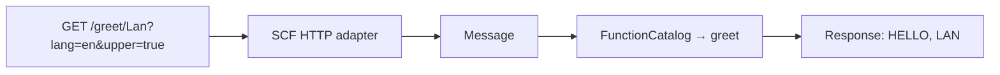

# Reading Query Parameters via the `http_request_param` Header in Spring Cloud Function

## 1. Problem: Needing Both Payload and Query Parameters

In **Spring Cloud Function (SCF)**, business logic is modeled as `Supplier<O>`, `Function<I, O>`, or `Consumer<I>` and registered in `FunctionCatalog`. The logic can be triggered via HTTP, Spring Cloud Stream events, or serverless adapters. The HTTP adapter handles receiving the request, converting the payload, and passing the appropriate data into the functional bean.

For example, a system needs to generate a greeting based on a user's name and language:

```http
GET /greet/Lan?lang=en&upper=true HTTP/1.1
Host: localhost:8080
```

This URL carries **three distinct kinds of information**:

- `greet` is the **function name** that the adapter looks up in `FunctionCatalog`.
- `Lan` is the **business input** extracted from the path item according to the `GET /{function}/{item}` pattern.
- `lang=en` and `upper=true` are **query parameters**. They describe processing options for the request, not separate Java parameters of `Function.apply()`.

In Spring MVC, developers may be familiar with `@RequestParam("lang")`. However, a functional bean in SCF's model does not automatically support `@RequestParam`. To read query parameters, a function can accept `org.springframework.messaging.Message<T>` and look up the **message header** keyed by `http_request_param`.

Learning objectives:

1. Explain why query parameters are placed in a `Message` header.
2. Write a `Function<Message<String>, String>` that reads both the payload and query parameters.
3. Use `HeaderUtils.HTTP_REQUEST_PARAM` instead of repeating the key string in code.
4. Handle missing parameters, multi-value parameters, URL encoding, and untrusted input.
5. Keep business logic reusable across HTTP, events, and serverless.

## 2. Where Does SCF Put Query Parameters?

According to the **HTTP Request Parameters** section of the Spring Cloud Function documentation, the HTTP adapter handles query parameters much like HTTP headers: they are placed inside `MessageHeaders` under the `http_request_param` key, whose value is a **`Map` of request parameters**.



The contents of `Message<String>` map as follows:

| Location in message | Example | Meaning |
| --- | --- | --- |
| `message.getPayload()` | `"Lan"` | Primary input, taken from `/{item}` on GET |
| `message.getHeaders().get("http_request_param")` | Map containing `lang` and `upper` | Query parameters from the URL |
| Other message headers | `contentType`, forwarded HTTP headers… | Metadata provided by the adapter; types and names may depend on runtime |

**Distinguish two header sources:**

- `http_request_param` is a **key in `MessageHeaders` created by the adapter** to package query parameters.
- `X-Correlation-ID` or `Accept` are **HTTP request headers** that the adapter may forward into the message.

Clients should pass `?lang=en` in the URL. Sending a raw HTTP header named `http_request_param` is not a standard contract for declaring query parameters, and client-supplied headers must never be treated as trusted input.

### Why Must the Signature Accept `Message`?

These two signatures carry different information:

```java
Function<String, String> simple;           // Receives payload.
Function<Message<String>, String> inspect; // Receives payload and metadata.
```

With `Function<String, String>`, your code only receives the `String` object. Query parameters live in metadata and do not automatically become a second argument to `apply()`. With `Function<Message<String>, String>`, your code can read both `message.getPayload()` and `message.getHeaders()`.

SCF exposes a constant:

```java
import org.springframework.cloud.function.web.util.HeaderUtils;

String headerName = HeaderUtils.HTTP_REQUEST_PARAM;
// Corresponding value: "http_request_param".
```

Use this constant when code is directly coupled to the SCF HTTP adapter. To avoid depending on the web module inside a pure business library, read the header in an adapter layer and map normalized parameters into a domain DTO.

## 3. Complete Example: Language-Aware Greeting with Uppercase Option

### 3.1. Preparing Dependencies

Create a Spring Boot project with a compatible Spring Cloud Maven BOM. For an MVC application exposing functional beans over HTTP, use the starter:

```xml
<dependency>
    <groupId>org.springframework.cloud</groupId>
    <artifactId>spring-cloud-starter-function-web</artifactId>
</dependency>
```

This starter provides SCF's HTTP integration and the dependencies required to run on Spring MVC. When using WebFlux, choose the corresponding web starter for your release train and test on that version. Do not specify an arbitrary SCF version outside the active BOM.

### 3.2. Declaring the Functional Bean

Create `src/main/java/demo/QueryParameterApplication.java`. The example uses Java 17 or higher:

```java
package demo;

import java.util.List;
import java.util.Locale;
import java.util.Map;
import java.util.Optional;
import java.util.function.Function;

import org.springframework.boot.SpringApplication;
import org.springframework.boot.autoconfigure.SpringBootApplication;
import org.springframework.cloud.function.web.util.HeaderUtils;
import org.springframework.context.annotation.Bean;
import org.springframework.messaging.Message;

@SpringBootApplication
public class QueryParameterApplication {

    public static void main(String[] args) {
        SpringApplication.run(QueryParameterApplication.class, args);
    }

    @Bean
    public Function<Message<String>, String> greet() {
        return message -> {
            String name = message.getPayload().trim();
            String language = firstQueryParam(message, "lang")
                    .orElse("vi");
            boolean uppercase = firstQueryParam(message, "upper")
                    .map("true"::equalsIgnoreCase)
                    .orElse(false);

            String greeting = "en".equalsIgnoreCase(language)
                    ? "Hello, " + name
                    : "Xin chào, " + name;

            return uppercase
                    ? greeting.toUpperCase(Locale.ROOT)
                    : greeting;
        };
    }

    /**
     * Reads a single value of a query parameter.
     *
     * HeaderUtils only specifies the key and Map; the exact
     * value type may vary by adapter/version.
     */
    private static Optional<String> firstQueryParam(
            Message<?> message, String name) {

        Object header = message.getHeaders()
                .get(HeaderUtils.HTTP_REQUEST_PARAM);
        if (!(header instanceof Map<?, ?> parameters)) {
            return Optional.empty();
        }

        Object value = parameters.get(name);
        if (value instanceof String text) {
            return Optional.of(text);
        }
        if (value instanceof String[] values) {
            return values.length == 0
                    ? Optional.empty()
                    : Optional.ofNullable(values[0]);
        }
        if (value instanceof List<?> values) {
            return values.isEmpty() || values.get(0) == null
                    ? Optional.empty()
                    : Optional.of(values.get(0).toString());
        }

        // Do not cast a value of unknown shape to String.
        return Optional.empty();
    }
}
```

Key details in this example:

- `@Bean` names the function `greet`, so the default named URL begins with `/greet`.
- The `Message<String>` payload is the name passed in the path item or body.
- `HeaderUtils.HTTP_REQUEST_PARAM` is the key used to retrieve the query parameter Map.
- `firstQueryParam` handles **missing header**, **non-Map value**, and `String`, `String[]`, or `List<?>` values without blind casting.
- `lang` defaults to `vi`; `upper` defaults to `false`.

SCF documentation only specifies that the header value is a **Map**; it does not guarantee across every adapter and version that each Map entry is always a `String` or always a `String[]`. Therefore, the example avoids an unchecked `(Map<String, String>) header` cast followed by calling `get()`.

**Limitations of the example:** any value other than `en` is treated as Vietnamese, and `upper` only activates when the value equals `true` (case-insensitive). These are illustrative rules, not production API validation.

## 4. Testing GET Requests with Query Parameters

Start the application:

```bash
mvn spring-boot:run
```

By default, the application listens on `http://localhost:8080`. The commands below use Bash syntax; in PowerShell, use `curl.exe` to invoke the real curl binary.

### 4.1. Sending `lang=en`

```bash
curl -i -H 'Accept: text/plain' \
  'http://localhost:8080/greet/Lan?lang=en'
```

Expected HTTP response body:

```text
Hello, Lan
```

Execution flow:

1. SCF looks up the `greet` function in the catalog.
2. The path item `Lan` is used as the message payload.
3. The query parameter `lang=en` is stored in a Map under the `http_request_param` header.
4. The function reads `language="en"` and returns `Hello, Lan`.

### 4.2. Combining Two Query Parameters

```bash
curl -i -H 'Accept: text/plain' \
  'http://localhost:8080/greet/Lan?lang=en&upper=true'
```

Expected response body:

```text
HELLO, LAN
```

The `&` character separates query parameter pairs. Wrap the URL in single quotes when running in Bash so the shell does not interpret `&` as a background job operator.

### 4.3. When No Query Parameter Is Sent

```bash
curl -i 'http://localhost:8080/greet/Lan'
```

Because `firstQueryParam` returns `Optional.empty()` when the header or key is absent, the function uses its defaults. Expected body:

```text
Xin chào, Lan
```

A real application might choose different rules: requiring `lang`, rejecting unsupported languages, or defaulting from user account preferences. What matters is handling absent parameters **intentionally**, without dereferencing `null`.

### 4.4. Distinguishing Query and Path

| URL | `Message` payload | Query Map read | Expected body |
| --- | --- | --- | --- |
| `/greet/Lan` | `Lan` | No `lang` | `Xin chào, Lan` |
| `/greet/Lan?lang=vi` | `Lan` | `lang=vi` | `Xin chào, Lan` |
| `/greet/Lan?lang=en` | `Lan` | `lang=en` | `Hello, Lan` |
| `/greet/Lan?lang=en&upper=true` | `Lan` | `lang=en`, `upper=true` | `HELLO, LAN` |
| `/greet/Minh?upper=true` | `Minh` | `upper=true` | `XIN CHÀO, MINH` |

**Incorrect:** defining a `Function<String, String> greet` bean and expecting `?lang=en` to become a Java variable `lang`. Only when accepting `Message<T>` or using a separate adapter does the function gain access to that metadata.

## 5. How Do Query Parameters Work with a POST Body?

The `GET /{function}/{item}` pattern fits short, simple payloads. However, HTTP query parameters can also accompany requests with a **body**:

```bash
curl -i -X POST \
  'http://localhost:8080/greet?lang=en&upper=true' \
  -H 'Content-Type: text/plain; charset=UTF-8' \
  -H 'Accept: text/plain' \
  --data 'Lan'
```

According to the adapter contract:

- The `Message<String>` payload is taken from the **request body**, which is `Lan`.
- Query parameters are stored in the `http_request_param` header just as with GET.
- The function executes the exact same logic and returns the business result `HELLO, LAN`.

Comparison:

| Request | Where does payload come from? | Where do query parameters come from? |
| --- | --- | --- |
| `GET /greet/Lan?lang=en` | The `Lan` segment | The `?lang=en` part |
| `POST /greet?lang=en` with body `Lan` | Request body | The `?lang=en` part |
| `PUT /greet?lang=en` with body `Lan` | Request body | The `?lang=en` part |

**Note:** With the SCF HTTP adapter, GET for a Function typically uses `/{function}/{item}`; do not assume `GET /greet?name=Lan` automatically puts `name` into the payload. Query parameters are metadata, while the primary input must be supplied per the HTTP contract.

## 6. Multiple Values for the Same Parameter Name

HTTP allows repeating a query key:

```text
GET /greet/Lan?lang=en&lang=vi
```

SCF documentation states the header value is a Map, without standardizing in public docs how **single vs. multiple values** are represented across every version. One adapter may store a `String[]` or `List`; a single value may appear as a `String` depending on the conversion source.

The `firstQueryParam` example above intentionally picks the **first value** when encountering an array or list, which is suitable for learning. In a real API contract:

- If a parameter **allows only one value**, detect and **reject duplicate values** instead of silently picking the first one.
- If a parameter **allows multiple values**, normalize into a `List<String>` and validate every item; do not collapse into a comma-separated string unless clients explicitly follow that convention.
- Never use first/last value precedence for authentication or authorization decisions. Proxies and frameworks may canonicalize repeated parameters differently.

Example of a tag-filtering API:

```text
GET /search/books?tag=java&tag=spring&limit=10
```

If you need to accept multiple tags under a stable contract, define clear rules for ordering, duplicates, max element count, and parsing; a dedicated controller or adapter is often better once binding logic grows complex.

## 7. Safely Reading the `Map` and Converting to Domain Types

### 7.1. Why Not Cast Directly?

The snippet below is unsafe:

```java
// Avoid using in production code:
@SuppressWarnings("unchecked")
Map<String, String> params = (Map<String, String>)
        message.getHeaders().get("http_request_param");
String lang = params.get("lang");
```

It assumes the header is always present and every value is always a `String`. If the adapter supplies a `String[]`, the generic cast only fails later when the value is used; if the header is missing, it throws a `NullPointerException`.

Using `instanceof Map<?, ?>` alongside value-type checks as in section 3 keeps behavior explicit. In production, after verifying the adapter's actual runtime representation, standardize an internal DTO and write data-contract tests.

### 7.2. Parsing an Integer from a Query Parameter

Suppose a function needs a `limit` parameter to cap the number of results. A straightforward approach:

```java
String rawLimit = firstQueryParam(message, "limit")
        .orElse("20");

int limit;
try {
    limit = Integer.parseInt(rawLimit);
} catch (NumberFormatException ex) {
    throw new IllegalArgumentException(
            "limit must be an integer", ex);
}

if (limit < 1 || limit > 100) {
    throw new IllegalArgumentException(
            "limit must be between 1 and 100");
}
```

This snippet is meant to sit **inside the function** once you have `message` and the `firstQueryParam` helper. It illustrates that query parameters still arrive as text and must be parsed and validated per your contract. Do not assume `IllegalArgumentException` is automatically translated into `400 Bad Request` by the SCF HTTP adapter; if your API requires specific error responses, handle errors at the HTTP boundary.

### 7.3. Distinguishing Absent from Empty Values

These three requests can represent different states:

```text
/greet/Lan
/greet/Lan?lang=
/greet/Lan?lang=en
```

- **Key absent:** the helper returns `Optional.empty()`, so defaults apply.
- **Key present with empty string:** the helper may return `Optional.of("")`; your code must decide whether empty is valid or not.
- **Key present with value:** parse and validate the content.

Do not conflate “absent” and “empty” if they carry different meanings under the API contract.

## 8. URI Encoding, Unicode, and Special Characters

Query parameters live inside the URL, so they require **percent-encoding**. For example, a note with spaces:

```bash
curl -i 'http://localhost:8080/greet/Lan?lang=en&note=hello%20world'
```

Here `note=hello%20world` is metadata; the sample function ignores `note`. Path item data containing spaces also needs encoding:

```bash
curl -i 'http://localhost:8080/greet/Ngoc%20Lan?lang=en'
# Expected: Hello, Ngoc Lan
```

Several characters have special meanings in URLs:

| Character | Meaning/risk if not encoded properly |
| --- | --- |
| `?` | Starts the query string, leaving the path item |
| `&` | Separates query parameter pairs |
| `#` | Starts a fragment; fragments are normally not sent to the HTTP server |
| `=` | Separates query parameter name and value |
| `%` | Starts a percent-encoded sequence |
| `+` | May be interpreted as a space in form-encoded query strings |
| `/` | Separates path segments; encoded slashes may be restricted by proxies/containers |

In Java applications, use a **URI builder** or HTTP client API to construct URIs and encode each component in its proper context. Avoid manually concatenating user strings into URLs, especially when they contain Unicode, `&`, `+`, or `%`.

For large payloads, multi-line text, JSON, tokens, or sensitive data, use the request body with proper authentication. Query parameters routinely appear in access logs, browser history, proxy logs, and observability tools.

## 9. Distinguishing Query Headers from Other Input Types

| Information | Example | How SCF passes it to the function | When to use |
| --- | --- | --- | --- |
| **Path item** | `GET /greet/Lan` | Payload `Lan` in `Message<String>` | One short, simple input |
| **Body text** | `POST /greet` with `Lan` | Payload `Lan` | Free-form strings with spaces or URL-unfriendly characters |
| **Body JSON** | `POST /quote` with JSON DTO | Payload converted to DTO type | Multi-field business data |
| **Query parameter** | `?lang=en` | Inside Map at `MessageHeaders["http_request_param"]` | Processing filters/options |
| **HTTP header** | `X-Correlation-ID: abc` | HTTP adapter may copy into `MessageHeaders` | Protocol-level metadata |

Example of two functions sharing the same business logic with different input contracts:

```java
Function<String, String> standardize =
        value -> value.trim().toUpperCase(Locale.ROOT);

Function<Message<String>, String> adapter =
        message -> standardize.apply(message.getPayload());
```

The `standardize` function only knows `String` and can be reused without HTTP. The `adapter` function also understands Spring Messaging metadata. When an application also consumes events or deploys serverlessly, let the adapter layer map necessary query/header values into a business DTO so the core remains independent of `http_request_param`.

## 10. FunctionCatalog, Composition, and Changing the HTTP Prefix

Reading query parameters does not alter bean selection rules:

- When the catalog has only one functional bean, the bean name can be omitted from the URL.
- When there are multiple beans, named paths such as `/greet/Lan` select the right function.
- `spring.cloud.function.definition` can designate a default function/composition or filter the exposed function list.
- `spring.cloud.function.web.path` changes the HTTP prefix without altering the `http_request_param` message header itself.

Example:

```properties
spring.cloud.function.web.path=/api/functions
```

Clients then call:

```bash
curl -i 'http://localhost:8080/api/functions/greet/Lan?lang=en'
```

The function name `greet`, payload `Lan`, and query map `lang=en` are still interpreted by the exact same rules. If Spring Cloud Stream invokes the same function, the event adapter **does not automatically generate** an HTTP query map; if business logic requires a language setting, pass that information in event headers or payloads per a dedicated contract.

## 11. Testing and Diagnostics

### 11.1. Quick Test Suite

```bash
# One query parameter:
curl -i 'http://localhost:8080/greet/Lan?lang=en'

# Two query parameters:
curl -i 'http://localhost:8080/greet/Lan?lang=en&upper=true'

# No query: uses defaults:
curl -i 'http://localhost:8080/greet/Lan'

# POST body + query:
curl -i -X POST 'http://localhost:8080/greet?lang=en' \
  -H 'Content-Type: text/plain' \
  -H 'Accept: text/plain' \
  --data 'Lan'

# Repeated key (to test multi-value policy):
curl -i 'http://localhost:8080/greet/Lan?lang=vi&lang=en'

# Check empty value:
curl -i 'http://localhost:8080/greet/Lan?lang='
```

Observe HTTP status, response body, and the actual data seen by the function. The demo focuses on parameter-reading logic; do not assume every Spring Boot/SCF version emits identical response headers under different content negotiation settings.

### 11.2. Troubleshooting Table

| Symptom | Cause to check | Fix |
| --- | --- | --- |
| `message.getHeaders().get("http_request_param")` is `null` | No query string, wrong HTTP adapter, or metadata not forwarded | Verify URL, adapter, and handle missing-key cases |
| `ClassCastException` when reading the Map | Casting value to `String` while adapter uses a list/array | Use `Map<?, ?>` and check value types before use |
| `lang` parameter has no effect | Function accepts only `String` or reads the wrong key | Switch to `Message<String>` and use `HeaderUtils.HTTP_REQUEST_PARAM` |
| `GET /greet?lang=en` fails | Missing `/{item}` required by Function GET mapping | Call `GET /greet/Lan?lang=en` or use a POST body |
| URL containing `&` gets truncated in the shell | URL not wrapped in quotes | Quote the URL or use an HTTP client |
| Values with `+` or Unicode characters decode wrongly | Client or gateway encodes/decodes inconsistently | Use a URI builder and test special characters |
| `lang=en&lang=vi` produces unexpected results | Inconsistent first/last value selection policy | Define multi-value handling explicitly and reject duplicates if needed |
| `POST` returns 415/400 | Wrong `Content-Type`, charset, or incompatible payload | Send `text/plain` or JSON matching the input type |
| `404 Not Found` | Wrong function name, prefix, or function filtering | Check `@Bean`, `web.path`, and `definition` |
| Event handler cannot read `http_request_param` | Header belongs to the HTTP adapter contract, not event transports | Define dedicated event metadata and map into a business DTO |

### 11.3. Minimum Integration Test Cases

When writing integration tests for the HTTP adapter, include cases where:

1. `GET /greet/Lan?lang=en` returns `Hello, Lan`.
2. `GET /greet/Lan?lang=en&upper=true` returns `HELLO, LAN`.
3. Omitting `lang` makes the function default to `vi`.
4. `POST /greet?lang=en` with body `Lan` matches GET with the same input.
5. Empty parameters, invalid types (when applicable), repeated parameters, and percent-encoded characters follow defined rules.
6. After changing `spring.cloud.function.web.path`, the function still receives the query map properly.

You can use `MockMvc`, `WebTestClient`, or an HTTP client suited to your Spring Boot/Spring Web version. **Testing only the Java function directly does not prove the HTTP adapter populates the message header properly.**

## 12. When Should You Use a Controller/Router Instead?

Reading `http_request_param` is useful when you want to stay within SCF's functional bean model while still needing HTTP parameters. However, an API requiring multiple path variables, complex query DTOs, detailed validation/error responses, OpenAPI documentation, or varied status codes may be a better fit for a Spring MVC/WebFlux controller or router:

```java
// Illustrative MVC controller; not a required SCF signature.
@GetMapping("/greetings/{name}")
public String greet(
        @PathVariable String name,
        @RequestParam(defaultValue = "vi") String lang) {
    return greetingService.greet(name, lang);
}
```

The controller handles HTTP binding and validation; the service/functional bean executes business logic. That keeps business logic usable from HTTP, event streams, or serverless without coupling to how parameters arrive in the URL.

## 13. Practice Exercises

1. From `GET /greet/Lan?lang=en&upper=true`, identify the function name, payload, message header key, and business result.
2. Why can `Function<String, String> greet` not read `?lang=en` as a second Java argument? How should the signature be changed?
3. Write code to read `http_request_param` using `HeaderUtils.HTTP_REQUEST_PARAM` and handle a missing header.
4. Compare `GET /greet/Lan?lang=en` with `POST /greet?lang=en` carrying body `Lan`: where does the payload come from, and where does metadata come from?
5. Why is casting directly to `Map<String, String>` risky? How should you handle a parameter with multiple values?
6. For query `?limit=200`, implement validation with an allowed range from 1 to 100; explain why HTTP error handling at the boundary is still needed.
7. With `?lang=vi&lang=en`, why can silently picking the first value violate the API contract?
8. Change the prefix to `/v1/functions` and rewrite the URL for calling `greet` with `lang=en`.
9. A function invoked from Spring Cloud Stream does not receive the `http_request_param` header. Explain why and propose a DTO design to share the business logic.

## Official References

- [Spring Cloud Function — Standalone Web Applications](https://docs.spring.io/spring-cloud-function/reference/spring-cloud-function/standalone-web-applications.html): **HTTP Request Parameters** section, `http_request_param` key, `HeaderUtils.HTTP_REQUEST_PARAM`, `GET /{function}/{item}` mapping, request headers, and function mapping.
- [Spring Cloud Function — Programming Model](https://docs.spring.io/spring-cloud-function/reference/spring-cloud-function/programming-model.html): `FunctionCatalog`, `Supplier`, `Function`, `Consumer`, and messages with headers.
- [HeaderUtils Java API](https://www.javadoc.io/static/org.springframework.cloud/spring-cloud-function-parent/4.0.0/org/springframework/cloud/function/web/util/HeaderUtils.html): `HTTP_REQUEST_PARAM` constant (example API doc; verify against your running artifact).
- [Spring Framework — Spring Messaging](https://docs.spring.io/spring-framework/reference/integration.html): the `Message` abstraction and message metadata.

> **Remember:** `http_request_param` is an **internal key in `MessageHeaders`** populated by the SCF HTTP adapter containing a Map of HTTP query parameters. To read them, use `Function<Message<T>, O>` and `message.getHeaders().get(HeaderUtils.HTTP_REQUEST_PARAM)`. Always check value types, absent values, multi-value parameters, and URI encoding, and keep core business logic independent of HTTP when reuse is needed.
