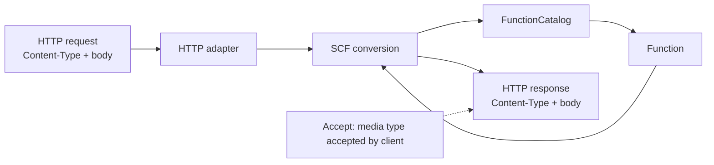

# Content-Type, Accept, and Content Negotiation in Spring Cloud Function

## 1. Problem to Solve

**Spring Cloud Function (SCF)** allows packaging business logic as Java beans of type `Supplier<O>`, `Function<I, O>`, and `Consumer<I>`. `FunctionCatalog` manages and supplies them to multiple adapters: HTTP, events via Spring Cloud Stream, or serverless environments. Consequently, a pricing quote function does not need to inspect `HttpServletRequest` itself to know where data arrived from.

However, when a function is invoked over HTTP, a client can send the same content as **plain text**, **JSON**, or another format. The server must determine:

1. **What format did the client send?** The `Content-Type` header describes how to interpret the request body.
2. **Which Java type does the function expect?** For example, `String`, `QuoteRequest`, or `Message<String>`. The input type is part of the Java contract, not an HTTP header.
3. **What format does the client want to receive?** The `Accept` header describes the media types the client can handle in the response.
4. **Does the adapter have a suitable converter?** The HTTP runtime together with SCF must decode the input, invoke the function, and produce the response body/headers.

This is **content negotiation**. For example:

```http
POST /quote HTTP/1.1
Host: localhost:8080
Content-Type: application/json
Accept: application/json

{"sku":"BOOK-001","quantity":2}
```

With the `Function<QuoteRequest, QuoteResponse> quote` bean, the HTTP adapter converts the JSON into `QuoteRequest`, runs business logic, and serializes `QuoteResponse` to JSON in the response. If the client sends the wrong headers or unconvertible data, an error can occur **before** `quote.apply()` is ever called.

### Learning Objectives

After this lesson, you will be able to:

- Accurately distinguish the roles of `Content-Type`, `Accept`, and Java data types.
- Invoke `Function<String, String>` using `text/plain`, and `Function<DTO, DTO>` using `application/json`.
- Explain how `MessageConverter` / `ConversionService` participate in SCF conversion.
- Interpret and anticipate `400`, `406`, `415`, and conversion/exception errors during HTTP testing.
- Understand the limits of `Accept: text/event-stream`, HTTP headers, and multi-element payloads.
- Keep logic independent of HTTP when sharing functions with event or serverless adapters.

## 2. Content-Type Is Not the Same as Accept

| Criterion | `Content-Type` | `Accept` |
| --- | --- | --- |
| Who sets it on the request | Client | Client |
| Question it answers | **What format is the body I am sending?** | **What format can I receive in the response?** |
| Example | `Content-Type: text/plain` | `Accept: application/json` |
| Purpose | Helps select the input decoder | Helps select the output representation |
| Associated with | Request body | Response representation |
| If omitted | The framework may apply defaults; SCF uses `application/json` as a hint when `contentType` is missing at the message conversion layer | Client places no explicit limit on response type; server selects a suitable format |
| Related errors | `415 Unsupported Media Type` or parse/conversion errors | `406 Not Acceptable` when no acceptable representation can be produced |

**Further distinction:** the server returns `Content-Type` in the **response** to announce the format of the body **actually sent back**. That value does not always equal the exact string the client placed in `Accept`; `Accept` may contain a list of choices, wildcards, or quality weights.

Correct example:

```http
POST /uppercase HTTP/1.1
Content-Type: text/plain; charset=UTF-8
Accept: text/plain

hello
```

Typical response:

```http
HTTP/1.1 200 OK
Content-Type: text/plain

HELLO
```

The execution order is **decode request → convert to Java type → run function → encode response**. Changing `Accept` does not mean the framework automatically changes the function's Java parameter type.



**Note:** this diagram shows the conceptual flow; parsing and encoding steps may be handled by Spring MVC/WebFlux codecs, Spring Messaging converters, or SCF conversion depending on the input type and adapter.

## 3. Formats Supported by the SCF HTTP Adapter

SCF's *Standalone Web Applications* documentation describes two foundational content categories directly supported by the web adapter:

- **Plain text:** `text/plain`, suitable for `Function<String, String>` and textual input/output.
- **JSON:** `application/json`, suitable for POJOs, Java `record`s, or structured DTOs when a JSON converter is available.

In addition, **multi-element** output data can be requested by clients as **Server-Sent Events (SSE)** via `Accept: text/event-stream`, provided the function type, adapter, and runtime actually support it.

At the conversion layer, SCF also has mechanisms for handling `application/octet-stream` with `byte[]` in certain `MessageConverter` flows. This **does not mean every SCF web endpoint is an arbitrary binary upload/download API**; binary, multipart, and streaming cases require dedicated verification. When HTTP requirements are highly specialized, a Spring MVC/WebFlux controller or router is usually a better fit.

### Combining Media Type and Parameter Type

Suppose a client sends:

```http
Content-Type: application/json

{"sku":"BOOK-001","quantity":2}
```

and the function signature is:

```java
Function<QuoteRequest, QuoteResponse> quote;
```

SCF receives **two complementary signals**: the media type tells it how to read the raw payload, while `QuoteRequest` specifies the object to instantiate. The `Content-Type: application/json` header **does not automatically turn every function into a JSON endpoint** if its signature is incompatible; conversely, having `QuoteRequest` does not turn an arbitrary body into valid JSON.

## 4. Internal Conversion Model in Spring Cloud Function

SCF leverages built-in Spring mechanisms to deliver data matching the function signature:

| Conversion path | Typical mechanism | When encountered |
| --- | --- | --- |
| Raw data already wrapped in Spring `Message<?>` | `MessageConverter` | HTTP adapter, messaging/event adapters, message-based composition |
| Non-`Message` input requiring type conversion | `ConversionService` | Spring-based object conversion and invocation |
| HTTP bytes ↔ web-layer objects | MVC/WebFlux HTTP message converters/codecs | Before and after SCF processing, depending on runtime |

Common SCF converters include:

- `JsonMessageConverter`: handles JSON ↔ POJO for `application/json` using the JSON library on the classpath.
- `StringMessageConverter`: handles converting to `String` when content types such as `text/plain` match.
- `ByteArrayMessageConverter`: handles `byte[]` payloads such as `application/octet-stream`.

The documentation also emphasizes that `Content-Type` is a **hint for selecting a converter**, not a replacement for the target type. If no converter satisfies both conditions, an exception can occur. Do not rely on custom converters or special media-type syntax without testing on your running SCF version.

### Default When Content-Type Is Omitted

At the **SCF message conversion** layer, when no `contentType` header is present, SCF defaults to `application/json`. However, in **HTTP** requests, MVC/WebFlux, the HTTP client, and `Message` construction can affect earlier conversion steps. Therefore, **never rely on an omitted header to implicitly choose JSON or plain text**. Always send explicitly:

```text
Content-Type: text/plain       # if body is plain text
Content-Type: application/json # if body is JSON
```

This is also why SCF's documentation recommends supplying both `Content-Type` and `Accept` when POSTing text, to avoid negotiation differences between older and newer Spring Boot versions.

## 5. Runnable Example: One Application Accepting Text and JSON

The example uses **Java 17+**, Spring Boot, and the Spring Cloud Function web starter. The project needs a **Spring Cloud dependencies BOM** matching your Spring Boot line; do not assign an incompatible SCF version manually.

To expose functions over HTTP with Spring MVC, declare the dependency:

```xml
<dependency>
    <groupId>org.springframework.cloud</groupId>
    <artifactId>spring-cloud-starter-function-web</artifactId>
</dependency>
```

If your application runs on WebFlux, use the SCF WebFlux starter from the corresponding release train. The example below uses functional beans independent of MVC/WebFlux, except for the HTTP adapter responsible for negotiation.

Create `src/main/java/demo/ContentNegotiationApplication.java`:

```java
package demo;

import java.math.BigDecimal;
import java.util.Locale;
import java.util.function.Consumer;
import java.util.function.Function;
import java.util.function.Supplier;

import org.springframework.boot.SpringApplication;
import org.springframework.boot.autoconfigure.SpringBootApplication;
import org.springframework.context.annotation.Bean;
import org.springframework.messaging.Message;
import org.springframework.messaging.MessageHeaders;

@SpringBootApplication
public class ContentNegotiationApplication {

    public static void main(String[] args) {
        SpringApplication.run(ContentNegotiationApplication.class, args);
    }

    // Text -> Text.
    @Bean
    public Function<String, String> uppercase() {
        return text -> text.toUpperCase(Locale.ROOT);
    }

    // JSON object -> JSON object.
    @Bean
    public Function<QuoteRequest, QuoteResponse> quote() {
        return input -> {
            if (input == null || input.sku() == null
                    || input.sku().isBlank()
                    || input.quantity() <= 0) {
                throw new IllegalArgumentException(
                        "SKU and quantity must be valid");
            }
            BigDecimal unitPrice = new BigDecimal("199000");
            BigDecimal total = unitPrice.multiply(
                    BigDecimal.valueOf(input.quantity()));
            return new QuoteResponse(
                    input.sku(), input.quantity(), total);
        };
    }

    // GET -> JSON object.
    @Bean
    public Supplier<ServiceStatus> serviceStatus() {
        return () -> new ServiceStatus("SPRING_CLOUD_FUNCTION", "READY");
    }

    // Receives text and observes Content-Type copied into MessageHeaders.
    @Bean
    public Function<Message<String>, String> inspectContentType() {
        return message -> {
            Object type = message.getHeaders()
                    .get(MessageHeaders.CONTENT_TYPE);
            String reportedType =
                    type == null ? "missing" : type.toString();
            return "payload=" + message.getPayload()
                    + "; type=" + reportedType;
        };
    }

    // Consumer illustrating request/response behavior distinct from Function.
    @Bean
    public Consumer<AuditEvent> auditEvent() {
        return event -> System.out.println(
                "Audit: " + event.type() + "/" + event.reference());
    }

    public record QuoteRequest(String sku, int quantity) {}
    public record QuoteResponse(
            String sku, int quantity, BigDecimal totalPrice) {}
    public record ServiceStatus(String service, String state) {}
    public record AuditEvent(String type, String reference) {}
}
```

The price `199000` is purely illustrative and not a real price list. The application assumes Jackson or a compatible JSON codec is on the classpath via the web starter/BOM.

Run the application:

```bash
mvn spring-boot:run
```

The curl commands use Bash syntax and default URL `http://localhost:8080`. In Windows PowerShell, call `curl.exe` and adjust line breaks accordingly; do not rely on PowerShell's `curl` alias.

## 6. Practicing with Content-Type: text/plain

### 6.1. Function Accepting and Returning Text

```bash
curl -i -X POST 'http://localhost:8080/uppercase' \
  -H 'Content-Type: text/plain; charset=UTF-8' \
  -H 'Accept: text/plain' \
  --data 'hello spring cloud'
```

Business response:

```http
HTTP/1.1 200 OK
Content-Type: text/plain

HELLO SPRING CLOUD
```

SCF uses the Java type `Function<String, String>` to pass the body as a `String`. Since the client specified `text/plain`, there is no assumption that the body is a JSON string. The bean signature is not `Function<byte[], byte[]>`; do not assume the input stays byte-for-byte identical once the converter applies charset decoding.

### 6.2. Inspecting Content-Type Metadata

The `inspectContentType` bean accepts `Message<String>` so you can observe the payload and `contentType` header:

```bash
curl -i -X POST 'http://localhost:8080/inspectContentType' \
  -H 'Content-Type: text/plain' \
  -H 'Accept: text/plain' \
  --data 'hello'
```

The response looks like:

```text
payload=hello; type=text/plain
```

Depending on the version and codec, `MessageHeaders.CONTENT_TYPE` may include charset parameters or be represented as a `MimeType`. **Do not assert that the entire response matches byte-for-byte** if your test only intends to confirm the header reached the message; verify the media type and payload semantically.

### 6.3. Multi-Line Content and UTF-8

When the body contains newlines, use a transmission flag that preserves the content:

```bash
printf 'line one\nline two\n' |
  curl -i -X POST 'http://localhost:8080/uppercase' \
    -H 'Content-Type: text/plain; charset=UTF-8' \
    -H 'Accept: text/plain' \
    --data-binary @-
```

Once the input is decoded into a `String`, the outcome depends on the charset agreed upon by client and server. `--data-binary @-` reads from stdin to avoid unwanted mangling when preserving newlines from the input stream. If payloads contain secrets, prevent body logging and enforce TLS.

## 7. Practicing with Content-Type: application/json

### 7.1. Converting a JSON Object to a DTO

The `quote` bean has signature `Function<QuoteRequest, QuoteResponse>`. The client must send a JSON object:

```bash
curl -i -X POST 'http://localhost:8080/quote' \
  -H 'Content-Type: application/json' \
  -H 'Accept: application/json' \
  --data '{"sku":"BOOK-001","quantity":2}'
```

Expected business response:

```json
{
  "sku": "BOOK-001",
  "quantity": 2,
  "totalPrice": 398000
}
```

When HTTP processing succeeds, the typical status is `200 OK` and the response `Content-Type` is compatible with `application/json`. Whitespace, JSON field ordering, number formatting, charset, and HTTP headers can vary; tests should parse JSON rather than comparing raw response text verbatim.

### 7.2. Valid Header vs. Wrong Body or Wrong Header

The requests below are **not equivalent**:

```bash
# Valid: JSON object with JSON header.
curl -i -X POST 'http://localhost:8080/quote' \
  -H 'Content-Type: application/json' \
  --data '{"sku":"BOOK-001","quantity":2}'

# Invalid: body is not valid JSON.
curl -i -X POST 'http://localhost:8080/quote' \
  -H 'Content-Type: application/json' \
  --data '{"sku":"BOOK-001","quantity":'

# Misinterpreted: JSON body declared as text/plain.
curl -i -X POST 'http://localhost:8080/quote' \
  -H 'Content-Type: text/plain' \
  --data '{"sku":"BOOK-001","quantity":2}'
```

The second request has a **JSON syntax error**; the third creates a mismatch between the **media type** and the target Java type. Depending on the converter and HTTP adapter, the response may be `400`, `415`, or another conversion error. Do not claim all invalid pairs return the exact same status across every version.

### 7.3. Valid JSON with Invalid Business Data

```bash
curl -i -X POST 'http://localhost:8080/quote' \
  -H 'Content-Type: application/json' \
  --data '{"sku":"BOOK-001","quantity":0}'
```

The body can be decoded into `QuoteRequest` successfully, yet `quote` throws `IllegalArgumentException` because `quantity <= 0`. **Business validation errors differ from media-type errors**. The SCF HTTP adapter does not guarantee automatically converting every `IllegalArgumentException` into `400 Bad Request`. For standardized error responses, add exception handling at the HTTP boundary or use a controller/router.

## 8. What Does Accept Control on the Response Side?

When sending:

```http
Accept: application/json
```

the client declares that it can receive JSON. With `Supplier<ServiceStatus> serviceStatus`:

```bash
curl -i 'http://localhost:8080/serviceStatus' \
  -H 'Accept: application/json'
```

Typical response:

```http
HTTP/1.1 200 OK
Content-Type: application/json

{"service":"SPRING_CLOUD_FUNCTION","state":"READY"}
```

There is no request body, so you **do not need to set `Content-Type` on a GET Supplier** to request JSON back; that is the job of `Accept`.

### 8.1. Accept Does Not Change the Function's Return Type

If a bean returns `QuoteResponse`, a client sending `Accept: text/plain` **does not mean SCF will automatically call `toString()` or generate CSV**. The system must have an HTTP converter/codec capable of producing a matching representation. If none is found, the HTTP runtime may return `406 Not Acceptable` or behave differently depending on configuration.

Therefore, the negative test below is a **case to observe**, not an error code to hardcode before running:

```bash
curl -i -X POST 'http://localhost:8080/quote' \
  -H 'Content-Type: application/json' \
  -H 'Accept: text/plain' \
  --data '{"sku":"BOOK-001","quantity":2}'
```

If the API must support `text/plain` for quotes, explicitly write a function returning `String` or an explicit HTTP representation converter; do not expect changing `Accept` alone to suffice.

### 8.2. Accept Can Contain Multiple Choices

Per HTTP semantics, a client may send:

```http
Accept: application/json, text/plain;q=0.8, */*;q=0.1
```

Meaning:

- `application/json` has default top priority at `q=1`.
- `text/plain;q=0.8` is accepted with a lower weight.
- `*/*;q=0.1` indicates the client also accepts other formats at low priority.

However, the HTTP runtime can only choose a media type **supported by available converters**. It does not mean every function automatically supports every media type listed in `Accept`. In practice exercises, specify a single concrete option (`Accept: text/plain` or `Accept: application/json`) for clear observation.

## 9. Comparing Common Header Combinations

| Function / scenario | Request Content-Type | Request Accept | Expected behavior or what to test |
| --- | --- | --- | --- |
| `uppercase: String → String` | `text/plain` | `text/plain` | **Valid:** receives and returns plain text |
| `quote: DTO → DTO` | `application/json` | `application/json` | **Valid:** JSON → DTO → JSON |
| `serviceStatus: Supplier<DTO>` | No request body, so not needed | `application/json` | **Valid:** Supplier returns DTO as JSON |
| `quote` | `application/json` | `text/plain` | Test response encoding capability; may fail to satisfy `Accept` |
| `quote` | `text/plain` | `application/json` | Do not assume JSON body decodes properly; converter error may occur |
| `quote` | `application/json` with invalid JSON body | `application/json` | Parse/conversion error before the function runs |
| `uppercase` | No Content-Type | No Accept | Avoid relying on defaults; HTTP clients and frameworks may behave differently |
| `auditEvent: Consumer<DTO>` | `application/json` | `application/json` | Successful POST typically returns **202 Accepted** and adapter echoes input |

**Testing principle:** for every case, verify **HTTP status, response `Content-Type`, response body, and whether the function actually ran** together. Status alone does not prove the right converter ran or that a Consumer's side effect was durably persisted.

## 10. Content Negotiation When Using Message<?>

If a bean needs to inspect metadata beyond the payload, use `org.springframework.messaging.Message<T>`. Example from our app:

```java
@Bean
public Function<Message<String>, String> inspectContentType() {
    return message -> {
        Object contentType = message.getHeaders()
                .get(MessageHeaders.CONTENT_TYPE);
        return message.getPayload() + " / " + contentType;
    };
}
```

At the HTTP boundary, the request `Content-Type` is typically placed into the `contentType` message header. This is **metadata** SCF uses to select converters; it is not a business value automatically appended to a `String` parameter.

If a function has signature:

```java
Function<Message<QuoteRequest>, Message<QuoteResponse>> handle;
```

then both input and output `Message`s can carry **payload + headers**. SCF supports copying output message headers into HTTP response headers; at the same time, per the documentation, many HTTP request headers may be copied to the response by default. Keep in mind:

- The **response** `Content-Type` header must describe the actual response payload, not simply be echoed incorrectly from the request.
- Do not treat `Accept` as a mechanism that automatically alters the generic type `QuoteResponse`.
- Avoid returning sensitive headers such as tokens/authorization or unnecessary internal metadata.
- SCF provides `spring.cloud.function.http.ignored-headers` to exclude specific HTTP headers from propagation; security must still be enforced at the Security/Gateway layer.

Example configuration to filter out certain headers:

```properties
spring.cloud.function.http.ignored-headers=X-Internal-Token,X-Debug-Secret
```

**Scope:** this filters adapter-level header propagation; it is not a substitute for preventing secret logging or protecting secrets in downstream systems.

## 11. Content Negotiation During Function Composition

Suppose there are two functions:

```java
@Bean
public Function<String, String> normalize() {
    return String::trim;
}

@Bean
public Function<String, String> uppercase() {
    return text -> text.toUpperCase(Locale.ROOT);
}
```

SCF can compose them:

```properties
spring.cloud.function.definition=normalize|uppercase
```

When the HTTP adapter maps the composition to the root path, you can invoke:

```bash
curl -i -X POST 'http://localhost:8080/' \
  -H 'Content-Type: text/plain' \
  -H 'Accept: text/plain' \
  --data '  hello  '
# Business result: HELLO
```

With the `Function<String, String>` pair above, the two functions already have compatible types. SCF can also use **conversion** to bridge functions whose output and input types do not match directly, provided a suitable converter exists and content-type information is clear enough.

Conceptual example:

```text
Function<A, String>       -> "JSON object encoded as a String"
Function<B, C>            -> requires B
SCF MessageConverter      -> can convert String to B if it is valid JSON
                                and contentType/target type allow it
```

**Not every pair of functions is guaranteed to compose**: if a payload is invalid or no suitable converter exists, composition can fail. Across different transports, content-type metadata and header propagation may differ; always test the real composition path rather than testing individual `Function.apply()` calls in isolation.

## 12. Multi-Element Data and Server-Sent Events

SCF documentation distinguishes **single-valued** and **multi-valued** responses. If a function returns multi-element data, clients can request **SSE** format:

```http
Accept: text/event-stream
```

This is a request for **how the response is streamed**, not for the client to send SSE in the request body. An SSE stream typically uses `Content-Type: text/event-stream` on the **response** and emits events incrementally rather than a single JSON object.

Illustrative header example:

```bash
curl -i -N 'http://localhost:8080/streamUpdates' \
  -H 'Accept: text/event-stream'
```

**Note:** `streamUpdates` above is a **hypothetical endpoint name**, not a bean in section 5's application. This command is only meaningful when you have declared a Supplier/Function returning multi-element data and your deployed adapter/runtime supports streaming. `-N` disables curl buffering so streamed chunks appear immediately.

Do not assume every `Function<List<T>, List<R>>` becomes an SSE stream merely because the client sends `Accept: text/event-stream`. Streaming capability, JSON batching, backpressure, and client disconnect handling depend on return types, converters, and the MVC/WebFlux runtime; test these carefully when designing real APIs.

## 13. 400, 406, 415 Errors and Real-World Scenarios

| Response/symptom | Typical cause | How to resolve |
| --- | --- | --- |
| `400 Bad Request` | Malformed JSON, data cannot be parsed by web rules | Check body and parse error; send valid JSON |
| `406 Not Acceptable` | No representation found matching `Accept` | Request a supported media type or add a converter |
| `415 Unsupported Media Type` | Request body media type is unsupported by endpoint/converter | Set `Content-Type` matching both body and Java type |
| `500 Internal Server Error` | Converter or business code throws an unmapped exception | Inspect internal logs/stack traces; add proper error mapping |
| Body turns into a string with unexpected JSON quotes | Client sent a JSON string instead of plain text, triggering a different converter path | Decide whether input is `String` or DTO; send matching media type and body |
| Response does not have the client's desired format | `Accept` cannot be satisfied or return type lacks an encoder | Check response `Content-Type`, return type, and converter |
| UTF-8 data becomes garbled | Charset mismatch across client/web server/converter | Explicitly send the right charset and test Vietnamese characters |
| Sending `curl -d` produces an unexpected media type | curl uses its own default if Content-Type is omitted | Always pass `-H 'Content-Type: ...'` in tests |
| Valid headers, but `404` returned | Wrong function-name route or SCF base path | Check `FunctionCatalog`, `spring.cloud.function.definition`, `spring.cloud.function.web.path` |

**Do not assume fixed status codes for every converter error**: HTTP runtime, SCF adapter, Spring Boot version, and exception-handling setup can vary. For example, a valid JSON body with `quantity=0` is a **business error**, not guaranteed to become `400`; meanwhile, an incompatible `Accept` can yield `406` when the web layer actively enforces negotiation.

### Recommended Diagnostic Workflow

1. Send the request using `curl -i` and read **status, request headers, response headers, and body**.
2. Confirm the **exact URL and HTTP method**; `404`/`405` are not `Content-Type` bugs.
3. Confirm `Content-Type` accurately describes the **actual body** and that the body is valid JSON/text.
4. Check the bean's input/output types in `FunctionCatalog`.
5. Confirm `Accept` is compatible with the output type and available converters.
6. Inspect stack traces and codec logs internally (never leak stack traces to clients).
7. Add integration tests locking down header, status, and body contracts for your deployment version.

## 14. Practice Suite with curl

Run the application from section 5 and test each case in turn:

```bash
# 1. POST text/plain -> String.
curl -i -X POST 'http://localhost:8080/uppercase' \
  -H 'Content-Type: text/plain' \
  -H 'Accept: text/plain' \
  --data 'hello'

# 2. POST application/json -> QuoteResponse.
curl -i -X POST 'http://localhost:8080/quote' \
  -H 'Content-Type: application/json' \
  -H 'Accept: application/json' \
  --data '{"sku":"BOOK-001","quantity":2}'

# 3. GET Supplier<DTO>, requesting JSON in the response.
curl -i 'http://localhost:8080/serviceStatus' \
  -H 'Accept: application/json'

# 4. Observe contentType in MessageHeaders.
curl -i -X POST 'http://localhost:8080/inspectContentType' \
  -H 'Content-Type: text/plain' \
  -H 'Accept: text/plain' \
  --data 'hello'

# 5. Send invalid JSON body and observe the actual status.
curl -i -X POST 'http://localhost:8080/quote' \
  -H 'Content-Type: application/json' \
  --data '{"sku":"BOOK-001","quantity":'

# 6. DTO returned, but client only accepts text/plain:
#    this is a negative test; do not hardcode a specific status ahead of time.
curl -i -X POST 'http://localhost:8080/quote' \
  -H 'Content-Type: application/json' \
  -H 'Accept: text/plain' \
  --data '{"sku":"BOOK-001","quantity":2}'

# 7. Consumer accepts JSON and returns 202 on success.
curl -i -X POST 'http://localhost:8080/auditEvent' \
  -H 'Content-Type: application/json' \
  -H 'Accept: application/json' \
  --data '{"type":"ORDER_CREATED","reference":"ORD-100"}'
```

Record observations in a test table:

| Trial | Status | Response Content-Type | Body/side effect to verify |
| --- | --- | --- | --- |
| 1 | 200 | `text/plain` (possibly with charset) | `HELLO` |
| 2 | 200 | `application/json` (possibly with charset) | `totalPrice=398000` |
| 3 | 200 | `application/json` | `state=READY` |
| 4 | 200 | Matching text | Contains `payload=hello`, records media type |
| 5 | Per HTTP/runtime error | Error response | Function likely never invoked |
| 6 | Per negotiation/runtime | Observe actual response | Check whether client receives a valid representation |
| 7 | 202 | Per converter | Input passed to Consumer; check logs, do not assume durable persistence |

When writing automated tests, use `MockMvc` (for MVC apps) or `WebTestClient` (for WebFlux) with test dependencies matching your Spring Boot version. **Unit tests calling `quote.apply()` directly do not test HTTP content negotiation.**

## 15. Practice Exercises

1. Explain the difference between `Content-Type: application/json` and `Accept: application/json` in a `POST /quote` request.
2. With `Function<String, String> uppercase`, write a request sending plain text `"hello"` and receiving `"HELLO"` without treating it as a JSON string.
3. With `Function<QuoteRequest, QuoteResponse>`, compute the response when `quantity=3` and unit price is 199,000; which headers should be sent?
4. Why does setting `Accept: text/plain` not mean a DTO-returning function automatically turns into a `toString()` string?
5. Compare **malformed JSON syntax**, **wrong media type**, and **failed business validation**; should you assume all three return HTTP 400 by default?
6. Create a bean accepting `Message<String>` and print `MessageHeaders.CONTENT_TYPE`. How does it differ from `Content-Type` in the HTTP response?
7. Explain why `spring.cloud.function.web.path` changes the URL without altering input/output types or Content-Type.
8. If a function returns `Flux<Update>`, what is the purpose of `Accept: text/event-stream`? What streaming behaviors need testing?
9. If two functions in a composition have directly incompatible output/input types, under what conditions can SCF bridge them with a converter? Why can't every pair be guaranteed to compose?
10. Design a test matrix (request body, Content-Type, Accept, status, response Content-Type) for a public API that accepts a JSON DTO while needing compatibility with legacy HTTP clients.

## Official References

- [Spring Cloud Function — Standalone Web Applications](https://docs.spring.io/spring-cloud-function/reference/spring-cloud-function/standalone-web-applications.html): text/JSON, HTTP methods, input/output, SSE, request/response headers, content negotiation, and version-dependent behavior.
- [Spring Cloud Function — Programming Model: Type conversion (Content-Type negotiation)](https://docs.spring.io/spring-cloud-function/reference/spring-cloud-function/programming-model.html): relationship among `MessageConverter`, `ConversionService`, parameter types, and the `contentType` header.
- [Spring Framework — HTTP Message Conversion](https://docs.spring.io/spring-framework/reference/web/webmvc/message-converters.html): HTTP message converters in Spring MVC.
- [Spring Framework — WebFlux HTTP Message Codecs](https://docs.spring.io/spring-framework/reference/web/webflux/reactive-spring.html): message handling foundation in reactive HTTP.
- [RFC 9110 — HTTP Semantics](https://www.rfc-editor.org/rfc/rfc9110.html): definitions of `Content-Type`, `Accept`, `406`, and `415`.

> **Remember:** `Content-Type` specifies **what format the sent body is in**, `Accept` specifies **what format the client wants back**, and **the function's Java types** specify what objects to convert to/from. All three must align with available converters. Send explicit headers, test both requests and responses, and keep business logic independent of HTTP for reuse in event and serverless runtimes.
