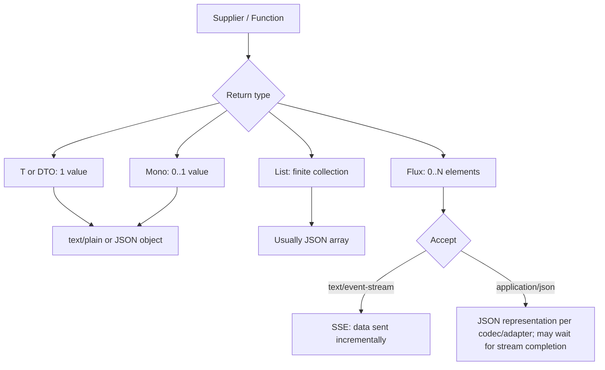

# Returning a Single Value, Collection, or Server-Sent Events Stream in Spring Cloud Function

## 1. Three Ways a Function Represents HTTP Results

**Spring Cloud Function (SCF)** encourages writing business logic with `Supplier<O>`, `Function<I, O>`, and `Consumer<I>`. Beans are registered in `FunctionCatalog` and can be invoked via HTTP, Spring Cloud Stream events, or serverless runtimes. The same function does not need to know which protocol sits in front of it; the adapter handles reading input and representing output.

With the **SCF HTTP adapter**, what matters is **how many values the function produces**:

1. **A single value:** `String`, a Java DTO/record, or `Mono<T>` carrying at most one element; clients typically receive a text body or a single JSON object.
2. **A collection:** `List<T>` or another collection type containing multiple elements; clients typically receive a JSON array representation if supported by the converter/runtime.
3. **A stream:** `Flux<T>` can emit multiple elements over time. Clients can request **Server-Sent Events (SSE)** via `Accept: text/event-stream` to consume events incrementally without waiting for the entire stream to complete.

These are three **result models**, not three separate Java functional interfaces. A `Supplier` can return a DTO or a `Flux`; a `Function` can return a string, a list, or a stream; and a `Consumer` has no business return value from `accept()`.

Example of a product pricing system:

```text
GET  /status        -> 1 service status object
GET  /priceCatalog  -> list of current prices, finite
GET  /heartbeats    -> multiple events emitted over time
POST /quote         -> 1 quote object per 1 request
```

This topic ties directly into the **HTTP contract**, **`Content-Type`**, **`Accept`**, **how codecs write responses**, **connection termination**, and MVC/WebFlux deployment options.

### Learning Objectives

After this lesson, learners will be able to:

- Distinguish `T`, `List<T>`, `Mono<T>`, and `Flux<T>` in HTTP responses.
- Return JSON objects, JSON arrays, and SSE streams from functional beans exposed by the SCF HTTP adapter.
- Send the right `Accept` header, read `Content-Type`, and observe streaming with `curl -N`.
- Explain SSE `data: ...` framing, stream completion, client cancellation, and resume limitations.
- Choose the right output type for an HTTP API while keeping logic reusable across HTTP, events, and serverless.

## 2. Reading the Official Rules of the SCF HTTP Adapter

SCF's *Standalone Web Applications* documentation states the rule: when **given a single-valued input** and the target function is clearly **single-valued** (returning neither a collection nor a `Flux`), the response also contains **a single value**. For **multi-valued responses**, clients can request a server-sent events stream using `Accept: text/event-stream`.

Practical comparison table:

| Bean / return type | Logical cardinality | Common HTTP method | Typical reception | When is SSE needed? |
| --- | --- | --- | --- | --- |
| `Supplier<String>` | One value | `GET /{supplier}` | Plain text, typically `text/plain` | Not needed |
| `Supplier<StatusDto>` | One object | `GET /{supplier}` | JSON object | Not needed |
| `Function<Request, Response>` | One result per input | `POST /{function}` | JSON object or plain text | Not needed |
| `Supplier<List<T>>` | One collection containing multiple elements | `GET /{supplier}` | Usually a JSON array | Can be requested, though an already-built collection does not become a real-time stream |
| `Supplier<Mono<T>>` | 0 or 1 element reactively | `GET /{supplier}` | One value once publisher completes with data | Usually not needed |
| `Supplier<Flux<T>>` | 0 to many elements, finite or unbounded | `GET /{supplier}` | May be aggregated depending on media type/adapter | **Ideal** when emitting incrementally |
| `Function<Flux<I>, Flux<O>>` | Input stream → output stream | `POST /{function}` when HTTP adapter supports this contract | Depends on codec and input media type | Useful for multi-valued outputs |
| `Consumer<T>` | No business return value | `POST /{consumer}` | Typically `202 Accepted`, may echo input | Not a natural fit for SSE responses |

**Note on status codes:** successful `Supplier` and `Function` calls typically yield `200 OK`; for `Consumer`, `POST`/`PUT` typically returns `202 Accepted`, and `DELETE` typically returns `204 No Content`. For SSE, `200 OK` describes establishing the HTTP response/connection; it does not mean all future events were delivered successfully.

**Note on versions:** SCF provides an MVC HTTP adapter as well as WebFlux options across version lines. Details around buffering, JSON arrays, response completion, and streaming depend on the web runtime/converter. The examples below describe **contracts to test on your exact version**, rather than claiming identical response bytes across every SCF version and proxy.

## 3. Distinguishing Single Value, Collection, and Publisher

### 3.1. One Object Is Not a Stream

Example:

```java
@Bean
public Supplier<ServiceStatus> status() {
    return () -> new ServiceStatus("READY", 3);
}
```

Each time `status.get()` runs, it returns one object. When the client sends `Accept: application/json`, the adapter can render:

```json
{"state":"READY","activeWorkers":3}
```

The response completes once the object is written. There is no reason to hold the connection open waiting for a second item.

### 3.2. A Collection Is One Result Containing Multiple Items

```java
@Bean
public Supplier<List<PriceLine>> priceCatalog() {
    return () -> List.of(
        new PriceLine("BOOK-001", 120000),
        new PriceLine("PEN-002", 15000)
    );
}
```

This is **one call** to `Supplier.get()`, returning a pre-populated collection of two items. With `Accept: application/json`, the common representation is a JSON array:

```json
[
  {"sku":"BOOK-001","unitPrice":120000},
  {"sku":"PEN-002","unitPrice":15000}
]
```

A JSON array can hold hundreds of elements, yet at the protocol level it can still be **a single response written and closed**, not SSE. Large collections usually require pagination, item limits, and serialization cost checks.

### 3.3. Mono and Flux Belong to the Reactive Model

**Project Reactor** provides common publishers:

| Type | Cardinality | Meaning |
| --- | --- | --- |
| `T` | One object returned directly | Imperative execution |
| `List<T>` | One container holding 0..N elements | All elements are ready when the collection is returned |
| `Mono<T>` | 0..1 element (may complete asynchronously) | Either one result or empty |
| `Flux<T>` | 0..N elements | Can emit incrementally, can be unbounded |

A `Flux` does not necessarily mean elements arrive spaced over time: `Flux.just("a", "b", "c")` can emit all three items immediately. Conversely, `Flux.interval(...)` emits items on a schedule. Clients must observe the difference between **multiple items** and **incremental emission over time**.



## 4. Sample Project: Single, List, and Finite Stream

The example uses **Java 17+**, Spring Boot with a **compatible Spring Cloud BOM**, and SCF's HTTP adapter. For a Spring MVC application, declare the starter:

```xml
<dependency>
    <groupId>org.springframework.cloud</groupId>
    <artifactId>spring-cloud-starter-function-web</artifactId>
</dependency>
```

The reactive example uses `reactor.core.publisher.Flux`; verify that `reactor-core` is on the classpath via managed dependencies. Do not pin an independent Reactor version if your project BOM already manages it. When choosing WebFlux, use the SCF WebFlux starter for your release train; do not arbitrarily mix web starters and guess which HTTP runtime is active.

Create `src/main/java/demo/OutputFormsApplication.java`:

```java
package demo;

import java.math.BigDecimal;
import java.time.Duration;
import java.util.List;
import java.util.Locale;
import java.util.function.Function;
import java.util.function.Supplier;

import org.springframework.boot.SpringApplication;
import org.springframework.boot.autoconfigure.SpringBootApplication;
import org.springframework.context.annotation.Bean;
import reactor.core.publisher.Flux;

@SpringBootApplication
public class OutputFormsApplication {

    public static void main(String[] args) {
        SpringApplication.run(OutputFormsApplication.class, args);
    }

    // One object => JSON object when client accepts JSON.
    @Bean
    public Supplier<ServiceStatus> status() {
        return () -> new ServiceStatus("READY", 3);
    }

    // One string => plain text.
    @Bean
    public Function<String, String> uppercase() {
        return value -> value.toUpperCase(Locale.ROOT);
    }

    // A finite collection => typical JSON array representation.
    @Bean
    public Supplier<List<PriceLine>> priceCatalog() {
        return () -> List.of(
            new PriceLine("BOOK-001", 120000),
            new PriceLine("PEN-002", 15000)
        );
    }

    // One JSON request => one JSON response.
    @Bean
    public Function<QuoteRequest, QuoteResponse> quote() {
        return req -> {
            if (req == null || req.sku() == null
                    || req.sku().isBlank()
                    || req.quantity() <= 0) {
                throw new IllegalArgumentException("Invalid quote request");
            }
            BigDecimal total = BigDecimal.valueOf(120000L)
                    .multiply(BigDecimal.valueOf(req.quantity()));
            return new QuoteResponse(req.sku(), req.quantity(), total);
        };
    }

    // A finite Flux: up to five heartbeats, one per second.
    // Do not block threads inside a Reactor pipeline.
    @Bean
    public Supplier<Flux<Heartbeat>> heartbeats() {
        return () -> Flux.interval(Duration.ofSeconds(1))
            .take(5)
            .map(i -> new Heartbeat(i + 1, "alive"));
    }

    public record ServiceStatus(String state, int activeWorkers) {}
    public record PriceLine(String sku, int unitPrice) {}
    public record QuoteRequest(String sku, int quantity) {}
    public record QuoteResponse(
            String sku, int quantity, BigDecimal totalPrice) {}
    public record Heartbeat(long sequence, String state) {}
}
```

These prices and statuses are purely **sample data**. `heartbeats` is a **cold publisher created fresh whenever the Supplier is invoked**. How the HTTP adapter subscribes and times Supplier calls is the runtime's responsibility; the example does not assume requests share a single subscription or counter.

Run the application:

```bash
mvn spring-boot:run
```

The `curl` commands below use Bash syntax and assume the server runs at `http://localhost:8080`. In PowerShell, use `curl.exe` and adapt line continuations for your shell.

## 5. Returning a Single Value: String or DTO

### 5.1. Supplier Returning a JSON Object

```bash
curl -i 'http://localhost:8080/status' \
  -H 'Accept: application/json'
```

Typical response:

```http
HTTP/1.1 200 OK
Content-Type: application/json

{"state":"READY","activeWorkers":3}
```

Clients can parse the JSON object and read its fields. Distinguish **a single object from a one-element JSON array**: those two shapes represent different API contracts even when carrying one record.

### 5.2. Function Returning Text

```bash
curl -i -X POST 'http://localhost:8080/uppercase' \
  -H 'Content-Type: text/plain' \
  -H 'Accept: text/plain' \
  --data 'hello'
```

Business response: `HELLO`, typically status `200 OK`. The Function takes one input and returns one output; SCF does not wrap `HELLO` in a JSON array simply because it can serve multiple requests.

### 5.3. Function Returning a DTO After Receiving JSON

```bash
curl -i -X POST 'http://localhost:8080/quote' \
  -H 'Content-Type: application/json' \
  -H 'Accept: application/json' \
  --data '{"sku":"BOOK-001","quantity":2}'
```

Business response:

```json
{"sku":"BOOK-001","quantity":2,"totalPrice":240000}
```

**One successful result does not mean all inputs are valid**. When `quantity <= 0`, the example throws an exception. The SCF HTTP adapter does not guarantee automatically converting every business exception into a specific 4xx status; an explicit HTTP error contract must be built separately when required by the API.

## 6. Returning a Collection: JSON Array and Collection Limits

### 6.1. GET a `Supplier<List<T>>`

```bash
curl -i 'http://localhost:8080/priceCatalog' \
  -H 'Accept: application/json'
```

When the codec renders the result as a JSON array, the expected body is:

```json
[
  {"sku":"BOOK-001","unitPrice":120000},
  {"sku":"PEN-002","unitPrice":15000}
]
```

Success HTTP status is typically `200 OK`. With JSON serializers, field ordering and whitespace may vary; automated tests should **parse JSON and assert elements** rather than comparing raw strings verbatim. Verify whether your actual SCF adapter version keeps the collection as one array or adapts it into multiple messages/items.

### 6.2. A Collection Differs from Multiple HTTP Responses

A normal `GET /priceCatalog` call is **one request and one HTTP response**, even though the body contains multiple objects. There is no default mechanism that opens multiple HTTP connections or sends one HTTP status per element.

This impacts:

- **Memory:** `get()` may materialize the entire `List` before the adapter writes the body.
- **Latency:** the client may have to wait for the full list to be assembled.
- **Size limits:** huge responses consume significant memory, bandwidth, and processing time.
- **Pagination:** for large datasets, require `page`, `size`, cursor, or equivalent limits at the API boundary; avoid unbounded `List`s.
- **Schema:** a single object and an array of objects are different contracts; switching between them breaks clients.

### 6.3. What About Requesting SSE from a List?

SCF documentation notes that clients can request multi-valued responses with `Accept: text/event-stream`. However, because **a `List` is already fully constructed in memory before returning**, it may provide no real-time emission timing benefit; clients simply receive elements the server already built.

Test it explicitly:

```bash
curl -i -N 'http://localhost:8080/priceCatalog' \
  -H 'Accept: text/event-stream'
```

If the adapter and codec choose streaming for the collection, you may observe multiple SSE records. If it aggregates/serializes differently, do not automatically blame `List`: streaming behavior depends on the SCF/web adapter, data type, and media type. When you **genuinely need incremental emission over time**, declaring `Flux<T>` is a much clearer model signal.

## 7. What Are Server-Sent Events (SSE)?

**SSE** is an HTTP mechanism allowing a **server to push a unidirectional sequence of events incrementally to a client over a long-lived response**. The client typically sends an HTTP GET, and the server responds with headers:

```http
HTTP/1.1 200 OK
Content-Type: text/event-stream
```

Events are then separated by **a blank line**. Illustrative SSE format example:

```text
data: {"sequence":1,"state":"alive"}

data: {"sequence":2,"state":"alive"}

data: {"sequence":3,"state":"alive"}

```

Each `data:` line carries event data. An event may also include `id:`, `event:`, or `retry:` per the SSE specification, though **the SCF HTTP adapter does not automatically generate those fields from an arbitrary DTO**. The example above illustrates format only and does not mandate JSON field order or encoder chunking.

SSE suits progress updates, status notifications, lightweight live updates, or streams where clients only **receive data from the server**. If you need bidirectional session communication or continuous client-to-server messages, WebSocket or another protocol may fit better.

### Comparing SSE, JSON Arrays, and WebSockets

| Criterion | JSON array in one HTTP response | SSE | WebSocket |
| --- | --- | --- | --- |
| Typical direction | Server → client | Server → client | Bidirectional |
| Consumption model | Usually processed after full JSON arrives | Processed event by event as they arrive | Frame/message based |
| Transport media type | `application/json` | `text/event-stream` | WebSocket protocol after HTTP handshake |
| Termination | Response finishes | Stream can be finite or kept open | Connection closed per protocol |
| Use cases | Snapshots, paginated lists | Updates, progress, notifications | Chat, bidirectional interactive collaboration |
| Through gateways | Standard HTTP | Watch proxy buffering and timeouts | Requires connection upgrade support |

## 8. Producing an SSE Stream from `Supplier<Flux<T>>`

The `heartbeats` bean from section 4:

```java
@Bean
public Supplier<Flux<Heartbeat>> heartbeats() {
    return () -> Flux.interval(Duration.ofSeconds(1))
        .take(5)
        .map(i -> new Heartbeat(i + 1, "alive"));
}
```

Explanation:

1. `Flux.interval(Duration.ofSeconds(1))` produces a timed sequence of indices from a Reactor publisher.
2. `take(5)` **caps** the stream at five items and completes afterward, avoiding an infinite open connection in exercises.
3. `map(...)` converts each index into a `Heartbeat` DTO.
4. The SCF HTTP adapter can turn those elements into SSE when the client sends `Accept: text/event-stream` and the codec/runtime supports it.

Call:

```bash
curl -i -N 'http://localhost:8080/heartbeats' \
  -H 'Accept: text/event-stream'
```

`-N` (or `--no-buffer`) tells curl not to buffer output internally, letting you observe events arriving over time. Expected response **shape**:

```http
HTTP/1.1 200 OK
Content-Type: text/event-stream

data: {"sequence":1,"state":"alive"}

data: {"sequence":2,"state":"alive"}

data: {"sequence":3,"state":"alive"}

data: {"sequence":4,"state":"alive"}

data: {"sequence":5,"state":"alive"}

```

In this example, items are **expected** roughly one second apart before the stream completes; exact timing depends on the scheduler, HTTP runtime, and network. Do not write tests asserting millisecond-exact arrival intervals.

**Formatting note:** field ordering, whitespace, and newlines above are illustrative; codecs may emit compact JSON without spaces, escape characters differently, or adjust representations across versions. Proper tests parse each **SSE event** and assert `sequence` and `state`.

### 8.1. What Happens Without `Accept: text/event-stream`?

Compare:

```bash
# Client expects a JSON response.
curl -i 'http://localhost:8080/heartbeats' \
  -H 'Accept: application/json'

# Client requests individual events.
curl -i -N 'http://localhost:8080/heartbeats' \
  -H 'Accept: text/event-stream'
```

With `application/json`, some HTTP runtimes may **wait for the publisher to complete and emit a JSON array**. With `text/event-stream`, the goal is **emitting each item as it arrives**. Do not assume both requests receive the same body or finish at the same time; inspect response `Content-Type`, arrival timing per element, and completion behavior.

In particular, if a `Flux` **never completes**, attempting to collect all of it into a JSON array can never produce a finite JSON response. Therefore, for continuous update feeds, explicitly design around SSE or another streaming protocol and reject incompatible `Accept` headers if needed.

### 8.2. Finite vs. Unbounded Streams

```java
// Finite: emits onComplete after 5 elements.
Flux<Long> finite = Flux.interval(Duration.ofSeconds(1))
        .take(5);

// Logically can emit indefinitely until cancelled/errored.
Flux<Long> ongoing = Flux.interval(Duration.ofSeconds(1));
```

These illustrate data types, not two `@Bean` declarations to paste into the project. A finite stream fits progress updates for a job that finishes. An unbounded stream fits continuous updates, but requires defining **timeouts, subscription cancellation, connection quotas, resource limits, and client reconnect policies**.

## 9. What SSE Does Not Guarantee Automatically

### 9.1. HTTP 200 Does Not Guarantee All Events Succeed

With a JSON array, the server can often catch errors before finishing the body. With SSE, response headers and status have usually already been sent upfront. If the publisher throws an error **after** emitting a few events, the server normally cannot change the status to 500 on a response that already sent `200`.

Applications must choose an error contract: close the stream, emit a **standardized error event** when possible, or have clients reconnect and query state separately. Never treat SSE as a reliable queue that persists every event.

### 9.2. SSE Does Not Replay Missed Events by Default

The SSE spec supports `id:` and allows clients to send `Last-Event-ID` upon reconnecting. However, `Supplier<Flux<T>>` itself does not provide an **event store**, durable sequence numbers, or replay logic.

If users must **never miss notifications** across disconnects, you need persistent storage, offsets/cursors, replay mechanics, and reconnect tests. If only non-critical liveness signals are needed, losing a few heartbeats may be acceptable.

### 9.3. SSE Does Not Automatically Solve Backpressure Across Every Layer

`Flux` supports Reactive Streams backpressure within compatible pipeline stages, but the **end-to-end path** across the HTTP encoder, proxies, network, and slow clients still needs control. A fast publisher can cause large buffers or dropped connections.

Consider:

- Emission rate and size of each event.
- Buffer bounds and behavior when clients read slowly.
- Concurrent open stream counts.
- Timeouts, keep-alive/heartbeats, and cancellation.
- Observability for latency, open connections, and stream errors.

### 9.4. Blocking Threads with `Thread.sleep` Causes Severe Issues

In reactive applications, avoid calling `Thread.sleep(...)` or blocking I/O directly inside callbacks running on the event loop. Our example uses `Flux.interval` to pace emissions without blocking threads inside `map`. For genuinely blocking I/O, offload to an appropriate scheduler/executor or switch to an asynchronous API.

The `Flux` type alone does not guarantee that underlying database drivers, HTTP clients, or internal code are non-blocking.

## 10. Testing SSE Through Proxies or API Gateways

A stream working on `localhost:8080` can still misbehave behind Nginx, Spring Cloud Gateway, or load balancers. Watch for:

| Issue | Client symptom | Mitigation |
| --- | --- | --- |
| **Proxy buffering** | Server emits events individually, but client receives them in bursts | Configure response buffering appropriately at the proxy/gateway |
| **Idle timeout** | Connection closes after quiet intervals | Tune timeouts and consider protocol heartbeats |
| **Client disconnect** | Server keeps working or leaks resources if not cancelled properly | Verify cancellation propagates upstream |
| **Slow consumer** | Memory buffers grow and latency spikes | Rate-limit, monitor, and design backpressure |
| **Load balancing on reconnect** | Client reconnects to a different instance | Use a shared event store/cursor if replay is required |
| **Expired auth token** | Stream rejected on subsequent reconnects | Design safe auth/refresh and reconnect policies |
| **Cached SSE** | Events get cached or replayed erroneously | Verify `Cache-Control` and CDN/proxy policies |

In browsers, `EventSource` issues HTTP GET requests and provides basic automatic reconnect. However, the standard browser `EventSource` API cannot set arbitrary custom request headers like a full HTTP client. If your API requires an `Authorization: Bearer ...` header, choose an appropriate auth architecture and avoid placing sensitive tokens in query strings.

## 11. Choosing Output Types by Product Goal

| Goal | Suggested output type | Why |
| --- | --- | --- |
| Return result of one quote request | `QuoteResponse` | One request, one clear result |
| Read current system status | `ServiceStatus` | Single snapshot |
| Read a small pre-built list | `List<PriceLine>` | Natural JSON array, closes response after sending |
| Read a large dataset by page | Page DTO containing `List<T>` and metadata | Avoids dumping unbounded data into one response |
| Return one asynchronous result | `Mono<T>` | Non-blocking wait for 0..1 reactive result |
| Stream one-way job progress over HTTP | `Flux<ProgressEvent>` + SSE | Receives incremental progress steps |
| Follow continuous live updates | `Flux<Event>` + SSE | Stream stays open while subscribed |
| Continuous bidirectional send and receive | WebSocket or suitable transport | SSE is server → client only |
| Guarantee zero event loss and durable processing | Broker + offset/event store; SSE only for display | HTTP streams do not replace durable event systems |

### Especially: `Flux` and `List` Are Not Interchangeable

Changing `Supplier<List<T>>` to `Supplier<Flux<T>>` can alter when data is generated, when the HTTP body completes, resource consumption, and error handling. Choose based on **whether incremental emission is actually needed**, not just to make code look “reactive.”

## 12. Relationship with `FunctionCatalog`, Composition, and Other Adapters

The `status`, `priceCatalog`, and `heartbeats` beans in our example are all functional beans registered and looked up through `FunctionCatalog`. Bean names determine the paths in the SCF HTTP adapter:

```text
GET  /status
GET  /priceCatalog
GET  /heartbeats
POST /uppercase
POST /quote
```

If you configure:

```properties
spring.cloud.function.web.path=/api/functions
```

the URLs shift to `/api/functions/heartbeats`, `/api/functions/priceCatalog`, etc., without changing output types or `Accept` semantics.

When composing functions (`spring.cloud.function.definition=first|second`), the **final output type of the composition** is what the HTTP adapter must represent. If an upstream function produces `Flux<T>` while the downstream function only accepts `T`, check `FunctionCatalog` adaptation, conversion, and invocation rules; **do not assume every element triggers identical invocations across every adapter**.

In Spring Cloud Stream, `Supplier<Flux<T>>` often represents an **event source** subscribed to once to feed a stream. Over HTTP, each request and subscription has its own lifecycle. In serverless platforms, execution duration, timeouts, and streaming support depend on the provider. **SSE is an HTTP representation choice, not an intrinsic property of the function itself.**

## 13. Manual Test Suite

Run the application from section 4 and test:

```bash
# A. A single DTO.
curl -i 'http://localhost:8080/status' \
  -H 'Accept: application/json'

# B. A string.
curl -i -X POST 'http://localhost:8080/uppercase' \
  -H 'Content-Type: text/plain' \
  -H 'Accept: text/plain' \
  --data 'hello'

# C. A JSON object after processing JSON input.
curl -i -X POST 'http://localhost:8080/quote' \
  -H 'Content-Type: application/json' \
  -H 'Accept: application/json' \
  --data '{"sku":"BOOK-001","quantity":2}'

# D. A collection.
curl -i 'http://localhost:8080/priceCatalog' \
  -H 'Accept: application/json'

# E. A finite Flux with SSE.
curl -i -N 'http://localhost:8080/heartbeats' \
  -H 'Accept: text/event-stream'

# F. Same Flux, but requesting JSON: observe the difference.
curl -i 'http://localhost:8080/heartbeats' \
  -H 'Accept: application/json'
```

### Results Log Table

| Case | Primary expectation | What to measure |
| --- | --- | --- |
| A | JSON object and 200 | `state`, `activeWorkers`, response `Content-Type` |
| B | `HELLO` and 200 | `text/plain` type |
| C | DTO with `totalPrice=240000` | JSON schema and calculated total |
| D | Two-element list | JSON array / adapter codec behavior |
| E | SSE with five logical values | `text/event-stream`, pacing, completion |
| F | Representation without SSE | Actual headers, buffering, completion time |

**Important:** to verify streaming, do not read only the final body. Observe **when each event appears**. A JSON array arriving all at once after five seconds and an SSE stream delivering five records over five seconds are two very different behaviors.

### What Should Automated Tests Verify?

An integration test suite (for example, `WebTestClient` with WebFlux or an HTTP client suited for MVC) should verify:

1. JSON objects have the expected shape and are not unexpectedly wrapped in an array.
2. JSON arrays contain the expected element count and valid DTO fields.
3. SSE responses carry the `text/event-stream` media type.
4. `heartbeats` emits all **five sequences** in order and then completes.
5. Subscriptions cancel when the client disconnects so expensive work stops.
6. Mid-stream errors follow an explicit contract once headers have been sent.
7. The same endpoints work with an SCF web prefix and through gateways.

Do not assert per-event timing down to exact milliseconds; schedulers and networks fluctuate.

## 14. Common Design and Operational Mistakes

| Symptom | Causes to check | Resolution |
| --- | --- | --- |
| Client wanted SSE, but received a JSON array | Wrong `Accept`, converter/runtime picked JSON, or bean returns a collection | Send `Accept: text/event-stream`; verify output type and codec |
| Nothing appears until the response finishes | Proxy buffering, curl buffering, or output aggregated | Use `curl -N`; inspect proxy and runtime settings |
| SSE never terminates | `Flux` is an unbounded source | Design cancellation, timeouts, or bound with `take(n)` |
| Browser reconnects and loses events | No event store, IDs, or replay | Add `id`, persist history, and implement cursor replay when needed |
| Response sends 200, then stream breaks | Error occurred after headers were written | Define an error/retry contract; monitor and log |
| RAM spikes when collecting a stream | Sent `Accept: application/json` to a large/unbounded `Flux` | Use streaming or pagination instead of collecting everything |
| Events arrive in large batches | Proxy or codec buffering | Check flushing, gateway, and runtime settings |
| Open connections grow unboundedly | Many clients keeping SSE open | Enforce quotas, timeouts, and connection monitoring |
| `Thread.sleep` slows down all of WebFlux | Blocking the event loop | Use Reactor operators and offload blocking work properly |
| API returns an array when client expects an object | Unstable schema contract | Clearly separate single vs. list outputs with contract tests |
| SSE fails in serverless | Platform lacks streaming support or has short timeouts | Check platform capabilities; use a broker/polling if needed |

### Pre-Production Checklist

- Choose `T`, `List<T>`, `Mono<T>`, or `Flux<T>` based on actual product requirements.
- Explicitly document media types in the API contract; for SSE, require `text/event-stream`.
- Bound item counts, event sizes, and maximum connection lifetimes.
- Verify proxy buffering, idle timeouts, TLS, authentication, and rate limiting.
- Define error behavior after a stream has already started.
- When high reliability is required, back streams with an event store/offset/replay; SSE is only the delivery channel to the client.
- Test against the exact SCF starter, Spring Boot, Spring Cloud BOM, and MVC/WebFlux runtime you plan to deploy.

## 15. Exercises

1. Explain why `Supplier<ServiceStatus>` and `Supplier<List<ServiceStatus>>` produce two different JSON response shapes even though both are invoked with GET.
2. In what situations is `Supplier<Flux<Heartbeat>>` preferable to `Supplier<List<Heartbeat>>`? When is a simple `List` better?
3. For the `heartbeats` bean in section 4, write a `curl` command to consume SSE, and predict the event count and stream termination condition.
4. A client sends `Accept: application/json` to an unbounded `Flux`. Analyze the risks if the adapter attempts to collect all items before writing JSON.
5. Why does receiving `HTTP 200 OK` from an SSE endpoint not prove all events were delivered to the client?
6. Using the SSE format, explain the roles of `data:`, blank lines, `id:`, and `Last-Event-ID`.
7. An Nginx reverse proxy causes events to arrive in 30-second bursts even though the server emits every second. Propose diagnostic steps.
8. Design an API displaying order-processing progress: choose the function type, media type, error event format, and client reconnect strategy.
9. Why should you avoid `Thread.sleep(1000)` inside a Reactor callback running on the event loop?
10. If the same bean is invoked from both HTTP and Spring Cloud Stream, what belongs to the function's logic and what belongs solely to the HTTP SSE adapter?

## Official References

- [Spring Cloud Function — Standalone Web Applications](https://docs.spring.io/spring-cloud-function/reference/spring-cloud-function/standalone-web-applications.html): single-valued vs. multi-valued responses and `Accept: text/event-stream`; routing and HTTP methods.
- [Spring Cloud Function — Programming Model](https://docs.spring.io/spring-cloud-function/reference/spring-cloud-function/programming-model.html): `Supplier<Flux<T>>`, `FunctionCatalog`, reactive functions, and lifecycle.
- [Project Reactor — Reference Guide](https://projectreactor.io/docs/core/release/reference/): `Flux`, `Mono`, cancellation, backpressure, and `interval`, `take`, `map` operators.
- [Spring Framework — WebFlux](https://docs.spring.io/spring-framework/reference/web/webflux.html): reactive HTTP, serialization, and streaming.
- [MDN — Using server-sent events](https://developer.mozilla.org/en-US/docs/Web/API/Server-sent_events/Using_server-sent_events): SSE syntax, `EventSource`, reconnection, and event format.

> **Remember:** A `T` or DTO normally produces **a single response value**; `List<T>` represents a **finite collection**; `Flux<T>` represents **multiple reactive elements**. When a client requests `Accept: text/event-stream`, the SCF HTTP adapter can expose multi-valued responses as **SSE**. Choose the right output type, media type, and runtime, and test real streaming behavior instead of inferring from Java signatures alone.
