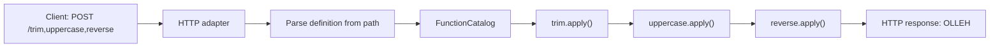

# Mapping Composed Functions to HTTP Paths in Spring Cloud Function

## 1. Problem: Invoking a Processing Chain with One HTTP Request

**Spring Cloud Function (SCF)** lets you write business logic as Java beans (`Supplier<O>`, `Function<I, O>`, and `Consumer<I>`). `FunctionCatalog` registers, looks up, and supports **composition** (chaining multiple functions into one processing pipeline). The exact same beans can be used over HTTP, Spring Cloud Stream events, or serverless runtimes.

Suppose an application has three small operations:

1. `trim`: strips leading and trailing whitespace from a string.
2. `uppercase`: converts a string to uppercase.
3. `reverse`: reverses character order.

Instead of writing another controller that invokes each function sequentially, SCF can compose the three beans into one logical function:

```text
input "  hello  "
       |
       v
     trim          -> "hello"
       |
       v
   uppercase       -> "HELLO"
       |
       v
    reverse        -> "OLLEH"
       |
       v
HTTP response "OLLEH"
```

The HTTP adapter can resolve the composition directly from the **URL path**:

```text
POST /trim,uppercase,reverse
```

Or you can configure a **default composition** so clients call the root path:

```properties
spring.cloud.function.definition=trim|uppercase|reverse
```

```text
POST /
```

Both approaches invoke the same processing chain, though they have different deployment semantics. This lesson focuses on the **rules for mapping compositions to HTTP endpoints**, not just Java's `Function.andThen(...)` syntax.

### Learning Objectives

After this lesson, you will be able to:

- Explain the roles of `FunctionCatalog`, `spring.cloud.function.definition`, and path segments containing function name lists.
- Use commas or pipes to identify compositions and accurately predict execution order.
- Select a default composition at the root path, apply function filtering with semicolons, and change the HTTP adapter base path.
- Distinguish the resulting types of `Function → Function`, `Supplier → Function`, and `Function → Consumer` compositions.
- Call HTTP endpoints with the right method and input/output types, and diagnose routing, conversion, and security issues.
- Write contract tests for composed URLs before exposing them to clients.

## 2. Three Layers to Distinguish: Bean, Composition, and URL

SCF does not force you to declare an extra bean for every combination. `FunctionCatalog` can look up and compose registered functional beans from a **definition string**.

| Component | Example | Responsibility |
| --- | --- | --- |
| Named bean | `uppercase`, `reverse` | Defines a single operation |
| Composition definition | `uppercase|reverse` | Composes sequentially from left to right |
| HTTP path for composition | `/uppercase,reverse` | Identifies the composition looked up by the HTTP adapter |
| Root mapping | `spring.cloud.function.definition=uppercase|reverse` | Picks the composition as the default function at the root path |
| Web base path | `spring.cloud.function.web.path=/api/functions` | Changes the prefix of SCF HTTP endpoints |
| Function filtering | `spring.cloud.function.definition=uppercase|reverse;greeting` | Exposes only an allowed list; does not auto-create a root mapping |

Conceptual request path:



**Key point:** the names in the URL are **bean names known to the catalog**, not Java class names or `apply()` method names. The HTTP adapter acts purely as the transport layer; code inside each function remains independent of HTTP.

## 3. Delimiters: Pipe, Comma, and Semicolon

SCF allows expressing composition with a **pipe** (`|`) or **comma** (`,`). For instance, both expressions:

```text
uppercase|reverse
uppercase,reverse
```

describe calling `uppercase` followed by `reverse` when used in a supported composition context.

In **URLs**, official documentation recommends using commas because although pipes are valid in SCF routing, they are awkward to type on the command line:

```text
POST /uppercase,reverse
```

**Do not confuse these three characters:**

| Character | Example | Meaning |
| --- | --- | --- |
| `|` | `trim|uppercase` | Chains functions sequentially |
| `,` | `/trim,uppercase` | Convenient composition syntax in HTTP paths |
| `;` | `spring.cloud.function.definition=trim|uppercase;greeting` | Lists **items to expose** in filtering mode; does not chain them |

In `application.properties`, you do not need to URL-encode `|`. In Bash or PowerShell, however, a pipe can be interpreted by the shell as a pipe operator, so wrap the entire argument in quotes when passing the property on the command line:

```bash
java -jar app.jar '--spring.cloud.function.definition=trim|uppercase'
```

Similarly, when `;` is present, quote the entire string so the shell does not split commands:

```bash
java -jar app.jar '--spring.cloud.function.definition=trim|uppercase;greeting'
```

`app.jar` is just an illustrative artifact name. In real URLs, prefer **commas** and always wrap URLs in quotes when using `curl`.

## 4. Creating a Spring Cloud Function Project for Practice

The example uses **Java 17+**, Spring Boot with a compatible Spring Cloud BOM, and the HTTP web starter. In a Maven project already managing Spring Cloud versions via the BOM, declare:

```xml
<dependency>
    <groupId>org.springframework.cloud</groupId>
    <artifactId>spring-cloud-starter-function-web</artifactId>
</dependency>
```

For WebFlux, use the web module/starter compatible with your active SCF and Spring Boot lines; do not mix two web stacks arbitrarily and guess which runtime gets chosen.

Create `src/main/java/demo/CompositionHttpApplication.java`:

```java
package demo;

import java.util.Locale;
import java.util.function.Consumer;
import java.util.function.Function;
import java.util.function.Supplier;

import org.springframework.boot.SpringApplication;
import org.springframework.boot.autoconfigure.SpringBootApplication;
import org.springframework.context.annotation.Bean;

@SpringBootApplication
public class CompositionHttpApplication {

    public static void main(String[] args) {
        SpringApplication.run(CompositionHttpApplication.class, args);
    }

    @Bean
    public Function<String, String> trim() {
        return String::trim;
    }

    @Bean
    public Function<String, String> uppercase() {
        return text -> text.toUpperCase(Locale.ROOT);
    }

    @Bean
    public Function<String, String> reverse() {
        return text -> new StringBuilder(text).reverse().toString();
    }

    @Bean
    public Function<String, String> wrap() {
        return text -> "[" + text + "]";
    }

    @Bean
    public Supplier<String> greeting() {
        return () -> "  hello  ";
    }

    @Bean
    public Consumer<String> audit() {
        return text -> System.out.println("AUDIT: " + text);
    }
}
```

Design highlights:

- Each small operation knows only `String` and needs no `HttpServletRequest` or `@RequestBody`.
- The `Function<String, String>` beans have **compatible** input/output types for composing in multiple orders.
- `greeting` and `audit` let us demonstrate compositions that **change the resulting function contract**.
- Because the catalog holds multiple functional beans, endpoints are accessed **by name or composition**; no root function is auto-selected simply by being registered first.

Start the application:

```bash
mvn spring-boot:run
```

The `curl` commands below follow Bash syntax. In PowerShell, use `curl.exe` and matching line continuations; the default URL is `http://localhost:8080`.

## 5. Invoking a Composition Directly via HTTP Path

### 5.1. Composing Two Functions

Try `uppercase` and `reverse`:

```bash
curl -i -X POST 'http://localhost:8080/uppercase,reverse' \
  -H 'Content-Type: text/plain' \
  -H 'Accept: text/plain' \
  --data 'hello'
```

Processing flow:

```text
input "hello"
    |
uppercase -> "HELLO"
    |
reverse   -> "OLLEH"
    |
response "OLLEH"
```

On success, a typical response is:

```http
HTTP/1.1 200 OK
Content-Type: text/plain

OLLEH
```

The HTTP adapter looks up the expression `uppercase,reverse` in `FunctionCatalog`; it does not require a bean literally named `uppercase,reverse` in the application context.

### 5.2. Composing Three Functions

```bash
curl -i -X POST \
  'http://localhost:8080/trim,uppercase,reverse' \
  -H 'Content-Type: text/plain' \
  -H 'Accept: text/plain' \
  --data '  hello  '
# Expected response body: OLLEH
```

The input is passed in the **request body** because the composed result is still a `Function<String, String>`. Data flows through each function in the specified order.

### 5.3. Changing Order Can Change the Result

Composition is not commutative in general. Compare:

```bash
curl -i -X POST 'http://localhost:8080/trim,wrap' \
  -H 'Content-Type: text/plain' --data '  hello  '
# Expected: [hello]

curl -i -X POST 'http://localhost:8080/wrap,trim' \
  -H 'Content-Type: text/plain' --data '  hello  '
# Expected: [  hello  ]
```

Because `trim` only strips whitespace **at the start and end of the entire string**, when `wrap` runs first, the outer brackets leave the spaces inside so `trim` no longer removes them.

**Do not confuse:** `trim,wrap` means `wrap(trim(input))`, not `trim(wrap(input))`.

## 6. Mapping a Composition to the Root Path via `definition`

When multiple beans exist, the HTTP adapter does not know which function to pick at `/` by default. You can designate a single composition as the **default definition**.

In `src/main/resources/application.properties`:

```properties
spring.cloud.function.definition=trim|uppercase|reverse
```

After restarting the application, call the root path:

```bash
curl -i -X POST 'http://localhost:8080/' \
  -H 'Content-Type: text/plain' \
  -H 'Accept: text/plain' \
  --data '  hello  '
# Response body: OLLEH
```

This **specifies the composition invoked at root**, not an alias for a Java bean named `/`. In SCF documentation, the same property can also act as a **fallback** when no function matches the URL.

For instance, if the application has `trim`, `uppercase`, and `reverse` and the definition above is set, a URL matching no bean name may still be handled by the selected composition. Therefore:

> **Root mapping and fallback are not access-control mechanisms.** If the API must reject any path outside an allowlist, enforce HTTP routing/security in Spring MVC/WebFlux or an API gateway and test invalid URLs.

### 6.1. When Only One Function Exists

If the catalog contains **only** `uppercase`, the path name is optional: `POST /uppercase` and `POST /` both invoke that function. However, the project in section 4 has six beans, so you **cannot** rely on the “single function” rule here unless you restrict the catalog or set a definition.

### 6.2. Selecting a Composition via `application.yml`

Equivalent to the properties file:

```yaml
spring:
  cloud:
    function:
      definition: "trim|uppercase|reverse"
```

Quoting the definition string makes special characters clearer. Do not declare the same key in both YAML and properties simultaneously; if multiple sources define it, the **effective** value follows Spring Boot's property source precedence order.

## 7. Function Filtering: Exposing Selected Compositions Without Auto-Root

The `spring.cloud.function.definition` property also **filters which functions the HTTP adapter exposes** when its value contains **multiple entries** separated by `;`.

Example:

```properties
spring.cloud.function.definition=trim|uppercase;greeting
```

Here **two entries are exposed**:

1. The `trim|uppercase` composition.
2. The standalone `greeting` Supplier.

Expected URLs:

```text
POST /trim,uppercase
GET  /greeting
```

With this filtering configuration:

- `POST /` does **not automatically** point to `trim|uppercase`.
- `/reverse`, `/wrap`, and **unlisted** compositions are no longer exposed by the HTTP adapter under filtering.
- The `;` character does **not** mean “run `trim|uppercase` then `greeting`.” It merely lists the two allowed items to expose.

Test:

```bash
curl -i -X POST 'http://localhost:8080/trim,uppercase' \
  -H 'Content-Type: text/plain' \
  -H 'Accept: text/plain' \
  --data '  hello  '
# Expected: HELLO

curl -i 'http://localhost:8080/greeting'
# Expected: "  hello  " (Supplier returns String)
```

### Matrix of `definition` Configurations

Suppose the catalog contains `trim`, `uppercase`, `reverse`, `wrap`, `greeting`, and `audit`:

| `spring.cloud.function.definition` | Named / composition endpoints | Root `/` |
| --- | --- | --- |
| Unset | Beans and compositions can be looked up by name in the URL | No automatic default function when multiple beans exist |
| `trim|uppercase` | Selected composition; verify actual routes if other names are called | `POST /` calls `trim → uppercase` |
| `trim|uppercase|reverse` | Selected composition | `POST /` runs all three steps |
| `trim;uppercase` | Only the two listed single functions | No automatic root |
| `trim|uppercase;greeting` | `/trim,uppercase` and `/greeting` | No automatic root |
| `trim|uppercase;wrap|reverse` | Both listed compositions | No automatic root |

**Distinguish clearly:** filtering via `definition` restricts endpoints published by the SCF adapter, but does not replace authentication/authorization. If a default endpoint, another controller, or a routing header still reaches sensitive logic, verify and lock it down at the web/security layer.

## 8. Changing the URL Prefix with `spring.cloud.function.web.path`

By default, the SCF HTTP adapter sets its base path to `/`. To place all functions under a uniform prefix:

```properties
spring.cloud.function.web.path=/api/functions
```

Then:

```text
POST /api/functions/trim,uppercase
POST /api/functions/uppercase,reverse
GET  /api/functions/greeting
```

If you also select a default definition:

```properties
spring.cloud.function.web.path=/api/functions
spring.cloud.function.definition=trim|uppercase
```

the composition can be called at the **adapter's base path**:

```bash
curl -i -X POST 'http://localhost:8080/api/functions' \
  -H 'Content-Type: text/plain' \
  --data '  hello  '
# Expected: HELLO
```

If `server.servlet.context-path=/order-service` is configured in a Spring MVC application, client URLs become:

```text
POST /order-service/api/functions
POST /order-service/api/functions/trim,uppercase
```

When using an API gateway, verify both the **public URL** and the **actual URL received by the backend**. A gateway can rewrite prefixes, but it does not alter composition order or bean Java types. Do not repeat the gateway prefix inside `web.path` if the gateway already strips it, to avoid duplicated path segments.

### Trailing Slashes

Some web runtimes distinguish `/api/functions` from `/api/functions/`; trailing-slash matching policies can differ across Spring Framework versions and proxies. Test the **official published URL** and any variants you intend to support rather than assuming they are always equivalent.

## 9. HTTP Methods and Result Types After Composition

When chaining functions, the **chain's input type** and the **final component's output type** determine how the adapter reads requests and returns responses. Not every composition yields a `Function<I, O>`.

### 9.1. Function → Function Yields a Function

```text
Function<String,String> trim
    |
    v
Function<String,String> uppercase
    |
    v
Function<String,String> trim|uppercase
```

Call `POST /trim,uppercase` or `PUT /trim,uppercase` with `text/plain` and receive a typical `200 OK` result.

For functions taking simple inputs, SCF also supports GET with a path item:

```text
GET /{function}/{item}
```

Example to try:

```bash
curl -i 'http://localhost:8080/uppercase,reverse/hello'
# Expected: OLLEH
```

Here `uppercase,reverse` is **one composition definition**, while `hello` is the path item input. Special characters in the input require URL-encoding; for JSON or complex DTOs, use a request body.

### 9.2. Supplier → Function Still Yields a Supplier

`greeting` is a `Supplier<String>`, while `trim` and `uppercase` are `Function<String, String>`. When composed:

```text
greeting | trim | uppercase
```

the overall result is still a **Supplier**: it requires no client input and only produces output.

```bash
curl -i 'http://localhost:8080/greeting,trim,uppercase' \
  -H 'Accept: text/plain'
# Expected: HELLO
```

This is a **GET** request. Do not send `POST` merely because the chain contains `Function`s downstream.

### 9.3. Function → Consumer Yields a Consumer

Composing `trim|audit` creates the pipeline:

```text
POST body "  event  "
  |
trim -> "event"
  |
audit.accept("event")
  |
Consumer produces no business result
```

Call:

```bash
curl -i -X POST 'http://localhost:8080/trim,audit' \
  -H 'Content-Type: text/plain' \
  --data '  event  '
```

Overall it is a **Consumer**, so under default mapping the HTTP adapter typically returns `202 Accepted` and may echo input. The example's side effect is logging `AUDIT: event`; the HTTP response is not proof of durable storage.

### 9.4. Invalid or HTTP-Unsuitable Compositions

| Composition pattern | Overall result | Guidance |
| --- | --- | --- |
| `Function → Function` | Function | Accepts input, returns output |
| `Supplier → Function` | Supplier | GET fetches transformed output |
| `Function → Consumer` | Consumer | Accepts input for processing, no business output |
| `Supplier → Consumer` | `Runnable` | Do not treat as a standard body-accepting/returning endpoint; verify the corresponding adapter |
| `Consumer → Function` | Cannot compose under Consumer's `void` contract | Consumer returns no value to feed the next Function |
| `Consumer → Supplier` | Cannot compose under standard contracts | Redesign ordering or split into separate workflows |

## 10. Mapping Compositions to a Specific HTTP Method

SCF provides properties of the form `spring.cloud.function.http.<METHOD>` to select functions or compositions callable via a given HTTP method, useful for simple CRUD-like mappings.

Example:

```properties
spring.cloud.function.http.GET=greeting;uppercase|reverse
spring.cloud.function.http.POST=trim|uppercase;reverse
spring.cloud.function.http.PUT=uppercase
```

Here:

- `;` separates **distinct items** mapped to that method.
- `|` describes a **composition** within an item.
- These properties **do not define a REST controller**, add `@RequestMapping`, or enforce PUT idempotency.

When testing this configuration, you can run:

```bash
# POST listed composition.
curl -i -X POST 'http://localhost:8080/trim,uppercase' \
  -H 'Content-Type: text/plain' \
  --data '  hello  '

# GET composition with path item.
curl -i 'http://localhost:8080/uppercase,reverse/hello'
```

**Important:** always verify how `spring.cloud.function.http.*` interacts with `spring.cloud.function.definition` when both are used. In applications with multiple routing rules, do not assume a function is exposed on every method simply because its name is in the catalog. When you need REST contracts with path variables and detailed status codes, use a Spring MVC/WebFlux controller or router as the HTTP boundary.

## 11. Input/Output and Content Negotiation When Composing

A composition is a **typed pipeline**. If `A` returns data that `B` cannot accept directly, the pipeline needs a valid conversion or it will fail.

### 11.1. Composing Functions with Matching Types

In our example:

```text
trim:      String -> String
uppercase: String -> String
reverse:   String -> String
wrap:      String -> String
```

every sequential pair already matches in type. For `POST /trim,uppercase`, send:

```http
Content-Type: text/plain
Accept: text/plain
```

and a plain-text body. `Content-Type` identifies the request body format, while `Accept` specifies the response format accepted by the client.

### 11.2. Composing Two Functions with Different Generic Types

Suppose we have:

```java
Function<OrderRequest, String> encode;
Function<OrderSummary, Receipt> generateReceipt;
```

Do not assume the `String` output of `encode` automatically becomes `OrderSummary`. SCF has conversion mechanisms via `MessageConverter` or `ConversionService` for supported cases; however, the converter must understand the payload, content type, and target Java type.

If the output is invalid or no suitable converter exists, invoking the composition can fail **before the next function runs**. Do not expose arbitrary public composition routes assuming the adapter will convert every DTO pair automatically.

### 11.3. Headers and `Message<?>`

A function can accept `Message<T>` to read both payload and HTTP metadata such as `Content-Type`, correlation IDs, or query parameters. When a composition includes functions using `Message<?>`, the adapter and catalog propagate headers per Spring Messaging rules.

**Security boundary:** data from URL paths, request headers, and bodies is untrusted. Never let clients arbitrarily choose sensitive compositions—especially since SCF also supports header- and expression-based routing. Enforce input validation, authentication, authorization, length limits, and an allowlist of exposed compositions.

## 12. `FunctionCatalog` and HTTP Mapping vs. Dynamic Routing

SCF also provides `functionRouter` to select a function from message headers, application properties, or routing expressions. This mechanism is **distinct** from the HTTP adapter parsing a URL like `/trim,uppercase`.

| Mechanism | Question answered | Example |
| --- | --- | --- |
| HTTP path composition | Which chain did the client call? | `POST /trim,uppercase` |
| `spring.cloud.function.definition` | Which composition is default/selected, or which list is exported? | `trim|uppercase` |
| `spring.cloud.function.http.POST` | Which compositions are mapped to POST? | `trim|uppercase;reverse` |
| `functionRouter` | Which function will a routing function pick by context? | `spring.cloud.function.definition` message header |

When external clients can send matching HTTP headers, the web adapter may copy them into message headers, which can influence routing if `functionRouter` is active. For header-supplied routing expressions, SCF restricts the evaluation context compared to property-configured expressions, yet **it must never be treated as authorization**.

If you only need a fixed processing chain exposed over HTTP, **path composition or static `definition`** is usually simpler than a dynamic router. For public APIs, define exact permitted URLs and block access to internal functions.

## 13. Common Routing and Composition Errors

| Symptom | Possible cause | How to check |
| --- | --- | --- |
| `POST /trim,uppercase` returns 404 | Wrong bean name, SCF HTTP web not enabled, or composition filtered out | Check `@Bean`, `FunctionCatalog`, web dependency, `definition` |
| `POST /` fails when multiple beans exist | No default composition | Configure a single `definition` or call named paths |
| `POST /` fails with `definition=trim|uppercase;greeting` | Filtering mode does not auto-map root | Call `/trim,uppercase` or remove the filter list and set a single definition |
| Output string differs from expectation | Wrong composition order | Compare `trim,wrap` vs. `wrap,trim` |
| Startup command splits or pipes into another command | Unquoted `|` or `;` in shell | Quote the full `--spring.cloud.function.definition=...` argument |
| URL with `|` behaves oddly in client/gateway | Character needs encoding or is interpreted by shell/URI parser | Use commas in URLs; test through the gateway too |
| GET composition returns 405/404 | Incorrect GET `/{function}/{item}` usage, or composition ends in Consumer | Verify composition result type and HTTP method |
| JSON into composition causes conversion error | Media type / generic type mismatch between functions | Check `Content-Type`, `Accept`, and type conversion |
| Arbitrary URL still runs despite no matching bean | Definition fallback triggered | Test unknown paths; never treat fallback as an allowlist |
| URL duplicates `/api/functions` | Confused SCF base path with context path or gateway rewrite | Inspect the actual URL received by the backend |
| Unintended beans are exposed | Missing filtering and security | Use `definition` with an allowlist; add authorization |
| Client receives 202 instead of 200 | Chain ends in a Consumer | Check composition return type, side effects, and HTTP status |

### Short Diagnostic Workflow

1. Inspect the **effective** values of `spring.cloud.function.definition` and `spring.cloud.function.web.path`.
2. Verify bean names and input/output signatures of each component in `FunctionCatalog`.
3. Check composition order and delimiters `|`, `,`, `;`.
4. Check SCF base path, context path, and proxy/gateway rewrites.
5. Use `curl -i` to capture status, response headers, and body; verify which function actually ran.
6. Probe unlisted URLs to detect unintended fallback or routing behavior.

## 14. Integration Test Suite

Run the application from section 4 **without** setting `spring.cloud.function.definition` or `spring.cloud.function.web.path`:

```bash
# A. Run two functions.
curl -i -X POST 'http://localhost:8080/uppercase,reverse' \
  -H 'Content-Type: text/plain' \
  -H 'Accept: text/plain' \
  --data 'hello'

# B. Run three functions.
curl -i -X POST 'http://localhost:8080/trim,uppercase,reverse' \
  -H 'Content-Type: text/plain' \
  -H 'Accept: text/plain' \
  --data '  hello  '

# C. Prove order matters.
curl -i -X POST 'http://localhost:8080/trim,wrap' \
  -H 'Content-Type: text/plain' --data '  hello  '
curl -i -X POST 'http://localhost:8080/wrap,trim' \
  -H 'Content-Type: text/plain' --data '  hello  '

# D. Supplier composition.
curl -i 'http://localhost:8080/greeting,trim,uppercase' \
  -H 'Accept: text/plain'

# E. Function -> Consumer composition.
curl -i -X POST 'http://localhost:8080/trim,audit' \
  -H 'Content-Type: text/plain' --data '  event  '

# F. Function composition with GET path item.
curl -i 'http://localhost:8080/uppercase,reverse/hello'
```

### Expectations Table

| Case | Business output | Typical HTTP status | What to verify |
| --- | --- | --- | --- |
| A | `OLLEH` | 200 | `uppercase` runs before `reverse` |
| B | `OLLEH` | 200 | All three steps run in order |
| C1 | `[hello]` | 200 | `trim` runs before `wrap` |
| C2 | `[  hello  ]` | 200 | `wrap` runs before `trim` |
| D | `HELLO` | 200 | Final composition is a Supplier |
| E | Log `AUDIT: event` | 202 | Final composition is a Consumer; produces no business output |
| F | `OLLEH` | 200 | GET passes path item into composition |

Next, test the two configuration modes separately:

**Mode 1 — root default:**

```properties
spring.cloud.function.definition=trim|uppercase
```

```bash
curl -i -X POST 'http://localhost:8080/' \
  -H 'Content-Type: text/plain' --data '  hello  '
# Expected: HELLO
```

**Mode 2 — filtering:**

```properties
spring.cloud.function.definition=trim|uppercase;greeting
```

```bash
curl -i -X POST 'http://localhost:8080/trim,uppercase' \
  -H 'Content-Type: text/plain' --data '  hello  '
# Expected: HELLO

curl -i 'http://localhost:8080/greeting'
# Expected: Supplier returns hello string with spaces
```

Whenever switching configuration, **restart the application** and do not mix test results between root default and filtering modes. In a CI pipeline, run real HTTP tests through the web adapter (MockMvc/WebTestClient or an appropriate HTTP client), not just direct calls to Java lambdas. Tests should verify **which routes are published, which routes are rejected, methods, response bodies, and side effects**.

## 15. Practice Exercises

1. In `POST /uppercase,reverse`, which names are beans, which character forms the composition, and what is the execution order?
2. Given input `"  hello  "`, compute the outputs of `trim|wrap` and `wrap|trim`. Why do they differ?
3. A catalog contains multiple beans; if you want `POST /` to run `trim|uppercase`, what configuration is required?
4. Why does `definition=trim|uppercase;greeting` **not** map the composition to `/`? Write the two exposed endpoints.
5. Continuing question 3, if you also add `spring.cloud.function.web.path=/v1/functions`, what is the composition's default URL?
6. Write a `curl` command calling `GET /uppercase,reverse/hello` and explain the difference between `hello` and the two function names.
7. If `greeting` is a Supplier and `uppercase` is a Function, state the resulting type and HTTP method of `greeting|uppercase`.
8. If `trim` is a Function and `audit` is a Consumer, why can the composition return 202 instead of 200?
9. A client hits an unknown path yet still receives a response from a composition. Explain the fallback mechanism and why URLs must be protected at the security layer.
10. Propose a set of contract tests ensuring the application exposes only the two compositions `trim|uppercase` and `wrap|reverse`, hiding all remaining functions.
11. Explain how to quote CLI arguments containing `|` and `;` so the shell does not split the composition expression.
12. When should you use pure `FunctionCatalog` + composition, and when do you need a dedicated HTTP controller/router to map multiple resources and status codes?

## Official References

- [Spring Cloud Function — Standalone Web Applications](https://docs.spring.io/spring-cloud-function/reference/spring-cloud-function/standalone-web-applications.html): *Function Mapping rules*, *Function Filtering rules*, `spring.cloud.function.definition`, composition paths, and HTTP method mapping.
- [Spring Cloud Function — Programming Model](https://docs.spring.io/spring-cloud-function/reference/spring-cloud-function/programming-model.html): `FunctionCatalog`, declarative composition, combining `Supplier`/`Function`/`Consumer`, and routing.
- [Spring Cloud Function — Functional Bean Definitions](https://docs.spring.io/spring-cloud-function/reference/functional.html): declaring functional beans and using them across multiple adapters.
- [Spring Framework — Web MVC](https://docs.spring.io/spring-framework/reference/web/webmvc.html): choosing an HTTP controller/router when contracts go beyond SCF's web adapter scope.

> **Remember:** The identifier `trim|uppercase` and path `/trim,uppercase` describe the same composition; **execution runs left to right**. Setting **a single** `spring.cloud.function.definition` can select a composition for the root URL; using `;` to list multiple entries enables **filtering** with no automatic root mapping. The HTTP method and response depend on the **result type of the whole composition**, not just individual beans.
