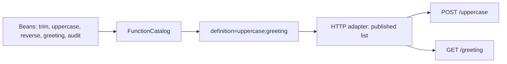

# Filtering Exposed Functions with a Semicolon-Separated List in Spring Cloud Function

## 1. Problem: Many Beans, but Only Some Should Become HTTP Endpoints

Spring Cloud Function (**SCF**) encourages writing business logic as Java beans of type `Supplier<O>`, `Function<I, O>`, and `Consumer<I>`. Beans can be registered in `FunctionCatalog` and reused across HTTP, Spring Cloud Stream events, or serverless environments without rewriting business logic.

When the **SCF HTTP adapter** is enabled, an application with multiple functional beans typically exposes them under paths matching their bean names:

```text
POST /uppercase
POST /reverse
POST /trim
GET  /greeting
POST /audit
```

In practice, however, not every bean should become a public HTTP endpoint. Steps like `trim` may belong only **inside a composition**, while `audit` may be called strictly internally. You want to keep them in the catalog for reuse while **exposing only designated endpoints**.

Spring Cloud Function supports this via a **semicolon-separated list of functions or compositions**:

```properties
spring.cloud.function.definition=uppercase;greeting
```

This line means: expose only `uppercase` and `greeting` through the HTTP adapter. The `;` delimiter does **not** mean “run uppercase then greeting.”

### Learning Objectives

After this lesson, you will be able to:

1. Distinguish between a bean existing in `FunctionCatalog` and being exposed as an HTTP endpoint.
2. Configure `spring.cloud.function.definition=foo;bar` to expose only a selected list.
3. Combine a composition with another function using `foo|bar;baz`.
4. Distinguish `;` (list filtering), `|` (composition), and `,` (convenient composition syntax in HTTP paths).
5. Explain why there is **no automatic root mapping** when `definition` contains multiple entries separated by `;`.
6. Test permitted and disallowed endpoints and understand the security limits of filtering.

## 2. Function Exposure Rules of the SCF HTTP Adapter

The official *Standalone Web Applications* documentation describes the following cases:

| State | Mapping rule | Example |
| --- | --- | --- |
| Only **one** functional bean | Name in URL is optional | Only `uppercase`: `POST /uppercase` and `POST /` |
| **Multiple** beans, no definition set | Functions are exposed by name | `POST /uppercase`, `POST /reverse` |
| **One** definition set | Can select a function or composition for the root path | `spring.cloud.function.definition=uppercase\|reverse` |
| **Multiple** items in definition via `;` | **Exposes only listed items**, does not auto-map root | `spring.cloud.function.definition=uppercase;greeting` |

“Exposing” here belongs to the **HTTP adapter**. Beans without corresponding HTTP endpoints can still live in the Spring application context and `FunctionCatalog`; other components in the application can still invoke them under their own contracts.



**Scope note:** `spring.cloud.function.definition` is a Spring Cloud Function property, not exclusive to the web module. Spring Cloud Stream and other integrations may also read it to decide which function to bind. When using multiple adapters in one application, evaluate the impact on each adapter.

## 3. Distinguishing Semicolon, Pipe, and Comma

This is the most important part of the lesson.

| Character | Example | Meaning |
| --- | --- | --- |
| `;` | `foo;bar` | Lists **two independent items** to expose |
| `\|` | `foo\|bar` | **Chains** `foo` then `bar` into one composition |
| `,` | `/foo,bar` | Convenient composition syntax in HTTP paths |

Several examples:

```properties
# One selected function:
spring.cloud.function.definition=uppercase

# One two-step composition:
spring.cloud.function.definition=trim|uppercase

# Two individual functions exposed:
spring.cloud.function.definition=trim;uppercase

# One composition + one Supplier exposed:
spring.cloud.function.definition=trim|uppercase;greeting

# Two compositions and one Supplier:
spring.cloud.function.definition=trim|uppercase;reverse|uppercase;greeting
```

These lines are **mutually alternative choices**, not settings to place together in the same file. In an actual configuration file, specify only one `spring.cloud.function.definition` line with your intended value.

### 3.1. Why Is `trim;uppercase` Not a Composition?

Suppose the input is `"  hello  "`:

- `trim|uppercase`: a single pipeline: `"  hello  "` → `"hello"` → `"HELLO"`.
- `trim;uppercase`: two independent endpoints; clients can call `/trim` or `/uppercase`, with **no automatic pipeline** between them.

If clients should only invoke the normalized chain, include `trim|uppercase` as a single **item** in the list and omit `trim`/`uppercase` as standalone endpoints.

### 3.2. Calling a Composition in HTTP Paths with a Comma

Even though `definition` uses `|`, prefer commas in URLs:

```text
POST /trim,uppercase
POST /reverse,uppercase
```

SCF also accepts pipes for composition, but pipes are awkward in shells and some HTTP clients/URL encoders. With `curl`, commas are easier to handle reliably.

### 3.3. Do Not Turn a `;`-Separated List into a URL Segment

The configuration:

```properties
spring.cloud.function.definition=trim|uppercase;greeting
```

does not create a single endpoint named `/trim,uppercase;greeting`. Instead, it exposes **two endpoints**:

```text
POST /trim,uppercase
GET  /greeting
```

There is no step invoking `greeting` after the `trim|uppercase` composition.

## 4. Illustrative Java Project

### 4.1. Dependencies

Use Spring Boot and a **compatible Spring Cloud BOM**. For an MVC application exposing functions over HTTP, add the Maven starter:

```xml
<dependency>
    <groupId>org.springframework.cloud</groupId>
    <artifactId>spring-cloud-starter-function-web</artifactId>
</dependency>
```

Do not pin an SCF version outside the BOM line. If choosing WebFlux, use the SCF module/starter matching your web runtime and version; HTTP tests must run against that exact runtime.

### 4.2. Declaring Six Beans

Create `src/main/java/demo/FunctionFilteringApplication.java`:

```java
package demo;

import java.util.Locale;
import java.util.function.Consumer;
import java.util.function.Function;
import java.util.function.Supplier;

import org.springframework.boot.SpringApplication;
import org.springframework.boot.autoconfigure.SpringBootApplication;
import org.springframework.context.annotation.Bean;

@SpringBootApplication
public class FunctionFilteringApplication {

    public static void main(String[] args) {
        SpringApplication.run(FunctionFilteringApplication.class, args);
    }

    @Bean
    public Function<String, String> trim() {
        return String::trim;
    }

    @Bean
    public Function<String, String> uppercase() {
        return value -> value.toUpperCase(Locale.ROOT);
    }

    @Bean
    public Function<String, String> reverse() {
        return value -> new StringBuilder(value).reverse().toString();
    }

    @Bean
    public Supplier<String> greeting() {
        return () -> "Hello from SCF";
    }

    @Bean
    public Consumer<String> audit() {
        return value -> System.out.println("AUDIT: " + value);
    }

    // Illustrative bean intended for internal use only.
    @Bean
    public Function<String, String> internalDecorate() {
        return value -> "[internal] " + value;
    }
}
```

Six beans exist in the application context. `internalDecorate` is a **harmless** example of a function not meant for HTTP export; it handles no secrets or sensitive data. All code remains reusable in event-driven or serverless runtimes through the respective adapters.

Start with:

```bash
mvn spring-boot:run
```

The `curl` examples follow Bash syntax with default server `http://localhost:8080`. If using PowerShell, call `curl.exe` and adjust line continuations accordingly.

## 5. Before Filtering: Which URLs Could Exist?

When `spring.cloud.function.definition` is unset and multiple functional beans exist, the SCF HTTP adapter exposes endpoints by bean name by default:

| Request | Bean invoked | Output/side effect |
| --- | --- | --- |
| `POST /uppercase` with body `hello` | `uppercase` | `HELLO` |
| `POST /trim` with body `"  hello  "` | `trim` | `hello` |
| `POST /reverse` with body `hello` | `reverse` | `olleh` |
| `GET /greeting` | `greeting` | `Hello from SCF` |
| `POST /audit` with body `event` | `audit` | Logs `AUDIT: event` |
| `POST /internalDecorate` with body `x` | `internalDecorate` | `[internal] x` |

This is why you must control the exposed HTTP surface: **adding a functional bean to the application can create a new endpoint** unless the adapter has appropriate restriction rules.

An application with multiple beans like this example does not automatically pick a function for `POST /` when no default definition is set.

## 6. Case A: Exposing Only Two Functions

In `src/main/resources/application.properties`, add:

```properties
spring.cloud.function.definition=uppercase;greeting
```

Restart the application. Two endpoints are exposed:

```bash
# Exposed: Function, returns HTTP 200 and HELLO.
curl -i -X POST 'http://localhost:8080/uppercase' \
  -H 'Content-Type: text/plain' \
  -H 'Accept: text/plain' \
  --data 'hello'

# Exposed: Supplier, returns HTTP 200 and greeting.
curl -i 'http://localhost:8080/greeting' \
  -H 'Accept: text/plain'
```

Compare with requests **not on the list**:

```bash
# Not exposed:
curl -i -X POST 'http://localhost:8080/reverse' \
  -H 'Content-Type: text/plain' --data 'hello'

# Not exposed:
curl -i -X POST 'http://localhost:8080/internalDecorate' \
  -H 'Content-Type: text/plain' --data 'hello'

# This composition is also not listed:
curl -i -X POST 'http://localhost:8080/uppercase,reverse' \
  -H 'Content-Type: text/plain' --data 'hello'
```

Under **Function Filtering rules**, unlisted functions or compositions are **not exported by the SCF HTTP adapter**. In the sample app with no other handlers, the HTTP status is typically `404 Not Found`. However, if the URL is handled by a custom controller, proxy rewrite, or another routing mechanism, the actual status may differ—verify with HTTP integration tests.

### 6.1. What About the Root Path?

`uppercase;greeting` is a list of **two items**. SCF does not treat the first item in the list as a default. Therefore:

```text
POST /uppercase  -> has an SCF route
GET  /greeting   -> has an SCF route
POST /           -> NO automatic root mapping
```

Do not rely on item ordering in a filtered list to pick a default function.

## 7. Case B: Exposing Only a Composition and a Supplier

Change the configuration to:

```properties
spring.cloud.function.definition=trim|uppercase;greeting
```

Here there are exactly **two exposed items**:

- Composition `trim|uppercase` at URL `/trim,uppercase`.
- Supplier `greeting` at URL `/greeting`.

Invoke the pipeline:

```bash
curl -i -X POST 'http://localhost:8080/trim,uppercase' \
  -H 'Content-Type: text/plain' \
  -H 'Accept: text/plain' \
  --data '  hello  '
# Business result: HELLO
```


Verification table:

| HTTP request | In the list? | Meaning |
| --- | --- | --- |
| `POST /trim,uppercase` | **Yes** | Runs `trim` then `uppercase` |
| `GET /greeting` | **Yes** | Generates greeting |
| `POST /trim` | No | Does not expose standalone `trim` |
| `POST /uppercase` | No | Does not expose standalone `uppercase` |
| `POST /reverse` | No | Does not expose `reverse` |
| `POST /uppercase,reverse` | No | This composition is also not exposed |
| `POST /internalDecorate` | No | Does not expose internal-use bean |
| `POST /` | No | Does not auto-create root mapping |

**Key point:** for `trim|uppercase` to run, both `trim` and `uppercase` beans must still exist in the catalog. Only **their standalone HTTP endpoints** are omitted from the published list.

### 7.1. Exposing Only Two Compositions

You can configure:

```properties
spring.cloud.function.definition=trim|uppercase;reverse|uppercase
```

Then two items exist:

```text
POST /trim,uppercase
POST /reverse,uppercase
```

Example:

```bash
curl -i -X POST 'http://localhost:8080/reverse,uppercase' \
  -H 'Content-Type: text/plain' \
  --data 'hello'
# hello -> olleh -> OLLEH
```

You do not need to declare another Java bean literally named `reverse,uppercase`; `FunctionCatalog` builds the composition from existing beans.

## 8. Single Definition vs. Multiple Definitions Have Different Root Behavior

These two configurations are **not equivalent**.

### Single Entry: Selecting a Default Composition

```properties
spring.cloud.function.definition=trim|uppercase
```

This string selects **one composition**. By SCF HTTP adapter rules, it can be called at the root URL:

```bash
curl -i -X POST 'http://localhost:8080/' \
  -H 'Content-Type: text/plain' \
  --data '  hello  '
# Result: HELLO
```

The documentation also notes **fallback** behavior when a function name cannot be resolved from the URL: if a single definition is selected, an unmatched path may also resolve to that definition. This is especially important when auditing unintended routes.

### Multiple Entries: Filtering Endpoints

```properties
spring.cloud.function.definition=trim|uppercase;greeting
```

This string lists **two items**. SCF's filtering rules:

1. Expose only the listed entries.
2. Do not expose remaining functions and compositions.
3. **Do not automatically map the root endpoint**.

### Prediction Matrix

Assuming the catalog contains all six beans from section 4:

| Definition | Typical exposed SCF endpoints | Root `/` |
| --- | --- | --- |
| Unset | Beans and compositions can be called by name | No single default |
| `uppercase` | Selects `uppercase` | Can invoke `uppercase` at root |
| `trim\|uppercase` | Selects composition | Can invoke `trim → uppercase` at root |
| `uppercase;greeting` | `/uppercase`, `/greeting` | **Not** auto-mapped |
| `trim\|uppercase;greeting` | `/trim,uppercase`, `/greeting` | **Not** auto-mapped |
| `trim\|uppercase;reverse\|uppercase` | Both listed compositions | **Not** auto-mapped |

This matrix describes the **HTTP adapter**, not a claim that no other URLs exist anywhere in the entire Spring Boot application.

## 9. Combining Filtering with `spring.cloud.function.web.path`

The `spring.cloud.function.web.path` property changes the **HTTP adapter's base path**. For example:

```properties
spring.cloud.function.web.path=/api/functions
spring.cloud.function.definition=trim|uppercase;greeting
```

HTTP clients must call:

```bash
curl -i -X POST \
  'http://localhost:8080/api/functions/trim,uppercase' \
  -H 'Content-Type: text/plain' \
  --data '  hello  '

curl -i 'http://localhost:8080/api/functions/greeting'
```

Path breakdown:

```text
/api/functions                 <- SCF adapter base path
/api/functions/trim,uppercase  <- exposed composition
/api/functions/greeting        <- exposed Supplier
```

Even with `web.path` set, a two-item filter **does not automatically create a root mapping at `/api/functions`**.

### Servlet Context Path

With Spring MVC, you can simultaneously configure:

```properties
server.servlet.context-path=/backend
spring.cloud.function.web.path=/api/functions
spring.cloud.function.definition=trim|uppercase;greeting
```

Clients calling the application directly then use:

```text
POST /backend/api/functions/trim,uppercase
GET  /backend/api/functions/greeting
```

If an API gateway or reverse proxy sits in front, public URLs depend on rewrite rules. Never repeat the same prefix across context path, SCF web path, and gateway if the gateway already handles part of it.

## 10. Configuration Sources and Shell Delimiter Pitfalls

Spring Boot allows configuring the same property in multiple ways. The examples below are **mutually alternative options**, not meant to be set simultaneously.

### `application.properties`

```properties
spring.cloud.function.definition=trim|uppercase;greeting
```

### `application.yml`

```yaml
spring:
  cloud:
    function:
      definition: "trim|uppercase;greeting"
```

This is **a single string**, not a YAML sequence. SCF splits entries by `;` itself.

### Environment Variables

```bash
export SPRING_CLOUD_FUNCTION_DEFINITION='trim|uppercase;greeting'
mvn spring-boot:run
```

In PowerShell:

```powershell
$env:SPRING_CLOUD_FUNCTION_DEFINITION = 'trim|uppercase;greeting'
mvn spring-boot:run
```

### Command-Line Argument

```bash
java -jar app.jar '--spring.cloud.function.definition=trim|uppercase;greeting'
```

`app.jar` is just an example of a built artifact. In many shells, `|` is a pipe operator and `;` is a command separator: quote **the entire argument** so the value reaches Spring Boot intact.

A command-line argument or environment variable can override the same key in a config file per Spring Boot's precedence order. When investigating discrepancies between local and production, always check the **effective value**.

## 11. Filtering Does Not Remove HTTP Method Rules

The `spring.cloud.function.definition` list determines **which functions/compositions are exposed**. HTTP methods and responses still depend on the function type:

| Exposed item | Type | Typical method | Typical success status |
| --- | --- | --- | --- |
| `uppercase` | Function | POST/PUT, or GET with path item | 200 OK |
| `greeting` | Supplier | GET | 200 OK |
| `audit` | Consumer | POST/PUT, DELETE | 202 (POST/PUT), 204 (DELETE) |
| `trim\|uppercase` | Function → Function | POST/PUT, or GET with path item | 200 OK |
| `greeting\|uppercase` | Supplier → Function | GET | 200 OK |
| `trim\|audit` | Function → Consumer | POST/PUT | 202 Accepted |

For example, if you configure:

```properties
spring.cloud.function.definition=greeting;trim|uppercase;trim|audit
```

then three endpoints can be exposed with their appropriate methods:

```text
GET  /greeting
POST /trim,uppercase
POST /trim,audit
```

Do not expect `trim|audit` to return a DTO created by the Consumer: `Consumer.accept()` returns `void`. An HTTP `202` also does not prove the event was durably persisted in a database or message broker.

### Method-Specific Mapping Is a Separate Feature

SCF also offers:

```properties
spring.cloud.function.http.GET=greeting
spring.cloud.function.http.POST=trim|uppercase;reverse
```

Here `;` continues to list multiple items and `|` represents composition, but these properties **select items per HTTP method**. Do not confuse them with the export list in `spring.cloud.function.definition`.

When combining routing configurations, test on the exact SCF version deployed. Having a composition in the catalog does not mean every HTTP method is exposed.

## 12. HTTP Filtering Is Not Exclusion from `FunctionCatalog`

Three mechanisms easily confused:

| Mechanism | Example | Meaning |
| --- | --- | --- |
| **HTTP export filtering** | `spring.cloud.function.definition=foo;bar` | Exposes a list of functions/compositions via the adapter |
| **Excluding beans from catalog candidates** | `spring.cloud.function.ineligible-definitions=bean1,bean2` | Excludes Java Function beans from becoming `FunctionCatalog` candidates |
| **Function routing** | `functionRouter` or routing expression | Picks the target function per instruction from properties/messages |

The first mechanism keeps internal beans available so compositions can use them. The second serves a different goal: excluding `trim` from the catalog altogether breaks looking up `trim|uppercase`. The third picks the execution target **per message or routing condition**, not as a default HTTP URL allowlist.

The *Programming Model* documentation also has a section called **Function Filtering**, describing how to build a "go/discard" route with a router. That is **not** the same as *Function Filtering rules* in **Standalone Web Applications**, where `;` restricts **which HTTP endpoints are exposed**.

## 13. Do Not Use Filtering as an Authorization Mechanism

Filtering narrows the HTTP surface exposed by the adapter, but **it does not replace authentication/authorization**.

Situations to account for:

- Beans hidden from the HTTP adapter can still be invoked internally by Java code or `FunctionCatalog`.
- A Spring MVC/WebFlux controller or API gateway may expose another route to the same business logic.
- An application using `functionRouter` may accept routing instructions via `MessageHeaders` when configuration allows it, and HTTP headers can be copied into message headers by the adapter.
- `spring.cloud.function.definition` can affect other adapters such as Spring Cloud Stream.
- A **single** `definition` has fallback behavior for unmatched URLs, unlike multi-item filtering.

For sensitive HTTP endpoints, you still need **Spring Security or an API gateway**, role/scope-based access rules, HTTP method restrictions, validation, logging, and payload limits. If clients are ever allowed to pass routing headers, audit carefully for unauthorized function invocation risks.

## 14. Testing Both Allowed and Disallowed Endpoints

Use the final configuration:

```properties
spring.cloud.function.web.path=/api/functions
spring.cloud.function.definition=trim|uppercase;greeting
```

Restart and call:

```bash
# 1. ALLOWED: composition, 200 + HELLO.
curl -i -X POST 'http://localhost:8080/api/functions/trim,uppercase' \
  -H 'Content-Type: text/plain' \
  -H 'Accept: text/plain' \
  --data '  hello  '

# 2. ALLOWED: Supplier, 200 + greeting.
curl -i 'http://localhost:8080/api/functions/greeting' \
  -H 'Accept: text/plain'

# 3. NOT EXPOSED: standalone trim.
curl -i -X POST 'http://localhost:8080/api/functions/trim' \
  -H 'Content-Type: text/plain' --data 'hello'

# 4. NOT EXPOSED: standalone uppercase.
curl -i -X POST 'http://localhost:8080/api/functions/uppercase' \
  -H 'Content-Type: text/plain' --data 'hello'

# 5. NOT EXPOSED: another composition.
curl -i -X POST 'http://localhost:8080/api/functions/uppercase,reverse' \
  -H 'Content-Type: text/plain' --data 'hello'

# 6. NO AUTOMATIC ROOT MAPPING.
curl -i -X POST 'http://localhost:8080/api/functions' \
  -H 'Content-Type: text/plain' --data 'hello'

# 7. NOT EXPOSED: internal bean.
curl -i -X POST 'http://localhost:8080/api/functions/internalDecorate' \
  -H 'Content-Type: text/plain' --data 'hello'
```

### Verification Matrix

| Case | Condition to verify | Typical status in sample app |
| --- | --- | --- |
| 1 | Composition executes in order, result `HELLO` | 200 |
| 2 | Supplier returns `Hello from SCF` | 200 |
| 3–4 | Individual beans are not exposed | Typically 404 |
| 5 | Unlisted composition is not exposed | Typically 404 |
| 6 | No automatic root mapping | Typically 404 |
| 7 | `internalDecorate` is not exposed | Typically 404 |

**A `404` result is expected when no other handler exists.** In systems with custom controllers, gateways, or additional routing, actual statuses may differ—also verify that internal logic is not triggered unexpectedly.

Quick status check:

```bash
curl -s -o /dev/null -w '%{http_code}\n' \
  -X POST 'http://localhost:8080/api/functions/uppercase' \
  -H 'Content-Type: text/plain' --data 'hello'
```

### Integration Tests Should Cover

1. Listed endpoints: right status, response `Content-Type`, body, and side effects.
2. Unlisted endpoints: not exposed by the adapter.
3. Unlisted compositions: not callable merely because component beans remain in the catalog.
4. No automatic root mapping when the list has multiple items.
5. Single-definition mode tested separately for root and fallback behavior.
6. `web.path` prefix, Servlet context path, and gateway rewrites do not leave old URLs exposed.
7. Routing-related HTTP headers do not allow invoking unauthorized functions.
8. Effective configuration matches across every profile/deployment.

Tests calling `uppercase.apply()` directly do not prove HTTP filtering works. Write HTTP integration tests using `MockMvc`, `WebTestClient`, or a real HTTP client suited to your chosen stack.

## 15. Configuration Mistakes and Fixes

| Symptom | Common cause | Fix |
| --- | --- | --- |
| Wanted composition, got two separate endpoints | Used `trim;uppercase` | Use `trim\|uppercase` |
| Calling `POST /` fails | Definition has multiple items with `;` | Call a listed name or design an explicit root route |
| Calling `/trim` returns 404 even though bean exists | Only `trim\|uppercase` is exposed | Add `;trim` if standalone `trim` should truly be exposed |
| `/trim,uppercase` fails | Wrong bean name, not listed, or conversion failure | Check definition, names, and I/O types |
| Unlisted function name is still reachable | Property ineffective, another route, fallback, or router | Inspect runtime config, controllers, gateway, and headers |
| CLI startup fails with `;` or `\|` | Shell splits or pipes the command | Quote the entire argument |
| Extra `;` present | Empty definition item | Remove extra delimiters and verify config string |
| New URL returns 404 | Forgot `web.path` or context path | Compare against the actual backend URL |
| Unexpected function appears after deployment | Environment/profile overrides definition | Check effective property sources |
| Event flow breaks after changing definition | `definition` is shared with another integration | Test Spring Cloud Stream separately |
| Bean missing from catalog breaks composition | Confused `ineligible-definitions` with HTTP filtering | Keep the bean in the catalog if compositions need it |
| Mistook filtering for security | Missing authorization layer | Enforce policies at the gateway/Spring Security |

### Diagnostic Procedure

1. Confirm the **names and types** of all functional beans.
2. Identify which items are exposed standalone and which are compositions.
3. Build the exact `spring.cloud.function.definition` string with `;` and `|`.
4. Verify the effective runtime config, not just the file value.
5. Account for `spring.cloud.function.web.path`, context path, and gateway rewrites.
6. Send `curl -i` to both allowed and disallowed URLs.
7. Check all other routing/security mechanisms before concluding an endpoint is locked down.

## 16. Practice Exercises

1. A catalog has `uppercase`, `reverse`, `greeting`, and `audit`. With `definition=uppercase;greeting`, which endpoints does the SCF HTTP adapter expose?
2. Why does `definition=trim;uppercase` not create the composition `trim → uppercase`?
3. Write a definition exposing only `trim|uppercase` and `greeting`, without exposing `trim` or `uppercase` individually.
4. With `definition=trim|uppercase;reverse|uppercase`, write both URLs and compute the output for input `hello`.
5. Why does filtering with two items not auto-create a root mapping?
6. After setting `spring.cloud.function.web.path=/v1/functions`, what is the URL for `trim|uppercase`?
7. Why can a bean hidden from the HTTP adapter still be looked up in the catalog by other Java code?
8. Compare `spring.cloud.function.ineligible-definitions` with listing endpoints via `spring.cloud.function.definition`.
9. Write `curl` commands proving `/trim,uppercase` is exposed while `/trim` is not.
10. A gateway routes to a custom controller that calls `internalDecorate` directly. Is HTTP filtering enough to block access to that logic?
11. Why must `trim|uppercase;greeting` be quoted when set in Bash, PowerShell, or as a command-line argument?
12. If the same application uses Spring Cloud Stream, what should you test when changing `spring.cloud.function.definition`?

## References

- [Spring Cloud Function — Standalone Web Applications](https://docs.spring.io/spring-cloud-function/reference/spring-cloud-function/standalone-web-applications.html): *Function Mapping rules*, *Function Filtering rules*, `foo;bar`, `foo|bar;baz`, and root mapping.
- [Spring Cloud Function — Programming Model](https://docs.spring.io/spring-cloud-function/reference/spring-cloud-function/programming-model.html): `FunctionCatalog`, composition, `ineligible-definitions`, routing, and the global scope of `definition`.
- [Spring Boot — Externalized Configuration](https://docs.spring.io/spring-boot/reference/features/external-config.html): configuring `application.properties`, YAML, environment variables, and command-line arguments.
- [Spring Security — Authorize HTTP Requests](https://docs.spring.io/spring-security/reference/servlet/authorization/authorize-http-requests.html): securing requests with authorization instead of treating endpoint lists as a security policy.

> **Remember:** `spring.cloud.function.definition=foo;bar` exposes **two functions**; `foo|bar;baz` exposes **one composition and one function**. `;` **separates list entries**, while `|` **chains functions**. In multi-item filtering mode, the SCF HTTP adapter **does not automatically map root** and **does not expose** unlisted functions or compositions. This is an HTTP export management mechanism, not a substitute for security and authorization.
