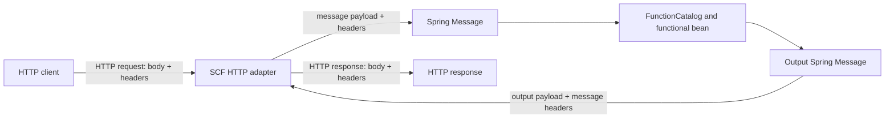

# Propagating and Ignoring HTTP Headers in Spring Cloud Function Responses

## 1. Problem: HTTP Responses Sometimes Carry Headers from the Request

**Spring Cloud Function (SCF)** lets you build reusable business logic with `Supplier<O>`, `Function<I, O>`, and `Consumer<I>`. These beans are placed in `FunctionCatalog` for invocation over HTTP, event systems, or serverless runtimes without coupling business logic to a specific protocol.

When exposing beans via the **SCF HTTP adapter**, an incoming request carries not only a body, but also **HTTP headers**. For example:

```http
POST /uppercase HTTP/1.1
Host: localhost:8080
Content-Type: text/plain
Accept: text/plain
X-Demo-Client: mobile-app
X-Demo-Trace: req-100

hello
```

A client might expect the response to contain only `HELLO`, yet response headers also depend on the HTTP adapter. Spring Cloud Function's **Standalone Web Applications** documentation states that **by default, most request HTTP headers are copied to response HTTP headers**. Applications sometimes need to preserve certain headers for tracing, yet **should not echo unnecessary or sensitive headers**.

SCF provides the property:

```properties
spring.cloud.function.http.ignored-headers=X-Demo-Client,X-Demo-Secret
```

This property lets you configure a **comma-separated list of request header names to skip when the HTTP adapter propagates headers to the response**. That is the focus of this lesson.

On the other hand, if a function accepts or returns `Message<T>`, it can also **read message headers and explicitly construct output message headers**. The HTTP adapter can translate output message headers into HTTP response headers.

### Learning Objectives

After this lesson, you will be able to:

1. Trace how HTTP request headers flow through the SCF HTTP adapter and `FunctionCatalog`.
2. Distinguish **copying HTTP request headers to the response** from **forwarding Spring Messaging headers across functions**.
3. Write `Function<Message<String>, Message<String>>` to read input metadata and intentionally emit response headers.
4. Use `spring.cloud.function.http.ignored-headers` with a comma-separated list.
5. Verify header presence or absence in responses using `curl -i` and `curl -D -`.
6. Identify risks involving `Authorization`, `Cookie`, routing headers, CORS, proxies, and HTTP-managed headers.

## 2. Three Header Layers in a Single SCF HTTP Call

To avoid confusion, consider three data layers:



There are three groups of information to examine:

| Group | Examples | Who is responsible? |
| --- | --- | --- |
| **Request HTTP headers** | `Content-Type`, `Accept`, `X-Demo-Trace` | Sent by client and received by HTTP adapter |
| **Spring `MessageHeaders`** | `contentType`, `X-Demo-Trace`, `http_request_param` | Adapter populates metadata for the function; function can read via `Message<T>` |
| **Response HTTP headers** | `Content-Type`, `X-Demo-Processed`, `Cache-Control` | SCF web adapter, output Message, web framework, security, and proxies may all contribute |

**Not every HTTP header is business data.** Some headers serve content negotiation, framing, connection management, or security. Servlet containers, MVC/WebFlux, and reverse proxies may add, modify, or strip headers while constructing the response.

### 2.1. Two Separate Propagation Flows

SCF documentation describes **two independent mechanisms**:

- **HTTP-level propagation:** by default, most request `HttpHeaders` are copied to response `HttpHeaders`. The `spring.cloud.function.http.ignored-headers` property controls which headers are excluded from this mechanism.
- **Function/message-level propagation:** a function accepting `Message<I>` can read headers; a function returning `Message<O>` can carry headers that the adapter writes to the HTTP response. In the pure catalog model, input Message headers are not automatically preserved across every function's output.

Thus, **removing a header from the HTTP adapter's default copy list does not prove another Java component cannot explicitly emit that header in an output `Message`**. To tightly control responses, verify both the application layer and web/security/gateway layers.

## 3. Default Behavior: Most Request Headers May Be Echoed

With a very simple bean:

```java
@Bean
public Function<String, String> uppercase() {
    return value -> value.toUpperCase(Locale.ROOT);
}
```

Call:

```bash
curl -i -X POST 'http://localhost:8080/uppercase' \
  -H 'Content-Type: text/plain' \
  -H 'Accept: text/plain' \
  -H 'X-Demo-Client: mobile-app' \
  -H 'X-Demo-Trace: req-100' \
  --data 'hello'
```

Typical business response:

```http
HTTP/1.1 200 OK
Content-Type: text/plain

HELLO
```

**The snippet above shows only the body and primary media type**, not the full list of response headers. Per SCF, certain request headers—including custom headers—may appear in the response via default propagation. Which headers actually appear depends on the SCF version, web runtime, filters, and proxies.

What to observe:

- Does `X-Demo-Client` appear in the **response** or only in the request?
- Is `X-Demo-Trace` echoed?
- Does `Content-Type` reflect the actual response type rather than being mistaken for an unconditional copy from the request?
- Did Spring Security, the servlet container, or a gateway add extra headers?

### Do Not Claim Every Header Is Copied

The documentation says **“most”**, not all. Headers tied to protocol framing, cookies, connections, or content length may receive special framework treatment. Never write tests requiring every request header to appear in the response.

Examples:

| Request header | Typical purpose | Should it be echoed to response by default? |
| --- | --- | --- |
| `X-Demo-Trace` | Correlation/tracing | May be useful, but validate its content |
| `X-Demo-Client` | Client metadata | Only if explicitly required by the API |
| `Authorization` | Request authentication | **Never** echo tokens |
| `Cookie` | Client-sent credentials/session | **Never** copy verbatim to response |
| `Content-Type` | Describes request body | Response needs the media type of the **response body** |
| `Content-Length` | Body size | HTTP runtime must compute accurately, never copy blindly |
| `Connection` | Connection management | Connection/hop-by-hop header; not business metadata |
| `Host` | Request authority/host | No general business reason to echo |

**Conclusion:** default propagation is an adapter convenience, **not a security policy**, and does not replace an API's response-header specification.

## 4. Ignoring Headers via `spring.cloud.function.http.ignored-headers`

This is the official property documented in SCF's **Http Headers propagation** section:

```properties
spring.cloud.function.http.ignored-headers=foo,bar
```

The list is **comma-separated**. More clearly illustrated:

```properties
spring.cloud.function.http.ignored-headers=X-Demo-Client,X-Demo-Secret
```

At the HTTP adapter level, this configuration instructs it **not to echo the two named request headers** via default copying.

### 4.1. What This Property Does

1. Targets **SCF HTTP adapter header propagation**.
2. Accepts one or more header names separated by `,`.
3. Prevents **unnecessary** custom request headers from leaking into responses.
4. Serves as one layer to **reduce accidental metadata leakage** once headers to exclude are identified.

### 4.2. What This Property Does Not Guarantee by Itself

- **Does not** strip the request header before a bean reads it via `MessageHeaders`.
- **Does not** automatically delete a response header **explicitly set by the function itself** in an output `Message<?>` if the adapter's path does not re-filter at that step—verify by testing.
- **Does not** stop another filter, controller, Spring Security, or gateway from adding the same header to the response.
- **Does not** configure header forwarding for Spring Cloud Stream, Kafka/Rabbit, or serverless adapters.
- **Does not** replace policies stripping tokens, cookies, session IDs, and internal headers at security boundaries.
- **Does not** alter HTTP methods or select functions in `FunctionCatalog`.

### 4.3. Distinguishing Commas from Other SCF Delimiters

| Property | Illustrative value | Delimiter and purpose |
| --- | --- | --- |
| `spring.cloud.function.http.ignored-headers` | `X-Demo-Client,X-Demo-Secret` | **Comma** lists **header names to ignore** |
| `spring.cloud.function.definition` | `normalize\|uppercase;greeting` | `;` lists functions/compositions; `\|` composes |
| `spring.cloud.function.http.POST` | `normalize\|uppercase;quote` | Method-specific list and composition |
| `spring.cloud.function.web.path` | `/api/functions` | URL prefix, unrelated to header lists |

**Common mistake:** writing `ignored-headers=foo;bar` out of habit from function filtering's semicolon syntax. For `ignored-headers`, the documentation specifies **commas**.

### 4.4. Is It Case-Sensitive?

Under HTTP semantics, **field names are case-insensitive**. However, concrete implementations may apply normalization rules when populating `MessageHeaders`. In practice, keep header casing consistent across requests and configuration, and test on your exact SCF/web version. Do not treat casing differences in `curl -i` output as evidence that filtering failed.

## 5. Practice Project: Functions With and Without Message Headers

The example uses **Java 17+**, Spring Boot, and a Spring Cloud BOM compatible with the SCF HTTP adapter. For a Spring MVC application, Maven needs:

```xml
<dependency>
    <groupId>org.springframework.cloud</groupId>
    <artifactId>spring-cloud-starter-function-web</artifactId>
</dependency>
```

Do not pin an arbitrary version if the project imports the Spring Cloud BOM. If using WebFlux or another release train, choose a compatible web adapter and verify behavior on the real runtime.

Create `src/main/java/demo/HttpHeadersApplication.java`:

```java
package demo;

import java.util.List;
import java.util.Locale;
import java.util.Map;
import java.util.Optional;
import java.util.function.Consumer;
import java.util.function.Function;
import java.util.function.Supplier;

import org.springframework.boot.SpringApplication;
import org.springframework.boot.autoconfigure.SpringBootApplication;
import org.springframework.context.annotation.Bean;
import org.springframework.messaging.Message;
import org.springframework.messaging.support.MessageBuilder;

@SpringBootApplication
public class HttpHeadersApplication {

    public static void main(String[] args) {
        SpringApplication.run(HttpHeadersApplication.class, args);
    }

    // Does not interact directly with MessageHeaders.
    @Bean
    public Function<String, String> uppercase() {
        return value -> value.toUpperCase(Locale.ROOT);
    }

    // Reads one client header and explicitly sets two output Message headers.
    @Bean
    public Function<Message<String>, Message<String>> annotate() {
        return message -> {
            String trace = findHeader(message, "X-Demo-Trace")
                    .filter(value -> value.matches(
                            "[A-Za-z0-9_-]{1,48}"))
                    .orElse("not-provided");

            String result = message.getPayload()
                    .toUpperCase(Locale.ROOT);

            return MessageBuilder.withPayload(result)
                    .setHeader("X-Demo-Processed", "true")
                    .setHeader("X-Demo-Trace", trace)
                    .build();
        };
    }

    // GET Supplier: no request body needed.
    @Bean
    public Supplier<String> banner() {
        return () -> "SCF HTTP header demo";
    }

    // POST Consumer: processes input, produces no business result.
    @Bean
    public Consumer<String> audit() {
        return value ->
                System.out.println("Audit received: " + value);
    }

    /**
     * Defensively reads a custom header from MessageHeaders.
     * Some adapters store headers as String, String[], or List.
     */
    private static Optional<String> findHeader(
            Message<?> message, String name) {

        for (Map.Entry<String, Object> entry
                : message.getHeaders().entrySet()) {

            if (!entry.getKey().equalsIgnoreCase(name)) {
                continue;
            }

            Object value = entry.getValue();

            if (value instanceof String text) {
                return Optional.of(text);
            }

            if (value instanceof String[] items
                    && items.length == 1
                    && items[0] != null) {
                return Optional.of(items[0]);
            }

            if (value instanceof List<?> items
                    && items.size() == 1
                    && items.get(0) instanceof String text) {
                return Optional.of(text);
            }
        }

        return Optional.empty();
    }
}
```

In this example:

- `uppercase` takes `String` and returns `String`: business logic is unaware of headers.
- `annotate` accepts `Message<String>` and reads request metadata placed into message headers by the HTTP adapter.
- `annotate` **does not copy all input headers** to the output Message; it selectively picks a validated `X-Demo-Trace` and creates `X-Demo-Processed`.
- `banner` illustrates a GET Supplier; `audit` illustrates a POST Consumer.
- `findHeader` uses case-insensitive name comparison and only accepts an unambiguous single value. When the value has multiple elements or another type, it returns `Optional.empty()`.
- The trace regex is purely **illustrative validation** to avoid echoing arbitrary strings; it is not a universal standard for correlation IDs.

Run:

```bash
mvn spring-boot:run
```

The `curl` examples use Bash syntax and assume the server runs at `http://localhost:8080`. In PowerShell, use `curl.exe` and appropriate line continuations.

## 6. Step 1: Observing Behavior Without `ignored-headers`

First, **do not add** `spring.cloud.function.http.ignored-headers` yet.

### 6.1. Sending Custom Headers to `Function<String, String>`

```bash
curl -i -X POST 'http://localhost:8080/uppercase' \
  -H 'Content-Type: text/plain' \
  -H 'Accept: text/plain' \
  -H 'X-Demo-Client: mobile-app' \
  -H 'X-Demo-Secret: example-only-not-a-real-secret' \
  --data 'hello'
```

Expected business body:

```text
HELLO
```

Observe the **response headers**. SCF may copy `X-Demo-Client` and `X-Demo-Secret` via default propagation. Some headers may be retained or stripped by the web runtime or middleware; the goal here is to **record a baseline**, not hardcode the entire response header set.

**Never send real tokens or secrets in exercises.** The string containing “Secret” here is purely dummy data to test propagation behavior.

### 6.2. Calling a Function Returning `Message<String>`

```bash
curl -i -X POST 'http://localhost:8080/annotate' \
  -H 'Content-Type: text/plain' \
  -H 'Accept: text/plain' \
  -H 'X-Demo-Trace: req-100' \
  -H 'X-Demo-Client: mobile-app' \
  --data 'hello'
```

The expected business response has body:

```text
HELLO
```

In the response headers, look for:

```text
X-Demo-Processed: true
X-Demo-Trace: req-100
```

These two headers originate from the **output Message created by the function**. If `X-Demo-Trace` does not appear as expected, first inspect the input message header's type/naming and how the adapter translates output headers to HTTP, before blaming the regex or Java lambda.

**Note:** `X-Demo-Client` may still appear in the response due to HTTP-level request header copying, even though the output Message did **not** copy it.

### 6.3. Do Not Confuse Response Headers with curl's Request Headers

`curl -i` prints **response status + response headers + body**. With `curl -v`, the client also prints **request headers** and connection details; distinguish outgoing `>` lines from incoming `<` lines in verbose output.

In real environments, avoid `curl -v` when `Authorization` or sensitive cookies are present, as terminal logs and CI output collectors may capture credentials.

## 7. Step 2: Configuring Ignored Request Headers for Responses

Add to `src/main/resources/application.properties`:

```properties
spring.cloud.function.http.ignored-headers=X-Demo-Client,X-Demo-Secret
```

Restart the application so the property takes effect. Re-send the **exact same request** from section 6:

```bash
curl -i -X POST 'http://localhost:8080/uppercase' \
  -H 'Content-Type: text/plain' \
  -H 'Accept: text/plain' \
  -H 'X-Demo-Client: mobile-app' \
  -H 'X-Demo-Secret: example-only-not-a-real-secret' \
  --data 'hello'
```

Verify:

1. The HTTP response still has body `HELLO`.
2. Request headers `X-Demo-Client` and `X-Demo-Secret` are no longer copied to the response by default propagation.
3. Required HTTP response headers (such as `Content-Type`) are still emitted properly by the web runtime.
4. If an “ignored” header still shows up, check whether a function, filter, or proxy **explicitly creates** it after SCF's filter runs.

### Before and After Comparison

| Case | Before setting property | After setting property |
| --- | --- | --- |
| Response body of `uppercase` | `HELLO` | `HELLO` |
| `X-Demo-Client` from request | May be copied | Excluded from default copying |
| `X-Demo-Secret` from request | May be copied | Excluded from default copying |
| `X-Demo-Processed` created by `annotate` | Absent on `uppercase` | Absent on `uppercase` |
| Response `Content-Type` | Matches body/codec | Still matches body/codec |
| Authorization and security | Requires separate configuration | **Still requires separate configuration** |

### Testing Headers Only Without Printing the Body

```bash
curl -s -D - -o /dev/null -X POST \
  'http://localhost:8080/uppercase' \
  -H 'Content-Type: text/plain' \
  -H 'Accept: text/plain' \
  -H 'X-Demo-Client: mobile-app' \
  -H 'X-Demo-Secret: example-only-not-a-real-secret' \
  --data 'hello'
```

Here:

- `-D -`: prints response headers to stdout.
- `-o /dev/null`: discards the response body.
- `-s`: suppresses curl's progress meter.

On Windows, `/dev/null` may not behave like Unix; use an appropriate null sink (such as `NUL` in CMD) or simply use `curl.exe -i` to inspect status, headers, and body.

## 8. Step 3: Output Message Headers Still Serve Their Own Role

Keep the property:

```properties
spring.cloud.function.http.ignored-headers=X-Demo-Client,X-Demo-Secret
```

Call `annotate`:

```bash
curl -i -X POST 'http://localhost:8080/annotate' \
  -H 'Content-Type: text/plain' \
  -H 'Accept: text/plain' \
  -H 'X-Demo-Trace: req-100' \
  -H 'X-Demo-Client: mobile-app' \
  -H 'X-Demo-Secret: example-only-not-a-real-secret' \
  --data 'hello'
```

Expected **per the example's contract**:

- Payload `HELLO`.
- Output Message sets `X-Demo-Processed: true`.
- Output Message sets `X-Demo-Trace: req-100` if the input header has a valid type/value; otherwise `not-provided`.
- `X-Demo-Client` and `X-Demo-Secret` are **not copied by default** via HTTP propagation.

Do not assume `ignored-headers` strips **every** header of that name regardless of where it was created. If a function explicitly does:

```java
return MessageBuilder.withPayload("HELLO")
        .setHeader("X-Demo-Secret", "created-by-function")
        .build();
```

that is a **new output Message header**. Verify whether it reaches the response or is stripped by another step in your actual runtime. To guarantee a header is never emitted externally, enforce policy at the **HTTP response boundary** and test end-to-end.

### 8.1. Why Should You Avoid Copying All Headers in Code?

The pattern below easily leaks metadata:

```java
// Only to illustrate risk: DO NOT use blindly.
return MessageBuilder.withPayload("HELLO")
        .copyHeaders(message.getHeaders())
        .build();
```

If input contains tokens, routing headers, session info, or internal headers, copying everything can carry those values into the output Message, event adapters, or HTTP response.

A safer approach is **need-based allowlisting**:

```java
return MessageBuilder.withPayload("HELLO")
        .setHeader("X-Demo-Processed", "true")
        .build();
```

If you need to preserve a correlation ID, obtain it from a trusted source and validate its format and length before echoing.

## 9. Distinguishing HTTP `ignored-headers` from `FunctionCatalog` `copy-input-headers`

SCF's **Programming Model** documentation also describes copying **input Spring Messaging headers** to output:

```properties
spring.cloud.function.configuration.uppercase.copy-input-headers=true
```

These two properties are **not equivalent**:

| Property | Operating layer | Meaning |
| --- | --- | --- |
| `spring.cloud.function.http.ignored-headers` | **HTTP web adapter** | Skips copying specified request HTTP headers to response HTTP headers during default propagation |
| `spring.cloud.function.configuration.<function>.copy-input-headers` | **SCF FunctionCatalog/function wrapper** | When enabled for a compatible function, can copy input **Message headers** to the function's output Message |

### 9.1. Why Distinguish Them?

Consider the flow:

```text
HTTP request
  |
  +--> HTTP headers --------> HTTP adapter propagation --------> HTTP response
  |
  +--> Message headers -----> FunctionCatalog + function ------> output Message
                                                                     |
                                                                     v
                                                                HTTP response
```

There can be **two paths** carrying headers to the response. If you enable input Message header copying while also setting `ignored-headers`, test the combined outcome; do not assume one property cancels all effects of the other.

### 9.2. When Using Composition

Suppose:

```properties
spring.cloud.function.definition=normalize|uppercase
```

In a composition, the output of `normalize` becomes the input to `uppercase`. Spring Messaging headers **may be preserved, augmented, or altered** depending on function signatures, wrapper conversions, and header-propagation settings.

Do not assume an HTTP request carrying `X-Demo-Trace` means every step in the pipeline automatically receives it. If business logic needs an end-to-end correlation ID:

1. Define where the correlation ID is generated and trusted.
2. Pass only genuinely required metadata via `Message` or a business DTO.
3. Avoid forwarding credentials like `Authorization` across steps that do not need them.
4. Write composition tests over both HTTP and event adapters when shared.

## 10. Which HTTP Headers Should a Function Explicitly Create?

An API may require response headers in addition to the body. Common choices:

| Response header | When to use | Notes |
| --- | --- | --- |
| `X-Demo-Processed` | Illustrative flag indicating processing succeeded | Does not replace HTTP status |
| `X-Request-ID` | Correlation/tracing if standardized by the system | Validate/trust ID; avoid conflicting with the tracing layer |
| `Cache-Control` | API caching rules | Usually set at web/security/gateway layer per contract |
| `Location` | Newly created resource, typically paired with an appropriate status | Default SCF functions do not automatically yield `201 Created` |
| `ETag` | Caching and conditional requests | Must compute and handle `If-None-Match`/`If-Match` properly |
| `Content-Type` | Media type of the **response body** | Let codec/web runtime determine or set carefully |
| `Vary` | Representation varies by request headers | Design consistently with caches/CDNs |
| `Access-Control-Expose-Headers` | Allows browser JavaScript to read specific custom response headers | CORS policy must be configured at the web layer |
| `Set-Cookie` | Server sets a cookie | Never construct by echoing the request `Cookie` header |

Never use an output Message to arbitrarily overwrite `Content-Length`, `Transfer-Encoding`, `Connection`, or framing/hop-by-hop headers. The Spring web runtime and proxies must manage those to keep responses valid.

### 10.1. `Content-Type` and `Accept` Still Have Distinct Roles

Call:

```bash
curl -i -X POST 'http://localhost:8080/annotate' \
  -H 'Content-Type: text/plain' \
  -H 'Accept: text/plain' \
  --data 'hello'
```

- Request `Content-Type` describes the body the client **sends**.
- `Accept` describes the response format the client **wants to receive**.
- Response `Content-Type` describes the body the server **actually returns**.

Do not use `ignored-headers` to solve JSON conversion errors, content negotiation issues, `406 Not Acceptable`, or `415 Unsupported Media Type`; those are separate concerns.

### 10.2. Consumer and `204 No Content`

When calling `POST /audit`, the SCF HTTP adapter typically returns `202 Accepted` and may echo input data. When invoking a Consumer via `DELETE`, status is typically `204 No Content`.

**204 has no response body**, yet HTTP responses can still carry valid headers. Do not expect a Consumer to construct an output Message with a body; `Consumer.accept()` returns `void`. If an API needs specialized business response headers/statuses, design an explicit HTTP boundary instead of relying solely on default mapping.

## 11. CORS and Browsers: Seeing a Header in curl Does Not Mean JavaScript Can Read It

Suppose `curl -i` shows:

```http
X-Demo-Processed: true
```

A browser `fetch()` calling a **cross-origin** API may still block JavaScript from reading that header unless the CORS policy lists it as an **exposed response header**.

Conceptual example:

```http
Access-Control-Expose-Headers: X-Demo-Processed, X-Demo-Trace
```

**This is not an SCF `ignored-headers` property.** CORS must be configured in Spring MVC/WebFlux, Spring Security, or the gateway, covering allowed origins, methods, request headers, and credentials. Never set `Access-Control-Allow-Origin: *` blindly for APIs using cookies/credentials.

Remember to distinguish:

- `X-Demo-Processed` is present on the actual HTTP response.
- The browser permits JavaScript to read `X-Demo-Processed`.
- The user is authorized to invoke the API operation.

Those are three **separate** questions.

## 12. Security Risks: Never Echo Credentials or Routing Headers

Following HTTP security principles, these headers require careful control:

- `Authorization`, `Proxy-Authorization`, and `Cookie`: may carry credentials or session tokens.
- `X-API-Key`, `X-Internal-Token`: custom names that may carry secrets depending on the system.
- Client-supplied tenant/user/role headers: **must never be treated as proof of access** without authentication and verification by the gateway/security layer.
- `spring.cloud.function.definition` and `spring.cloud.function.routing-expression`: in certain SCF setups, headers can influence `functionRouter` and execution targets.

The **Programming Model** documentation notes that the HTTP adapter can convert the `spring.cloud.function.definition` header into a Message header; routing expressions arriving via message headers run in a more restricted evaluation context than property-defined expressions. Even so, **restricted evaluation does not replace authorization**.

### Defensive Rules

1. **Never echo secrets** into responses. Define headers to strip at the web/server/gateway layer; `ignored-headers` is only one piece.
2. **Never let clients pick sensitive functions** via routing headers unless the architecture enforces strict allowlists and authorization.
3. **Never copy all input `MessageHeaders`** when you only need a correlation ID.
4. **Never log raw header maps** when they can contain tokens, cookies, or personal data.
5. **Never assume** an unexposed URL is completely unreachable through another controller, event adapter, or router.
6. **Verify the final response** after servlet filters, reverse proxies, API gateways, and CDNs.

## 13. Configuring `ignored-headers` Across Environments

The forms below are **equivalent in intent** and should not be declared simultaneously.

### 13.1. `application.properties`

```properties
spring.cloud.function.http.ignored-headers=X-Demo-Client,X-Demo-Secret
```

### 13.2. `application.yml`

```yaml
spring:
  cloud:
    function:
      http:
        ignored-headers: X-Demo-Client,X-Demo-Secret
```

Or quote it to emphasize that it is a string:

```yaml
spring:
  cloud:
    function:
      http:
        ignored-headers: "X-Demo-Client,X-Demo-Secret"
```

### 13.3. Environment Variables

In Bash:

```bash
export SPRING_CLOUD_FUNCTION_HTTP_IGNORED_HEADERS='X-Demo-Client,X-Demo-Secret'
mvn spring-boot:run
```

In PowerShell:

```powershell
$env:SPRING_CLOUD_FUNCTION_HTTP_IGNORED_HEADERS = 'X-Demo-Client,X-Demo-Secret'
mvn spring-boot:run
```

Environment variable resolution follows Spring Boot's relaxed binding; verify the effective property on your running version.

### 13.4. Command-Line Arguments

```bash
java -jar app.jar \
  '--spring.cloud.function.http.ignored-headers=X-Demo-Client,X-Demo-Secret'
```

`app.jar` is an illustrative artifact name. When multiple sources define the same property, **Spring Boot's externalized configuration precedence** determines the effective value. If editing a file leaves responses unchanged, check overriding environment variables, active profiles, and CLI arguments.

### 13.5. Do Not Confuse with HTTP Method Mapping

Both properties share the `spring.cloud.function.http` prefix, yet:

```properties
spring.cloud.function.http.POST=uppercase
spring.cloud.function.http.ignored-headers=X-Demo-Client
```

- The `POST` line selects functions/compositions for the HTTP method.
- The `ignored-headers` line names request headers excluded from propagation.

Setting both does not mean header filtering controls whether POST is allowed.

## 14. Test Matrix: With/Without Headers and Multiple Response Paths

With section 5's application, set:

```properties
spring.cloud.function.http.ignored-headers=X-Demo-Client,X-Demo-Secret
```

Then run these test cases.

| Case | Request | What to prove |
| --- | --- | --- |
| A | POST `/uppercase` with `X-Demo-Client`, `X-Demo-Secret` | Neither ignored header is copied by default |
| B | POST `/uppercase` with no custom headers | `HELLO` business logic does not depend on metadata |
| C | POST `/annotate` with `X-Demo-Trace: req-100` | Output Message sets `X-Demo-Processed` and valid trace |
| D | POST `/annotate` with malformed trace | Function uses fallback `not-provided` |
| E | POST `/annotate` with `X-Demo-Secret` | Dummy secret is not copied by default |
| F | GET `/banner` with custom headers | Observe header propagation on Supplier |
| G | POST `/audit` with custom headers | Verify 202 and headers without assuming durable persistence |
| H | DELETE `/audit` | Verify 204, no response body |
| I | Test through gateway/proxy | Inspect final response after intermediate layers |

### 14.1. Quick Verification Commands

```bash
# A. Ignored headers on response propagation.
curl -i -X POST 'http://localhost:8080/uppercase' \
  -H 'Content-Type: text/plain' \
  -H 'Accept: text/plain' \
  -H 'X-Demo-Client: mobile-app' \
  -H 'X-Demo-Secret: example-only-not-a-real-secret' \
  --data 'hello'

# C. Output Message explicitly adds response headers.
curl -i -X POST 'http://localhost:8080/annotate' \
  -H 'Content-Type: text/plain' \
  -H 'Accept: text/plain' \
  -H 'X-Demo-Trace: req-100' \
  --data 'hello'

# D. Invalid trace: falls back without echoing arbitrary characters.
curl -i -X POST 'http://localhost:8080/annotate' \
  -H 'Content-Type: text/plain' \
  -H 'X-Demo-Trace: invalid trace with spaces' \
  --data 'hello'

# F. Supplier and header propagation.
curl -i 'http://localhost:8080/banner' \
  -H 'Accept: text/plain' \
  -H 'X-Demo-Client: mobile-app'

# G. Consumer and HTTP 202.
curl -i -X POST 'http://localhost:8080/audit' \
  -H 'Content-Type: text/plain' \
  -H 'X-Demo-Client: mobile-app' \
  --data 'event-100'
```

### 14.2. What Should Integration Tests Assert?

- **Logic:** status and response body match the function.
- **Header filtering:** listed headers are not copied from request to response by the adapter.
- **Explicit output headers:** required headers intentionally emitted by the function are present with valid values.
- **No leakage:** credentials and secret metadata never reach responses even across multiple middleware layers.
- **No misuse of HTTP-managed headers:** `Content-Type` matches the body; no conflicting framing headers.
- **CORS:** browser JavaScript can or cannot read custom headers per policy.
- **Gateway:** proxies do not re-inject banned headers.

Tests calling `annotate().apply(message)` directly **do not prove headers reach the HTTP response**; they only verify output `MessageHeaders`. Use `MockMvc`, `WebTestClient`, or an integrated HTTP client matching your deployed web runtime and SCF starter.

## 15. Common Errors

| Symptom | Possible cause | Resolution |
| --- | --- | --- |
| Header still appears in response after ignoring | Output Message, filter, or proxy explicitly adds it; property not loaded | Check effective config; inspect each response layer |
| Used `;` and filtering fails | Wrong property delimiter | Use `,` per documentation |
| Function cannot read request header | Input is `String` instead of `Message<String>`, different header name, or different value type | Use `Message`; inspect actual key/type |
| `X-Demo-Trace` disappears | Not copied to function output or stripped by a filter | Set output Message header explicitly and test |
| Token leaked in response | Copied all input headers or misconfigured security | Block at web/security/gateway; allowlist headers |
| Browser cannot read custom response header | Not exposed via CORS | Configure `Access-Control-Expose-Headers` and CORS policy |
| Wrong `Content-Type` | Confused request vs. response header; codec/media type mismatch | Check `Content-Type`, `Accept`, and output type |
| `HTTP 204` and client tries to parse body | DELETE Consumer has no response body | Never parse JSON from 204 |
| Headers differ between MVC and WebFlux | Different runtime, converter, or HTTP adapter | Run tests against the exact stack/version deployed |
| Header missing in `curl -i` but visible in verbose | Looking at request headers instead of response | Distinguish `>` and `<` when using `curl -v` |
| Property changed, behavior unchanged | Overridden by CLI/env/profile or app not restarted | Inspect effective property sources |
| Unwanted header routing picks internal function | `functionRouter` and routing headers unprotected | Enforce allowlists and authorization |

### Diagnostic Workflow

1. **Verify the request:** URL, method, `Content-Type`, `Accept`, and custom headers.
2. **Verify the function:** is the signature `Function<String,String>` or `Function<Message<String>,Message<String>>`?
3. **Verify the property:** exact `spring.cloud.function.http.ignored-headers`, commas, and effective config source.
4. **Inspect the output Message:** does it explicitly set the same header?
5. **Inspect web filters, security, and gateway:** do they add or overwrite response headers after the adapter?
6. **Test end-to-end:** run `curl -i` against both direct backend and public URLs.
7. **Add regression tests:** confirm sensitive headers are never emitted after any Spring Cloud Function upgrade.

## 16. When to Use a Controller, Filter, or Gateway for Response Headers?

The `ignored-headers` property is useful when your sole goal is **excluding specific request headers from the SCF HTTP adapter's default copying**. It is not a comprehensive tool for enforcing full HTTP response policies.

Consider a Spring MVC/WebFlux controller, filter, Spring Security, or gateway when your API needs to:

- Strip **all** headers not on an allowlist rather than blacklisting a few names.
- Enforce consistent security headers such as `Strict-Transport-Security`, `Content-Security-Policy`, or `X-Content-Type-Options`.
- Configure multi-origin CORS and conditional `Access-Control-Expose-Headers`.
- Control `Cache-Control`, `Vary`, `ETag`, status codes, and conditional requests.
- Prevent token/cookie leakage regardless of whether headers came from a function, framework, or proxy.
- Manage output headers in streaming/SSE before response headers are committed.
- Protect APIs by role/scope/HTTP method and block routing to sensitive functions.

**Recommended design:** keep business logic in functional beans and enforce HTTP-specific policies at the HTTP boundary. The same function remains usable in message brokers or serverless runtimes, where **HTTP response headers are not even a direct concept**.

## 17. Practice Exercises

1. Why can `Function<String,String>` ignore request headers to uppercase text yet the response still carry some request headers?
2. Write the configuration to ignore `X-Internal-Token` and `X-Demo-Client` using `spring.cloud.function.http.ignored-headers`.
3. Distinguish output `MessageHeaders` from HTTP response `HttpHeaders`.
4. Write `Function<Message<String>,Message<String>>` returning uppercased text and setting header `X-Processed-By: scf`.
5. Why should you avoid `.copyHeaders(message.getHeaders())` when requests carry `Authorization`?
6. A header listed in `ignored-headers` still appears in the response. List at least three distinct causes.
7. Compare `spring.cloud.function.http.ignored-headers` with `spring.cloud.function.configuration.uppercase.copy-input-headers`.
8. A client sends `X-Demo-Trace: req-100`. How should you validate it before echoing it in the response?
9. The browser reads the response body but cannot read `X-Demo-Processed` even though `curl` sees it. Which layer needs checking?
10. Can HTTP `204 No Content` include response headers? Should a client parse a JSON body?
11. Why must response `Content-Type` not be copied unconditionally from the request?
12. Propose a test table covering all header sources: default request copy, output Message, servlet filter, and API gateway.
13. A service uses `functionRouter` accepting routing expressions from HTTP headers. What protections are needed beyond `ignored-headers`?
14. If the same bean handles both HTTP and Kafka events, why should you not assume `ignored-headers` also filters Kafka message headers?

## Official References

- [Spring Cloud Function — Standalone Web Applications](https://docs.spring.io/spring-cloud-function/reference/spring-cloud-function/standalone-web-applications.html): **Http Headers propagation** section, `spring.cloud.function.http.ignored-headers`, request/output `Message<?>`, HTTP mapping, and HTTP adapter limits.
- [Spring Cloud Function — Programming Model](https://docs.spring.io/spring-cloud-function/reference/spring-cloud-function/programming-model.html): **Input Header propagation**, `copy-input-headers`, `FunctionCatalog`, message conversion, and routing headers.
- [Spring Framework — Spring Messaging](https://docs.spring.io/spring-framework/reference/integration.html): the `Message` and `MessageHeaders` abstractions.
- [Spring Boot — Externalized Configuration](https://docs.spring.io/spring-boot/reference/features/external-config.html): properties, YAML, environment variables, and config source precedence.
- [Spring Framework — CORS](https://docs.spring.io/spring-framework/reference/web/webmvc-cors.html): CORS rules and exposing custom response headers to browsers.
- [HTTP Semantics — RFC 9110](https://www.rfc-editor.org/rfc/rfc9110.html): definitions of HTTP fields, media types, responses, and protocol management.

> **Remember:** The SCF HTTP adapter can copy **most request headers to the response**. To exclude unwanted headers from that behavior, use `spring.cloud.function.http.ignored-headers=foo,bar` with **commas**. Functions accepting/returning `Message<?>` can still read or **explicitly set** their own headers. Distinguish propagation layers and test the **final response**; `ignored-headers` does not replace secret controls, CORS, security, or API gateways.
