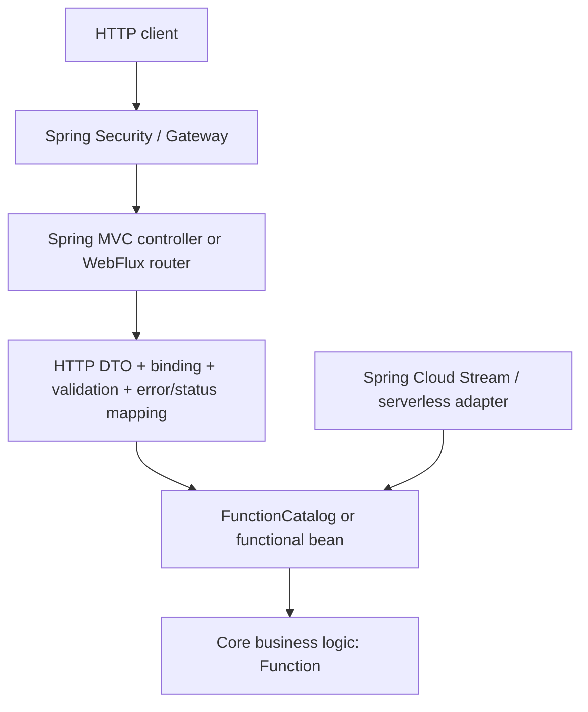
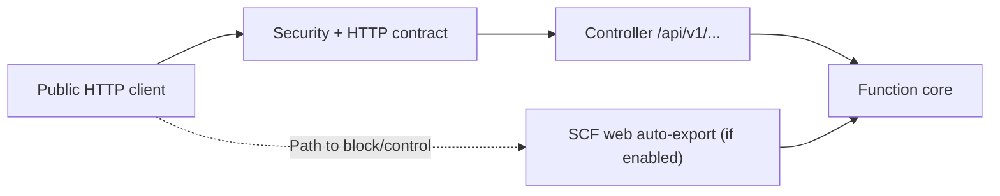

# Boundary Between Function Endpoints and Complex-Contract Web APIs in Spring Cloud Function

## 1. Asking the Right Question: Expose a Function or Design an HTTP API?

**Spring Cloud Function (SCF)** lets you package logic into `Supplier<O>`, `Function<I, O>`, and `Consumer<I>`. `FunctionCatalog` registers, looks up, converts data for, and composes functions. Depending on the adapter, the **same logic** can be invoked over HTTP, event processing, or a serverless platform.

A simple requirement:

```text
POST /uppercase
Content-Type: text/plain

hello
```

Response body:

```text
HELLO
```

For a stateless transformation function, exposing the bean directly via the **SCF HTTP adapter** is natural. However, a product API's requirements can look quite different:

```http
POST /api/v1/customers/cus-42/quotes?lang=vi HTTP/1.1
Content-Type: application/json
Accept: application/json
X-Request-ID: req-100

{"sku":"BOOK-001","quantity":2}
```

This API may need to satisfy **multiple contracts at once**: customer resources, path variables, query parameters, DTO schemas, Bean Validation, consistent error codes, `Content-Type`/`Accept`, request IDs, per-customer authorization, caching, quantity bounds, versioning, and idempotency rules when writing data.

Spring Cloud Function's official **Standalone Web Applications** documentation explicitly states that while SCF can expose functional beans as REST endpoints, it is **not a replacement for Spring MVC/WebFlux**; the HTTP adapter mainly serves simpler serverless/stateless models.

### Core Takeaway

**It is not an either/or choice:** you can **keep business logic inside reusable functions** while using **Spring MVC/WebFlux at the HTTP boundary** to own complex web contracts.

### Learning Outcomes

After this lesson, you will:

1. Know when to use the SCF HTTP adapter directly and when to use a controller/router.
2. Distinguish the **function contract** (Java input/output) from the **HTTP contract** (URLs, methods, headers, statuses, errors, security).
3. Design a reusable `Function<QuoteCommand, QuoteOutcome>` while exposing it via a controller with DTOs, validation, and `ProblemDetail`.
4. Understand the role of `FunctionCatalog` compared to injecting a functional bean directly.
5. Avoid accidentally exposing extra SCF endpoints alongside a controller.
6. Build a checklist and contract test suite for a long-lived API.

## 2. What Part Does the SCF HTTP Adapter Solve?

Per SCF documentation, when `spring-cloud-function-web` is present in a compatible Spring Boot web app, functional beans can be auto-exposed over HTTP, with default paths tied to bean names and an optional prefix via `spring.cloud.function.web.path`.

Typical mapping table:

| Function type | HTTP request | Typical response |
| --- | --- | --- |
| `Supplier<O>` | `GET /{supplier}` | 200 and value generated by Supplier |
| `Function<I,O>` | `POST /{function}` | 200 and result from `apply()` |
| `Function<I,O>` | `PUT /{function}` | 200 and result from `apply()` |
| `Function<I,O>` | `GET /{function}/{item}` | 200, `item` as input |
| `Consumer<I>` | `POST`/`PUT /{consumer}` | 202 and typically echoes input |
| `Consumer<I>` | `DELETE /{consumer}` | 204, no response body |

SCF also provides:

- `FunctionCatalog` and composition, e.g., `normalize|uppercase` invoked via `/normalize,uppercase`.
- `spring.cloud.function.definition` to pick a default function/composition or filter exposed functions.
- `spring.cloud.function.web.path` to change the path prefix.
- `spring.cloud.function.http.GET`, `POST`, etc., to restrict method mappings per function.
- Text/JSON conversion via converters matching Java types.
- `Message<T>` to read payload, metadata, and input/output headers.
- Multi-element responses and SSE requests via `Accept: text/event-stream` when supported by the adapter/runtime.

These features are **very useful**, yet they do not turn the adapter into a full framework for every REST API.

### 2.1. Function Contracts Differ from Web Contracts

| Aspect | Functional bean contract | HTTP API contract |
| --- | --- | --- |
| Identity | Bean name, definition, or composition | Resource URL, version, HTTP method |
| Input | `I` of `Function<I,O>` | Path, query, headers, body, caller identity |
| Output | `O` of function | Status, media type, headers, body |
| Validation | Business invariant checks | Request parsing, Bean Validation, type/format, required fields |
| Errors | Exceptions or domain outcomes | `400`, `404`, `409`, `422`, `5xx`, standardized error body |
| Permissions | Typically transport-independent logic | Authentication/authorization by URL, method, principal/resource |
| Side effects | Decided by business code | HTTP method must reflect semantics and retry contracts |
| Operations | Invocation, composition, messaging | CORS, caching, conditional requests, rate limits, observability |

**Example:** `Function<QuoteCommand, QuoteOutcome>` knows how to calculate a quote. It does not inherently know whether to return `200 OK` or `201 Created`, whether to attach a `Location` header, or whether the caller is authorized to quote for `cus-42`.

## 3. Decision Matrix: When to Use What?

| Requirement | Direct SCF HTTP adapter | Spring MVC/WebFlux controller/router |
| --- | --- | --- |
| Single stateless function, clear I/O | **Well suited** | Works too, though possibly unnecessary |
| Demo or simple internal endpoint | **Well suited**, needs access control | Depends on complexity |
| Simple composition by bean name | **Strong:** `FunctionCatalog` and path composition | Can invoke compositions via catalog |
| Multi-level resource API like `/customers/{id}/orders/{orderId}` | Becomes awkward | **Well suited** |
| Multiple path variables, query DTOs, pagination/sorting | Requires manual handling via path/headers | **Well suited** |
| DTO validation, per-field errors | Requires custom boundary | **Well suited** |
| Complex `201`/`202`/`204`, `Location`, `ETag` responses | Not its strength | **Well suited** |
| Standardized `ProblemDetail`/`application/problem+json` | Requires extra web handling | **Well suited** |
| Per-resource, role/scope, or tenant authorization | Not solved automatically | **HTTP Security needed in all cases** |
| Multipart upload, downloads, Range, large files | Not the primary tool | **Well suited** |
| Simple SSE from `Flux` | Supported per adapter/runtime | WebFlux/WebMVC streaming for deep contracts |
| WebSockets, conditional HTTP, complex CORS | Not designed to replace the web stack | **Well suited** |
| Business logic reused via Kafka/serverless | **Function is a great core** | Controller acts purely as an outer HTTP adapter |

**Rule of thumb:** when the primary concerns are “which function, what input, what output,” consider exposing SCF directly. When the primary concerns are “which resource, who is allowed, which status, which validation, which headers, and how retries and caching work,” use a **dedicated HTTP boundary**.

## 4. Recommended Architecture: Functional Core + HTTP Adapter

A balanced architecture:



In this design:

- **Functional core** accepts domain commands/DTOs free of HTTP request objects, returns domain outcomes, and enforces invariants.
- **HTTP boundary** reads URL, query, headers, and body; authenticates and validates; calls the function; and maps outcomes or errors to HTTP status/body/headers.
- **Event/serverless adapters** convert platform events/requests into the same command type without simulating HTTP.
- **`FunctionCatalog`** supplies SCF-specific lookup, composition, and conversion when needed; not every controller must call the catalog if direct bean injection suffices.

This does not claim all logic must be pure functions. When business operations involve databases, transactions, external APIs, or event publishing, keep side effects inside a clearly orchestrated application service/port rather than mixing them with HTTP formatting logic.

### A Common Architectural Mistake

Avoid placing this in a business function:

```java
// Not a good design for reuse across events/serverless:
Function<HttpServletRequest, ResponseEntity<?>> calculateQuote;
```

Because then every non-HTTP adapter would have to mock `HttpServletRequest` and understand `ResponseEntity`. Convert the HTTP request into a `QuoteCommand` before invoking the function.

## 5. Java Example: Business Logic as Function, HTTP as Controller

Let us build a per-customer quote calculation API featuring:

- `POST /api/v1/customers/{customerId}/quotes`.
- Query parameter `lang` accepting `vi` or `en`.
- Optional `X-Request-ID` header, validated before echoing.
- JSON request with `sku` and `quantity`, using Bean Validation.
- JSON response with calculated price, `Cache-Control: no-store`, and request ID.
- `400` on binding/validation failures, `422` when the SKU is unsupported.
- **Creates no persistent resource**: returns `200 OK`, not `201 Created`.

### 5.1. Dependencies for the Controller Approach

Initialize a **Spring Boot Java 17+** project with a compatible Spring Cloud BOM. The example uses **Spring MVC** and `jakarta.validation` following Spring Boot 3.x/Spring Framework 6.x conventions. Declare the appropriate dependencies:

```xml
<dependencies>
    <dependency>
        <groupId>org.springframework.boot</groupId>
        <artifactId>spring-boot-starter-web</artifactId>
    </dependency>
    <dependency>
        <groupId>org.springframework.boot</groupId>
        <artifactId>spring-boot-starter-validation</artifactId>
    </dependency>
    <dependency>
        <groupId>org.springframework.cloud</groupId>
        <artifactId>spring-cloud-function-context</artifactId>
    </dependency>
</dependencies>
```

Versions should be managed by a compatible Spring Boot parent/BOM and Spring Cloud BOM. **Intentionally omit `spring-cloud-starter-function-web`** in this controller application: adding the SCF HTTP adapter could simultaneously publish the functional bean under an extra URL outside your controlled API contract.

If you only need a `Function` bean without `FunctionCatalog`, you can even declare it with plain Spring Core; `spring-cloud-function-context` is included here to continue using the SCF/`FunctionCatalog` model.

### 5.2. Complete Java File

Create `src/main/java/demo/QuoteApplication.java`. Package-private classes are placed in the same file so the example can be read continuously:

```java
package demo;

import java.math.BigDecimal;
import java.util.Set;
import java.util.UUID;
import java.util.function.Function;

import jakarta.validation.Valid;
import jakarta.validation.constraints.Max;
import jakarta.validation.constraints.Min;
import jakarta.validation.constraints.NotBlank;
import jakarta.validation.constraints.Pattern;

import org.springframework.beans.factory.annotation.Qualifier;
import org.springframework.boot.SpringApplication;
import org.springframework.boot.autoconfigure.SpringBootApplication;
import org.springframework.context.annotation.Bean;
import org.springframework.http.CacheControl;
import org.springframework.http.HttpStatus;
import org.springframework.http.MediaType;
import org.springframework.http.ProblemDetail;
import org.springframework.http.ResponseEntity;
import org.springframework.web.bind.MethodArgumentNotValidException;
import org.springframework.web.bind.annotation.ExceptionHandler;
import org.springframework.web.bind.annotation.PathVariable;
import org.springframework.web.bind.annotation.PostMapping;
import org.springframework.web.bind.annotation.RequestBody;
import org.springframework.web.bind.annotation.RequestHeader;
import org.springframework.web.bind.annotation.RequestMapping;
import org.springframework.web.bind.annotation.RequestParam;
import org.springframework.web.bind.annotation.RestController;
import org.springframework.web.bind.annotation.RestControllerAdvice;

@SpringBootApplication
public class QuoteApplication {
    public static void main(String[] args) {
        SpringApplication.run(QuoteApplication.class, args);
    }

    // Business core with no HTTP types at all.
    @Bean
    public Function<QuoteCommand, QuoteOutcome> calculateQuote() {
        return command -> {
            if (command == null || command.quantity() <= 0) {
                throw new IllegalArgumentException(
                        "Quantity must be positive");
            }
            if (!"BOOK-001".equals(command.sku())) {
                throw new UnsupportedSkuException(command.sku());
            }

            BigDecimal price = BigDecimal.valueOf(120000L);
            BigDecimal total = price.multiply(
                    BigDecimal.valueOf(command.quantity()));

            return new QuoteOutcome(
                    command.sku(), command.quantity(), total);
        };
    }
}

// Business DTOs: no HTTP status, headers, or URLs.
record QuoteCommand(String sku, int quantity) {}
record QuoteOutcome(String sku, int quantity, BigDecimal totalPrice) {}

// DTO dedicated to the HTTP contract.
record QuoteRequest(
        @NotBlank
        @Pattern(regexp = "[A-Z0-9-]{1,32}")
        String sku,
        @Min(1) @Max(100)
        int quantity) {}

record QuoteResponse(
        String sku,
        int quantity,
        BigDecimal totalPrice,
        String currency) {}

final class UnsupportedSkuException extends RuntimeException {
    UnsupportedSkuException(String sku) {
        super("Unsupported SKU: " + sku);
    }
}

final class InvalidHttpRequestException extends RuntimeException {
    InvalidHttpRequestException(String detail) {
        super(detail);
    }
}

// HTTP boundary: validates URL, query, headers, body, and status.
@RestController
@RequestMapping("/api/v1/customers/{customerId}/quotes")
class QuoteController {

    private final Function<QuoteCommand, QuoteOutcome> calculator;

    QuoteController(
            @Qualifier("calculateQuote")
            Function<QuoteCommand, QuoteOutcome> calculator) {
        this.calculator = calculator;
    }

    @PostMapping(
            consumes = MediaType.APPLICATION_JSON_VALUE,
            produces = MediaType.APPLICATION_JSON_VALUE)
    public ResponseEntity<QuoteResponse> calculate(
            @PathVariable("customerId") String customerId,
            @RequestParam(name = "lang", defaultValue = "vi") String lang,
            @RequestHeader(name = "X-Request-ID", required = false)
            String requestId,
            @Valid @RequestBody QuoteRequest request) {

        if (!customerId.matches("[a-z0-9-]{1,24}")) {
            throw new InvalidHttpRequestException(
                    "Invalid customer ID");
        }
        if (!Set.of("vi", "en").contains(lang)) {
            throw new InvalidHttpRequestException(
                    "Unsupported lang");
        }
        if (requestId != null
                && !requestId.matches("[A-Za-z0-9_-]{1,36}")) {
            throw new InvalidHttpRequestException(
                    "Invalid X-Request-ID");
        }

        String safeId = requestId == null
                ? UUID.randomUUID().toString()
                : requestId;

        // Do not pass HttpServletRequest/ResponseEntity into the function.
        QuoteOutcome result = calculator.apply(
                new QuoteCommand(request.sku(), request.quantity()));

        QuoteResponse body = new QuoteResponse(
                result.sku(),
                result.quantity(),
                result.totalPrice(),
                "VND");

        return ResponseEntity.ok()
                .header("X-Request-ID", safeId)
                .cacheControl(CacheControl.noStore())
                .body(body);
    }
}

// HTTP error contract: do not put ResponseEntity inside the core Function.
@RestControllerAdvice
class QuoteErrors {

    @ExceptionHandler(InvalidHttpRequestException.class)
    ResponseEntity<ProblemDetail> invalid(
            InvalidHttpRequestException exception) {

        ProblemDetail problem =
                ProblemDetail.forStatusAndDetail(
                        HttpStatus.BAD_REQUEST,
                        exception.getMessage());
        problem.setTitle("Invalid HTTP request");

        return ResponseEntity.badRequest()
                .contentType(MediaType.APPLICATION_PROBLEM_JSON)
                .body(problem);
    }

    @ExceptionHandler(UnsupportedSkuException.class)
    ResponseEntity<ProblemDetail> unsupported(
            UnsupportedSkuException exception) {

        ProblemDetail problem =
                ProblemDetail.forStatusAndDetail(
                        HttpStatus.UNPROCESSABLE_ENTITY,
                        "The SKU is not supported");
        problem.setTitle("Unsupported SKU");

        return ResponseEntity.unprocessableEntity()
                .contentType(MediaType.APPLICATION_PROBLEM_JSON)
                .body(problem);
    }

    @ExceptionHandler(MethodArgumentNotValidException.class)
    ResponseEntity<ProblemDetail> invalidBody(
            MethodArgumentNotValidException exception) {

        ProblemDetail problem =
                ProblemDetail.forStatusAndDetail(
                        HttpStatus.BAD_REQUEST,
                        "sku and quantity do not satisfy the API contract");
        problem.setTitle("Request validation failed");

        return ResponseEntity.badRequest()
                .contentType(MediaType.APPLICATION_PROBLEM_JSON)
                .body(problem);
    }
}
```

**Key highlights of the example:**

- `calculateQuote` is a `Function<QuoteCommand, QuoteOutcome>` bean. It knows nothing about URIs, HTTP headers, query strings, or statuses.
- `QuoteRequest` is an HTTP DTO annotated with `@NotBlank`, `@Pattern`, `@Min`, and `@Max`; Bean Validation runs when a validation provider is present.
- `QuoteController` owns the URL, method, `consumes`, `produces`, validation, response headers, and `ResponseEntity`.
- `QuoteErrors` defines error codes and `ProblemDetail` payloads for three sample error categories.
- There is no database or durable quote store, so the result is **200 OK** for a calculation, **not** 201.
- There is no authorization on `customerId` yet. The regex only validates ID **syntax**; for real users, add Spring Security and verify the relationship between the caller and `customerId`.
- `lang` here is **validated without changing business behavior yet**; in a production API, use it for localization if required by the contract or remove unused query parameters.
- The `120000 VND` price and single SKU are dummy data illustrating the architecture.

### 5.3. Why Not Return `ResponseEntity` from the Function?

The snippet below introduces unnecessary HTTP coupling:

```java
// Anti-pattern: function is hard to reuse over Kafka/serverless.
Function<QuoteCommand, ResponseEntity<QuoteResponse>> quote;
```

In a `QuoteRequested` event sent over a broker, consumers do not need `HttpStatus`, `Location`, or `Cache-Control`. Therefore, the core should return `QuoteOutcome`; each adapter builds its own appropriate response or event.

## 6. Testing the Controller's HTTP Contract

Start the application using your project's Maven/Gradle wrapper (for example, Maven):

```bash
mvn spring-boot:run
```

The `curl` commands below use Bash syntax, with default server `http://localhost:8080`. In PowerShell, use `curl.exe` and matching line continuations.

### 6.1. Valid Call: 200 + JSON + Headers

```bash
curl -i -X POST \
  'http://localhost:8080/api/v1/customers/cus-42/quotes?lang=vi' \
  -H 'Content-Type: application/json' \
  -H 'Accept: application/json' \
  -H 'X-Request-ID: req-100' \
  --data '{"sku":"BOOK-001","quantity":2}'
```

Typical response:

```http
HTTP/1.1 200 OK
Content-Type: application/json
Cache-Control: no-store
X-Request-ID: req-100

{"sku":"BOOK-001","quantity":2,"totalPrice":240000,"currency":"VND"}
```

Actual headers may include charset and other web-runtime headers; JSON field ordering carries no semantics. Business result: two units times 120,000 = 240,000 VND.

### 6.2. Invalid Body: 400 Bad Request

```bash
curl -i -X POST \
  'http://localhost:8080/api/v1/customers/cus-42/quotes' \
  -H 'Content-Type: application/json' \
  -H 'Accept: application/json' \
  --data '{"sku":"BOOK-001","quantity":0}'
```

`@Min(1)` fails validation before the business function is ever called. The sample advice returns `400` with an `application/problem+json` body.

Abbreviated example body:

```json
{
  "type": "about:blank",
  "title": "Request validation failed",
  "status": 400,
  "detail": "sku and quantity do not satisfy the API contract"
}
```

When a production API needs per-field error details, add standardized properties to `ProblemDetail` and bound error detail contents. Never return raw stack traces, exception objects, or sensitive data to clients.

### 6.3. Valid Schema with Unsupported SKU: 422

```bash
curl -i -X POST \
  'http://localhost:8080/api/v1/customers/cus-42/quotes' \
  -H 'Content-Type: application/json' \
  -H 'Accept: application/json' \
  --data '{"sku":"BOOK-999","quantity":2}'
```

The `calculateQuote` bean receives a structurally valid command and throws `UnsupportedSkuException`; the controller advice maps it to `422 Unprocessable Content` with `ProblemDetail`.

**The `422` rule is a design choice of this sample API contract**, not auto-generated by SCF. Another system might return `404` for a non-existent SKU on an identified resource, depending on its API definition.

### 6.4. Invalid Path, Query, or Header: 400

```bash
# Unsupported lang.
curl -i -X POST \
  'http://localhost:8080/api/v1/customers/cus-42/quotes?lang=fr' \
  -H 'Content-Type: application/json' \
  --data '{"sku":"BOOK-001","quantity":2}'

# Malformed X-Request-ID.
curl -i -X POST \
  'http://localhost:8080/api/v1/customers/cus-42/quotes' \
  -H 'Content-Type: application/json' \
  -H 'X-Request-ID: invalid value!' \
  --data '{"sku":"BOOK-001","quantity":2}'
```

These requests receive `400` from `InvalidHttpRequestException`. Validating `X-Request-ID` does not make headers trusted for security; correlation IDs are used after validation, whereas identity must come from authentication.

### 6.5. Wrong Content-Type, Accept, or HTTP Method

```bash
# Content-Type does not match @PostMapping(consumes).
curl -i -X POST \
  'http://localhost:8080/api/v1/customers/cus-42/quotes' \
  -H 'Content-Type: text/plain' \
  --data 'hello'

# Client only accepts text/plain, incompatible with produces.
curl -i -X POST \
  'http://localhost:8080/api/v1/customers/cus-42/quotes' \
  -H 'Content-Type: application/json' \
  -H 'Accept: text/plain' \
  --data '{"sku":"BOOK-001","quantity":2}'

# Endpoint specifies POST only; PUT is not registered.
curl -i -X PUT \
  'http://localhost:8080/api/v1/customers/cus-42/quotes' \
  -H 'Content-Type: application/json' \
  --data '{"sku":"BOOK-001","quantity":2}'
```

In a typical Spring MVC app, these cases receive `415 Unsupported Media Type`, `406 Not Acceptable`, and `405 Method Not Allowed`, respectively. Exact error bodies depend on Spring Boot error handling, `@ControllerAdvice`, and active filters. The key difference is that **the controller declares method, `consumes`, and `produces` right in the route contract**.

## 7. `FunctionCatalog` Remains Useful Alongside Controllers

In our example, the controller injects directly:

```java
@Qualifier("calculateQuote")
Function<QuoteCommand, QuoteOutcome> calculator
```

This is straightforward when you only need to invoke one typed bean. When you need SCF composition, conversion, or wrappers, look up through the catalog:

```java
import org.springframework.cloud.function.context.FunctionCatalog;

// Illustrative inside a Spring bean/service:
Function<QuoteCommand, QuoteOutcome> function =
        catalog.lookup("calculateQuote");

QuoteOutcome result = function.apply(
        new QuoteCommand("BOOK-001", 2));
```

SCF provides catalog wrappers for features such as **composition and type conversion**. Injecting a `Function` directly from the Spring application context gives you the raw bean as declared, **without automatically applying all `FunctionCatalog` wrappers**.

**Never** call `catalog.lookup()` with a function name coming directly from a user's path, query, or header without an allowlist. If an API accepts arbitrary function names and executes them, you have built a dynamic routing mechanism with serious security risks.

### Sharing Across HTTP, Events, and Serverless

The same `calculateQuote` can serve:

```text
HTTP controller:
  QuoteRequest + URL metadata
    -> QuoteCommand
    -> calculateQuote
    -> QuoteResponse + HTTP status/headers

Spring Cloud Stream:
  QuoteRequested event
    -> QuoteCommand
    -> calculateQuote
    -> QuoteCalculated event

Serverless:
  Platform event
    -> QuoteCommand
    -> calculateQuote
    -> Platform response
```

**Reuse does not mean identical transaction or retry behavior.** Event handlers may have at-least-once delivery, serverless platforms have execution timeouts, and HTTP clients have their own retry policies. Business layers with side effects must clarify idempotency for each adapter.

## 8. Critical Pitfall: Accidentally Exposing Two HTTP APIs

Suppose an application defines both:

```java
@Bean
public Function<QuoteCommand, QuoteOutcome> calculateQuote() {
    // ...
}
```

and a `@RestController` at `/api/v1/customers/{customerId}/quotes`.

If you **add the SCF web starter** to that same application, it may auto-expose an additional endpoint:

```text
POST /calculateQuote
```

That endpoint can accept `QuoteCommand` directly and return `QuoteOutcome`, **bypassing the validation, headers, paths, and authorization written in `QuoteController`**. That becomes an **HTTP boundary bypass** if only the main controller is protected.

### How to Avoid Unintended Route Exposure

**Option 1 — Controller-only HTTP:** keep `spring-boot-starter-web` and `spring-cloud-function-context`; omit SCF web auto-export in this deployment. This is the choice used in our example.

**Option 2 — Two clearly separated HTTP paths:** if you need both SCF endpoints for trusted callers and a public REST API, give SCF its own prefix:

```properties
spring.cloud.function.web.path=/internal-functions
```

Then enforce **Spring Security/gateway deny-by-default rules**, network policies, or separate deployments so `/internal-functions/**` is never leaked. Changing the prefix alone is **not** a security mechanism.

**Option 3 — Separate runtimes:** share the business library and SCF functions; run the web API in one deployment and event/serverless adapters in others. Use this when security, lifecycles, or scaling characteristics differ markedly across protocols.

If using `spring.cloud.function.definition`, watch out for **root mapping/fallback** with a single definition and **function filtering** with semicolon-separated entries. Never treat filtering as authorization. Also audit `functionRouter` and routing headers that could redirect target execution.

### Diagram for Preventing Bypass



## 9. Validation: Boundary Between Bad Requests and Business Errors

HTTP inputs undergo **two validation layers**:

1. **Boundary validation:** valid JSON, required fields, formats, lengths, number/date parsing, path/query/header constraints.
2. **Business invariants:** supported SKUs, pricing rules, order limits, resource state, business permissions.

Examples:

| Input | Detection layer | Sample contract response |
| --- | --- | --- |
| JSON missing a brace | HTTP JSON converter | 400 |
| `quantity=0` | `@Min(1)` on DTO | 400 |
| `sku=""` | `@NotBlank`/`@Pattern` | 400 |
| `lang=fr` | HTTP query validation | 400 |
| `sku=BOOK-999` valid syntax, unsupported | Business function | 422 per sample contract |
| Unauthorized access to another customer's data | Security/authorization | 403, or 404 depending on resource-hiding policy |
| Database/remote service failure | Infrastructure | 5xx or designed error without stack trace leaks |

Do not rely solely on `IllegalArgumentException` expecting the SCF web adapter to turn every error into `400`. Production APIs need an explicit **error taxonomy** mapped cleanly at the HTTP boundary.

### Consistent Error Representation

Spring Framework's `ProblemDetail` supports RFC 9457 error bodies, typically returned as `application/problem+json`. For larger APIs, standardize:

- Machine-readable `type` or stable error code.
- User-friendly `title`, `status`, and `detail` without leaking secrets.
- `instance` and correlation/request ID if needed.
- Per-field validation error lists with sensitive values masked/omitted.
- Clear mapping rules translating domain, concurrency, and security errors into HTTP statuses.

Do not assume `@ControllerAdvice` automatically catches exceptions from SCF functions when requests enter **via SCF auto-export routes** rather than a controller; that is another reason to integration-test the exact active routes.

## 10. Authorization and Tenancy Cannot Be Inferred from Paths

Consider the API:

```text
GET /api/v1/customers/cus-42/orders/ord-7
```

Path variables identify **the resource**; they do not prove the caller has rights to it. The system needs:

- Authentication: who is calling? JWT, session, mTLS, or API key per architecture.
- Authorization: may this principal read/update `cus-42` and `ord-7`?
- Object-level authorization: verify against the **actual resource** once tenant/owner is resolved.
- Method-level rules: permission for GET does not imply permission for DELETE.
- Routing header controls: prevent users from redirecting to internal functions via `spring.cloud.function.definition` or routing expressions.
- Logging/observability: never log raw tokens, cookies, secrets, or PII.

Even when an SCF function is triggered by an event, the message broker needs its own identity and trust contract. Never pass raw `HttpServletRequest` or JWT headers into a domain command when the adapter only needs to pass a verified actor ID and permissions.

## 11. HTTP Status Codes, Caching, and Conditional Requests

A function produces Java output, yet **does not determine full HTTP response semantics**. Complex APIs frequently require:

| Scenario | Possible status/headers | Additional requirements |
| --- | --- | --- |
| Compute quote and return immediately | `200 OK` | Result JSON body |
| Create durably persisted order | `201 Created` + `Location` | Resource ID and successful commit |
| Accept asynchronous job | `202 Accepted` + status URL | Job tracking, timeouts, and status endpoint |
| Delete/update succeeded with no body | `204 No Content` | Client must not parse a body |
| Resource not found | `404 Not Found` | Clear disclosure/authorization policy |
| Version/state conflict | `409 Conflict` or `412 Precondition Failed` | Business state checks or ETag preconditions |
| Unauthorized / forbidden | `401`/`403` | Security and challenge per contract |
| Client cache validation match | `304 Not Modified` | `ETag`/`Last-Modified` and precondition handling |
| Cacheable API response | `Cache-Control`, `Vary` | Understand PII, privacy, and CDN behavior |

Example of Spring MVC returning `201` **only when an actual resource-creation operation occurs**:

```java
// Separate illustrative snippet; assumes orderService.create() persists durably.
var saved = orderService.create(command);
URI location = URI.create("/api/v1/orders/" + saved.id());

return ResponseEntity.created(location).body(saved);
```

This is **not** part of section 5's quote application and must not be used without a real `orderService`. Returning `201` merely because the HTTP method is POST violates the contract.

### Content-Type and Accept

`Content-Type` describes the request body sent by the client; `Accept` describes media types accepted in the response. `@PostMapping(consumes=..., produces=...)` makes this contract explicit directly on the route.

With SCF auto-export, text/JSON conversion depends on function types, `MessageConverter`, and the web runtime; it fits simple endpoints well, but does not replace multi-representation negotiation and standardized error contracts in full-featured APIs.

## 12. Where Do Idempotency, Transactions, and Retries Live?

HTTP methods carry semantics, yet **method names alone do not create idempotency**.

- `GET` should be safe: mutating no business state.
- `PUT` and `DELETE` are expected to be idempotent in intended effect.
- `POST` is typically non-idempotent and may need an `Idempotency-Key` when clients retry payment or order creation.
- `202 Accepted` **does not guarantee** processing finished or an event was durably stored.
- A function invoked via an event broker may receive the same message multiple times; that is a delivery-semantics problem of its own.

A write API must explicitly design:

1. Transaction boundaries and commit timing.
2. Duplicate/retry detection (idempotency keys, unique constraints, event IDs).
3. Optimistic locking and `If-Match` preconditions for concurrent writes.
4. Error mappings (`409`, `412`, `429`, `5xx`) per contract.
5. Idempotency verification across crashes, timeouts, and client disconnects.

**SCF `FunctionCatalog` does not replace a transaction manager, persistence layer, outbox pattern, or security policy.** Keep clear responsibilities at the HTTP boundary and application service layer when side effects are complex.

## 13. Pagination, Multipart, File Transfers, SSE, and WebSockets

A common misconception is “SCF supports `Flux` and SSE, so it equals all of WebFlux.” Those are not the same thing.

### 13.1. Pagination and Filter DTOs

Example of a list-reading API:

```text
GET /api/v1/orders?cursor=abc&limit=20&sort=createdAt,desc
```

The API must parse queries, validate `limit`, enforce deterministic sorting, return `nextCursor` metadata, and prevent oversized queries. The SCF HTTP adapter places query parameters into `MessageHeaders["http_request_param"]` when accepting `Message<T>`, yet once query binding gets complex, `@RequestParam` or a dedicated WebFlux functional router is far easier to control.

### 13.2. Multipart Uploads and File Downloads

File transfers typically need:

- Multipart form-data with multiple parts and size limits.
- Streaming upload/download, antivirus scanning, or format checks.
- `Content-Disposition`, `Content-Length`, HTTP Range, and caching directives.
- Filename/path-traversal protection, timeouts, and resource cleanup.

Spring MVC/WebFlux provide dedicated abstractions for these contracts (such as `MultipartFile` in MVC or `FilePart` in WebFlux). Never assume an SCF function accepting DTOs can replace a file API.

### 13.3. SSE and Multi-Element Responses

SCF can emit multi-valued responses as **SSE** when clients send:

```http
Accept: text/event-stream
```

For `Supplier<Flux<T>>` or reactive functions, this works well for simple streaming. When an API requires event IDs, replay, cursors, per-client authorization, heartbeats, backpressure, disconnect cleanup, and proxy/gateway tuning, build a complete HTTP streaming boundary; `Flux` alone does not guarantee replay or event storage.

### 13.4. WebSockets and Bidirectional Streaming

SSE flows **server → client**. Applications needing continuous bidirectional interaction should use WebSockets or an appropriate transport. Do not try to mimic full WebSocket sessions/connections using a `Function<String,String>`.

## 14. Spring MVC Controller or WebFlux `RouterFunction`?

Both can keep business logic inside functional beans.

| Criterion | Spring MVC Controller | Spring WebFlux Router/Handler |
| --- | --- | --- |
| Programming model | `@RestController`, `@GetMapping`, etc. | `RouterFunction<ServerResponse>`, reactive handler |
| Binding & validation | Convenient annotations/Bean Validation | Reactive request body + stack-appropriate validation |
| Response status/headers | `ResponseEntity`, `ProblemDetail` | `ServerResponse`, reactive codecs |
| Typical I/O | Servlet; can use blocking services | Reactive; avoid blocking on the event loop |
| Streaming | MVC supports async/SSE | WebFlux excels at `Flux` and backpressure |
| Calling SCF logic | Inject `Function` or `FunctionCatalog` | Same, paying attention to reactive types and schedulers |

Conceptual WebFlux routing example (not part of section 5's MVC source):

```java
// Illustrative inside a WebFlux application with an existing Handler.
RouterFunction<ServerResponse> routes(QuoteHandler handler) {
    return RouterFunctions.route()
            .POST("/api/v1/quotes", handler::calculate)
            .build();
}
```

WebFlux **does not automatically turn a blocking function into non-blocking code**. If a handler calls blocking JDBC or a slow `Function.apply()` on the event loop, proper schedulers/I/O architecture are still required. Conversely, choosing an MVC controller does not strip reusability from the functional core.

## 15. Migration Path from an SCF HTTP Endpoint to a Full-Contract API

Suppose today you have:

```text
POST /calculateQuote
Content-Type: application/json
```

Tomorrow the product requires:

```text
POST /api/v1/customers/{customerId}/quotes
```

Migration steps:

1. **Freeze the current contract:** document URL/method, Java I/O types, JSON schema, statuses, headers, and active consumers.
2. **Define business DTOs:** separate `QuoteCommand`/`QuoteOutcome` from HTTP request/response types.
3. **Build the new controller/router:** map path/query/header/body, validation, security, statuses, and error contracts.
4. **Call the same core function:** inject the bean or look up via `FunctionCatalog` for required composition/conversion.
5. **Protect old routes:** prevent auto-export from leaving unpolicied endpoints exposed; if legacy clients remain, keep compatibility routes only under a time-bound migration plan.
6. **Test in parallel:** domain golden cases, separate contract tests for both HTTP APIs, and separate event/serverless contract tests if applicable.
7. **Roll out gradually:** API versioning, telemetry, deprecation notices, routing, and rollback plans.
8. **Remove old routes:** once clients have migrated and access controls are verified.

Never silently change `200` to `201`, switch a JSON object to an array, or alter 4xx errors just because the URL changed; those are **breaking changes** if existing clients rely on the old contract.

## 16. Testing: Function Tests Are Not Enough for HTTP Contracts

To verify the system properly, maintain **three test layers**.

### 16.1. Unit Tests for the Core Function

Simple cases:

```java
Function<QuoteCommand, QuoteOutcome> calculator =
        new QuoteApplication().calculateQuote();

QuoteOutcome result =
        calculator.apply(new QuoteCommand("BOOK-001", 2));

assert result.totalPrice().compareTo(
        BigDecimal.valueOf(240000L)) == 0;
```

The `assert` snippet uses Java's built-in assertion (requiring `-ea` at runtime); in real projects, use JUnit/AssertJ. This test only verifies the calculation—**not** HTTP routing or validation.

### 16.2. Integration Tests for the HTTP Boundary

| Test case | What must be verified |
| --- | --- |
| Valid POST | 200, valid JSON, validated request ID, and expected response headers |
| Unsupported SKU | 422, `application/problem+json`, error body leaks no internal details |
| Quantity 0 or 101 | 400 from Bean Validation; core function is not invoked |
| Malformed JSON | 400 from HTTP converter |
| `Content-Type: text/plain` | Rejected before JSON handler, typically 415 |
| `Accept: text/plain` | Cannot satisfy declared representation, typically 406 |
| PUT/DELETE to POST-only route | Method disallowed, typically 405 |
| Invalid `customerId`, `lang`, or request ID | 400 per contract |
| Accessing another customer | 403/404 per chosen policy once **security is implemented** |
| Unintended `POST /calculateQuote` | Not exposed in controller-only runtime |
| Headers, CORS, and gateway | Verify end-to-end responses and ensure no credential reflection |

Manual `curl` verification commands:

```bash
# Success:
curl -i -X POST \
  'http://localhost:8080/api/v1/customers/cus-42/quotes' \
  -H 'Content-Type: application/json' \
  --data '{"sku":"BOOK-001","quantity":2}'

# SCF auto-export must not exist when using controller-only.
curl -i -X POST 'http://localhost:8080/calculateQuote' \
  -H 'Content-Type: application/json' \
  --data '{"sku":"BOOK-001","quantity":2}'

# Invalid DTO, expects 400.
curl -i -X POST \
  'http://localhost:8080/api/v1/customers/cus-42/quotes' \
  -H 'Content-Type: application/json' \
  --data '{"sku":"BOOK-001","quantity":0}'
```

Do not treat a single `404` as proof that logic cannot be reached via another path; if multiple adapters exist, test each path explicitly.

### 16.3. End-to-End and Cross-Adapter Contracts

If the same business logic handles events:

- Is the event schema compatible with `QuoteCommand`?
- Are idempotency, retries, and dead-letter handling properly enforced?
- Are HTTP statuses and headers kept out of event payloads unless explicitly contracted?
- Does `FunctionCatalog` lookup/composition resolve the right types?
- Are message producer identity and security sufficiently verified?
- Is cross-adapter tracing/request ID propagated without leaking tokens or secrets?

An application can pass 100% of its function unit tests and still ship **route bypass flaws**, wrong HTTP statuses, or authorization bugs if integration/E2E tests are missing.

## 17. Common Design Mistakes

| Anti-pattern | Problem | Fix |
| --- | --- | --- |
| Passing `HttpServletRequest` into `Function<I,O>` | Tight coupling to Servlet | Convert requests into business commands at the boundary |
| Returning `ResponseEntity` from core functions | Mixes HTTP status/headers into domain logic | Return domain results; controller builds HTTP responses |
| Using SCF auto-export for every public REST API | Lacks complex resource/status/security contracts | Use a controller/router at the boundary |
| Running both controllers and uncontrolled SCF web | Exposes raw endpoints by function name | Remove web auto-export or isolate/secure deployments |
| Treating function filtering as authorization | Filtering routes does not enforce user permissions | Use Spring Security, gateway, and object-level checks |
| Testing only `Function.apply()` | Leaves HTTP binding, validation, and errors untested | Test with `MockMvc`/`WebTestClient`/real HTTP |
| Assuming POST = 201 | POST may simply perform a calculation | Return 201 only when a resource is created per contract |
| Assuming PUT = idempotent | Java code may repeat side effects | Enforce idempotency via storage/transactions and contracts |
| Forwarding all request headers to domain | Leaks tokens/PII and couples to HTTP | Pass only validated/normalized metadata |
| Treating `Flux` as production-ready SSE | Misses disconnect, replay, and proxy handling | Design stream lifecycles and run integration tests |
| Returning stack traces in error bodies | Leaks internal system details | Use standardized `ProblemDetail` and internal logging |
| Mixing MVC and WebFlux arbitrarily | Unpredictable web runtime behavior | Choose one stack, align BOM, and test on that version |
| Letting clients pick `FunctionCatalog.lookup(name)` | Routes to unauthorized functions | Use fixed names or allowlists with authorization |

## 18. Checklist for Choosing an Approach in a New Project

Before deciding between exposing an SCF function over HTTP or building a controller/router, answer:

- [ ] Does the API consist of just a few stateless operations without complex resource URLs?
- [ ] Does it only need to read a single text/JSON body and return one result body?
- [ ] Are multiple path/query/header values part of the contract?
- [ ] Are Bean Validation, `ProblemDetail`, and consistent error mappings required?
- [ ] Are `201`/`202`/`204` statuses, `Location`, `ETag`, or conditional requests required?
- [ ] Are pagination, multiple media types, multipart uploads, or byte-range downloads required?
- [ ] Is per-owner/tenant/resource authorization required?
- [ ] Are transactions, idempotency, retries, and asynchronous workflows involved?
- [ ] Are WebSockets or long-lived streams with reconnect/replay needed?
- [ ] Is there a risk of exposing an unintended SCF auto-export endpoint alongside controllers?
- [ ] Does the logic need to be shared with Spring Cloud Stream or serverless?
- [ ] Do dedicated contract tests exist for HTTP and for event/serverless paths separately?

**How to interpret results:** if most requirements revolve around function input/output, SCF auto-export may suffice. If many requirements involve HTTP semantics, authorization, error handling, or resource lifecycles, use a **dedicated HTTP boundary** while keeping business functions underneath.

## 19. Practice Exercises

1. SCF exposes `POST /uppercase` for `Function<String,String>`. If you want `POST /api/v1/users/{userId}/normalize`, would you choose an SCF route or an MVC controller? Explain.
2. Name at least five responsibilities of an HTTP controller/router that `Function<I,O>` should not know about.
3. Why can `POST /calculateQuote` via SCF auto-export and `POST /api/v1/customers/{id}/quotes` via a controller invoke the same function while presenting two different HTTP contracts?
4. Identify the three separate places in the quote example that handle input validation, business invariants, and HTTP error mapping.
5. Why should business DTOs never contain `ResponseEntity` or `HttpServletRequest`?
6. For `quantity=0` and `sku=BOOK-999`, explain the causes and statuses of the two errors in the example. Must every system choose those exact statuses?
7. If creating a real order, when should `201 Created` be returned, how should `Location` be set, and what persistence condition must hold?
8. Why does mapping `PUT` to a function not automatically guarantee idempotency when clients retry?
9. If an application includes both `spring-cloud-starter-function-web` and custom controllers, what must be verified to prevent authorization bypass?
10. State the benefits of `FunctionCatalog.lookup("calculateQuote")` compared to injecting `Function<QuoteCommand,QuoteOutcome>` directly.
11. If an API requires `GET /orders?cursor=...&limit=...`, which approach gives cleaner query binding, validation, and contract clarity?
12. Can a `Flux` emitting live updates replace an event store and replay after disconnects?
13. Propose a three-layer test strategy for business logic shared across HTTP, Kafka, and serverless.
14. Design a shared HTTP error contract for `400`, `404`, `409`, and `422` without coupling domain functions to HTTP.
15. Analyze why regex validation on `customerId` cannot replace tenant/owner authorization.

## Official References

- [Spring Cloud Function — Standalone Web Applications](https://docs.spring.io/spring-cloud-function/reference/spring-cloud-function/standalone-web-applications.html): explicitly states SCF HTTP export is not a replacement for Spring MVC/WebFlux; method tables, routing, filtering, header propagation, and web configuration.
- [Spring Cloud Function — Programming Model](https://docs.spring.io/spring-cloud-function/reference/spring-cloud-function/programming-model.html): `Supplier`, `Function`, `Consumer`, `FunctionCatalog`, composition, conversion, and routing.
- [Spring Framework — Mapping Requests](https://docs.spring.io/spring-framework/reference/web/webmvc/mvc-controller/ann-requestmapping.html): `@GetMapping`, `@PostMapping`, path variables, queries, headers, and media types.
- [Spring Framework — `@RequestBody`](https://docs.spring.io/spring-framework/reference/web/webmvc/mvc-controller/ann-methods/requestbody.html): JSON binding, `@Valid`, and 400 validation errors.
- [Spring Framework — `ResponseEntity`](https://docs.spring.io/spring-framework/reference/web/webmvc/mvc-controller/ann-methods/responseentity.html): statuses, headers, and response bodies.
- [Spring Framework — Exception Handling](https://docs.spring.io/spring-framework/reference/web/webmvc/mvc-controller/ann-exceptionhandler.html): `@ExceptionHandler`, `@ControllerAdvice`, and error representation.
- [Spring Framework — WebFlux](https://docs.spring.io/spring-framework/reference/web/webflux.html): reactive web stack and routing.
- [Spring Security — Authorize HTTP Requests](https://docs.spring.io/spring-security/reference/servlet/authorization/authorize-http-requests.html): securing HTTP endpoints with authorization.
- [RFC 9457 — Problem Details for HTTP APIs](https://www.rfc-editor.org/rfc/rfc9457.html): error body standard.
- [RFC 9110 — HTTP Semantics](https://www.rfc-editor.org/rfc/rfc9110.html): HTTP methods, statuses, caching, and conditional requests.

> **Remember:** The **SCF HTTP adapter** is great for exposing a simple `Supplier`, `Function`, `Consumer`, or composition. **Spring MVC/WebFlux** fits better when an API needs resource contracts, statuses, validation, auth, headers, error schemas, caching, and retries. The two approaches are **not mutually exclusive**: keep business logic in reusable functions, place HTTP contracts in controllers/routers, and guard against accidentally exposing extra public SCF endpoints.
