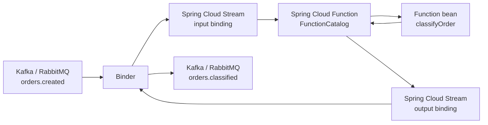

# The Role of FunctionCatalog in the Spring Cloud Stream Programming Model

## 1. Context and Learning Objectives

Suppose a sales service receives `orders.created` events from Kafka, computes the priority level for each order, and then emits `orders.classified` events. The classification logic only needs to understand an `OrderCreated` and produce an `OrderClassified`; the logic itself does not need to know about Kafka, RabbitMQ, HTTP, or serverless environments.

That is the approach of **Spring Cloud Function**: write business logic using the three Java interfaces `Supplier<T>`, `Function<I, O>`, and `Consumer<T>`, then let adapters decide how to invoke the functions. When an application receives or emits events through a broker, **Spring Cloud Stream** is the appropriate integration layer.

**FunctionCatalog** is the bridge between the two layers: it looks up functions by name or composition expression, normalizes invocation, and provides the function that Spring Cloud Stream uses to process messages.

After this lesson, you will be able to:

1. Distinguish the roles of `FunctionCatalog`, `ApplicationContext`, Spring Cloud Function, Spring Cloud Stream, and binders.
2. Explain the path of a message from a broker to a `Function` and back.
3. Configure `spring.cloud.function.definition`, composition, and binding names.
4. Identify common issues when there are multiple functions, incorrect function names, or mismatched data types.

## 2. Where Does FunctionCatalog Sit in the Architecture?

`FunctionCatalog` belongs to **Spring Cloud Function** and is typically auto-configured by Spring when the corresponding dependencies are present. It is a function catalog that can be looked up at runtime, not a queue and not a Kafka/RabbitMQ API.

| Component | Primary Responsibility | Example |
| --- | --- | --- |
| `Supplier<T>` | Produces data without needing input data | Emitting events on a schedule |
| `Function<I, O>` | Transforms an input into an output | Classifying orders |
| `Consumer<T>` | Receives data and processes it without returning an output | Logging, updating a database |
| `FunctionCatalog` | Finds, normalizes, composes, and prepares functions for invocation | Looking up `classifyOrder` by name |
| Spring Cloud Stream | Creates input/output bindings and dispatches messages to the selected function | `classifyOrder-in-0` |
| Binder | Connects bindings to a specific middleware | Kafka binder, RabbitMQ binder |



The diagram above illustrates **logical responsibilities**, not that every message directly calls `lookup()` every time it passes through. The framework can look up and prepare the function when setting up bindings, then reuse that function for subsequent executions.

If Kafka is replaced with RabbitMQ, most changes stay in the binder and destination configuration; `Function<OrderCreated, OrderClassified>` can remain unchanged. The same logic can also be exposed over HTTP via an appropriate Spring Cloud Function adapter or used in a serverless environment without putting protocol code into the business function.

## 3. How Does FunctionCatalog Discover and Normalize Functions?

### 3.1. From Java Beans to the Catalog

With the functional programming model, we declare beans using `@Bean`:

```java
import java.util.function.Consumer;
import java.util.function.Function;
import java.util.function.Supplier;

import org.springframework.context.annotation.Bean;
import org.springframework.context.annotation.Configuration;

@Configuration
class FunctionalConfiguration {

    @Bean
    Function<String, String> uppercase() {
        return value -> value.toUpperCase();
    }

    @Bean
    Consumer<String> audit() {
        return value -> System.out.println("Received: " + value);
    }

    @Bean
    Supplier<String> heartbeat() {
        return () -> "alive";
    }
}
```

Function beans are discovered and registered *lazily* by Spring Cloud Function in `FunctionCatalog`. The default bean names (`uppercase`, `audit`, `heartbeat`) become the names used to select functions. An annotation such as `@StreamListener` on each method is not required for them to become functions used by Spring Cloud Stream.

You can retrieve the catalog from the context:

```java
import org.springframework.cloud.function.context.FunctionCatalog;
import org.springframework.context.ApplicationContext;

FunctionCatalog catalog = context.getBean(FunctionCatalog.class);

// Look up the function normalized by Spring Cloud Function by name:
Object selectedFunction = catalog.lookup("uppercase");
```

The snippet above demonstrates **lookup**. In a typical Spring Cloud Stream application, you do not need to call `lookup()` manually: the `spring.cloud.function.definition` property tells the framework which function to retrieve.

### 3.2. Why Not Retrieve the Bean Directly from ApplicationContext?

`ApplicationContext.getBean("uppercase")` returns the raw business bean. `FunctionCatalog.lookup("uppercase")` returns a function representation prepared by Spring Cloud Function to support framework capabilities, including:

- **Signature normalization:** supports `Supplier`, `Function`, `Consumer`, as well as reactive types like `Flux`/`Mono`.
- **Data conversion:** combines the input/output types declared in the function with message metadata such as `contentType` to convert payloads into the appropriate type.
- **Function composition:** creates a single logical function from a chain of functions, such as `trim|uppercase`.
- **Routing:** supports selecting target functions via the `RoutingFunction` mechanism when an application genuinely needs to handle multiple message types conditionally.

This is why the catalog is not just a `Map<String, Function>`. However, the catalog **does not itself create topics, consumer groups, broker connections, retries, or exactly-once guarantees**; those behaviors depend on Spring Cloud Stream, the binder, and system configuration.

## 4. From Functions in the Catalog to Message Bindings

Spring Cloud Stream uses the name selected in `spring.cloud.function.definition` to identify the function and derive the bindings to create.

For a standard function:

```java
@Bean
Function<String, String> uppercase() {
    return String::toUpperCase;
}
```

The default binding names are:

| Function Signature | Input Binding | Output Binding |
| --- | --- | --- |
| `Function<I, O> uppercase` | `uppercase-in-0` | `uppercase-out-0` |
| `Consumer<T> audit` | `audit-in-0` | No automatic output binding |
| `Supplier<T> heartbeat` | No input binding | `heartbeat-out-0` |

The number `0` is the input/output index, not the partition count or consumer count. Functions with multiple inputs/outputs will have other indices, though normally each function has at most one input and one output.

Configuration example:

```yaml
spring:
  cloud:
    function:
      definition: uppercase
    stream:
      bindings:
        uppercase-in-0:
          destination: raw-text
          group: text-workers
        uppercase-out-0:
          destination: upper-text
```

Where:

- `definition: uppercase`: selects the `uppercase` bean via the Spring Cloud Function model.
- `uppercase-in-0`: the **internal** binding name for receiving events; `raw-text`: the destination name **on the broker**.
- `uppercase-out-0`: the **internal** binding name for emitting results; `upper-text`: the output destination.
- `group: text-workers`: consumer group configuration on the input side, handled by Spring Cloud Stream/the binder.

Do not confuse function names, binding names, and destination names. Changing a topic from `raw-text` to `incoming-text` does not require changing the bean name or the binding name.

**Note:** When an application has exactly one functional bean, Spring Cloud Stream can auto-detect that bean. Even so, declaring `spring.cloud.function.definition` explicitly is usually clearer and more stable, especially as the application grows and adds new beans.

## 5. Complete Example: Classifying Orders Over Kafka

### 5.1. Transport-Independent Business Function

Suppose the system receives JSON:

```json
{"orderId":"ORD-101","totalInCents":150000}
```

The classification function is based on the amount; it does not call Kafka APIs and does not directly read a `MessageChannel`:

```java
import java.util.function.Function;

import org.springframework.boot.SpringApplication;
import org.springframework.boot.autoconfigure.SpringBootApplication;
import org.springframework.context.annotation.Bean;

@SpringBootApplication
public class OrderStreamApplication {

    public static void main(String[] args) {
        SpringApplication.run(OrderStreamApplication.class, args);
    }

    public record OrderCreated(String orderId, long totalInCents) {}
    public record OrderClassified(String orderId, String priority) {}

    @Bean
    Function<OrderCreated, OrderClassified> classifyOrder() {
        return order -> {
            String priority =
                    order.totalInCents() >= 100_000 ? "PRIORITY" : "STANDARD";
            return new OrderClassified(order.orderId(), priority);
        };
    }
}
```

This is a `Function<OrderCreated, OrderClassified>`. The same lambda can be invoked in a unit test without a broker:

```java
var fn = new OrderStreamApplication().classifyOrder();
var result = fn.apply(
        new OrderStreamApplication.OrderCreated("ORD-101", 150_000)
);
// result.priority() == "PRIORITY"
```

### 5.2. Configuring Spring Cloud Stream to Invoke the Function

Add the `spring-cloud-stream-binder-kafka` dependency along with compatible Spring Boot and Spring Cloud dependencies to the project, then configure the Kafka connection. Example `application.yml`:

```yaml
spring:
  cloud:
    function:
      definition: classifyOrder
    stream:
      bindings:
        classifyOrder-in-0:
          destination: orders.created
          group: order-classifiers
          content-type: application/json
        classifyOrder-out-0:
          destination: orders.classified
          content-type: application/json
      kafka:
        binder:
          brokers: localhost:9092
```

Java `record` types and JSON support require a corresponding converter library (typically Jackson in Spring Boot applications). Note that `localhost:9092` is only an illustrative address; an active Kafka broker is required for real integration runs.

The path of an event:

1. The Kafka binder receives a record from destination `orders.created` via consumer group `order-classifiers`.
2. Spring Cloud Stream passes the record into binding `classifyOrder-in-0`; the message handling layer coordinates with Spring Cloud Function to convert the JSON payload into `OrderCreated`.
3. According to `spring.cloud.function.definition`, the framework selects `classifyOrder` in `FunctionCatalog` and invokes the classification logic.
4. The `OrderClassified` result is converted into the appropriate representation (here JSON) and emitted via binding `classifyOrder-out-0` to destination `orders.classified`.

Expected output for the sample event:

```json
{"orderId":"ORD-101","priority":"PRIORITY"}
```

If you switch input from Kafka to RabbitMQ, the `classifyOrder` function remains unchanged. You swap the binder, connection configuration, and corresponding destinations; delivery guarantee details depend on each binder.

## 6. Selecting One Function, Composing Multiple Functions, and Running Multiple Pipelines

### 6.1. A Single Function

```yaml
spring:
  cloud:
    function:
      definition: uppercase
```

The application uses the `uppercase` bean directly and creates bindings according to that bean's signature.

### 6.2. Composition: Functions Running Sequentially

`FunctionCatalog` can prepare a chain of functions as a single logical function:

```java
@Bean
Function<String, String> trim() {
    return String::trim;
}

@Bean
Function<String, String> uppercase() {
    return String::toUpperCase;
}
```

```yaml
spring:
  cloud:
    function:
      definition: trim|uppercase
```

With input `"  spring  "`, `trim` runs first, `uppercase` runs second, and the output is `"SPRING"`. The `|` operator expresses **in-application composition**, not a pipeline passing through two topics. Because this is a single logical pipeline, Spring Cloud Stream connects the input of the first function and the output of the last function to the broker; the composed function's binding names are derived from the composition name, so you should verify the actual names before configuring the corresponding destinations.

Composed types must be compatible: `Function<A, B>` → `Function<B, C>` produces `Function<A, C>`; `Function<A, B>` → `Consumer<B>` produces consumer behavior; `Supplier<A>` → `Function<A, B>` produces supplier behavior. You cannot arbitrarily place a `Consumer` in the middle of a chain and expect output from it.

### 6.3. Multiple Independent Functions: Semicolon

When **two separate pipelines** are needed, use `;`:

```yaml
spring:
  cloud:
    function:
      definition: uppercase;audit
    stream:
      bindings:
        uppercase-in-0:
          destination: text.incoming
        uppercase-out-0:
          destination: text.uppercase
        audit-in-0:
          destination: audit.incoming
```

Here `uppercase` and `audit` have separate input bindings; data arriving at `audit.incoming` does not automatically pass through `uppercase`. The `;` means selecting multiple definitions to bind independently, whereas `|` means chaining functions into a single definition.

When composition makes binding names hard to read, Spring Cloud Stream allows overriding the implicit binding name via `spring.cloud.stream.function.bindings.<implicit-name>=<explicit-name>`. However, renaming adds another mapping layer to track; for single functions, prefer the default convention.

## 7. FunctionCatalog Support for Message and Type Conversion

By default, business logic only needs to operate on the payload:

```java
@Bean
Function<String, String> uppercase() {
    return String::toUpperCase;
}
```

If you need to read event metadata (such as a correlation ID), you can declare `Message<T>`:

```java
import java.util.function.Function;

import org.springframework.context.annotation.Bean;
import org.springframework.messaging.Message;
import org.springframework.messaging.support.MessageBuilder;

@Bean
Function<Message<String>, Message<String>> addSource() {
    return incoming -> MessageBuilder.withPayload(incoming.getPayload())
            .copyHeaders(incoming.getHeaders())
            .setHeader("processedBy", "stream-service")
            .build();
}
```

In this example, the logic receives both payload and headers; the output is also a `Message`. Only use `Message<T>` when business logic genuinely needs headers. For pure business logic, `Function<T, R>` keeps code cleaner and easier to test.

Regarding JSON:

- The parameter type (`OrderCreated`) tells the framework the target Java type.
- The header or `contentType: application/json` configuration provides payload format information.
- Message converters participate when the actual payload does not yet match the target type.
- If you declare overly generic `Object` or `Message<?>`, the framework lacks sufficient hints to automatically turn the payload into the desired business POJO.

**Separating responsibilities:** invocation normalization and conversion capabilities belong to the Spring Cloud Function/Spring Cloud Stream layer; the Kafka binder works with records on the broker. `FunctionCatalog` is neither a standalone JSON parser nor a transport.

## 8. Dynamic Routing and Points to Watch

Spring Cloud Function provides `RoutingFunction`, typically named `functionRouter` in the catalog. This is an option when multiple event types need to be handled by different functions through a single entry point. Configuration or message metadata can provide function selection information, and routing can use expressions.

Distinguish the two mechanisms:

- **Composition** (`trim|uppercase`): all messages pass through the same processing chain in a predefined order.
- **Routing** (`functionRouter`): each message can be routed to a different target function depending on routing information.

With externally received data, you should not allow untrusted message headers to dictate arbitrary expression execution. Restrict valid targets and how expressions are evaluated. For reactive functions handling `Flux`, the framework may invoke the function once to set up the stream, so per-message routing thinking cannot be applied by default the same way as with imperative functions.

Similarly, an imperative `Supplier<T>` is typically triggered by Spring Cloud Stream via polling; `Supplier<Flux<T>>` and `Function<Flux<I>, Flux<O>>` must be understood according to the reactive stream lifecycle. The catalog's role remains finding/normalizing the function, while emitting and receiving on the broker is organized by the Stream/binder layer.

## 9. Common Errors and How to Diagnose Them

| Symptom | Possible Cause | How to Check or Fix |
| --- | --- | --- |
| Application has multiple function beans but bindings are not as expected | Did not specify which functions to bind | Set `spring.cloud.function.definition` to match the bean name, or declare definitions with `;` |
| Configured function not found | Wrong bean name, missing `@Bean`, wrong package scan, or incompatible signature | Check the bean name and test `catalog.lookup("function-name")` in the actual context |
| Function and bindings exist but no messages are received | Wrong destination name, binder not connected, wrong consumer group, or broker not running | Check `spring.cloud.stream.bindings.*` configuration, binder logs, and messaging infrastructure |
| Payload conversion failure | JSON does not match Java type, missing converter, or wrong `contentType` | Check sample payload, `Function<I, O>` types, JSON serializer/deserializer, and headers |
| Used `trim|uppercase` thinking they are two independent consumers | Confused composition with multiple definitions | Use `;` if separate bindings are needed, `|` if chaining functions |
| Changed destination name but configured the wrong binding | Confused function name, binding name, and topic name | Distinguish `classifyOrder`, `classifyOrder-in-0`, and `orders.created` |
| A function not meant to receive messages gets auto-bound | Only one functional bean exists so it was auto-detected | Configure `spring.cloud.function.definition` as intended, or consider `spring.cloud.stream.function.autodetect=false` |
| Looked up bean directly and expected composition/conversion | Retrieved raw bean from `ApplicationContext` | Let Stream use the catalog or look up via `FunctionCatalog` when there is a clear technical reason |

When debugging, trace from **definition → binding name → destination → binder connection → payload/headers → function output**. Checking layer by layer helps pinpoint whether the issue lies in function selection, transport configuration, or the business logic itself.

## 10. Self-Check Practice Exercises

From the `classifyOrder` example above, try three changes:

1. Send two events with `totalInCents` equal to `99_999` and `100_000`, respectively. The expected results are `STANDARD` and `PRIORITY`; this boundary is decided entirely by the business function.
2. Add a `Function<OrderCreated, OrderCreated> validateOrder` bean to verify that `orderId` is not blank, then change the definition to `validateOrder|classifyOrder`. Explain why this order differs from `classifyOrder|validateOrder` and why binding configuration needs to be reviewed when changing composition.
3. Create an additional `Consumer<OrderClassified> auditOrder` to record classified events. Choose between composing `classifyOrder|auditOrder` and two separate pipelines `classifyOrder;auditOrder`, then explain the difference regarding whether an output binding exists.

**Comprehension check questions:**

- Why is the presence of the `classifyOrder` bean in `ApplicationContext` not enough to know which topic it is bound to?
- What does `spring.cloud.function.definition` tell Spring Cloud Stream to select, and what does `spring.cloud.stream.bindings.*.destination` select?
- Why can a business function be reused over HTTP, a broker, or serverless?
- When JSON fails to convert to `OrderCreated`, would you inspect `FunctionCatalog`, the message format, or the binder first? Why?

## 11. Summary

`FunctionCatalog` is the component that **discovers, looks up, and normalizes functional beans** in Spring Cloud Function. It allows selecting functions by name, composing multiple functions, and integrating message conversion so that a single piece of Java logic can be invoked across different environments. Spring Cloud Stream uses this model to connect `Supplier`, `Function`, and `Consumer` to event-driven bindings and binders.

Three names to remember when reading a Spring Cloud Stream application:

- `classifyOrder`: the function name in the catalog.
- `classifyOrder-in-0` / `classifyOrder-out-0`: the application's binding names.
- `orders.created` / `orders.classified`: the destinations on the middleware.

### References

- [Spring Cloud Function — Programming model](https://docs.spring.io/spring-cloud-function/reference/spring-cloud-function/programming-model.html)
- [Spring Cloud Stream — Producing and consuming messages](https://docs.spring.io/spring-cloud-stream/reference/spring-cloud-stream/producing-and-consuming-messages.html)
- [Spring Cloud Stream — Functional binding names](https://docs.spring.io/spring-cloud-stream/reference/spring-cloud-stream/functional-binding-names.html)
- [Spring Cloud Stream — Message conversion mechanics](https://docs.spring.io/spring-cloud-stream/reference/spring-cloud-stream/mechanics.html)
