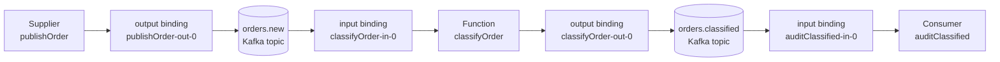
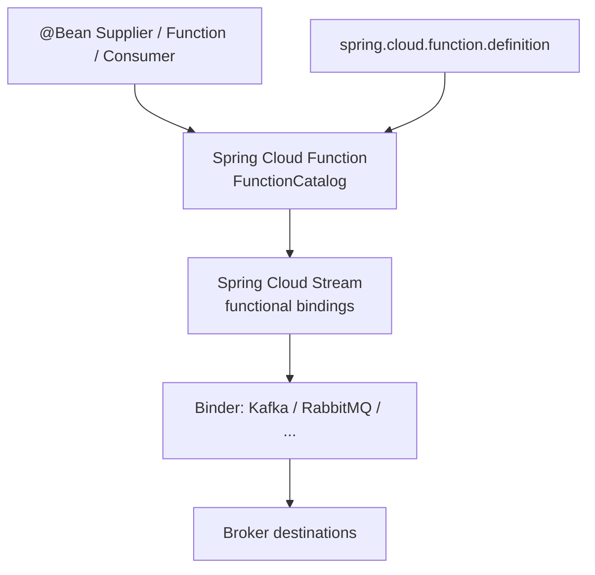

# Mapping Supplier, Function, and Consumer to Source, Processor, and Sink

## 1. From Function Model to Event Processing Model

In Spring Cloud Function, business logic is described through three standard Java interfaces: `Supplier<T>`, `Function<I, O>`, and `Consumer<T>`. These functions do not need to know whether they will be invoked via HTTP, events, or a serverless environment. When combined with **Spring Cloud Stream**, the three interfaces correspond respectively to three roles in an event-driven system:

- **Source:** generates data to emit, represented by `Supplier<T>`.
- **Processor:** receives data, transforms it, and emits the result, represented by `Function<I, O>`.
- **Sink:** receives data and performs the final action, represented by `Consumer<T>`.

For example, a sales system might emit a new order event, classify its priority level, and then record the result for auditing. The source, processor, and sink roles can live inside the same application or be deployed as separate services.



**Distinguish the two meanings of "destination/sink":** `Consumer<T>` is the final processing endpoint in Java code (sink); whereas `destination` in Stream configuration is the topic, queue, or logical address name on the middleware. A `Consumer` receives data *from* a destination through an input binding, rather than automatically turning into a topic with the same name as the bean.

### Learning Objectives

After this lesson, you will be able to:

1. Identify the data direction, trigger mechanism, and binding names corresponding to each function type.
2. Configure a `Supplier → Function → Consumer` pipeline using Spring Cloud Stream and the Kafka binder.
3. Distinguish chaining functions through a broker from composition in Spring Cloud Function.
4. Understand the roles of `FunctionCatalog`, payload conversion, consumer groups, and error handling in each role.
5. Write unit tests for business logic without starting a message broker.

## 2. Mapping Table of the Three Interfaces

| Java Interface | Role in Stream | Trigger Point | Default Binding | Meaning of Result |
| --- | --- | --- | --- | --- |
| `Supplier<T>` | Source | Poller or emission mechanism of a reactive stream | `<beanName>-out-0` | `T` is emitted to the output destination |
| `Function<I, O>` | Processor | A message/stream entering the input binding | `<beanName>-in-0` and `<beanName>-out-0` | `O` is sent to the output destination |
| `Consumer<T>` | Sink | A message/stream entering the input binding | `<beanName>-in-0` | No default output binding |

The names in the table are **Spring Cloud Stream conventions for simple functional beans**. The index `0` represents the first input/output port; it is not the partition count, consumer count, or message count. For multi-input/multi-output functions or composition, binding names must be verified according to the framework rules and actual configuration.

You can remember them by their function signatures:

```text
Supplier<T>      () -> T        source: no input needed, has output
Function<I, O>   I  -> O        processor: has input, has output
Consumer<T>      T  -> void     sink: has input, no output
```

The concept of "no input" here means **no input binding is automatically generated by Spring Cloud Stream for that bean**. A supplier can still read from a database, outbox, memory, or internal API to produce values. Similarly, a consumer can write to a database, call another service, or proactively emit a new event via another mechanism, but no output binding is inferred from the `Consumer<T>` signature.

## 3. Supplier: Mapping a Data-Producing Function to a Source

### 3.1. Characteristics

`Supplier<T>` returns a value of type `T` each time it is invoked. In the Stream model, the result of the invocation becomes an output message:

```java
import java.util.concurrent.atomic.AtomicLong;
import java.util.function.Supplier;

@Bean
Supplier<OrderCreated> publishOrder() {
    AtomicLong sequence = new AtomicLong();

    return () -> new OrderCreated(
            "ORD-" + sequence.incrementAndGet(),
            150_000L
    );
}
```

This function does not receive a payload from an input binding. Spring Cloud Stream creates the **output binding** `publishOrder-out-0` and sends the data emitted by the supplier to the configured destination.

Configuration example:

```yaml
spring:
  cloud:
    function:
      definition: publishOrder
    stream:
      bindings:
        publishOrder-out-0:
          destination: orders.new
          content-type: application/json
```

In this example, `publishOrder` is the bean/function name, `publishOrder-out-0` is the internal binding name, and `orders.new` is the destination on the broker.

### 3.2. When Is a Supplier Invoked?

For an **imperative supplier** of the form `Supplier<T>`, Spring Cloud Stream typically uses a *poller* to invoke the function at a configured interval. Each poll can produce new data; if the source has no new data, the supplier logic should be designed to match the non-emission semantics of the framework version in use.

Key points to remember:

- A supplier does not automatically receive messages from Kafka just because a Kafka binder is present in the application.
- A supplier is not invoked only once at startup in the default imperative model; it can be invoked repeatedly by the poller.
- The order-generating code above is for illustration only. If used as-is in production, the poller could continuously generate dummy orders. Real sources are usually an outbox, a query for pending records, a controlled schedule, or a stream of events with a clear lifecycle.
- With `Supplier<Flux<T>>` (reactive supplier), the trigger mechanism and stream lifecycle differ from an imperative supplier: the framework may obtain the reactive stream once and emit according to stream signals. Do not assume that every element in the `Flux` is a new supplier invocation.

If you want to proactively emit a message at the moment an internal API is called, consider Spring Cloud Stream's `StreamBridge`. That serves a different need than an automatically polled supplier.

## 4. Function: Mapping a Transformation to a Processor

### 4.1. Characteristics

`Function<I, O>` takes an input and produces a result, fitting the **processor** role:

```java
import java.util.function.Function;

@Bean
Function<OrderCreated, OrderClassified> classifyOrder() {
    return order -> {
        String priority = order.totalInCents() >= 100_000L
                ? "PRIORITY"
                : "STANDARD";
        return new OrderClassified(order.orderId(), priority);
    };
}
```

A processor has two sides:

- **Input:** Stream fetches a message from a destination, prepares the payload as type `OrderCreated`, and passes it to the function.
- **Output:** the `OrderClassified` result is converted into a message and sent via the output binding to the next destination.

```yaml
spring:
  cloud:
    function:
      definition: classifyOrder
    stream:
      bindings:
        classifyOrder-in-0:
          destination: orders.new
          group: classify-workers
          content-type: application/json
        classifyOrder-out-0:
          destination: orders.classified
          content-type: application/json
```

The processor does not need to know the specific Kafka topic. Changing `orders.new` to another destination name is a binding configuration change and does not require rewriting the classification algorithm.

### 4.2. Business Logic and Error Notes

A `Function` can contain pure logic: the same input produces the same output with no side effects. This is the easiest style to test and reuse. If the function writes to a database or calls an external API, you also need to consider retries, duplicate events, and idempotency.

Do not assume that when a function throws an exception, the framework always skips the message or always retries indefinitely. Retry mechanisms, dead-letter destinations, commit/acknowledgment, and delivery guarantees depend on the binder and specific configuration.

## 5. Consumer: Mapping a Final Action to a Sink

### 5.1. Characteristics

`Consumer<T>` receives data without returning a result for Spring Cloud Stream to emit further:

```java
import java.util.function.Consumer;

@Bean
Consumer<OrderClassified> auditClassified() {
    return event -> System.out.printf(
            "Audit: order=%s priority=%s%n",
            event.orderId(),
            event.priority()
    );
}
```

Spring Cloud Stream creates the input binding `auditClassified-in-0`. Because the signature has no return value, the framework **does not create** an output binding `auditClassified-out-0` for a standard consumer.

```yaml
spring:
  cloud:
    function:
      definition: auditClassified
    stream:
      bindings:
        auditClassified-in-0:
          destination: orders.classified
          group: audit-workers
          content-type: application/json
```

From an architectural perspective, a sink can perform many kinds of tasks: storing processing history, sending notifications, updating a read model, or aggregating statistics. In the example, printing a log is the simplest way to observe the output; in a real system, a durable audit service should be used if traceability is required.

### 5.2. Consumer Groups and Message Consumption

`group` is configured on the **input binding**. With Kafka, instances in the same group typically share work across a topic (by partition), whereas two different groups can both receive the same events for different purposes. `group` does not turn a consumer into an output topic.

For example, adding an email service using group `notify-workers` to read `orders.classified` will not prevent group `audit-workers` from receiving the same events, provided the data is still available according to retention settings and each group's read offset.

Consumers with side effects should pay special attention to **duplicate processing**. If an event is redelivered, a database write or notification send might execute a second time. You can use an event ID, unique constraints, or an idempotency strategy matching the business requirements.

## 6. Complete Example: source → processor → sink Over Kafka

### 6.1. Three Functional Beans in One Application

This example uses Java 17 or later for `record`. The three beans below are placed in the same Spring Boot application for ease of learning; they can equally be moved into three standalone applications with the corresponding destination configuration.

```java
import java.util.concurrent.atomic.AtomicLong;
import java.util.function.Consumer;
import java.util.function.Function;
import java.util.function.Supplier;

import org.springframework.boot.SpringApplication;
import org.springframework.boot.autoconfigure.SpringBootApplication;
import org.springframework.context.annotation.Bean;

@SpringBootApplication
public class OrderEventsApplication {

    public static void main(String[] args) {
        SpringApplication.run(OrderEventsApplication.class, args);
    }

    public record OrderCreated(String orderId, long totalInCents) {}

    public record OrderClassified(String orderId, String priority) {}

    // Source: creates a sample order when polled.
    @Bean
    Supplier<OrderCreated> publishOrder() {
        AtomicLong sequence = new AtomicLong();

        return () -> new OrderCreated(
                "ORD-" + sequence.incrementAndGet(),
                150_000L
        );
    }

    // Processor: transforms an order into a classification result.
    @Bean
    Function<OrderCreated, OrderClassified> classifyOrder() {
        return order -> new OrderClassified(
                order.orderId(),
                order.totalInCents() >= 100_000L
                        ? "PRIORITY"
                        : "STANDARD"
        );
    }

    // Sink: records the result, returns no output.
    @Bean
    Consumer<OrderClassified> auditClassified() {
        return event -> System.out.printf(
                "Audit: %s -> %s%n",
                event.orderId(),
                event.priority()
        );
    }
}
```

To run this demonstration, the project needs Spring Boot, Spring Cloud Stream with the **Kafka binder**, compatible Spring Cloud version management, and Jackson for JSON handling. You can add the binder via the `org.springframework.cloud:spring-cloud-stream-binder-kafka` dependency in a project with a compatible BOM configured. Kafka must be running; the following configuration example assumes a broker at `localhost:9092`.

### 6.2. Selecting All Three Functions and Connecting Them via Destinations

```yaml
spring:
  cloud:
    function:
      definition: publishOrder;classifyOrder;auditClassified
    stream:
      bindings:
        publishOrder-out-0:
          destination: orders.new
          content-type: application/json

        classifyOrder-in-0:
          destination: orders.new
          group: classify-workers
          content-type: application/json
        classifyOrder-out-0:
          destination: orders.classified
          content-type: application/json

        auditClassified-in-0:
          destination: orders.classified
          group: audit-workers
          content-type: application/json

      kafka:
        binder:
          brokers: localhost:9092
```

In `spring.cloud.function.definition`, the semicolon `;` selects **multiple independent definitions** so that Spring Cloud Stream sets up the corresponding bindings. The three beans do not call each other directly. Data moves between them through shared destinations.

| Step | Invoked Function | Input Binding | Output Binding | Related Destinations |
| --- | --- | --- | --- | --- |
| 1. Emit order | `publishOrder` | None | `publishOrder-out-0` | Emits to `orders.new` |
| 2. Classify | `classifyOrder` | `classifyOrder-in-0` | `classifyOrder-out-0` | Reads `orders.new`, emits `orders.classified` |
| 3. Audit | `auditClassified` | `auditClassified-in-0` | None | Reads `orders.classified` |

An expected data cycle:

```text
poller invokes publishOrder()
    -> OrderCreated("ORD-1", 150000)
    -> publishOrder-out-0 -> orders.new
    -> classifyOrder-in-0 -> classifyOrder(...)
    -> OrderClassified("ORD-1", "PRIORITY")
    -> classifyOrder-out-0 -> orders.classified
    -> auditClassified-in-0 -> auditClassified(...)
    -> log: Audit: ORD-1 -> PRIORITY
```

If the source, processor, and sink run in the same JVM, they still exchange data **through Kafka** because the configuration above connects them via the broker. When the broker temporarily stops or a message is redelivered, actual execution order and processing count will depend on binder, partition, and consumer group mechanics.

### 6.3. When Should They Be Split Into Multiple Services?

In a development environment, keeping all three beans in one application makes it easy to observe the full flow. In real deployments, you can split them if you need to scale the processor independently, isolate tasks that depend on external systems, or maintain clearer domain boundaries.

After splitting, each service typically selects only the definition it owns:

```yaml
# In the source service:
spring.cloud.function.definition: publishOrder

# In the processor service (separate application.yml):
spring.cloud.function.definition: classifyOrder

# In the sink service (separate application.yml):
spring.cloud.function.definition: auditClassified
```

These are three configuration snippets for **three different applications**, not a single YAML file. The connecting destinations remain `orders.new` and `orders.classified`.

## 7. What Role Does FunctionCatalog Play During Mapping?

Spring Cloud Function discovers functional beans in the Spring context and exposes them through **`FunctionCatalog`**. Spring Cloud Stream relies on this model to select functions according to `spring.cloud.function.definition`, prepare invocation, and determine bindings from each function's signature.



Boundaries to keep in mind:

- `FunctionCatalog` handles lookup, normalization, composition, and data-type handling support according to the Spring Cloud Function model.
- Spring Cloud Stream decides input/output bindings, connection setup, and how functions are triggered in a message-driven context.
- The binder manages interaction with a specific middleware, such as Kafka or RabbitMQ.
- The logic inside `Supplier`, `Function`, and `Consumer` determines the business value or effect.

Do not call `ApplicationContext.getBean("classifyOrder")` expecting it to automatically have a message binding. A Java bean is logic; bindings are established by Spring Cloud Stream based on the functional definition and configuration.

When an application has multiple functional beans, an explicit `spring.cloud.function.definition` configuration is important to select the right beans. If there is only one functional bean, some configurations/versions can auto-detect and bind that bean. Using explicit configuration keeps the application predictable as the number of beans grows.

## 8. How Does Composition Differ from a Broker Pipeline?

Spring Cloud Function supports **composition** using the `|` symbol. For example, given two functions:

```java
@Bean
Function<String, String> trim() {
    return String::trim;
}

@Bean
Function<String, String> uppercase() {
    return String::toUpperCase;
}
```

```yaml
spring:
  cloud:
    function:
      definition: trim|uppercase
```

Data `"  spring  "` passes through `trim` then `uppercase` to produce `"SPRING"`. The two steps form **one composed logical function**, and Stream binds the input and output of the chain as a single unit. You must check the implicit binding names of the composition before configuring destinations or mapping to explicit names with `spring.cloud.stream.function.bindings.*`.

Comparison:

| Criterion | Composition `trim\|uppercase` | Multiple Definitions `trim;uppercase` |
| --- | --- | --- |
| Execution relationship | The latter function directly receives the output of the former | Two functions are bound separately |
| Channel between the two functions | In-application function call / processing chain | Depends on input/output bindings and destinations |
| Number of logical pipelines | One | Two |
| Intermediate broker configuration | Not required | Needed if pipelines exchange data through a broker |
| Suitable when | Small steps sharing lifecycle and compatible data types | Independent sources/sinks needing separate flows or services |

Across the three roles, you can compose `Supplier<T>` with `Function<T, R>` to build a source emitting `R` if the framework version and function signatures are compatible. Similarly, composing `Function<I, O>` with `Consumer<O>` yields a pipeline ending in a side-effect handler with no standard output.

However, **do not treat `publishOrder;classifyOrder;auditClassified` as composition**. The `;` declares three independent functions, and the example flow only forms when the destinations of each pair match. This distinction determines where retries are placed, how scaling works, and delivery boundaries.

## 9. Data Types, Message, and Payload Conversion

The functional model favors business data types:

```java
Function<OrderCreated, OrderClassified> classifyOrder()
```

When a message arrives over Kafka, the payload may be represented as bytes or a JSON string. Spring Cloud Stream coordinates with Spring Cloud Function's message conversion mechanism to supply the appropriate input type according to the function signature and `contentType` information. When sending results, the output can be converted into the corresponding format.

There are two working styles:

**Payload only — the default choice when metadata is not needed**

```java
@Bean
Function<String, String> normalize() {
    return value -> value.trim().toLowerCase();
}
```

**Payload with headers — when a correlation ID or metadata is needed**

```java
import java.util.function.Function;
import org.springframework.messaging.Message;
import org.springframework.messaging.support.MessageBuilder;

@Bean
Function<Message<String>, Message<String>> tagMessage() {
    return message -> MessageBuilder
            .withPayload(message.getPayload().trim())
            .copyHeaders(message.getHeaders())
            .setHeader("normalizedBy", "order-stream")
            .build();
}
```

When using `Message<T>`, understand that externally arriving headers may be missing or untrusted. Rely on headers for business decisions only when proper validation rules and data checks are in place.

A common mistake is declaring `Function<Object, Object>` and expecting the framework to always know which record to map JSON into. The more specific the input type, the more information the framework has to assist conversion. When encountering errors, check the JSON schema, `contentType`, Jackson support, and Java types before changing core logic.

## 10. Testing at the Right Responsibility Layer

For the classification algorithm, you can test the function directly without creating Kafka, topics, or a binder:

```java
import static org.junit.jupiter.api.Assertions.assertEquals;
import org.junit.jupiter.api.Test;

class OrderEventsApplicationTest {

    @Test
    void classifyOrderUsesAmountThreshold() {
        var app = new OrderEventsApplication();
        var classify = app.classifyOrder();

        var below = classify.apply(
                new OrderEventsApplication.OrderCreated("ORD-1", 99_999L)
        );
        var atThreshold = classify.apply(
                new OrderEventsApplication.OrderCreated("ORD-2", 100_000L)
        );

        assertEquals("STANDARD", below.priority());
        assertEquals("PRIORITY", atThreshold.priority());
    }
}
```

This unit test verifies the classification rule; it does **not** prove that the broker is connected or that bindings are configured properly. For Stream integration, separately verify that the source actually emits to the expected destination, the processor reads and emits on the right topics, and the sink receives the expected payload. You can use the Spring Cloud Stream test binder for certain scenarios; behavior depending on actual Kafka requires integration testing with the corresponding broker.

Distinguish two different failures:

- Function unit test fails: most likely the business logic or data contract is wrong.
- Function unit test passes, yet no messages appear: inspect `definition`, binding names, destination, group, binder, broker, serialization, and consumer offset.

## 11. Common Mistakes When Mapping the Three Roles

| Symptom | Common Cause | How to Fix |
| --- | --- | --- |
| Supplier does not emit to topic | Wrong `publishOrder-out-0` name, destination, or binder | Check bean name, `definition`, output binding, and binder logs |
| Supplier emits messages continuously unexpectedly | Imperative supplier is polled on a schedule, and code always creates data | Design a conditional source; control poller and source data |
| Function produces no output | Wrong input destination, conversion error, or function throws an exception | Check input group, JSON payload, Java types, logs, and error handling mechanism |
| Consumer has no `-out-0` | `Consumer<T>` has no return value | This is expected behavior; use `Function` if transformation and forwarding are needed |
| Same event is processed repeatedly | Message redelivery, restart, retry, or non-idempotent side effect | Use an event ID and design operations to be safe on retries |
| Two consumers do not both receive an event | Both instances share the same group and therefore split work | Use different groups if two business functions need independent copies |
| All three beans are declared, yet they do not form a chain | Definition `a;b;c` only creates separate pipelines | Connect output/input via the same destination or intentionally use composition |
| Confusing bean name with topic name | `publishOrder`, `publishOrder-out-0`, and `orders.new` are three different names | Verify function, binding, and transport separately |
| Java tests pass, yet application does not consume from Kafka | Tests do not cover wiring, conversion, and broker | Add integration tests for connectivity and serialization |

A systematic way to debug is to trace across the three boundaries: **function logic → binding → broker**. If the logs report a function lookup error, check `spring.cloud.function.definition`. If the expected topic does not appear, inspect `spring.cloud.stream.bindings.*`. If messages arrive but the function does not receive the right type, inspect `contentType` and the payload.

## 12. Reinforcement Exercises

### Exercise 1: Identifying Bindings

Given three beans:

```java
Supplier<String> generate()
Function<String, Integer> length()
Consumer<Integer> store()
```

Fill in the default input/output binding names by convention, then identify which bean has no input and which bean has no output.

**Answer hint:** `generate-out-0`; `length-in-0` and `length-out-0`; `store-in-0`.

### Exercise 2: Connecting a Pipeline via Destinations

Suppose you need to emit text into `text.raw`, calculate its length and emit the result into `text.length`, and then have the final consumer read `text.length`. Write YAML using `spring.cloud.function.definition: generate;length;store` and connect the bindings properly.

**Acceptance criteria:** `generate-out-0` and `length-in-0` share destination `text.raw`; `length-out-0` and `store-in-0` share destination `text.length`; both input bindings have appropriate groups.

### Exercise 3: Choosing Composition vs. Separate Pipelines

One service needs to normalize an email address and then hash the data before emitting a message. Another system needs to classify orders, while the auditing step must be deployed and scaled independently. Choose between composition and a broker-based pipeline; explain your choice based on lifecycle, scalability, failure handling, and delivery requirements.

**Hint:** normalization and hashing usually suit composition when types and responsibilities are clear; independent auditing typically needs its own consumer/sink connected via a topic to decouple lifecycles.

### Self-Check

1. Why does `Supplier<T>` have no `-in-0` yet can still query a database?
2. When two applications use the same `orders.classified` destination and the same Kafka consumer group, is it guaranteed that both receive every event?
3. Why does `Consumer<T>` not generate a default output binding?
4. Distinguish `spring.cloud.function.definition`, binding name, and `destination`.
5. Switching from Kafka to RabbitMQ affects which layers, and why can most of the bean code stay unchanged?

## 13. Conclusion

The three functional interfaces form a consistent model for Spring Cloud Stream:

- **`Supplier<T>` → source → output binding:** emits data to the broker.
- **`Function<I, O>` → processor → input and output bindings:** reads, processes, and emits results.
- **`Consumer<T>` → sink → input binding:** reads and completes a business action, with no default return output.

`FunctionCatalog` allows Spring Cloud Function to manage, look up, and compose this logic; Spring Cloud Stream maps them into bindings; and binders connect those bindings to Kafka, RabbitMQ, or suitable middleware. Thanks to this separation, the same business function can be tested independently and reused over HTTP, event-driven, or serverless environments given appropriate adapters and configuration.

### References

- [Spring Cloud Function — Programming model](https://docs.spring.io/spring-cloud-function/reference/spring-cloud-function/programming-model.html)
- [Spring Cloud Stream — Producing and consuming messages](https://docs.spring.io/spring-cloud-stream/reference/spring-cloud-stream/producing-and-consuming-messages.html)
- [Spring Cloud Stream — Functional binding names](https://docs.spring.io/spring-cloud-stream/reference/spring-cloud-stream/functional-binding-names.html)
- [Spring Cloud Stream — Polling configuration and suppliers](https://docs.spring.io/spring-cloud-stream/reference/spring-cloud-stream/producing-and-consuming-messages.html)
