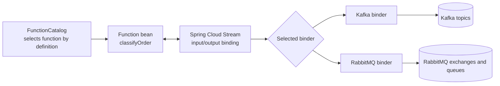
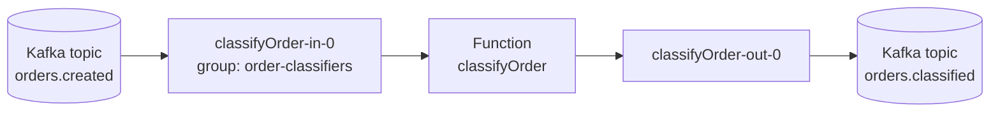
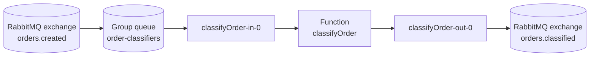
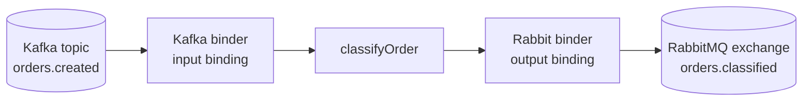

# Choosing Kafka or RabbitMQ Binder by Environment

## 1. Context: Swapping Brokers While Reusing Business Logic

Suppose a service receives `orders.created` events, classifies orders, and emits `orders.classified` results. The development environment uses an existing RabbitMQ instance, whereas production has Kafka for event retention and replay. If business code calls the Kafka consumer or RabbitMQ listener directly, switching middleware can force major code changes.

**Spring Cloud Function** lets you express logic using `Supplier<T>`, `Function<I, O>`, and `Consumer<T>`, independent of whether it is triggered over HTTP, events, or serverless. **Spring Cloud Stream** uses those functions to create sources, processors, or sinks in a message-driven model. The **Binder** is the integration layer between Spring Cloud Stream bindings and Kafka, RabbitMQ, or a specific middleware; **FunctionCatalog** finds and normalizes registered functions.

This lesson focuses on two related but distinct decisions:

1. Choosing **Kafka or RabbitMQ** based on retention, replay, routing, throughput, reliability, and operational requirements.
2. Choosing the **binder in Spring Cloud Stream** via dependencies and environment-specific configuration while keeping the `Function` logic unchanged.

After this lesson, you will be able to configure the same bean to run with Kafka or RabbitMQ, distinguish destinations and consumer groups across the two brokers, handle scenarios using multiple binders, and recognize characteristics that are not automatically equivalent when switching brokers.

## 2. Where Does the Binder Sit in the System?



For example, consider a function named `classifyOrder` with signature `Function<OrderCreated, OrderClassified>`. Spring Cloud Stream normally derives two bindings:

- `classifyOrder-in-0`: where incoming messages are received.
- `classifyOrder-out-0`: where outgoing messages are emitted.

Configuring `destination: orders.created` identifies the data source on the broker, while `destination: orders.classified` identifies the target for sending results. Binding names are an application-internal concept; destinations are a middleware concept mapped by the binder.

| Component | Responsibility | Example |
| --- | --- | --- |
| Java functional bean | Business processing | `classifyOrder` |
| `spring.cloud.function.definition` | Selects a bean or composition from FunctionCatalog | `classifyOrder` |
| Input/output binding | Stream-managed input/output port | `classifyOrder-in-0` |
| Binder | Connects that port to middleware | `kafka` or `rabbit` |
| Destination | Where messages are sent or received | `orders.created` |
| Consumer group | Input processing group | `order-classifiers` |

**Terminology warning:** the destination `orders.created` usually maps to a **topic** in Kafka, whereas with the RabbitMQ binder it typically involves an **exchange** and a queue bound to that exchange. The two brokers do not share the same physical topology merely because they use the same destination name.

## 3. Comparing Kafka and RabbitMQ Against Real Requirements

| Criterion | Kafka | RabbitMQ |
| --- | --- | --- |
| Common model | Distributed event log, topic, partition | Broker with exchange, queue, and routing |
| How consumers receive | Read records by consumer group and offset | Read messages from a queue routed by an exchange |
| Data after processing | Remains in topic per retention policy, independent of consumption | Messages are typically removed from the queue after successful ack |
| History replay | Can re-read records still within retention using appropriate offset/group | No built-in replay for acked messages; requires separate storage and replay design |
| Parallelism | Within a group, bounded by partition count | Multiple consumers can compete for messages in the same queue |
| Ordering | Ordered within each partition; no global ordering across partitions | Depends on consumption pattern, prefetch, concurrency, and redelivery |
| Routing | Topic, key, partition, and application logic | Exchange, binding key, and queue |
| Common strengths | Streaming, event log, multiple independent groups, replay | Task queues, work distribution, exchange-based routing |
| Operational observability | Lag, offset, partition, retention | Queue depth, unacked messages, exchange/queue, redelivery |

This table describes typical patterns. Kafka can also distribute work tasks and RabbitMQ has stream variants; these are not absolute limits of either product. You must compare specific broker versions, queue types, topologies, configurations, and goals.

### 3.1. When Kafka Is a Good Fit

Consider Kafka if:

- Multiple systems need to read the same event stream and process it independently, such as billing, audit, and analytics.
- There is a **replay** requirement to rebuild state within the active retention window.
- Data can be partitioned by a key (`orderId` or `customerId`) to scale throughput and preserve per-key ordering.
- Infrastructure already has operational tooling for Kafka, consumer lag, retention, security, and schema evolution.

Example: services emitting order state change events and analytics teams needing to re-read history within the retention period.

### 3.2. When RabbitMQ Is a Good Fit

Consider RabbitMQ if:

- The system mainly processes **asynchronous tasks/commands**, where each task needs one worker in a pool to execute it.
- Flexible routing to multiple queues via exchanges and routing keys is needed.
- The operations team already manages queues, dead-lettering, prefetch, acks, and retry policies well.
- There is no requirement to replay the entire history of successfully acknowledged messages.

Example: distributing requests to send emails, generate PDF invoices, process files, and tasks requiring multiple worker groups.

You cannot conclude that Kafka is always faster or RabbitMQ is always easier to operate for every application. The decision should be measured by throughput, message size, access patterns, expected failures, operational capacity, and recovery requirements.

## 4. Writing Binder-Independent Business Functions

Use Java 17+ to declare a record and a Java functional bean:

```java
import java.util.function.Function;

import org.springframework.boot.SpringApplication;
import org.springframework.boot.autoconfigure.SpringBootApplication;
import org.springframework.context.annotation.Bean;

@SpringBootApplication
public class OrderApplication {

    public static void main(String[] args) {
        SpringApplication.run(OrderApplication.class, args);
    }

    public record OrderCreated(String orderId, long totalInCents) {}

    public record OrderClassified(String orderId, String priority) {}

    @Bean
    Function<OrderCreated, OrderClassified> classifyOrder() {
        return order -> new OrderClassified(
                order.orderId(),
                order.totalInCents() >= 100_000L
                        ? "PRIORITY"
                        : "STANDARD"
        );
    }
}
```

The classification rule does not depend on Kafka, RabbitMQ, HTTP, or serverless. When Stream triggers it, FunctionCatalog supplies the registered function; the message handling layer combines the `OrderCreated` type and information like `contentType` to convert the incoming payload, then handles the `OrderClassified` result.

With the same input:

```json
{"orderId":"ORD-101","totalInCents":150000}
```

Expected business output:

```json
{"orderId":"ORD-101","priority":"PRIORITY"}
```

The same bean can also be exposed over HTTP using an appropriate Spring Cloud Function adapter or deployed serverlessly with corresponding configuration. When switching adapters, pure logic remains reusable; transport behavior, authentication, and lifecycle still depend on the environment.

## 5. Dependencies: Profiles Can Only Select Binders Present in the Application

To use the Kafka binder or RabbitMQ binder, the project needs the corresponding dependency:

| Binder | Maven Artifact |
| --- | --- |
| Kafka | `org.springframework.cloud:spring-cloud-stream-binder-kafka` |
| RabbitMQ | `org.springframework.cloud:spring-cloud-stream-binder-rabbit` |

If **a single JAR file** must be able to select either binder by profile, both dependencies can be packaged. For example, in a Maven project that already has a Spring Cloud BOM compatible with Spring Boot:

```xml
<dependencies>
    <dependency>
        <groupId>org.springframework.cloud</groupId>
        <artifactId>spring-cloud-stream-binder-kafka</artifactId>
    </dependency>
    <dependency>
        <groupId>org.springframework.cloud</groupId>
        <artifactId>spring-cloud-stream-binder-rabbit</artifactId>
    </dependency>
</dependencies>
```

Do not assign an arbitrary version to a binder. Choose a Spring Boot/Spring Cloud pair supported by the project and let the BOM manage versions. If each environment is built into a separate artifact containing only one binder, switching profiles **will not automatically add the missing dependency**.

In addition to dependencies, the runtime environment must have the corresponding broker and appropriate permissions, network configuration, and broker resources.

## 6. Shared Configuration Across Both Binders

Properties belonging to the logical layer should be declared broker-independently in `application.yml`:

```yaml
spring:
  cloud:
    function:
      definition: classifyOrder
    stream:
      bindings:
        classifyOrder-in-0:
          destination: orders.created
          group: order-classifiers
          content-type: application/json
        classifyOrder-out-0:
          destination: orders.classified
          content-type: application/json
```

**Configuration explanation:**

- `definition: classifyOrder` selects the exact function to bind via the Spring Cloud Function model.
- `classifyOrder-in-0` and `classifyOrder-out-0` are derived from a standard `Function<I, O>`.
- `orders.created` and `orders.classified` are **logical destination names** interpreted by the binder.
- `group: order-classifiers` lets Stream identify the message-receiving group. How groups are implemented differs between Kafka and RabbitMQ.
- `content-type: application/json` supports JSON payload handling; Java records require JSON serialization/deserialization support (typically Jackson).

When an application has multiple functional beans, explicitly specify `spring.cloud.function.definition`. Otherwise, auto-detection may not select the flow you intend.

## 7. Selecting Kafka with a Spring Profile

Create `application-kafka.yml` with Kafka configuration:

```yaml
spring:
  cloud:
    stream:
      defaultBinder: kafka
      kafka:
        binder:
          brokers: ${KAFKA_BROKERS:localhost:9092}
```

Activate the profile:

```bash
java -jar order-service.jar --spring.profiles.active=kafka
```

When both the Kafka and RabbitMQ binders are on the classpath, `defaultBinder: kafka` indicates that bindings without an explicit `binder` property should use Kafka. `brokers` provides the list of reachable Kafka brokers. `localhost:9092` is only an example for local testing; on Docker/Kubernetes, advertised listeners and networking between the application and Kafka must also be considered.

Processing flow:



Kafka-specific factors:

- **Groups and offsets:** consumers in the same group split partitions; another group can read the same topic at its own position.
- **Replay:** processed records may remain in the topic per retention; re-reading requires an appropriate offset/group while records are still available.
- **Parallelism:** increasing the number of instances beyond the number of partitions assigned to the group does not automatically increase parallelism.
- **Ordering:** Kafka preserves order within each partition; keys and partitioning must align with business ordering needs.
- **Error handling:** retry/DLQ, offset commits, and recovery must be configured as required; arbitrary exactly-once guarantees do not come automatically just from using Kafka.

## 8. Selecting RabbitMQ with a Spring Profile

Create `application-rabbit.yml`:

```yaml
spring:
  rabbitmq:
    host: ${RABBITMQ_HOST:localhost}
    port: ${RABBITMQ_PORT:5672}
    username: ${RABBITMQ_USERNAME:guest}
    password: ${RABBITMQ_PASSWORD:guest}
    virtual-host: ${RABBITMQ_VHOST:/}
  cloud:
    stream:
      defaultBinder: rabbit
```

Activate the profile:

```bash
java -jar order-service.jar --spring.profiles.active=rabbit
```

In typical configurations, the RabbitMQ binder uses the connection configured via `spring.rabbitmq.*`. The `guest` account is only for illustrating a local test broker; production should retrieve credentials from a secrets management system, apply least privilege, and configure TLS if required.

Structural diagram:



For the RabbitMQ binder, a destination is usually mapped to an exchange. The input group participates in the rules for creating/selecting a queue and binding the queue to the exchange. Specific queue names, routing keys, durable queues, and declaration permissions should be verified against the binder configuration.

**Core difference:** a message successfully acked by a consumer typically no longer remains in the consuming queue, so full history cannot be replayed by default as when records remain in a Kafka topic. If replay is needed, you must have a dedicated storage and replay mechanism or an appropriate queue/stream architecture.

Criteria that usually need configuration in RabbitMQ include queue durability, consumer concurrency, prefetch, acknowledgement, redelivery, dead-lettering, routing keys, and permissions to create exchanges/queues.

## 9. Profile Configuration in a Single YAML File

If you want to use a single `application.yml` file, Spring Boot supports multi-document YAML separated by `---`:

```yaml
# Shared configuration section:
spring:
  cloud:
    function:
      definition: classifyOrder
    stream:
      bindings:
        classifyOrder-in-0:
          destination: orders.created
          group: order-classifiers
          content-type: application/json
        classifyOrder-out-0:
          destination: orders.classified
          content-type: application/json

---
spring:
  config:
    activate:
      on-profile: kafka
  cloud:
    stream:
      defaultBinder: kafka
      kafka:
        binder:
          brokers: ${KAFKA_BROKERS:localhost:9092}

---
spring:
  config:
    activate:
      on-profile: rabbit
  cloud:
    stream:
      defaultBinder: rabbit
  rabbitmq:
    host: ${RABBITMQ_HOST:localhost}
    port: ${RABBITMQ_PORT:5672}
    username: ${RABBITMQ_USERNAME:guest}
    password: ${RABBITMQ_PASSWORD:guest}
```

This is **one file** with three YAML documents. The `spring.config.activate.on-profile` sections take effect only when the corresponding profile is enabled. Do not mix separate profile files and profile documents in `application.yml` simultaneously unless you have verified the override precedence.

In this single-binder example, you should activate **one** of the two profiles, `kafka` or `rabbit`. If both are accidentally activated, `defaultBinder` may be overridden depending on configuration order.

| Property | Where to Place | Meaning |
| --- | --- | --- |
| `spring.cloud.function.definition` | Shared | Selects the Java function |
| `spring.cloud.stream.bindings.*.destination` | Shared or profile if environment names differ | Selects the logical destination |
| `spring.cloud.stream.bindings.*.group` | Shared or profile | Identifies the event-receiving group |
| `spring.cloud.stream.bindings.*.content-type` | Shared | Payload contract |
| `spring.cloud.stream.defaultBinder` | Per profile | Selects Kafka/RabbitMQ binder |
| `spring.cloud.stream.kafka.binder.*` | Kafka profile | Kafka binder connection and configuration |
| `spring.rabbitmq.*` | Rabbit profile | RabbitMQ connection |

Supply appropriate environment variables and credentials when running for real. Avoid committing production passwords or sensitive broker endpoints to source control.

## 10. When Multiple Binders Are Needed Simultaneously

Another scenario from profile switching is **reading from Kafka while emitting to RabbitMQ** in the same application—for example, a bridge carrying messages from an event streaming platform to a task-processing queue system.

In that case, configure `binder` on a **per-binding** basis:

```yaml
spring:
  cloud:
    function:
      definition: classifyOrder
    stream:
      bindings:
        classifyOrder-in-0:
          binder: kafka
          destination: orders.created
          group: order-bridge
          content-type: application/json
        classifyOrder-out-0:
          binder: rabbit
          destination: orders.classified
          content-type: application/json
      kafka:
        binder:
          brokers: ${KAFKA_BROKERS:localhost:9092}
  rabbitmq:
    host: ${RABBITMQ_HOST:localhost}
    port: ${RABBITMQ_PORT:5672}
    username: ${RABBITMQ_USERNAME:guest}
    password: ${RABBITMQ_PASSWORD:guest}
```

This example assumes both binders are on the classpath and the registered binder configuration names are `kafka` and `rabbit`. In systems declaring binder instances with custom names via `spring.cloud.stream.binders.<name>`, the `binder` property must point to the **declared instance name**. Do not assume an arbitrary binder name always matches the middleware type name.



Even though `classifyOrder` is a pure function, the bridge must still handle the case where a message has been published to RabbitMQ but the process crashes before the Kafka input is acknowledged. In that situation, data may be received again and sent as a duplicate. There is no automatic distributed transaction spanning both brokers merely from choosing two binders.

Solutions typically include event IDs, idempotent handling at the target consumer, bounded retries, dead-letter monitoring, and recovery procedures. Using two binders should be justified by clear integration needs because it increases operational complexity.

## 11. Meaning of Consumer Group in Both Binders

`group` has a real impact on how messages are distributed across consumers, though the brokers implement it differently.

**In Kafka:** instances in the same group receive assigned partitions from the topic. A message in a given partition is generally processed by one assigned consumer in the group at a time; independent groups maintain separate offsets and can read the same records still within retention.

**In RabbitMQ:** the Spring Cloud Stream Rabbit binder typically creates/selects a queue per group and binds that queue to the exchange. Instances in the same group generally compete to consume from that group's queue; another group can use a different queue to receive copies according to the corresponding exchange binding.

For example, `order-classifiers` and `order-auditors` are two independent business groups. Both can receive data from destination `orders.created` if each broker's configuration ensures delivery to both groups.

What not to confuse: a Kafka consumer group is not a RabbitMQ queue, a Kafka partition is not a RabbitMQ exchange, and changing a consumer group can alter the read position or topology. When switching brokers, run separate integration tests for data delivery behavior.

## 12. Error, Retry, and DLQ Configuration per Binder

A shared setting such as `content-type: application/json` does not guarantee identical error-handling behavior.

### Kafka binder

Factors to verify: offset commit, retry, DLQ topic, record key/partition, DLQ retention, and replay capability. Example option to enable DLQ for an input binding:

```yaml
spring:
  cloud:
    stream:
      kafka:
        bindings:
          classifyOrder-in-0:
            consumer:
              enableDlq: true
```

This only illustrates a Kafka-binder-specific property. In a real environment, check the consumer group, DLQ topic, create/write permissions, DLQ naming, and retry behavior of the framework version in use.

### RabbitMQ binder

Factors to verify: queue/exchange, acknowledgement, requeue, prefetch, dead-letter exchange/queue, provisioning permissions, and avoiding infinite error loops. Example option:

```yaml
spring:
  cloud:
    stream:
      rabbit:
        bindings:
          classifyOrder-in-0:
            consumer:
              autoBindDlq: true
```

This is a Rabbit-binder-specific property. If production manages exchanges/queues with infrastructure as code, ensure the binder configuration and broker policies align; do not assume the application has permission to auto-create all resources.

| Error Requirement | Kafka Binder | RabbitMQ Binder |
| --- | --- | --- |
| Confirm input processing | Offset/commit and consumer semantics | Ack/nack and queue semantics |
| Replay old data | Offsets on a topic within retention | Requires separate storage/replay once acked |
| Unprocessable messages | Retry, DLQ topic depending on configuration | Retry, requeue, DLQ/Dead Letter Exchange depending on configuration |
| Backlog monitoring | Consumer lag/offset | Queue depth/unacked messages |
| Duplicate-free guarantee | Requires idempotency and proper delivery design | Requires idempotency and proper delivery design |

Do not promise "exactly once" for an entire workflow merely by picking Kafka or enabling DLQ. Side effects to a database, HTTP, or another broker still require separate guarantees.

## 13. What Stays Unchanged When Switching Binders vs. What Must Be Verified

**Usually stays unchanged:**

- The `Function<OrderCreated, OrderClassified>` and unit tests for classification rules.
- The function name in `spring.cloud.function.definition`.
- Binding name conventions `classifyOrder-in-0` and `classifyOrder-out-0`.
- The JSON contract if both sides accept that schema.
- Composition expressions like `validate|classifyOrder` if the functions have compatible types.

**Must be verified and may need changes:**

1. Binder dependencies, connection configuration, TLS, credentials, and access permissions.
2. Kafka topics versus RabbitMQ exchanges and queues, auto-provisioning, and the source of truth managing topology.
3. Consumer groups, work distribution, ordering, concurrency, partitions, or prefetch.
4. Offsets, acknowledgements, retries, replay, and dead-letter policies.
5. Existing data on the old broker: switching profiles does not automatically migrate history or backlogged queues to the new broker.
6. Headers, `contentType`, schema evolution, and payload conversion.
7. Metrics, alerts, and incident runbooks tailored to each broker.

**Environment recommendation:** staging should test with infrastructure and semantics close to production. Using RabbitMQ for local development can save effort, but it does not replace integration testing on Kafka if production relies on partitions, offsets, replay, or Kafka-specific error handling.

## 14. Testing and Verifying the Binder Choice

### 14.1. Unit Testing the Business Function

Test the bean directly to ensure logic does not depend on the broker:

```java
import static org.junit.jupiter.api.Assertions.assertEquals;
import org.junit.jupiter.api.Test;

class OrderApplicationTest {

    @Test
    void classifiesOrdersRegardlessOfBinder() {
        var fn = new OrderApplication().classifyOrder();

        var normal = fn.apply(
                new OrderApplication.OrderCreated("ORD-1", 99_999L)
        );
        var priority = fn.apply(
                new OrderApplication.OrderCreated("ORD-2", 100_000L)
        );

        assertEquals("STANDARD", normal.priority());
        assertEquals("PRIORITY", priority.priority());
    }
}
```

This test proves the business rule at the `100_000` threshold, but it **does not prove** that the broker is connected, messages are serialized, consumers ack/commit, or DLQ works.

### 14.2. Integration Testing with Kafka

1. Start Kafka and configure a reachable `KAFKA_BROKERS`; ensure required topics exist or are provisioned according to policy.
2. Run the application with the `kafka` profile and verify in the logs that bindings are attached to the Kafka binder.
3. Send JSON `{"orderId":"ORD-101","totalInCents":150000}` to topic `orders.created`.
4. Read topic `orders.classified` and confirm the result has `priority: PRIORITY`.
5. Inspect group `order-classifiers` and consumer lag; test restarts, send a malformed/failing message, and observe retry/DLQ if configured.

### 14.3. Integration Testing with RabbitMQ

1. Start RabbitMQ and provide appropriate connection/virtual host/credentials.
2. Run the application with the `rabbit` profile; inspect the exchange, the group's queue, and binding/routing in RabbitMQ management or equivalent tooling.
3. Publish a matching message to exchange `orders.created`, observing the message being processed and emitted through exchange `orders.classified`.
4. Use a test consumer on the proper queue/binding to check the output; observe unacked count, queue depth, and redelivery.
5. Test failing messages in an isolated environment to verify retry/requeue/DLQ behavior.

Kafka and RabbitMQ publish/consume tools are not interchangeable. Integration tests must cover the real topology of the broker in use.

## 15. Common Troubleshooting Matrix

| Symptom | Possible Cause | Resolution |
| --- | --- | --- |
| Both dependencies present but app reports ambiguous binder | Missing `defaultBinder` or binder instance name mismatch | Select the right profile and binder name; check startup logs |
| Selected Rabbit but Rabbit binder is missing | Runtime artifact lacks the dependency | Verify dependencies and final packaged artifact |
| Kafka does not receive messages | Wrong brokers/advertised listeners, topic, group, offset, or permissions | Check connectivity, topic, consumer lag, and Kafka logs |
| Rabbit exchange has messages but function does not run | Queue not bound, wrong routing key/group, or missing permissions | Inspect exchange → queue topology and consumers |
| JSON fails to convert to `OrderCreated` | Schema, content type, or converter mismatch | Inspect payload, headers, and function signature |
| Messages processed repeatedly after switching binders | Retry/rebalance/redelivery or lack of idempotency | Use event IDs and safe duplicate handling |
| App runs without producing output | Wrong output destination or function throws exception | Check `classifyOrder-out-0` binding, logs, and DLQ |
| New Kafka group does not read history as expected | Offset policy or retention | Check offset reset settings and whether records still exist |
| Rabbit consumer works but cannot replay | Messages were acked and removed from queue | Design separate storage/replay if mandatory |
| Kafka → Rabbit bridge emits duplicates | No shared transaction across both brokers | Design idempotent downstream handling and retry/recovery |

Investigate in order: **function definition → binding name → selected binder → destination/topology → broker connection → payload/conversion → ack or offset**. This helps isolate whether the defect is in configuration or business logic.

## 16. Applied Exercises

### Exercise 1: Choosing a Broker

Three systems have different requirements:

1. An analytics system needs multiple groups to re-read order event history within the retention period.
2. A system processes PDF generation requests; each task should be completed by one worker, and failed tasks sent to a DLQ.
3. An existing system already runs RabbitMQ, only needs a task queue, and does not require replay.

Recommend a binder for each system and justify based on retention/replay, routing, scaling, infrastructure, and operations. Do not choose merely because of technology popularity.

### Exercise 2: Switching Profiles

Starting from the `classifyOrder` function, create a shared configuration along with two profiles `kafka`/`rabbit`. Identify the values of:

- `spring.cloud.function.definition`;
- `spring.cloud.stream.defaultBinder`;
- `classifyOrder-in-0.destination` and `classifyOrder-out-0.destination`;
- `spring.cloud.stream.bindings.classifyOrder-in-0.group`.

A correct answer must separate **bean name**, **binding name**, **destination**, and **binder name**.

### Exercise 3: Kafka In, RabbitMQ Out

Configure `classifyOrder-in-0.binder: kafka` and `classifyOrder-out-0.binder: rabbit`. Suppose RabbitMQ has received the event, but the process crashes before the Kafka input is acknowledged; explain the risk and propose a mechanism to prevent duplicate processing.

### Self-Check Questions

1. Why can you change the binder by profile without changing `Function<OrderCreated, OrderClassified>`?
2. How does the `orders.created` destination differ as a physical entity between Kafka and RabbitMQ?
3. What role does `group` play for Kafka consumers versus RabbitMQ queues?
4. When is replay an important architectural requirement?
5. Why does running integration tests with RabbitMQ not verify Kafka's offset and partition behavior?
6. If an application has both Kafka and RabbitMQ binders, which property specifies the binder per binding?

## 17. Summary

**Kafka** is typically chosen for event streaming with topics, partitions, retention, and replay. **RabbitMQ** typically fits queue-based models, exchange routing, and asynchronous task processing. The choice still must be grounded in each environment's load, SLA, operations, and data requirements.

At the application layer, **Spring Cloud Function** keeps logic as `Supplier`, `Function`, and `Consumer`; **FunctionCatalog** finds/normalizes functions; **Spring Cloud Stream** creates bindings; and the **binder** delivers messages to Kafka or RabbitMQ. `spring.cloud.stream.defaultBinder` selects the binder per profile, while `spring.cloud.stream.bindings.<binding>.binder` selects the binder per port when multiple brokers must be combined.

The most important takeaway when switching environments: keeping business functions intact is a major advantage, but **you must re-verify broker delivery semantics**, especially ordering, retries, replay, acknowledgement, groups, and idempotency.

### References

- [Spring Cloud Stream — Reference documentation](https://docs.spring.io/spring-cloud-stream/reference/)
- [Spring Cloud Stream — Producing and consuming messages](https://docs.spring.io/spring-cloud-stream/reference/spring-cloud-stream/producing-and-consuming-messages.html)
- [Spring Cloud Stream — Functional binding names](https://docs.spring.io/spring-cloud-stream/reference/spring-cloud-stream/functional-binding-names.html)
- [Spring Cloud Function — Reference documentation](https://docs.spring.io/spring-cloud-function/reference/)
- [Apache Kafka — Documentation](https://kafka.apache.org/documentation/)
- [RabbitMQ — Documentation](https://www.rabbitmq.com/docs)
