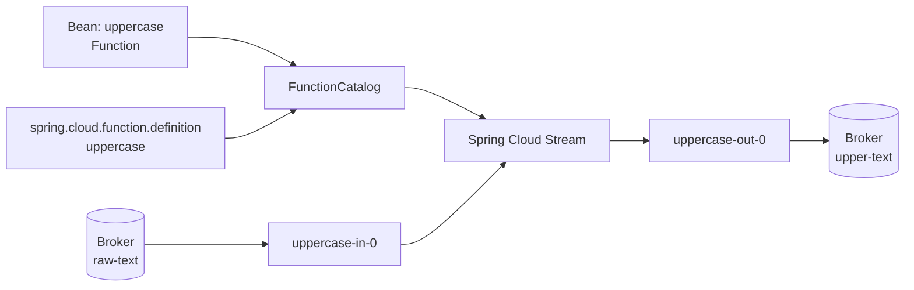
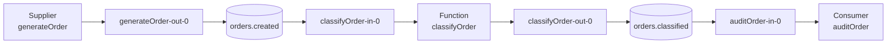

# The `<function>-in-0` and `<function>-out-0` Binding Convention

## 1. Why Understanding Binding Names Matters

In **Spring Cloud Function**, we describe business logic using `Supplier<T>`, `Function<I, O>`, and `Consumer<T>` rather than coupling tightly to a single protocol. The same function can be triggered via HTTP, events, or a serverless environment given an appropriate adapter. When using **Spring Cloud Stream** to bring a function into an event stream, the framework creates logical connection endpoints called *bindings*.

Suppose we declare:

```java
@Bean
Function<String, String> uppercase() {
    return String::toUpperCase;
}
```

To receive data from a Kafka topic and send results to another topic, Spring Cloud Stream needs to know the **input** and **output** of the `uppercase` function. By default convention:

- `uppercase-in-0` is the **input binding**.
- `uppercase-out-0` is the **output binding**.

This name comes from the function name and the direction of data flow. It is not a Kafka topic name, RabbitMQ queue, or HTTP endpoint. We map each binding to an actual destination via configuration.

**Learning objectives:**

1. Decode each component in `<function>-in-0` and `<function>-out-0`.
2. Identify the correct input/output bindings of `Supplier`, `Function`, and `Consumer`.
3. Distinguish bean name, binding name, destination name, consumer group, and binder.
4. Configure default bindings, rename bindings explicitly, and apply them to composition or multiple functions.
5. Diagnose common errors when configuring the wrong binding name or direction.

## 2. The Default Naming Formula

For a standard functional bean, Spring Cloud Stream uses the convention:

```text
<functionName>-in-<index>
<functionName>-out-<index>
```

Meaning of each component:

| Component | Meaning | Example |
| --- | --- | --- |
| `<functionName>` | Functional bean/definition name selected by Stream | `uppercase` |
| `-in-` | Binding receiving data **into** the function | `uppercase-in-0` |
| `-out-` | Binding emitting data **out of** the function | `uppercase-out-0` |
| `0` | Index of the first input/output port, zero-based | `uppercase-in-0`, `uppercase-out-0` |

The trailing `0` is **not**:

- A Kafka partition number.
- The number of consumers in a group.
- A message sequence number.
- A priority setting or function version number.

For a function with one input and one output, the index is `0` in both cases. Some advanced scenarios with multiple inputs/outputs, such as reactive functions using tuple structures, may generate `-in-1` or `-out-1`; in that case, the index represents the position of each logical port. Do not infer multiple bindings merely because a function accepts an object containing multiple fields.

### Where Does the Function Name Come From?

With the following configuration:

```java
@Bean
Function<String, String> normalizeText() {
    return text -> text.trim().toLowerCase();
}
```

The default bean name is `normalizeText`, so the bindings are normally `normalizeText-in-0` and `normalizeText-out-0`.

You can specify an explicit bean name:

```java
@Bean("cleanText")
Function<String, String> normalizeText() {
    return text -> text.trim().toLowerCase();
}
```

Here the exposed bean name is `cleanText`. When selecting `spring.cloud.function.definition: cleanText`, the corresponding default binding names are `cleanText-in-0` and `cleanText-out-0`. Do not look only at the Java method name and overlook an explicit bean name.

**Rule:** use the exact functional definition name recognized by Spring Cloud Function and Spring Cloud Stream; it is case-sensitive, and do not rewrite it with a different casing.

## 3. How Do Spring Cloud Function, FunctionCatalog, and Stream Work Together?

`FunctionCatalog` belongs to Spring Cloud Function and enables finding, normalizing, and composing functional beans. Spring Cloud Stream uses the selected function to establish bindings and process messages on middleware.



In this model:

- `uppercase` is the **bean/function name** in the catalog.
- `uppercase-in-0` and `uppercase-out-0` are the **application's binding names**.
- `raw-text` and `upper-text` are the **destinations on the broker**.
- The Kafka binder, RabbitMQ binder, or another binder connects the bindings to the corresponding infrastructure.

`FunctionCatalog` does not itself create Kafka topics or RabbitMQ queues. Selecting the binder and producing/consuming messages are the responsibilities of Spring Cloud Stream and the binder, governed by infrastructure configuration.

## 4. Which Bindings Do the Three Function Interfaces Generate?

| Functional Bean | Common Role | Default Input Binding | Default Output Binding |
| --- | --- | --- | --- |
| `Supplier<T> publishEvent` | Source | None | `publishEvent-out-0` |
| `Function<I,O> transformEvent` | Processor | `transformEvent-in-0` | `transformEvent-out-0` |
| `Consumer<T> auditEvent` | Sink | `auditEvent-in-0` | None |

The reason follows directly from the Java signatures:

```text
Supplier<T>      () -> T       emits data only
Function<I, O>   I  -> O       receives and transforms data
Consumer<T>      T  -> void    receives data only
```

### 4.1. Supplier Has Only an Output Binding

```java
@Bean
Supplier<String> publishEvent() {
    return () -> "new-order";
}
```

Spring Cloud Stream can create `publishEvent-out-0` to emit data to a destination. **There is no default `publishEvent-in-0`** because `Supplier` does not receive input messages from Stream.

An imperative supplier is typically triggered via a poller; each invocation can emit a result. The example above always returns a string and is therefore unsuitable for running unbounded in production without controlling emission demand. For `Supplier<Flux<T>>`, understand the reactive stream lifecycle and emission behavior rather than assuming the framework re-invokes the supplier for every element.

### 4.2. Function Has Both Input and Output Bindings

```java
@Bean
Function<String, String> transformEvent() {
    return text -> text.trim().toUpperCase();
}
```

The framework receives messages via `transformEvent-in-0`, invokes the function, and emits results via `transformEvent-out-0`. Both bindings belong to the same functional definition.

### 4.3. Consumer Has Only an Input Binding

```java
@Bean
Consumer<String> auditEvent() {
    return value -> System.out.println("Audit: " + value);
}
```

The framework receives messages via `auditEvent-in-0`. Because `Consumer<T>` does not return data to Stream, **there is no default `auditEvent-out-0`**.

If a consumer proactively writes to a database or uses another API to emit messages, that is a side effect decided by the code, and does not cause the consumer signature to automatically generate an output binding.

## 5. Minimal Configuration with One Function

Example application uppercasing strings:

```java
import java.util.function.Function;

import org.springframework.boot.SpringApplication;
import org.springframework.boot.autoconfigure.SpringBootApplication;
import org.springframework.context.annotation.Bean;

@SpringBootApplication
public class UppercaseApplication {

    public static void main(String[] args) {
        SpringApplication.run(UppercaseApplication.class, args);
    }

    @Bean
    Function<String, String> uppercase() {
        return String::toUpperCase;
    }
}
```

With the Kafka binder on the classpath and an appropriate broker, declare `application.yml`:

```yaml
spring:
  cloud:
    function:
      definition: uppercase
    stream:
      bindings:
        uppercase-in-0:
          destination: raw-text
          group: uppercase-workers
          content-type: text/plain
        uppercase-out-0:
          destination: upper-text
          content-type: text/plain
      kafka:
        binder:
          brokers: localhost:9092
```

Tracing a message passing through:

1. The Kafka binder receives a record from destination `raw-text` for group `uppercase-workers`.
2. Stream passes the data into binding `uppercase-in-0` and converts it into the input expected by `Function<String,String>`.
3. The `uppercase` function converts `"spring"` to `"SPRING"`.
4. Stream sends the output through `uppercase-out-0` to destination `upper-text`.

There is no reason to name a topic `uppercase-in-0`; a destination can be any name appropriate for the infrastructure. The binding name exists to **link configuration to the function's logical port**.

**Prerequisites for running the example:** the project must have a Spring Cloud Stream Kafka binder dependency compatible with the application's Spring Boot/Spring Cloud versions and an actually reachable Kafka broker at `localhost:9092`. The example only illustrates configuration and does not assume the broker already exists.

## 6. Five Easily Confused Kinds of Names

| Concept | Example | Where Declared or Appears |
| --- | --- | --- |
| **Function name** | `uppercase` | `@Bean` name and `spring.cloud.function.definition` |
| **Input binding** | `uppercase-in-0` | Key under `spring.cloud.stream.bindings` |
| **Output binding** | `uppercase-out-0` | Key under `spring.cloud.stream.bindings` |
| **Destination** | `raw-text`, `upper-text` | `destination` value of each binding |
| **Consumer group** | `uppercase-workers` | `group` value of an input binding |
| **Binder** | `kafka` or `rabbit` | Default binder or `binder` property of a binding |

The following example is **incorrect** if you mistake `raw-text` for an input binding name:

```yaml
spring:
  cloud:
    stream:
      bindings:
        raw-text:
          group: uppercase-workers
```

When selecting the `uppercase` function, Stream looks up configuration for `uppercase-in-0` by convention. Putting `raw-text` as the key only works if you **have declared a matching alias** or explicitly created a binding with that name through another mechanism.

Correct configuration using the default name:

```yaml
spring:
  cloud:
    stream:
      bindings:
        uppercase-in-0:
          destination: raw-text
          group: uppercase-workers
```

Similarly, adding `group` to an output binding does not turn the output into a consumer group. Group is a concept belonging to the message-receiving side.

## 7. A Complete Example: Supplier → Function → Consumer

Suppose a system emits order events, classifies priority, and records the results. The three beans reside in one application to demonstrate the naming convention; in a real system they can be split into separate applications.

```java
import java.util.concurrent.atomic.AtomicLong;
import java.util.function.Consumer;
import java.util.function.Function;
import java.util.function.Supplier;

import org.springframework.boot.SpringApplication;
import org.springframework.boot.autoconfigure.SpringBootApplication;
import org.springframework.context.annotation.Bean;

@SpringBootApplication
public class OrderEventsApplication {

    public static void main(String[] args) {
        SpringApplication.run(OrderEventsApplication.class, args);
    }

    public record OrderCreated(String id, long totalInCents) {}

    public record OrderClassified(String id, String priority) {}

    // Source: output binding only.
    @Bean
    Supplier<OrderCreated> generateOrder() {
        AtomicLong sequence = new AtomicLong();
        return () -> new OrderCreated(
                "ORD-" + sequence.incrementAndGet(), 150_000L);
    }

    // Processor: input and output bindings.
    @Bean
    Function<OrderCreated, OrderClassified> classifyOrder() {
        return order -> new OrderClassified(
                order.id(),
                order.totalInCents() >= 100_000L
                        ? "PRIORITY" : "STANDARD");
    }

    // Sink: input binding only.
    @Bean
    Consumer<OrderClassified> auditOrder() {
        return event -> System.out.printf(
                "Audit %s: %s%n", event.id(), event.priority());
    }
}
```

The configuration describes three independent logical pipelines, connected via the broker through shared destinations:

```yaml
spring:
  cloud:
    function:
      definition: generateOrder;classifyOrder;auditOrder
    stream:
      bindings:
        generateOrder-out-0:
          destination: orders.created
          content-type: application/json

        classifyOrder-in-0:
          destination: orders.created
          group: classifiers
          content-type: application/json
        classifyOrder-out-0:
          destination: orders.classified
          content-type: application/json

        auditOrder-in-0:
          destination: orders.classified
          group: auditors
          content-type: application/json
```

Flow diagram:



| Bean | Receiving Binding | Emitting Binding | Destination |
| --- | --- | --- | --- |
| `generateOrder` | None | `generateOrder-out-0` | Emits `orders.created` |
| `classifyOrder` | `classifyOrder-in-0` | `classifyOrder-out-0` | Reads `orders.created`, emits `orders.classified` |
| `auditOrder` | `auditOrder-in-0` | None | Reads `orders.classified` |

The semicolon `;` in `definition` selects **multiple independent functions**; it does not automatically wire one bean's output directly into another bean's input. In the example, the shared destinations are what create the message path.

**Practice note:** `generateOrder` creates a new event on every poll, so it should only be used as a demo source. Production deployments need controlled data sources and appropriate emission policies to avoid generating orders indefinitely.

## 8. Renaming Bindings with the function.bindings Property

The `uppercase-in-0` and `uppercase-out-0` convention is simple and predictable. However, sometimes a system prefers more domain-meaningful binding names, such as `incomingText` and `outgoingText`.

Spring Cloud Stream lets you **map implicit binding names to explicit binding names** using `spring.cloud.stream.function.bindings`:

```yaml
spring:
  cloud:
    function:
      definition: uppercase
    stream:
      function:
        bindings:
          uppercase-in-0: incomingText
          uppercase-out-0: outgoingText

      bindings:
        incomingText:
          destination: raw-text
          group: uppercase-workers
          content-type: text/plain
        outgoingText:
          destination: upper-text
          content-type: text/plain
```

In this configuration:

1. The bean is still named `uppercase`.
2. Internal convention still determines input `uppercase-in-0` and output `uppercase-out-0`.
3. The `function.bindings` property translates them into two binding names exposed in configuration: `incomingText` and `outgoingText`.
4. `destination`, `group`, and `content-type` are placed under the **explicit names** after mapping.

This is **renaming bindings**, not renaming Kafka topics. Setting `destination: raw-text` still keeps the topic name as `raw-text`.

### When Should You Rename?

Usually it is best to keep the default convention because reading the code immediately reveals the binding names. Aliases are useful when:

- The project already has a stable binding naming convention to preserve.
- A composition chain is long and implicit names are unwieldy in configuration files.
- A deployment tool expects readable, meaningful binding names.

Renaming introduces an extra mapping layer. When debugging, you must track the function name, implicit binding name, explicit binding name, and destination. Do not rename a binding merely to change a topic.

## 9. How Does Composition Affect Binding Names?

Spring Cloud Function allows composing functions with the `|` operator. For example:

```java
@Bean
Function<String, String> trim() {
    return String::trim;
}

@Bean
Function<String, String> uppercase() {
    return String::toUpperCase;
}
```

```yaml
spring:
  cloud:
    function:
      definition: trim|uppercase
```

`trim` runs first, then `uppercase`. From Spring Cloud Stream's perspective, this is **one composed functional pipeline**: input at the start of the chain and output at the end. The implicit binding names of the composition are derived from the **entire definition string**, e.g., `trim|uppercase-in-0` and `trim|uppercase-out-0`.

Do not declare a separate destination for `trim-out-0` expecting messages to pass through the broker before reaching `uppercase-in-0`. In a composition, the two functions run sequentially within the same logical pipeline.

To avoid keys containing `|` inside the bindings configuration section, you can define aliases:

```yaml
spring:
  cloud:
    function:
      definition: trim|uppercase
    stream:
      function:
        bindings:
          "trim|uppercase-in-0": cleanInput
          "trim|uppercase-out-0": cleanOutput
      bindings:
        cleanInput:
          destination: raw-text
          group: clean-workers
        cleanOutput:
          destination: upper-text
```

Quotes around keys containing `|` keep the YAML unambiguous. The aliases `cleanInput` and `cleanOutput` are the binding names to attach properties to; `raw-text` and `upper-text` remain the destinations.

### Comparing `|` and `;`

| `definition` Config | Meaning | Effect on Bindings |
| --- | --- | --- |
| `trim|uppercase` | Composes two functions into one pipeline | First function's input and last function's output are bound as a single unit |
| `trim;uppercase` | Selects two independent functions | Each function has its own bindings by convention |
| `trim` | Selects only one function | `trim-in-0` and `trim-out-0` |

Remember that composition requires compatible data types. For example, `Function<A,B>` followed by `Function<B,C>` yields `Function<A,C>`. If it ends with `Consumer<B>`, the pipeline ends at a sink, with no regular output for Stream to bind.

## 10. Multiple Functional Beans and Selecting a Definition

In an application containing multiple `Supplier`, `Function`, or `Consumer` beans, configuring `spring.cloud.function.definition` explicitly tells Stream which functions to bind:

```yaml
spring:
  cloud:
    function:
      definition: classifyOrder;auditOrder
```

This generates:

- `classifyOrder-in-0` and `classifyOrder-out-0` for the `Function`.
- `auditOrder-in-0` for the `Consumer`.

There is no automatic `auditOrder-out-0` because `Consumer` returns no output.

If an application has exactly one functional bean, some Spring Cloud Stream configurations can auto-detect and bind that bean. Even so, declaring the definition explicitly prevents behavior changes when new beans are added. If you want to disable auto-detection, refer to `spring.cloud.stream.function.autodetect=false` appropriate for the version in use.

Do not confuse Spring having created a bean in `ApplicationContext` with Stream necessarily creating bindings for that bean. The bean must be selected via the function definition mechanism or appropriate auto-detection.

## 11. When Do -in-1 or -out-1 Appear?

With `Function<OrderCreated, OrderClassified>`, by default there is only one input port and one output port, even if `OrderCreated` has many fields.

Certain **multi-port reactive functions** use tuples to describe multiple input streams or multiple output streams. When the framework supports that signature and port count, binding names can include:

```text
aggregate-in-0
aggregate-in-1
aggregate-out-0

split-in-0
split-out-0
split-out-1
```

This is a **logical port** index; it does not mean the same message is automatically duplicated. A multi-input function may need to handle timing, synchronization, or combining streams under reactive semantics; a multi-output function must explicitly determine which data is emitted to each port.

Multi-input/multi-output capabilities depend on the reactive function model and Spring Cloud Stream version support. Do not put `classifyOrder-in-1` into YAML for an ordinary `Function<OrderCreated,OrderClassified>` expecting the framework to automatically create a second port.

A `Function<Flux<Order>, Flux<Result>>` still normally has **one input stream and one output stream**; the fact that a `Flux` carries many elements over time does not produce `-in-1` or `-out-1`.

## 12. Bindings and Protocol/Binder Are Two Independent Axes

An advantage of Spring Cloud Function is that business logic does not depend on transport. With Spring Cloud Stream, binding names still follow the functional definition name even if you switch brokers from Kafka to RabbitMQ:

```yaml
spring:
  cloud:
    function:
      definition: classifyOrder
    stream:
      defaultBinder: kafka
      bindings:
        classifyOrder-in-0:
          destination: orders.created
          group: classifiers
        classifyOrder-out-0:
          destination: orders.classified
```

If you switch `defaultBinder` to `rabbit` and provide the right dependency/broker connection, `classifyOrder-in-0` and `classifyOrder-out-0` do not need to change. However, Kafka topics/partitions/offsets and RabbitMQ exchanges/queues/acks behave differently, so retries, replay, ordering, and duplicate handling must be tested separately.

When an application **uses multiple binders simultaneously**, you can select the binder at the binding level:

```yaml
spring:
  cloud:
    stream:
      bindings:
        classifyOrder-in-0:
          binder: kafka
          destination: orders.created
          group: classifiers
        classifyOrder-out-0:
          binder: rabbit
          destination: orders.classified
```

This example assumes both binders are on the classpath and have connections configured. It represents a Kafka → function → RabbitMQ flow. If named binder instances are configured, `binder` must match the instance name. Bridging two brokers does not create an automatic distributed transaction; redelivery and idempotency must be considered.

## 13. StreamBridge Bindings Differ from Function-Derived Bindings

Not every Spring Cloud Stream binding is generated from a `Supplier`, `Function`, or `Consumer`. If an application wants to proactively emit events when an API is called, it can use `StreamBridge`:

```java
import org.springframework.cloud.stream.function.StreamBridge;

@Service
class NotificationPublisher {
    private final StreamBridge streamBridge;

    NotificationPublisher(StreamBridge streamBridge) {
        this.streamBridge = streamBridge;
    }

    void publish(String text) {
        streamBridge.send("notifications-out-0", text);
    }
}
```

You can declare the output binding explicitly:

```yaml
spring:
  cloud:
    stream:
      output-bindings: notifications-out-0
      bindings:
        notifications-out-0:
          destination: notifications
          content-type: text/plain
```

Here `notifications-out-0` is a name **chosen by the author** for StreamBridge; it is not necessarily derived from a bean named `notifications`. The `output-bindings` property declares output bindings when there is no corresponding functional definition. Depending on usage, StreamBridge can also create bindings dynamically when `send` is called.

Therefore, when encountering an `-out-0` string in configuration, check whether **the binding is derived from a function or declared explicitly**. Do not assume with certainty that a matching `@Bean Supplier` or `Function` exists.

## 14. Relationship Between Bindings, Payloads, and Message Headers

Spring Cloud Function can use both plain payload types and `Message<T>`:

```java
@Bean
Function<String, String> uppercase() {
    return String::toUpperCase;
}
```

Or when metadata is needed:

```java
import org.springframework.messaging.Message;
import org.springframework.messaging.support.MessageBuilder;

@Bean
Function<Message<String>, Message<String>> tagUppercase() {
    return incoming -> MessageBuilder
            .withPayload(incoming.getPayload().toUpperCase())
            .copyHeaders(incoming.getHeaders())
            .setHeader("processedBy", "tagUppercase")
            .build();
}
```

Both signatures have **one input binding and one output binding**. Using `Message<T>` does not generate an extra binding just to carry headers.

It can be configured as:

```yaml
spring:
  cloud:
    function:
      definition: tagUppercase
    stream:
      bindings:
        tagUppercase-in-0:
          destination: raw-text
          content-type: text/plain
        tagUppercase-out-0:
          destination: tagged-text
          content-type: text/plain
```

`content-type` guides data conversion; the `String` parameter type or Java record provides target type information. If you use `Function<Object,Object>` or a JSON payload with an incompatible schema, the framework may lack sufficient information to convert to the expected business type.

If a function emits `Message<T>` and adds headers, headers may be mapped by a supporting binder to broker-transmitted metadata via its own mechanism. Check header compatibility, serialization, and transport limits; binding names still follow the function signature.

## 15. How to Read Configuration from Left to Right

Suppose you see:

```yaml
spring:
  cloud:
    function:
      definition: classifyOrder
    stream:
      bindings:
        classifyOrder-in-0:
          destination: orders.created
          group: classify-workers
          content-type: application/json
        classifyOrder-out-0:
          destination: orders.classified
          content-type: application/json
```

Answer these questions in order:

1. **Which function?** `classifyOrder`, resolved via the Spring Cloud Function/FunctionCatalog model.
2. **Which signature?** `Function<I,O>` has one input port and one output port.
3. **Which input?** `classifyOrder-in-0` receives from `orders.created`.
4. **Which group?** `classify-workers` identifies the input consumer group.
5. **Which output?** `classifyOrder-out-0` emits to `orders.classified`.
6. **Which binder?** Check the default binder, per-binding binder, and active dependencies.
7. **Which payload?** `application/json`; the function's Java types specify the desired conversion result.

If one step is wrong, fix that exact configuration layer. For example, changing a Kafka topic name without changing the bean only requires changing `destination`; changing the bean name requires checking `definition` and the binding names (or aliases).

## 16. Common Errors and How to Fix Them

| Symptom | Possible Cause | How to Check and Fix |
| --- | --- | --- |
| Bean `uppercase` works but receives no input | Configuration key was set to `raw-text` instead of `uppercase-in-0` | Use the proper implicit binding or declare an alias |
| Renamed `@Bean("cleanText")` but still configured `normalizeText-in-0` | Bean/definition name changed | Align `definition` and bindings |
| `Consumer<T>` has no output binding | Consumer returns no result | This is default behavior; use `Function` if a bound output is needed |
| `Supplier<T>` has no input binding | Supplier receives no input from Stream | This is expected behavior; configure output and an appropriate source/poller |
| Used `-in-1` for a single-input function | Confused binding index with partition | Only use `-in-1` when the signature supports a second port |
| `trim|uppercase` does not use `trim-out-0` | Two functions are composed into one pipeline | Use the composition's binding name or define an alias |
| `trim;uppercase` does not chain as expected | `;` selects two independent functions | Connect via destinations or use `|` if composition is intended |
| Put `group` on output | Confused consumer group with producer | Place `group` under the input binding |
| Aliased to `incomingText` but kept destination under `uppercase-in-0` | Explicit and implicit names mixed | Attach `bindings.*` configuration under the actual alias name |
| Correct binding names but no messages | Wrong destination, group, broker, offset, routing, or permissions | Check the binder and broker after verifying the definition |
| Function receives JSON but fails with type error | `content-type`/schema incompatible with Java type | Check JSON, converter, headers, and function signature |

An effective debugging workflow is **check bean name → definition → binding name → alias (if any) → destination → binder/broker → payload and headers**. Following this order separates function-selection errors, transport configuration errors, and business logic bugs.

## 17. Practice Exercises

### Exercise 1: Fill in Binding Names

Given three beans:

```java
@Bean
Supplier<String> sendPing() { return () -> "ping"; }

@Bean
Function<String, Integer> countChars() { return String::length; }

@Bean
Consumer<Integer> saveLength() {
    return length -> System.out.println(length);
}
```

**Task:** write all default binding names and indicate which beans have no input or no output.

**Reference answer:** `sendPing-out-0`; `countChars-in-0` and `countChars-out-0`; `saveLength-in-0`. There is no default `sendPing-in-0` or `saveLength-out-0`.

### Exercise 2: Connecting a Pipeline via Destinations

Suppose the three beans `sendPing;countChars;saveLength` need to run sequentially through the broker. Map:

- `sendPing-out-0` and `countChars-in-0` to the same destination `ping.raw`.
- `countChars-out-0` and `saveLength-in-0` to the same destination `ping.length`.
- `countChars-in-0` and `saveLength-in-0` to different groups, suggested names `char-counters` and `length-storers`.

Explain why the two functions do not automatically chain together just because of `;`.

### Exercise 3: Fixing Configuration Errors

Inspect the following snippet:

```yaml
spring:
  cloud:
    function:
      definition: uppercase
    stream:
      bindings:
        raw-text:
          group: upper-workers
        upper-text:
          destination: output
```

**Task:** fix it so input binding `uppercase-in-0` reads destination `raw-text` and output binding `uppercase-out-0` emits to destination `upper-text`.

**Hint:** the keys under `bindings` are **binding names**; the `destination` value is the **logical topic/queue name**.

### Exercise 4: Defining Aliases for Composition

With `definition: trim|uppercase`, create a mapping so the configuration only uses two explicit names `cleanInput` and `cleanOutput`. Explain the purpose of `spring.cloud.stream.function.bindings`, and why changing aliases does not change the `trim` or `uppercase` function names.

### Self-Check

1. Is the `0` in `classifyOrder-in-0` a Kafka partition number?
2. Does a `Consumer<T>` have a default `<name>-out-0`? Why or why not?
3. Does adding `Message<T>` to a signature create an extra binding for headers?
4. To change a topic, do you change `function.definition` or `bindings.<name>.destination`?
5. Why do `trim|uppercase` and `trim;uppercase` produce different sets of bindings?
6. When reading a binding named `notifications-out-0`, how do you distinguish whether it was derived from a function or created explicitly by StreamBridge?

## 18. Summary

The **`<function>-in-0` and `<function>-out-0`** convention allows Spring Cloud Stream to assign predictable names to the logical ports of functional beans:

- `Supplier<T>` typically has only `<name>-out-0`.
- `Function<I,O>` typically has both `<name>-in-0` and `<name>-out-0`.
- `Consumer<T>` typically has only `<name>-in-0`.

The function name identifies the logic retrieved from **FunctionCatalog**; the binding name identifies the input/output port in **Spring Cloud Stream**; `destination` identifies the logical address on **Kafka, RabbitMQ, or another middleware**. When switching brokers, binding names usually stay the same; when changing bean names, composition, or aliases, you must reconcile the binding names used in configuration.

Understanding this separation makes configuration clear, speeds up debugging, keeps testing at the right layer, and enables reusing the same Spring Cloud Function business logic across HTTP, event-driven, or serverless adapters where appropriate.

### References

- [Spring Cloud Stream — Functional binding names](https://docs.spring.io/spring-cloud-stream/reference/spring-cloud-stream/functional-binding-names.html)
- [Spring Cloud Stream — Producing and consuming messages](https://docs.spring.io/spring-cloud-stream/reference/spring-cloud-stream/producing-and-consuming-messages.html)
- [Spring Cloud Stream — Function composition](https://docs.spring.io/spring-cloud-stream/reference/spring-cloud-stream/producing-and-consuming-messages.html)
- [Spring Cloud Stream — StreamBridge](https://docs.spring.io/spring-cloud-stream/reference/spring-cloud-stream/producing-and-consuming-messages.html)
- [Spring Cloud Function — Reference documentation](https://docs.spring.io/spring-cloud-function/reference/)
