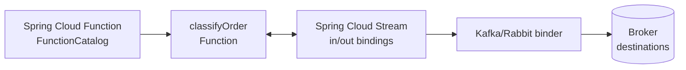
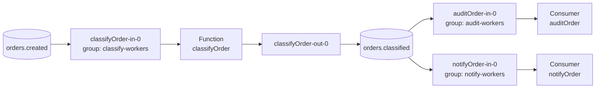
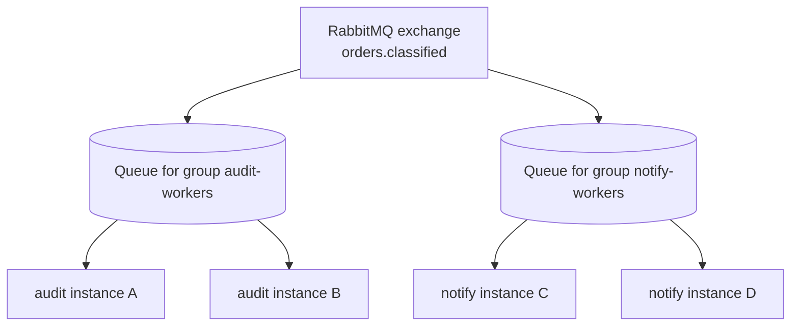

# Mapping Bindings to Destinations and Consumer Groups

## 1. Problem: One Event Stream, Multiple Processing Needs

Suppose an order service receives `orders.created` events, classifies priority levels, and then emits `orders.classified` events. Two different departments need to read the results:

- The **audit** service stores classification history for traceability.
- The **notification** service messages customers when an order is prioritized.

Both need to see the classified events. At the same time, if there are three instances of the audit service, we usually want those instances to **share the workload** within one group rather than every instance writing an identical audit record.

Spring Cloud Stream solves both needs by combining:

- **Binding**: an input or output port of a function inside the application.
- **Destination**: a logical address on the messaging system, typically a Kafka topic or a RabbitMQ exchange.
- **Consumer group**: the identity of a message-receiving group; members in the same group share work, while independent groups can separately receive data from the same destination.

Business functions still use the **Spring Cloud Function** model: `Supplier<T>`, `Function<I, O>`, and `Consumer<T>`. `FunctionCatalog` finds and normalizes functions; Spring Cloud Stream creates bindings; and binders connect those bindings to Kafka or RabbitMQ. As a result, the same Java logic can be reused with HTTP, event-driven, or serverless adapters given appropriate configuration.

After this lesson, you will:

1. Clearly distinguish function name, binding, destination, group, and binder.
2. Map input/output bindings to destinations using YAML.
3. Explain the two distribution patterns: **same group shares work**, **different groups receive independently**.
4. Understand how Kafka and RabbitMQ implement destinations and groups.
5. Identify issues with default groups, offsets, partitions, retries, and configuration mistakes.
6. Build and test a complete Java/Spring Cloud Stream example.

## 2. Five Concepts to Keep Separate

| Concept | Example | Responsibility |
| --- | --- | --- |
| **Functional bean** | `classifyOrder` | Java logic registered by Spring Cloud Function |
| **Binding** | `classifyOrder-in-0`, `classifyOrder-out-0` | Function's data-receiving/emitting port in Spring Cloud Stream |
| **Destination** | `orders.created`, `orders.classified` | Logical address of messages on the broker |
| **Consumer group** | `classify-workers`, `audit-workers` | Identifies a consumer group on an **input binding** |
| **Binder** | `kafka`, `rabbit` | Integration layer connecting bindings to a specific broker |

A familiar chain of names:

```text
Bean: classifyOrder
Input binding: classifyOrder-in-0
    destination = orders.created
    group       = classify-workers

Output binding: classifyOrder-out-0
    destination = orders.classified
```

**Binding and destination are not the same thing.** The name `classifyOrder-in-0` only has meaning in Spring Cloud Stream configuration. The broker sees the destination `orders.created`, mapped by the binder to the corresponding entity.

**Consumer group is also not a destination.** Group defines how an input binding participates in consuming data at a destination. A destination can be read by multiple groups; a group can have multiple consuming instances.

## 3. How Are Bindings Generated from Function Signatures?

For a standard function, the implicit binding name is generated by convention:

```text
<function-name>-in-0
<function-name>-out-0
```

The index `0` is the function's first port. It is not the partition count, offset position, consumer group, or instance count.

| Interface | Role | Input Binding | Output Binding |
| --- | --- | --- | --- |
| `Supplier<OrderCreated> publishOrder` | Emit events | None | `publishOrder-out-0` |
| `Function<OrderCreated, OrderClassified> classifyOrder` | Classify events | `classifyOrder-in-0` | `classifyOrder-out-0` |
| `Consumer<OrderClassified> auditOrder` | Write audit | `auditOrder-in-0` | None |

`Supplier` does not receive an input message from Spring Cloud Stream, so it has no default input binding. `Consumer` does not return a business output, so it has no default output binding. `Function` has both directions.

A bean accepting `Message<T>` instead of `T` still normally has one input binding: headers and payload are parts of the same message, not two separate ports. Indices `-in-1` or `-out-1` only appear in supported multi-port models, such as certain multi-stream reactive signatures; a POJO with multiple fields does not automatically create multiple ports.

### Role of FunctionCatalog

`FunctionCatalog` is a catalog in Spring Cloud Function that looks up `classifyOrder` by bean name, normalizes invocation, and supports composition. Spring Cloud Stream relies on the selected definition to create and attach bindings. The catalog does not itself decide Kafka topics, RabbitMQ queues, offsets, or consumer groups.



## 4. Syntax for Mapping Bindings to Destinations

All standard bindings are configured under `spring.cloud.stream.bindings`. The map key is the **binding name**; the `destination` property specifies the logical address to read from or write to:

```yaml
spring:
  cloud:
    function:
      definition: classifyOrder
    stream:
      bindings:
        classifyOrder-in-0:
          destination: orders.created
          group: classify-workers
          content-type: application/json
        classifyOrder-out-0:
          destination: orders.classified
          content-type: application/json
```

Correspondingly:

| Configuration Path | Value | Purpose |
| --- | --- | --- |
| `spring.cloud.function.definition` | `classifyOrder` | Selects the functional bean |
| `spring.cloud.stream.bindings.classifyOrder-in-0.destination` | `orders.created` | Reads messages from the input destination |
| `spring.cloud.stream.bindings.classifyOrder-in-0.group` | `classify-workers` | Joins the consumer group named `classify-workers` |
| `spring.cloud.stream.bindings.classifyOrder-out-0.destination` | `orders.classified` | Emits output to the output destination |
| `spring.cloud.stream.bindings.*.content-type` | `application/json` | Provides payload format information |

If no destination is specified, the binding name can be used as the default destination name under Spring Cloud Stream's mechanism. This is handy for short demos, but can easily lead to the application silently using destination `classifyOrder-in-0` instead of the domain topic `orders.created`. In real examples, declare `destination` explicitly.

**Do not put `group` on an output binding expecting the producer to send only to that group.** Group has meaning on the consumer side; producers emit to a destination and input groups organize their own consumption.

## 5. Distribution Diagram: Same Destination, Multiple Groups

After classification, both audit and notification need to receive messages from `orders.classified`.



Both end consumers map to **destination `orders.classified`**, but have **different groups**. Consequently, each group has the opportunity to read events according to binder mechanics and data retention/read state.

Conversely, if the `auditOrder` service runs multiple instances all in group `audit-workers`, those instances typically share the work; each instance does not need to receive a duplicate copy.

### Distribution Matrix

| Destination | Group | Illustrative Instance Count | Meaning |
| --- | --- | --- | --- |
| `orders.classified` | `audit-workers` | 3 | Three audit instances share load within one group |
| `orders.classified` | `notify-workers` | 2 | Two notification instances share load within a second group |
| `orders.classified` | `analytics-workers` | 1 | Analytics group independent of the two groups above |

**One group with multiple instances: competing/sharing work. Multiple different groups: independent consumption.** This is an important mental rule, though the underlying mechanism via partitions/offsets or queues/exchanges depends on the binder. There is no guarantee every group always receives full history: it also depends on when the group is created, initial offset, retention, topology, and broker limits.

## 6. Java Example: One Processor, Two Sinks

Using Java 17+ to declare records and an illustrative Spring Boot application:

```java
import java.util.function.Consumer;
import java.util.function.Function;

import org.springframework.boot.SpringApplication;
import org.springframework.boot.autoconfigure.SpringBootApplication;
import org.springframework.context.annotation.Bean;

@SpringBootApplication
public class OrderStreamApplication {

    public static void main(String[] args) {
        SpringApplication.run(OrderStreamApplication.class, args);
    }

    public record OrderCreated(String orderId, long totalInCents) {}

    public record OrderClassified(String orderId, String priority) {}

    @Bean
    Function<OrderCreated, OrderClassified> classifyOrder() {
        return event -> new OrderClassified(
                event.orderId(),
                event.totalInCents() >= 100_000L
                        ? "PRIORITY" : "STANDARD"
        );
    }

    @Bean
    Consumer<OrderClassified> auditOrder() {
        return event -> System.out.printf(
                "AUDIT: %s -> %s%n",
                event.orderId(),
                event.priority()
        );
    }

    @Bean
    Consumer<OrderClassified> notifyOrder() {
        return event -> System.out.printf(
                "NOTIFY: order=%s, priority=%s%n",
                event.orderId(),
                event.priority()
        );
    }
}
```

These beans do not directly use Kafka consumer APIs, Rabbit listeners, or HTTP requests. When using Spring Cloud Stream, we select each functional definition and configure each binding's destination.

### Configuring Three Functions in the Same Application

```yaml
spring:
  cloud:
    function:
      definition: classifyOrder;auditOrder;notifyOrder
    stream:
      bindings:
        classifyOrder-in-0:
          destination: orders.created
          group: classify-workers
          content-type: application/json
        classifyOrder-out-0:
          destination: orders.classified
          content-type: application/json

        auditOrder-in-0:
          destination: orders.classified
          group: audit-workers
          content-type: application/json

        notifyOrder-in-0:
          destination: orders.classified
          group: notify-workers
          content-type: application/json

      kafka:
        binder:
          brokers: localhost:9092
```

This example assumes the project has Spring Boot, a compatible Spring Cloud BOM, the `spring-cloud-stream-binder-kafka` dependency, JSON conversion support (typically Jackson), and a Kafka broker at `localhost:9092`. Permissions and topic creation must be configured appropriately for the real environment.

The `;` in `definition` requests binding **three independent functional definitions**. It does not automatically chain them in a single Java call; connection occurs via destinations:

- `classifyOrder` reads `orders.created`, emits `orders.classified`.
- `auditOrder` reads `orders.classified` with group `audit-workers`.
- `notifyOrder` reads `orders.classified` with group `notify-workers`.

If the input payload is:

```json
{"orderId":"ORD-101","totalInCents":150000}
```

The processor produces:

```json
{"orderId":"ORD-101","priority":"PRIORITY"}
```

In a healthy run with a new message delivered by the broker to both groups, you can observe:

```text
AUDIT: ORD-101 -> PRIORITY
NOTIFY: order=ORD-101, priority=PRIORITY
```

Do not rely on the order in which the two log lines appear: the groups process independently and there is no rule forcing `auditOrder` to run before `notifyOrder`.

**Architecture note:** placing three beans in one JVM is convenient for learning. When splitting into separate services, each service selects its own `definition`, while the corresponding destinations and groups preserve the same logical relationships.

## 7. Sources Also Use Destinations, Without Consumer Groups

If input events are produced by a `Supplier<OrderCreated>`, the default binding name exists only on the output side:

```java
@Bean
Supplier<OrderCreated> publishOrder() {
    return () -> new OrderCreated("ORD-DEMO", 150_000L);
}
```

Configuration example when the application selects the supplier as a source:

```yaml
spring:
  cloud:
    function:
      definition: publishOrder
    stream:
      bindings:
        publishOrder-out-0:
          destination: orders.created
          content-type: application/json
```

Because a supplier does not consume from an input binding, it has no group. An imperative `Supplier<T>` is typically triggered by Stream via a poller; the example above would keep creating the exact same event if polled repeatedly, so it is only suitable for illustration and should not be deployed as-is to production.

When you need to proactively emit a message at the moment an API request is handled, consider `StreamBridge`; that is an active emit path with no group on the output side. Groups only apply when there is an input binding receiving messages.

## 8. Consumer Groups in Kafka: Partition Assignment and Offsets

With the Kafka binder, `destination: orders.classified` usually maps to Kafka topic `orders.classified`. `group: audit-workers` usually corresponds to a Kafka consumer group named `audit-workers`.

Picture a topic with three partitions and the audit application running two instances in the same group:

```text
Kafka topic: orders.classified
    partition 0 ----+
    partition 1 ----+---- group audit-workers
    partition 2 ----+       instance A / instance B
                    |
                    +---- group notify-workers
                           instance C / instance D
```

Within the same group, each partition at any given time is typically assigned to one consumer in that group. Therefore:

- If a group has multiple instances, data in the topic is divided by partition assignment.
- If a group has more instances than partitions, some instances may sit idle with no partitions assigned.
- Two different groups have separate read positions (*offsets*) and can both read records still within retention.
- Record order is preserved by Kafka within **a single partition**, with no global ordering guarantee across all partitions.

### What Is an Offset and How Does It Relate to Groups?

Kafka uses offsets to identify a record's position within a partition. A consumer group maintains its corresponding consumed/committed offset state. When an application restarts, where reading resumes depends on stored offsets and startup configuration.

For example: group `audit-workers` has already read a record; group `notify-workers` has not. The two groups do not share offsets, so audit's progress does not cause notify to skip that record.

However, a newly created group **does not automatically receive the entire history**. The starting read point can depend on start-offset configuration, group state, and whether records still exist within retention. If business logic needs replay, read timing and retention must be designed explicitly.

### When Are Multiple Groups Needed?

A system can use the same `orders.classified` topic for:

- `audit-workers`: writes history to the audit store.
- `notify-workers`: sends notifications.
- `analytics-workers`: aggregates data.
- `fraud-workers`: runs risk checks.

These groups have different goals and can scale and recover independently. If all of them used the same group, they would become competing consumers in a single group, breaking the "every business function receives every event" goal.

## 9. Consumer Groups in RabbitMQ: Exchanges, Queues, and Bindings

With the RabbitMQ binder, a destination is usually mapped to an **exchange**. A group's input binding connects to a queue created/selected by the binder according to the group and specific naming rules.



This is a logical model, not a guarantee of exact queue/routing key names. Exchange type, queue names, binding keys, durability, and resource declaration mechanics depend on the Rabbit binder and broker configuration.

Points to understand:

- Consumers in the **same group** typically pull messages from that group's shared queue and compete to process them.
- **Different groups** typically have different queues bound to the exchange, allowing each group to receive messages matching the routing rules.
- Once a message is processed and acked successfully, it is usually removed from that queue.
- **Replaying acked messages** is not equivalent to how Kafka retains records by retention and offset. If history is needed, separate storage/replay must be designed.

For example, an audit application and a notify application use two different groups, both declaring destination `orders.classified`. The RabbitMQ binder can create/select two different queues attached to that exchange. To be sure both receive all messages, check the exchange type, routing, queue bindings, and provisioning permissions in the running environment.

## 10. Explicitly Named Groups vs. Default Groups

Spring Cloud Stream supports explicitly grouped consumers as well as ungrouped consumption, often referred to as an **anonymous consumer group** at the Stream abstraction layer. Exact behavior of an anonymous group depends on the binder and version.

For services that need stability across restarts and scaling across multiple instances, declare an explicit group:

```yaml
spring:
  cloud:
    stream:
      bindings:
        auditOrder-in-0:
          destination: orders.classified
          group: audit-workers
```

### Why Does the Group Name Matter?

Suppose there are three deployments performing the same audit task:

| Deployment | Group | Expected Behavior |
| --- | --- | --- |
| audit instance A | `audit-workers` | Same audit group |
| audit instance B | `audit-workers` | Shares work with A |
| audit instance C | `audit-workers` | Shares work with A and B |
| notify instance D | `notify-workers` | Independent group, does not compete with audit |

If A, B, and C accidentally use three different groups, the same event could be audited three times. If notify accidentally uses group `audit-workers`, notify becomes a competing member of audit, causing neither business function to receive complete data as expected.

**A group is a deployment contract**, not just a label for readable logs.

### How Should Groups Be Named?

Name groups after the **consumer business function**, not arbitrarily after pod numbers or hostnames when instances perform the same work. For example:

- `order-classifiers`;
- `order-auditors`;
- `order-notifiers`.

Across isolated environments, you may need separate groups/destinations or separate brokers so test data does not affect production. If multiple applications share the same group on the same destination with different logic, load sharing turns into a hard-to-detect business bug.

## 11. Same Destination, Different Groups: Easily Confused Cases

### Case A: Two Business Functions Both Want to Receive Events

```yaml
spring:
  cloud:
    stream:
      bindings:
        auditOrder-in-0:
          destination: orders.classified
          group: audit-workers
        notifyOrder-in-0:
          destination: orders.classified
          group: notify-workers
```

Two input bindings read the same destination using separate groups. This is the right pattern when audit and notify need to receive events independently.

### Case B: Multiple Instances Performing the Same Business Function

Each instance of audit uses the configuration:

```yaml
spring:
  cloud:
    stream:
      bindings:
        auditOrder-in-0:
          destination: orders.classified
          group: audit-workers
```

Instances in the same processing group share work according to binder mechanics. Scaling the instance count does not mean "each instance receives every event."

### Case C: Two Functions Share a Group Name but Read Different Destinations

```yaml
spring:
  cloud:
    stream:
      bindings:
        auditOrder-in-0:
          destination: orders.classified
          group: audit-workers
        auditRefund-in-0:
          destination: refunds.classified
          group: audit-workers
```

Having the same group value on **different destinations** does not make the two functions compete for a record from a single topic. With Kafka, a group can participate in reading multiple topics, each topic/partition having its own offset. With RabbitMQ, the queue for each destination/group has its own topology per the binder. You should still review naming intent and deployment details to avoid operational confusion.

### Case D: Producer Sets a Group

```yaml
spring:
  cloud:
    stream:
      bindings:
        classifyOrder-out-0:
          destination: orders.classified
          group: audit-workers
```

Here `group` on an output binding does not cause the producer to "emit exclusively to audit." If a group should receive only a subset of messages, design appropriate destinations, routing, or filtering rather than relying on `group` on the producer.

## 12. Renaming Bindings Does Not Change the Meaning of Group

If you want to rename the default binding `classifyOrder-in-0` to `incomingOrders`, Spring Cloud Stream provides binding-name mapping via `spring.cloud.stream.function.bindings`:

```yaml
spring:
  cloud:
    function:
      definition: classifyOrder
    stream:
      function:
        bindings:
          classifyOrder-in-0: incomingOrders
          classifyOrder-out-0: outgoingOrders

      bindings:
        incomingOrders:
          destination: orders.created
          group: classify-workers
          content-type: application/json
        outgoingOrders:
          destination: orders.classified
          content-type: application/json
```

After mapping:

- The function is still named `classifyOrder`.
- The explicit input binding is `incomingOrders`, with destination `orders.created` and group `classify-workers`.
- The explicit output binding is `outgoingOrders`, emitting to `orders.classified`.

The key point is placing `destination` and `group` under the **mapped binding name**. Aliases can make configuration easier to read, but they also introduce another naming layer to check when debugging.

With composition such as `validateOrder|classifyOrder`, Spring Cloud Function composes the functions into one logical pipeline before Spring Cloud Stream attaches input/output. If you need to rename a composition's bindings, map the **implicit composition name** used by the framework rather than assuming individual component function bindings still exist independently.

## 13. Destinations and Groups Under Multiple Binders/Environments

Bindings are an abstraction usable with both Kafka and RabbitMQ. You can keep the `classifyOrder` bean unchanged and select the binder by profile:

```yaml
# Shared properties:
spring:
  cloud:
    function:
      definition: classifyOrder
    stream:
      bindings:
        classifyOrder-in-0:
          destination: orders.created
          group: classify-workers
        classifyOrder-out-0:
          destination: orders.classified
```

Kafka profile example, with the Kafka binder on the classpath:

```yaml
spring:
  cloud:
    stream:
      defaultBinder: kafka
      kafka:
        binder:
          brokers: localhost:9092
```

Or RabbitMQ profile, with the Rabbit binder on the classpath:

```yaml
spring:
  rabbitmq:
    host: localhost
    port: 5672
    username: guest
    password: guest
  cloud:
    stream:
      defaultBinder: rabbit
```

These are **snippets belonging to different profile files**, not YAML pasted over each other in the same place. Kafka uses topics, partitions, and groups/offsets; RabbitMQ uses exchanges, queues, and acknowledgements. The `classifyOrder` logic usually remains intact, while topology and retry/replay must be re-tested.

If using **both binders simultaneously**, you can select the binder per binding:

```yaml
spring:
  cloud:
    stream:
      bindings:
        classifyOrder-in-0:
          binder: kafka
          destination: orders.created
          group: classify-workers
        classifyOrder-out-0:
          binder: rabbit
          destination: orders.classified
```

This example only illustrates the mapping: when running for real, both binders must be on the classpath and have connection settings configured. If custom-named binder instances are declared, the `binder` value must use the exact registered instance name. A Kafka → RabbitMQ bridge does not automatically guarantee a distributed transaction across both brokers.

## 14. Operations: Retries, Duplicate Processing, and Observing Groups

Groups determine work distribution, but **do not automatically guarantee system-wide exactly-once processing for every event**.

A typical failure sequence:

1. Consumer receives `OrderClassified("ORD-101", "PRIORITY")`.
2. Consumer has already written to the database or sent a notification.
3. Application fails before processing completion is acknowledged to the broker.
4. Broker may redeliver the event; the side effect in step 2 risks running twice.

Build idempotency (such as event IDs, unique constraints, or processing state) for side effects. Retries, dead-letter destinations, ack/commit, and replay should be designed according to the active binder.

### What to Observe in Kafka and RabbitMQ

| What to Observe | Kafka | RabbitMQ |
| --- | --- | --- |
| Group backlog | Consumer lag, offsets, partitions | Queue depth, unacked message count |
| Group/instances | Consumer group and partition assignment | Queue, consumer count, connections/channels |
| Failed messages | Retry/error handling, DLQ topic if configured | Requeue, retry, dead-letter exchange/queue if configured |
| Still-readable data | Retention and offsets | Queue/stream contents and corresponding retention policy |
| Scaling bottleneck symptoms | Limited partition count | Prefetch, concurrency, backlog, processing rate, or resources |

Do not assume an independent consumer group is a permanent data-backup mechanism. A Kafka group cannot read records past retention; a RabbitMQ group does not retain acked messages by default. Check both broker configuration and consumer progress.

## 15. Checklist When Messages Do Not Reach the Consumer

When `auditOrder` does not receive `orders.classified`, isolate layer by layer:

1. **Bean/definition:** does the application have an `auditOrder` bean and has `definition` selected it? With multiple beans, use `spring.cloud.function.definition` explicitly.
2. **Binding:** is the input name `auditOrder-in-0` or the configured alias?
3. **Destination:** is the input reading `orders.classified`? Is the producer actually emitting to that destination?
4. **Group:** is it accidentally sharing a group with another business function? Does a new group have mistaken replay expectations?
5. **Binder:** does the application have the binder dependency, broker address, and appropriate read/write permissions?
6. **Broker:** does the topic have new records? Are exchange/queue bound properly? Is a partition/consumer/queue actively receiving messages?
7. **Payload:** are JSON, `content-type`, and the function's Java types compatible?
8. **Error handling:** is the message being retried, routed to a DLQ, or failing due to an exception?

### Common Errors

| Symptom | Possible Cause | Resolution |
| --- | --- | --- |
| Not reading from `orders.created` | Wrong `destination` or omitted so binder fell back to default binding name | Configure `classifyOrder-in-0.destination: orders.created` |
| Only one of two business functions receives messages | Both functions accidentally share the same group on the same destination | Separate groups per business function |
| Every audit instance processes the same event | Each instance uses a different group | Have instances of the same business function share a group name |
| New consumer does not read Kafka history | Retention/initial offset or group state differs from expectations | Check offsets, start offset, and retention |
| RabbitMQ receives message at exchange but it does not reach consumer | Wrong or missing queue/exchange binding, routing key, or permissions | Check topology and Rabbit binder configuration |
| Consumer receives duplicate messages | Redelivery after failure or retry | Apply idempotency and monitor retries |
| Producer sends data but `Consumer` has no output | `Consumer<T>` returns no value | Do not expect a default `<consumer>-out-0` |
| Renaming alias loses destination | `bindings.*` still uses the old implicit name | Place `destination` and `group` under the actual alias name |
| Data ends up in DLQ | Conversion/logic error or retries exhausted | Inspect payload, headers, exceptions, and DLQ |
| Group adds instances but throughput does not grow | Kafka partition limit or Rabbit prefetch/concurrency, CPU/IO | Measure bottleneck, adjust topology and processing capacity |

## 16. Testing Business Logic and Wiring

### 16.1. Unit Testing the Business Function

Classification logic can be tested independently without Kafka or RabbitMQ:

```java
import static org.junit.jupiter.api.Assertions.assertEquals;
import org.junit.jupiter.api.Test;

class OrderStreamApplicationTest {

    @Test
    void classifiesOrdersByThreshold() {
        var fn = new OrderStreamApplication().classifyOrder();

        var normal = fn.apply(
                new OrderStreamApplication.OrderCreated("ORD-1", 99_999L)
        );
        var priority = fn.apply(
                new OrderStreamApplication.OrderCreated("ORD-2", 100_000L)
        );

        assertEquals("STANDARD", normal.priority());
        assertEquals("PRIORITY", priority.priority());
    }
}
```

Unit tests verify business rules. They do not verify `destination`, `group`, binder connectivity, or load-sharing semantics.

### 16.2. Integration Testing with the Broker

To properly verify destinations and groups, test scenarios with a real broker or equivalent integration environment:

1. Publish two valid JSON messages to `orders.created`.
2. Confirm `orders.classified` contains two corresponding outputs.
3. Start audit and notify using **two different groups**; send new messages and verify each business function receives appropriately.
4. Start additional audit instances with the **same group**; send multiple messages and verify intra-group distribution per binder semantics.
5. Start a consumer with a new group; check history-reading conditions against Kafka offsets/retention or Rabbit queue provisioning.
6. Trigger processing errors in a test environment and verify retries, redelivery, DLQ, and duplicate handling.

The Spring Cloud Stream test binder can help test routing and conversion at the framework level. However, to verify Kafka partitions/offsets or Rabbit exchanges/queues/acks, test against the corresponding broker.

## 17. Practice Exercises

### Exercise 1: Distinguishing Four Names

Read the configuration:

```yaml
spring:
  cloud:
    function:
      definition: reserveStock
    stream:
      bindings:
        reserveStock-in-0:
          destination: orders.accepted
          group: inventory-workers
        reserveStock-out-0:
          destination: inventory.reserved
```

Answer:

- What is the functional bean name?
- What are the input binding and output binding?
- What are the input destination and output destination?
- Which binding does `group` belong to?
- Does renaming the input Kafka topic necessarily require renaming the bean?

**Hint:** `reserveStock`, `reserveStock-in-0`, `reserveStock-out-0`; destinations are `orders.accepted` and `inventory.reserved` respectively; `group` is only on the input.

### Exercise 2: Splitting Groups So Both Business Functions Receive Events

Two consumers `auditOrder` and `notifyOrder` both read `orders.classified`, and initially both configured group `order-workers`. After running, not every event has both an audit log and a notify log.

Explain the problem and edit the YAML so each business function reads independently. Re-verify with new messages and proper binder semantics.

**Hint:** use `audit-workers` for audit and `notify-workers` for notify; same destination, different groups.

### Exercise 3: Scaling Within One Group

A Kafka topic has four partitions. The audit application has six instances in the same group `audit-workers`. Explain why increasing the instance count may not achieve concurrent execution across all six instances. If another application uses group `analytics-workers`, does analytics automatically share offsets with audit?

**Hint:** the partition count limits how many consumers in the same group can receive useful partition assignments; a different group tracks its own read positions.

### Exercise 4: Switching from Kafka to RabbitMQ

Keep `classifyOrder-in-0.destination: orders.created` and `group: classify-workers`, then switch to the Rabbit binder. Describe which infrastructure entities must be inspected and which behaviors cannot be assumed equivalent.

**Hint:** from Kafka topic/partition/group offset to Rabbit exchange/queue/binding/ack; verify routing, replay, and retries.

### Self-Assessment Questions

1. Why can a single destination appear in the configuration of multiple different input bindings?
2. How do "same destination, same group" and "same destination, different groups" differ?
3. Does `group` have any meaning on an output binding?
4. If `destination` is omitted, why can an application still run yet read from an unintended topic?
5. Why does a Kafka consumer group not guarantee re-reading every message in history?
6. How does the RabbitMQ binder map groups into topology?
7. When using an alias for an input binding, under which name must `destination` and `group` be placed?
8. Why is testing against a real broker necessary to evaluate redelivery and parallelism?

## 18. Summary

**Binding** is the function's logical port, **destination** is where messages are sent/received, and **consumer group** indicates which instances share consumption work. In Spring Cloud Stream:

- `spring.cloud.function.definition` selects functions in the Spring Cloud Function/FunctionCatalog model.
- `spring.cloud.stream.bindings.<binding>.destination` maps each input/output binding to a destination.
- `spring.cloud.stream.bindings.<input-binding>.group` identifies a consumer group.
- Same group usually shares work; different groups can consume independently from the same destination.
- Kafka uses topics, partitions, and offsets; RabbitMQ uses exchanges, queues, and acknowledgements. Keeping binding names identical **does not mean** the two brokers have identical delivery semantics.

Properly separating the three layers **function → binding → destination/group** allows reusing `Supplier`, `Function`, and `Consumer` logic across environments, writing clear configuration, and diagnosing failures when events do not reach the right service.

### References

- [Spring Cloud Stream — Reference documentation](https://docs.spring.io/spring-cloud-stream/reference/)
- [Spring Cloud Stream — Producing and consuming messages](https://docs.spring.io/spring-cloud-stream/reference/spring-cloud-stream/producing-and-consuming-messages.html)
- [Spring Cloud Stream — Functional binding names](https://docs.spring.io/spring-cloud-stream/reference/spring-cloud-stream/functional-binding-names.html)
- [Spring Cloud Function — Reference documentation](https://docs.spring.io/spring-cloud-function/reference/)
- [Apache Kafka — Documentation](https://kafka.apache.org/documentation/)
- [RabbitMQ — Documentation](https://www.rabbitmq.com/docs)
