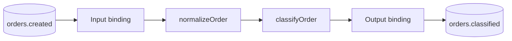
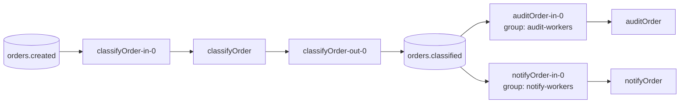
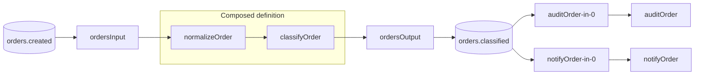

# Configuring a Composed Function and Multiple Independent Definitions

## 1. Context: The Same Functions Can Form Two Different Architectures

Suppose an order application has the following processing steps:

1. Normalize order data (`normalizeOrder`).
2. Classify the order (`classifyOrder`).
3. Write audit (`auditOrder`).
4. Send notification (`notifyOrder`).

The first two steps typically need to run sequentially within the same business operation. The latter two steps may need to consume the same event yet operate independently, because a failure in the notification service should not halt all auditing work.

Spring Cloud Function expresses logic using `Supplier<T>`, `Function<I, O>`, and `Consumer<T>` beans. When using Spring Cloud Stream, we declare `spring.cloud.function.definition` to choose how those beans connect to the event infrastructure. Two operators are very easy to confuse:

- **`|` (pipe):** composes multiple functions into **one definition with a sequential execution order**.
- **`;` (semicolon):** selects **multiple independent definitions** so Spring Cloud Stream creates separate bindings for each definition.

Example:

```yaml
spring:
  cloud:
    function:
      definition: normalizeOrder|classifyOrder
```

The configuration above creates one sequential processing pipeline. Meanwhile:

```yaml
spring:
  cloud:
    function:
      definition: classifyOrder;auditOrder;notifyOrder
```

selects three separate pipelines that **do not automatically call one another**. If we want them to pass data between each other, we must connect their input/output bindings to the same destination on the broker or use appropriate composition.

The objective of this lesson is to understand the boundary between these two models, configure binding names accurately, compose `Function` with `Supplier`/`Consumer`, and verify where data actually flows.

## 2. Separating Three Layers: FunctionCatalog, Bindings, and Destinations

`FunctionCatalog` belongs to **Spring Cloud Function**. It discovers functional beans registered in `ApplicationContext` and supports lookup, invocation normalization, message conversion, and composition. Spring Cloud Stream relies on the functional definition to create input/output bindings, and the binder connects those bindings to Kafka or RabbitMQ.

| Layer | Responsibility | Example |
| --- | --- | --- |
| Functional bean | Contains business logic | `normalizeOrder`, `classifyOrder` |
| `FunctionCatalog` | Looks up or composes functions | `normalizeOrder|classifyOrder` |
| `spring.cloud.function.definition` | Specifies the definition(s) to bring into the Stream application | `normalizeOrder|classifyOrder` |
| Spring Cloud Stream binding | Logical port receiving/emitting messages | `ordersInput`, `ordersOutput` |
| Destination | Address on middleware | `orders.created`, `orders.classified` |
| Binder | Connects bindings to a broker | Kafka binder, RabbitMQ binder |

Note: `FunctionCatalog` can be used outside Stream, such as when exposing functions via HTTP or serverless adapters. Having a function recognized by the catalog **does not mean** it already has a Kafka consumer, a RabbitMQ queue, or an HTTP endpoint. The adapter and deployment configuration decide how the function is triggered.

For standard Spring Cloud Stream, binding names are derived from the definition by convention:

```text
<function-definition>-in-0
<function-definition>-out-0
```

A `Function<I,O>` typically has one input and one output; `Supplier<T>` has only output; `Consumer<T>` has only input. The index `0` is the first port, not a partition number or consumer group.

## 3. Syntax and Meaning of the Two Operators

| `spring.cloud.function.definition` | Result | How Does Data Flow? |
| --- | --- | --- |
| `normalizeOrder` | One function | Function's input → function's output |
| `normalizeOrder|classifyOrder` | One function composed of two steps | Output of `normalizeOrder` is passed straight into `classifyOrder` |
| `normalizeOrder;classifyOrder` | Two independent definitions | Each definition has its own bindings; no automatic connection between them |
| `normalizeOrder|classifyOrder;auditOrder` | One composed pipeline and one independent consumer | Pipeline and consumer connect only when bindings/destinations match |
| `auditOrder;notifyOrder` | Two independent consumers | Each consumer has an input binding and can use its own group/destination |

Spring Cloud Function also supports a comma `,` for writing composition. In this lesson we use `|` because it is easier to read and clearly distinct from `;`. These two symbols have different meanings and should not be substituted for one another.

### 3.1. Composition Runs Sequentially

With `normalizeOrder|classifyOrder`, `normalizeOrder` runs first, and its result becomes the input to `classifyOrder`. The Java types must be compatible. If `normalizeOrder` returns `OrderCreated`, the next step must accept `OrderCreated` or a compatible type.

Conceptually:

```java
Function<A, B> first = ...;
Function<B, C> second = ...;

Function<A, C> pipeline = first.andThen(second);
```

Spring Cloud Function performs additional normalization steps and integrates with the messaging system, so composition in the framework is richer than a plain `andThen` call. However, the data-ordering principle remains the same.

### 3.2. Multiple Definitions Do Not Create a Causal Relationship

With `normalizeOrder;classifyOrder`, Spring Cloud Stream sets up two separate pipelines. They may listen on two different destinations or on the same destination if configured that way. Simply because `normalizeOrder` precedes `classifyOrder` in the definition string, **there is no guarantee** it runs before `classifyOrder` on the same message.

The `;` is a list selector, not a "then" operator. When two services need to process the same event, design destinations and consumer groups accordingly; when consecutive transformations are needed without a broker in between, use composition.

## 4. Java Example: Beans That Can Be Composed or Run Independently

An illustrative application using Java 17+ with two records, two `Function`s, and two `Consumer`s:

```java
import java.util.function.Consumer;
import java.util.function.Function;

import org.springframework.boot.SpringApplication;
import org.springframework.boot.autoconfigure.SpringBootApplication;
import org.springframework.context.annotation.Bean;

@SpringBootApplication
public class OrderFunctionsApplication {

    public static void main(String[] args) {
        SpringApplication.run(OrderFunctionsApplication.class, args);
    }

    public record OrderCreated(String orderId, long totalInCents) {}

    public record OrderClassified(String orderId, String priority) {}

    // Normalizes and validates data while keeping the same output type.
    @Bean
    Function<OrderCreated, OrderCreated> normalizeOrder() {
        return order -> {
            if (order.orderId() == null ||
                    order.orderId().isBlank()) {
                throw new IllegalArgumentException(
                        "orderId must not be blank");
            }
            if (order.totalInCents() < 0) {
                throw new IllegalArgumentException(
                        "totalInCents must not be negative");
            }
            return new OrderCreated(
                    order.orderId().strip(),
                    order.totalInCents());
        };
    }

    // Receives OrderCreated and produces the classified event.
    @Bean
    Function<OrderCreated, OrderClassified> classifyOrder() {
        return order -> new OrderClassified(
                order.orderId(),
                order.totalInCents() >= 100_000L
                        ? "PRIORITY"
                        : "STANDARD");
    }

    // Consumer: records the result, no default output binding.
    @Bean
    Consumer<OrderClassified> auditOrder() {
        return event -> System.out.printf(
                "AUDIT %s: %s%n",
                event.orderId(),
                event.priority());
    }

    @Bean
    Consumer<OrderClassified> notifyOrder() {
        return event -> System.out.printf(
                "NOTIFY %s: %s%n",
                event.orderId(),
                event.priority());
    }
}
```

This is a pedagogical example: printing logs is not sufficient for durable auditing or notifications. In a real system, both consumers might call repositories or business services, in which case idempotency and redelivery must be considered.

Input data:

```json
{"orderId":" ORD-101 ","totalInCents":150000}
```

After `normalizeOrder`:

```json
{"orderId":"ORD-101","totalInCents":150000}
```

After `classifyOrder`:

```json
{"orderId":"ORD-101","priority":"PRIORITY"}
```

By separating beans, we can use that exact logic in unit tests, HTTP adapters, serverless, or message-driven adapters without bringing Kafka/RabbitMQ APIs into business methods.

## 5. Configuring Case A: A Single Composed Function

Select the composition of the two `Function`s:

```yaml
spring:
  cloud:
    function:
      definition: normalizeOrder|classifyOrder
```

The framework treats this string as **one functional definition**. Externally, the pipeline has the signature:

```text
Function<OrderCreated, OrderClassified>
```

The pipeline's input receives `OrderCreated`; the first step normalizes/validates; the second step classifies; the pipeline's output is `OrderClassified`.



**There is no intermediate broker between the two beans** in the composition above. Spring Cloud Stream only needs to connect the input of the entire pipeline and the output of the entire pipeline; wiring `normalizeOrder` to `classifyOrder` belongs to the function layer.

### 5.1. Implicit Binding Names of a Composition

With standard functional composition, binding names are derived from the **entire definition**:

```text
normalizeOrder|classifyOrder-in-0
normalizeOrder|classifyOrder-out-0
```

Do not configure `normalizeOrder-out-0` and `classifyOrder-in-0` expecting them to be two ports connected through a broker in a composition configuration: the ports between the two functions are already wired inside the pipeline.

If you choose to use the implicit names directly, you can configure:

```yaml
spring:
  cloud:
    function:
      definition: normalizeOrder|classifyOrder
    stream:
      bindings:
        "normalizeOrder|classifyOrder-in-0":
          destination: orders.created
          group: classify-workers
          content-type: application/json
        "normalizeOrder|classifyOrder-out-0":
          destination: orders.classified
          content-type: application/json
```

Keys containing `|` are enclosed in quotes for unambiguous YAML. `orders.created` and `orders.classified` are **destinations on the broker**, not function names or binding names.

### 5.2. Explicit Binding Names for a Composition

When a composition is long, implicit names become hard to maintain. Spring Cloud Stream lets you map them to readable names:

```yaml
spring:
  cloud:
    function:
      definition: normalizeOrder|classifyOrder
    stream:
      function:
        bindings:
          "normalizeOrder|classifyOrder-in-0": ordersInput
          "normalizeOrder|classifyOrder-out-0": ordersOutput

      bindings:
        ordersInput:
          destination: orders.created
          group: classify-workers
          content-type: application/json
        ordersOutput:
          destination: orders.classified
          content-type: application/json
```

Here:

- `normalizeOrder|classifyOrder` remains the **functional definition**.
- `ordersInput` and `ordersOutput` are the **explicit binding names** used in Stream configuration.
- `orders.created` and `orders.classified` remain the **destinations**.
- `classify-workers` is the consumer group for the input binding.

After aliasing, place `destination`, `group`, and `content-type` under the **explicit binding names**. Do not attach some properties under the implicit name and others under the alias.

### 5.3. Error Boundary of a Composed Pipeline

If `normalizeOrder` throws `IllegalArgumentException` because `orderId` is blank, `classifyOrder` will not be invoked for that input. If `classifyOrder` throws an exception, the entire pipeline also fails for that message. Spring Cloud Stream/the binder determines retries, acknowledgement/offset, and dead-lettering according to configuration.

Composition fits when steps share a common processing and deployment boundary, input/output types are compatible, and no intermediate topic or queue is needed.

## 6. Configuring Case B: Multiple Independent Definitions

Now select three separate beans:

```yaml
spring:
  cloud:
    function:
      definition: classifyOrder;auditOrder;notifyOrder
```

This configuration has **three functional definitions**, each bound independently by Spring Cloud Stream:

| Definition | Input Binding | Output Binding |
| --- | --- | --- |
| `classifyOrder` | `classifyOrder-in-0` | `classifyOrder-out-0` |
| `auditOrder` | `auditOrder-in-0` | None |
| `notifyOrder` | `notifyOrder-in-0` | None |

For the beans to form a business flow, map the destinations appropriately:

```yaml
spring:
  cloud:
    function:
      definition: classifyOrder;auditOrder;notifyOrder
    stream:
      bindings:
        classifyOrder-in-0:
          destination: orders.created
          group: classify-workers
          content-type: application/json
        classifyOrder-out-0:
          destination: orders.classified
          content-type: application/json

        auditOrder-in-0:
          destination: orders.classified
          group: audit-workers
          content-type: application/json

        notifyOrder-in-0:
          destination: orders.classified
          group: notify-workers
          content-type: application/json
```

Data flow:



**The three definitions do not call each other directly.** `classifyOrder` emits to `orders.classified`; the two consumers listen on that destination with separate groups. Same destination and **different groups** is the standard way for audit and notify each to receive events according to binder semantics.

If audit runs three instances in the same group `audit-workers`, those instances typically share the group's workload. If audit and notify accidentally use the same group on the same destination, they can become competing consumers, breaking the "every business function receives every event" goal.

### 6.1. Role of the Semicolon

The `;` merely lists **multiple definitions** to bind. You cannot rely on written order:

```text
classifyOrder;auditOrder;notifyOrder
```

to infer "classify first, audit second, notify last." Actual execution order is determined by the message broker, bindings/destinations, groups, concurrency, processing state, and system design. The two end consumers also have no enforced ordering relative to one another.

### 6.2. Each Definition Can Be Deployed in Its Own Application

When splitting into three services, each application typically selects only the bean it needs:

```yaml
# In order-classifier/application.yml:
spring:
  cloud:
    function:
      definition: classifyOrder
```

```yaml
# In order-audit/application.yml:
spring:
  cloud:
    function:
      definition: auditOrder
```

```yaml
# In order-notifier/application.yml:
spring:
  cloud:
    function:
      definition: notifyOrder
```

The snippets above are three configuration examples **for three different applications**. They also need their corresponding `bindings.*`, destinations, groups, and binder connections. This separation allows each consumer to scale and release independently; in return, you must operate message flows, retries, and error monitoring across services.

## 7. Configuring Case C: Composing One Pipeline Plus Independent Definitions

In practice, we often want to **compose normalization with classification**, while keeping **audit and notify independent**. Both operators can be combined:

```yaml
spring:
  cloud:
    function:
      definition: normalizeOrder|classifyOrder;auditOrder;notifyOrder
    stream:
      function:
        bindings:
          "normalizeOrder|classifyOrder-in-0": ordersInput
          "normalizeOrder|classifyOrder-out-0": ordersOutput
      bindings:
        ordersInput:
          destination: orders.created
          group: classify-workers
          content-type: application/json
        ordersOutput:
          destination: orders.classified
          content-type: application/json

        auditOrder-in-0:
          destination: orders.classified
          group: audit-workers
          content-type: application/json

        notifyOrder-in-0:
          destination: orders.classified
          group: notify-workers
          content-type: application/json
```

Explanatory diagram:



There are **three bound units**: one pipeline `normalizeOrder|classifyOrder` and two consumers `auditOrder`, `notifyOrder`. Normalization and classification do not exchange messages via a broker; the two consumers continue receiving results through the broker.

### Inspecting Configuration Name by Name

| Component | Value | How to Understand It |
| --- | --- | --- |
| Composed definition | `normalizeOrder|classifyOrder` | One pipeline built from two `Function`s |
| Composition's implicit input binding | `normalizeOrder|classifyOrder-in-0` | Entry port for the entire pipeline |
| Explicit input binding | `ordersInput` | Alias for the entry port |
| Explicit output binding | `ordersOutput` | Alias for the exit port |
| Input destination | `orders.created` | Where events to classify arrive |
| Output destination | `orders.classified` | Where results are emitted |
| Independent definition 1 | `auditOrder` | Sink reading `orders.classified` |
| Independent definition 2 | `notifyOrder` | Sink reading `orders.classified` |

Thus, `|` is scoped **within a single definition**, whereas `;` separates definitions **within the application**.

## 8. Composing Supplier, Function, and Consumer: The Ends Decide Binding Direction

Spring Cloud Function does not compose only `Function` with `Function`. However, **the function types at the start and end of the chain decide the outcome**:

| Composition | Resulting Logical Function Type | Typical Bindings |
| --- | --- | --- |
| `Function<A,B>|Function<B,C>` | `Function<A,C>` | Input and output |
| `Supplier<A>|Function<A,B>` | `Supplier<B>` | Output |
| `Function<A,B>|Consumer<B>` | `Consumer<A>` | Input |
| `Supplier<A>|Consumer<A>` | `Runnable` per Spring Cloud Function model | Do not assume input/output bindings like `Function` |
| `Consumer<A>|Function<A,B>` | Invalid for sequential composition | No valid pipeline |

Example of a supplier emitting order status followed by a normalizing processor:

```java
@Bean
Supplier<String> source() {
    return () -> "  ready  ";
}

@Bean
Function<String, String> normalize() {
    return String::trim;
}
```

```yaml
spring:
  cloud:
    function:
      definition: source|normalize
```

The result is a logical source with output; it does not automatically get an input binding merely because the composition contains two beans.

With a consumer at the end:

```java
@Bean
Function<String, String> uppercase() {
    return String::toUpperCase;
}

@Bean
Consumer<String> audit() {
    return value -> System.out.println("Audit: " + value);
}
```

```yaml
spring:
  cloud:
    function:
      definition: uppercase|audit
```

This is a consumer-style pipeline: it receives a string, uppercases it, and logs it; by default **there is no output binding** to emit results onward.

You cannot put a `Consumer` in the middle of a chain and expect to take output from it for the next function. If you need to emit further after an update step, redesign the contract with a `Function` returning an appropriate result or use two pipelines separated by a broker.

### Steps Must Have Compatible Data Types

`Function<A,B>` composed with `Function<B,C>` yields `Function<A,C>`. When an output type differs from the next step's input type, lookup/composition errors or runtime conversion failures can occur. Do not look only at `definition` and assume the framework can automatically coerce arbitrary types.

For JSON payloads, declare sufficiently specific Java types and an appropriate `content-type`. Clearly separate *bean not found* errors, *incompatible type composition* errors, and *message deserialization* errors when debugging.

## 9. Composition Differs from Routing and Fan-Out

These three requirements are not equivalent:

| Requirement | Appropriate Model | Characteristic |
| --- | --- | --- |
| Always run `normalize` then `classify` | Composition `normalize|classify` | Sequential execution of functions in one pipeline |
| Run `audit` and `notify` in independent groups | `audit;notify` and same destination with separate groups | Two independent consumers via the broker |
| Pick a different function per message | Routing function / routing strategy | Target handler depends on message content or metadata |

Spring Cloud Function provides `RoutingFunction` for routing when an application needs to select a function conditionally. That is a different mechanism from fixed composition. Do not use `;` pretending to create per-message routing.

If two consumers both read one destination yet share **the same group**, they may split messages between them rather than each receiving a copy. To fan out to two business functions, you normally need two separate groups and an appropriate broker topology.

## 10. Differences in Errors, Retries, Scaling, and Operations

### 10.1. Within a Composed Pipeline

If two steps `normalizeOrder|classifyOrder` live in the same pipeline, they share one input binding and one output binding. A message failing in the first step prevents the second step from running; the framework/binder handles the error at that pipeline's scope.

Composition generally fits when:

- Steps are small and tightly coupled in domain logic.
- You want to keep logic pure, easy to unit test, and free of an intermediate broker.
- You want to avoid extra serialization, latency, and operating topics/queues between steps.
- The steps share a deployment lifecycle and scaling profile.

In return, you cannot scale normalization and classification into two separate consumer groups simply by changing configuration on the composed pipeline. If one step is slow, the entire pipeline is affected.

### 10.2. Across Independent Definitions Connected via a Broker

When classification, audit, and notify are separate pipelines, each consumer group has its own processing progress, retry mechanism, and scaling capacity per the broker. Messages must be published/consumed through destinations, adding serialization, networking, broker resources, and potential duplicate processing.

This generally fits when:

- Auditing and notification tasks need independent deployment/scaling.
- Each consumer needs different error policies, SLAs, and processing rates.
- Multiple business groups need to read the same events.
- The system needs event storage and replay according to the broker's capabilities.

**Note:** Using Kafka or RabbitMQ does not automatically guarantee "exactly once" for an entire workflow. When a message is redelivered after failure, side effects may execute twice; consumers should be designed to be idempotent.

### Decision Matrix

| Criterion | Single Composition | Multiple Definitions via Broker |
| --- | --- | --- |
| Connection between steps | Sequential function calls inside the app | Input/output bindings and destinations |
| Intermediate topic/queue required | No | Yes, if pipelines must exchange messages |
| Independent step scaling | Shared within one pipeline | Can scale independently per consumer group |
| End-to-end testing | Easy logic unit tests; need outer binding tests | Also need destination, group, and serialization tests |
| Retry/error boundary | Per pipeline | Per consumer/binding and broker |
| Duplicate message risk | Still exists at outer broker input/output | Additional delivery boundaries between pipelines |
| Best suited for | Cohesive transformation chains | Multiple independent processing tasks/teams |

## 11. Brokers, Consumer Groups, and Destination Names

An example running on Kafka can add broker configuration:

```yaml
spring:
  cloud:
    stream:
      kafka:
        binder:
          brokers: localhost:9092
```

To run, the project must have Spring Boot, the Spring Cloud Stream Kafka binder, and a compatible Spring Cloud version manager. A Kafka broker must be reachable; `localhost:9092` is only an illustrative address.

With the RabbitMQ binder, the destination is typically an exchange and the consumer group helps determine the queue created/selected. The `normalizeOrder`, `classifyOrder`, `auditOrder`, and `notifyOrder` logic can stay unchanged, though topology and ack/retry behavior differ from Kafka.

### Why Do Groups Matter in the Multiple-Definition Example?

`auditOrder` and `notifyOrder` both read `orders.classified` but have different groups:

```yaml
auditOrder-in-0:
  destination: orders.classified
  group: audit-workers

notifyOrder-in-0:
  destination: orders.classified
  group: notify-workers
```

With Kafka, the two groups maintain separate read positions/offsets and can both read records still within retention. Within one group, consumers share partitions. With RabbitMQ, two groups typically correspond to two separate queues bound to the exchange; instances within one group typically compete to consume from that group's queue.

If `destination` is not declared for a binding, the binding name may be used as the default destination. This can easily cause an application to accidentally read `auditOrder-in-0` instead of `orders.classified`. Therefore, in examples with multiple pipelines, explicitly declare `destination` for every binding.

## 12. Message Conversion and Headers in Composition

You can write functions with plain payloads:

```java
@Bean
Function<String, String> uppercase() {
    return String::toUpperCase;
}
```

Or work with `Message<T>` when headers are needed:

```java
import org.springframework.messaging.Message;
import org.springframework.messaging.support.MessageBuilder;

@Bean
Function<Message<String>, Message<String>> tagSource() {
    return incoming -> MessageBuilder
            .withPayload(incoming.getPayload())
            .copyHeaders(incoming.getHeaders())
            .setHeader("processedBy", "order-service")
            .build();
}
```

Both forms still have one standard input and one standard output. Headers are message metadata and do not create an extra binding.

When composing a function using `Message<T>` with a payload-only function, be clear about the **data type contract** each step accepts and returns. Spring Cloud Function supports invocation normalization and conversion, but cannot guarantee every arbitrary combination is valid. Test compositions with realistic payloads and headers, especially when steps depend on correlation IDs, content types, or routing metadata.

### Reactive Functions Are a Special Case

With a `Function<Flux<OrderCreated>, Flux<OrderClassified>>` bean, the function may be invoked once to establish the reactive pipeline, then process many elements through the stream. Therefore, do not assume the framework invokes the lambda once **per message**, or that retries/exceptions always behave identically to an imperative `Function<OrderCreated,OrderClassified>`.

Composition between reactive and imperative functions has its own rules regarding types and stream lifecycles. When using reactive functions, test backpressure, stream errors, and how the binder integrates with reactive processing.

## 13. Testing: Proving Composition Order and Definition Independence

### 13.1. Unit Testing Composition Order

Pure Java logic can be tested without a broker. For example, compose two beans into one function using Java's `andThen` to verify the contract:

```java
import static org.junit.jupiter.api.Assertions.assertEquals;
import static org.junit.jupiter.api.Assertions.assertThrows;

import java.util.function.Function;
import org.junit.jupiter.api.Test;

class OrderFunctionsApplicationTest {

    @Test
    void normalizesBeforeClassifying() {
        var application = new OrderFunctionsApplication();

        Function<OrderFunctionsApplication.OrderCreated,
                 OrderFunctionsApplication.OrderClassified> pipeline =
                application.normalizeOrder()
                           .andThen(application.classifyOrder());

        var result = pipeline.apply(
                new OrderFunctionsApplication.OrderCreated(
                        " ORD-101 ", 150_000L)
        );

        assertEquals("ORD-101", result.orderId());
        assertEquals("PRIORITY", result.priority());
    }

    @Test
    void rejectsInvalidOrdersBeforeClassification() {
        var application = new OrderFunctionsApplication();
        var pipeline = application.normalizeOrder()
                .andThen(application.classifyOrder());

        assertThrows(IllegalArgumentException.class,
                () -> pipeline.apply(
                        new OrderFunctionsApplication.OrderCreated(
                                " ", 10L)));
    }
}
```

These two tests verify business logic and processing step order. They **do not automatically verify** that Spring selected the right `definition`, configured the right binding names, or successfully connected to a broker.

### 13.2. Testing Composition with Spring Cloud Stream

In integration tests, select `normalizeOrder|classifyOrder`, publish JSON to `orders.created`, and inspect `orders.classified`. Input `" ORD-101 "` must become `"ORD-101"` and `"PRIORITY"`. Send a message with a blank `orderId` to observe error handling per the binder's retry/DLQ configuration.

You can use the Spring Cloud Stream test binder to check flow and conversion at the framework level, alongside real Kafka/RabbitMQ or containerized environments to verify actual broker behavior.

### 13.3. Testing Multiple Independent Definitions

Select `classifyOrder;auditOrder;notifyOrder` or the combined configuration from Section 7. With a newly published event:

1. Verify the classification pipeline emits its result to destination `orders.classified`.
2. Verify both audit and notify receive the event via **different groups**.
3. Scale up audit instances sharing `audit-workers` and verify intra-group work distribution.
4. Trigger a failure in the notify consumer in a test environment and verify audit can still continue processing per broker/configuration mechanics.
5. Verify retries, redelivery, DLQ, and idempotency if consumers have side effects.

Do not infer an "audit then notify" execution order simply because the two names appear consecutively in `definition`.

## 14. Common Configuration Mistakes

| Symptom | Common Cause | How to Fix |
| --- | --- | --- |
| Bean exists but Stream does not bind the right function | Multiple beans exist without `spring.cloud.function.definition` | Specify `definition` explicitly |
| `normalizeOrder|classifyOrder` cannot pass data through | Incompatible output/input types or wrong conversion | Check Java signatures, payload, and content type |
| Composition does not receive messages from expected topic | Used `normalizeOrder-in-0` instead of the composition's binding | Check the implicit composition binding name or alias |
| Defined alias but destination has no effect | `bindings.*` still placed under old implicit name | Attach configuration under the explicit name after mapping |
| `classifyOrder;auditOrder` does not run sequentially | `;` declares independent definitions | Connect via destination or use composition if sequential |
| Only one of the two sinks receives messages | Audit and notify share the same group on one destination | Use a separate group for each business function |
| Two instances of the same business function process duplicates | Instances use different groups or redelivery occurred | Align group names and design idempotency |
| No `auditOrder-out-0` exists | `auditOrder` is a `Consumer<T>` | This is default behavior; use `Function` if output is needed |
| Kafka input does not read history as expected | Group offset/retention differs from expectations | Check group offsets and replay policy |
| RabbitMQ does not deliver to the right queue | Wrong exchange/queue binding, routing, or permissions | Check topology and binder configuration |
| Function throws error and no output appears | Entire pipeline fails before producing output | Check exception, retry/DLQ, and input content |
| Switching to reactive changes invocation counts | `Flux` lifecycle differs from imperative | Test subscriptions, errors, and backpressure |

### Suggested Debugging Workflow

Follow this order: **bean name → `definition` → `|` / `;` boundary → implicit binding name → alias → destination → group → binder/broker → payload and runtime errors**.

If the output is wrong even though messages reach the right function, check logic and data types. If the function passes unit tests yet no messages arrive, check binding/destination names and broker status. If audit/notify receive partial messages, check consumer groups and topology before changing business code.

## 15. Practice Exercises

### Exercise 1: Identifying Architecture from Definition

Given two configurations:

```yaml
# A
spring.cloud.function.definition: sanitize|uppercase

# B
spring.cloud.function.definition: sanitize;uppercase
```

Identify which configuration creates one sequential pipeline and which creates two separate pipelines. If the input is `"  java  "`, in which configuration is `sanitize` guaranteed to run before `uppercase` on the same message without adding an intermediate broker?

**Hint:** only configuration A enforces composition ordering.

### Exercise 2: Completing Bindings for a Composed Pipeline

Use `definition: normalizeOrder|classifyOrder`. Define aliases `ordersInput`, `ordersOutput`, connect them to `orders.created` and `orders.classified` respectively, and set the input group to `classify-workers`.

**Acceptance criteria:** aliases are placed under `spring.cloud.stream.function.bindings`, while `destination` and `group` are placed under `spring.cloud.stream.bindings.ordersInput`/`ordersOutput`.

### Exercise 3: Two Independent Sinks

Add `auditOrder` and `notifyOrder` reading from `orders.classified`. Write `spring.cloud.function.definition` to keep the composed pipeline intact and add the two independent definitions. Create two different consumer groups and explain what happens if they share the same group.

**Hint:** `normalizeOrder|classifyOrder;auditOrder;notifyOrder` with groups `audit-workers`/`notify-workers`.

### Exercise 4: Composing Compatible Types

Given:

```java
Function<String, Integer> parseLength = String::length;
Function<Integer, Boolean> isLong = n -> n > 10;
Consumer<Boolean> auditResult = System.out::println;
```

Determine the resulting logical types of `parseLength|isLong` and `parseLength|isLong|auditResult`. In both cases, what input and output bindings will Stream require?

**Hint:** the first two functions produce `Function<String,Boolean>`; when appending the final consumer, the pipeline becomes `Consumer<String>`.

### Exercise 5: Choosing the Right Approach

A service needs to normalize orders, classify them, send notifications, and write reports. Normalization and classification are always deployed together, whereas reporting must scale independently and may be paused for maintenance. Propose the composition, independent definitions, destinations, and groups; explain error boundaries and duplicate-handling considerations.

### Self-Assessment Questions

1. Must `spring.cloud.function.definition` contain only one bean name?
2. Why does `;` not create a sequential pipeline?
3. How do the binding names of `validate|classify` differ from those of `validate`?
4. After aliasing a composition, which name does `destination` configuration belong under?
5. Does `Function<A,B>|Consumer<B>` have a default output binding?
6. When audit and notify both read `orders.classified`, why should they use different groups?
7. Why is a unit test using `andThen` insufficient to conclude that Spring Cloud Stream configuration works correctly?
8. When are multiple independent definitions preferable to a long composition?

## 16. Summary

**Composition `|`** turns compatible functions into **one logical pipeline**; Spring Cloud Stream typically binds at the input and output of that pipeline. **The semicolon `;`** lets you select **multiple independent definitions**; for them to exchange data, you must configure bindings/destinations or use an explicit integration mechanism.

In Spring Cloud Function, `FunctionCatalog` manages discovering and composing `Supplier`, `Function`, and `Consumer`. Spring Cloud Stream connects the selected functions to Kafka/RabbitMQ via binders. Because logic is decoupled from transport, the same functions can be reused over HTTP, event-driven, or serverless environments with appropriate adapters.

For an order system, a sound choice is composing `normalizeOrder|classifyOrder` for cohesive business processing, while configuring `auditOrder` and `notifyOrder` as independent consumers through the broker. This keeps core logic easy to test and lets post-processing capabilities scale according to their own needs.

### References

- [Spring Cloud Function — Programming model and function composition](https://docs.spring.io/spring-cloud-function/reference/spring-cloud-function/programming-model.html)
- [Spring Cloud Stream — Producing and consuming messages, multiple functions](https://docs.spring.io/spring-cloud-stream/reference/spring-cloud-stream/producing-and-consuming-messages.html)
- [Spring Cloud Stream — Functional binding names](https://docs.spring.io/spring-cloud-stream/reference/spring-cloud-stream/functional-binding-names.html)
- [Spring Cloud Stream — Reference documentation](https://docs.spring.io/spring-cloud-stream/reference/)
