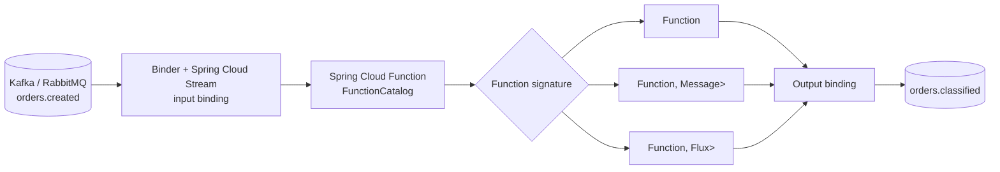
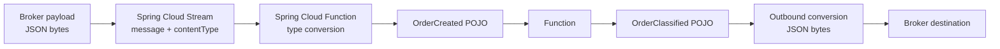

# Sending and Receiving POJOs, Messages, and Reactive Data

## 1. Problem: One Business Operation, Three Data Forms

A service receives order events from `orders.created`, classifies them by total amount, and emits results to `orders.classified`. The business logic can be written simply as:

```java
OrderClassified classify(OrderCreated order) {
    String priority = order.totalInCents() >= 100_000L
            ? "PRIORITY" : "STANDARD";
    return new OrderClassified(order.orderId(), priority);
}
```

However, a real event stream does not carry only payloads. A message may include `correlationId`, `contentType`, tracing information, or metadata provided by the binder. In some cases, an application also wants to process a **continuous stream of data** with Reactor `Flux` instead of one value per function invocation.

In **Spring Cloud Function**, the three common communication forms are:

1. **Plain POJO / payload** — `Function<OrderCreated, OrderClassified>`: business logic sees only Java objects.
2. **Message with headers** — `Function<Message<OrderCreated>, Message<OrderClassified>>`: business logic can read/write both payload and metadata.
3. **Reactive stream** — `Function<Flux<OrderCreated>, Flux<OrderClassified>>` or `Function<Flux<Message<OrderCreated>>, Flux<Message<OrderClassified>>>`: logic builds a pipeline processing elements asynchronously.

**Spring Cloud Stream** receives and emits these forms through bindings with Kafka, RabbitMQ, or a corresponding binder. **FunctionCatalog** finds/normalizes `Supplier`, `Function`, and `Consumer` beans and supports composition; the Stream adapter decides how messages are delivered to the function.

After this lesson, you will be able to choose the right function signature, configure input/output bindings and `content-type`, handle headers intentionally, explain the reactive function lifecycle, avoid confusing `Flux` with a JSON array, and test business logic independently of the broker.

## 2. Overview: Payloads, Messages, and Streams

The three forms are not three different broker technologies. They are **three ways of representing and handling data at the function boundary**.

| Criterion | POJO / `T` | `Message<T>` | Reactive `Flux<T>` or `Flux<Message<T>>` |
| --- | --- | --- | --- |
| Function input | Business object | Payload and headers | A sequence of elements over time |
| Typical signature | `Function<OrderCreated, OrderClassified>` | `Function<Message<OrderCreated>, Message<OrderClassified>>` | `Function<Flux<OrderCreated>, Flux<OrderClassified>>` |
| Accessing headers | Not directly | `message.getHeaders()` | If elements are `Message<T>` |
| Processing model | One invocation processes one payload in the imperative model | One invocation processes one message in the imperative model | Function sets up the pipeline; subsequent elements flow through it |
| Complexity | Low | Medium | Higher; requires understanding Reactor and stream lifecycle |
| Best suited for | Business transformations needing no metadata | Correlation, tracing, routing metadata | Asynchronous processing, stream composition, non-blocking I/O when suitable APIs exist |
| Errors to watch | Conversion and exceptions per invocation | Header/type conversion and exceptions | An `onError` signal can terminate the stream; explicit reactive error handling needed |



The diagram shows responsibility boundaries; it does not imply all three beans are triggered simultaneously. Normally, we select one definition for a pipeline via `spring.cloud.function.definition`. All three signatures can route data through **one input binding and one output binding**; `Flux` is a multi-element stream and does not create extra bindings by default.

## 3. Baseline Example: Using Java Records to Represent Business POJOs

Using Java 17+ and Spring Boot. Here `record` is a simple Java data object, serving the role of a POJO/DTO in the application; the framework requires a JSON library and versions with proper record support.

```java
public record OrderCreated(String orderId, long totalInCents) {}

public record OrderClassified(String orderId, String priority) {}
```

A JSON input:

```json
{
  "orderId": "ORD-101",
  "totalInCents": 150000
}
```

Expected output:

```json
{
  "orderId": "ORD-101",
  "priority": "PRIORITY"
}
```

If business logic only needs `orderId` and `totalInCents`, have the function accept `OrderCreated`. Passing Kafka `ConsumerRecord` or RabbitMQ `Delivery` directly into classification logic reduces reusability over HTTP or serverless.

## 4. Receiving and Sending POJOs with Function<I, O>

### 4.1. Declaring the Function

```java
import java.util.function.Function;

import org.springframework.context.annotation.Bean;
import org.springframework.context.annotation.Configuration;

@Configuration
class PojoFunctions {

    record OrderCreated(String orderId, long totalInCents) {}
    record OrderClassified(String orderId, String priority) {}

    @Bean
    Function<OrderCreated, OrderClassified> classifyPojo() {
        return order -> {
            if (order.orderId() == null || order.orderId().isBlank()) {
                throw new IllegalArgumentException("Invalid orderId");
            }

            String priority = order.totalInCents() >= 100_000L
                    ? "PRIORITY" : "STANDARD";

            return new OrderClassified(order.orderId(), priority);
        };
    }
}
```

The `classifyPojo` bean accepts an `OrderCreated` and returns an `OrderClassified`. It does not know which broker the message came from and does not create topics/queues itself.

### 4.2. Mapping to the Broker via Bindings

Example `application.yml` when selecting only this function:

```yaml
spring:
  cloud:
    function:
      definition: classifyPojo
    stream:
      bindings:
        classifyPojo-in-0:
          destination: orders.created
          group: order-classifiers
          content-type: application/json
        classifyPojo-out-0:
          destination: orders.classified
          content-type: application/json
```

**What happens when a message arrives?**

1. The binder reads the message from destination `orders.created`.
2. Spring Cloud Stream coordinates with Spring Cloud Function to prepare a payload matching type `OrderCreated`.
3. The framework invokes `classifyPojo.apply(order)`.
4. The returned `OrderClassified` is converted to the appropriate output representation and sent via `classifyPojo-out-0` to `orders.classified`.

When the payload is JSON, Spring typically needs a JSON converter such as Jackson. Actual conversion behavior depends on the incoming payload type, `contentType`, binder configuration, and framework version. `content-type: application/json` is a format hint and does not automatically supply a missing JSON library.

**Receiving and sending POJOs does not mean the broker transports a raw Java object directly on the wire in all cases.** On the wire, data is usually bytes or a serialized format; the binder and appropriate converters/serializers handle that boundary.

### 4.3. Quickly Testing the POJO Function

```java
import static org.junit.jupiter.api.Assertions.assertEquals;

import org.junit.jupiter.api.Test;

class PojoFunctionsTest {

    @Test
    void classifiesOrderWithoutBroker() {
        var function = new PojoFunctions().classifyPojo();

        var result = function.apply(
                new PojoFunctions.OrderCreated("ORD-101", 150_000L));

        assertEquals("ORD-101", result.orderId());
        assertEquals("PRIORITY", result.priority());
    }
}
```

This unit test proves the classification rule without starting Kafka/RabbitMQ. It does not prove data is received from or emitted to the right destinations; binding verification is a separate step.

## 5. When Is Message<T> Needed Instead of Just the Payload?

**Spring Messaging**'s `Message<T>` encapsulates:

- **Payload**: business content of type `T`.
- **Headers**: metadata accompanying the message, such as `correlationId`, `contentType`, event type, or operational metadata.

```text
Message<OrderCreated>
├── payload
│   ├── orderId: "ORD-101"
│   └── totalInCents: 150000
└── headers
    ├── correlationId: "req-789"
    ├── contentType: application/json
    └── ...metadata provided by the framework/binder
```

This is **one message with one payload and one set of headers**, not multiple input bindings. When a function accepts `Message<T>`, the binding names are still typically `<name>-in-0` and `<name>-out-0`.

Choose `Message<T>` when logic must answer metadata-related questions: "Which request did this order come from?", "Which event type is this message?", "Which correlation ID must be preserved when emitting the result?".

If metadata is not needed, `Function<T,R>` is easier to read and test.

## 6. Receiving Message<OrderCreated> and Emitting Message<OrderClassified>

### 6.1. Example of Intentional Header Handling

```java
import java.util.function.Function;

import org.springframework.context.annotation.Bean;
import org.springframework.context.annotation.Configuration;
import org.springframework.messaging.Message;
import org.springframework.messaging.support.MessageBuilder;

@Configuration
class MessageFunctions {

    record OrderCreated(String orderId, long totalInCents) {}
    record OrderClassified(String orderId, String priority) {}

    @Bean
    Function<Message<OrderCreated>, Message<OrderClassified>> classifyMessage() {
        return inbound -> {
            OrderCreated order = inbound.getPayload();

            var classified = new OrderClassified(
                    order.orderId(),
                    order.totalInCents() >= 100_000L
                            ? "PRIORITY" : "STANDARD"
            );

            // Only forward metadata actually needed by the business logic.
            Object correlationId = inbound.getHeaders().get("correlationId");

            var builder = MessageBuilder.withPayload(classified)
                    .setHeader("processedBy", "order-stream");

            if (correlationId != null) {
                builder.setHeader("correlationId", correlationId);
            }

            return builder.build();
        };
    }
}
```

In this example:

- `inbound.getPayload()` returns `OrderCreated`.
- `inbound.getHeaders()` returns the inbound message's metadata.
- `MessageBuilder.withPayload(...)` constructs a new message with payload `OrderClassified`.
- `processedBy` is added to mark the processing service.
- `correlationId` is forwarded when present, aiding request tracing across services.

Selectively copying headers is easy to control. If you truly need to preserve all headers, `MessageBuilder.copyHeaders(inbound.getHeaders())` can be used, though you should not blindly copy transport headers or untrusted data onto a new message. Some headers carry system semantics or are binder-specific; verify how the transport maps them.

### 6.2. Bindings Still Have One Input and One Output

```yaml
spring:
  cloud:
    function:
      definition: classifyMessage
    stream:
      bindings:
        classifyMessage-in-0:
          destination: orders.created
          group: order-classifiers
          content-type: application/json
        classifyMessage-out-0:
          destination: orders.classified
          content-type: application/json
```

Changing the signature from `Function<OrderCreated,OrderClassified>` to `Function<Message<OrderCreated>,Message<OrderClassified>>` **does not create an extra port to carry headers**. It only changes the Java object passed into and returned from the function.

### 6.3. Do Headers Always Arrive Identically?

Do not assume all headers are preserved across every broker. Kafka, RabbitMQ, and HTTP/serverless adapters have different metadata-carrying mechanisms. Spring Cloud Stream binders may map or filter certain headers depending on configuration, format, and infrastructure capabilities.

For example, `correlationId` might be a `String` at one step yet be received in a different form at the next step depending on header serialization. Verify the header contract in integration tests, especially when integrating with non-Spring applications.

## 7. Content Type and the Payload Conversion Process

`content-type` often causes confusion because it appears both in binding configuration and potentially in message headers.

### 7.1. Typical Conversion Sequence



With `Function<OrderCreated,OrderClassified>`, the function's generic types inform the framework of the expected Java types. `content-type: application/json` indicates the wire format converters can use. `FunctionCatalog` itself is not a broker serializer and cannot guarantee converting every type if required converters are missing.

### 7.2. Headers and Configuration Can Differ

In Spring Cloud Stream, a `contentType` value in the message header (when provided and used) typically takes precedence over the content type configured on the binding, falling back to defaults afterward. Thus, a producer attaching a wrong `contentType` can cause the consumer to convert the payload incorrectly even when YAML looks valid.

For outbound messages, if you change a payload from text to a JSON object while keeping an old `contentType` header, review and update the content type accordingly. Do not copy all input headers verbatim onto output when the data format changes.

### 7.3. Common JSON Errors

| Symptom | Possible Cause | Resolution |
| --- | --- | --- |
| Function expects `OrderCreated` but receives `byte[]` or `String` | Conversion did not occur as expected | Check generic types, `contentType`, converters, and native decoding |
| JSON is missing a required field | Producer/consumer schema mismatch | Check contract, validation, and schema compatibility |
| Function uses `Object` and lacks desired POJO | Type hint is too generic | Use a concrete Java type such as `OrderCreated` |
| `contentType` header mismatches payload | Wrong metadata or stale header forwarded | Fix message contract; set matching content type |
| Java tests pass but Kafka consumer fails | Unit tests bypass serialization/binder | Add integration tests with a real broker and realistic data |

If **binder-native serialization/deserialization** is enabled, the conversion path may differ from standard Spring Cloud Function/Stream mechanics. Avoid treating `content-type` configuration as a promise that all binders serialize identically.

## 8. POJO, Message, and Supplier/Consumer at Both Ends of a Stream

The three Java interfaces map to three roles in Spring Cloud Stream:

| Interface | Example Signature | Default Binding | Purpose |
| --- | --- | --- | --- |
| `Supplier<OrderCreated>` | `() -> OrderCreated` | `<name>-out-0` | Emits new payload |
| `Supplier<Message<OrderCreated>>` | `() -> Message<OrderCreated>` | `<name>-out-0` | Emits payload with headers |
| `Function<OrderCreated,OrderClassified>` | `OrderCreated -> OrderClassified` | Both `-in-0` and `-out-0` | Transforms payload |
| `Consumer<OrderClassified>` | `OrderClassified -> void` | `<name>-in-0` | Receives and executes side effects |
| `Consumer<Message<OrderClassified>>` | `Message<OrderClassified> -> void` | `<name>-in-0` | Side effects with metadata handling |

### 8.1. Supplier Can Produce Message<T>

```java
import java.util.UUID;
import java.util.function.Supplier;

import org.springframework.context.annotation.Bean;
import org.springframework.messaging.Message;
import org.springframework.messaging.support.MessageBuilder;

@Bean
Supplier<Message<String>> createHeartbeat() {
    return () -> MessageBuilder.withPayload("alive")
            .setHeader("eventId", UUID.randomUUID().toString())
            .build();
}
```

This example cleanly illustrates an output with headers. For an imperative supplier, Stream usually triggers it via a poller; a function that always returns a message will continuously emit data on each poll interval. Production requires an appropriate emission policy so events are not generated infinitely.

### 8.2. Consumer Can Read Message<T>

```java
import java.util.function.Consumer;

import org.springframework.context.annotation.Bean;
import org.springframework.messaging.Message;

@Bean
Consumer<Message<String>> auditHeartbeat() {
    return message -> System.out.printf(
            "eventId=%s payload=%s%n",
            message.getHeaders().get("eventId"),
            message.getPayload());
}
```

A consumer typically has an input binding and **no automatic output binding** because its signature returns `void`. When the side effect writes to a database or sends notifications, design duplicate handling, because the broker may redeliver a message after an error.

### 8.3. Active Emission with StreamBridge

Not every source fits a polled supplier. If an HTTP request or internal logic decides when to emit an event, you can use `StreamBridge` to send via an output binding:

```java
import org.springframework.cloud.stream.function.StreamBridge;
import org.springframework.messaging.support.MessageBuilder;
import org.springframework.stereotype.Service;

@Service
class EventPublisher {

    private final StreamBridge streamBridge;

    EventPublisher(StreamBridge streamBridge) {
        this.streamBridge = streamBridge;
    }

    boolean publish(String orderId) {
        var message = MessageBuilder.withPayload(orderId)
                .setHeader("eventType", "ORDER_CREATED")
                .build();

        return streamBridge.send("ordersOut", message);
    }
}
```

```yaml
spring:
  cloud:
    stream:
      output-bindings: ordersOut
      bindings:
        ordersOut:
          destination: orders.created
          content-type: text/plain
```

`ordersOut` is an active binding name declared by the application; it is not necessarily derived from a `Supplier` bean. `StreamBridge` allows emitting messages at the moment code calls `send`; its lifecycle differs from a polled imperative `Supplier`.

## 9. What Is Reactive in Spring Cloud Function and Spring Cloud Stream?

In Reactor, `Flux<T>` represents a Publisher capable of emitting **0 to many elements**, along with completion or error signals; `Mono<T>` represents at most one element. Reactor implements Reactive Streams concepts, including subscriptions and data demand (*backpressure*) at supporting boundaries.

A reactive function typically has the signature:

```java
Function<Flux<OrderCreated>, Flux<OrderClassified>>
```

**Important difference:** with reactive functional bindings, the framework may invoke the function **once to establish the processing pipeline**, then feed subsequent messages as elements of that stream. Do not assume each new message causes the framework to re-invoke `apply(Flux)`.

Comparison:

```text
Imperative Function<OrderCreated, OrderClassified>:
  message 1 -> apply(order1) -> result1
  message 2 -> apply(order2) -> result2

Reactive Function<Flux<OrderCreated>, Flux<OrderClassified>>:
  apply(inputFlux) -> outputFlux is established
  inputFlux: order1 --- order2 --- order3 --- ...
  outputFlux: result1 -- result2 -- result3 -- ...
```

A `Flux` in a reactive function **is not by default a JSON array** sent inside one broker message. Stream receives multiple messages and represents them as elements of a stream. Whether output is emitted as individual messages or batched via a specific mechanism depends on the function and binder.

## 10. Receiving and Sending Reactive Data with Function<Flux<I>, Flux<O>>

### 10.1. Transforming Each Element with map

```java
import java.util.function.Function;

import org.springframework.context.annotation.Bean;
import org.springframework.context.annotation.Configuration;
import reactor.core.publisher.Flux;

@Configuration
class ReactiveFunctions {

    record OrderCreated(String orderId, long totalInCents) {}
    record OrderClassified(String orderId, String priority) {}

    @Bean
    Function<Flux<OrderCreated>, Flux<OrderClassified>> classifyReactive() {
        return orders -> orders.map(order -> {
            String priority = order.totalInCents() >= 100_000L
                    ? "PRIORITY" : "STANDARD";

            return new OrderClassified(order.orderId(), priority);
        });
    }
}
```

`map` is a synchronous element-by-element transformation operator. Here, the function does not call `subscribe()` because it **returns the Flux** for the framework to manage subscription and result emission according to binding mechanics.

This signature still normally maps to:

- `classifyReactive-in-0`: input binding.
- `classifyReactive-out-0`: output binding.

```yaml
spring:
  cloud:
    function:
      definition: classifyReactive
    stream:
      bindings:
        classifyReactive-in-0:
          destination: orders.created
          group: reactive-classifiers
          content-type: application/json
        classifyReactive-out-0:
          destination: orders.classified
          content-type: application/json
```

The Reactor library must be present in the application (pulled in via compatible Spring Cloud/Spring Boot dependencies). A reactive signature does not automatically make everything inside non-blocking: calling blocking JDBC or `Thread.sleep` inside `map` can still block the execution thread and degrade throughput.

### 10.2. When Asynchronous Operations Are Needed

If an API returns `Mono<R>`, you can use `flatMap` or `concatMap` to compose asynchronous results:

```java
// Suppose enrichAsync(OrderCreated) returns Mono<OrderClassified>.
Function<Flux<OrderCreated>, Flux<OrderClassified>> pipeline =
        input -> input.concatMap(this::enrichAsync);
```

`concatMap` processes and emits results in input element order, typically trading off concurrency. `flatMap` allows multiple async tasks to run concurrently and may reorder outputs. Choose the operator based on ordering requirements and resource limits, not solely for throughput.

`enrichAsync` in the example is an illustrative method that the application must implement using an appropriate reactive API; it is not a built-in Spring Cloud Function method.

### 10.3. Filtering in a Stream Reduces Output Count

```java
@Bean
Function<Flux<OrderCreated>, Flux<OrderCreated>> largeOrders() {
    return orders -> orders.filter(
            order -> order.totalInCents() >= 100_000L);
}
```

An input message may **produce no output message** if filtered out. That does not mean the input binding lost the message: filtering is a business decision of the pipeline. Define an explicit discard policy when every event must be accounted for.

## 11. Reactive Message: Preserving Metadata per Element

When a reactive pipeline needs correlation IDs, use `Flux<Message<T>>` instead of `Flux<T>`:

```java
import java.util.function.Function;

import org.springframework.context.annotation.Bean;
import org.springframework.messaging.Message;
import org.springframework.messaging.support.MessageBuilder;
import reactor.core.publisher.Flux;

@Bean
Function<Flux<Message<OrderCreated>>,
         Flux<Message<OrderClassified>>> classifyReactiveMessage() {

    return messages -> messages.map(inbound -> {
        OrderCreated order = inbound.getPayload();
        var result = new OrderClassified(
                order.orderId(),
                order.totalInCents() >= 100_000L
                        ? "PRIORITY" : "STANDARD"
        );

        Object correlationId = inbound.getHeaders().get("correlationId");
        var builder = MessageBuilder.withPayload(result)
                .setHeader("processedBy", "reactive-order-service");

        if (correlationId != null) {
            builder.setHeader("correlationId", correlationId);
        }

        return builder.build();
    });
}
```

The snippet assumes `OrderCreated` and `OrderClassified` records are declared as in Section 3. For each element of the `Flux`:

1. The function extracts the Java payload.
2. Creates `OrderClassified`.
3. Builds an output message with the chosen business headers.
4. Emits the output message when downstream is ready to accept it.

**Distinction:** `Flux<Message<T>>` is a stream of **many independent messages**, each with its own headers. It differs from `Message<Flux<T>>`, which is **one message whose payload is a Flux**. In standard Spring Cloud Stream reactive functional bindings, `Flux<Message<T>>` is the form to consider when handling metadata per event. Do not assume the binder serializes an entire `Flux` into a single payload.

## 12. Supplier and Consumer in the Reactive World

### 12.1. Reactive Supplier

A `Supplier<Flux<T>>` supplies a Publisher that can emit many elements over time:

```java
import java.time.Duration;
import java.util.function.Supplier;

import org.springframework.context.annotation.Bean;
import reactor.core.publisher.Flux;

@Bean
Supplier<Flux<String>> demoHeartbeatStream() {
    return () -> Flux.interval(Duration.ofSeconds(1))
            .map(index -> "heartbeat-" + index);
}
```

`Flux.interval` creates a continuous stream for demonstration; do not use it as-is in production without controlling schedule, rate limits, and message demand. Spring Cloud Stream typically obtains the reactive supplier's Publisher to subscribe according to the stream lifecycle, unlike polling an imperative `Supplier<String>` for each emission.

The default output binding is `demoHeartbeatStream-out-0`. Each emitted element goes through the binder's emission mechanism; it does not automatically collect the entire `Flux` into a single JSON list.

### 12.2. Reactive Consumer Requires Careful Consideration

With `Consumer<Flux<T>>`, the `Consumer` signature returns `void` and therefore does not return a result Publisher to the framework like `Function<Flux<I>,Flux<O>>`. Subscription, completion, and error signaling can become harder to manage. Do not mechanically convert an imperative `Consumer<T>` into `Consumer<Flux<T>>` assuming per-event processing, acknowledgement, and retries remain identical.

If you only need to write an event to a database, an imperative `Consumer<T>` is usually easier to reason about. If you want to build a reactive pipeline with output, consider `Function<Flux<I>,Flux<O>>`; if there are asynchronous side effects, explicitly design subscription and completion tracking rather than arbitrarily calling `subscribe()` and ignoring errors.

### 12.3. Lifecycle Comparison

| Bean | When Is It Invoked? | Key Considerations |
| --- | --- | --- |
| `Supplier<T>` | Typically polled on a schedule | Each poll can emit one message |
| `Supplier<Flux<T>>` | Supplies a reactive stream to the framework | Publisher lifecycle, subscription, and emission rate |
| `Function<T,R>` | When a payload needs imperative processing | Exceptions usually tie to one message invocation |
| `Function<Message<T>,Message<R>>` | When a message needs processing | Can read/write headers |
| `Function<Flux<T>,Flux<R>>` | Sets up the reactive pipeline; elements flow through afterward | Do not assume `apply` runs per message; errors can terminate the stream |
| `Consumer<T>` | When a message needs processing | Side effects, idempotency, retries, and acks |

This is a practical mental model. Exact polling, subscription, and error management depend on the Spring Cloud Stream version, binder, and application configuration.

## 13. Error Handling in Reactive Pipelines

### 13.1. Difference Between Imperative Exceptions and Reactive onError

With `Function<OrderCreated,OrderClassified>`, errors typically occur inside a single `apply(order)` call. The framework can coordinate error handling, retries, or DLQ at the message boundary according to the binder and configuration.

With `Function<Flux<OrderCreated>,Flux<OrderClassified>>`, if `map` throws an exception, Reactor may emit an **`onError` signal and terminate the stream**. Because a reactive functional pipeline can be long-lived across many messages, per-message retries cannot be assumed to work the same way as in the imperative model.

The following example can terminate the pipeline upon encountering an invalid message:

```java
@Bean
Function<Flux<OrderCreated>, Flux<OrderClassified>> fragilePipeline() {
    return orders -> orders.map(order -> {
        if (order.orderId() == null) {
            throw new IllegalArgumentException("Missing orderId");
        }
        return new OrderClassified(order.orderId(), "STANDARD");
    });
}
```

### 13.2. Per-Element Error Handling When Policy Is Clear

When business rules **allow skipping invalid events** and a durable error logging/quarantine mechanism exists, wrap per-message work in its own `Mono`:

```java
import reactor.core.publisher.Mono;

@Bean
Function<Flux<OrderCreated>, Flux<OrderClassified>> validatedPipeline() {
    return orders -> orders.concatMap(order ->
            Mono.fromCallable(() -> {
                if (order.orderId() == null ||
                        order.orderId().isBlank()) {
                    throw new IllegalArgumentException("Missing orderId");
                }
                return new OrderClassified(order.orderId(), "STANDARD");
            })
            .onErrorResume(error -> {
                // DEMO: log error; production needs durable storage/quarantine.
                System.err.println("Skipping invalid event: " + error.getMessage());
                return Mono.empty();
            }));
}
```

`onErrorResume` is placed **inside per-element handling** to contain errors to that single element. This pattern **intentionally drops** invalid messages, so it is only appropriate when business requirements permit it. If events cannot be lost, ensure dead-lettering/quarantine or proper error reporting completes before emitting completion.

Do not use `onErrorContinue` or unconditional `retry()` across the entire `Flux` as a blanket fix. These operators can introduce unexpected behavior, repeat side effects, or alter processing boundaries. In particular, retrying at the entire stream level differs from retrying a single broker-delivered message.

### 13.3. Backpressure Does Not Replace Delivery Guarantees

Reactive Streams provides a demand mechanism between Publisher and Subscriber at supporting boundaries. However, backpressure in Reactor **does not automatically guarantee** that Kafka/RabbitMQ delivers data only at business speed, never loses messages, or achieves exactly-once semantics.

Check:

- Producer and consumer rates, buffers, prefetch/poll, and concurrency.
- When broker acknowledgement or offset commit occurs.
- Connection drops, restarts, rebalances, retries, or DLQ behavior.
- Duplicate handling when a consumer side effect ran yet the broker redelivered the message.

For tasks that write to a database or call external APIs, ensure idempotency via event IDs, unique constraints, or an appropriate strategy.

## 14. Testing POJO, Message, and Reactive Functions

### 14.1. Unit Testing POJO

```java
var fn = new PojoFunctions().classifyPojo();
var result = fn.apply(new PojoFunctions.OrderCreated("ORD-101", 150_000L));

// result.priority() == "PRIORITY"
```

This test is fast and broker-independent.

### 14.2. Unit Testing Message<T> and Headers

```java
import static org.junit.jupiter.api.Assertions.assertEquals;

import org.junit.jupiter.api.Test;
import org.springframework.messaging.support.MessageBuilder;

class MessageFunctionsTest {

    @Test
    void preservesCorrelationId() {
        var function = new MessageFunctions().classifyMessage();

        var incoming = MessageBuilder
                .withPayload(new MessageFunctions.OrderCreated(
                        "ORD-101", 150_000L))
                .setHeader("correlationId", "req-789")
                .build();

        var outgoing = function.apply(incoming);

        assertEquals("PRIORITY", outgoing.getPayload().priority());
        assertEquals("req-789",
                outgoing.getHeaders().get("correlationId"));
        assertEquals("order-stream",
                outgoing.getHeaders().get("processedBy"));
    }
}
```

The test proves the function reads/writes headers as expected at the Java level. It **does not confirm** whether a specific binder transports that header across the broker.

### 14.3. Unit Testing Reactive with StepVerifier

With the `reactor-test` dependency in test scope:

```java
import org.junit.jupiter.api.Test;
import reactor.core.publisher.Flux;
import reactor.test.StepVerifier;

class ReactiveFunctionsTest {

    @Test
    void classifiesMultipleEvents() {
        var function = new ReactiveFunctions().classifyReactive();

        var input = Flux.just(
                new ReactiveFunctions.OrderCreated("ORD-1", 99_999L),
                new ReactiveFunctions.OrderCreated("ORD-2", 100_000L));

        StepVerifier.create(function.apply(input))
                .expectNextMatches(event ->
                        event.orderId().equals("ORD-1") &&
                        event.priority().equals("STANDARD"))
                .expectNextMatches(event ->
                        event.orderId().equals("ORD-2") &&
                        event.priority().equals("PRIORITY"))
                .verifyComplete();
    }
}
```

`StepVerifier` asserts Publisher elements in expected order and the completion signal. For `Flux.interval` or infinite streams, do not use `verifyComplete()` if the stream has no end; instead bound the event count or use virtual time appropriately.

### 14.4. Testing Spring Cloud Stream Bindings

After unit tests, run integration tests to verify:

1. `spring.cloud.function.definition` selected the right bean.
2. The input binding receives JSON with the right `contentType` and converts it to the right POJO.
3. The output binding emits JSON to the right destination with the right type.
4. For `Message<T>`, correlation headers travel through the actual binder per contract.
5. For reactive, multiple consecutive messages are processed; a single-element error behaves as designed.
6. After restarts or broker redelivery, side effects are not duplicated against business rules.

The Spring Cloud Stream test binder can help verify wiring/message conversion logic at the framework level. To verify Kafka offsets, partitions, RabbitMQ queues/acks, header mapping, and real retry/DLQ behavior, run integration tests against the corresponding broker.

## 15. Placing All Three Function Styles in One App and Selecting One

An application can define multiple beans:

```java
@Bean
Function<OrderCreated, OrderClassified> classifyPojo() { /* ... */ }

@Bean
Function<Message<OrderCreated>, Message<OrderClassified>>
classifyMessage() { /* ... */ }

@Bean
Function<Flux<OrderCreated>, Flux<OrderClassified>>
classifyReactive() { /* ... */ }
```

The snippet above illustrates **signatures**, not a standalone runnable Java file: bodies and types are implemented as in previous examples. When multiple functional beans exist, explicitly specify the definition to wire into Stream. The following options are **three alternative configurations** and should not be enabled together unless you intentionally want multiple consumer groups reading one topic.

**Selecting POJO:**

```yaml
spring:
  cloud:
    function:
      definition: classifyPojo
    stream:
      bindings:
        classifyPojo-in-0:
          destination: orders.created
          group: order-classifiers
        classifyPojo-out-0:
          destination: orders.classified
```

**Selecting Message:**

```yaml
spring:
  cloud:
    function:
      definition: classifyMessage
    stream:
      bindings:
        classifyMessage-in-0:
          destination: orders.created
          group: order-classifiers
        classifyMessage-out-0:
          destination: orders.classified
```

**Selecting reactive:**

```yaml
spring:
  cloud:
    function:
      definition: classifyReactive
    stream:
      bindings:
        classifyReactive-in-0:
          destination: orders.created
          group: order-classifiers
        classifyReactive-out-0:
          destination: orders.classified
```

When payloads use JSON, you can add `content-type: application/json` on the corresponding input/output bindings. Kafka and RabbitMQ also require binder dependencies, connection configuration, credentials, and matching destinations.

Selecting a different bean changes the **default binding names** because the bean name differs. You can use `spring.cloud.stream.function.bindings` to define aliases, but you must update all `destination`/`group` settings under the explicit binding names.

## 16. Choosing Data Representation Based on Requirements

| Scenario | Type to Consider | Reason |
| --- | --- | --- |
| Only classifying, computing, or transforming data | `Function<T,R>` | Clear logic, easy to reuse and test |
| Need correlation ID, event type, or business headers | `Function<Message<T>,Message<R>>` | Accesses metadata per message |
| Processing event streams with Reactor, non-blocking I/O, or stream operators | `Function<Flux<T>,Flux<R>>` | Pipeline model with asynchronous processing |
| Need both reactive processing and per-event headers | `Function<Flux<Message<T>>,Flux<Message<R>>>` | Each element has its own payload/headers |
| Need to emit when a schedule/poller invokes the source | `Supplier<T>` or `Supplier<Message<T>>` | Emits data without needing an input binding |
| Need to emit a reactive event stream | `Supplier<Flux<T>>` | Publisher emits multiple elements over the stream lifecycle |
| Only persisting results or triggering final actions | `Consumer<T>` / `Consumer<Message<T>>` | Sink with side effects, no default output |
| Need to emit immediately when code handles an HTTP request | `StreamBridge` | Proactively sends via an output binding |

Reactive is not automatically better than imperative for every business problem. If an operation is simple, synchronous, and has minimal I/O, a POJO `Function` is usually less complex. Add `Message` or `Flux` only when the problem specifically requires that capability.

## 17. Common Mistakes and How to Fix Them

| Symptom | Typical Cause | How to Check |
| --- | --- | --- |
| POJO function cannot deserialize JSON | `contentType`/schema/converter mismatch | Check payload, type hint, Jackson, and binder native conversion |
| Switched to `Message<T>` and added `-in-1` | Confused headers with a second binding port | Use one `-in-0` for a regular message |
| Correlation header disappears | Header not forwarded or binder does not map as expected | Check message-building code, output headers, and broker |
| Returned `Message<T>` yet output has wrong format | Kept old content type when payload changed | Set the right content type and check conversion |
| Treated `Flux` as a JSON array | Confused a Publisher with a single payload | Check reactive signature and how Stream binds each element |
| Only first element processed or pipeline stops | `onError` terminated the stream | Monitor Reactor signals and error-handling policy |
| `Function<Flux<T>,Flux<R>>` has fewer `apply` calls than messages | Reactive function is used to establish the stream | Test output per element, not invocations per message |
| Called `subscribe()` inside function and returned another Publisher | Subscription detached from framework lifecycle | Return the Publisher describing the whole pipeline |
| `map` is slow despite using Flux | Performing blocking I/O on the processing thread | Choose non-blocking APIs or configure schedulers properly |
| `Consumer<Flux<T>>` does not report errors as expected | No result Publisher; subscription management is tricky | Prefer `Consumer<T>` or a reactive pipeline with a clear completion contract |
| Message processed twice | Retry, redelivery, or restart | Implement idempotency and check ack/offset |
| Unit tests pass yet broker receives nothing | Wrong binding/destination/group/binder or conversion | Integration test with an actual broker |

When debugging, trace in order: **definition → binding name → binder/destination → payload wire format → content type → Java type → headers → reactive lifecycle/error handling**. Separating conversion errors, business logic errors, and broker delivery errors helps avoid fixing the wrong layer.

## 18. Reinforcement Exercises

### Exercise 1: POJO or Message?

One function only needs to convert `OrderCreated` to `OrderClassified`. Another function needs to preserve `correlationId` from input to output. Choose the signature for each function and explain why both can use the same input/output binding pattern.

**Hint:** use `Function<OrderCreated,OrderClassified>` for the first and `Function<Message<OrderCreated>,Message<OrderClassified>>` for the second; both still typically have one input and one output.

### Exercise 2: JSON Conversion

A producer sends:

```json
{"orderId":"ORD-202","totalInCents":50000}
```

The consumer declares `Function<OrderCreated,OrderClassified>`. Describe the steps from bytes/JSON to the Java record and output JSON. If a data-type error occurs, which settings would you inspect first?

**Hint:** check `contentType`, converters, record fields, type hints, native serialization, and JSON dependencies.

### Exercise 3: Reactive Filter

Write `Function<Flux<OrderCreated>,Flux<OrderCreated>>` that emits only orders with `totalInCents >= 100_000`. Given three inputs with amounts `50_000`, `100_000`, and `150_000`, predict the output count. Explain why `Flux` does not mean three input bindings.

### Exercise 4: Per-Event Error Handling

A reactive pipeline stops when the second message is missing `orderId`. Design a **no-data-loss** policy: store or route the failing message to durable quarantine while continuing to process valid messages. Specify how you confirm error persistence succeeded before skipping that element.

### Exercise 5: Testing Headers

Create a message with header `correlationId: req-789` and payload `OrderCreated("ORD-101",150000)`. Write a unit test verifying the function returns a payload with priority `PRIORITY` and the correlation ID header intact. Then describe an integration test needed to verify an actual binder transports the header.

### Self-Assessment Questions

1. How many payloads and how many default input bindings does `Message<OrderCreated>` have?
2. Does a `Function<Flux<OrderCreated>,Flux<OrderClassified>>` automatically emit the entire Flux as one JSON array?
3. When should you choose `Message<T>` instead of `T`?
4. Why can `flatMap` change output order in a stream?
5. Why is an exception inside reactive `map` dangerous without an `onError` strategy?
6. Does `content-type` on a binding completely replace schema validation or native serializers?
7. Why can manually calling `subscribe()` inside a reactive function complicate error tracking and lifecycle management?
8. What does a Reactor unit test with `StepVerifier` prove, and what still requires a broker integration test?

## 19. Summary

In Spring Cloud Stream, **POJOs, Messages, and reactive streams** are three options at the data-processing boundary:

- **`Function<T,R>`** receives and emits Java payloads, suitable for most pure transformation logic.
- **`Function<Message<T>,Message<R>>`** receives and emits messages with headers, needed when logic uses correlation IDs or metadata.
- **`Function<Flux<T>,Flux<R>>`** processes a stream of elements under the Reactor model; watch subscription, error signals, backpressure, and broker acknowledgement boundaries.
- **`Function<Flux<Message<T>>,Flux<Message<R>>>`** combines stream processing with per-message metadata.

Spring Cloud Function and `FunctionCatalog` keep business logic protocol-independent; Spring Cloud Stream and binders connect data through destinations on Kafka, RabbitMQ, or suitable middleware. Choose the data representation based on business needs, keep JSON/header contracts clear, and test function logic, wiring, and broker behavior separately. As a result, the same logic can be reused over HTTP, event-driven, or serverless environments when deployed with compatible adapters.

### References

- [Spring Cloud Function — Programming model](https://docs.spring.io/spring-cloud-function/reference/spring-cloud-function/programming-model.html)
- [Spring Cloud Stream — Producing and consuming messages](https://docs.spring.io/spring-cloud-stream/reference/spring-cloud-stream/producing-and-consuming-messages.html)
- [Spring Cloud Stream — Content type negotiation](https://docs.spring.io/spring-cloud-stream/reference/spring-cloud-stream/mechanics.html)
- [Spring Cloud Stream — Functional binding names](https://docs.spring.io/spring-cloud-stream/reference/spring-cloud-stream/functional-binding-names.html)
- [Project Reactor — Reference Guide](https://projectreactor.io/docs/core/release/reference/)
