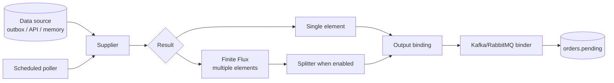

# Polling Suppliers and Splitting Collections of Elements

## 1. Problem: Periodically Fetching Multiple Records While Emitting Individual Events

Suppose an order service stores outbound events in an *outbox* table. Every few seconds, the application reads a batch of new records and sends them to Kafka or RabbitMQ for other services to process. A single query might return three orders:

```json
[
  {"orderId":"ORD-101","totalInCents":150000},
  {"orderId":"ORD-102","totalInCents":80000},
  {"orderId":"ORD-103","totalInCents":220000}
]
```

There are at least two ways to represent the output:

- **One message containing the whole list** of three orders. Consumers must understand the batch format and iterate through elements themselves.
- **Three independent messages**, each containing one order. Consumers can process, retry, load-balance, or route on a per-event basis.

In **Spring Cloud Function**, `Supplier<T>` is a source function: it produces data without needing input. In **Spring Cloud Stream**, a `Supplier` can be triggered by a *poller* (scheduled invoker) and emit results via an output binding to a broker. If the output data is a collection of elements, we must also decide **whether to split the collection into multiple messages**.

These two questions are independent:

1. **Polling**: when and how often should the data source be invoked?
2. **Splitting**: when a single invocation returns multiple elements, should it emit one collection message or multiple separate messages?

The core point of this lesson is distinguishing imperative `Supplier<T>`, reactive `Supplier<Flux<T>>`, and `@PollableBean(splittable = true)` for finite streams that need to be polled repeatedly.

**Learning objectives:** After this lesson, you will be able to configure poller intervals, understand the `maxMessagesPerPoll` limit, choose how to emit individual elements, write a `@PollableBean`, configure output bindings, test output message counts, and identify duplicate-delivery risks when reading data in batches.

## 2. Related Components

| Component | Role | Example |
| --- | --- | --- |
| `Supplier<T>` | Source function returning a value when invoked | `Supplier<OrderCreated>` |
| `Supplier<Flux<T>>` | Source function supplying a Publisher of multiple elements | `Supplier<Flux<OrderCreated>>` |
| `FunctionCatalog` | Looks up, normalizes, and supports composing functional beans | Looks up bean `publishPendingOrders` |
| Spring Cloud Stream poller | Triggers a source on a schedule when the source model requires polling | Triggers supplier every 5 seconds |
| Splitter | Breaks down a multi-element result into multiple messages | 3 elements → 3 messages |
| Output binding | The supplier's data emission port | `publishPendingOrders-out-0` |
| Binder | Transfers messages between bindings and middleware | Kafka binder, RabbitMQ binder |
| Destination | Logical address of output on middleware | `orders.pending` |

A standard `Supplier` has no input binding because it is not triggered by an incoming message. It connects outward via `<supplierName>-out-0`.



The diagram shows the general processing flow. A reactive supplier providing a continuous stream does not share the same poller lifecycle as an imperative supplier; later sections explain that difference.

## 3. Do Not Confuse One Poll with One Output Message

Suppose there is a batch of five records in the data source and the poller runs once:

| Source Form | Result of One Data Fetch | How to Understand the Output |
| --- | --- | --- |
| `Supplier<OrderCreated>` | One `OrderCreated` | Normally emits one order message |
| `Supplier<List<OrderCreated>>` | One `List` of 5 orders | This is **one List value**; do not assume it becomes 5 messages |
| Standard reactive `Supplier<Flux<OrderCreated>>` | One `Flux` | Publisher can emit multiple elements over the subscription's lifetime; does not automatically re-poll |
| `@PollableBean(splittable=true)` on `Supplier<Flux<OrderCreated>>` | One finite `Flux` of 5 elements per poll | Spring Cloud Stream can split it into **5 separate messages** on output |
| `@PollableBean(splittable=false)` | One finite `Flux` when polled | Disables annotation-driven element splitting; verify how the intact Publisher is handled downstream/by binder |

A simple calculation highlights the difference:

```text
1 poll
    -> source returns 5 elements
    -> splittable = true
    -> up to 5 data messages from that batch

maxMessagesPerPoll = 1
    != limiting Flux element count to 1
    != guaranteeing only 1 message per cycle after splitting
```

`maxMessagesPerPoll` controls how many messages/fetches the poller processes per polling cycle, **not** a parameter that truncates a `Flux` after its first element, nor does it change the batch size returned by a repository.

## 4. Imperative Supplier: Each get() Call Produces One Value

### 4.1. Simple Bean

```java
import java.util.concurrent.atomic.AtomicLong;
import java.util.function.Supplier;

import org.springframework.context.annotation.Bean;
import org.springframework.context.annotation.Configuration;

@Configuration
class SimpleSupplierConfiguration {

    @Bean
    Supplier<String> orderNumbers() {
        AtomicLong counter = new AtomicLong();
        return () -> "ORD-" + counter.incrementAndGet();
    }
}
```

With Spring Cloud Stream, `orderNumbers` is the bean name selected in `spring.cloud.function.definition`. When bound as a source, Stream uses a poller to invoke `get()` on a schedule and emit results to output binding `orderNumbers-out-0`.

Configuration example:

```yaml
spring:
  cloud:
    function:
      definition: orderNumbers
    stream:
      bindings:
        orderNumbers-out-0:
          destination: orders.generated
          content-type: text/plain
```

Each successful `get()` call in the example produces **one new String**. It does not read Kafka or RabbitMQ input; the broker only receives produced messages.

### 4.2. What If the Source Has No Data Yet?

For example, a repository may have no pending records:

```java
@Bean
Supplier<OrderCreated> nextOrder(OutboxRepository repository) {
    return () -> repository.findNextPending().orElse(null);
}
```

This is illustrative code based on an application-defined `OutboxRepository` interface. In the polled source model, returning `null` indicates there is no message to emit on that poll. Verify actual behavior of the framework version and converters if using special result types.

**Important:** reading a record and marking it sent immediately inside `get()` can lose data if the broker publish subsequently fails. In a real outbox application, separate fetching/claiming records, confirming publish success, and error recovery through a clearly designed delivery workflow. Do not treat the `findNextPending()` example as a complete durable outbox implementation.

## 5. Default Poller and Invocation Cadence Configuration

In Spring Cloud Stream's functional Supplier model, the default poller typically invokes an imperative supplier roughly **once per second**. According to Spring Cloud Stream documentation, typical defaults for the default poller are `fixedDelay = 1000 ms` and `maxMessagesPerPoll = 1`; cross-check with the framework version in use when exact scheduling guarantees matter.

### 5.1. Global Poller Configuration

For example, to increase the pause between polls:

```yaml
spring:
  integration:
    poller:
      fixed-delay: 5000
      max-messages-per-poll: 1
```

`spring.integration.poller.fixed-delay` is measured in milliseconds by default. A value of `5000` corresponds to a 5-second fixed delay on the poller schedule; it is **not a guarantee** that the broker sees a message exactly every 5 seconds, because processing time, scheduling, load, and connectivity also apply.

`max-messages-per-poll` controls the maximum number of receives/messages handled by the default poller per trigger, rather than setting the batch size of a `Flux`. If the source has no data, a poll cycle does not have to emit any message.

Other properties available depending on version:

| Property with prefix `spring.integration.poller.` | Role |
| --- | --- |
| `fixed-delay` | Fixed delay between poll cycles |
| `max-messages-per-poll` | Maximum number of messages accepted by the poller in one trigger |
| `initial-delay` | Delay before the first trigger |
| `cron` | Schedule by cron expression |
| `time-unit` | Time unit used for delay values |

Do not configure multiple trigger types expecting them to combine; choose one scheduling policy and check version precedence rules.

### 5.2. Per-Output-Binding Poller Configuration

When an application has multiple sources with different cadences, configure the poller at the producer binding level:

```yaml
spring:
  cloud:
    function:
      definition: orderNumbers
    stream:
      bindings:
        orderNumbers-out-0:
          destination: orders.generated
          producer:
            poller:
              fixed-delay: 3000
              max-messages-per-poll: 1
```

Equivalent property path:

```properties
spring.cloud.stream.bindings.orderNumbers-out-0.producer.poller.fixed-delay=3000
```

Binding-level configuration lets one supplier emit every 3 seconds while another uses the default schedule or its own schedule. Make sure `orderNumbers-out-0` matches the functional definition and has not been aliased to another name.

**Distinguish schedule from batch size:** decreasing `fixed-delay` increases source call frequency; increasing how many records a query returns is configured in the repository/source logic; emitting each record as a separate message is determined by output representation and splitting.

## 6. Reactive Supplier: A Publisher That Can Live Long

Look at a `Supplier<Flux<String>>` without `@PollableBean`:

```java
import java.time.Duration;
import java.util.function.Supplier;

import org.springframework.context.annotation.Bean;
import reactor.core.publisher.Flux;

@Bean
Supplier<Flux<String>> liveHeartbeat() {
    return () -> Flux.interval(Duration.ofSeconds(2))
            .map(index -> "heartbeat-" + index);
}
```

This is a reactive supplier providing a stream that can keep emitting elements. In Spring Cloud Stream, such a reactive source is normally **invoked once to obtain the Publisher**, after which the framework subscribes and forwards elements emitted by the stream.

```text
Application startup
      |
      v
liveHeartbeat.get()  ----> Active Flux
                               |
                           heartbeat-0
                           heartbeat-1
                           heartbeat-2
                           ...
```

There is no reason for the framework to call `get()` again every two seconds: `Flux.interval` itself produces the signals. This is the difference from a `Supplier<String>` invoked by the default poller.

### What When the Flux Is Finite?

```java
@Bean
Supplier<Flux<String>> oneShotMessages() {
    return () -> Flux.just("A", "B", "C");
}
```

`Flux.just` is a **finite** stream. Without a mechanism requesting repeated polling, this kind of reactive supplier is typically initialized/subscribed once and then completes. You cannot simply add `spring.integration.poller.fixed-delay` and expect it to automatically re-run `Flux.just(...)` every cycle.

To use a finite Publisher **on each poll**, Spring Cloud Function provides `@PollableBean` and Spring Cloud Stream can interpret that marker.

## 7. @PollableBean: Marking Finite Reactive Sources That Need Polling

`org.springframework.cloud.function.context.PollableBean` is an annotation in Spring Cloud Function. It is placed on a method providing a functional bean and acts as a **marker** so integration frameworks recognize that the reactive source returns a finite stream needing scheduled invocation.

Points to distinguish:

- Spring Cloud Function provides the annotation and `splittable` metadata.
- **Spring Cloud Function itself does not implement polling mechanics** solely from having the annotation.
- Spring Cloud Stream, when binding it as a source, orchestrates the poller and performs element splitting according to `splittable`.

Basic example:

```java
import java.util.function.Supplier;

import org.springframework.cloud.function.context.PollableBean;
import reactor.core.publisher.Flux;

@PollableBean(splittable = true)
public Supplier<Flux<String>> batchLetters() {
    return () -> Flux.just("A", "B", "C");
}
```

The snippet above is a **bean method** that must reside in an appropriate Spring configuration class. In supported Spring Cloud Function versions, `@PollableBean` acts as a specialized bean annotation; you do not need to also place `@Bean` on the same method.

When the `batchLetters` definition is selected and polled by Spring Cloud Stream:

```text
Poll #1: batchLetters.get() -> Flux(A, B, C)
                            -> message "A"
                            -> message "B"
                            -> message "C"

Poll #2: batchLetters.get() -> Flux(A, B, C)
                            -> message "A"
                            -> message "B"
                            -> message "C"
```

The example uses fixed strings for observability; it **intentionally emits the same elements repeatedly** on each poll. A real source must track fetched records, handle duplicate emission, and manage delivery state.

### 7.1. Effect of splittable

| Annotation | Invoked by Poller? | Output from a Finite Flux |
| --- | --- | --- |
| `@PollableBean(splittable = true)` | Yes, when bound by Spring Cloud Stream | Elements are split to be emitted as individual messages |
| `@PollableBean` | Yes | `splittable` defaults to `true` in current documented versions |
| `@PollableBean(splittable = false)` | Yes | Disables annotation-driven element splitting; check how the intact Publisher is handled downstream/by binder |
| `@Bean Supplier<Flux<T>>` without `@PollableBean` | Normally Publisher obtained once | Stream emits elements per subscription, not re-polled every cycle |

**Do not confuse `splittable=false` with "send a JSON array."** The annotation only controls splitting Publisher output; how an unsplit `Flux` is handled/serialized depends on the integration layer and binder. If the target contract is **one JSON batch**, intentionally build a `List<T>` payload or a batch DTO and test conversion, rather than relying on sending a raw Publisher.

### 7.2. Not Every Collection Is Split Automatically

`Supplier<List<OrderCreated>>` and `Supplier<Flux<OrderCreated>>` have **different data types and lifecycles**. Do not put `@PollableBean(splittable=true)` on an arbitrary `Supplier<List<T>>` and assume it gets the exact reactive splitting behavior shown in docs. When you need certainty that each item is one message, use a clearly supported pattern such as `Supplier<Flux<T>>` with `@PollableBean(splittable=true)`, or explicitly iterate items through `StreamBridge` in a properly coordinated task.

## 8. Complete Example: Each Poll Fetches a Group of Three Orders

The following example creates three **new** sample events on each poll. Each event is sent individually with `splittable=true` enabled. This snippet simulates a finite data source without connecting to a database.

```java
import java.util.List;
import java.util.concurrent.atomic.AtomicLong;
import java.util.function.Supplier;

import org.springframework.boot.SpringApplication;
import org.springframework.boot.autoconfigure.SpringBootApplication;
import org.springframework.cloud.function.context.PollableBean;
import reactor.core.publisher.Flux;

@SpringBootApplication
public class PollingOrdersApplication {

    public static void main(String[] args) {
        SpringApplication.run(PollingOrdersApplication.class, args);
    }

    public record OrderCreated(String orderId, long totalInCents) {}

    @PollableBean(splittable = true)
    public Supplier<Flux<OrderCreated>> publishPendingOrders() {
        AtomicLong nextId = new AtomicLong(0);

        return () -> {
            long base = nextId.getAndAdd(3);

            List<OrderCreated> batch = List.of(
                    new OrderCreated("ORD-" + (base + 1), 150_000L),
                    new OrderCreated("ORD-" + (base + 2), 80_000L),
                    new OrderCreated("ORD-" + (base + 3), 220_000L)
            );

            return Flux.fromIterable(batch);
        };
    }
}
```

Analysis:

1. `@PollableBean(splittable=true)` announces a finite reactive source that needs polling and element splitting.
2. `publishPendingOrders` is the functional bean name selected in `definition`.
3. Each `get()` call creates a new `List<OrderCreated>` of three orders.
4. `Flux.fromIterable(batch)` turns the group into a finite stream and completes.
5. Spring Cloud Stream splits the result so each `OrderCreated` can become one message on the output binding.
6. `AtomicLong` only illustrates distinct IDs within **one process**. It is not a distributed ID generator, does not survive restarts, and does not solve broker duplicate delivery.

### 8.1. application.yml

Assume the project has the Spring Cloud Stream Kafka binder compatible with the Spring Boot/Spring Cloud versions, and a running Kafka broker:

```yaml
spring:
  cloud:
    function:
      definition: publishPendingOrders
    stream:
      bindings:
        publishPendingOrders-out-0:
          destination: orders.pending
          content-type: application/json
          producer:
            poller:
              fixed-delay: 5000
              max-messages-per-poll: 1
      kafka:
        binder:
          brokers: localhost:9092
```

This configuration means:

- Select bean `publishPendingOrders` in `FunctionCatalog`.
- Emit via output binding `publishPendingOrders-out-0` to logical Kafka topic `orders.pending`.
- Use JSON for `OrderCreated` payloads when a compatible converter is present, typically via Jackson.
- Use the producer binding's dedicated poller with `fixed-delay: 5000` (milliseconds).
- `max-messages-per-poll: 1` does not limit the number of elements emitted by the splitter from each `Flux` to one.

### 8.2. Expected Output

One poll with `base = 0` can produce:

```json
{"orderId":"ORD-1","totalInCents":150000}
```

```json
{"orderId":"ORD-2","totalInCents":80000}
```

```json
{"orderId":"ORD-3","totalInCents":220000}
```

These are **three independent message payloads**, not one JSON array. As the poller keeps running while the application is active, subsequent batches contain IDs `ORD-4`, `ORD-5`, and so on.

**Do not infer** that the broker writes all three records in a single transaction, that every consumer processes them in exact order, or that all three messages appear at the exact same instant. Those guarantees depend on the binder, partitioning, transport, producer configuration, and runtime state.

## 9. Configuring a Sink to Verify Message Count

To observe the number of events emitted by the source, another consumer application can define:

```java
import java.util.function.Consumer;
import org.springframework.context.annotation.Bean;
import org.springframework.context.annotation.Configuration;

@Configuration
class OrderConsumerConfiguration {

    public record OrderCreated(String orderId, long totalInCents) {}

    @Bean
    Consumer<OrderCreated> auditOrder() {
        return order -> System.out.printf(
                "Received order=%s amount=%d%n",
                order.orderId(),
                order.totalInCents()
        );
    }
}
```

Consumer configuration in a **separate application**:

```yaml
spring:
  cloud:
    function:
      definition: auditOrder
    stream:
      bindings:
        auditOrder-in-0:
          destination: orders.pending
          group: order-auditors
          content-type: application/json
```

When the source produces a batch of three orders and the splitter works properly, the consumer observes three separate order-payload invocations.

If you run multiple consumer instances with the same `group: order-auditors`, those instances can share work according to the broker's model; not every instance needs to see all three messages. If two business functions should both process every event, use two independent consumer groups or corresponding topology rather than assigning random group names per pod.

## 10. Finite Streams vs. Continuous Streams: Choosing the Right Source Style

A common trap is using `Supplier<Flux<T>>` for both needs below without distinguishing lifecycles:

| Need | Example | Appropriate Implementation |
| --- | --- | --- |
| Continuously receive events from an active Publisher | Sensor stream or long-lived reactive source | `@Bean Supplier<Flux<T>>`, framework subscribes to the stream |
| Every few seconds fetch up to N records and process the batch | Polling a finite database/outbox | `@PollableBean(splittable=true) Supplier<Flux<T>>` |
| Every few seconds fetch exactly one record | One new event from an internal queue | Imperative `@Bean Supplier<T>` |
| Emit when a user clicks a button or HTTP request arrives | Application transaction creates an event | `StreamBridge`, called by application code |
| Actually want to send a batch as a single payload | Downstream API expects JSON array/batch DTO | Create `BatchCreated` or `List<T>` as payload; do not use splitting |

### Why Not Use Flux.interval for Everything?

You can write a `Supplier<Flux<T>>` with `Flux.interval` to periodically query a database inside a reactive pipeline, but then the read schedule is **driven by Reactor**, not `@PollableBean`'s poller. If you wrap an external poller around a Reactor timer without understanding the lifecycle, you can create multiple subscriptions or unintended duplicate emissions.

For typical DB tasks, pick one primary scheduling mechanism. If using a reactive timer, account for backpressure, concurrency, non-blocking I/O, and state management. If using the framework poller, let it control when the supplier builds a finite batch.

## 11. What Happens to List<T> Without Splitting?

A `List<OrderCreated>` is **one Java value**:

```java
@Bean
Supplier<List<OrderCreated>> pendingBatch() {
    return () -> List.of(
            new OrderCreated("ORD-1", 150_000),
            new OrderCreated("ORD-2", 80_000)
    );
}
```

With this source style, the author must explicitly define the **payload contract**. In typical configuration, do not expect Spring Cloud Stream to turn a `List` into separate messages merely because it is a collection. When serialized to JSON with a compatible converter, the result can be **one message containing a JSON array**; verify actual framework and converter behavior.

Comparing the two wire formats:

**One message containing a batch:**

```json
[
  {"orderId":"ORD-1","totalInCents":150000},
  {"orderId":"ORD-2","totalInCents":80000}
]
```

**Two separate messages after splitting:**

```json
{"orderId":"ORD-1","totalInCents":150000}
```

```json
{"orderId":"ORD-2","totalInCents":80000}
```

The two forms differ in consumer contract, retries, partitioning, message size, and error-tracking granularity.

### Why Can a Batch Payload Still Be Useful?

A batch payload fits if the consumer intentionally processes all items as one unit (such as a bulk-insert API). It can reduce per-message overhead, though it increases payload size and the blast radius of reprocessing on failure. Use an explicit DTO if the batch carries group metadata:

```java
record OrderBatch(String batchId, List<OrderCreated> orders) {}
```

If the business requirement is for **each order to be partitioned, retried, and audited individually**, splitting per element is usually easier to operate. This choice should come from the business contract, not merely from the `List` type returned by a repository.

## 12. Adding Headers to Each Element After Splitting

If each event should carry `batchId` and `eventId`, the supplier can return a stream of `Message<OrderCreated>`:

```java
import java.util.List;
import java.util.UUID;
import java.util.function.Supplier;

import org.springframework.cloud.function.context.PollableBean;
import org.springframework.messaging.Message;
import org.springframework.messaging.support.MessageBuilder;
import reactor.core.publisher.Flux;

@PollableBean(splittable = true)
public Supplier<Flux<Message<OrderCreated>>> publishWithHeaders() {
    return () -> {
        String batchId = UUID.randomUUID().toString();

        List<OrderCreated> orders = List.of(
                new OrderCreated("ORD-101", 150_000L),
                new OrderCreated("ORD-102", 80_000L)
        );

        return Flux.fromIterable(orders)
                .map(order -> MessageBuilder
                        .withPayload(order)
                        .setHeader("batchId", batchId)
                        .setHeader("eventId", order.orderId())
                        .build());
    };
}
```

This snippet is an illustrative bean method in a class that already has `record OrderCreated` and appropriate Spring configuration. Each element of the `Flux` is a `Message` with payload and headers; no separate output binding is needed for headers.

When passing through the Kafka/RabbitMQ binder, header mapping and conversion depend on the transport and configuration. Run integration tests to confirm `batchId`/`eventId` still reach the consumer with the expected types. Do not arbitrarily copy system headers when reconstructing messages.

In production, an event ID should be stable per source record and not change across retries of the same event. `UUID.randomUUID()` here only illustrates `batchId`, while `eventId` is based on the business ID; if records can be replayed, ensure the event ID is sufficiently unique and immutable.

## 13. Polling Real Data: Outbox, Offsets, and Reliability

A finite polled source can be built from a repository:

```java
@PollableBean(splittable = true)
public Supplier<Flux<OrderCreated>> pendingFromOutbox(
        OutboxRepository repository) {

    return () -> Flux.fromIterable(
            repository.findPendingBatch(50)
    );
}
```

In the example above, `OutboxRepository` is a project-defined interface, and `findPendingBatch(50)` reads up to 50 records in a deterministic order/criteria. This is an **outline of batch reading**, without acknowledgement management, claim/lease, or send-success marking yet.

### 13.1. Risk of Deleting Records Immediately Upon Reading

Incorrect workflow example:

```text
1. Poll -> read 50 records.
2. Delete or mark all 50 records as SENT.
3. Begin emitting 50 messages to the broker.
4. Publishing message #27 fails.
5. The remaining 24 unsent records may already be deleted/marked SENT.
```

The goal of an outbox is to avoid losing events across the boundary between data transactions and the broker. Updating state too early breaks that goal.

### 13.2. Safer Design Approach

Consider a workflow with clear state transitions and recovery:

1. Save events to the outbox table in the same transaction as the business change.
2. Poll a batch of pending records, optionally claiming/leasing them to avoid multiple instances grabbing the same record.
3. Emit messages with a stable event ID and observability into send outcomes.
4. Transition the record state only after confirming the broker accepted the publish under the chosen guarantee level.
5. If a failure happens between sending and updating the outbox, allow retries; consumers use **idempotency** to prevent duplicate side effects.
6. When a source crashes, expired leases must be recoverable so stuck records can be picked up again.

Merely setting `splittable=true` **does not perform** a distributed transaction between database and broker. How send-confirmation callbacks, state marking, and transactions connect must be designed specifically for the binder and storage. For system-wide exactly-once requirements, evaluate transaction/outbox design deeply rather than inferring it from splitter mechanics.

### 13.3. Do Not Increase Poll Frequency Unboundedly to Lower Latency

Raising poll frequency increases query load, empty polls, contention, and CPU/broker pressure. For large outboxes, consider:

- Capping batch size in the repository (e.g., 50 records).
- Ordering by key/created time and using an appropriate claim mechanism.
- Measuring pending record count, time from insert to publish, and retry counts.
- Limiting concurrent polls across multiple instances.
- Monitoring publishing errors and consumer lag/queue depth.
- Alerting on long-stalled records or abnormal retry loops.

`fixed-delay` adjusts the poll cadence **inside the application**; it does not replace durable queue design, DB indexing, or cross-process work partitioning.

## 14. Polling Suppliers Differ from PollableMessageSource

Two concepts contain the word "poll" but have opposite data directions:

| Mechanism | Position | Who Pulls Data? | Which Output/Input Binding? |
| --- | --- | --- | --- |
| Polled `Supplier<T>` | **Source emitting** from app to broker | Spring Cloud Stream poller calls `get()` | Supplier's output binding |
| `@PollableBean Supplier<Flux<T>>` | **Source emitting** finite batches to broker | Poller invokes supplier; splitter emits items | Supplier's output binding |
| `PollableMessageSource` | **Consumer actively pulling** existing messages from broker | Application code calls `poll(...)` | Pollable input binding |

`PollableMessageSource` is a separate Spring Cloud Stream mechanism for consumers actively polling messages from a broker. It is not how you mark a `Supplier` source. When documentation or config mentions `spring.cloud.stream.pollable-source`, check whether it refers to a **polled consumer** or a **polled supplier**.

This lesson focuses on **polling on the `Supplier` source side**, where there is no default input binding and each value is emitted to an output destination.

## 15. When Should StreamBridge Be Used Instead of Polling a Supplier?

If data appears because of an HTTP request or an existing event callback, the default poller is unnecessary. Spring Cloud Stream provides `StreamBridge` for active emission:

```java
import org.springframework.cloud.stream.function.StreamBridge;
import org.springframework.stereotype.Service;

@Service
class OrderPublisher {

    private final StreamBridge streamBridge;

    OrderPublisher(StreamBridge streamBridge) {
        this.streamBridge = streamBridge;
    }

    void publishOrders(List<OrderCreated> orders) {
        for (OrderCreated order : orders) {
            streamBridge.send("ordersOut", order);
        }
    }
}
```

```yaml
spring:
  cloud:
    stream:
      output-bindings: ordersOut
      bindings:
        ordersOut:
          destination: orders.pending
          content-type: application/json
```

This snippet emits each `OrderCreated` via a separate `send` call as application code iterates the collection. It does not use `@PollableBean` and is not triggered on a schedule.

**Reliability note:** calling `send` sequentially does not mean an atomic transaction sending the entire batch. The sample code also omits checking the `send` return value, exception handling, retries, and idempotency; add them for production deployments.

StreamBridge fits sources actively triggered by application code. `@PollableBean` fits sources that scan periodically and return a finite batch of elements per poll. Both still use Spring Cloud Stream output bindings and binders.

## 16. Testing: Counting Polls and Emitted Messages

### 16.1. Unit Testing a Source Returning a Finite Flux

From the `PollingOrdersApplication` example in Section 8:

```java
import static org.junit.jupiter.api.Assertions.assertEquals;
import org.junit.jupiter.api.Test;
import reactor.core.publisher.Flux;
import reactor.test.StepVerifier;

class PollingOrdersApplicationTest {

    @Test
    void eachCallReturnsThreeOrders() {
        var supplier = new PollingOrdersApplication()
                .publishPendingOrders();

        Flux<PollingOrdersApplication.OrderCreated> firstBatch =
                supplier.get();

        StepVerifier.create(firstBatch)
                .expectNextCount(3)
                .verifyComplete();

        Flux<PollingOrdersApplication.OrderCreated> secondBatch =
                supplier.get();

        StepVerifier.create(secondBatch)
                .assertNext(order ->
                        assertEquals("ORD-4", order.orderId()))
                .expectNextCount(2)
                .verifyComplete();
    }
}
```

This test uses `reactor-test` and proves **each supplier invocation returns three elements**. It does not itself prove the framework polls on schedule or that the splitter emits three real messages to the broker.

### 16.2. Integration Testing with Spring Cloud Stream

To verify the "each element becomes one message" requirement, test at the Stream boundary. A minimal scenario:

1. Start the application with bean `publishPendingOrders` selected, `splittable=true`, and a poller interval slow enough to observe easily.
2. Direct output to a test binder or a test Kafka/RabbitMQ broker.
3. After one poll cycle, verify **three messages** are read from the output destination, each with one `OrderCreated` payload.
4. Verify the first, second, and third messages have IDs matching the set generated in a single poll.
5. After the next poll cycle, verify output receives three more individual messages rather than one JSON array.
6. Run consumer `auditOrder` to confirm downstream receives separate payloads.
7. Test a case where the source returns `Flux.empty()` and verify no messages are emitted from an empty batch.
8. Simulate an error on an element or broker and verify retry/duplicate behavior matches design.

**Distinguish test scope:** unit tests verify the source; integration tests verify scheduled polling, splitting, content conversion, bindings, and the binder.

### 16.3. Testing Empty Batches

A source can return `Flux.empty()` when the repository has no data:

```java
@PollableBean(splittable = true)
public Supplier<Flux<String>> noPendingMessages() {
    return Flux::empty;
}
```

On each poll, the empty stream completes with no elements. With splitting, there are no element payloads to emit. This is a natural choice for data-scanning sources that do not always have new records.

**Note:** this example illustrates a standalone bean for learning; do not enable multiple suppliers simultaneously without explicitly declaring the definitions to bind.

## 17. Risks and Common Errors

| Symptom | Possible Cause | How to Check and Fix |
| --- | --- | --- |
| `Supplier<String>` emits continuously with no new events | Every poll returns the same value | Control the source, return no data when appropriate, design idempotency |
| Finite `Supplier<Flux<T>>` runs only once | Missing `@PollableBean`; reactive suppliers usually supply Publisher once | Use `@PollableBean` for finite sources needing repeated polling |
| Batch sent as one JSON array | Source returns `List<T>` or splitting is not configured as expected | Use `@PollableBean(splittable=true) Supplier<Flux<T>>` and test message count |
| `splittable=true` is set but no messages appear | Wrong bean/definition name, output binding, destination, or binder | Check `<supplier>-out-0`, startup logs, and broker |
| Three messages appear even with `max-messages-per-poll=1` | Confused poll count with Flux element count | Understand that the splitter emits multiple elements from one result |
| Poller runs too fast or too slow | Wrong `fixed-delay`, wrong time unit, or busy scheduler | Check global/per-binding properties and measure actual cadence |
| Increasing `fixed-delay` still emits continuously | Reactive supplier self-drives with `Flux.interval` | Separate Reactor timers from framework pollers |
| `splittable=false` produces unreadable output | Splitting disabled while downstream does not support raw Publisher | Build an explicit batch payload and configure converters clearly |
| Duplicate messages after restart | Outbox not yet acked/published completely, expired lease, or retry | Use stable event IDs, idempotent consumers, and a state machine |
| Messages lost on broker failure | Source records marked/deleted before broker acceptance | Design outbox with publish confirmation and recovery |
| Sources read overlapping batches across instances | Missing claim/lease or source partitioning | Use synchronization/claim mechanisms in persistence |
| Flux fails mid-batch and stops | `onError` terminated the stream with no retry/quarantine policy | Handle per-element errors and re-emission/recording strategy |
| Using blocking APIs in an unbounded reactive pipeline | Blocking on an unsuitable processing thread | Choose true reactive APIs or proper schedulers and benchmark |
| Producer emits properly yet consumer sees nothing | Wrong destination/group/offset, conversion, or broker permissions | Debug from binding to broker and consumer |
| Per-element headers vanish | Message built without headers or binder does not map headers | Check `Message<T>`, serializer, and integration tests |

A useful debugging order is: **bean definition → Supplier type → whether @PollableBean is present → poller schedule → returned value → splittable → output binding → destination/binder → payload and headers → consumer processing state**.

## 18. Practice Exercises

### Exercise 1: Predicting Message Count

Source uses:

```java
@PollableBean(splittable = true)
public Supplier<Flux<Integer>> numbers() {
    return () -> Flux.just(10, 20, 30, 40);
}
```

If one poll cycle invokes the source once, with splitting how many elements and how many output messages are expected? Why does `maxMessagesPerPoll=1` not reduce the output to one message?

**Hint:** four elements lead to four messages from a single returned Flux, assuming no filtering/errors in the pipeline.

### Exercise 2: Fixing a Reactive Source That Runs Only Once

An application declares `@Bean Supplier<Flux<String>>` returning `Flux.just("A","B")` but only emits two events at startup. The requirement is to emit a new group every 10 seconds.

Update the annotation and poller configuration. Specify the `splittable` value and expected binding name when the bean is named `batchSource`.

**Hint:** `@PollableBean(splittable=true)` and `batchSource-out-0.producer.poller.fixed-delay: 10000`.

### Exercise 3: From List to Separate Messages

A repository returns a `List<OrderCreated>` of up to 20 records. Write a `Supplier<Flux<OrderCreated>>` using `Flux.fromIterable(...)` and configure Spring Cloud Stream to emit each order as an individual message. List at least three reasons why retry/duplicate handling must be tested before production deployment.

### Exercise 4: Designing a Real Batch Payload

A downstream API expects a JSON array of up to 50 orders in **one** message. Which payload type would you choose, and why should you not rely on an unsplit `Supplier<Flux<T>>` to produce a JSON array? Compare how errors are handled when one item inside the batch is invalid.

### Exercise 5: Safe Outbox Polling

Suppose the poller fetches 50 records and the 27th send fails. Propose outbox states, a retry mechanism, and event IDs so unsent records are not lost while already-sent records do not cause duplicate side effects upon re-emission.

### Self-Assessment Questions

1. Why does `Supplier<T>` normally have only an output binding?
2. What is the difference between `@Bean Supplier<Flux<T>>` and `@PollableBean Supplier<Flux<T>>`?
3. Which problem does `splittable=true` solve? Does it replace the poller?
4. Is `maxMessagesPerPoll` the repository's batch size or the maximum number of elements in a Flux?
5. With `Flux.empty()` on a poll cycle, what is the expected output?
6. When should you use `Supplier<List<T>>` to send a batch, and when do you need per-element messages?
7. Why can increasing the number of source instances cause duplicate emission of the same outbox record?
8. What test is needed to verify there are actually three messages on Kafka rather than one JSON array?
9. When is `StreamBridge` more appropriate than a scheduled polled source?
10. How do you decouple publish confirmation from marking a record as sent?

## 19. Summary

In Spring Cloud Function, `Supplier<T>` defines protocol-independent data generation. Spring Cloud Stream uses a **poller** to trigger imperative sources when needed and uses an **output binding** to send data to a broker. For reactive sources:

- A plain `Supplier<Flux<T>>` provides a Publisher obtained/subscribed according to stream lifecycle, not automatically re-polled every cycle.
- `@PollableBean` marks finite reactive sources that Spring Cloud Stream should poll repeatedly.
- `@PollableBean(splittable = true)` requests splitting result elements to emit **individual messages**.
- `splittable=false` disables this splitting mechanism; it does not automatically turn the Publisher into a JSON batch payload.
- `fixed-delay` controls polling cadence, while batch element count is decided by the data source.
- When events must be emitted from callbacks or HTTP requests, `StreamBridge` is an active option independent of a poller.

`FunctionCatalog`, composition, and conversion also allow functional beans to be reused over HTTP, events, or serverless when compatible adapters exist. In periodic data emission problems, choosing the right Supplier and splitting model solves **message structure**; outbox design, ack/offset handling, retries, and idempotency determine the **delivery reliability** of the whole system.

### References

- [Spring Cloud Stream — Producing and Consuming Messages: Suppliers, Polling, Splitting](https://docs.spring.io/spring-cloud-stream/reference/spring-cloud-stream/producing-and-consuming-messages.html)
- [Spring Cloud Function — Programming Model: Supplier and @PollableBean](https://docs.spring.io/spring-cloud-function/reference/spring-cloud-function/programming-model.html)
- [Spring Cloud Stream — Functional Binding Names](https://docs.spring.io/spring-cloud-stream/reference/spring-cloud-stream/functional-binding-names.html)
- [Project Reactor — Reactor Core Reference Guide](https://projectreactor.io/docs/core/release/reference/)
- [Spring Integration — Polling Consumer](https://docs.spring.io/spring-integration/reference/endpoint/polling-consumer.html)
