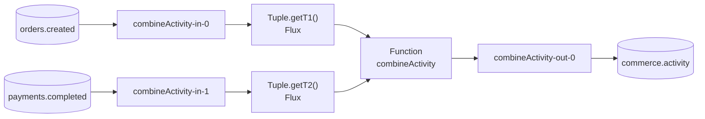
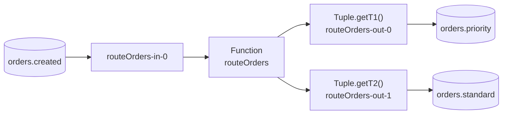
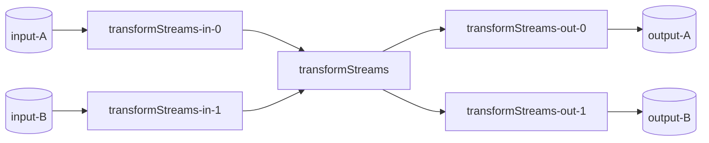

# Multiple Inputs and Outputs and Binding Index Ordering

## 1. Problem: One Function Needs Multiple Data Streams

In event-processing problems, a function does not always have just one input source and one output destination. For instance, an e-commerce service might need to:

- Receive **new order** events from `orders.created`.
- Receive **payment completed** events from `payments.completed`.
- Normalize both event types and emit them into a unified activity stream `commerce.activity`.

In the opposite direction, a service might read `orders.created` and classify:

- **Priority** orders sent to `orders.priority`.
- **Standard** orders sent to `orders.standard`.

These are two distinct design patterns:

1. **Multiple inputs, one output** — merging or combining multiple data streams.
2. **One input, multiple outputs** — splitting a single data stream into multiple emission channels.

Spring Cloud Function lets you describe business logic as Java functions that can be reused across HTTP, event-driven, or serverless environments via appropriate adapters. **Spring Cloud Stream** uses functional beans and `FunctionCatalog` to connect those functions to brokers. In multi-port cases, Stream relies on **data types, the number of elements in a tuple, and the order of those elements** to derive binding names.

**Learning objectives:** After this lesson, you will be able to read `-in-0`, `-in-1`, `-out-0`, and `-out-1` accurately; configure destinations and consumer groups for each port; write multi-port functions using Reactor `Flux` and `Tuple2`; distinguish port position from message ordering; test routing; and handle risks involving subscriptions, errors, and backpressure.

## 2. Reviewing the Binding Naming Convention

For standard functional models, Spring Cloud Stream uses:

```text
<function-name>-in-<index>
<function-name>-out-<index>
```

| Component | Meaning | Example |
| --- | --- | --- |
| `<function-name>` | Selected bean/functional definition name | `combineActivity` |
| `-in-` | Port receiving data into the function | `combineActivity-in-0` |
| `-out-` | Port emitting results from the function | `combineActivity-out-0` |
| `0`, `1`, ... | **Port position**, zero-based in each direction | `combineActivity-in-1` |

A `Function<OrderCreated, OrderClassified>` normally has only `classifyOrder-in-0` and `classifyOrder-out-0`. A `Supplier<T>` normally has only output bindings; a `Consumer<T>` normally has only input bindings.

**The binding index is not** a Kafka partition number, consumer group, offset, record sequence number, or broker arrival order. When `-in-1` appears, it means the function has a **second logical input port**. `-out-1` indicates a **second logical output port**. Inputs and outputs have **independent** index sequences, both starting at `0`.

Example:

```text
combineActivity-in-0   <-- orders.created
combineActivity-in-1   <-- payments.completed
combineActivity-out-0  --> commerce.activity

routeOrders-in-0       <-- orders.created
routeOrders-out-0      --> orders.priority
routeOrders-out-1      --> orders.standard
```

You do not create `combineActivity-out-1` if the function returns only **one** output stream. Likewise, `routeOrders` does not get `-in-1` merely because each Order object has multiple fields.

## 3. How Do Multiple Ports Differ from Multiple Fields on a POJO?

Compare these signatures:

```java
// One logical input: a single OrderCreated with multiple fields.
Function<OrderCreated, OrderClassified> classifyOrder;

// One logical input: a single object containing two lists.
Function<OrderBatch, BatchResult> processBatch;

// Two true logical inputs: two independent Publishers.
Function<Tuple2<Flux<OrderCreated>, Flux<PaymentReceived>>,
         Flux<ActivityRecord>> combineActivity;

// One logical input, two logical outputs.
Function<Flux<OrderCreated>,
         Tuple2<Flux<OrderCreated>, Flux<OrderCreated>>> routeOrders;
```

Only the last two signatures describe **multiple bindings** under Spring Cloud Stream's multi-port mechanism.

Spring Cloud Stream has supported multi-input/multi-output in the functional model since version 3.0, initially focusing on **reactive functions** with `TupleN<Flux<...>>`. Reactor's tuple type tells the framework:

- **Arity**: how many inputs or outputs exist.
- **Type**: the element type in each stream.
- **Position**: the position of each port for naming `-in-0`, `-in-1`, etc.

A `List<T>`, JSON array, or `Tuple2<OrderCreated, PaymentReceived>` is not an equivalent way to declare two stream bindings. If you only need to process two fields already bundled in one message, use a normal DTO. If you genuinely need two independent input topics or queues, use the appropriate multi-port signature.

## 4. Why Are Reactor Flux and Tuple Needed?

Project Reactor's `Flux<T>` represents a stream containing 0 to many elements. With the reactive function model, the `Function` is typically invoked to **establish the pipeline**; subsequent messages then flow through the stream without necessarily re-invoking `apply` for each individual message like an imperative function.

`Tuple2<A,B>` stores two values with distinct types:

```java
import reactor.util.function.Tuple2;
import reactor.util.function.Tuples;

Tuple2<String, Integer> pair = Tuples.of("orders", 42);

String first = pair.getT1();   // "orders"
Integer second = pair.getT2(); // 42
```

Reactor names the elements `T1`, `T2`, etc. **T1 is the first element**, yet the corresponding binding name uses a **zero-based index**:

| Position in Tuple | Corresponding Input Binding | Corresponding Output Binding |
| --- | --- | --- |
| `getT1()` | `<function>-in-0` | `<function>-out-0` |
| `getT2()` | `<function>-in-1` | `<function>-out-1` |
| `getT3()` in `Tuple3` | `<function>-in-2` | `<function>-out-2` |

This is the single most important rule when writing configuration: **`T1 ↔ index 0`, `T2 ↔ index 1`**. Never invert the order just because Java tuple accessors start at 1 while bindings start at 0.

## 5. Example 1: Two Inputs, One Output

### 5.1. Event-Unification Problem

There are two independent streams:

- `Flux<OrderCreated>`: events from `orders.created`.
- `Flux<PaymentReceived>`: events from `payments.completed`.

We want to convert both into a unified `ActivityRecord` contract and emit to `commerce.activity`.



With this architecture, each input is a message stream from a separate destination. The function needs no Kafka consumer API or RabbitMQ listener API.

### 5.2. Java Bean

```java
import java.util.function.Function;

import org.springframework.boot.SpringApplication;
import org.springframework.boot.autoconfigure.SpringBootApplication;
import org.springframework.context.annotation.Bean;

import reactor.core.publisher.Flux;
import reactor.util.function.Tuple2;

@SpringBootApplication
public class CommerceStreamApplication {

    public static void main(String[] args) {
        SpringApplication.run(CommerceStreamApplication.class, args);
    }

    public record OrderCreated(String orderId, long totalInCents) {}

    public record PaymentReceived(String orderId, String paymentId) {}

    public record ActivityRecord(
            String orderId,
            String eventType,
            String description) {}

    @Bean
    Function<Tuple2<Flux<OrderCreated>, Flux<PaymentReceived>>,
             Flux<ActivityRecord>> combineActivity() {

        return sources -> {
            // T1 maps to combineActivity-in-0.
            Flux<ActivityRecord> orders = sources.getT1()
                    .map(order -> new ActivityRecord(
                            order.orderId(),
                            "ORDER_CREATED",
                            "amount=" + order.totalInCents()
                    ));

            // T2 maps to combineActivity-in-1.
            Flux<ActivityRecord> payments = sources.getT2()
                    .map(payment -> new ActivityRecord(
                            payment.orderId(),
                            "PAYMENT_RECEIVED",
                            "paymentId=" + payment.paymentId()
                    ));

            // One shared output stream.
            return Flux.merge(orders, payments);
        };
    }
}
```

**Signature breakdown:**

```text
Input  : Tuple2<Flux<OrderCreated>, Flux<PaymentReceived>>
           |                   |
           |                   +--> combineActivity-in-1
           +----------------------> combineActivity-in-0

Output : Flux<ActivityRecord>
           +----------------------> combineActivity-out-0
```

`Flux.merge` combines elements from both streams into one output. It **does not guarantee** that the order event always appears before the payment event for the same `orderId`. The two sources have different latencies, consumer groups, partitions, and emission times.

### 5.3. application.yml Configuration

```yaml
spring:
  cloud:
    function:
      definition: combineActivity
    stream:
      bindings:
        combineActivity-in-0:
          destination: orders.created
          group: activity-orders
          content-type: application/json

        combineActivity-in-1:
          destination: payments.completed
          group: activity-payments
          content-type: application/json

        combineActivity-out-0:
          destination: commerce.activity
          content-type: application/json
```

Configuration path for each binding:

| Binding | Role | Destination | Group |
| --- | --- | --- | --- |
| `combineActivity-in-0` | Receives `OrderCreated` | `orders.created` | `activity-orders` |
| `combineActivity-in-1` | Receives `PaymentReceived` | `payments.completed` | `activity-payments` |
| `combineActivity-out-0` | Emits `ActivityRecord` | `commerce.activity` | Not applicable to producers |

**Groups are set on input bindings**, not outputs. The two groups here have separate jobs: receiving orders and receiving payments. Do not confuse group names with `in-0`/`in-1` order; renaming a group does not alter tuple ordering.

The example requires Spring Boot, Spring Cloud Function/Stream, Reactor, and a compatible Kafka or RabbitMQ binder. If using Kafka, you need `spring-cloud-stream-binder-kafka` and broker settings; if using RabbitMQ, you need the corresponding binder and connection/queue/exchange settings. The configuration above only shows **binding to destinations** and does not replace real infrastructure configuration.

### 5.4. Sample Messages

Message entering `orders.created`:

```json
{"orderId":"ORD-101","totalInCents":150000}
```

Message entering `payments.completed`:

```json
{"orderId":"ORD-101","paymentId":"PAY-9001"}
```

Possible outputs:

```json
{"orderId":"ORD-101","eventType":"ORDER_CREATED","description":"amount=150000"}
```

```json
{"orderId":"ORD-101","eventType":"PAYMENT_RECEIVED","description":"paymentId=PAY-9001"}
```

**Do not infer ordering between the two outputs** from the order of `T1` and `T2` in the tuple. Port positions are fixed; when a message passes through `Flux.merge` depends on the actual arrival timing of each source.

## 6. "Merge" Is Not "Join by Business Key"

This is a common multi-input trap. Distinguish:

- **Merge**: receives events from two streams and places all of them into one shared stream.
- **Zip**: pairs the first element of stream A with the first element of stream B, the second with the second, etc.
- **Keyed join/correlation**: combines events when they share the same `orderId`, within designed time bounds or state management.
- **Combine latest**: combines the most recent values from sources whenever a new event arrives, not by default a business-key join.

Business-wise broken example:

```java
// DANGEROUS if you expect matching by orderId.
Flux.zip(orderFlux, paymentFlux)
        .map(pair -> process(pair.getT1(), pair.getT2()));
```

If the first order is `ORD-101` and the first payment is `ORD-205`, `zip` still pairs them by position, not by `orderId`. It has no understanding of business keys.

For a pipeline that needs a "paid order" result, design state storage/keyed correlation, timeouts, late events, retries, memory bounds, or an appropriate state store. You cannot merely add `Tuple2` to a signature and treat it as an event join.

`Flux.merge` in `combineActivity` above fits because the requirement is only **normalizing events to log activity**, not proving which order has been paid.

## 7. Example 2: One Input, Two Outputs

### 7.1. Splitting Orders Into Two Streams

A single input `orders.created` contains both priority and standard orders. We want:

- `routeOrders-out-0` to route orders at or above the 100,000 threshold into `orders.priority`.
- `routeOrders-out-1` to route orders below the threshold into `orders.standard`.



The two outputs are two independent streams. In this example, each order is **routed to exactly one branch by threshold**, rather than sent to both destinations.

### 7.2. Java Bean Sharing One Source Split Into Two Branches

You can add the following bean to `CommerceStreamApplication` from Section 5:

```java
import java.util.function.Function;

import org.springframework.context.annotation.Bean;
import reactor.core.publisher.Flux;
import reactor.util.function.Tuple2;
import reactor.util.function.Tuples;

@Bean
Function<Flux<OrderCreated>,
         Tuple2<Flux<OrderCreated>, Flux<OrderCreated>>> routeOrders() {

    return orders -> {
        // Multicast the same source to both output subscribers.
        Flux<OrderCreated> shared = orders.publish().autoConnect(2);

        // getT1() -> routeOrders-out-0.
        Flux<OrderCreated> priority = shared.filter(
                order -> order.totalInCents() >= 100_000L);

        // getT2() -> routeOrders-out-1.
        Flux<OrderCreated> standard = shared.filter(
                order -> order.totalInCents() < 100_000L);

        return Tuples.of(priority, standard);
    };
}
```

**Why share the source?** If you simply create two independent branches with `orders.filter(...)` and return a tuple, subscribing to each branch can create **two subscriptions** to the same Publisher. On a cold source, side effects may run twice; on a hot source, branches may see different subsets of elements. `publish().autoConnect(2)` allows one upstream subscription to be shared once **two downstream subscribers** have connected.

There are two important caveats:

1. `autoConnect(2)` relies on **both outputs being subscribed**. If one output is inactive or hits a lifecycle error, the stream may not start emitting. This example illustrates the semantics; production needs testing when one branch is slow, errors out, or disconnects.
2. Both branches share the same upstream, so backpressure and errors can affect each other. Do not assume two outputs are two completely isolated transactions or processors merely because there are two bindings.

Do not manually call `subscribe()` on each branch and return an unrelated tuple: doing so prevents the framework from managing subscription lifecycle and errors.

### 7.3. Configuring Destinations for Each Output

```yaml
spring:
  cloud:
    function:
      definition: routeOrders
    stream:
      bindings:
        routeOrders-in-0:
          destination: orders.created
          group: route-workers
          content-type: application/json

        routeOrders-out-0:
          destination: orders.priority
          content-type: application/json

        routeOrders-out-1:
          destination: orders.standard
          content-type: application/json
```

Mapping table:

| Port | Position in Function | Destination | Role |
| --- | --- | --- | --- |
| `routeOrders-in-0` | Input `Flux<OrderCreated>` | `orders.created` | Reads all orders |
| `routeOrders-out-0` | `Tuple.getT1()` | `orders.priority` | Emits priority orders |
| `routeOrders-out-1` | `Tuple.getT2()` | `orders.standard` | Emits standard orders |

If you swap `Tuples.of(priority, standard)` to `Tuples.of(standard, priority)` **without updating YAML**, `routeOrders-out-0` becomes the standard stream while its destination remains `orders.priority`. This is a dangerous code–config mismatch: the application keeps running while messages go to the wrong business topic.

### 7.4. Testing Three Orders

Input:

```json
{"orderId":"ORD-101","totalInCents":150000}
```

```json
{"orderId":"ORD-102","totalInCents":80000}
```

```json
{"orderId":"ORD-103","totalInCents":220000}
```

Expected output:

| Destination | Expected Events |
| --- | --- |
| `orders.priority` | `ORD-101`, `ORD-103` |
| `orders.standard` | `ORD-102` |

The two outputs are **two distinct channels**. Do not compare "the first message on out-0" with "the first message on out-1" assuming they correspond to the same record. If the two branches emit at different speeds, they also have no guaranteed cross-broker or cross-topic ordering relationship.

## 8. Multiple Inputs and Multiple Outputs Together

A function can simultaneously accept multiple streams and return multiple streams reactively:

```java
Function<Tuple2<Flux<String>, Flux<Integer>>,
         Tuple2<Flux<String>, Flux<String>>> transformStreams;
```

Binding names by convention:

```text
transformStreams-in-0    -> Tuple.getT1() (Flux<String>)
transformStreams-in-1    -> Tuple.getT2() (Flux<Integer>)

transformStreams-out-0   -> return.getT1() (Flux<String>)
transformStreams-out-1   -> return.getT2() (Flux<String>)
```

Index table:

| Input | Index | Output | Index |
| --- | --- | --- | --- |
| Input tuple's `getT1()` | `in-0` | Output tuple's `getT1()` | `out-0` |
| Input tuple's `getT2()` | `in-1` | Output tuple's `getT2()` | `out-1` |

Visualizing the diagram:



This is still **one functional bean**. Having four bindings does not mean there are four `@Bean Function`s. Internal computation can use `merge`, `filter`, `groupBy`, `flatMap`, or other Reactor operators, but behavior when data arrives asynchronously from the two inputs must be clearly defined.

## 9. Index Order Is Not Event Processing Order

Separate three kinds of ordering:

1. **Port order:** `T1 ↔ in-0/out-0` and `T2 ↔ in-1/out-1`. This is a structural mapping determined by the function signature and tuple.
2. **Element order within one stream:** depends on source, partitions, concurrency, and Reactor operators. With `Flux.map` or `concatMap`, order within one stream can be preserved per operator semantics; with concurrent `flatMap`, output order can change.
3. **Cross-stream order:** two inputs on two different topics/queues do not share a global order merely because `Tuple2` is used.

Example:

```text
in-0: ORD-1 -------- ORD-3 ------------ ORD-5
in-1: PAY-9 -- PAY-7 ---------- PAY-8

T1 is always in-0; T2 is always in-1.
Yet PAY-9 may arrive before ORD-1.
```

With `Flux.merge`, events from both streams interleave by emission timing. With `Flux.zip`, elements pair by position rather than by key. If business-time ordering is required, design ordering/windowing/partitioning and appropriate state management.

### Why Does the Distinction Matter?

In a payment system, accidentally assigning `combineActivity-in-0` to `payments.completed` while code reads `sources.getT1()` as `OrderCreated` can cause deserialization errors or corrupted data. In an order-splitting problem, flipping `Tuples.of` can silently send orders to the wrong destination.

The best defense is meaningful variable names, a clear mapping table, and testing both payload **and destination of every binding**.

## 10. Replacing Implicit Binding Names with Explicit Aliases

With multiple ports, `combineActivity-in-0` and `combineActivity-in-1` can be hard to read. Spring Cloud Stream lets you assign explicit binding names via `spring.cloud.stream.function.bindings`:

```yaml
spring:
  cloud:
    function:
      definition: combineActivity
    stream:
      function:
        bindings:
          combineActivity-in-0: orderEventsInput
          combineActivity-in-1: paymentEventsInput
          combineActivity-out-0: activityOutput

      bindings:
        orderEventsInput:
          destination: orders.created
          group: activity-orders
          content-type: application/json

        paymentEventsInput:
          destination: payments.completed
          group: activity-payments
          content-type: application/json

        activityOutput:
          destination: commerce.activity
          content-type: application/json
```

After mapping:

- Input `getT1()` still represents the **first input port**, while the binding in configuration is named `orderEventsInput`.
- `getT2()` is still the **second input port**, named `paymentEventsInput`.
- The single output is named `activityOutput`.
- `orders.created`, `payments.completed`, and `commerce.activity` remain the destinations on the broker.

**Aliases do not change tuple order.** Simply renaming `combineActivity-in-0` to `paymentEventsInput` does not make `getT1()` the second input. To change port semantics, align Java code, mapping, and tests.

When using aliases, place `destination`/`group`/`content-type` under the **renamed binding names**. Mixing some properties under implicit names and others under aliases causes subtle bugs.

## 11. Connecting Each Port to a Different Binder

Multi-input/multi-output is a **Spring Cloud Stream** concept, while binders handle middleware connections. When multiple binders are available, you can choose a separate binder per port:

```yaml
spring:
  cloud:
    function:
      definition: combineActivity
    stream:
      bindings:
        combineActivity-in-0:
          binder: kafka
          destination: orders.created
          group: activity-orders

        combineActivity-in-1:
          binder: rabbit
          destination: payments.completed
          group: activity-payments

        combineActivity-out-0:
          binder: kafka
          destination: commerce.activity
```

This is an **illustrative role-assignment configuration**, not a ready-to-run complete config: the application must have both the Kafka binder and RabbitMQ binder on the classpath, connection settings for both, and binder names matching registered binder instances. When using custom-named binder instances, the `binder` property must reference that exact name.

Meaning:

- The first input can read from a Kafka topic.
- The second input can read from a RabbitMQ exchange/queue.
- The output can emit to a Kafka topic.

However, **there is no automatic distributed transaction** merely because both inputs are grouped in a `Tuple2`. Kafka offsets, RabbitMQ acks, side effects, and outbound publishes are distinct delivery boundaries. Design retries, idempotency, dead-lettering, and recovery explicitly.

## 12. Multiple Ports Differ from Multiple Independent Functional Definitions

Two configurations can look similar in binding count yet have completely different architectures.

**One multi-port bean:**

```java
@Bean
Function<Tuple2<Flux<String>, Flux<Integer>>, Flux<String>>
combineActivity() { /* ... */ }
```

```yaml
spring:
  cloud:
    function:
      definition: combineActivity
```

Spring Cloud Stream has two input bindings and one output binding for **one functional definition**. The function can see and transform both streams together.

**Two single-input/output beans:**

```java
@Bean
Function<String, String> normalizeText() {
    return String::trim;
}

@Bean
Function<Integer, String> formatNumber() {
    return Object::toString;
}
```

```yaml
spring:
  cloud:
    function:
      definition: normalizeText;formatNumber
```

In this configuration, Stream sets up separate pipelines, such as `normalizeText-in-0`/`normalizeText-out-0` and `formatNumber-in-0`/`formatNumber-out-0`. **There is no `-in-1`** for `normalizeText` merely because the application has two beans.

| Criterion | One Multi-Port Function | Multiple Definitions `a;b` |
| --- | --- | --- |
| Logical unit | One bean seeing multiple streams | Multiple independent beans |
| Binding names | `f-in-0`, `f-in-1`, ... | `a-in-0`, `b-in-0`, ... |
| Built-in coordination across streams in one bean | Yes, via Reactor | Not automatic; requires broker/composition |
| Error and lifecycle boundary | Tied to the shared reactive pipeline | Per definition/binding |
| When to choose | Merging, correlating, or splitting streams intentionally | Independent business workflows, separate scaling |

Meanwhile `a|b` is **composition**, connecting the output of the first function to the input of the next as one logical pipeline. `;` is not `|`, and neither randomly produces `-in-1`/`-out-1`. For compositions involving multi-port functions, explicitly check framework support and type compatibility before deploying.

## 13. One Source Emitting Many Messages Does Not Mean Multiple Output Bindings

Compare three cases:

```java
// One source emitting a stream of many elements.
Supplier<Flux<OrderCreated>> events;

// One function receiving a stream and emitting a stream.
Function<Flux<OrderCreated>, Flux<OrderCreated>> normalize;

// One function receiving one stream and splitting into two output streams.
Function<Flux<OrderCreated>,
         Tuple2<Flux<OrderCreated>, Flux<OrderCreated>>> routeOrders;
```

A standard `Supplier<Flux<OrderCreated>>` has **one output binding** because it returns only one Publisher. Each `OrderCreated` emitted by the stream can become one message, but that **does not create** `events-out-1`.

`Function<Flux<OrderCreated>,Flux<OrderCreated>>` has **one input and one output binding**, even if millions of elements pass through the Flux over its lifetime.

Only when the signature describes **multiple input/output streams**, such as `Tuple2<Flux<...>, Flux<...>>`, do additional indices appear. Splitting a collection (`splittable` on a pollable supplier), batch mode, or JSON arrays also do not turn a function into a multi-output function.

## 14. Payloads, Content Types, and Headers per Port

Each input/output binding can have its own configuration:

```yaml
spring:
  cloud:
    stream:
      bindings:
        combineActivity-in-0:
          destination: orders.created
          content-type: application/json

        combineActivity-in-1:
          destination: payments.completed
          content-type: application/json

        combineActivity-out-0:
          destination: commerce.activity
          content-type: application/json
```

The framework uses type information from `Tuple2<Flux<OrderCreated>,Flux<PaymentReceived>>` to convert incoming payloads into the right Java records. When two inputs have different schemas, **do not collapse both into `Flux<Object>`** if you want to leverage type-safe conversion.

### When Message<T> Is Needed

If per-event correlation IDs or headers are needed, the input can be:

```java
Function<
    Tuple2<Flux<Message<OrderCreated>>,
           Flux<Message<PaymentReceived>>>,
    Flux<Message<ActivityRecord>>
> combineWithHeaders;
```

This is an **illustrative signature**; you must implement a body that constructs `Message<ActivityRecord>` and chooses which headers to forward. The signature still has two inputs and one output; adding `Message<T>` does not create a separate port for headers.

Headers traveling through Kafka/RabbitMQ can be converted or restricted by the binder and transport. A new source might lack a correlation ID or use a different header type. Integration tests must verify the output schema and header contract, not only Java function unit tests.

## 15. Reactive Nature: Subscriptions, Backpressure, and Errors

Multi-port functions operate on **streams**, not just single messages. That brings power as well as risks that require deliberate design.

### 15.1. Lifecycle Differs from Imperative

With a regular `Function<OrderCreated,OrderClassified>`, each message invokes the function imperatively. With `Function<Tuple2<Flux<OrderCreated>, Flux<PaymentReceived>>, Flux<ActivityRecord>>`, the function is normally invoked to establish the stream, while messages flow through the Publishers afterward.

Do not put side effects directly inside the `apply` body expecting them to run once per message. If using `doOnNext`, side effects execute per subscription and can re-run if the Publisher is resubscribed. For critical operations, design idempotency and lifecycle properly.

### 15.2. When One Input Errors

`Flux.merge` can emit `onError` if one input encounters an unhandled error, **terminating the output stream** and affecting the whole pipeline. Do not assume the framework retries a single message on each port the same way as an imperative `Function<T,R>`. Reactive stream error policies and binder retry/ack mechanics must be evaluated separately.

Example:

```java
return Flux.merge(
        sources.getT1().map(this::convertOrder),
        sources.getT2().map(this::convertPayment)
);
```

If `convertPayment` throws an exception, the entire `Flux.merge` can receive an error signal. To avoid halting the whole pipeline over one bad message, explicitly decide whether failed messages are quarantined/DLQed, logged, or recovered; do not assume "ignoring the error" is safe.

### 15.3. Backpressure Across Two Outputs

In the `routeOrders` example, both outputs share the same upstream. If the priority output slows down, pipeline backpressure can affect the standard stream as well. How brokers apply real backpressure depends on the binder, buffers, concurrency, and configuration.

Do not assume `publish().autoConnect(2)` turns the two branches into completely independent processors. It solves **subscription sharing**, not isolation, transactions, guaranteed delivery, or dead-letter queues.

### 15.4. Reliability When Emitting Multiple Outputs

When one input feeds two outputs, such as fan-out, a successful publish on `out-0` does not guarantee `out-1` also succeeded. Two outputs are generally independent send paths. If business rules require "both destinations or neither," build an outbox/transaction design or recovery mechanism suited to the broker and application. Do not infer atomicity merely because one Java function returns `Tuple2`.

## 16. Testing the Tuple-to-Binding Mapping Properly

There are two critical testing layers:

- **Reactor logic unit tests**: verify `getT1()`/`getT2()` perform their roles properly and outputs go to the right branches.
- **Spring Cloud Stream integration tests**: verify `-in-0`/`-in-1` read from the right destinations, `-out-0`/`-out-1` send to the right destinations, and converters and brokers work.

### 16.1. Unit Test for Two Inputs, One Output

Using `reactor-test` and JUnit 5:

```java
import static org.junit.jupiter.api.Assertions.assertEquals;
import static org.junit.jupiter.api.Assertions.assertTrue;

import java.util.List;
import org.junit.jupiter.api.Test;
import reactor.core.publisher.Flux;
import reactor.test.StepVerifier;
import reactor.util.function.Tuples;

class CombineActivityTest {

    @Test
    void combinesBothSourcesWithoutAssumingGlobalOrder() {
        var app = new CommerceStreamApplication();
        var function = app.combineActivity();

        var inputs = Tuples.of(
                Flux.just(new CommerceStreamApplication.OrderCreated(
                        "ORD-101", 150_000L)),
                Flux.just(new CommerceStreamApplication.PaymentReceived(
                        "ORD-101", "PAY-9001"))
        );

        StepVerifier.create(function.apply(inputs).collectList())
                .assertNext(events -> {
                    assertEquals(2, events.size());

                    assertTrue(events.stream().anyMatch(event ->
                            "ORDER_CREATED".equals(event.eventType())));

                    assertTrue(events.stream().anyMatch(event ->
                            "PAYMENT_RECEIVED".equals(event.eventType())));
                })
                .verifyComplete();
    }
}
```

Why not assert `ORDER_CREATED` is always the first element? Because `Flux.merge` makes no ordering promise between two asynchronous Publishers. This test focuses on the true contract: receiving both event types with the expected schema.

### 16.2. Unit Test for One Input, Two Outputs

`routeOrders` uses `publish().autoConnect(2)`, so tests must **subscribe to both outputs**. `Flux.zip` can be used in the test to consume both branches simultaneously; this is purely a test technique, **not a design for joining business events**.

```java
import static org.junit.jupiter.api.Assertions.assertEquals;
import org.junit.jupiter.api.Test;
import reactor.core.publisher.Flux;
import reactor.test.StepVerifier;

class RouteOrdersTest {

    @Test
    void assignsPriorityAndStandardToCorrectTuplePositions() {
        var app = new CommerceStreamApplication();
        var function = app.routeOrders();

        var input = Flux.just(
                new CommerceStreamApplication.OrderCreated("ORD-1", 50_000L),
                new CommerceStreamApplication.OrderCreated("ORD-2", 150_000L),
                new CommerceStreamApplication.OrderCreated("ORD-3", 80_000L),
                new CommerceStreamApplication.OrderCreated("ORD-4", 220_000L)
        );

        var outputs = function.apply(input);

        StepVerifier.create(Flux.zip(
                    outputs.getT1(), outputs.getT2()))
                .assertNext(pair -> {
                    assertEquals("ORD-2", pair.getT1().orderId());
                    assertEquals("ORD-1", pair.getT2().orderId());
                })
                .assertNext(pair -> {
                    assertEquals("ORD-4", pair.getT1().orderId());
                    assertEquals("ORD-3", pair.getT2().orderId());
                })
                .verifyComplete();
    }
}
```

If a test subscribes only to `outputs.getT1()`, a pipeline using `autoConnect(2)` may **emit nothing at all** while waiting for the second subscriber. Keep this in mind when testing multi-output functions sharing a source. For realistic datasets where the two branches have unequal element counts, do not use `Flux.zip` to count all elements; use a test harness that subscribes to both branches and collects each stream independently.

### 16.3. Spring Cloud Stream Integration Test

At the framework level, select definition `combineActivity` and send test messages into the two corresponding input bindings:

```text
InputDestination:
  combineActivity-in-0 <- {"orderId":"ORD-101","totalInCents":150000}
  combineActivity-in-1 <- {"orderId":"ORD-101","paymentId":"PAY-9001"}

OutputDestination:
  combineActivity-out-0 -> two ActivityRecords of the expected types
```

For `routeOrders`:

```text
InputDestination:
  routeOrders-in-0 <- ORD-101 (150000)
  routeOrders-in-0 <- ORD-102 (80000)

OutputDestination:
  routeOrders-out-0 -> ORD-101 (priority)
  routeOrders-out-1 -> ORD-102 (standard)
```

The Spring Cloud Stream test binder can help verify mapping and conversion at the framework level. To validate Kafka partitions/offsets, RabbitMQ queues/acks, retries, and real publish failures, still run integration tests with the corresponding broker. As emphasized in this lesson, do not equate a Reactor logic test with an end-to-end guarantee.

## 17. Configuring Both Functions in the Same Application

If the application should both normalize commerce events and split orders into two branches, you can select two independent definitions:

```yaml
spring:
  cloud:
    function:
      definition: combineActivity;routeOrders
    stream:
      bindings:
        combineActivity-in-0:
          destination: orders.created
          group: activity-orders
        combineActivity-in-1:
          destination: payments.completed
          group: activity-payments
        combineActivity-out-0:
          destination: commerce.activity

        routeOrders-in-0:
          destination: orders.created
          group: order-router
        routeOrders-out-0:
          destination: orders.priority
        routeOrders-out-1:
          destination: orders.standard
```

In this example:

- `combineActivity` has **two inputs and one output**.
- `routeOrders` has **one input and two outputs**.
- In total the application has three input bindings and three output bindings, yet **there is no `combineActivity-in-2`** or `routeOrders-out-2`.
- `combineActivity-in-0` and `routeOrders-in-0` both read `orders.created` with **different groups**, because each business function needs to receive messages independently per binder semantics.

The `;` simply selects two separate definitions. It does not create one giant function with three inputs and three outputs. Port counts and binding indices must be computed **per functional definition**, not summed across the whole application.

## 18. Common Mistakes and How to Fix Them

| Symptom | Common Cause | How to Fix |
| --- | --- | --- |
| `combineActivity-in-1` is missing | Signature is a single POJO or lacks Tuple of Flux | Check the multi-input reactive signature |
| `getT1()` receives Payment instead of Order | Destinations mapped backwards on `-in-0` and `-in-1` | Align tuple order and YAML |
| `routeOrders-out-0` emits standard orders | Order in `Tuples.of(...)` is inverted | Verify `getT1()`/`getT2()` against output mapping |
| Added `-in-1` because Order has two fields | Confused POJO field count with input port count | A single-parameter POJO is still one input |
| Used `List<Order>` expecting two output bindings | A batch/list is one payload | Use `Tuple2<Flux<...>,Flux<...>>` when two streams genuinely exist |
| Expected multiple messages in Flux to create `-out-1` | Confused element count with port count | One Publisher is still one output binding |
| `routeOrders` emits nothing when testing only one branch | `autoConnect(2)` is waiting for the second subscriber | Subscribe to and test both branches |
| One slow branch drags down the other | Shared source and backpressure | Benchmark load, review isolation/buffering or architecture |
| Event order flips when using `Flux.merge` | Two sources emit asynchronously | Do not assume cross-input order; design explicit correlation |
| `Flux.zip` pairs wrong Order and Payment | Pairs by position rather than `orderId` | Use stateful processing / keyed join when needed |
| An error stops all output | Reactive `onError` terminated the pipeline | Design per-event error handling and recovery |
| Alias declared yet binding has no destination | Configuration remained under old implicit name | Put destination under the actual alias |
| Used `a;b` expecting `a-in-1` to appear | Two independent definitions, not one multi-port function | Compute indices per bean |
| One output publishes successfully while the other fails | No atomic transaction spanning both outputs | Recovery, idempotency, outbox, or appropriate design |
| JSON deserializes into wrong type | Content type/schema/binder converter mismatch | Check each port's generic type and wire payload |
| Switched Kafka to Rabbit expecting identical ordering | Brokers have different topologies and semantics | Integration test topic/partition vs. exchange/queue |

Suggested debugging order: **definition → Tuple/Flux signature → input/output count → index and T1/T2 order → alias → destination/group → binder → payload/conversion → subscription/errors**.

## 19. Practice Exercises

### Exercise 1: Fill in Binding Names

Given bean:

```java
@Bean
Function<Tuple2<Flux<String>, Flux<Integer>>, Flux<String>> gather() {
    return tuple -> Flux.merge(
            tuple.getT1(),
            tuple.getT2().map(String::valueOf));
}
```

Write the input and output binding names, then explain which port `getT1()` and `getT2()` correspond to.

**Hint:** `gather-in-0`, `gather-in-1`, `gather-out-0`. `getT1()` ↔ `in-0`; `getT2()` ↔ `in-1`.

### Exercise 2: YAML Configuration for Two Sources

Function `gather` receives strings from `text.raw` and integers from `numbers.raw`, then emits results to `mixed.output`. Set groups `text-workers` and `number-workers` for each input. Use `content-type` matching the actual wire format sent by producers rather than assuming everything is JSON.

### Exercise 3: Splitting Output by Threshold

Suppose `routeOrders` returns `Tuples.of(priority, standard)`. Write the binding names and corresponding destinations for both branches. If the order is changed to `Tuples.of(standard, priority)`, how must the configuration change?

**Hint:** output indices follow tuple position, not variable names `priority` or `standard`.

### Exercise 4: Four Ports

Given signature:

```java
Function<
    Tuple2<Flux<OrderCreated>, Flux<PaymentReceived>>,
    Tuple2<Flux<ActivityRecord>, Flux<String>>
> enrichAndAlert;
```

List all bindings completely. Explain why `enrichAndAlert-in-2` and `enrichAndAlert-out-2` **do not exist** in this structure.

### Exercise 5: Distinguishing Merge and Join

The Order stream emits `ORD-101` then `ORD-102`. The Payment stream emits `ORD-102` then `ORD-101`. Explain why `Flux.zip` can pair mismatched information and why `Flux.merge` also does not solve the requirement "emit only when an order has a matching payment."

### Exercise 6: One Application with Two Definitions

An application declares `combineActivity;routeOrders`. Calculate the total number of input/output bindings and list **every binding name**. Explain why you cannot number them 0 through 2 across the whole application.

### Exercise 7: Testing Subscriptions

Using unit tests for `routeOrders` with `publish().autoConnect(2)`, explain why subscribing only to `getT1()` can cause the test to receive no data; design a test that subscribes to both streams and verifies each order is routed accurately.

### Self-Assessment Questions

1. Why does `Tuple2<Flux<A>,Flux<B>>` have two input bindings whereas `Flux<Tuple2<A,B>>` has only one input?
2. Does `getT2()` correspond to `-in-1` or `-in-2`?
3. Does input binding ordering guarantee messages arrive in the same order?
4. Does changing the destination of `-in-0` turn `getT1()` into `getT2()`?
5. When should you choose `Flux.merge`, and when do you need business-key event correlation?
6. Why does multi-output not provide atomic publishing across two destinations by default?
7. If `a;b` is selected, why does `a-in-1` not appear automatically?
8. With one input and two outputs, why must you test both branches when sharing a subscription?
9. To rename bindings in YAML, which property is used and where is `destination` placed?
10. Which behaviors must be tested against a real broker beyond Reactor unit tests?

## 20. Summary

Spring Cloud Stream maps functional bean ports using the **`<function>-in-<index>`** and **`<function>-out-<index>`** convention, where indices start at 0 and **count separately per direction of each function**.

For multi-input/multi-output, the model typically uses **reactive functions** and Reactor tuples:

- `Tuple.getT1()` corresponds to input/output `-0`.
- `Tuple.getT2()` corresponds to input/output `-1`.
- `Function<Tuple2<Flux<A>,Flux<B>>,Flux<C>>` has **two input bindings and one output binding**.
- `Function<Flux<A>,Tuple2<Flux<B>,Flux<C>>>` has **one input binding and two output bindings**.
- The number of elements in a `Flux`, number of fields in a POJO, or number of functions selected with `;` **does not determine a function's binding count**.

`FunctionCatalog` assists with managing and looking up functions, Spring Cloud Stream establishes bindings, and binders connect them to Kafka, RabbitMQ, or suitable middleware. Port ordering is a **stable structural contract**, but does not replace system-level design for ordering, joins, backpressure, retries, idempotency, or transactions.

### References

- [Spring Cloud Stream — Producing and Consuming Messages: Functions with multiple input and output arguments](https://docs.spring.io/spring-cloud-stream/reference/spring-cloud-stream/producing-and-consuming-messages.html)
- [Spring Cloud Stream — Functional binding names](https://docs.spring.io/spring-cloud-stream/reference/spring-cloud-stream/functional-binding-names.html)
- [Spring Cloud Function — Programming model](https://docs.spring.io/spring-cloud-function/reference/spring-cloud-function/programming-model.html)
- [Project Reactor — Reactor Core Reference Guide](https://projectreactor.io/docs/core/release/reference/)
- [Project Reactor — Tuple API](https://projectreactor.io/docs/core/release/api/reactor/util/function/Tuple2.html)
