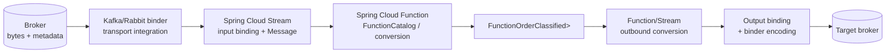
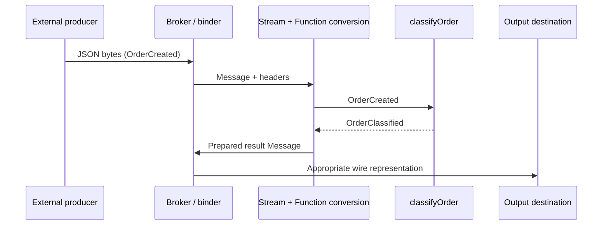
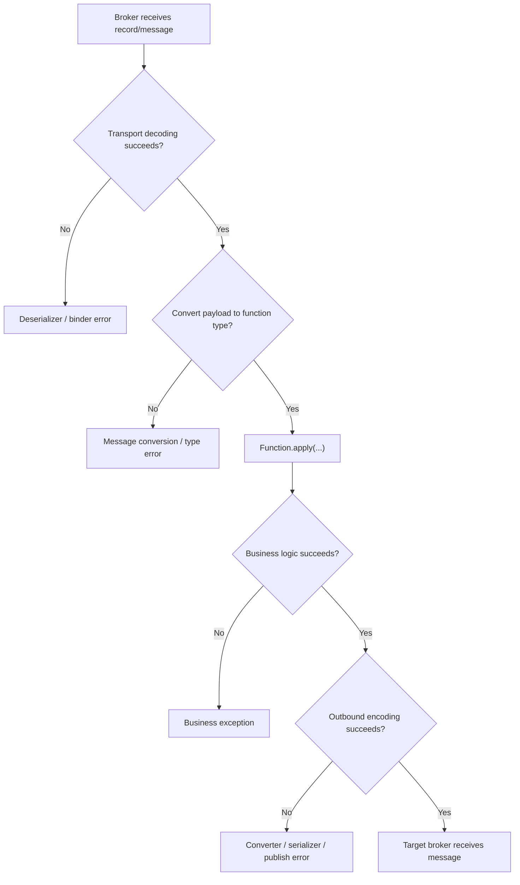

# Splitting Type Conversion Responsibilities Between Functions and Binders

## 1. Problem: Who Turns JSON Into Java Objects?

A service receives order events from Kafka or RabbitMQ. The incoming message contains a JSON payload:

```json
{"orderId":"ORD-101","totalInCents":150000}
```

Business logic is written using Spring Cloud Function:

```java
@Bean
Function<OrderCreated, OrderClassified> classifyOrder() {
    return order -> new OrderClassified(
            order.orderId(),
            order.totalInCents() >= 100_000L
                    ? "PRIORITY" : "STANDARD");
}
```

A crucial question arises: messages on the broker are usually bytes or data decoded by a broker client, yet the `Function` receives an `OrderCreated`. **Which component is responsible for turning transport data into Java types?** And when the function returns an `OrderClassified`, which component converts the result back into a form the broker can transport?

In **Spring Cloud Function**, we develop protocol-independent logic with `Supplier<T>`, `Function<I,O>`, and `Consumer<T>`. `FunctionCatalog` manages looking up/normalizing functions and can supply an adaptation layer so they can be invoked with messages. **Spring Cloud Stream** creates bindings, connecting those functions to middleware via Kafka, RabbitMQ, or other **binders**.

To understand this cleanly, separate three kinds of responsibilities:

1. **Transport encoding/decoding**: broker communication, bytes, serializers/deserializers, headers, acknowledgements, offsets, and topology.
2. **Message-to-function type conversion**: using content type and Java signatures to pass a message's payload into `Function<T,R>` as the type the function expects, then representing the result for output.
3. **Business transformation**: receiving type-safe domain objects, executing business rules, and producing result objects.

The first two layers can cooperate and shift depending on *native encoding/decoding* settings; do not say "Function always deserializes JSON itself" or "the binder always turns JSON into a POJO."

**Lesson objectives:** After this lesson, you will be able to identify the owner of each conversion step, configure `content-type`, distinguish Spring Cloud Function wrappers from broker serializers, use `Message<T>` and headers intentionally, understand Kafka native mode, test wiring, and diagnose errors occurring before or after the function is invoked.

## 2. End-to-End Responsibility Diagram



This path is a **conceptual model**, not a guarantee that every binder and configuration produces the exact same internal converter chain. In Spring Cloud Stream's functional model, Spring Cloud Function participates substantially in invocation normalization and payload conversion based on function types. The binder adapts to the broker protocol; in a binder's **native** mode, the broker client's serializer/deserializer can handle conversion right at the transport boundary.

| Layer | What Info Does It Know? | What Is It Usually Responsible For? | What Should It Not Be Given? |
| --- | --- | --- | --- |
| **Functional bean** | `OrderCreated`, `OrderClassified`, and business rules | Business validation, classification, computation | Encoding Kafka bytes, creating RabbitMQ queues |
| **FunctionCatalog / function invocation wrapper** | Function name, parameter/return types, `Message<T>`, content type | Lookup, composition, message adaptation, and framework type conversion | Guaranteeing networking, offsets, or broker transactions |
| **Spring Cloud Stream** | Bindings, destinations, groups, producer/consumer properties | Organizing input/output paths and coordinating invocation with binders | Deciding order classification logic |
| **Binder** | Broker, destinations, headers, and transport configuration | Broker connectivity, receiving/emitting messages, transport policies; supporting binder-specific native codecs | Understanding the `PRIORITY` business rule |
| **Broker client serializer/deserializer** | `byte[]`, `String`, Avro/JSON bytes, and client-specific config | Native decoding/encoding when enabled and configured | Guaranteeing DTO matches business schema |
| **End consumer** | Event contract and side effects | Consuming results as intended, idempotency | Assuming messages are delivered strictly once |

An easily misunderstood case is Kafka's default serializer. The Kafka client must turn outbound values into bytes; however, that **does not mean** every `Function<OrderCreated,...>` must configure Kafka's `JsonDeserializer`. In the Spring messaging-based conversion path, the framework can convert JSON bytes into the DTO **before the function runs**, while the Kafka layer simply transports the prepared representation.

## 3. Three Easily Confused Terms: Serialization, Conversion, Transformation

### 3.1. Serialization / Deserialization

Serialization turns a value into a representation that can be transmitted or stored. Deserialization does the reverse. JSON example:

```text
OrderCreated("ORD-101", 150000)
        |
        | JSON serialize
        v
{"orderId":"ORD-101","totalInCents":150000}
        |
        | UTF-8 encode
        v
byte[]
```

In a Kafka environment, the Kafka client's serializer/deserializer can participate directly at transport time. In RabbitMQ, Spring AMQP and corresponding converters package metadata/payload differently. The actual execution path depends on whether you use framework conversion or native codecs.

### 3.2. Type Conversion at the Function Boundary

Type conversion brings **already received** data into the type required by the function signature. For example:

```text
Message<byte[]> + contentType application/json
             |
             | framework conversion when enabled and converter present
             v
OrderCreated(orderId="ORD-101", totalInCents=150000)
             |
             | Function.apply(...)
             v
OrderClassified(orderId="ORD-101", priority="PRIORITY")
```

`FunctionCatalog` and Spring Cloud Function's invocation mechanism can use the function's type info and message converters to process payloads. This process does not replace validating all business conditions or ensuring the producer sends a compliant schema.

### 3.3. Transformation in Business Logic

Transformation is the mapping that **the application intentionally defines**:

```java
String priority = order.totalInCents() >= 100_000L
        ? "PRIORITY" : "STANDARD";
```

The JSON parser does not decide the `100_000L` threshold, and the Kafka binder should not know about `PRIORITY` and `STANDARD`. Thanks to this boundary, the function can be reused across Spring Cloud Function's HTTP, message-driven, or serverless adapters, even though each adapter reads/writes wire formats differently.

## 4. The Function Signature Is the Most Important Type Contract

The three basic functional bean types:

| Bean | Java Input | Java Output | Typical Stream Bindings |
| --- | --- | --- | --- |
| `Supplier<OrderCreated>` | None | `OrderCreated` | Only `<name>-out-0` |
| `Function<OrderCreated,OrderClassified>` | `OrderCreated` | `OrderClassified` | `<name>-in-0` and `<name>-out-0` |
| `Consumer<OrderClassified>` | `OrderClassified` | `void` | Only `<name>-in-0` |

Specific signatures tell the framework which object types to instantiate/supply. For example:

```java
Function<OrderCreated, OrderClassified> classifyOrder
```

provides far more information than:

```java
Function<Object, Object> classifyOrder
```

With `Object`, the framework does not always have enough information to infer `OrderCreated`. If the payload is JSON, the program might see a `Map`, `String`, `byte[]`, or whatever type an upstream converter produced, depending on the path. Do not use overly broad generic types expecting conversion to magically pick the exact DTO.

### 4.1. Message<T> Does Not Create Extra Bindings

Both signatures:

```java
Function<OrderCreated, OrderClassified>

Function<Message<OrderCreated>, Message<OrderClassified>>
```

normally have **one input and one output**. The difference is that the second signature grants access to headers and lets the function construct an output message with new metadata. A message does not turn into two bindings just because it has a payload and headers.

### 4.2. Flux<T> Is Not a JSON Array

```java
Function<Flux<OrderCreated>, Flux<OrderClassified>>
```

is a reactive function processing a stream of elements. The framework can invoke the function to establish the pipeline and then pass multiple messages sequentially through the stream. A `Flux<T>` is not by default a JSON array inside a single broker message. When using reactive, lifecycle and error handling differ from imperative, yet **the separation of conversion/transport/logic responsibilities must remain clear**.

## 5. Complete Example: Broker-Independent POJO Function

### 5.1. Java Code

```java
import java.util.function.Function;

import org.springframework.boot.SpringApplication;
import org.springframework.boot.autoconfigure.SpringBootApplication;
import org.springframework.context.annotation.Bean;

@SpringBootApplication
public class OrderConversionApplication {

    public static void main(String[] args) {
        SpringApplication.run(OrderConversionApplication.class, args);
    }

    public record OrderCreated(String orderId, long totalInCents) {}

    public record OrderClassified(String orderId, String priority) {}

    @Bean
    Function<OrderCreated, OrderClassified> classifyOrder() {
        return order -> {
            if (order.orderId() == null ||
                    order.orderId().isBlank()) {
                throw new IllegalArgumentException(
                        "Invalid orderId");
            }
            if (order.totalInCents() < 0) {
                throw new IllegalArgumentException(
                        "totalInCents must be non-negative");
            }

            String priority = order.totalInCents() >= 100_000L
                    ? "PRIORITY" : "STANDARD";

            return new OrderClassified(
                    order.orderId(), priority);
        };
    }
}
```

The class above uses Java 17+ for `record`. The `classifyOrder` bean accepts only domain objects. There are no Kafka, RabbitMQ, or Spring Messaging imports inside the business method.

### 5.2. Stream Configuration

```yaml
spring:
  cloud:
    function:
      definition: classifyOrder
    stream:
      bindings:
        classifyOrder-in-0:
          destination: orders.created
          group: order-classifiers
          content-type: application/json
        classifyOrder-out-0:
          destination: orders.classified
          content-type: application/json
```

Each part has its own role:

- `definition: classifyOrder`: finds/selects the bean via the Spring Cloud Function model.
- `classifyOrder-in-0`: logical inbound port.
- `destination: orders.created`: message source on the broker.
- `group: order-classifiers`: consumer group identity, implemented by the binder per broker.
- `content-type: application/json`: describes payload format for the message conversion mechanism.
- `classifyOrder-out-0`: logical outbound port.
- `destination: orders.classified`: where the broker receives result events.

`content-type` is not a topic name, not a Java class, and not enough information to start Kafka or RabbitMQ. Running requires binder dependencies, broker connectivity, access permissions, and compatible converters.

### 5.3. Path of One Event Through the Application



This is the logical flow with **framework conversion**, meaning `useNativeDecoding`/`useNativeEncoding` are not enabled. A compatible JSON converter can convert the payload into `OrderCreated`, and then the result is prepared for output. The final destination sees a new message with equivalent content:

```json
{"orderId":"ORD-101","priority":"PRIORITY"}
```

Distinguish the output produced by business rules from the bytes/headers written to the broker by the binder. The final result also depends on conversion config, serializers, schema, and producer headers.

## 6. Role of contentType: A Hint to Select the Converter

### 6.1. Setting Content Type on a Binding

```yaml
spring:
  cloud:
    stream:
      bindings:
        classifyOrder-in-0:
          destination: orders.created
          content-type: application/json
        classifyOrder-out-0:
          destination: orders.classified
          content-type: application/json
```

In the framework conversion path, `application/json` guides how the payload is interpreted. The Java type `OrderCreated` specifies which DTO the conversion should produce. Both pieces of information complement each other:

```text
payload: byte[] or JSON String
            +
contentType: application/json
            +
target type: OrderCreated
            |
            v
       OrderCreated
```

A MIME type does not replace a schema. Both JSON `{"orderId":7}` and `{"orderId":"ORD-101","totalInCents":150000}` can be described as `application/json`, yet only one satisfies the business DTO contract.

### 6.2. contentType Header vs. Binding Configuration

Spring Cloud Stream supports content-type information in both message headers and binding properties. On the standard processing path, a **`contentType` header supplied on the message** can take precedence when selecting a converter over the binding's configured value. Therefore, check **both headers and YAML**, not just one side.

Error example:

```text
Header: contentType = text/plain
Body:   {"orderId":"ORD-101","totalInCents":150000}
Target: OrderCreated
```

If the framework applies text conversion instead of JSON, the function may fail to receive the expected DTO. Changing `content-type` in YAML may not fix it if the wrong message header still takes priority on that execution path.

Do not try to guess every converter layer from a fixed diagram; behavior is also influenced by native serializers, binder version, transport metadata, and application configuration.

### 6.3. Common Content Types

| Content Type | Typical Interpretation | Notes |
| --- | --- | --- |
| `application/json` | JSON object, array, or scalar per schema | Requires a JSON converter and compatible target type |
| `text/plain` | Plain text content | Usually fits `String`; character encoding matters |
| `application/octet-stream` | Raw bytes without a specific content contract | Fits binary payloads; app must know how to interpret |
| Custom MIME type (e.g., organization-specific) | Format following a specialized contract | May require a custom converter/codec |

Assigning a MIME type does not mean the framework knows how to handle every format, such as arbitrary Avro/Protobuf. Those formats typically require serializers/deserializers, converters, a schema registry, and compatible versions.

## 7. Message<T>: Separating Payload and Metadata

When an application needs correlation IDs or business headers, it can use `Message<T>`:

```java
import java.util.function.Function;

import org.springframework.context.annotation.Bean;
import org.springframework.context.annotation.Configuration;
import org.springframework.messaging.Message;
import org.springframework.messaging.support.MessageBuilder;

@Configuration
class OrderMetadataFunctions {

    @Bean
    Function<
            Message<OrderConversionApplication.OrderCreated>,
            Message<OrderConversionApplication.OrderClassified>
    > classifyWithMetadata() {

        return inbound -> {
            var order = inbound.getPayload();

            var result = new OrderConversionApplication.OrderClassified(
                    order.orderId(),
                    order.totalInCents() >= 100_000L
                            ? "PRIORITY"
                            : "STANDARD");

            var builder = MessageBuilder
                    .withPayload(result)
                    .setHeader("processedBy", "classification-service");

            Object correlationId =
                    inbound.getHeaders().get("correlationId");

            if (correlationId != null) {
                builder.setHeader("correlationId", correlationId);
            }

            return builder.build();
        };
    }
}
```

This is an **alternative definition** to `classifyOrder`. When using it, set `spring.cloud.function.definition: classifyWithMetadata` and configure `classifyWithMetadata-in-0` and `classifyWithMetadata-out-0`.

### 7.1. Who Creates Message<T>?

On the message-driven path, the binder receives transport data/metadata, and Spring Cloud Stream together with Spring Cloud Function deliver an appropriate `Message` to the function. When the signature is `Message<OrderCreated>`, the **payload** must match `OrderCreated`; the **headers** hold metadata for the function to use as needed.

A header is not a Java field of `OrderCreated`. If the producer puts `correlationId` in headers, the bean will not automatically see it via `order.correlationId()` unless the payload contract also defines that field.

### 7.2. Do Not Blindly Call copyHeaders

You could write:

```java
MessageBuilder.withPayload(result)
        .copyHeaders(inbound.getHeaders())
        .build();
```

but this is **not the best default for every system**. Input headers may include consumer metadata, partitions, delivery tags, or an old `contentType` that no longer matches the new payload. Some headers carry internal semantics or must not be forwarded to another broker.

Prefer selectively forwarding headers such as `correlationId`, event IDs, and approved trace metadata, while ensuring the output content type matches `OrderClassified`. Binders may map or filter headers according to infrastructure; Kafka record headers and RabbitMQ message properties are not completely identical.

### 7.3. The Message Signature Does Not Solve All Conversion

`Message<OrderCreated>` lets the function read metadata, but **does not force the broker to already send an `OrderCreated`**. If a producer sends JSON bytes violating the schema, conversion errors still occur before `apply` is invoked. Verify payload types in integration tests, especially when services use different frameworks.

## 8. Native Encoding/Decoding: When the Binder's Serializer Takes Over

An important principle: Spring Cloud Stream allows using **native encoding/decoding** mechanisms on certain binders.

- `useNativeDecoding` on a **consumer binding**: changes how values are decoded from transport before reaching the function.
- `useNativeEncoding` on a **producer binding**: changes how values are encoded when emitted to the broker.
- Native serializers/deserializers are typically configured in the binder-specific section, **not** via the Function's Java generic types.

This is a **per-binding** choice and does not automatically apply to the entire application. Native mode may bypass part of the conversion path managed by Spring Cloud Stream/Function; do not assume `content-type: application/json` fixes codec errors in native mode.

### 8.1. When Not Using Native Mode

```text
Kafka record bytes
     ↓
Binder + message abstraction
     ↓
Framework conversion via contentType + target type
     ↓
Function<OrderCreated,OrderClassified>
     ↓
Outbound conversion via binding/headers
     ↓
Binder writes bytes to Kafka
```

On this path, application code focuses on DTOs while the framework and binder coordinate wire formats. This is usually an easy, reusable starting point when services mainly exchange JSON and do not need specialized broker codecs.

### 8.2. When Using Native Mode

```text
Kafka record bytes
     ↓
Kafka native Deserializer
     ↓
Java value supplied by client/binder
     ↓
Function receives matching type
     ↓
Java result
     ↓
Kafka native Serializer
     ↓
Kafka record bytes
```

In native mode, the Java type returned by the deserializer must be compatible with the function signature; the output must be compatible with the serializer. If the deserializer returns `String` while the function expects `OrderCreated` without an intermediate conversion step, a type error can occur. Native codecs do not enforce business validation rules on their own.

**Important:** a native Kafka codec and a Spring JSON converter are not two names for the same component. Decide clearly which path is responsible. Do not mix both mechanisms merely because a sample config happens to show both `content-type` and `value.deserializer`.

## 9. Native Kafka Example: StringDeserializer and StringSerializer

To illustrate responsibility separation, use a simple function receiving and returning `String`:

```java
import java.util.function.Function;

import org.springframework.context.annotation.Bean;
import org.springframework.context.annotation.Configuration;

@Configuration
class TextFunctions {

    @Bean
    Function<String, String> normalizeText() {
        return value -> value.strip().toUpperCase();
    }
}
```

When using the Kafka binder with native String codecs, configure per binding:

```yaml
spring:
  cloud:
    function:
      definition: normalizeText
    stream:
      bindings:
        normalizeText-in-0:
          destination: text.raw
          group: text-normalizers
          consumer:
            useNativeDecoding: true

        normalizeText-out-0:
          destination: text.normalized
          producer:
            useNativeEncoding: true

      kafka:
        binder:
          brokers: localhost:9092
        bindings:
          normalizeText-in-0:
            consumer:
              configuration:
                value.deserializer: org.apache.kafka.common.serialization.StringDeserializer
          normalizeText-out-0:
            producer:
              configuration:
                value.serializer: org.apache.kafka.common.serialization.StringSerializer
```

This example is **Kafka-binder-specific** and requires compatible Spring Cloud Stream/Spring Kafka dependencies and versions. A given deployment may use native codec properties provided by that binder version; cross-check the reference docs for that version before production rollout.

In this example:

- Kafka `StringDeserializer` produces a `String` from bytes on the receiving side.
- `normalizeText` only runs `strip().toUpperCase()`.
- Kafka `StringSerializer` converts the resulting `String` to bytes on the sending side.
- `useNativeDecoding`/`useNativeEncoding` explicitly state we want the native path on each side.

Do not leave a `JsonDeserializer<OrderCreated>` paired with `Function<String,String>` expecting the code to still work without explicit conversion. When changing native types, verify both serializer and deserializer, not just one side.

### 9.1. What About Native JSON?

You can use Kafka JSON serializers/deserializers or ecosystem Avro/Protobuf codecs, but configuration must account for:

- The exact target Java type produced by the deserializer.
- Headers/type information used by JSON serializers, schemas, and versions.
- Security risks when allowing deserialization of untrusted classes.
- Compatibility between non-Spring producers and Spring consumers.
- Schema evolution rules, payload size, and parse errors.

Do not configure overly broad trusted packages or allow arbitrary class deserialization just "to make the example run." In polyglot systems, explicit schemas and controlled types are generally more reliable than relying on Java class metadata attached to messages.

## 10. Kafka Binder and RabbitMQ Binder Do Not Run the Same Codec Chain

Both binders can connect Spring Cloud Function to a message broker, but their transport mechanisms differ.

| Comparison Point | Kafka Binder | RabbitMQ Binder |
| --- | --- | --- |
| Unit of transfer | Record in topic/partition | Message via exchange/queue |
| Common native codecs | Kafka `Serializer` / `Deserializer` for key/value | Spring AMQP/Rabbit-specific message conversion and properties |
| Transport metadata | Kafka headers, key, partition, timestamp, consumer offset | AMQP properties, routing key, delivery tag, exchange/queue |
| Consumer grouping | Consumer group and offset | Group-based queue/binding, acknowledgements |
| Conversion errors | Can happen in deserializer or framework converter | Can happen in AMQP conversion or framework converter |
| Reprocessing data | Offsets/retention and error handling | Ack/requeue/dead-letter and error handling |

If you move the same `Function<OrderCreated,OrderClassified>` from Kafka to RabbitMQ, **business logic** can remain intact, but Kafka's `value.serializer` config will not take effect in the Rabbit binder. Native properties are specific to each binder.

Example configuration selecting the Rabbit binder in a profile:

```yaml
spring:
  rabbitmq:
    host: localhost
    port: 5672
  cloud:
    stream:
      defaultBinder: rabbit
```

When working with RabbitMQ, review content conversion, header mapping, and binder codecs for the exact version. Do not copy native Kafka serialization properties into the Rabbit binder.

## 11. Conversion Between Functions in a Composition

Spring Cloud Function supports composing functions:

```java
@Bean
Function<String, String> sanitize() {
    return String::strip;
}

@Bean
Function<String, String> uppercase() {
    return String::toUpperCase;
}
```

```yaml
spring:
  cloud:
    function:
      definition: sanitize|uppercase
```

The logical pipeline has `String` input and `String` output. With Spring Cloud Stream, bindings are typically attached at the **start and end of the composition**, without creating an intermediate topic between the two functions.

With typed functions:

```java
Function<OrderCreated, OrderCreated> validate
Function<OrderCreated, OrderClassified> classify
```

the composition `validate|classify` has logical type `Function<OrderCreated,OrderClassified>`. Do not assume JSON conversion at the message boundary means any arbitrary pair of functions can be composed. If one function's output and the next function's input are incompatible, add an explicit conversion step or align their type contracts.

### 11.1. Message<T> in Composition

When one step uses `Message<T>`, check the impact on payloads/headers between steps. One function may return a plain payload while another expects a correlation ID. Spring Cloud Function supports adaptation during invocation, but does not replace designing a clear metadata contract.

**Practical example:** `validateOrder` should return a clean `OrderCreated`; `classifyOrder` receives `OrderCreated` and returns `OrderClassified`. If a later step truly needs transport headers, consider moving validated business metadata into the DTO or consistently using `Message<T>` where needed. Do not implicitly leak Kafka headers into business rules if the function is also meant for HTTP/serverless reuse.

### 11.2. When to Use an Explicit Conversion Function?

Not every conversion is serialization plumbing. For example, converting `amountInCents` from `String` to `long` can be a semantic and validation requirement:

```java
record RawOrder(String orderId, String amountInCents) {}

record OrderCreated(String orderId, long totalInCents) {}

@Bean
Function<RawOrder, OrderCreated> parseBusinessOrder() {
    return raw -> new OrderCreated(
            raw.orderId(),
            Long.parseLong(raw.amountInCents()));
}
```

This function **is not a Kafka deserializer**; it is a unit-testable business-contract transformation step. If parsing fails, handle invalid data according to application policy rather than hoping a different `content-type` will repair bad data.

## 12. When Should a Function Receive byte[] or String?

Sometimes an application **intentionally** processes raw data:

```java
@Bean
Function<byte[], byte[]> echoBytes() {
    return bytes -> bytes;
}
```

or:

```java
@Bean
Function<String, String> normalizeText() {
    return text -> text.trim();
}
```

This is a reasonable choice if the contract is genuinely binary or plain text. However, if business logic ultimately still needs `OrderCreated`, accepting `byte[]` and manually writing:

```java
OrderCreated order = objectMapper.readValue(bytes, OrderCreated.class);
```

in every bean duplicates serialization code, couples business logic to JSON, and hinders reuse when exposing the same function over HTTP or serverless.

Prefer typed POJOs with framework conversion when:

- Transport sends a format with a suitable converter.
- The function cares only about domain objects.
- Reusing logic across adapters is a goal.
- There is no specialized native codec, binary streaming, or custom optimization requirement.

Conversely, keep bytes or native types when the wire format/transport library itself is an intentional technical requirement. Always ensure the interface accurately advertises its contract.

## 13. Which Layer Do Errors Occur In?

Errors can occur **before the function runs**, **inside the function**, or **after the function returns**.



| Stage | Example | Why It Matters |
| --- | --- | --- |
| **Native deserialization** | Kafka deserializer throws while parsing bytes | The `Function` bean may never be invoked |
| **Framework conversion** | JSON field has wrong type or wrong content type | Error lies at the message → Java boundary |
| **Business transformation** | Blank `orderId`, negative amount | This is business validation, not a serializer error |
| **Outbound conversion** | DTO cannot serialize, wrong header/content type | Function ran, yet output failed to send |
| **Broker publish** | Network/ACL/missing topic | Valid Java output may still fail to reach destination |
| **Downstream conversion** | Another consumer does not understand new schema | Producer–consumer contract is incompatible |

### 13.1. Why try/catch Inside a Function Cannot Catch All Errors

```java
@Bean
Function<OrderCreated, OrderClassified> classifyOrder() {
    return order -> {
        try {
            return classify(order);
        } catch (RuntimeException ex) {
            // Only wraps exceptions thrown when code here executes.
            throw ex;
        }
    };
}
```

If a native Kafka deserializer throws an exception **before** an `OrderCreated` is constructed, `classifyOrder.apply(...)` is not called. Similarly, if the publisher fails to serialize `OrderClassified` **after** the function returns, `try/catch` inside the function does not cover that error.

Retry strategies, DLQ, deserialization error handlers, ack/offset policies, and observability must be configured at the corresponding layer, depending on the binder and Spring Cloud Stream version.

### 13.2. Do Not Confuse Retries with Fixing Malformed Data

JSON containing `totalInCents: "not-a-number"` will typically fail repeatedly across retries unless a consumer version supports that value. Unbounded retries can stall a partition/queue. Classify failures into:

- **Transient**: network blips, temporarily unavailable broker, flaky database.
- **Poison message/permanent**: incompatible schema, wrong content type, invalid class, rejected business data.
- **Unknown**: requires telemetry and conservative retry thresholds before routing to DLQ/quarantine.

A DLQ must have monitoring and safe reprocessing procedures. Do not treat "sent to DLQ" as completing the business workflow.

## 14. Headers: Binder-Carried Metadata vs. Application-Decided Data

A single event may carry:

```text
Payload: {"orderId":"ORD-101","totalInCents":150000}

Application header:
  correlationId = "REQ-789"

Content metadata:
  contentType = "application/json"

Transport-specific metadata:
  Kafka: key / partition / offset ...
  RabbitMQ: routing key / delivery tag ...
```

**Responsibility split:**

- The business producer decides which metadata to publish as part of the **event contract** (e.g., `eventId`, `correlationId`).
- The binder/transport translation maps certain metadata between the broker and Spring `MessageHeaders`.
- Functions can use headers via `Message<T>`, but should avoid depending on broker-internal headers if reuse across adapters is desired.
- Downstream consumers verify header data types and semantics; never blindly trust externally populated headers.

### 14.1. When Changing Payloads, Check Outbound Content Type

If input is plain text while output is a JSON DTO, copying the old `contentType: text/plain` header can break outbound conversion. A controllable approach is building the output message with the new payload and preserving only needed business headers, then setting the appropriate content type on the output binding or header as designed.

### 14.2. Correlation ID Does Not Guarantee Ordering

`correlationId` aids tracing; it does not itself guarantee ordering, exactly-once delivery, or atomic publishing. In Kafka, keys/partitions govern ordering within a partition; in RabbitMQ, routing/queues/concurrency govern processing. Do not treat a business header as a substitute for broker semantics.

## 15. Testing Each Conversion Layer Separately

A good test suite does more than confirm output JSON looks right; it pinpoints which layer failed.

### 15.1. Unit Testing the Business Function

```java
import static org.junit.jupiter.api.Assertions.assertEquals;
import org.junit.jupiter.api.Test;

class OrderConversionApplicationTest {

    @Test
    void classifiesOrderWithoutTransport() {
        var function = new OrderConversionApplication().classifyOrder();

        var output = function.apply(
                new OrderConversionApplication.OrderCreated(
                        "ORD-101", 150_000L));

        assertEquals("ORD-101", output.orderId());
        assertEquals("PRIORITY", output.priority());
    }
}
```

This test proves the business rule; it does not test JSON decoders, binders, or brokers.

### 15.2. Testing Message<T> and Headers at the Java Level

```java
import static org.junit.jupiter.api.Assertions.assertEquals;
import org.junit.jupiter.api.Test;
import org.springframework.messaging.support.MessageBuilder;

class OrderMetadataFunctionsTest {

    @Test
    void retainsSelectedCorrelationHeader() {
        var function = new OrderMetadataFunctions()
                .classifyWithMetadata();

        var incoming = MessageBuilder.withPayload(
                new OrderConversionApplication.OrderCreated(
                        "ORD-101", 150_000L))
                .setHeader("correlationId", "REQ-789")
                .build();

        var output = function.apply(incoming);

        assertEquals("PRIORITY",
                output.getPayload().priority());
        assertEquals("REQ-789",
                output.getHeaders().get("correlationId"));
        assertEquals("classification-service",
                output.getHeaders().get("processedBy"));
    }
}
```

This test does not guarantee that a real Kafka/RabbitMQ binder transmits all headers in the same way. Integration tests are required for messages flowing through brokers.

### 15.3. Spring Cloud Stream Test Binder

The test binder verifies wiring via `definition`, input/output bindings, and message conversion in a framework test harness. For `classifyOrder`:

1. Send a message with JSON bytes payload to input binding `classifyOrder-in-0`.
2. Attach content type `application/json` per test contract.
3. Receive the message from output binding `classifyOrder-out-0`.
4. Verify the resulting payload, when interpreted as JSON, has `priority: PRIORITY`.
5. Send schema-invalid JSON and observe error handling at the framework layer.

Calling `function.apply(new OrderCreated(...))` alone will not test any of these steps.

### 15.4. Integration Testing with Real Kafka/RabbitMQ

A real broker is required to verify:

- Kafka `value.serializer`/`value.deserializer` in native mode.
- RabbitMQ exchanges/queues and message properties.
- Mapping of `contentType` and `correlationId` across transport.
- Compatibility with non-Spring producers/consumers.
- Offsets, acknowledgements, retries, redelivery, and DLQ.
- Behavior when outbound conversion succeeds yet network publish fails.

**Important:** the same POJO Function can run under both binders, yet passing tests on RabbitMQ do not prove Kafka native deserializers are configured properly, and vice versa.

## 16. Decision Table: Where Should Conversion Live?

| Need | Primary Place to Handle | Reason |
| --- | --- | --- |
| JSON bytes → `OrderCreated` using framework conversion | Spring Cloud Function/Stream message conversion via type + content type | Keeps business beans pure Java |
| `OrderCreated` → `OrderClassified` | Java functional bean | This is business transformation |
| Kafka record bytes → `String` in native mode | Kafka `StringDeserializer` | This is native transport decoding |
| `String` → Kafka record bytes in native mode | Kafka `StringSerializer` | This is native transport encoding |
| Selectively forwarding `correlationId` metadata | Logic using `Message<T>` | Application decides business metadata |
| Mapping Kafka/Rabbit headers | Binder and adapter | Depends on broker semantics |
| Avro/Protobuf and schema registry | Schema-aware codec/converter | Cannot simply swap `application/json` |
| Normalizing currency string to valid `long` | Business conversion/validation function | This is a semantic contract |
| Retry/DLQ when deserialization fails | Error handling at consumer/binder layer | Function may not have been called yet |
| Idempotency when consumer processes duplicates | Application/DB and event ID design | Codecs do not prevent duplicate side effects |

**Design principle:** let each layer do what it knows best. Do not put business rules in a Kafka deserializer; do not put offset management in a classification function; do not put manual JSON parsing inside every function when the framework provides clean conversion with a clear contract.

## 17. Scenario Combining Multiple Sources and Multiple Payload Types

A system can have three independent pipelines:

- `normalizeText` reading `text.raw` as plain text.
- `classifyOrder` reading `orders.created` as a JSON DTO.
- `auditEvent` recording a `Message<OrderClassified>` with a correlation header.

With configuration:

```yaml
spring:
  cloud:
    function:
      definition: normalizeText;classifyOrder;auditEvent
    stream:
      bindings:
        normalizeText-in-0:
          destination: text.raw
          group: text-workers
          content-type: text/plain
        normalizeText-out-0:
          destination: text.normalized
          content-type: text/plain

        classifyOrder-in-0:
          destination: orders.created
          group: classify-workers
          content-type: application/json
        classifyOrder-out-0:
          destination: orders.classified
          content-type: application/json

        auditEvent-in-0:
          destination: orders.classified
          group: audit-workers
          content-type: application/json
```

the `;` selects **independent** definitions; it does not automatically wire `normalizeText`'s output into `classifyOrder`. Destinations and consumer groups govern distribution.

If you want `sanitize|uppercase` to be a composition, the Java types between the functions must be compatible. Conversion at the broker–Function boundary is a separate concern from whether two Java functions have matching contracts for composition.

### 17.1. One Message Can Be Processed by Two Independent Groups

`audit-workers` and `notify-workers` can both read `orders.classified`. With Kafka, the two consumer groups maintain separate offsets; with RabbitMQ, there are usually separate group queues. This is binder/broker behavior, **not decided by JSON converters or `FunctionCatalog`**.

### 17.2. Switching Binders While Preserving Function Contracts

An application can switch `spring.cloud.stream.defaultBinder` between Kafka and RabbitMQ per profile. `Function<OrderCreated,OrderClassified>` remains a function with the same data types. However, destination names and topology, native codecs, header mapping, offsets/acks, and retries must be reviewed. "Unchanged function" does not mean "equivalent serialization and delivery guarantees."

## 18. Common Troubleshooting Matrix

| Symptom | Layer to Check First | Specific Question |
| --- | --- | --- |
| Function not called; logs report byte deserialization failure | Native decoder or framework converter | Is `useNativeDecoding` enabled? Are the deserializer or content type right? |
| Function receives `LinkedHashMap` instead of DTO | Type conversion / target type | Does the signature use `Object` or raw types? |
| `ClassCastException` before or at invocation | Type mismatch | What type does the native deserializer return? What type does the signature expect? |
| JSON string received as plain text | Content type / conversion | Is the `contentType` header set to `text/plain`? |
| Java unit test passes, broker outputs wrong data | Serializer/converter or destination | What are the outbound content type and native encoding configured to? |
| Kafka emits message yet Rabbit consumer cannot read headers | Transport header mapping | Is logic relying on Kafka-specific headers or blindly copying headers? |
| Output is a DTO yet broker receives unparseable bytes | Outbound encoding | Are `value.serializer` or converters set per contract? |
| `orderId` is blank after JSON parses successfully | Business validation | Does the function validate input data? |
| Retries repeatedly yet always fails parsing | Poison message / schema mismatch | Is DLQ/quarantine needed, or fixing the producer contract? |
| Copied headers from String to DTO and got wrong format | Stale content-type header | Did you reset the outbound content type appropriately? |
| Switched to native encoding and hit serializer error | Native producer codec | Does the serializer support the output's Java type? |
| Switched brokers; function compiles but does not run | Binder transport/connection | Are dependencies, destinations, groups, and permissions right? |
| Test binder passes yet production Kafka fails | Native Kafka config / broker policies | Have you tested `StringDeserializer`/`StringSerializer` against real Kafka? |
| Consumer processes duplicate messages | Redelivery / offset / ack | Are event IDs and idempotency in place? |

Consistent debugging flow:

1. Confirm **functional definition and Java signature**.
2. Confirm **input binding, destination, and binder**.
3. Inspect the actual data arriving from transport: bytes, String, or Java object?
4. Determine **whether native mode is enabled**.
5. Check **`contentType` on both message and binding** if using framework conversion.
6. Check whether converters/codecs support the format and target type.
7. Confirm whether the function is invoked; distinguish errors before/during/after invocation.
8. Inspect output serializers, headers, error handling, and broker publishing.

## 19. Practice Exercises

### Exercise 1: Splitting Responsibilities

Given JSON event `{"orderId":"ORD-101","totalInCents":150000}` and `Function<OrderCreated,OrderClassified>`, explain which layer decides the topic/queue, which layer converts JSON into the DTO, and which layer computes `PRIORITY`. Under what circumstances would the function not be invoked even though the message arrived at the broker?

**Hint:** the binder handles transport connectivity; FunctionCatalog/invocation and message-type conversion form the Java type boundary; the business function owns the rule; native decoding or conversion errors can occur prior to invocation.

### Exercise 2: String Conversion with Native Kafka

Write `Function<String,String> normalizeText` to uppercase text. Configure Kafka `StringDeserializer` and `StringSerializer` with `useNativeDecoding/useNativeEncoding` in the proper directions. Explain why adding `JsonDeserializer<OrderCreated>` in this scenario is inappropriate.

### Exercise 3: Preserving Correlation ID

Write `Function<Message<OrderCreated>,Message<OrderClassified>>` preserving `correlationId` and adding `processedBy`. Why must you think carefully before calling `copyHeaders`? What should output `content-type` be set to when returning a DTO?

### Exercise 4: Catching Errors at the Right Layer

Classify the following errors:

- Kafka `StringDeserializer` cannot read data sent by a producer in another format.
- JSON parses cleanly, yet `totalInCents < 0`.
- The function returns a valid DTO, yet the producer serializer does not support that type.
- The Kafka topic lacks write permissions.
- The consumer receives a redelivered event and writes duplicate database records.

For each case, propose where to configure logging, retry/DLQ, or idempotency.

### Exercise 5: Designing a Cross-Language Contract

A Java service emits events to a Python service. Propose the payload contract, content type, required fields, event version, and schema evolution approach. Why should Python not be forced to depend on headers containing Java class names from Kafka's JsonSerializer?

### Exercise 6: Comparing Two Conversion Paths

Draw two diagrams:

1. JSON bytes → binder → framework conversion → `OrderCreated` → `Function` → outbound conversion → broker.
2. JSON bytes → native deserializer → `OrderCreated` → `Function` → native serializer → bytes.

Point out which points require testing with a real binder and which can be unit tested without a broker.

### Self-Assessment Questions

1. Is `content-type: application/json` a Java class name or a MIME type?
2. Is `FunctionCatalog` responsible for committing Kafka offsets?
3. If a Kafka native deserializer throws an error, can code inside `Function<OrderCreated,...>` always catch that exception?
4. Why is `Message<T>` useful for correlation IDs without creating an extra input binding?
5. Why can pure functions be tested without Kafka or RabbitMQ?
6. When toggling `useNativeEncoding`, which serializer type must be checked?
7. What is the difference between serializing a DTO to JSON and classifying an order?
8. Why should you not copy an old `contentType` when changing payload from plain text to a JSON object?
9. Can a native Kafka serializer be reused as-is for the RabbitMQ binder?
10. Why can exactly-once/idempotency policies not be solved by a JSON converter alone?

## 20. Summary

Splitting type conversion responsibilities helps Spring Cloud Function preserve its core goal: **reusable, protocol-independent business logic**.

- **Functional beans** define business transformations and the `T → R` type contract.
- **FunctionCatalog and Spring Cloud Function's invocation/conversion mechanism** assist with function lookup and adapting messages to Java signatures, cooperating with Spring Cloud Stream on input/output paths.
- **Spring Cloud Stream** creates input/output bindings, manages destination mapping, and coordinates message processing.
- **Binders** integrate Kafka/RabbitMQ and own transport responsibilities; when native mode is selected, native serializers/deserializers or codecs play a direct role.
- **`contentType`, Java generic types, serializers, schemas, and headers** together determine data compatibility; missing any piece can prevent messages from reaching the function as the right type.
- **Retries, DLQ, offsets/acks, and idempotency** are reliability concerns, not features of a JSON parser.

A maintainable design usually features clear message contracts, typed POJO business functions, conversion placed at the right boundary, selective metadata propagation, and integration tests against real binders. Consequently, the same function can run over HTTP, event streams, or compatible serverless environments without duplicating business logic into per-protocol codecs.

### References

- [Spring Cloud Function — Programming model](https://docs.spring.io/spring-cloud-function/reference/spring-cloud-function/programming-model.html)
- [Spring Cloud Function — Reference documentation](https://docs.spring.io/spring-cloud-function/reference/)
- [Spring Cloud Stream — Reference documentation](https://docs.spring.io/spring-cloud-stream/reference/)
- [Spring Cloud Stream — Content type negotiation and conversion](https://docs.spring.io/spring-cloud-stream/reference/spring-cloud-stream/mechanics.html)
- [Spring Cloud Stream — Producing and consuming messages](https://docs.spring.io/spring-cloud-stream/reference/spring-cloud-stream/producing-and-consuming-messages.html)
- [Apache Kafka — Serialization and deserialization](https://kafka.apache.org/documentation/)
- [Spring for Apache Kafka — Serialization, Deserialization, and Message Conversion](https://docs.spring.io/spring-kafka/reference/kafka/serdes.html)
- [RabbitMQ — Documentation](https://www.rabbitmq.com/docs)
