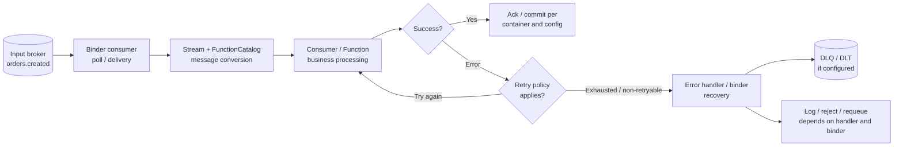
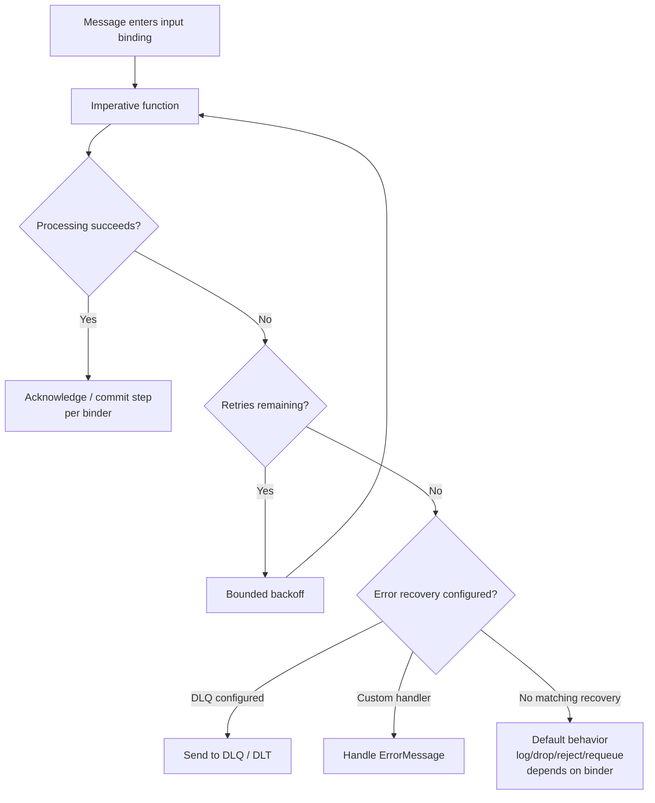
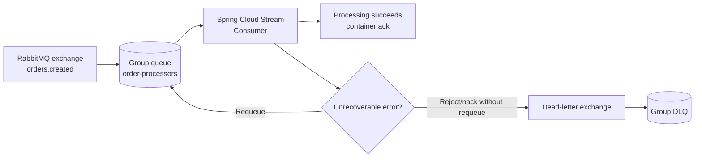
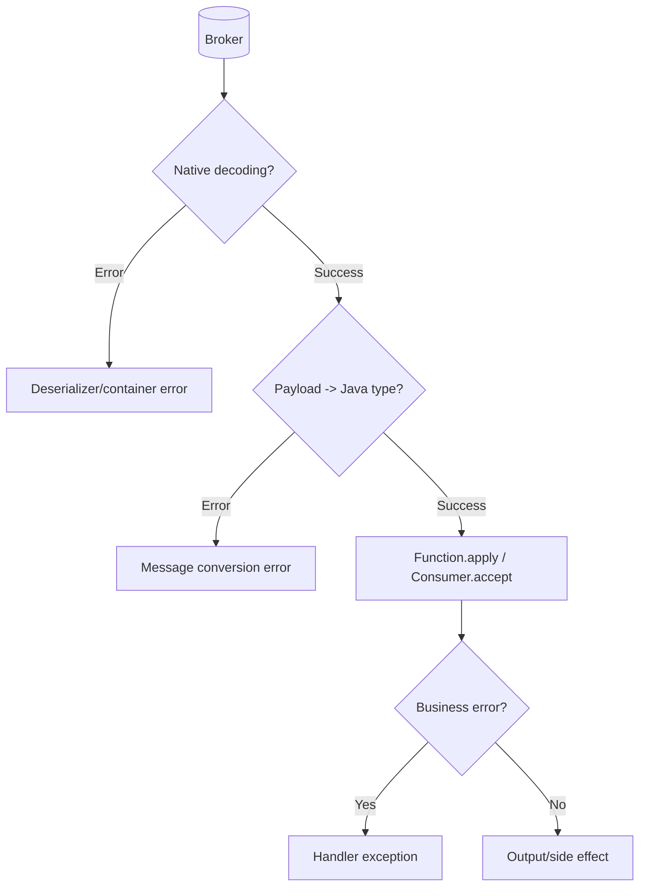
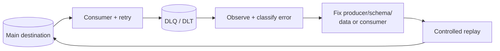

# Boundaries of Retry, Message Acknowledgement, and Dead-Letter Queue Support

## 1. Why Can a Working Function Still Duplicate or Lose Events?

Suppose a service receives `OrderCreated` events from `orders.created`, validates orders, and writes results to a database. When the database connection flickers, a message may fail mid-processing. If the application restarts after writing to the database but before the broker acknowledges processing, the same event may be delivered again. If the application swallows the error and acknowledges too early, the event risks **never being processed**.

In **Spring Cloud Function**, business logic can be a pure Java `Consumer<OrderCreated>` or `Function<OrderCreated, OrderClassified>`. A function does not directly manage Kafka offsets or RabbitMQ delivery tags. **Spring Cloud Stream** and binders connect functions to brokers, while providing error-handling mechanisms based on the programming model and binder capabilities.

Three concepts must be kept separate:

- **Retry:** re-invoking a failed operation according to attempt count, exception type, and backoff policy.
- **Acknowledgement/offset commit:** informing the broker or consumer group which records are considered processed under the configured mode.
- **DLQ/DLT (dead-letter quarantine):** routing records that cannot be processed normally to another destination for investigation, repair, or reprocessing.

They interact with each other, yet **are not synonymous**. You can have retries without a DLQ; you can have a DLQ yet publishing to the DLQ can also fail; you can have acknowledgement without business side effects being safely persisted. This lesson focuses on the **framework – function – binder – broker boundaries**, not merely memorizing YAML property names.

After this lesson, you will be able to:

1. Identify which errors happen before, during, or after invoking a function.
2. Configure retries and backoff for an imperative input binding.
3. Distinguish Kafka offsets from RabbitMQ ack/nack and producer acknowledgements.
4. Configure DLQ/DLT for Kafka and RabbitMQ under the right configuration namespaces.
5. Explain why imperative function retry/DLQ does not apply identically to reactive functions.
6. Design idempotency, deliberately test failures, and operate a safe replay workflow.

## 2. Responsibility Map from Broker to Business Logic



This diagram is a **conceptual model**, not a claim that steps execute strictly sequentially in every version and binder. Offset commits, undeserializable message errors, DLT routing, and container retries each have distinct branches. In particular, successfully routing a record to a DLQ does not mean the original business side effect succeeded.

| Component | What Does It Understand? | Common Responsibilities | What It Does Not Guarantee Automatically |
| --- | --- | --- | --- |
| `Supplier`, `Function`, `Consumer` | DTOs and business rules | Processing data, returning outputs, or executing side effects | Broker transactions, offset commits, queue provisioning |
| `FunctionCatalog` | Function names, types, and composition | Lookup, normalizing invocation and conversion | Kafka/RabbitMQ DLQ decisions |
| Spring Cloud Stream | Input/output bindings, consumer properties, function definition | Connecting invocations to binders, providing retry/error handling for eligible handlers | Workflow-wide exactly-once |
| Kafka binder | Topics, partitions, consumer groups, Kafka client | Consuming/producing records; coordinating retries, DLT, and offsets per config | External database transactions |
| RabbitMQ binder | Exchanges, queues, deliveries, ack/nack, DLX | Coordinating consumers, requeue/dead-letter, and republishing per config | Kafka-style offset replay |
| Downstream DB/API | Business state | Durable writes, deduplication, consistency | Broker automatically knowing side effects committed |

**Principle:** keep business functions protocol-independent; configure retry/DLQ/ack at the binding and binder layers where possible; yet idempotency and transaction boundaries still must be designed in the application.

## 3. Classifying Errors Before Choosing Retry

Not every error should be retried.

| Error Category | Example | Is Retry Usually Useful? | Handling Approach |
| --- | --- | --- | --- |
| **Transient** | Database timeout, temporary API overload, brief network drop | Yes, with limits and backoff | Controlled retry, monitor attempt counts |
| **Permanent / poison message** | Malformed JSON, wrong schema, forbidden value, permanently invalid event | Usually no | Quarantine, DLQ, fix contract |
| **Intentional business rejection** | Order missing `orderId`, negative amount | Should not loop endlessly | Reject with clear reason; optionally emit a business rejection event per contract |
| **Downstream error after side effect** | Wrote to DB yet response timed out | Risk of duplication on retry | Idempotency and state check before writing again |
| **Output publish error** | Function produced result yet target broker rejected it | Separate producer-side policy | Producer retry/outbox, send confirmation |
| **Deserialization error before function** | Kafka deserializer cannot build DTO | Different from exceptions inside `apply` | Deserializer error handler / binder-specific recovery |

A message violating the schema will not become valid after 100 retries. Conversely, a database may recover in a few seconds. Therefore, retry policies must consider **exception types**, attempt counts, backoff intervals, and final disposition.

### Error Loop to Avoid

```text
invalid message
   -> consumer fails
   -> broker immediately requeues
   -> consumer receives it again
   -> exact same error
   -> immediately requeues
   -> ... indefinitely
```

This loop can burn CPU, flood logs, and block valid messages. A monitored DLQ or explicit quarantine state is usually far better than unbounded requeuing.

## 4. Retry in Spring Cloud Stream: Scope of Applicability

In Spring Cloud Stream's functional model, an **imperative message handler** is invoked by the framework for each individual message. For example:

```java
@Bean
Consumer<OrderCreated> processOrder() {
    return event -> orderService.process(event);
}
```

When the handler throws an exception, the framework/binder can apply retries according to supported consumer policies. In common configurations, `maxAttempts` defaults to **3 total attempts**, **including the initial attempt**. Setting `maxAttempts: 1` disables this retry loop.

> This is retry at the boundary of **an input binding handling imperative messages**. It is not Kafka producer retry, not database transaction retry, and should not be assumed to work the same way inside `Function<Flux<T>,Flux<R>>`.

### 4.1. Common Consumer Properties

| Property | Meaning | Commonly Documented Default |
| --- | --- | --- |
| `maxAttempts` | Total message processing attempts, including the first | `3` |
| `backOffInitialInterval` | Delay before the first retry | `1000 ms` |
| `backOffMultiplier` | Multiplier increasing delay between attempts | `2.0` |
| `backOffMaxInterval` | Upper cap on retry delay | `10000 ms` |
| `defaultRetryable` | Whether unlisted exceptions are retried | `true` |
| `retryableExceptions` | Map of exception classes to retry/non-retry boolean | Config-dependent |

Standard paths:

```text
spring.cloud.stream.bindings.<input-binding-name>.consumer.maxAttempts
spring.cloud.stream.bindings.<input-binding-name>.consumer.backOffInitialInterval
spring.cloud.stream.bindings.<input-binding-name>.consumer.backOffMultiplier
spring.cloud.stream.bindings.<input-binding-name>.consumer.backOffMaxInterval
```

Example:

```yaml
spring:
  cloud:
    stream:
      bindings:
        processOrder-in-0:
          consumer:
            maxAttempts: 3
            backOffInitialInterval: 1000
            backOffMultiplier: 2.0
            backOffMaxInterval: 10000
```

With three consecutive failures, the typical backoff schedule is first attempt, ~1 second wait, second attempt, ~2 seconds wait, third attempt. Actual timing depends on the scheduler, version, and binder mechanics. `maxAttempts` does not guarantee exact absolute execution timestamps.

### 4.2. Classifying Retryable Exceptions

To retry transient errors while skipping retries for bad business data, use configuration like:

```yaml
spring:
  cloud:
    stream:
      bindings:
        processOrder-in-0:
          consumer:
            maxAttempts: 3
            defaultRetryable: true
            retryableExceptions:
              java.lang.IllegalArgumentException: false
              java.lang.IllegalStateException: true
```

This is an **illustrative exception map**, not a rule that every `IllegalStateException` is transient. In real applications, define dedicated domain exceptions (e.g., `TransientDownstreamException` and `InvalidOrderException`) so policy does not depend on overly generic exceptions. When an exception is wrapped inside another exception, check how the framework traverses causes.

**Note:** this property only takes effect within retry mechanisms supported by the binder and programming model. An exception occurring before the message handler, such as native deserialization, may follow a different error path.

## 5. Java Example: Consumer with Transient and Permanent Errors

Using Java 17+ and Spring Boot. The bean below is an educational example: it deliberately throws exceptions based on a field to demonstrate retry/DLQ, without performing database transactions.

```java
import java.util.function.Consumer;

import org.springframework.boot.SpringApplication;
import org.springframework.boot.autoconfigure.SpringBootApplication;
import org.springframework.context.annotation.Bean;

@SpringBootApplication
public class OrderProcessingApplication {

    public static void main(String[] args) {
        SpringApplication.run(OrderProcessingApplication.class, args);
    }

    public record OrderCreated(
            String eventId,
            String orderId,
            long totalInCents) {}

    @Bean
    Consumer<OrderCreated> processOrder() {
        return order -> {
            if (order.eventId() == null ||
                    order.eventId().isBlank() ||
                    order.orderId() == null ||
                    order.orderId().isBlank() ||
                    order.totalInCents() < 0) {
                throw new IllegalArgumentException(
                        "Invalid order event");
            }

            // DEMO: always fails to observe retries and DLQ routing.
            if ("SIMULATE-FAIL".equals(order.orderId())) {
                throw new IllegalStateException(
                        "Simulated downstream dependency failure");
            }

            System.out.printf(
                    "Processed event=%s order=%s amount=%d%n",
                    order.eventId(),
                    order.orderId(),
                    order.totalInCents());
        };
    }
}
```

Two test messages:

**Valid:**

```json
{
  "eventId": "evt-101",
  "orderId": "ORD-101",
  "totalInCents": 150000
}
```

**Simulated failure to observe the retry path:**

```json
{
  "eventId": "evt-102",
  "orderId": "SIMULATE-FAIL",
  "totalInCents": 80000
}
```

If the binding is configured for three attempts, message `evt-102` can cause `processOrder` to be invoked three times before entering the error/recovery path. **Do not** assume messages automatically go to a DLQ unless the binder's DLQ feature is enabled.

If a message is JSON so malformed that `OrderCreated` cannot be constructed, the failure may occur before `processOrder.apply(...)`. In that case, function log counts will not reflect how many times the system attempted to decode or process the record.

## 6. One Error, Multiple Recovery Paths: What Happens After Retries Exhaust?

A common way to read the error flow:



Three limits to remember:

1. **Each binder has a different property set.** Kafka DLT and RabbitMQ DLQ have different topologies and metadata.
2. **Not enabling DLQ does not mean the broker retries forever**, nor should you assume messages are preserved. Default error handlers may log and drop in standard Spring Cloud Stream configurations. Verify the exact behavior of your version and binder.
3. **A custom error handler can replace the default recovery path.** Spring Cloud Stream docs describe `error-handler-definition` as independent of default/binder-specific error handlers; when supplying a custom error handler, do not assume DLQ still runs automatically alongside it merely because DLQ properties are set.

### Application-Defined ErrorMessage Handler

When custom message-level error handling is needed, define a consumer dedicated to `ErrorMessage`:

```java
import java.util.function.Consumer;

import org.springframework.context.annotation.Bean;
import org.springframework.messaging.support.ErrorMessage;

@Bean
Consumer<ErrorMessage> recordProcessingError() {
    return error -> {
        // DEMO: production must write to durable, monitored storage.
        System.err.println(
                "Processing error: " + error.getPayload().getMessage());
    };
}
```

And configure it on the **actual binding**:

```yaml
spring:
  cloud:
    stream:
      bindings:
        processOrder-in-0:
          error-handler-definition: recordProcessingError
```

This is an example of **replacing the default error-handling path**, not a snippet to paste simultaneously with the two DLQ examples below. If you write error data yourself, ensure the handler handles its own failures, storage durability, and observability. Simply logging errors does not guarantee preserving messages.

## 7. Kafka: Groups, Partitions, Offsets, and DLT

With the Kafka binder, `destination: orders.created` typically maps to Kafka topic `orders.created`; `group: order-processors` maps to the consumer group. Records have per-partition offsets, and the consumer group stores read/commit position state.

Example:

```text
Kafka topic: orders.created
  partition-0: offset 20, 21, 22, 23 ...
  partition-1: offset 10, 11, 12 ...

consumer group: order-processors
  read/commit progress is managed per topic + partition
```

**A record processed in Java does not mean Kafka immediately commits the corresponding offset.** Commit timing depends on the Kafka listener container, `ackMode`, batch/record processing, retry/recovery, and transaction settings.

In Kafka, a DLQ is typically called a **dead-letter topic (DLT)**. It is another Kafka topic, not a RabbitMQ queue. Sending a record to the DLT **does not physically delete the original record from the Kafka topic**; the original record remains subject to the topic's retention policy.

### 7.1. Configuring Kafka Retry and DLQ

Assuming the Kafka binder is on the classpath and a broker is at `localhost:9092`:

```yaml
spring:
  cloud:
    function:
      definition: processOrder
    stream:
      bindings:
        processOrder-in-0:
          destination: orders.created
          group: order-processors
          content-type: application/json
          consumer:
            maxAttempts: 3
            backOffInitialInterval: 1000
            backOffMultiplier: 2.0
            backOffMaxInterval: 10000

      kafka:
        binder:
          brokers: localhost:9092
        bindings:
          processOrder-in-0:
            consumer:
              enableDlq: true
              dlqName: orders.created.errors
```

**Two different namespaces:**

- `spring.cloud.stream.bindings.processOrder-in-0.consumer.*`: retry/backoff at the consumer binding level.
- `spring.cloud.stream.kafka.bindings.processOrder-in-0.consumer.*`: DLQ features, error topic, and Kafka-binder-specific properties.

`enableDlq` is generally **off by default**. A **named group** is an important prerequisite for Kafka binder DLQ support; anonymous groups are not supported identically. `dlqName` is optional to name the DLT, and if omitted, the Kafka binder follows a convention based on destination/group.

**Operational requirements:** the error topic must have appropriate partitions, write permissions, and serializers. The Kafka binder may provision topics depending on permissions and settings; in environments blocking auto-topic creation, pre-provision them. By default, DLT routing typically tries to preserve the original record's partition, so pay attention to DLT partition counts if provisioning manually.

### 7.2. DLT Serialization Is Not a Minor Detail

When an error happens in the handler, the binder must send the original record or failing payload to the DLT. If native decoding is enabled or the payload is no longer `byte[]`, **the DLT producer's serializer must be compatible with the actual type being sent**.

For example, a consumer handling `String` with native Kafka `StringDeserializer` may also need:

```yaml
spring:
  cloud:
    stream:
      bindings:
        processText-in-0:
          consumer:
            useNativeDecoding: true

      kafka:
        bindings:
          processText-in-0:
            consumer:
              enableDlq: true
              dlqName: text.raw.errors
              configuration:
                value.deserializer: org.apache.kafka.common.serialization.StringDeserializer
              dlqProducerProperties:
                configuration:
                  value.serializer: org.apache.kafka.common.serialization.StringSerializer
```

This is a **separate example** for a hypothetical `processText` bean with signature `Consumer<String>`, not mandatory extra config for `processOrder`. Do not use `StringSerializer` for an `OrderCreated` value if the DLQ path actually passes a DTO instead of a `String`. For POJOs, verify the exact conversion path, data written to the DLT, and supporting codecs via integration tests.

### 7.3. What Happens to the Offset After Routing to DLT?

When recovery succeeds and the binder considers the failing record handled under the DLT policy, consumer progress is normally allowed to advance. However, **do not treat that statement as an offset-commit rule applying across every ack mode and version**. If publishing to the DLT fails, the framework/binder may react differently; inspect logs and error handler policies.

Sending to a DLT is a recovery action, **not committing a database transaction**. That a record is no longer actively blocking the main consumer does not prove downstream completed the business operation.

## 8. Kafka Acknowledgement: Offset Commits Differ from Producer Acks

Kafka has at least two concepts easily lumped together as "ack":

1. **Producer `acks`**: requests broker confirmation of producer writes under settings such as `acks=all`.
2. **Consumer acknowledgement/offset commit**: updates the consumer group's read progress; managed either by the listener container or manually by the application under `ackMode`.

These two actions do not automatically create an end-to-end transaction.

### 8.1. Container-Managed Acknowledgement Modes

In most imperative Spring Cloud Stream apps, you can let the binder/container manage ack/commit per configuration and error handling. When the function completes cleanly, the consumer pipeline proceeds to completion; actual offset commit timing depends on the ack mode.

With Kafka, `ackMode` used by the Kafka binder builds on the Spring Kafka listener container. Modes may include `RECORD`, `BATCH`, `MANUAL`, `MANUAL_IMMEDIATE`, and time/count-based modes depending on the Spring Kafka version.

Do not rely on an unchanging default when designing recovery: defaults and deprecated properties have evolved across versions. Specify the needed mode explicitly and check docs for the active binder/dependency versions.

### 8.2. Manual Acknowledgement via Message Headers

When you truly want control over when Kafka acknowledges, the Kafka binder supports `MANUAL` or `MANUAL_IMMEDIATE` in supporting versions. In the appropriate mode, messages carry the `KafkaHeaders.ACKNOWLEDGMENT` header:

```java
import java.util.function.Consumer;

import org.springframework.context.annotation.Bean;
import org.springframework.kafka.support.Acknowledgment;
import org.springframework.kafka.support.KafkaHeaders;
import org.springframework.messaging.Message;

@Bean
Consumer<Message<String>> manualProcess() {
    return message -> {
        String payload = message.getPayload();

        // DEMO: synchronous processing must complete before ack.
        System.out.println("Processed: " + payload);

        Acknowledgment acknowledgment = message.getHeaders()
                .get(KafkaHeaders.ACKNOWLEDGMENT, Acknowledgment.class);

        if (acknowledgment == null) {
            throw new IllegalStateException(
                    "Missing Kafka acknowledgment header");
        }

        acknowledgment.acknowledge();
    };
}
```

```yaml
spring:
  cloud:
    function:
      definition: manualProcess
    stream:
      bindings:
        manualProcess-in-0:
          destination: text.raw
          group: manual-workers
          content-type: text/plain
      kafka:
        bindings:
          manualProcess-in-0:
            consumer:
              ackMode: MANUAL
```

**This is a Kafka-specific example and a standalone configuration**, not automatically wired into the `processOrder` example. Acknowledgement headers belong to transport; if you want to keep the same handler reusable over HTTP or RabbitMQ, extract payload processing into a separate service and let only the Kafka adapter read the ack header.

**Do not call `acknowledge()` before critical side effects complete.** Likewise, do not hold an acknowledgement indefinitely inside an async task assuming the container keeps the same lifecycle. Manual ack, retries, rebalancing, and DLT recovery require integration testing; a `try/catch` that catches an error without rethrowing can cause the framework to treat the message as succeeded unintentionally.

## 9. RabbitMQ: Delivery Acknowledgement, Requeue, and Dead-Letter Exchange

The RabbitMQ binder uses a different model from Kafka:

- Destinations are usually mapped by the binder to an **exchange**.
- A consumer group usually gets a **queue** bound to the exchange.
- The broker delivers messages to consumers; the consumer/container can **ack**, **reject**, or **nack** depending on mode.
- RabbitMQ has **dead-letter exchanges (DLX)** and **dead-letter queues (DLQ)** for rejected or expired messages per configured topology.



The diagram above depicts the **broker dead-lettering** path. Another path is the binder **republishing** failed messages to the DLQ with headers explaining the exception.

### 9.1. Configuring RabbitMQ Retry and DLQ

Example using the Rabbit binder with RabbitMQ running at `localhost:5672`:

```yaml
spring:
  rabbitmq:
    host: localhost
    port: 5672
    username: guest
    password: guest

  cloud:
    function:
      definition: processOrder
    stream:
      bindings:
        processOrder-in-0:
          destination: orders.created
          group: order-processors
          content-type: application/json
          consumer:
            maxAttempts: 3
            backOffInitialInterval: 1000
            backOffMultiplier: 2.0
            backOffMaxInterval: 10000

      rabbit:
        bindings:
          processOrder-in-0:
            consumer:
              autoBindDlq: true
              republishToDlq: true
              requeueRejected: false
```

Here:

- `autoBindDlq: true` tells the Rabbit binder to set up the DLQ/DLX and required bindings if provisioning permissions allow.
- `republishToDlq: true` makes the binder republish failed messages with added exception metadata when using that recovery path.
- `requeueRejected: false` prevents infinite reject → requeue loops when the binder uses reject/nack and appropriate DLX topology.
- `maxAttempts: 3` governs imperative processing attempts in the shared retry mechanism.

This is an **alternative** configuration to the Kafka example; do not paste two different binder configs into one profile unless you intentionally deploy multi-binder.

**Explicit groups are crucial** for durable queues and manageable DLQ naming. Exact queue names, exchange types, routing keys, and dead-letter topology must be checked against your Rabbit binder and existing setup; do not mechanically apply Kafka error topic names to Rabbit queues.

### 9.2. Requeue Differs from Framework Retry

Two non-equivalent situations:

- **Framework retry:** the same delivery is retried within the listener/binder according to `maxAttempts` and backoff.
- **RabbitMQ requeue:** the message is returned to the broker and may be redelivered later to the same or another consumer.

If `requeueRejected: true` without bounds, the broker can endlessly redeliver a broken message. When you want a DLQ, ensure reject/republish behavior routes the message to the error target instead of looping.

### 9.3. Republishing Is Not Broker Native Dead-Lettering

When `republishToDlq` is enabled, the binder can create a new message toward the DLQ, attaching headers such as exception info. When republishing is disabled, the message can take the reject/nack path so the broker dead-letters it via the DLX.

These two paths can differ in headers, payload preservation, publish confirms, and behavior when the DLQ is unavailable. For large messages, stack traces in headers can also hit AMQP frame limits; consider truncation/configuration during operations.

## 10. Kafka and RabbitMQ Comparison Table

| Question | Kafka Binder | RabbitMQ Binder |
| --- | --- | --- |
| What must be configured to read messages? | Topic, group, brokers | Exchange/queue, group, broker |
| What is consumption confirmation? | Consumer group offset progress / ack mode | Ack/nack/reject delivery on the queue |
| After successful processing? | Container/consumer commits offset per config | Container/consumer acks per mode |
| Handler-level retry? | Retry/error-handling mechanism per version and mode | Retry/error-handling mechanism per version and mode |
| What is the typical error destination? | Dead-letter **topic** (DLT) | Dead-letter **queue** (DLQ) via DLX or republish |
| Enable error destination per binding? | `enableDlq` | `autoBindDlq` and/or `republishToDlq` |
| Where to inspect progress/errors? | Consumer lag, offsets, DLT partitions | Queue depth, unacked count, dead-letter queue |
| Replay completed messages? | Can re-read records still in retention by adjusting offset/group | Acked messages do not stay in queue; needs separate storage/replay |
| Automatic exactly-once with external DB? | Not automatic | Not automatic |

**Do not copy error/ack settings verbatim between the two binders.** A property name that sounds semantically similar at the Stream layer does not guarantee identical execution at the broker.

## 11. Successful Ack Does Not Mean Side Effects Are Guaranteed Once

Suppose a consumer writes to a database:

```text
1. Receive event evt-101.
2. UPDATE/INSERT business data.
3. Database COMMIT succeeds.
4. Application crashes before committing broker offset/ack.
5. Broker redelivers evt-101.
```

On retry, the write operation may run a **second time**. This is a common case of **at-least-once delivery**. If the consumer is not idempotent, duplicate invoice rows, duplicate emails, or double charges can result.

Conversely:

```text
1. Receive event evt-101.
2. Ack/commit broker too early.
3. Application crashes before database COMMIT.
4. Broker/consumer group may consider the event consumed.
```

In that case, you risk dropping the side effect.

### 11.1. Crash Timing Matrix

| Crash Point | Business State | Broker State | Risk |
| --- | --- | --- | --- |
| Before DB write | Not written | Not acknowledged as processed | May be redelivered |
| After DB commit, before ack/offset | Written | Progress may not be committed | Redelivery, leading to duplicates |
| After ack/offset, before DB commit | Not written | May already consider done | Lost business effect |
| After DB write and broker ack | Written | Confirmed per configured model | Still must account for output errors, other side effects, and upstream |

Putting `@Transactional` on a Java method does not stretch a single transaction across the database, Kafka offsets, and Rabbit queues. Understand which transaction managers participate and each broker's capabilities and limits.

### 11.2. Designing Idempotency

A common approach uses an immutable `eventId` to ensure **each event produces its business side effect at most once**.

Conceptual schema example:

```sql
CREATE TABLE processed_event (
    consumer_name VARCHAR(120) NOT NULL,
    event_id VARCHAR(120) NOT NULL,
    processed_at TIMESTAMP NOT NULL,
    PRIMARY KEY (consumer_name, event_id)
);
```

Inside the same transaction as the business side effect:

```text
BEGIN TRANSACTION

  INSERT INTO processed_event(consumer_name, event_id, ...)
  If record (consumer_name, event_id) already exists:
      skip duplicate side effect per contract.

  If this is the first time:
      apply business state changes.

COMMIT TRANSACTION
After processing succeeds -> let consumer/binder acknowledge the message.
```

This approach requires handling unique key conflicts properly, using a durable database transaction, and keeping the marker and side effect in the same commit boundary. If the side effect sends an email or calls an external API, database idempotency alone may not suffice; combine with an outbox, downstream deduplication, or APIs supporting idempotency keys.

**Event IDs must remain stable across retries and replays.** Do not generate a fresh UUID every time a consumer re-receives the same event and expect duplicate detection to work.

## 12. Errors Before the Function: Conversion and Deserialization

Not every failure comes from `Consumer<T>` throwing an exception:



For example, `OrderCreated` expects `totalInCents` as a number. JSON containing the string `"not-a-number"` can fail conversion **before the Java consumer runs**. Therefore:

- A `try/catch` inside `processOrder` cannot catch all deserialization failures.
- Handler-level retries may not be the right recovery path.
- Native Kafka deserializers may need error-handling deserializer/container configuration; Rabbit has different converter/AMQP recovery.
- DLQ routing for conversion errors must be verified via integration tests along the actual data path in use, especially with `useNativeDecoding`.

`content-type: application/json` is only format metadata; it does not repair corrupted data. When a payload is a poison message, good practice is keeping the original record, recording the cause, and quarantining it to fix the schema/producer.

### 12.1. Output Publish Errors After Function Returns

A `Function<T,R>` may compute `R` accurately, yet outbound publishing fails due to ACLs, networking, or serializers. This error occurs on the **producer/output binding path**, distinct from exceptions inside the business function. Do not assume `consumer.maxAttempts` safely retries the whole send alongside already-executed side effects.

For critical workflows, consider the **outbox** pattern or appropriate transactional messaging; explicitly design input acknowledgement and output persistence. When bridging Kafka → RabbitMQ, there is no automatic distributed transaction merely from sharing one Java function.

## 13. Reactive Functions: Support Boundaries Are Essential to Understand

This is a major distinction in Spring Cloud Stream.

With **imperative functions**:

```java
Function<OrderCreated, OrderClassified>
Consumer<OrderCreated>
```

the framework can invoke the handler per message, observe exceptions, and apply binding-level retry/error handling.

With **reactive functions**:

```java
Function<Flux<OrderCreated>, Flux<OrderClassified>>
```

the framework typically invokes the function **once to establish the Publisher pipeline**. Subsequent elements and error signals travel through the Reactor stream. The framework **does not see individual per-message invocations** as in imperative handlers, so do not expect imperative `maxAttempts`, error handlers, and DLQs to behave identically inside a reactive stream.

### 13.1. Why Can onError Stop the Entire Stream?

```java
@Bean
Function<Flux<OrderCreated>, Flux<OrderClassified>> classifyReactive() {
    return orders -> orders.map(order -> {
        if (order.orderId() == null) {
            throw new IllegalArgumentException("Missing orderId");
        }
        return new OrderClassified(
                order.orderId(),
                order.totalInCents() >= 100_000L
                        ? "PRIORITY" : "STANDARD");
    });
}
```

If `map` throws an exception, Reactor can emit an `onError` signal and terminate the pipeline. One bad record can affect the entire stream, not just one message's `apply` call. Explicitly design how a long-lived source restarts or recovers, and when it is safe to ack.

### 13.2. Per-Element Handling When Event Quarantine Is Permitted

The following example illustrates per-item handling at the Reactor layer. This is **not** configuration that automatically enables Kafka/Rabbit DLQ:

```java
import java.util.function.Function;

import org.springframework.context.annotation.Bean;
import reactor.core.publisher.Flux;
import reactor.core.publisher.Mono;

@Bean
Function<Flux<OrderCreated>, Flux<OrderClassified>> classifySafely() {
    return orders -> orders.concatMap(order ->
            Mono.fromCallable(() -> {
                if (order.orderId() == null ||
                        order.orderId().isBlank()) {
                    throw new IllegalArgumentException(
                            "Missing orderId");
                }
                return new OrderClassified(
                        order.orderId(),
                        order.totalInCents() >= 100_000L
                                ? "PRIORITY" : "STANDARD");
            })
            .onErrorResume(error -> {
                // ILLUSTRATIVE ONLY: logs and skips the failing element.
                // Production needs durable quarantine / error events.
                System.err.println("Bad event: " + error.getMessage());
                return Mono.empty();
            }));
}
```

`concatMap` preserves element processing order within a source and allows managing errors per `Mono`. However, `Mono.empty()` **intentionally drops** output for the failing event. Never use this pattern when the requirement is "lose zero events" unless the bad record has already been durably persisted first.

In reactive pipelines, operators like `onErrorResume`, `retryWhen`, and `doOnError` are tools, not guarantees. `retryWhen` on an **entire Flux** can resubscribe to the source and re-run side effects that already occurred; it is not equivalent to retrying a single broker record.

### 13.3. Backpressure Does Not Replace Ack

Reactive backpressure regulates demand between supporting Publishers and Subscribers. It **does not automatically guarantee** that Kafka offsets are committed properly, Rabbit deliveries are acked, or side effects ran strictly once. Test behavior under stream errors, restarts, rebalances, pause/resume, and broker outages.

## 14. Supplier and StreamBridge: Source-Side Retry Is Not Consumer Retry

**`Supplier<T>`** produces outbound messages, **`Consumer<T>`** processes inbound messages. If a source emits to Kafka/RabbitMQ:

```java
@Bean
Supplier<OrderCreated> publishOrder() {
    return () -> new OrderCreated("evt-demo", "ORD-1", 150_000L);
}
```

normally only `publishOrder-out-0` exists. It has no input binding to apply `publishOrder-in-0.consumer.maxAttempts`. Polling the supplier, emitting output, producer confirms, and send-error handling are separate mechanisms.

The source example above is also dangerous if polled repeatedly: it emits the **same event ID forever**. A real application must bound source data, keep IDs stable on retries without reusing IDs for new events, and design a sent-marking workflow.

### 14.1. Active Emission with StreamBridge

```java
import org.springframework.cloud.stream.function.StreamBridge;
import org.springframework.stereotype.Service;

@Service
class OrderPublisher {

    private final StreamBridge streamBridge;

    OrderPublisher(StreamBridge streamBridge) {
        this.streamBridge = streamBridge;
    }

    boolean publish(OrderCreated order) {
        return streamBridge.send("ordersOut", order);
    }
}
```

`StreamBridge.send(...)` reflects the send outcome at its abstraction level, **not a promise that every consumer processed the business operation**. Distinguish producer confirms/acks from consumer acknowledgements; handle exceptions, false send results, and backpressure per your actual binder.

If a source reads from a database to emit events, do not mark records "sent" before having an appropriate publish guarantee. The outbox pattern is a common strategy when crash recovery and safe retries are required.

## 15. Custom Error Handlers and DLQ Can Be Mutually Exclusive

Spring Cloud Stream supports defining an `ErrorMessage` handler via the `error-handler-definition` property. As documented in Spring Cloud Stream, this custom handler **replaces** default/binder-specific handlers for the binding, so DLQ settings may **not execute** as expected when configured simultaneously.

Example **choosing a custom handler**:

```yaml
spring:
  cloud:
    function:
      definition: processOrder
    stream:
      bindings:
        processOrder-in-0:
          destination: orders.created
          group: order-processors
          error-handler-definition: recordProcessingError
```

Example **choosing binder-managed Kafka DLQ**:

```yaml
spring:
  cloud:
    function:
      definition: processOrder
    stream:
      bindings:
        processOrder-in-0:
          destination: orders.created
          group: order-processors
      kafka:
        bindings:
          processOrder-in-0:
            consumer:
              enableDlq: true
```

**These are two alternative illustrations**, not two YAML snippets to blindly merge. If you need both custom error recording and forwarding to a DLT, design an explicit recovery pipeline inside your custom handler and take responsibility for publish confirmation, deduplication, and handler failures.

Never use a custom handler merely to "swallow" exceptions and return normally. Doing so can mark events processed without any durable recovery state.

## 16. Lifecycle of a Message in DLQ/DLT

A DLQ is not a place to dump messages and forget them. A production workflow needs at least these steps:



### 16.1. What Data Should Be Recorded for Investigation?

An error record typically needs:

- Original content or a reference to the original record.
- Event ID and event timestamp.
- Destination, group, and binding that processed it.
- Error class, sanitized error message, and attempt count if available.
- Correlation/trace info if permitted for storage.
- Schema version and processing application version.
- Timestamp entered DLQ and triage/replay status.

**Be careful with sensitive data:** payloads and stack traces can contain PII or secrets. Enforce access control, retention, masking, and avoid putting secrets in logs or headers.

### 16.2. Replay Is Not Simply Resending to the Main Topic

If you read every message from the DLQ and push it back to the main destination **without fixing the bug**, you create a loop:

```text
main -> failure -> DLQ -> replay -> main -> failure -> DLQ -> ...
```

A safe replay process should:

1. Classify errors and verify the root cause is fixed or a new handler is deployed.
2. Select the exact message subset and record a batch/replay ID.
3. Preserve a stable event ID and critical metadata.
4. Rate-limit replay and watch consumer lag/queue depth.
5. Support pausing if error rates spike.
6. Log per-event outcomes, checking side effects and duplicates.
7. Ensure replay can be stopped, resumed, and audited.

Kafka DLT and RabbitMQ DLQ do not provide one unified Spring Cloud Stream replay API out of the box; dedicated tooling/jobs/applications or broker-specific procedures are usually needed.

## 17. Observability and Alerting: Watch All Three Paths

A healthy system monitors **retries**, **ack/lag**, and **DLQ** together.

| Metric | Question to Answer |
| --- | --- |
| Inbound/outbound message count | Has traffic shifted abnormally? |
| Handler failure rate | Did errors spike after a deployment? |
| Retry attempt count | Are messages retrying continually, and how long is backoff? |
| Per-event processing latency | Are retries inflating end-to-end latency? |
| Kafka consumer lag | Is the group falling behind or blocked on a failing partition? |
| Rabbit queue depth / unacked | Are messages piling up unacknowledged by consumers? |
| DLT/DLQ incoming count | How many messages are quarantined, and what is the trend? |
| Age of oldest DLQ message | Have events been left untriaged beyond SLA? |
| Replay success/failure | After a fix, did events actually succeed through the consumer? |
| Blocked duplicate side effects | Which scenarios is idempotency catching? |

Do not alert only when new messages appear in the DLQ. If the broker cannot write to the DLQ due to ACLs or an unprovisioned destination, **the DLQ count can remain 0 while the main consumer fails severely**. Add alerts for recovery-publish failures and consumer health.

### Tracing One Event

Example business trace:

```text
eventId=evt-102
destination=orders.created
group=order-processors
handler=processOrder
attempt=1   -> downstream timeout
attempt=2   -> downstream timeout
attempt=3   -> downstream timeout
recovery    -> DLT orders.created.errors
status      -> NEEDS_TRIAGE
```

`attempt` is just an illustrative observability field; the framework/binder is not required to provide identical header names and counting across all modes. Use structured logging and proper metrics/tracing systems; do not infer commit or DLT success from a single log string.

## 18. Testing: Proving Retries, DLQ, and Ack Together

### 18.1. Unit Testing the Business Function

Unit tests confirm whether the function throws exceptions under the right conditions:

```java
import static org.junit.jupiter.api.Assertions.assertDoesNotThrow;
import static org.junit.jupiter.api.Assertions.assertThrows;

import org.junit.jupiter.api.Test;

class OrderProcessingApplicationTest {

    @Test
    void successfulOrderCompletes() {
        var consumer = new OrderProcessingApplication()
                .processOrder();

        assertDoesNotThrow(() -> consumer.accept(
                new OrderProcessingApplication.OrderCreated(
                        "evt-101", "ORD-101", 150_000L)));
    }

    @Test
    void invalidOrderIsRejected() {
        var consumer = new OrderProcessingApplication()
                .processOrder();

        assertThrows(IllegalArgumentException.class,
                () -> consumer.accept(
                        new OrderProcessingApplication.OrderCreated(
                                "evt-102", "", 100L)));
    }

    @Test
    void simulatedDownstreamFailurePropagates() {
        var consumer = new OrderProcessingApplication()
                .processOrder();

        assertThrows(IllegalStateException.class,
                () -> consumer.accept(
                        new OrderProcessingApplication.OrderCreated(
                                "evt-103", "SIMULATE-FAIL", 100L)));
    }
}
```

These tests verify Java bean exceptions. They **do not prove** binding retry counts, offset commits, Rabbit acks, or DLT/DLQ behavior work. That belongs to integration tests.

### 18.2. Testing Bindings and Imperative Retries

You can use the Spring Cloud Stream test binder to check wiring and framework-level errors where suitable, but do not treat it as a replacement for a real Kafka/RabbitMQ broker.

Suggested scenario:

1. Start with `definition: processOrder`, exact `processOrder-in-0` name, destination, and group.
2. Send a valid message; verify the function runs once and produces expected output/side effects.
3. Send `SIMULATE-FAIL`; count invocations to verify against `maxAttempts`.
4. Ensure failures are not caught and swallowed inside `Consumer`.
5. Verify that after exhausting retries, the message enters the **configured** error handler or DLT/DLQ path.
6. Verify a valid message sent after the failing message is still processed according to broker semantics.
7. Send a schema-invalid payload to separately test the pre-function conversion failure path.

A good retry test uses timeouts and event-awaiting latches/assertions rather than arbitrary `Thread.sleep` calls assuming completion.

### 18.3. Kafka Integration Testing

With real Kafka or matching Testcontainers:

- Create `orders.created` and DLT with matching partitions/ACLs.
- Consume from the DLT as an independent consumer, send failing messages, and inspect original record content.
- Check consumer group offset progress and continued processing after recovery.
- Stop the app before/after side effects and check for redelivery.
- Simulate DLT serialize/publish failure: does the system log/alert rather than silently dropping?
- If using manual `ackMode`, test what happens when `acknowledge()` is called versus omitted.

**Note:** verifying ack/commit solely from function logs is insufficient. Inspect consumer group offsets and actual broker state.

### 18.4. RabbitMQ Integration Testing

With real RabbitMQ or a test container:

- Verify exchange, group queue, DLX, and DLQ are provisioned properly.
- Send failing messages and confirm they land in the right DLQ after retries fail.
- Verify exception headers when `republishToDlq` is enabled.
- Test `requeueRejected: true` in an isolated environment to observe loop risk; never enable unbounded requeue in production.
- Kill the consumer mid-processing to observe redelivery and `unacked`.
- Confirm valid messages still flow, avoiding head-of-line queue blocking from one poison message.

### 18.5. Testing Reactive Separately

With `Function<Flux<T>,Flux<R>>`, use Reactor `StepVerifier` to check pipeline behavior and error signals. Then run integration tests to verify how subscription termination/restart interacts with ack/offset. Do not evaluate reactive functions by counting `Function.apply` calls expecting one call per message.

## 19. Commonly Misunderstood Configurations

### 19.1. maxAttempts=1 Does Not Enable DLQ

```yaml
spring:
  cloud:
    stream:
      bindings:
        processOrder-in-0:
          consumer:
            maxAttempts: 1
```

This only disables the consumer retry loop. For a Kafka DLT, you must also enable `enableDlq` and configure an appropriate group/topic; for a Rabbit DLQ, you need dead-letter topology and matching reject/republish settings.

### 19.2. enableDlq Does Not Guarantee Retries

```yaml
spring:
  cloud:
    stream:
      kafka:
        bindings:
          processOrder-in-0:
            consumer:
              enableDlq: true
```

This selects Kafka dead-lettering for the binding; it does not replace `maxAttempts`/backoff and does not create idempotency. For errors in native deserializers or unusual batch/reactive modes, verify applicability.

### 19.3. requeueRejected=true Is Not a DLQ

If RabbitMQ immediately requeues a failing message, it can be redelivered indefinitely. When you want bounded retries followed by quarantine, configure retries and dead-lettering explicitly; do not flip `requeueRejected` to `true` just hoping to "retry."

### 19.4. Producer Acks Are Not Consumer Acks

Kafka `acks=all` controls broker durability confirmation for producer writes. It **does not prove** the consumer ran `processOrder`, updated the business DB, or committed the consumer group offset.

### 19.5. Putting Group on an Output Binding Does Not Create a Retry Group

Groups belong to input consumers. Producers emit to destinations; consumer groups independently manage how they read. Place `group` and `consumer.*` on the actual input binding.

### 19.6. Renaming a Binding Without Moving Error Settings

If you use:

```yaml
spring:
  cloud:
    stream:
      function:
        bindings:
          processOrder-in-0: ordersInput
```

then consumer properties, error-handler definitions, and binder-specific properties must be placed under the **actual binding name** `ordersInput`, not left under `processOrder-in-0` expecting the framework to merge both. In particular, check `spring.cloud.stream.kafka.bindings.ordersInput.consumer.*` or `spring.cloud.stream.rabbit.bindings.ordersInput.consumer.*`.

## 20. Common Troubleshooting Matrix

| Symptom | Possible Cause | Checks and Resolution |
| --- | --- | --- |
| Function fails yet only logs appear, no DLT | DLQ not enabled or custom handler replaced recovery | Check binder namespace, group, and error handler |
| Kafka DLT cannot write messages | Wrong ACL, topic partitions, or serializer | Check DLT producer and `dlqProducerProperties` |
| Rabbit message loops continuously | Unbounded requeue, no quarantine | Check `requeueRejected` and DLX/DLQ |
| `maxAttempts: 3` yet only one call observed | Error before invocation, reactive/batch mode, or wrong binding config | Check type conversion, programming model, properties |
| `maxAttempts: 1` yet redelivery still occurs | Broker/container has independent redelivery | Distinguish binder retry from broker redelivery |
| Duplicate database records | Crash after DB commit before broker ack | Use event ID idempotency + DB transaction |
| Lost side effects despite committed offset | Acked too early or swallowed exception | Acknowledge only after durable processing and recovery |
| DLT receives message yet main consumer stays stuck | Recovery/offset commit failed | Check DLT publisher logs, consumer group, and ack mode |
| Reactive stream stops after one failing message | `onError` terminated the Publisher | Handle errors per element; design restart and quarantine |
| DLQ enabled yet no messages arrive in error queue | Wrong Rabbit routing/DLX, custom error handler, insufficient permissions | Inspect topology and binder configuration |
| Kafka `acks=all` yet duplicates still processed | Confused producer ack with consumer delivery | Check idempotency and offset commits |
| Function unit test passes yet retry never runs | Unit tests bypass Stream/broker | Write binding and binder integration tests |
| Replayed DLQ fails again | Schema/consumer not fixed; blind replay | Pause replay, triage root cause, check contract |
| Missing ack header in `Message<T>` | Kafka manual ack not enabled or not using Kafka binder | Check `ackMode` and exact binding |
| An exception retries endlessly despite invalid data | Wrong retryable classification, broker requeue | Separate transient/permanent errors and inspect policies |
| Alias added and `maxAttempts`/DLQ stopped working | Still referencing old implicit binding name | Align alias across both Stream and binder namespaces |

## 21. Practice Exercises

### Exercise 1: Counting Attempts

An input binding has:

```yaml
consumer:
  maxAttempts: 4
  backOffInitialInterval: 500
  backOffMultiplier: 2.0
  backOffMaxInterval: 2000
```

**Questions:** What is the maximum total processing count under framework retry, including how many retries after the initial attempt? How do the expected backoff intervals grow before hitting the cap? Why can these numbers not be used to measure exact end-to-end broker latency?

**Hint:** four attempts total, three retries; typical backoff 500 ms, 1000 ms, 2000 ms, excluding execution/scheduling time.

### Exercise 2: Kafka DLT

For `processOrder-in-0` reading `orders.created` with group `order-processors`, write configuration for up to three attempts and DLT `orders.created.errors`. Place settings under the exact `spring.cloud.stream.bindings` and `spring.cloud.stream.kafka.bindings` namespaces.

### Exercise 3: Rabbit DLQ

A RabbitMQ service needs:

- Automatic DLX/DLQ provisioning when permissions allow.
- Three retry attempts before quarantining failed messages.
- Exception details attached to failed messages.
- No infinite requeuing.

Choose values for `autoBindDlq`, `republishToDlq`, and `requeueRejected`, and explain the difference between binder republishing and broker dead-lettering.

### Exercise 4: Why Is Idempotency Needed?

A consumer updates the DB successfully but the process crashes before committing the Kafka offset. Draw the sequence upon restart, predict the duplication risk, and propose a `processed_event` table with a composite unique key on `consumer_name` and `event_id`.

### Exercise 5: Errors Before the Function

A producer sends malformed JSON to `Consumer<OrderCreated>`. Why might a `try/catch` inside the lambda never see the error? Which component must be checked first, and why are integration tests with Kafka/RabbitMQ necessary?

### Exercise 6: Reactive and Retry

Given `Function<Flux<OrderCreated>,Flux<OrderClassified>>` throwing an exception in `map`, contrast imperative handler `maxAttempts` with Reactor's `retryWhen`. Why can retrying the whole pipeline re-execute side effects multiple times?

### Exercise 7: Safe Replay

After fixing a schema bug, 10,000 events sit in the DLT. Design a replay job with checkpointing, rate limiting, stable event IDs, monitoring, and a stop condition if failure rates climb again.

### Exercise 8: Comparing Acks

Why is Kafka producer `acks=all` not equivalent to RabbitMQ consumer `basicAck` or Kafka consumer offset commit? For each mechanism, state **who** confirms **what**.

### Self-Assessment Questions

1. Does `maxAttempts: 3` include the initial processing attempt?
2. Are messages guaranteed to go to a DLQ automatically whenever a function throws an exception?
3. Does Kafka DLT immediately delete the original record from the input topic?
4. Is RabbitMQ requeue a bounded retry mechanism by default?
5. Why is succeeding in Java insufficient to claim the offset has been committed?
6. Why should `Consumer<Flux<T>>`/`Function<Flux<T>,Flux<R>>` not use the same retry assumptions as imperative handlers?
7. How can a custom `ErrorMessage` handler affect the default DLQ path?
8. What information does a DLQ need for safe replay and auditing?
9. When should an error be retried versus quarantined?
10. Why is idempotency needed even when the binder supports retries and acknowledgements?
11. If the target broker fails to receive a message after `Function` returns a result, which side is the failure on?
12. Under which namespaces are binder-specific DLQ settings placed for Kafka and RabbitMQ?

## 22. Summary

**Retry, acknowledgement, and DLQ boundaries** are where understanding the relationship between Spring Cloud Function and Spring Cloud Stream matters most:

- `Supplier`, `Function`, and `Consumer` hold reusable business logic; `FunctionCatalog` manages function definitions and composition.
- For **imperative message handlers**, Spring Cloud Stream/binders can observe per-message exceptions and apply `maxAttempts`, backoff, error handlers, or DLQ/DLT as configured.
- For **reactive functions**, errors inside `Flux` are not handled like per-message handler calls; applications need explicit Reactor, quarantine, and lifecycle strategies.
- **Kafka offset commits** and **RabbitMQ ack/nack** are distinct confirmation mechanisms; **producer acks** are yet another concept.
- **Kafka DLTs** and **RabbitMQ DLQs** are error-quarantine destinations; they do not fix poison messages on their own, guarantee replay, or replace idempotency.
- **Idempotency, outbox patterns, observability, and broker integration tests** are critical to surviving crashes at the database–broker boundary.

When moving the same business logic from HTTP to event streams or serverless, keep the Java function simple, **but do not carry retry, ack, or DLQ assumptions from one transport over to another**. Every adapter/binder has its own delivery and recovery contract that must be verified independently.

### References

- [Spring Cloud Stream — Error Handling](https://docs.spring.io/spring-cloud-stream/reference/spring-cloud-stream/overview-error-handling.html)
- [Spring Cloud Stream — Binding Properties](https://docs.spring.io/spring-cloud-stream/reference/spring-cloud-stream/binding-properties.html)
- [Spring Cloud Stream — Kafka Binder Configuration Options](https://docs.spring.io/spring-cloud-stream/reference/kafka/kafka-binder/config-options.html)
- [Spring Cloud Stream — Kafka Binder Reference](https://docs.spring.io/spring-cloud-stream-binder-kafka/docs/current/reference/html/spring-cloud-stream-binder-kafka.html)
- [Spring Cloud Stream — RabbitMQ Binder Reference](https://docs.spring.io/spring-cloud-stream-binder-rabbit/docs/current/reference/html/README.html)
- [Spring Cloud Function — Reference Documentation](https://docs.spring.io/spring-cloud-function/reference/)
- [Spring for Apache Kafka — Message Listener Containers](https://docs.spring.io/spring-kafka/reference/kafka/receiving-messages/message-listener-container.html)
- [RabbitMQ — Consumer Acknowledgements and Publisher Confirms](https://www.rabbitmq.com/docs/confirms)
- [RabbitMQ — Dead Letter Exchanges](https://www.rabbitmq.com/docs/dlx)
