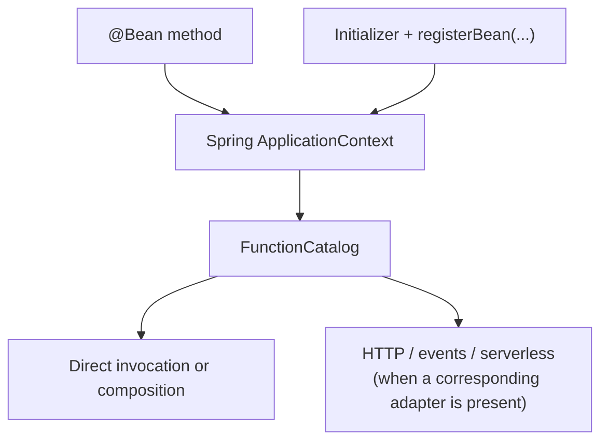

# Distinguishing `@Bean` from Functional-Style Bean Registration

## Objectives

After this lesson, you will be able to:

- Distinguish **writing business functions** using `Supplier`, `Function`, and `Consumer` from **registering those functions as Spring beans**.
- Register the same function for Spring Cloud Function in two ways: declaring a `@Bean` method and explicitly registering it with `GenericApplicationContext.registerBean(...)`.
- Explain why bean names, generic type information, and registration timing matter for `FunctionCatalog`, input/output data conversion, and adapters such as HTTP.
- Choose the appropriate registration approach for standard applications or applications that need to initialize beans in Java code.

## 1. Two Easily Confused Concepts

Spring Cloud Function lets you encapsulate business logic using three familiar Java interfaces:

| Interface | Role | Example |
| --- | --- | --- |
| `Supplier<O>` | Produces data without taking input parameters | Retrieve a list of orders to process |
| `Function<I, O>` | Takes input data and returns a result | Normalize an order code |
| `Consumer<I>` | Takes input data and performs an action without returning a result | Record an audit event |

These interfaces describe the **contract of the business function**. They do not dictate how Spring must create the bean.

Meanwhile, `@Bean` and **functional bean registration** are two mechanisms for adding objects into the `ApplicationContext`:

- **Declaring with `@Bean`:** Spring reads an annotated method in a configuration class and uses its return value to create the bean.
- **Functional-style registration:** Java code explicitly declares the bean using the container API, typically via `ApplicationContextInitializer<GenericApplicationContext>` and `context.registerBean(...)`.

A function of type `Function<String, String>` can be registered using **either approach**. Therefore, the word *functional* in the name of this registration style **does not mean** that simply using `java.util.function.Function` counts as functional bean registration.

When Spring Cloud Function is configured in an application, `FunctionCatalog` can discover matching `Supplier`, `Function`, and `Consumer` beans and wrap them to support lookup, data conversion, and function composition. The registration mechanism determines **how the bean appears in the context**; the catalog determines **how the function is accessed through Spring Cloud Function**.



## 2. First Approach: Declaring a Function with `@Bean`

Suppose the business requirement is to receive an externally supplied name, strip leading and trailing whitespace, and convert it to uppercase. The standard approach in a Spring Boot application with Spring Cloud Function is to create a bean of type `Function<String, String>`.

```java
import java.util.Locale;
import java.util.function.Function;

import org.springframework.boot.SpringApplication;
import org.springframework.boot.autoconfigure.SpringBootApplication;
import org.springframework.context.annotation.Bean;

@SpringBootApplication
public class BeanStyleApplication {

    public static void main(String[] args) {
        SpringApplication.run(BeanStyleApplication.class, args);
    }

    @Bean
    public Function<String, String> normalizeName() {
        return input -> input.trim().toUpperCase(Locale.ROOT);
    }
}
```

In this example:

1. `@SpringBootApplication` enables Spring Boot's standard configuration and bean discovery mechanisms.
2. The `normalizeName()` method is annotated with `@Bean`, so Spring creates a bean from the `Function` object returned by the method.
3. The default bean name is `normalizeName`, which is the method name. You can specify a different name with `@Bean("otherName")`.
4. The `Function<String, String>` signature appears directly in the method declaration. Spring Cloud Function has the information it needs to determine the input/output types for message conversion.

Passing `"  an  "` through the function produces `"AN"`. Using `Locale.ROOT` ensures the uppercase conversion rule does not depend on the default locale of the machine running the application.

The hallmark of `@Bean` is readable configuration that integrates naturally with `@Configuration`, conditional configuration, dependency injection, and standard Spring Boot tooling. This is usually the most convenient choice when the set of functions is known at coding time.

## 3. Second Approach: Registering a Bean in Java Code

Instead of defining a `@Bean` method, the application can create an `ApplicationContextInitializer` to register the bean definition into `GenericApplicationContext` **before the context is refreshed**.

The example below implements the exact same business logic as the previous section, but registers it with `registerBean(...)`:

```java
import java.util.Locale;
import java.util.function.Function;

import org.springframework.boot.SpringApplication;
import org.springframework.boot.autoconfigure.SpringBootApplication;
import org.springframework.context.ApplicationContextInitializer;
import org.springframework.context.support.GenericApplicationContext;

@SpringBootApplication
public class FunctionalStyleApplication {

    public static void main(String[] args) {
        SpringApplication application =
                new SpringApplication(FunctionalStyleApplication.class);

        application.addInitializers(
                (ApplicationContextInitializer<GenericApplicationContext>) context ->
                        context.registerBean(
                                "normalizeName",
                                NormalizeName.class,
                                NormalizeName::new));

        application.run(args);
    }

    static final class NormalizeName implements Function<String, String> {

        @Override
        public String apply(String input) {
            return input.trim().toUpperCase(Locale.ROOT);
        }
    }
}
```

Key observations:

- There is no `@Bean` method creating `normalizeName`. The bean is declared directly via `context.registerBean("normalizeName", NormalizeName.class, NormalizeName::new)`.
- `"normalizeName"` is the explicitly specified bean name; `NormalizeName.class` is the implementation class; `NormalizeName::new` supplies the instance when the container instantiates the bean.
- The `NormalizeName` class implements `Function<String, String>`, so the input/output type relationship is captured on the class itself rather than only in a lambda cast at registration time.
- The initializer runs during the context initialization phase, before refresh; as a result, the bean participates in Spring's managed lifecycle and is discovered by Spring Cloud Function during catalog configuration.

**Note on terminology:** this is Spring Framework/Boot's *functional bean registration*. The registered object itself is still a Java `Function` used by Spring Cloud Function. It does not force you to completely eliminate `@SpringBootApplication`, annotations, or all Spring Boot auto-configuration.

### Why Does the Example Use an Implementation Class Instead of a Raw-Typed Lambda?

You may come across a shorter registration form like this:

```java
context.registerBean(
        "normalizeName",
        Function.class,
        () -> (Function<String, String>)
                input -> input.trim().toUpperCase(Locale.ROOT));
```

This snippet registers a bean, but the `Function.class` argument is a **raw type**: the `<String, String>` information is not present in the `Class` passed to the container. Casting the lambda at compile time does not guarantee that the framework can infer the full input/output types at runtime.

This is especially important in Spring Cloud Function: when data arrives over HTTP or a messaging system, the framework may need to know the target type to convert the payload. For a function that only works with strings, missing metadata may not immediately expose an error; with JSON that needs to be mapped into a DTO, the risk of incorrect type conversion becomes much clearer.

There are two reliable ways to handle this:

1. Register a **concrete class** implementing `Function<I, O>`, such as `NormalizeName` above, so that generic metadata can be analyzed.
2. When you must register a lambda or dynamically generated/loaded function, use Spring Cloud Function's capability to declare **explicit function types**, typically through `FunctionRegistration` and the type metadata APIs appropriate for the framework version you are using.

`FunctionRegistration` is a helper class for **registering a function along with its name and type information for Spring Cloud Function**; it is not an alias for `GenericApplicationContext.registerBean(...)`. The two APIs can work together when building applications in a functional style, especially when a function's generic types cannot be inferred via reflection.

## 4. Direct Comparison

| Criterion | `@Bean` Declaration | Functional Registration with `registerBean` |
| --- | --- | --- |
| Where declared | A method inside a Spring configuration class | Java code calling `GenericApplicationContext` APIs |
| How bean is supplied | Return value from the `@Bean` method | Bean class and/or a `Supplier` that creates the bean |
| Configuration timing | Spring processes configuration declarations while building the context | Typically in an initializer, before context refresh |
| Naming | Defaults to the method name; can be changed via annotation | Specified via the `beanName` parameter |
| Generic metadata | Usually readable from the `@Bean` method signature | Depends on the class/bean definition type; requires care when using raw `Function.class` |
| Dependency injection | Uses `@Bean` method parameters or other DI mechanisms | Uses Spring DI or supplies dependencies at instantiation via the supplier |
| Bean lifecycle | Managed by Spring | Also managed by Spring when registered properly into the context |
| When suitable | Static Spring Boot configuration that is easy to read and maintain | Programmatic registration, conditional initialization, or a set of functions assembled at bootstrap |

**Both can produce beans for `FunctionCatalog`.** It is not true that `@Bean` is only for HTTP while `registerBean` is only for serverless. Support for HTTP, events, or serverless platforms is determined by the **configured adapter/runtime**, not by the bean registration syntax.

Another easily misunderstood difference: `registerBean` does not automatically make business functions run faster than `@Bean`. The two mechanisms primarily differ in how beans are declared and instantiated. If performance or startup time is a concern, measure it on your specific application and configuration rather than inferring it from the word *functional*.

## 5. What Does `FunctionCatalog` See?

Once the context is created with Spring Cloud Function auto-configuration, the `normalizeName` bean can be looked up through the catalog under **both registration approaches**:

```java
import java.util.function.Function;
import org.springframework.cloud.function.context.FunctionCatalog;

// catalog is obtained from the Spring ApplicationContext.
Function<String, String> function = catalog.lookup("normalizeName");
String result = function.apply("  an  "); // "AN"
```

The snippet above illustrates the caller code; the `catalog` variable must be injected or retrieved from `ApplicationContext` where used. The name `normalizeName` passed to `lookup` must match the name Spring Cloud Function publishes for the function.

Processing flow when an adapter is present:

```text
HTTP request / event payload
          |
          v
Adapter (if installed and configured)
          |
          v
FunctionCatalog.lookup("normalizeName")
          |
          v
Convert data to input type (if needed)
          |
          v
Function<String, String>.apply(...)
          |
          v
Result + output data conversion
```

If the application includes the **Spring Cloud Function Web adapter** and is running a compatible HTTP server, you can test the endpoint exposed by the adapter:

```bash
curl -X POST http://localhost:8080/normalizeName \
  -H 'Content-Type: text/plain' \
  --data-binary '  an  '
```

The expected result is `AN`. The command above only applies when you have added and configured an appropriate HTTP adapter; merely registering a bean or only adding Spring Cloud Function Context **does not automatically create an HTTP endpoint**.

Similarly, using the function in Spring Cloud Stream or a serverless environment requires the corresponding adapters/launchers. The idea of logic reuse lies in the fact that **the same function bean** can be exposed by the catalog to many different invocation protocols.

## 6. Common Pitfalls

### 6.1. Confusing the `Function` Type with Functional Registration

Writing `@Bean Function<String, String> ...` means you are **using a Java functional interface while registering it via annotation**. Only calling APIs such as `registerBean(...)` constitutes the functional-style bean registration discussed in this lesson.

### 6.2. Registering the Same Name in Two Places

If **the same application** has both a `@Bean normalizeName()` method and an initializer calling `registerBean("normalizeName", ...)`, you will hit a bean definition conflict or bean-overriding behavior depending on your configuration. The two example programs are **two independent options for comparison** and should not be merged as-is into a single context.

### 6.3. Losing `Function<I, O>` Metadata

Registering with `Function.class` without supplying proper type information can cause JSON-to-DTO conversion, message conversion, or return type resolution to behave incorrectly. For applications that rely on payload conversion, prefer a `@Bean` signature with full generics, a concrete implementation class, or `FunctionRegistration`'s type declaration mechanism.

### 6.4. Registering After the Context Has Finished Starting

Registering beans inside an initializer is a safe choice because it runs **before refresh**. If you add functions after the catalog and auto-configurations have initialized, do not assume every adapter and catalog will automatically update the same way they do at bootstrap.

### 6.5. Tests Forgetting to Include the Initializer in the Context

In the functional example, the initializer is added in `main`. A test that creates a Spring test context on its own might **not call `main`**, and therefore will not automatically apply that initializer. When writing integration tests, configure the initializer on the test context or extract it into a separate reusable class. Conversely, a unit test that only verifies the string transformation can call `new NormalizeName().apply(...)` directly without Spring.

## 7. Which Approach Should You Choose?

**Prefer `@Bean`** when the set of functions is relatively fixed, the application already uses Spring Boot in the standard way, and the team wants declarations that are easy to find, read, and test. This is a reasonable starting point for most `Supplier`, `Function`, and `Consumer` business capabilities.

**Choose functional registration** when the application needs to control bean declaration in Java code: for example, loading a set of functions at bootstrap, assembling module configurations under runtime conditions, or explicitly managing bean definitions. In that case, you must actively preserve function names, type metadata, and proper integration with the Spring lifecycle.

**Also use `FunctionRegistration` when you need** to explicitly publish a function's identity and data types to Spring Cloud Function, especially for lambdas without a generic signature that the framework can read directly. The exact API calls must be compatible with your project's Spring Cloud Function version.

## 8. Self-Check

1. Is a `@Bean` method returning `Consumer<OrderEvent>` an example of functional-style bean registration? **No**: `Consumer` is the business type; the registration mechanism is still `@Bean`.
2. Why can `registerBean("process", Function.class, supplier)` be less convenient than `registerBean("process", ProcessOrder.class, ProcessOrder::new)` if `ProcessOrder implements Function<Order, Receipt>`? **Because** the concrete implementation class exposes the `Order` and `Receipt` generic types, whereas `Function.class` does not carry those type arguments.
3. Does switching a bean from `@Bean` to `registerBean` automatically switch a feature from HTTP to Kafka? **No**: the protocol and invocation trigger depend on the adapter and integration configuration.
4. When should `registerBean` be called in the functional example? **In an initializer before context refresh**, so the bean participates properly in application initialization.

**Takeaway:** `Supplier`/`Function`/`Consumer` describe **what the function does**; `@Bean` or `registerBean` describes **how Spring receives the function**; `FunctionCatalog` together with adapters describes **how the application locates and invokes the function**.
