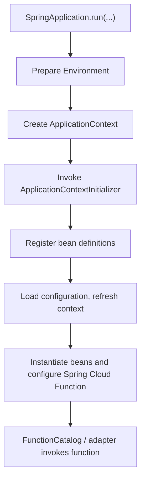

# `ApplicationContextInitializer` and `GenericApplicationContext` in Spring Cloud Function

## Lesson Objectives

In the **Bean Registration** chapter of Spring Cloud Function, `ApplicationContextInitializer` and `GenericApplicationContext` are two important tools when you want to bring business functions into Spring using Java code instead of only `@Bean` methods. After this lesson, you will be able to:

- Explain **when an initializer runs** during Spring Boot startup.
- Use `GenericApplicationContext.registerBean(...)` to register a `Function<I, O>` with a clear name and data types.
- Distinguish **bean definitions**, **bean factories**, **bean instances**, and **business functions**.
- Look up functions via `FunctionCatalog`; understand the conditions required for the same function to be invoked over HTTP, events, or a serverless environment.
- Troubleshoot common issues related to registration timing, generic types, bean names, dependency injection, and testing.

## 1. Roles of the Two APIs

### `ApplicationContextInitializer<C>`: Intervening in Context Creation

`ApplicationContextInitializer<C extends ConfigurableApplicationContext>` is a Spring interface with a single method:

```java
void initialize(C applicationContext);
```

Spring invokes the initializer **after creating and preparing the `ApplicationContext`, but before the context is refreshed (`refresh()`)**. Therefore, an initializer is well suited for preparing initial configuration or registering bean definitions that subsequent initialization steps will need.

In a Spring Boot application, the general sequence is:



The diagram shows the major milestones; several internal configuration steps take place during `refresh()`. The core point is: **the initializer gets an opportunity to register beans before the container finishes starting up**.

An initializer does not run automatically just because a class is named `...Initializer`. You must register it with the context creation process, such as via `SpringApplication.addInitializers(...)` or through the initializer configuration mechanism of your application or test environment.

### `GenericApplicationContext`: A Context with a Programmatic Bean Registration API

`GenericApplicationContext` is a Spring `ApplicationContext` implementation that allows registering bean definitions directly. For example:

```java
context.registerBean("normalizeName", NormalizeName.class, NormalizeName::new);
```

This call tells the container:

| Part | Meaning |
| --- | --- |
| `"normalizeName"` | The bean name, used for identification and lookup |
| `NormalizeName.class` | The bean class; lets Spring know the bean type |
| `NormalizeName::new` | A `Supplier<NormalizeName>` used to create the object when needed |
| `context` | The context responsible for storing the definition and managing the bean lifecycle |

**Calling `registerBean` does not mean the constructor has already run on that exact line.** The container stores the bean definition and creates the instance according to the Spring lifecycle: regular singletons are typically created during `refresh()`, while lazy or other-scoped beans may be created later.

Besides the overload taking a name and factory, `GenericApplicationContext` provides overloads such as `registerBean(Class<T>)`, `registerBean(String, Class<T>)`, and variants accepting `BeanDefinitionCustomizer` to customize metadata. Choose the overload based on your needs for naming, instance creation, scope, or lifecycle.

**Note the two kinds of `Supplier`:** in `registerBean(..., NormalizeName::new)`, the `Supplier` is a **bean creation factory**. In contrast, a Spring Cloud Function `Supplier<Order>` is a **business function that produces data**. Both use the `java.util.function.Supplier` interface, but they serve two different responsibilities.

## 2. Complete Example: Registering a `Function` from an Initializer

Suppose an application needs to normalize customer names: trim leading/trailing whitespace and convert to uppercase. The function must be usable in Spring Cloud Function via `FunctionCatalog`, so that an appropriate adapter can invoke it over HTTP or an event source later.

This example uses Spring Boot, Spring Cloud Function Context, and Java. Choose Spring Boot/Spring Cloud Function versions compatible with your project. If you want to expose an HTTP endpoint, you must add the **Spring Cloud Function Web adapter** and an appropriate web environment.

### Step 1 — Write the Standalone Business Function

File `NormalizeName.java`:

```java
package example.scf;

import java.util.Locale;
import java.util.function.Function;

public final class NormalizeName implements Function<String, String> {

    @Override
    public String apply(String input) {
        return input.trim().toUpperCase(Locale.ROOT);
    }
}
```

This class does not need `@Component` or `@Bean`. It can be unit-tested as plain Java. Explicitly implementing `Function<String, String>` also enables the framework to analyze the input and output types when the concrete class is registered.

### Step 2 — Create the Initializer and Register the Bean

File `FunctionBeansInitializer.java`:

```java
package example.scf;

import org.springframework.context.ApplicationContextInitializer;
import org.springframework.context.support.GenericApplicationContext;

public final class FunctionBeansInitializer
        implements ApplicationContextInitializer<GenericApplicationContext> {

    @Override
    public void initialize(GenericApplicationContext context) {
        context.registerBean(
                "normalizeName",
                NormalizeName.class,
                NormalizeName::new);
    }
}
```

In the code above, the initializer **registers a bean definition** named `normalizeName`. It does not call `new NormalizeName()` and hold a standalone instance outside Spring: the container itself uses the supplied factory and manages the created bean.

Declaring `GenericApplicationContext` as the initializer's type parameter requires the actual context to be compatible with that type. Standard default contexts in Spring Boot support this, though applications using a custom `ApplicationContextFactory` or custom context type should verify compatibility; avoid blind casts from `ConfigurableApplicationContext`.

### Step 3 — Attach the Initializer to `SpringApplication`

File `ScfApplication.java`:

```java
package example.scf;

import java.util.function.Function;

import org.springframework.boot.SpringApplication;
import org.springframework.boot.autoconfigure.SpringBootApplication;
import org.springframework.cloud.function.context.FunctionCatalog;
import org.springframework.context.ConfigurableApplicationContext;

@SpringBootApplication
public class ScfApplication {

    public static void main(String[] args) {
        SpringApplication application = new SpringApplication(ScfApplication.class);
        application.addInitializers(new FunctionBeansInitializer());

        ConfigurableApplicationContext context = application.run(args);
        FunctionCatalog catalog = context.getBean(FunctionCatalog.class);
        Function<String, String> normalize = catalog.lookup("normalizeName");

        if (normalize == null) {
            throw new IllegalStateException("normalizeName not found");
        }

        System.out.println(normalize.apply("  linh  ")); // LINH
    }
}
```

**Expected output:** `LINH`.

The example keeps the context active after `run()`, which is suitable for an HTTP service or a consumer that needs to stay running. For a quick test application without a web server, you can explicitly call `context.close()` once processing is done.

Note: `FunctionCatalog` comes from Spring Cloud Function. If an application only includes Spring Framework or lacks the required Spring Cloud Function configuration, `context.getBean(FunctionCatalog.class)` will find no bean to retrieve. `GenericApplicationContext.registerBean` by itself is purely a Spring Framework operation.

## 3. Bean Definition vs. Instance: What Actually Happens?

Revisit this line:

```java
context.registerBean("normalizeName", NormalizeName.class, NormalizeName::new);
```

At the moment `initialize(...)` runs, Spring can know the **bean's name, class, and creation method** without needing to instantiate `NormalizeName` yet. During `refresh()`, the container processes bean definitions, applies Spring mechanisms, and creates instances according to scope/lazy settings.

```text
initialize(context)
    |
    +-- registerBean("normalizeName", NormalizeName.class, factory)
            |
            +-- Bean definition recorded
                    |
                    v
             context.refresh()
                    |
                    +-- Spring creates instance when needed
                    +-- Lifecycle management / post-processing
                    +-- FunctionCatalog detects matching function
                    |
                    v
             catalog.lookup("normalizeName")
```

Distinguish easily confused operations:

| Operation | Result |
| --- | --- |
| `registerBean(...)` | Registers a Spring-managed **bean definition** |
| `new NormalizeName()` | Creates a plain Java object, which is not yet in the context on its own |
| `context.getBean("normalizeName")` | Retrieves the context-managed bean instance |
| `catalog.lookup("normalizeName")` | Retrieves the function via Spring Cloud Function's `FunctionCatalog`; may include the catalog's wrapping/conversion mechanisms |

`registerBean` does not inherently disable dependency injection, bean lifecycle callbacks, or `BeanPostProcessor` processing. However, if the factory you provide **calls the constructor directly**, the factory itself must pass any essential dependencies that the constructor requires.

## 4. Conditional Registration and Dependency Injection via Factory

### Selecting Beans Using Configuration Before Refresh

An initializer can use the `Environment` already prepared by Spring Boot to decide whether to register a bean:

```java
@Override
public void initialize(GenericApplicationContext context) {
    boolean enabled = context.getEnvironment()
            .getProperty("app.normalize.enabled", Boolean.class, true);

    if (enabled) {
        context.registerBean(
                "normalizeName",
                NormalizeName.class,
                NormalizeName::new);
    }
}
```

If the property `app.normalize.enabled=false` is present in `Environment` at the time the initializer runs, the bean is not registered. This is a **condition explicitly checked in Java code**; do not assume that annotations like `@ConditionalOnProperty` on an arbitrary class will be processed automatically when calling `registerBean` with that class.

Because the initializer runs early, rely only on configuration sources **already present in `Environment` at that stage**. Configuration introduced later during bean processing may not yet be available.

### Creating a Function That Depends on a Spring Service

A business function may need a service bean:

```java
public final class PriceFunction implements
        java.util.function.Function<Order, Quote> {

    private final PriceService priceService;

    public PriceFunction(PriceService priceService) {
        this.priceService = priceService;
    }

    @Override
    public Quote apply(Order order) {
        return priceService.quote(order);
    }
}
```

Assuming `Order`, `Quote`, and `PriceService` are defined in the application and `PriceService` will be a Spring bean, the initializer can register it like this:

```java
context.registerBean(
        "price",
        PriceFunction.class,
        () -> new PriceFunction(context.getBean(PriceService.class)));
```

The factory lambda `() -> ...` is invoked **when Spring actually creates the `price` bean**, typically during `refresh` for a non-lazy singleton. This differs from calling `context.getBean(PriceService.class)` **directly inside the body of `initialize(...)`**, when many of the application's bean definitions may not yet be loaded or ready.

You do not need a factory if Spring can automatically select and invoke the appropriate constructor from the bean definition; however, an explicit factory is useful when object creation logic is controlled by the application.

## 5. Connecting to `FunctionCatalog` and Protocols

Spring Cloud Function models business functions around three interfaces:

| Interface | Meaning for the catalog |
| --- | --- |
| `Supplier<O>` | Data source |
| `Function<I, O>` | Processes input data and produces a result |
| `Consumer<I>` | Receives data and performs an action |

When these functions are beans in the application context with appropriate Spring Cloud Function configuration, `FunctionCatalog` can look them up by name. Whether the bean was added via `@Bean` or `registerBean(...)`, the function's business contract stays the same.

```java
Function<String, String> fn = catalog.lookup("normalizeName");
String output = fn.apply("  linh  "); // LINH
```

If the **Spring Cloud Function Web adapter** is installed, a web application can receive HTTP requests and route them to the exposed function. For example, with the default endpoint matching the function name in a standard web setup:

```bash
curl -X POST http://localhost:8080/normalizeName \
  -H 'Content-Type: text/plain' \
  --data-binary '  linh  '
```

Expected output: `LINH`. This command requires the web adapter, a running HTTP server, appropriate endpoint mapping, and not closing the context immediately after `run()`. **Merely calling `registerBean` does not open an HTTP port.**

Similarly, events from a message broker or serverless platform require the corresponding adapters/launchers. The benefit of Spring Cloud Function is keeping the `Function` logic decoupled from the invocation trigger, allowing the same function to be reused across different environments.

### Preserving Generic Metadata for Message Conversion

This registration example:

```java
context.registerBean(
        "normalizeName",
        NormalizeName.class,
        NormalizeName::new);
```

allows Spring to see `NormalizeName implements Function<String, String>`. Conversely, writing:

```java
context.registerBean(
        "normalizeName",
        java.util.function.Function.class,
        () -> (java.util.function.Function<String, String>)
                text -> text.trim().toUpperCase(java.util.Locale.ROOT));
```

registers with `Function.class` as a **raw type**, which does not expose `<String, String>` in the class passed to the container. When handling JSON → DTO, missing input/output metadata can cause message conversion errors.

Therefore, prefer **an implementation class with explicit generics**, or supply explicit type metadata using a mechanism supported by your Spring Cloud Function version, such as `FunctionRegistration` where appropriate. `FunctionRegistration` is used to declare a function's name and types to Spring Cloud Function, whereas `GenericApplicationContext.registerBean` is Spring Framework's API for registering bean definitions.

## 6. Testing an Initializer

### Unit Testing Bean Registration Directly

You do not need to start all of Spring Boot to test a simple initializer. With JUnit 5 and Spring Context:

```java
import static org.junit.jupiter.api.Assertions.assertEquals;
import static org.junit.jupiter.api.Assertions.assertTrue;

import java.util.function.Function;
import org.junit.jupiter.api.Test;
import org.springframework.context.support.GenericApplicationContext;

class FunctionBeansInitializerTest {

    @Test
    void registersNormalizeName() {
        try (GenericApplicationContext context = new GenericApplicationContext()) {
            new FunctionBeansInitializer().initialize(context);

            assertTrue(context.containsBeanDefinition("normalizeName"));

            context.refresh();

            @SuppressWarnings("unchecked")
            Function<String, String> fn =
                    (Function<String, String>) context.getBean("normalizeName");

            assertEquals("LINH", fn.apply("  linh  "));
        }
    }
}
```

At this test level, `getBean(...)` confirms the bean exists and works in the Spring Context; it **does not prove** that `FunctionCatalog` has been auto-configured or that the HTTP adapter is working.

### Integration Testing with Spring Cloud Function

In a Spring Boot integration test, make sure the initializer is actually applied to the test context:

```java
import static org.junit.jupiter.api.Assertions.assertEquals;

import java.util.function.Function;
import org.junit.jupiter.api.Test;
import org.springframework.beans.factory.annotation.Autowired;
import org.springframework.boot.test.context.SpringBootTest;
import org.springframework.cloud.function.context.FunctionCatalog;
import org.springframework.test.context.ContextConfiguration;

@SpringBootTest
@ContextConfiguration(initializers = FunctionBeansInitializer.class)
class FunctionCatalogIntegrationTest {

    @Autowired
    FunctionCatalog catalog;

    @Test
    void exposesFunctionThroughCatalog() {
        Function<String, String> fn = catalog.lookup("normalizeName");
        assertEquals("LINH", fn.apply("  linh  "));
    }
}
```

This test requires Spring Boot Test, JUnit 5, and the corresponding Spring Cloud Function Context/auto-configuration dependencies. The `@ContextConfiguration(initializers = ...)` annotation matters because `@SpringBootTest` normally builds the test context directly and **does not run the `main` method** where the earlier example called `addInitializers`.

## 7. Common Errors and How to Fix Them

| Symptom | Possible Cause | How to Check/Fix |
| --- | --- | --- |
| `NoSuchBeanDefinitionException` for `normalizeName` | The initializer was not attached to context creation | Check `addInitializers` or the initializer in test config |
| `catalog.lookup("normalizeName")` cannot find the function | Wrong name, function registered too late, or missing Spring Cloud Function config | Compare bean names; register before refresh; verify dependencies |
| Bean name conflict | The same name registered via both `@Bean` and `registerBean`, or by two initializers | Use unique names, avoid duplicate registration, and do not rely on overriding |
| `ClassCastException` in the initializer | The actual `ApplicationContext` type does not match the generic/cast used | Check the context factory and initializer type |
| `getBean(...)` fails inside `initialize(...)` | Context not refreshed yet; bean definition not loaded or ready | Register a factory and let Spring resolve dependencies when creating the bean |
| JSON-to-DTO conversion fails | Input/output generics not recognized when using raw `Function.class` | Use a class implementing `Function<I, O>` or explicit type metadata |
| HTTP returns 404 even though the bean exists | Missing web adapter or mismatched endpoint mapping | Check adapter, server, route, and exposed functions configuration |
| Unit test passes but integration test does not see the function | Test context does not receive an initializer attached only in `main` | Declare the initializer in `@ContextConfiguration` or shared bootstrap config |

**Do not register a new function after the context and catalog have finished initializing and expect adapters to discover it automatically.** Registering in an initializer before refresh is the standard way to ensure the bean is present while the catalog is being set up.

## 8. When Should You Use This Approach?

Use `ApplicationContextInitializer` combined with `GenericApplicationContext` when you want to **select or construct beans programmatically at startup**—for example, configuring a set of functions per deployment environment, enabling/disabling feature groups based on startup properties, or explicitly controlling function names and factories.

If an application only has a few fixed business functions, `@Bean` methods are usually easier to read and maintain. With Spring Cloud Function, **both approaches can produce `Supplier`, `Function`, and `Consumer` beans for the catalog**; the choice depends on configuration and lifecycle needs, not on whether the application invokes functions via HTTP, events, or serverless.

## 9. Self-Check Questions

1. **Why is calling `registerBean` inside an initializer better when the catalog needs to recognize the function at startup?** Because the initializer runs before `refresh()`, so the bean definition is present when Spring Cloud Function sets up the catalog.
2. **Is `Supplier<NormalizeName>` in `registerBean` a business `Supplier<O>` in Spring Cloud Function?** No. It creates the bean instance; a business `Supplier<O>` produces data when the function is invoked.
3. **Does calling `registerBean("normalizeName", NormalizeName.class, ...)` already make an HTTP endpoint work?** Not yet. You also need the Spring Cloud Function Web adapter and the corresponding web environment/configuration.
4. **Why keep `NormalizeName implements Function<String, String>` instead of registering raw `Function.class`?** Because generic type metadata enables the catalog and adapters to convert payloads to the right types.
5. **Why might `@SpringBootTest` not see an initializer added in `main`?** Because Spring Test builds the context on its own and may not invoke `main`; you must register the initializer on the test context.

**Summary of relationships:** `ApplicationContextInitializer` defines **when and where to prepare bean definitions**; `GenericApplicationContext` provides the API to **register beans in code**; Spring Cloud Function's `FunctionCatalog` provides the way to **locate and invoke business functions** once Spring has initialized the context.
